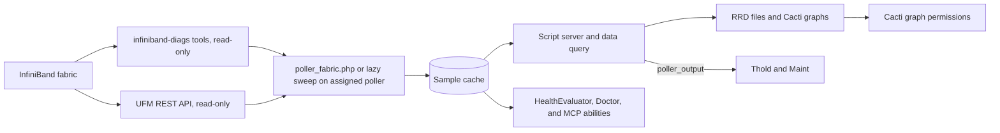

<!-- translations:start -->
[English](README.md) | [简体中文](docs/i18n/zh-CN/README.md) | [हिन्दी](docs/i18n/hi-IN/README.md) | [Español (España)](docs/i18n/es-ES/README.md) | [Español (Latinoamérica)](docs/i18n/es-419/README.md) | [العربية (السعودية)](docs/i18n/ar-SA/README.md) | [Afrikaans](docs/i18n/af-ZA/README.md) | [አማርኛ](docs/i18n/am-ET/README.md) | [العربية (مصر)](docs/i18n/ar-EG/README.md) | [العربية (المغرب)](docs/i18n/ar-MA/README.md) | [Български](docs/i18n/bg-BG/README.md) | [বাংলা](docs/i18n/bn-BD/README.md) | [Bosanski](docs/i18n/bs-BA/README.md) | [Deutsch](docs/i18n/de-DE/README.md) | [Ελληνικά](docs/i18n/el-GR/README.md) | [فارسی](docs/i18n/fa-IR/README.md) | [Filipino](docs/i18n/fil-PH/README.md) | [Français](docs/i18n/fr-FR/README.md) | [Français (Maroc)](docs/i18n/fr-MA/README.md) | [Français (Sénégal)](docs/i18n/fr-SN/README.md) | [Hausa](docs/i18n/ha-NG/README.md) | [עברית](docs/i18n/he-IL/README.md) | [Hrvatski](docs/i18n/hr-HR/README.md) | [Bahasa Indonesia](docs/i18n/id-ID/README.md) | [Igbo](docs/i18n/ig-NG/README.md) | [Italiano](docs/i18n/it-IT/README.md) | [日本語](docs/i18n/ja-JP/README.md) | [ქართული](docs/i18n/ka-GE/README.md) | [한국어](docs/i18n/ko-KR/README.md) | [Latviešu](docs/i18n/lv-LV/README.md) | [Malagasy](docs/i18n/mg-MG/README.md) | [मराठी](docs/i18n/mr-IN/README.md) | [Bahasa Melayu](docs/i18n/ms-MY/README.md) | [Nederlands](docs/i18n/nl-NL/README.md) | [Polski](docs/i18n/pl-PL/README.md) | [Português (Brasil)](docs/i18n/pt-BR/README.md) | [Português (Portugal)](docs/i18n/pt-PT/README.md) | [Русский](docs/i18n/ru-RU/README.md) | [Kinyarwanda](docs/i18n/rw-RW/README.md) | [Soomaali](docs/i18n/so-SO/README.md) | [Српски](docs/i18n/sr-RS/README.md) | [Svenska](docs/i18n/sv-SE/README.md) | [Kiswahili](docs/i18n/sw-KE/README.md) | [தமிழ்](docs/i18n/ta-IN/README.md) | [తెలుగు](docs/i18n/te-IN/README.md) | [ไทย](docs/i18n/th-TH/README.md) | [Türkçe](docs/i18n/tr-TR/README.md) | [Українська](docs/i18n/uk-UA/README.md) | [اردو](docs/i18n/ur-PK/README.md) | [Tiếng Việt](docs/i18n/vi-VN/README.md) | [isiXhosa](docs/i18n/xh-ZA/README.md) | [Yorùbá](docs/i18n/yo-NG/README.md) | [繁體中文](docs/i18n/zh-TW/README.md) | [isiZulu](docs/i18n/zu-ZA/README.md)
<!-- translations:end -->

# plugin_fabric

A Cacti 1.2 plugin (`fabric`, version `0.1.0-dev`) that brings InfiniBand port counters, link width and speed, and congestion indicators into Cacti as ordinary devices, data sources, and graphs. A link that trained at 1X instead of 4X then shows up as a graph and a Thold alert next to the host it serves, under Cacti's permissions, with Maint awareness and suppression.

> **Status: in development, no release yet.** This branch implements the plugin foundation, Cacti objects and alerting, scheduled background poller sweeps, remote collector replication, a read-only NVIDIA UFM REST backend with an encrypted credential vault, Configuration-as-Code (CasC) CLI management, and Cacti ecosystem hooks (CasC, Doctor, and MCP / Abilities API v2). It has been tested against fake tools, synthetic UFM transports, and the `ibsim` fabric simulator (rdma-core 50.0), never on a physical InfiniBand fabric or live UFM server. Checks that require hardware remain open in [docs/research/](docs/research/). This project is not affiliated with the Cacti project.

## What is implemented

- **Lifecycle and schema (v3)**: install, idempotent upgrade, uninstall (keeping plugin tables by default), and a PHP 8.2 requirement guard while keeping entry points parseable on PHP 8.0.
- **Access roles and pages**: `Fabric View` (`fabric.php`), `Fabric Operator` (`fabric_operator.php`), and `Fabric Admin` (`fabric_admin.php`, `fabric_health.php`) realms, plus a Settings tab under **Configuration > Settings > Fabrics**.
- **Read-only diagnostics backend (`diags`)**: strict argument-vector execution of `perfquery`, `ibnetdiscover`, and `iblinkinfo`, GUID-keyed inventory with identity-conflict detection and re-link proposals, link-state evaluation, and per-node counter sweeps.
- **Read-only NVIDIA UFM REST backend (`ufm`) and encrypted vault**: GET-only allowlisted REST client (`/ufmRest/resources/ports`, `/ufmRest/resources/systems`, `/ufmRest/monitoring/session/0/data`, and `/ufmRestV3/...` equivalents for token auth) feeding the same inventory, link-state, sample, and health tables as `diags`. Credentials (`token` or `basic`) are stored encrypted with AES-256-GCM in `plugin_fabric_secret` using an external 256-bit keyfile configured by `fabric_vault_key_file`. UFM fabrics can be defined through CasC (`cli/fabric.php`) or the repositories; the web admin form currently exposes `diags` fields.
- **Cacti objects, Thold, and Maint**: Cacti device, data, and graph templates (`templates/fabric-templates.xml`), the "Fabric Port" script-server data query (`scripts/ss_fabric_ports.php`, `resource/script_server/fabric_ports.xml`), `DERIVE` counter data sources and `GAUGE` link-state/rate data sources for Thold, discontinuity tracking, and saturated basic counters reported as `U`. Maint integration (`MaintMaintenance`) queries `plugin_maint_check_cacti_host()` (falling back to the `is_device_in_maintenance` hook) so nodes in active maintenance are counted separately and excluded from failed-sweep and degraded-port health warnings.
- **Scheduled sweeps, sharding, and remote collectors**: `poller_bottom` launches `poller_fabric.php` in the background for due fabrics assigned to the current poller, alongside lazy sweeps triggered by the script server. `INFO` declares `remote_collect:1, remote_poller:1`, `poller_fabric.php` supports deterministic GUID sharding (`--shard=K/N`), and `replicate_out` replicates non-secret `plugin_fabric_fabric` rows to remote collectors (`poller_id >= 2`). Vault entries (`plugin_fabric_secret`) and external keyfiles are never replicated.
- **CasC CLI and ecosystem hooks**: `cli/fabric.php` for YAML/XML export, validation, dry-run diff planning, confirmation-gated apply, and health reporting, plus `casc_register_providers`, `doctor_register_checks`, and `abilities_register` hooks.

## Access roles

| Realm | Access |
| --- | --- |
| Fabric View | Monitoring inventory and port views (`fabric.php`). |
| Fabric Operator | View access plus the Operations page (`fabric_operator.php`) and personal triage acknowledgments. |
| Fabric Admin | Operator access plus configuration, administrative actions (`fabric_admin.php`), and the health page (`fabric_health.php`). |

After copying upgrade files, open the Plugins page as an administrator to register new realms and hooks. Assign the Operator realm explicitly under **Configuration > Users** or user groups. Upgrades retain existing View and Admin realm IDs and grants. Admin access inherits Operator access, and Operator access inherits View access on each request; this does not add stored grants to users or groups. Plugin settings also require Fabric Admin access in addition to Cacti's Settings permission.

Cacti device permissions limit the rows and actions available to each user; unmapped objects require an administrator. Credentials, configuration, mapping, deletion, and other administrative changes remain in the administrative pages or CLI. Acknowledgments last only in the current user's session, for at most one hour and only while the same observation remains fresh. New or changed observations invalidate them. They never mark a failed measurement healthy or suppress alerts.

## Why

A degraded InfiniBand link still passes traffic. A 4X link that retrains at 1X leaves the port "active", and the host's SNMP interface graphs look normal, but tightly coupled jobs slow down. The evidence is in the fabric: each port reports its active, enabled, and supported width and speed, plus error and congestion counters. Reading it takes the InfiniBand diagnostic tools or a fabric manager API. Run by hand, they leave three gaps:

- **No history.** `perfquery` and `iblinkinfo` show the present, so a link that degraded last week is invisible.
- **No device context.** Fabric ports are not Cacti objects, so a port cannot be graphed beside the host it feeds.
- **No path into Cacti alerting.** Thold and Maint work on Cacti data sources and devices.

The plugin closes these gaps by reading the fabric through `infiniband-diags` or the NVIDIA UFM REST API, identifying nodes and ports by GUID, and publishing counters and link state as Cacti data sources. It reads only: it never resets counters or changes port state.

## Operations and CLI

### Background poller and manual sweeps

`fabric_poller_bottom()` starts `poller_fabric.php` in the background on each poller for enabled fabrics assigned to that `poller_id` whose sweep is due. You can also run the poller runner or a manual sweep directly on the assigned poller as the poller user (replacing `/path/to/cacti` with your Cacti directory):

```sh
php /path/to/cacti/plugins/fabric/poller_fabric.php [--fabric=ID] [--shard=K/N] [--force] [--debug]
php /path/to/cacti/plugins/fabric/fabric_sweep.php --fabric=ID [--node=GUID] [--force]
```

- `poller_fabric.php` runs all due fabrics for the local poller (or one fabric with `--fabric=ID`), enforces Cacti's process registry lock and `ClaimRepository` leases with a time budget of `max(30, intdiv(sweep_interval, 2))` seconds, and supports `--shard=K/N` (`0 <= K < N`) to shard `diags` node counter sweeps deterministically by node GUID.
- `fabric_sweep.php` runs an on-demand sweep of one enabled fabric (or one node with `--node=GUID`) assigned to the local poller. `--force` ignores whether the fabric is due while still honoring claims.

After first discovery fills the inventory, map nodes to Cacti devices on the Fabric Admin page. Keep Cacti's script timeout at 25 seconds or higher: a lazy sweep started by a data-query read limits tool execution to `script_timeout - 5` seconds so the script server returns in time with the last stored sample or `U`.

### NVIDIA UFM REST backend and credential vault

A `ufm` fabric requires an `https://` URL without embedded credentials, query strings, or fragments. `UfmSocketTransport` enforces TLS peer and hostname verification, rejects redirects, and supports an optional CA bundle (`ufm_ca_file`) and SHA-256 SPKI pin (`ufm_spki_pin`).

To store UFM credentials in `plugin_fabric_secret`, configure `fabric_vault_key_file` under **Configuration > Settings > Fabrics** with an absolute path to a regular file owned by the poller user (no symlinks in any parent directory, mode `0600`, holding 64 hex characters such as `openssl rand -hex 32` or 32 random non-printable bytes). The plugin never creates or writes the keyfile, and `replicate_out` never replicates `plugin_fabric_secret` or keyfiles to remote pollers.

### Configuration-as-Code and health CLI

`cli/fabric.php` manages plugin settings and fabric definitions declaratively in YAML or XML, and reports maintenance-aware health without running live sweeps:

```sh
php /path/to/cacti/plugins/fabric/cli/fabric.php export [--format=yaml|xml] [--file=PATH]
php /path/to/cacti/plugins/fabric/cli/fabric.php validate --file=PATH [--format=yaml|xml]
php /path/to/cacti/plugins/fabric/cli/fabric.php plan --file=PATH [--format=yaml|xml]
php /path/to/cacti/plugins/fabric/cli/fabric.php apply --file=PATH --confirm=PLAN_HASH [--format=yaml|xml]
php /path/to/cacti/plugins/fabric/cli/fabric.php health [--format=text|json]
```

`export` creates new files with mode `0600`, redacts `fabric_vault_key_file` as `[REDACTED]`, and emits named `ufm_credential_ref` references rather than secrets. `plan` and `apply` reject inline `ufm_token`, `ufm_password`, `secret`, and inline `fabric_vault_key_file` values. `apply` requires the exact `--confirm=PLAN_HASH` produced by `plan`.

### Ecosystem hooks

When the corresponding Cacti plugins or host integrations are present, `setup.php` registers:

- `casc_register_providers`: exports, validates, plans, and confirmation-applies `fabric` configuration (`yaml` and `xml`, schema v1) with secret redaction.
- `doctor_register_checks`: provides four read-only diagnostic checks (`fabric.schema`, `fabric.poller_freshness`, `fabric.identity_conflicts`, `fabric.ufm_vault`).
- `abilities_register`: registers three read-only, non-destructive, idempotent abilities under category `fabric`, gated by the Fabric View realm (and Cacti device permissions for port errors): `fabric-list-fabrics`, `fabric-get-health`, and `fabric-list-port-errors`.

## Scope and boundaries

Out of scope: changing fabric state, resetting counters, replacing a fabric manager or subnet manager, a plugin-owned alerting engine, a custom daemon or network protocol, and Ethernet or RoCE fabrics.

## Requirements and compatibility

| Component | Target |
|---|---|
| Cacti | 1.2.31 or later (`compat = 1.2.31`), no core patches |
| PHP | 8.2 or later; entry points stay parseable on 8.0 and refuse activation on 8.1 so an unsupported runtime gets a refusal instead of a broken Cacti UI |
| InfiniBand tools | `infiniband-diags` from `rdma-core` (tested in CI with rdma-core 50.0 under `ibsim`; output formats checked against v66.0 source) |
| UFM | NVIDIA UFM Enterprise REST API (`ufmRest` and `ufmRestV3` read-only endpoints; tested against synthetic transports in unit tests) |
| Thold, Maint | No changes required; CI runs an end-to-end test with unchanged Thold v1.8.2 and Maint v1.3 |

## Development and testing

The CI workflow (`.github/workflows/plugin-ci-workflow.yml`) tests PHP 8.2 through 8.5 against Cacti `release/1.2.31` and `1.2.x`, PHP 8.0 entry-point linting, PHP 8.1 refusal, PHPStan, gettext/translation verification, REUSE licensing, workflow linting, Thold/Maint end-to-end replay, and `ibsim` fabric simulation.

With Cacti's locked shared Pest plugin harness (`CACTI_PEST_BIN`) and a disposable Cacti database:

```sh
# Unit tests
"$CACTI_PEST_BIN" --configuration=phpunit.xml

# Lifecycle integration tests (disposable database only)
CACTI_PATH=/path/to/cacti FABRIC_TEST_DATABASE=disposable "$CACTI_PEST_BIN" --configuration=phpunit-integration.xml

# Static analysis (against Cacti 1.2.31)
CACTI_PATH=/path/to/cacti phpstan analyse -c phpstan.neon --no-progress

# Translation template, catalogs, and localized README checks
sh locales/build_gettext.sh --check

# Simulated ibsim fixture parser check
php tests/bin/check-ibsim-fixtures.php tests/fixtures/ibsim
```

## Design

- [docs/PLAN.md](docs/PLAN.md) is the architecture and design plan: upstream facts with sources, open hardware checks, identity model, counter and link-state rules, security boundaries, performance arithmetic, testing, and risks.
- [docs/decisions/](docs/decisions/) holds architecture decision records.
- [docs/REQUIREMENTS.md](docs/REQUIREMENTS.md) maps every requirement ID to its issue.



## How work is tracked

- **Milestones** follow the plan's milestones. Each has an epic issue listing its sub-issues and exit evidence.
- **Issues** are typed by label: `type: requirement`, `type: research`, `type: decision`, `type: epic`. Requirement issues state numbered, testable requirements (`REQ-AREA-NNN`) and acceptance criteria.
- **Labels** also carry `area:`, `phase:`, `priority:`, and `status:`. See [CONTRIBUTING.md](CONTRIBUTING.md#labels).
- The [project board](https://github.com/users/somethingwithproof/projects/8) shows all issues across milestones.

## Contributing

Read [CONTRIBUTING.md](CONTRIBUTING.md). Commits need a DCO sign-off (`git commit -s`). Design discussion happens on issues; open decisions carry the `type: decision` label.

## Security

Report vulnerabilities privately; see [SECURITY.md](SECURITY.md).

## License

GNU General Public License v2.0, the same license as Cacti and its plugins. See [LICENSE](LICENSE).
