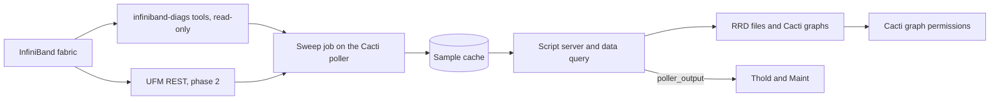

# plugin_fabric

A proposed Cacti 1.2 plugin that brings InfiniBand port counters, link width and speed, and congestion indicators into Cacti as ordinary devices, data sources, and graphs. A link that trained at 1X instead of 4X then shows up as a graph and a Thold alert next to the host it serves, under Cacti's permissions, with Maint able to suppress it.

> **Status: proposal.** This repository contains no plugin code yet. It holds the design, its decision records, and the requirements tracked as issues and milestones. Nothing below describes shipped behavior.

## Why

A degraded InfiniBand link still passes traffic. A 4X link that retrains at 1X leaves the port "active", and the host's SNMP interface graphs look normal, but tightly coupled jobs slow down. The evidence is in the fabric: each port reports its active, enabled, and supported width and speed, plus error and congestion counters. Reading it takes the InfiniBand diagnostic tools or a fabric manager API. Run by hand, they leave three gaps:

- **No history.** `perfquery` and `iblinkinfo` show the present, so a link that degraded last week is invisible.
- **No device context.** Fabric ports are not Cacti objects, so a port cannot be graphed beside the host it feeds.
- **No path into Cacti alerting.** Thold and Maint work on Cacti data sources and devices.

The plugin closes these gaps by reading the fabric through its own diagnostic tools (and later through UFM), identifying nodes and ports by GUID, and publishing counters and link state as Cacti data sources. It reads only: it never resets counters or changes port state.

## Planned scope

| Phase | Scope | Milestones |
|---|---|---|
| 0, research | Version matrix, upstream behavior confirmation, counter behavior on hardware, privilege model, MAD budget, UFM API | [M1](https://github.com/somethingwithproof/plugin_fabric/milestone/1) |
| 1, observe | Inventory by GUID, Cacti devices, port data query, counter and link-state data sources, Thold alerting, Maint suppression, health page | [M2](https://github.com/somethingwithproof/plugin_fabric/milestone/2), [M3](https://github.com/somethingwithproof/plugin_fabric/milestone/3), [M4](https://github.com/somethingwithproof/plugin_fabric/milestone/4) |
| 2, UFM | Read-only UFM REST backend, credential handling, identity continuity between backends | [M5](https://github.com/somethingwithproof/plugin_fabric/milestone/5) |
| 3, remote | Remote data collectors, replication, `remote_agent` actions, sharded sweeps for large fabrics | [M6](https://github.com/somethingwithproof/plugin_fabric/milestone/6) |

Out of scope: changing fabric state, replacing a fabric manager or subnet manager, a plugin-owned alerting engine, a custom daemon or network protocol, and Ethernet or RoCE fabrics (research).

## Compatibility targets

| Component | Target |
|---|---|
| Cacti | 1.2.31 or later, no core patches |
| PHP | 8.2 or later; `setup.php` stays parseable on 8.0 so an unsupported runtime gets a refusal instead of a broken Cacti UI |
| InfiniBand tools | infiniband-diags from rdma-core; design checked against v65.1, version matrix is a milestone 1 deliverable |
| UFM | UFM Enterprise REST API, phase 2; release matrix is a milestone 1 deliverable |
| Thold, Maint | No changes required |

## Design

- [docs/PLAN.md](docs/PLAN.md) is the full plan: architecture, upstream facts it depends on (with sources) and assumptions still to confirm, identity model, counter and link-state rules, security boundaries, performance arithmetic, testing, and risks.
- [docs/decisions/](docs/decisions/) holds architecture decision records for choices already made.
- [docs/REQUIREMENTS.md](docs/REQUIREMENTS.md) maps every requirement ID to its issue.

## How work is tracked

- **Milestones** follow the plan's milestones. Each has an epic issue listing its sub-issues and exit evidence.
- **Issues** are typed by label: `type: requirement`, `type: research`, `type: decision`, `type: epic`. Requirement issues state numbered, testable requirements (`REQ-AREA-NNN`) and acceptance criteria.
- **Labels** also carry `area:`, `phase:`, `priority:`, and `status:`. See [CONTRIBUTING.md](CONTRIBUTING.md#labels).
- The [project board](https://github.com/users/somethingwithproof/projects/8) shows all issues across milestones.

## Contributing

Read [CONTRIBUTING.md](CONTRIBUTING.md). Commits need a DCO sign-off. Design discussion happens on issues; open decisions carry the `type: decision` label.

## Security

Report vulnerabilities privately; see [SECURITY.md](SECURITY.md).

## License

GNU General Public License v2.0, the same license as Cacti and its plugins. See [LICENSE](LICENSE).
