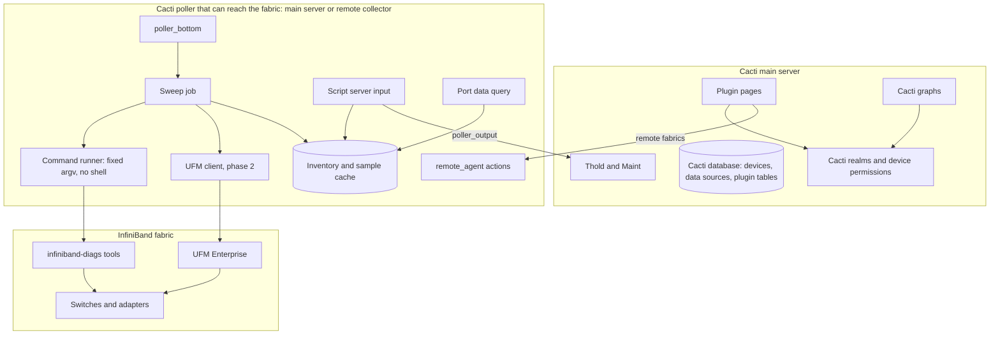

# Cacti 1.2 InfiniBand Fabric Plugin Plan

Status: in development, plan revision 2 (2026-11-15). Nothing described here as a plugin capability is published yet. Statements about infiniband-diags, UFM, the Linux kernel, RRDtool, Cacti core, and Thold describe upstream behavior and cite the file or page that was checked. Revision 2 incorporates the documentation and source research of milestone 1 ([docs/research](research/)); everything that needs a fabric, a UFM instance, or an account is marked *live* and listed in [Live checks](#live-checks), so milestone 1 is not complete until those run. Anything still unchecked is listed under [Assumptions to confirm](#assumptions-to-confirm). Owner is not assigned; estimates are in [Estimates](#estimates).

`plugin_fabric` brings InfiniBand port counters, link width and speed, and congestion indicators into Cacti 1.2 as ordinary devices, data sources, and graphs, so operators see fabric health next to the hosts and switches it belongs to, under Cacti's own permissions, and alert on it with Thold and Maint.

## Why this plugin

A link that trained at 1X instead of 4X still passes traffic. Message-passing jobs that were tuned for the full link slow down, and nothing in an SNMP interface graph shows why, because the InfiniBand port state is "active" and the interface counters of the host look normal. The information is in the fabric: each port reports its active, enabled, and supported link width and speed, and a set of error and congestion counters. Reading it needs the InfiniBand management tools or a fabric manager API, not SNMP.

Running those tools by hand or from scripts leaves gaps:

1. **No history.** `perfquery` and `iblinkinfo` report the present. A link that degraded last Tuesday, or a counter that began climbing before a job slowed down, is visible only if someone was recording.
2. **No device context.** Fabric ports are not Cacti objects, so the port that feeds a host cannot be graphed beside that host's CPU and Ethernet interfaces.
3. **No path into Cacti alerting.** Thold evaluates Cacti data sources and Maint suppresses Cacti devices. A script that prints a warning reaches neither.
4. **Counters that cannot be trusted raw.** Basic counters cap at small values and other tools can reset them, so naive graphing of the raw numbers produces flat lines, spikes, or negative rates.

Existing InfiniBand exporters for other monitoring systems read the same tools (for example, [infiniband_exporter](https://github.com/treydock/infiniband_exporter) runs `ibnetdiscover` and `perfquery`, and its README documents that the poller user needs access to the UMAD device or `sudo`). This plugin takes the same sources into Cacti and adds the parts Cacti operators expect: devices, permissions, Thold, Maint, and remote data collectors.

The Cacti GitHub organization has no InfiniBand plugin today (searched 2026-11-14).

## Goals and non-goals

**Goals**

- A read-only view of port counters, link width and speed, and port state for the nodes of an InfiniBand fabric, with history in Cacti's RRD files.
- A precise, tested rule for "degraded link": active width or speed below the best both ends support, excluding links an administrator limited on purpose where enabled values are available.
- Congestion indicators (PortXmitWait and discard counters) shown as rates with documented meaning.
- Identity by GUID and port number, never by LID or name, so history survives renames and re-addressing.
- Alerting and maintenance through Thold and Maint, so one notification path covers SNMP and fabric data.
- Least privilege: no root, no `sudo` by default, no shell, and no counter reset, ever.
- Remote data collectors for fabrics that a poller on the main server cannot reach.
- No required Cacti core patches.

**Non-goals**

- Replacing a fabric manager, a subnet manager, or UFM.
- Changing fabric state: no port enable or disable, no counter reset, no configuration writes.
- A plugin-owned incident, escalation, or notification engine.
- A new daemon, network protocol, or credential store.
- A reporting engine.
- Ethernet or RoCE fabrics (research).
- A public HTTP API or CLI in the first releases.

## Release phases

Each phase ships to users. Later phases are re-estimated after the phase before them.

| Phase | Label | Scope | Depends on |
|---|---|---|---|
| 0 | Research | Version matrix, upstream behavior confirmation, counter behavior on hardware, privilege model, MAD budget, UFM API (milestone 1). Documentation and source work is done; hardware and UFM checks are open ([Live checks](#live-checks)) | Nothing |
| 1 | Planned | Observe mode with the diagnostics-tools backend: inventory by GUID, devices, port data query, counter and link-state data sources, Thold alerting, Maint suppression, health page | Phase 0 |
| 2 | Planned | UFM REST backend, credential handling, identity continuity between backends | Phase 1, security review |
| 3 | Planned | Remote data collectors, replication, `remote_agent` actions, sharded sweeps for large fabrics | Phase 2, security review |
| - | Research | Congestion control counters, cable and FEC data, topology events, RoCE, public API, host-side counter source, node-to-node latency probes | Demand after phase 1 |

## Compatibility

**Cacti.** The minimum Cacti release is 1.2.31, with no core patches. The plugin uses only APIs present in that release (each checked in `release/1.2.31`):

- Plugin lifecycle and hooks: `api_plugin_register_hook()`, `api_plugin_register_realm()`, and `api_plugin_db_table_create()` ([lib/plugins.php](https://github.com/Cacti/cacti/blob/release/1.2.31/lib/plugins.php)). Core rejects hook and realm registration unless the function that calls `api_plugin_register_hook()` or `api_plugin_register_realm()` has `install`, `upgrade`, or `setup` in its name, so registration happens in `plugin_fabric_install()` and `plugin_fabric_upgrade()` directly, not in a helper class. `api_plugin_db_table_create()` handles an existing table differently at 1.2.31 and on `1.2.x`, so migrations do not depend on it.
- Devices and permissions: `api_device_save()` ([lib/api_device.php](https://github.com/Cacti/cacti/blob/release/1.2.31/lib/api_device.php)), `is_device_allowed()` and `get_allowed_devices()` ([lib/auth.php](https://github.com/Cacti/cacti/blob/release/1.2.31/lib/auth.php)).
- Templates: `import_xml_data()` ([lib/import.php](https://github.com/Cacti/cacti/blob/release/1.2.31/lib/import.php)).
- Script data queries: `query_script_host()` and its `arg_index`, `arg_query`, `arg_get`, and `arg_num_indexes` elements ([lib/data_query.php](https://github.com/Cacti/cacti/blob/release/1.2.31/lib/data_query.php)).
- Background work: `exec_background()` and `register_process_start()` ([lib/poller.php](https://github.com/Cacti/cacti/blob/release/1.2.31/lib/poller.php)). `exec_background()` runs its command through a shell (at 1.2.31 it does not quote the executable path; on `1.2.x` it does), so the plugin passes the PHP binary as the executable and a fixed script and options as arguments, with no operator text.
- Remote collectors: `call_remote_data_collector()` ([lib/functions.php](https://github.com/Cacti/cacti/blob/release/1.2.31/lib/functions.php)) and the `remote_agent` hook ([remote_agent.php](https://github.com/Cacti/cacti/blob/release/1.2.31/remote_agent.php)).

All fifteen functions named here have identical signatures at `release/1.2.31` and on `1.2.x` (`e2d5c25893221c3cd54ceb8293fba6ca38c936e6`); the differences are the two behaviors above ([research](research/cacti-core.md)).

**PHP.** The plugin requires PHP 8.2 or later, matching the Cacti 1.2.x floor. The `1.2.x` branch declares `"php": ">=8.2"` and pins Composer resolution to `platform.php: 8.2.0` ([branch composer.json](https://github.com/Cacti/cacti/blob/1.2.x/composer.json), Cacti/cacti#8569). PHP 8.0 and 8.1 are not supported, even on a 1.2.31 installation whose `composer.json` still says `>=8.0` ([release composer.json](https://github.com/Cacti/cacti/blob/release/1.2.31/composer.json)).

Because Cacti includes plugin files on every request, a parse error in a plugin breaks the whole Cacti UI. A 1.2.31 site can still run PHP 8.0 or 8.1, so:

- `setup.php`, `INFO`, and every file Cacti includes before the version check use only PHP 8.0 syntax.
- `plugin_fabric_check_config()` and `plugin_fabric_install()` refuse to proceed when `version_compare(PHP_VERSION, '8.2.0', '<')`, with a message naming the required version.
- Hook shims return early under the same condition, before the autoloader is registered, so no class file is parsed on an unsupported runtime.
- CI lints `setup.php` and the shim files under PHP 8.0.

Code loaded after the check uses language features through PHP 8.2 where they make the code clearer: `match`, enums, `readonly` properties and classes, first-class callable syntax, DNF types. Features from 8.3 and later are not used. Properties are always declared, because PHP 8.2 deprecates dynamic properties. PHPStan runs at `phpVersion` 8.2. No upper PHP bound is declared; the CI matrix defines the tested ceiling.

**Fabric tools.** The design was checked against rdma-core `v66.0` (`0fa90c60fbc274edb3495f30c1afd02b3f5fd38e`); the source files behind every fact below are identical in `v65.1`. The option tables of `perfquery`, `ibnetdiscover`, and `iblinkinfo` are identical from `v28.0` to `v66.0`. The supported matrix, from Repology and endoflife.date ([research](research/infiniband-diags-versions.md)):

| Distribution | Support end | rdma-core |
|---|---|---|
| Ubuntu 22.04 | 2027-06-01 | 39.0 |
| Ubuntu 24.04 | 2029-05-31 | 50.0 |
| Ubuntu 26.04 | 2031-05-29 | 61.0 |
| Debian 12 | 2028-06-30 | 44.0 |
| Debian 13 | 2030-06-30 | 56.1 |
| RHEL 8 family | 2029-05-31 | 48.0 (rebuild proxy) |
| RHEL 9 family | 2032-05-31 | 61.0 (rebuild proxy) |
| RHEL 10 family | 2035-05-31 | 62.0 in CentOS Stream 10 (proxy) |
| SLES 15 SP7, 16 | 2031-07-31, 2027-11-30 | unverified |
| NVIDIA DOCA-Host | not found | unverified |

Lines dropped from the plan: 28.0, 33.2, 35.0, 42.0, 49.1 (no listed distribution with current support ships them). Tools before `v50.0` (Ubuntu 22.04, Debian 12, RHEL 8 family) cannot decode XDR links. The tools install to `/usr/sbin` in the upstream Debian packaging. Captured `-h` output and output fixtures per version are *live*.

**UFM.** The UFM backend (phase 2) targets the UFM Enterprise REST API. The guide exists for 6.15.0 through 6.26.1 (the `6200` path is 6.20.0); the endpoints the plugin needs are stable across them, and support dates are not published in the guide ([research](research/ufm-rest.md)). The releases operators actually run are *live* (ask operators).

**Plugin metadata.** `INFO` declares `compat = 1.2.31` and the remote-collector capability set that servcheck and webseer declare (`online_view:1, online_mgmt:1, offline_view:0, offline_mgmt:0, remote_collect:1`). On a remote collector core runs `poller_bottom` only for plugins that declare `remote_poller:1`, so phase 3 adds that capability if the sweep runs from `poller_bottom` there.

## Upstream behavior the design depends on

Each row was a milestone 1 test, because a change in any of them changes the design. Rows are marked as checked in the research documents; a row that needs a real fabric stays *live*. Source paths are at the pinned tag or release named in the table heading.

**infiniband-diags and libibmad, rdma-core `v66.0`** (re-checked from `v65.1`; the files are identical). Paths are under [linux-rdma/rdma-core at v66.0](https://github.com/linux-rdma/rdma-core/tree/0fa90c60fbc274edb3495f30c1afd02b3f5fd38e). Details and corrections: [research](research/infiniband-diags-versions.md).

| Fact | Consequence | Source |
|---|---|---|
| `perfquery` reads PerfMgt GMPs: PortCounters, PortExtendedCounters, and optional groups such as PortXmitDataSL, PortRcvErrorDetails, PortExtendedSpeedsCounters, and congestion-control groups. | Counters come from the performance management agent on each port, not from SNMP. | `infiniband-diags/man/perfquery.8.in.rst` |
| Data counters (PortXmitData, PortRcvData) are octets divided by 4. | Graph definitions multiply by 4 to show bytes. | `perfquery.8.in.rst` |
| `-x` shows extended counters; the attribute is optional, and `perfquery` warns only when neither extended-width capability bit is set, and still sends the query and prints. | Extended counters must be probed per port, not assumed. | `perfquery.8.in.rst`; `infiniband-diags/perfquery.c` (`dump_perfcounters`) |
| Basic PortCounters field widths: SymbolErrorCounter 16 bits, LinkErrorRecoveryCounter 8, LinkDownedCounter 8, PortRcvErrors 16, PortRcvRemotePhysicalErrors 16, PortRcvSwitchRelayErrors 16, PortXmitDiscards 16, PortXmitConstraintErrors 8, PortRcvConstraintErrors 8, VL15Dropped 16, LocalLinkIntegrityErrors 4, ExcessiveBufferOverrunErrors 4, PortXmitData, PortRcvData, PortXmitPkts, PortRcvPkts, and PortXmitWait 32. | Narrow counters reach their cap quickly. | `libibmad/fields.c` (PortCounters fields) |
| `perfquery.c` states that InfiniBand counter semantics cap a counter that exceeds its limit rather than wrap it. This is a source comment about the tool; the specification text was not reachable and no port was observed at its cap (*live*). | A capped counter stops changing; RRDtool stores it as a rate of 0, so the plugin must test for the width's all-ones value itself ([research](research/counters.md)). | `infiniband-diags/perfquery.c` (comment above `aggregate_4bit`) |
| In basic PortCounters, PortXmitWait is used only when the capability mask indicates support (`IB_PM_PC_XMIT_WAIT_SUP`); otherwise `perfquery` sets it to zero and still prints `PortXmitWait:0`. The capability masks are printed in each counter's header line. | A zero PortXmitWait can mean "unsupported". It must not be treated as "no congestion"; the plugin reads the mask from the header line. | `perfquery.c` (`dump_perfcounters`) |
| Extended counters give 64-bit PortXmitData, PortRcvData, PortXmitPkts, PortRcvPkts, and, when supported, unicast and multicast packet counts. 64-bit forms of the error counters, including PortXmitWait, are printed only when the second capability mask indicates additional extended counters (`IB_PM_IS_ADDL_PORT_CTRS_EXT_SUP`). | 64-bit data counters are widely available; 64-bit error and wait counters are not guaranteed. | `perfquery.c` (`dump_perfcounters_ext`); `libibmad/fields.c` (extended and "More PortCountersExtended" fields) |
| `-r` resets after read; `-R` resets only. `ibqueryerrors` clears error counters with `-k` and data counters with `-K`, "regardless of if they are printed or not". | These options change fabric state seen by other tools and are never used. | `perfquery.8.in.rst`; `infiniband-diags/man/ibqueryerrors.8.in.rst` |
| `-a` aggregates counters over ports, `-l` loops per port, and port 255 selects all ports. Several ports can be given as a list or range, and a list or range without `-a` prints each port separately. Every invocation first queries ClassPortInfo, and a failed query ends the whole process. | One command can read many ports of a node, but aggregate output loses per-port values. The plugin uses a port list without `-a`, and a dead port ends that invocation (about 3 seconds at the defaults), so it needs per-node time and failure budgets. | `perfquery.8.in.rst` |
| `iblinkinfo` reports link information for each port of each node and has a one-line mode (`--line`), partial scans, `--switches-only`, and `--cas-only`. | One scan yields width, speed, and state for every port. | `infiniband-diags/man/iblinkinfo.8.in.rst` |
| `iblinkinfo` prints `Could be <width>` or `Could be <speed>` for a port when its active width or speed is not the best in the intersection of what both ends **support**, for extended speeds, FDR10, and legacy speeds alike. It never looks at what is enabled, and none of the three tools prints an enabled value. | This is the existing definition of a downgrade and the basis of the plugin's rule. An administrative limit cannot be recognized from these tools alone ([research](research/link-downgrade.md)). | `infiniband-diags/ibdiag_common.c` (`get_max_msg`); `infiniband-diags/iblinkinfo.c` |
| Link width values decode as 1 to 1X, 2 to 4X, 4 to 8X, 8 to 12X, and 16 to 2X. | The plugin stores lane counts as numbers using this mapping. | `libibmad/dump.c` (`mad_dump_linkwidth`) |
| `ibnetdiscover -p` prints one line per port: node type, LID, port number, port GUID, active width, and speed, followed by the remote node type, LID, port, GUID, and the two node descriptions. It prints no node GUID. The default topology output prints the node GUID (`switchguid=0x<node>(<port 0>)`, `caguid=0x<node>`), `--list` prints one line per node with its node GUID, and `--cache` saves a discovery for reuse. | Inventory comes from the default topology output, not `-p`; LIDs appear but change ([research](research/identity.md)). | `infiniband-diags/ibnetdiscover.c` (`dump_ports_report`); `infiniband-diags/man/ibnetdiscover.8.in.rst` |
| The node information record carries SystemGuid, node Guid, and PortGuid. | A node GUID is available separately from a port GUID. | `libibmad/fields.c` (NodeInfo fields) |

**Linux kernel, [v6.12](https://github.com/torvalds/linux/blob/v6.12/Documentation/ABI/stable/sysfs-class-infiniband).**

| Fact | Consequence | Source |
|---|---|---|
| Host adapters expose `node_guid`, and per port `lid`, `rate` (active width times active speed), `state`, `phys_state`, and a `counters/` directory with files including `symbol_error`, `link_downed`, `port_xmit_data`, and `port_xmit_wait`. | A host's own counters can be read from world-readable files with no device grant. Each read of a `counters/` file is a PerfMgt query handled by the local device driver, not a send on the fabric. Sysfs has no peer or enabled-width data, so it cannot feed the degraded-link rule ([research](research/sysfs-hca.md)). | `Documentation/ABI/stable/sysfs-class-infiniband` |
| `port_xmit_wait` is described as ticks during which the port had data to transmit but did not send, for lack of credits or arbitration. | It indicates waiting, not a fault. The tick length is not given there or in any public source found: an ibdiagnet manual says a tick is a multiple of the lane symbol time (4 ns at SDR), and an NVIDIA forum reply says one tick is one byte of lost bandwidth, which conflicts with the manual's per-ASIC table ([research](research/portxmitwait.md)). | same file |

**NVIDIA UFM Enterprise REST API guide, release 6200 path.** Pages: [Ports](https://networking-docs.nvidia.com/ufmenterpriserestapi/6200/ports-rest-api), [Monitoring](https://networking-docs.nvidia.com/ufmenterpriserestapi/6200/monitoring-rest-api).

| Fact | Consequence | Source |
|---|---|---|
| `GET /ufmRest/resources/ports` returns ports, with filters including `sys_type`, `system`, `active`, `external`, `high_ber_only`, and `cable_info`. Per-port fields include `guid`, `number`, `system_name`, `physical_state`, `logical_state`, `active_width`, `enabled_width`, `supported_width`, `active_speed`, `enabled_speed`, `supported_speed`, `lid`, and peer fields. | Inventory, link state, and the data for the downgrade rule are available from one resource. | Ports REST API page |
| The monitoring API has `POST /ufmRest/monitoring/start` (create and start a session), `POST /ufmRest/monitoring/snapshot` (one-time session with data), and `GET /ufmRest/monitoring/attributes` (available counters). Counter attributes include `Infiniband_SymbolErrors`, `Infiniband_LinkDowned`, `Infiniband_XmitWait`, `Infiniband_RcvErrors`, `Infiniband_XmtDiscards`, and `_Delta` variants for several error counters. | Whether a snapshot leaves server-side state is not documented (*live*). UFM's default session (ID 0) holds all port statistics collected every 30 seconds by default and is read with `GET /ufmRest/monitoring/session/0/data`, which creates no session. | Monitoring REST API page |
| The guide documents certificate-based client authentication under `/ufmRest/app/client_authentication/...`, with user and password as the fallback; tokens come from `POST /ufmRest/app/tokens` with no documented renewal. UFM has no built-in read-only role; `Monitoring_Only` is the nearest, and custom roles with an allowed-URL list exist ([research](research/ufm-rest.md)). | Authentication has more than one mode. Least-privilege role names and route spellings are *live*. | Client authentication page |

**ibdiagnet.** NVIDIA's [ibdiagnet dump file documentation](https://docs.nvidia.com/networking/display/ibdiagnetusermanualv219/ibdiagnet+dump+files) lists an `ibdiagnet2.db_csv` internal database and an `ibdiagnet2.net_dump` link dump among its output files; file sets differ by version. The research concludes it is out of scope for phases 1 to 3: it ships in the `ibutils2` package (DOCA-Host or UFM), not rdma-core; its default run takes two counter snapshots and writes files; it has options that reset counters; and the columns of its `db_csv` tables are not documented ([research](research/ibdiagnet.md)). Cable and PHY data may revisit it later.

**RRDtool.** The [rrdcreate documentation](https://oss.oetiker.ch/rrdtool/doc/rrdcreate.en.html) states that on a COUNTER overflow RRDtool checks whether the overflow happened at the 32-bit or 64-bit border, that a `max` setting on a 64-bit counter eliminates the possibility of mistaking a reset for a wrap, and that a value outside `min` and `max` is regarded as unknown. A reset therefore produces a large false rate unless `max` is set. Run offline, `max` closes the gap only for counters of 16 bits or fewer and for 64-bit counters above 2^32; for 32-bit counters and 64-bit counters below 2^32 it does not ([research](research/counters.md)).

**Cacti core 1.2.31** (`release/1.2.31`).

| Fact | Consequence | Source |
|---|---|---|
| A script data query declares `script_path` with `arg_index`, `arg_query`, `arg_get`, and optionally `arg_num_indexes`. "Index Count Changed" detection depends on `arg_num_indexes`, or on counting `arg_index` entries for a plain script query; a script-server query with no `arg_num_indexes` gets no detection. Each query line is split at the first `output_delimiter`, so a `<GUID>:<port>` index needs a delimiter other than `:`. | Ports can be indexes of a script query on the node's device; the plugin's XML sets `arg_num_indexes` and a delimiter that cannot occur in an index ([research](research/cacti-core.md)). | `lib/data_query.php` (`query_script_host`) |
| `api_device_remove()` and `api_device_remove_multi()` call the `device_remove` hook; `api_data_source_remove()` calls `data_source_remove`. | A plugin can clear mappings when Cacti objects are removed. | `lib/api_device.php`, `lib/api_data_source.php` |
| `remote_agent.php` dispatches unknown actions to plugins through the `remote_agent` hook and authorizes callers with `remote_client_authorized()`. `call_remote_data_collector()` exists in `lib/functions.php`. | The main server can call plugin actions on a remote collector. | `remote_agent.php`, `lib/functions.php` |
| `include/global.php` sets the connection mode to `recovery` or `offline` for remote collectors depending on the main database state and local backlog. | Remote jobs must work in both modes. | `include/global.php` |
| Thold registers `poller_output` and `poller_bottom` hooks. | Only polled data sources reach Thold. | plugin_thold `setup.php` |
| Maint exposes `plugin_maint_check_cacti_host($device_id): bool`, which Thold and core call directly (guarded by `api_plugin_is_enabled('maint')` and `function_exists()`) after loading Maint's functions file. Maint also registers a hook named `is_device_in_maintenance` that nothing calls. Maint declares `remote_collect:0`. | Maint suppresses Thold notifications for a device; it does not stop collection. The plugin checks maintenance with the same guarded call, and the check is unavailable on remote collectors. | plugin_maint `setup.php`, `includes/functions.php`; plugin_thold `includes/functions.php` |
| A data source name is at most 19 characters of `[A-Za-z0-9_]`. A COUNTER `max` of 0 is created as 1; `max` can be a data query variable. | Data source names are short forms, and templates set `max` explicitly. | `cacti.sql`, `data_templates.php`, `lib/rrd.php` |
| The PHP poller reads a script server reply with a blocking read and no timeout; `script_timeout` applies to Spine only. Polled values are stamped with the time of the database insert. | A blocked script stalls its poller process, and Cacti cannot be told when a value was measured. | `lib/poller.php`, `cmd.php`, `include/global_settings.php` |
| Core has no secret-encryption function a plugin can call at 1.2.31; `cacti_encrypt_secret()` exists only on `1.2.x`, with its key in the same database. | UFM credential storage cannot rely on core ([research](research/ufm-rest.md)). | `lib/functions.php` at `1.2.x` |

**Prior art.** The [infiniband_exporter README](https://github.com/treydock/infiniband_exporter#readme) records that `ibnetdiscover` and `perfquery` must be present, that a non-root user needs the UMAD device made accessible or `sudo` rules for exactly those two programs, and that collecting receive-error details costs one `perfquery` call per port.

### Assumptions to confirm

Each row had a milestone 1 issue. Status after the documentation and source research; *live* means it needs a fabric, a UFM instance, or a Cacti host.

| Assumption | Why it matters | Status |
|---|---|---|
| Switch external ports report a PortGUID that is distinct per port, or the switch's port 0 GUID. | Decides whether port identity is node GUID plus port number alone. | Source: all external ports of a switch carry the one PortGUID from NodeInfo, so node GUID plus port number is required. Hardware confirmation *live* ([identity](research/identity.md)). |
| The length of a PortXmitWait tick. | Decides whether a time ratio can be shown. | Not published. The plugin shows ticks per second only ([portxmitwait](research/portxmitwait.md)). *live*: read the device's `Tick` field. |
| Management datagram rates a fabric accepts from a monitoring node without disturbing the subnet manager or switch management CPUs. | Sets the minimum poll interval and the maximum fabric size per poller. | Not measured; no vendor guidance found. Structure of the cost documented ([mad-budget](research/mad-budget.md)). *live* |
| Which device nodes the tools open, their default permissions, and how to grant access to a dedicated user. | Defines the least-privilege model. | `/dev/infiniband/umad<N>`; root, mode 0600 by default; a udev rule with a group and mode 0660 grants it; the kernel checks nothing else ([privileges](research/privileges.md)). Per-distribution steps *live*. |
| UFM token creation endpoint, token lifetime, read-only roles, response paging, and whether a snapshot creates server-side state. | Defines the UFM backend and its credential handling. | Token endpoint and paging documented; lifetime, renewal, snapshot state, and role route names not ([ufm-rest](research/ufm-rest.md)). *live* |
| The speed side of the downgrade rule, including extended speeds and FDR10. | Completes the degraded-link rule. | Done: it mirrors the width side over supported speeds ([link-downgrade](research/link-downgrade.md)). |
| `perfquery` on a node returns both basic and extended counters in two queries per port, and a port's capability mask is read once per sweep. | Sets the query count in the arithmetic below. | Corrected: basic and extended are separate invocations; each invocation reads the mask once and covers a list of ports. |
| Colons and `0x` text in data query index values are safe in RRD file names and Cacti filters. | Decides the port index format. | RRD file names never contain the index; graph text escapes `:`; the query delimiter must not be `:` ([cacti-core](research/cacti-core.md)). |
| Script server input suits a per-port value set at the required call rate. | Decides the poll path. | One call per polled item through one pipe; a PHP poller has no read timeout. Call cost *live*. |
| Whether Cacti has a credential store plugins can use for secrets at 1.2.31. | Decides UFM credential storage. | No. |
| Counters behavior at the cap, after reset, and on reboot, on switch and HCA models. | Decides counter handling. | *live*; the RRDtool half is done offline ([counters](research/counters.md)). |
| Subnet discovery works without a running subnet manager and with which adapter port. | Defines failure behavior. | Not examined; *live*. Discovery sends directed-route SMPs from the chosen adapter port. |
| The role of `ibdiagnet`. | Decides whether it is an input. | Excluded from phases 1 to 3 ([ibdiagnet](research/ibdiagnet.md)). |

## Architecture

A fabric is watched by one poller: the main server or a remote data collector that can reach it. That poller does all fabric work. The main server never talks to the fabric directly.

| Component | Responsibility | Interfaces | Failure behavior |
|---|---|---|---|
| Plugin pages | Fabrics, inventory, mapping, ports, health | Cacti page framework, CSRF protection, realms | Show cached data with its age; never block on the fabric |
| Sweep job | Discover topology, read link state and counters, update the cache and health | `poller_bottom`, `exec_background()`, `register_process_start()`, filtered by `poller_id` | One instance per fabric; time budget; resumes next cycle; a failed port does not discard others |
| Command runner | Run the three allowlisted tools with fixed arguments | Process API with an argument array | Time and output limits; failure recorded; never a shell |
| UFM client (phase 2) | Read ports and counters over HTTPS | UFM REST API | Timeout; stale data shown as stale |
| Script server input | Return per-port values from the cache | Cacti script server | `U` for unknown or stale; `age` always numeric |
| Port data query | List ports of a node as indexes | Cacti script data query | Reads the inventory cache only |
| `remote_agent` actions (phase 3) | Inventory and health on a remote collector | `remote_agent` hook, `call_remote_data_collector()` | Collector unreachable means data shows as stale, never healthy |

### Collection backends

| Backend | Phase | What it provides | Requires |
|---|---|---|---|
| Diagnostics tools (`ibnetdiscover`, `iblinkinfo`, `perfquery`) | 1 | Topology, width and speed, counters, directly from the fabric | A node attached to the fabric, access to the management device, the tools installed |
| UFM REST | 2 | The same through the fabric manager | Network access to UFM and a read-only account |
| Host sysfs | Research | A host's own counters | A transport from the host to a poller |

Both phase 1 and phase 2 backends fill the same inventory and sample cache, so everything above the cache is backend independent.

### Topologies

1. **Poller attached to the fabric** (phase 1). The Cacti main server or a poller host has an HCA on the fabric and the tools installed.
2. **Poller reaches UFM over the network** (phase 2). No fabric attachment is needed on the poller.
3. **Remote data collector attached to the fabric** (phase 3). The collector runs the sweep and script server input; summary values reach the main server through the normal poller output path. The cost is a full Cacti remote collector (PHP, a web server, and a local database) on that host.

## Fabric identity and inventory

Identity is the one decision everything else depends on ([ADR 0003](decisions/0003-identify-by-guid-and-port-number.md)).

- A **node** (switch, channel adapter, or router) is identified by its node GUID.
- A **port** is identified by node GUID and port number, written `<node GUID>:<port>` with the GUID as 16 lowercase hexadecimal digits and a `0x` prefix.
- **LIDs** are assigned by the subnet manager and change. NodeDescription is operator-editable. Neither is identity. Both are shown as attributes.

Each node record has its type, GUID, display name, fabric, mapped Cacti device (if any), first and last seen times, and state. Each port record has its node, number, remote node and port, link state, and last sample.

**Discovery** runs `ibnetdiscover` through the command runner and reads the default topology output for node GUIDs (`switchguid=0x<node>(<port 0>)`, `caguid=0x<node>`) and links; `-p` and `iblinkinfo --line` print port GUIDs only, so they are not identity sources. A switch's port 0 GUID, printed on the same `switchguid` line, joins `iblinkinfo` rows to node records. All external ports of a switch carry that one port GUID, so a port GUID is never a port key for a switch. A parse failure leaves the previous inventory in place and raises a health error. The tools do not diagnose two devices that claim one GUID: libibnetdisc merges them into one node and silently replaces links. The plugin therefore flags a GUID whose node type, port count, device ID, vendor ID, or system image GUID changes between sweeps, records it as a conflict, and excludes it from sweeps until an operator resolves it. A neighbor-set change alone is a normal topology change (a moved or disconnected cable) and never raises a conflict. The exact detection rule needs hardware (*live*; [research](research/identity.md)).

**Replacement.** A replaced adapter or switch gets a new GUID. When a node disappears and a new node appears with the same neighbor node GUID and port number, the plugin proposes a re-link of the Cacti device and leaves both records in place until an operator confirms. It never re-links automatically.

**Unmapped nodes** are visible only to administrators until mapped to a device.

## Cacti objects

Ports appear as indexes of a script data query on the node's Cacti device ([decision pending](#open-decisions) on device granularity):

| Object | Created from | Notes |
|---|---|---|
| Device | "Fabric Node" device template; each created device is saved with `availability_method` 0 (none) unless an address exists and `poller_id` set to the poller that sweeps the fabric | Existing devices can be mapped instead; created only on operator confirmation. A device template has no availability field in Cacti 1.2; it is set per device through `api_device_save()` |
| Data query | "Fabric Port", a script query reading the inventory cache | Index `<node GUID>:<port>`; the XML sets `arg_num_indexes` and an `output_delimiter` that is not `:`; ports down with no remote end are skipped by default |
| Data sources | Four data templates per port: traffic (4 data sources), errors (12), congestion (4), link state (5) | Grouping measured in [research](research/rrd-layout.md): same disk as one file per counter (about 2.3 MB per port with the default profile), about one sixth of the files and update time. Data source names are at most 19 characters and `max` is set explicitly |
| State data source | "Fabric Port State" using the script server input | Polled; reaches Thold through `poller_output` |
| Graphs | Graph templates per group, plus a fabric overview | Placed in graph trees and protected by graph permissions like any Cacti graph |

Templates ship as Cacti template XML and are imported with `import_xml_data()` at install and upgrade, matched by hash so re-imports update rather than duplicate.

Devices created by the plugin appear in device lists and in plugins such as monitor and Thold. They carry the "Fabric Node" template so operators can filter them.

## Counters and link state

**Counters** are stored as received from the port.

- Basic counters are narrow and cap instead of wrapping (see the facts table). With no reset, a narrow counter eventually stops changing. The plugin uses the 64-bit forms where the port supports them, marks a capped basic counter as saturated and publishes unknown for it, and shows the reason on the port page. The alternative of resetting is rejected ([ADR 0004](decisions/0004-read-only-fabric-access.md)). A decision issue tracks the treatment and waits for hardware evidence.
- Data counters are octets divided by 4. Stored values stay in the tools' unit; graph definitions multiply by 4.
- Data sources are COUNTER type with an explicit `max` (a `max` of 0 would be created as 1). For counters of 16 bits or fewer, `max` equal to the cap per interval turns a reset into a gap; for data counters, `max` is the link's capacity in words per second and can be a per-port data query field. That is not enough for 32-bit counters, or for 64-bit counters reset from a value below 2^32, where the false rate stays below any useful `max`. The plugin therefore always compares each sample to the previous one, publishes unknown for one cycle after a decrease, and counts discontinuities on the port page ([research](research/counters.md)). Another tool can cause the decrease: OpenSM's optional performance manager resets counters at about three-quarters of their range by its documentation. The `max` is set once, when the RRD file is created, so it uses a bound that does not depend on the current speed: the capacity of the best width and speed the port supports at both ends. A later speed change within that bound needs no action; if a port's supported speed rises (a firmware or cable change), the plugin runs an `rrdtool tune` step for that port's files.
- A value the port does not support is unknown, never `0`. This applies in particular to PortXmitWait in basic counters, which the tools zero when unsupported.

**Congestion.** PortXmitWait is graphed as ticks per second. The tick length is not published for current link speeds, so it is not converted to time; an optional ratio of wait ticks to transmitted packets (the form UFM uses) needs no tick length. A high value shows that the port waited for credits or arbitration. It does not show a faulty port or cable. Transmit discards and constraint errors are graphed separately. The plugin ships no default congestion thresholds.

**Link state.** For each port the plugin records active and supported width and speed, enabled width and speed when the source provides them, physical state, and logical state. A port is **below best** when its active width or speed is below the best value supported at both ends, with widths ordered by lane count and speeds by rate, the rule `iblinkinfo` uses to print `Could be <width>` or `Could be <speed>`. It is **degraded** when no enabled value at either end explains it. None of the three allowlisted tools prints enabled values, so with them alone a below-best port is reported as below best with the cause unknown; enabled values come from UFM in phase 2; `smpquery` is not added ([ADR 0009](decisions/0009-command-allowlist-and-privileges.md)). Until then a below-best port's degraded value is unknown (`U`). When enabled values are present and explain the gap, the port is **limited**, which is not degraded. A port is down only when its logical state is Down, and a down port is never degraded. An Active port whose peer discovery did not find is unknown for this rule, not down. Unknown stays unknown. The fixtures (4X to 1X, 4X to 2X, speed-only, administrative limit, down, XDR on older tools) need a fabric ([research](research/link-downgrade.md)).

## Measurement state

| Dimension | States | Evidence |
|---|---|---|
| Freshness | Current, delayed, stale, never observed | Sample observation time against the cycle length |
| Execution | Completed, partial, failed | Sweep result per port |
| Link | Up, below best, degraded, down, unknown | The link-state rule above |
| Counter validity | Valid, discontinuity, saturated, unsupported | Comparison with the previous sample and the port's capability flags |
| Administrative | Enabled, disabled | Plugin records |
| Maintenance | In maintenance, not in maintenance | Maint's `plugin_maint_check_cacti_host()` (guarded function call); unavailable on remote collectors |

Each cached sample carries observation time, ingestion time, backend, and the capability flags observed for the port. A recent page refresh never counts as a recent measurement.

## Alerting and maintenance

The "Fabric Port State" data source returns values from the cache:

| Value | Meaning | Missing or stale data |
|---|---|---|
| `active_lanes` | Active width as a lane count | `U` |
| `speed_rank` | Active speed as an ordered number, defined by milestone 1 | `U` |
| `degraded` | 1 when the port is below best and the known enabled values do not explain it; `U` when it is below best and enabled values are unavailable (with only the phase 1 tools, always `U` for a below-best port); else 0 | `U` |
| `port_state` | Logical state as a number | `U` |
| `age` | Seconds since the port's last sample | Always numeric once the port has been sampled |

Thold thresholds and Maint schedules apply with no change to either plugin ([ADR 0002](decisions/0002-alert-through-cacti-data-sources.md)). Counter rate data sources can carry thresholds too, for example on symbol errors; a discontinuity must not trigger them.

Stated limits:

- **Sampling alignment.** Counters are cumulative and Cacti computes rates from the time it stores each value. The sweep timing decision matters for this reason.
- **Summary only.** The state data source shows the present port state. History of counters is in the RRD files.
- **Overlap with other tools.** Operators may run UFM alarms or `ibqueryerrors` in cron. The plugin does not disable them.

**Maintenance.** Device maintenance works through Maint's device type with no change to either plugin: Thold asks Maint through `plugin_maint_check_cacti_host()` (the `is_device_in_maintenance` hook Maint registers has no caller). Measurements continue during maintenance; only notifications are suppressed. Maint runs only on the main server (`remote_collect:0`).

## Collection and the sweep cache

A sweep reads every watched port once per cycle and writes samples to a cache table. Nothing starts one process per port per poll ([ADR 0005](decisions/0005-collect-through-a-sweep-cache.md)). A sweep runs lazily, on the first script server call for a mapped device in a cycle, under a claim row per fabric topology and per node, with a time budget and a failure budget per node; `fabric_sweep.php` runs the same code for an operator ([ADR 0008](decisions/0008-lazy-per-device-sweep-with-a-claim.md)). No page request starts a sweep, and there is no `poller_bottom` hook. Runs are idempotent: an interrupted run leaves the cache consistent and the next run continues. Milestone 2 ships the sweep and the CLI; the script server call that starts it is milestone 3.

The timing evidence behind that choice ([research](research/mad-budget.md)): the PHP poller stamps every value with its database insert time, so a prefetch skews rates by the change in sample age between consecutive samples (nothing when the age is constant), and core offers no way to store a value under a different time; under the PHP poller one process polls all of a device, but Spine can split a device across `device_threads`, so a lazy sweep needs a claim so only one caller sweeps; a slow sweep makes `cmd.php` end its host loop at the poll interval. A sweep started from `poller_bottom` fills the cache for the next cycle, which is a prefetch design. Live timing measurements remain to be taken; a prefetch can be added behind the same claim if they call for it.

Command lines are built from fixed templates and validated values. The builder cannot produce any reset or clear option, and a test enumerates what it can produce ([ADR 0004](decisions/0004-read-only-fabric-access.md)).

## UFM backend (phase 2)

The backend reads ports and counters from UFM with read-only requests and fills the same cache. Identity comes from the `guid` and `number` fields. It reads UFM's default monitoring session (`GET /ufmRest/monitoring/session/0/data`, collected by UFM every 30 seconds by default) rather than creating sessions; a snapshot is the alternative only if a live check shows it leaves no server-side state. The account is a custom GET-only role if the role routes allow it, otherwise `Monitoring_Only` with its session-creation right documented ([research](research/ufm-rest.md)). TLS verification is on by default. Credentials never appear on a command line, in a log, in an export, or on a page; their storage is a decision issue. Switching a fabric between backends keeps devices, indexes, and RRD files because identity is the same.

## Remote and scale (phase 3)

When the fabric is reachable only from a remote data collector, that collector runs the sweep and script server input, following the servcheck and webseer pattern:

- Plugin configuration tables replicate to collectors through the `replicate_out` hook.
- The sweep on each poller handles only fabrics assigned to that poller. If the sweep starts from `poller_bottom`, `INFO` declares `remote_poller:1`, because core skips that hook on a collector otherwise.
- The sweep writes the cache to the collector's local database; summary values reach the main server through the normal poller output path, which handles offline and recovery modes.
- The main server fetches inventory and health on demand through plugin actions in the `remote_agent` hook, called with `call_remote_data_collector()`. Actions are read-only and take fabric identifiers only.

`remote_agent` authorizes callers by address, which is Cacti's existing trust model for remote collectors. The documentation requires https between pollers and a restricted network path ([ADR 0006](decisions/0006-use-cacti-remote-collectors.md)).

A fabric too large for one poller's budget is split into shards of nodes, each assigned to one poller. Every node belongs to exactly one shard, and sharding changes neither identity nor RRD files.

## Code structure

Plugin code is object-oriented wherever Cacti's plugin contract allows it. Cacti calls plugins by function name, so these entry points stay procedural. Each is a thin shim, parseable on PHP 8.0, that checks the PHP version, validates input, and hands off to a class:

- `setup.php` lifecycle functions: `plugin_fabric_install()`, `plugin_fabric_uninstall()`, `plugin_fabric_version()`, `plugin_fabric_check_config()`, `plugin_fabric_upgrade()`.
- Hook callbacks such as `config_arrays`, `config_settings`, `draw_navigation_text`, `replicate_out`, `remote_agent`, `device_remove`, and `data_source_remove`.
- Page scripts, the script server input function, and the sweep CLI entry point.

**Layout.**

- Classes live in `lib/*.php` under the `Somethingwithproof\Fabric` namespace (the plugin is not a Cacti project; the namespace follows the repository owner, as the sibling plugins do), one class per file, loaded by a small `spl_autoload_register()` loader registered only after the PHP version check. No Composer runtime dependency is added. Files stay at depth 2 or less because the translation tooling scans only that deep.
- Settings use the `config_settings` hook. Logging uses `cacti_log()` with a `FABRIC` tag. Strings use the `fabric` text domain with a `locales/` directory and POT file.
- Realms: two, "Fabric View" and "Fabric Admin".

**Planned classes.** Names are illustrative; milestone 2 settles the set.

| Kind | Examples | Notes |
|---|---|---|
| Value objects | `Guid`, `PortRef`, `Sample`, `LinkState`, `Fabric` | `readonly` classes built by named constructors such as `Guid::fromString()` and `Fabric::fromRow()` |
| Enums | `Freshness`, `LinkCondition`, `CounterValidity`, `NodeType`, `Backend` | String-backed; stored as `varchar` values |
| Repositories | `NodeRepository`, `PortRepository`, `SampleRepository` | The only classes that issue SQL, always through prepared helpers; take an explicit connection |
| Boundaries | `CommandRunner`, `UfmClient`, `Clock` | Interfaces with real and fake implementations |
| Parsers | `PerfqueryParser`, `IblinkinfoParser`, `IbnetdiscoverParser` | Pure functions over recorded output |
| Services | `LinkStateEvaluator`, `CounterValidator`, `InventoryImporter`, `SweepPlanner` | Return decisions as objects; a runner applies side effects |

**Rules.** Dependencies come in through constructors, with no service locators and no static state apart from Cacti's globals, which only shims touch. `fromRow()` is the only place loose database values are normalized, and tests pin its behavior on empty strings, `NULL`, and malformed values.

## Storage, jobs, upgrades, and recovery

Plugin tables hold fabrics, nodes, ports, mappings, samples, discontinuity counts, and health. They are created and upgraded with Cacti's tracked plugin table API, and the stored plugin version changes only after a migration succeeds. The fabric is never written.

Disabling the plugin stops sweeps and leaves devices and RRD files in place. Uninstalling offers an export, asks whether to drop plugin tables, and asks whether to delete plugin-created devices; it never contacts the fabric. Backup documentation covers the Cacti database and RRD files. A restore test is part of release qualification.

## Performance

Capacity is stated in watched ports. Fixtures cover 100, 1,000, and 10,000 ports. The following is arithmetic from stated assumptions, not a measurement, except where a line says it is measured.

At 10,000 ports with a 300 second interval, two PerfMgt queries per port (basic and extended; one invocation covers a list of ports and costs one extra ClassPortInfo query per invocation, so the datagram count is two per port plus two per node):

- 20,000 counter queries per cycle, about 67 per second on average. At a 60 second interval, about 333 per second.
- Topology and link state at the same cadence add at least one query per port, or are read less often; milestone 1 measures.
- Four RRD files per port gives 40,000 file updates per cycle: about 133 per second at 300 seconds, 667 per second at 60 seconds. Measured with rrdtool alone on one development host (not Cacti): one cycle of 4,000 files took 0.29 seconds at 1,000 ports, against 1.67 seconds for 25,000 files (one file per data source) for the same data; disk is about 2.3 MB per port in both ([research](research/rrd-layout.md)). Sweep time and the fabric's datagram tolerance are not measured (*live*, [research](research/mad-budget.md)).
- About 25 data source columns per port across those files, or about 250,000 `data_template_rrd` rows, and about 30,000 graphs if each port has three.

Engineering targets, to be measured, not yet demonstrated:

- Plugin overview page under two seconds at 10,000 ports.
- Cacti's device, data source, and graph pages within normal response time at that row count.
- No page request runs a command, queries UFM, or waits for a remote collector.
- The sweep stays within its time budget at 10,000 ports.
- A documented minimum poll interval derived from the measured MAD budget.

The setup screen shows expected queries per cycle and RRD updates per second before a bulk import.

## Security

| Boundary | Control |
|---|---|
| Browser to Cacti | Cacti session, CSRF protection, realms, device and graph permissions, prepared queries, contextual escaping |
| Cacti to the fabric (tools) | A dedicated user with access to the management device and nothing else; no `sudo`, never documented ([ADR 0009](decisions/0009-command-allowlist-and-privileges.md)); allowlisted executables resolved from an absolute directory; argument arrays, never a shell; no operator text in command lines except validated values; time and output limits; reset and clear options impossible to compose; minimal environment |
| Cacti to UFM (phase 2) | HTTPS with verification on by default; read-only account; credentials never on a command line, in logs, exports, or pages; no redirect to another host; timeouts |
| Main server to remote collector (phase 3) | Cacti's `remote_agent` authorization and the configured https scheme; actions are read-only and accept identifiers only |
| Discovered data to the UI | GUIDs, node names, and tool output are untrusted text from the fabric: escaped on output, length-limited, and never used in file paths or commands |

Management access to a fabric is a privilege. The tools open `/dev/infiniband/umad<N>`, which the kernel creates `root`, mode 0600, with no mode of its own; neither rdma-core's udev rule nor systemd's default rules change that. The kernel's user MAD driver has no capability check, so anyone who can open the node can send any management datagram, and the same package's `ibportstate` can disable, enable, and reset switch ports and change link settings and the M_Key. The grant is a dedicated group with mode 0660 on `umad*` only; the main control on the fabric is M_Key protection, and when it is read-protected the tools need the key, which goes in the tool's config file, never on a command line. The plugin documents the group grant and does not document `sudo`. The residual risk and per-distribution steps are in [research](research/privileges.md); per-distribution verification is *live*.

Phase 1 needs a review of the command runner and the argument builder before release. Phase 2 needs a security review covering credential storage and the UFM client. Phase 3 needs a review of the `remote_agent` actions.

## Testing

- **Fixtures.** Recorded output of the real tools for each matrix version: healthy fabric, 4X to 1X and 4X to 2X downgrades, speed-only downgrade, administrative limit, down port, capped counter, counter reset, reboot, link flap, duplicate GUID, replaced adapter. Fixtures are scrubbed of site names.
- **Fake runner.** A fake command runner with scripted output, delays, and failures replaces the tools in tests.
- **Matrix.** Cacti 1.2.31 and current `1.2.x`, on every PHP minor in the CI matrix. `setup.php` and shims are also linted under PHP 8.0.
- **Argument safety.** A test enumerates every argument vector the builder can produce and asserts none contains a reset or clear option; injection tests use shell metacharacters in names and port lists.
- **Counters.** Series with cap, reset, and wrap produce documented values and never a spike or a negative rate.
- **Permissions.** Every page, graph, and data source as an administrator, a scoped user, a user whose access was just revoked, and a user with no access to unmapped nodes.
- **Alerting.** Thold fires and recovers on a fixture downgrade; Maint suppresses it.
- **Remote.** Collector offline, recovery mode, replication after reconnect.
- **Failure scenarios before each phase release:** subnet manager unreachable, adapter port down, tool missing, permission denied on the management device, command timeout, partial discovery, clock skew, interrupted sweep, duplicate sweep start, interrupted upgrade.
- **Harness.** Use the harness maintained Cacti plugins use, and confirm the choice with maintainers before adding test or CI infrastructure.

## Milestones

| Milestone | Phase | Deliverables | Exit evidence |
|---|---|---|---|
| 1. Compatibility and upstream research | 0 | Version matrix; confirmation of every fact and assumption; counter behavior on hardware; downgrade rule; privilege model; MAD budget; UFM API; Cacti core confirmation; estimates | Every row confirmed or corrected (done for documentation and source; hardware and UFM rows are *live*); the timing and saturation decisions have evidence (partly: [Live checks](#live-checks)) |
| 2. Foundation | 1 | PHP guard, lifecycle, realms, settings, class layout, fabric records, command boundary, inventory, sweep, link-state model, health, harness | Fresh install and upgrade at 1.2.31; install refused cleanly on PHP 8.1; unauthorized access rejected |
| 3. Cacti objects and alerting | 1 | Templates, device mapping, data query, counter and state data sources, discontinuity handling, congestion graphs, permissions, scale measurements | Fixture downgrade fires and clears a Thold alert; Maint suppresses it; resets never spike |
| 4. Phase 1 release | 1 | Documentation, packaging, restore test, failure qualification, pilots | Pilots on a small and a larger fabric |
| 5. UFM backend | 2 | UFM client, credentials, identity continuity, security review | Same fixture, same objects from either backend |
| 6. Remote and scale | 3 | Replication, `remote_agent` actions, sharded sweeps, security review | Offline, recovery, and sharding scenarios correct |

### Milestone 2 as built

Milestone 2 is implemented on a local branch. Where it differs from the requirement texts:

- **Namespace.** REQ-CODE-001 names `Cacti\Fabric`; the code uses `Somethingwithproof\Fabric`.
- **Sweep claim.** REQ-SWEEP-001 names Cacti's process registration; the code uses its own claim table ([ADR 0008](decisions/0008-lazy-per-device-sweep-with-a-claim.md)).
- **Supported and enabled values.** REQ-LINK-001 asks for supported and enabled width and speed. `iblinkinfo` prints only the best value both ends support, and only when the link runs below it. The plugin stores that hint as the best value, or the active value when no hint is printed. Enabled values stay empty until the UFM backend.
- **Down.** REQ-LINK-005 is applied as logical state Down only. An Active port whose peer is not found is unknown.
- **Limited.** A link state `limited` is added for a link that enabled values explain. No diags tool supplies those values, so phase 1 never reports it.
- **Device deletion.** REQ-LIFE-003 does not apply yet: milestone 2 creates no Cacti devices. Deleting a fabric removes only plugin rows.
- **Recorded fixtures.** REQ-TEST-001 asks for captures from real tools. The fixtures are generated from rdma-core v66.0's print formats and marked as such; captures stay with #14.
- **Starting a sweep.** The script server call that starts a sweep arrives with the data query in milestone 3. Until then sweeps run from `fabric_sweep.php`.

## Estimates

Sizes come from measured lines of plugin_cloudflare and plugin_smokeping; elapsed time is not estimated, because the evidence has no review latency and no hardware, and the owner's capacity is unknown ([research](research/estimates.md)). Production PHP, excluding tests:

| Milestone | Production lines | Gates outside the code |
|---|---|---|
| 2. Foundation | 5,800 to 7,000 | Harness and repository decisions |
| 3. Cacti objects and alerting | 2,000 to 2,900, plus template XML | Sweep timing and saturation evidence; device granularity |
| 4. Phase 1 release | 500 to 900 | Security review; two pilots |
| 5. UFM backend | 1,000 to 2,000 | A UFM instance; credential decision; security review |
| 6. Remote and scale | at least 1,200, no upper bound | A remote collector test bed; security review |

Phase 1 totals about 8,300 to 10,800 lines, through phase 2 about 9,300 to 12,800, through phase 3 about 10,500 to 14,000 or more. Tests ran at 0.8 to 1.9 times production lines in the two plugins.

## Open decisions

| Decision | Options | Needed before | Decided by |
|---|---|---|---|
| Sweep timing | Decided for milestone 2: lazy per-device sweep with a claim ([ADR 0008](decisions/0008-lazy-per-device-sweep-with-a-claim.md)). Revisit only if live timing shows it is too slow | Milestone 3 measurements | Live timing measurements ([research](research/mad-budget.md)) |
| Saturated basic counters | Prefer 64-bit and publish unknown on saturation (proposed); opt-in reset; events only | Milestone 3 | Live counter evidence ([research](research/counters.md)) |
| Device granularity | One device per node (proposed); one per fabric; switches only | Milestone 3 | Cacti maintainers |
| UFM credential storage | A key file outside the database (Cacti 1.2.31 has no core storage; `1.2.x` has one whose key is in the same database); file outside web root; environment | Phase 2 | Security review ([research](research/ufm-rest.md)) |
| Repository and name | `Cacti/plugin_fabric`, `Cacti/plugin_infiniband`, or community plugin | Before any code is published | Cacti maintainers |
| Test harness | Provisional: Pest from Cacti's locked shared plugin harness, as maintained plugins use | Before upstream proposal | Cacti maintainers |
| Enabled link values in phase 1 | Decided: no `smpquery`; below best with cause unknown, degraded value `U`, until the UFM backend ([ADR 0009](decisions/0009-command-allowlist-and-privileges.md)) | Done | Plugin owner |
| Sweep trigger | Decided: the script server (lazy); no `poller_bottom` hook ([ADR 0008](decisions/0008-lazy-per-device-sweep-with-a-claim.md)) | Done | Plugin owner |
| `sudo` | Decided: never used or documented ([ADR 0009](decisions/0009-command-allowlist-and-privileges.md)) | Done | Plugin owner |
| `ibdiagnet` | Decided: excluded from phases 1 to 3; optional cable and PHY input later ([ADR 0009](decisions/0009-command-allowlist-and-privileges.md)) | Done | Plugin owner |

## Risks

| Risk | Effect | Mitigation |
|---|---|---|
| Polling load disturbs the subnet manager or switch management CPUs | Fabric instability caused by monitoring | Measured MAD budget (not yet measured), documented minimum interval, bounded concurrency, per-fabric and per-node time and failure budgets |
| Basic counters saturate with no reset | Flat graphs that look healthy | 64-bit counters where supported; saturation flagged and shown as unknown; documentation |
| Management device access is broader than counter reads | A compromised poller user gains fabric management reach | Documented least-privilege grant, allowlisted executables, no shell, review before release |
| PortXmitWait misread as a fault or as zero | Wrong conclusions or false comfort | Unit and unsupported state documented; no default thresholds; unsupported shown as unknown |
| GUID reuse or duplicate GUIDs | Wrong history attached to a device; the tools merge duplicates silently | Plugin-side conflict detection, conflict state, re-link proposals only |
| Object counts slow Cacti at 10,000 ports | Poor experience for all Cacti users | Measure at milestone 3; document a supported port count |
| UFM API differs between releases | Backend breaks on upgrade | Matrix of releases, fixture servers, version check in health |
| Address-based `remote_agent` authorization | A host sharing a poller's address can call actions | https, restricted network, read-only actions |
| Volunteer capacity | Later phases stall | Each phase ships on its own |

## Research

Not scheduled; revisited after phase 1:

- Node-to-node latency distributions over the fabric as a probe profile of the SmokePing plugin proposal. This is cross-plugin research, with no dependency in either direction.
- Congestion control counters and per-VL data.
- Cable, transceiver, and FEC data.
- Topology change events.
- Ethernet and RoCE fabrics.
- A public API and CLI.
- A host-side collector for sysfs counters. Research concludes it is a possible later source for sites that cannot grant umad access, through `snmpd extend` ([research](research/sysfs-hca.md)).

## Live checks

Everything the documentation and source research could not settle, grouped by what it needs. Each row names the issue and the research document with the detail.

| Needs | Issue | Check | What it settles |
|---|---|---|---|
| Any InfiniBand host | #13, #14 | Capture `-h`, `-V`, and output of `perfquery`, `perfquery -x`, `iblinkinfo --line`, `ibnetdiscover`, `-p`, and `-l` per matrix version | Fixtures and real option output ([versions](research/infiniband-diags-versions.md)) |
| Any InfiniBand host | #19 | `stat /dev/infiniband/umad*` and udev rules per distribution; apply the group rule; run as member and non-member; try with OpenSM on the same port, with M_Key protection, in a container | The privilege model ([privileges](research/privileges.md)) |
| Switch and HCA models | #15 | Drive counters to the cap; reset with `perfquery -R` from a second host; reboot and flap; record `CapMask` and `CapMask2` | Cap, reset, and reboot behavior; which hardware has 64-bit error counters ([counters](research/counters.md)) |
| Switch and HCA models | #16 | Read the `Tick` field; fit bytes per tick under a known load; compare congested and idle links | The tick length ([portxmitwait](research/portxmitwait.md)) |
| Lab fabric with a downgradable link | #17 | Force 4X to 1X, 4X to 2X, a speed-only downgrade, and an administrative limit; capture tool and UFM output | The degraded-link fixtures ([link-downgrade](research/link-downgrade.md)) |
| Fabric with a switch and a dual-port HCA | #18 | Compare node, port, and switch port 0 GUIDs across tools; replace an HCA and a switch; present a duplicate GUID | Identity rules and re-link scenarios ([identity](research/identity.md)) |
| Fabrics near 100, 1,000, 10,000 ports | #20, #7 | Time per-port and per-node `perfquery`; discovery with `-o` and `--cache`; watch SM and switch CPU; compare UFM session 0 | Sweep time, datagram budget, minimum interval, sweep trigger ([mad-budget](research/mad-budget.md)) |
| A UFM instance | #21 | Custom GET-only role; snapshot state; paging at 10,000 ports; token lifetime; TLS defaults; field and state strings | The UFM recipe and fixtures ([ufm-rest](research/ufm-rest.md)) |
| A lab fabric | #22 | One ibdiagnet run with `db_csv` kept; counters before and after | Whether it is read-only; real table columns ([ibdiagnet](research/ibdiagnet.md)) |
| HCA hosts | #23 | List sysfs files; compare with `perfquery` on the same port | The sysfs source ([sysfs-hca](research/sysfs-hca.md)) |
| A Cacti 1.2.31 host | #24 | Run a script query with a colon index; reindex with and without `arg_num_indexes`; COUNTER `max` 0; script server cost and blocking; remote hooks in each mode | The Cacti rows marked by reading only ([cacti-core](research/cacti-core.md)) |
| A Cacti 1.2.31 host | #25 | Poll 1,000 and 10,000 fixture ports in both layouts | Poll time and row counts ([rrd-layout](research/rrd-layout.md)) |
| The owner | #26 | Capacity per week and maintainer response times | Elapsed-time estimates ([estimates](research/estimates.md)) |

## Research documents

| Issue | Document |
|---|---|
| #13, #14 | [infiniband-diags-versions.md](research/infiniband-diags-versions.md) |
| #15, #8 | [counters.md](research/counters.md) |
| #16 | [portxmitwait.md](research/portxmitwait.md) |
| #17 | [link-downgrade.md](research/link-downgrade.md) |
| #18 | [identity.md](research/identity.md) |
| #19 | [privileges.md](research/privileges.md) |
| #20, #7 | [mad-budget.md](research/mad-budget.md) |
| #21 | [ufm-rest.md](research/ufm-rest.md) |
| #22 | [ibdiagnet.md](research/ibdiagnet.md) |
| #23 | [sysfs-hca.md](research/sysfs-hca.md) |
| #24 | [cacti-core.md](research/cacti-core.md) |
| #25 | [rrd-layout.md](research/rrd-layout.md) |
| #26 | [estimates.md](research/estimates.md) |

Offline checks: [tests/rrd-counter](../tests/rrd-counter/run.sh) (counter reset and cap through an RRDtool COUNTER) and [tests/rrd-layout](../tests/rrd-layout/run.php) (RRD layout cost).

## Upstream process

This repository holds the plan and tracks its requirements as GitHub issues and milestones. Before code is proposed for the Cacti organization, open an issue there describing the problem, the phase plan, and the open decisions, and ask maintainers about the repository, name, device handling, and test harness. Maint changes are proposed as issues on the Maint repository first. No Thold change is needed.
