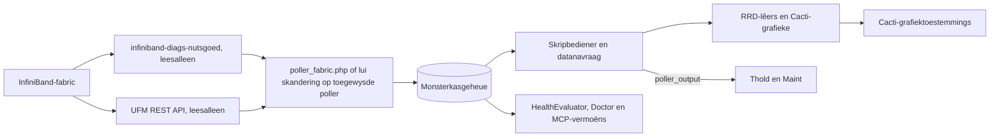

<!-- Source: README.md; SHA256: 79a16fb906f96ee79de2c719f18c38836f555440a7571a4a5ba38c64bb5b099f -->

<!-- translations:start -->
[English](../../../README.md) | [简体中文](../zh-CN/README.md) | [हिन्दी](../hi-IN/README.md) | [Español (España)](../es-ES/README.md) | [Español (Latinoamérica)](../es-419/README.md) | [العربية (السعودية)](../ar-SA/README.md) | [Afrikaans](README.md) | [አማርኛ](../am-ET/README.md) | [العربية (مصر)](../ar-EG/README.md) | [العربية (المغرب)](../ar-MA/README.md) | [বাংলা](../bn-BD/README.md) | [Bosanski](../bs-BA/README.md) | [Deutsch](../de-DE/README.md) | [فارسی](../fa-IR/README.md) | [Filipino](../fil-PH/README.md) | [Français](../fr-FR/README.md) | [Français (Maroc)](../fr-MA/README.md) | [Français (Sénégal)](../fr-SN/README.md) | [Hausa](../ha-NG/README.md) | [עברית](../he-IL/README.md) | [Hrvatski](../hr-HR/README.md) | [Bahasa Indonesia](../id-ID/README.md) | [Igbo](../ig-NG/README.md) | [Italiano](../it-IT/README.md) | [日本語](../ja-JP/README.md) | [한국어](../ko-KR/README.md) | [Malagasy](../mg-MG/README.md) | [मराठी](../mr-IN/README.md) | [Bahasa Melayu](../ms-MY/README.md) | [Nederlands](../nl-NL/README.md) | [Polski](../pl-PL/README.md) | [Português (Brasil)](../pt-BR/README.md) | [Русский](../ru-RU/README.md) | [Kinyarwanda](../rw-RW/README.md) | [Soomaali](../so-SO/README.md) | [Српски](../sr-RS/README.md) | [Svenska](../sv-SE/README.md) | [Kiswahili](../sw-KE/README.md) | [தமிழ்](../ta-IN/README.md) | [తెలుగు](../te-IN/README.md) | [ไทย](../th-TH/README.md) | [Türkçe](../tr-TR/README.md) | [Українська](../uk-UA/README.md) | [اردو](../ur-PK/README.md) | [Tiếng Việt](../vi-VN/README.md) | [isiXhosa](../xh-ZA/README.md) | [Yorùbá](../yo-NG/README.md) | [繁體中文](../zh-TW/README.md) | [isiZulu](../zu-ZA/README.md)
<!-- translations:end -->

# plugin_fabric

'n Cacti 1.2-inpropmodule (`fabric`, weergawe `0.1.0-dev`) wat InfiniBand-poorttellers, skakelwydte en -spoed, en opeenhopingsaanwysers as gewone toestelle, databronne en grafieke na Cacti bring. 'n Skakel wat teen 1X in plaas van 4X opgelei het, verskyn dan as 'n grafiek en 'n Thold-waarskuwing langs die gasheer wat dit bedien, onder Cacti se toestemmings, met Maint-bewustheid en -onderdrukking.

> **Status: onder ontwikkeling, nog geen vrystelling nie.** Hierdie tak implementeer die inpropmodule se grondslag, Cacti-objekte en waarskuwings, geskeduleerde agtergrond-poller-skanderings, replikasie na afgeleë versamelaars, 'n leesalleen-NVIDIA UFM REST-agterkant met 'n geënkripteerde geloofsbriefkluis, Configuration-as-Code (CasC) CLI-bestuur en Cacti-ekosisteemhake (CasC, Doctor en MCP / Abilities API v2). Dit is getoets teen nagemaakte nutsgoed, sintetiese UFM-transporte en die `ibsim`-fabric-simulator (rdma-core 50.0), nog nooit op 'n fisiese InfiniBand-fabric of lewendige UFM-bediener nie. Kontroles wat hardeware vereis, bly oop in [docs/research/](../../research/). Hierdie projek is nie met die Cacti-projek geaffilieer nie.

## Wat geïmplementeer is

- **Lewensiklus en skema (v3)**: installasie, idempotente opgradering, verwydering (behoud van inpropmodule-tabelle by verstek), en 'n PHP 8.2-vereistewag terwyl toegangspunte op PHP 8.0 ontleedbaar bly.
- **Toegangsrolle en bladsye**: `Fabric View` (`fabric.php`), `Fabric Operator` (`fabric_operator.php`) en `Fabric Admin` (`fabric_admin.php`, `fabric_health.php`)-sfere, plus 'n Settings-oortjie onder **Configuration > Settings > Fabrics**.
- **Leesalleen-diagnostiese agterkant (`diags`)**: streng argumentvektor-uitvoering van `perfquery`, `ibnetdiscover` en `iblinkinfo`, GUID-gesleutelde voorraad met identiteitskonflikopsporing en herkoppelingsvoorstelle, skakelstatus-evaluering en teller-skanderings per nodus.
- **Leesalleen-NVIDIA UFM REST-agterkant (`ufm`) en geënkripteerde kluis**: slegs-GET toegelate REST-kliënt (`/ufmRest/resources/ports`, `/ufmRest/resources/systems`, `/ufmRest/monitoring/session/0/data` en `/ufmRestV3/...`-ekwivalente vir teken-verifikasie) wat dieselfde voorraad-, skakelstatus-, monster- en gesondheidstabelle as `diags` voed. Geloofsbriewe (`token` of `basic`) word geënkripteerd met AES-256-GCM in `plugin_fabric_secret` gestoor deur middel van 'n eksterne 256-bis-sleutellêer wat deur `fabric_vault_key_file` gekonfigureer word. UFM-fabrics kan deur CasC (`cli/fabric.php`) of die bewaarplekke gedefinieer word; die web-adminvorm wys tans `diags`-velde.
- **Cacti-objekte, Thold en Maint**: Cacti-toestel-, data- en grafieksjablone (`templates/fabric-templates.xml`), die "Fabric Port"-skripbediener-datanavraag (`scripts/ss_fabric_ports.php`, `resource/script_server/fabric_ports.xml`), `DERIVE`-tellerdatabronne en `GAUGE`-skakelstatus-/tempodatabronne vir Thold, onderbrekingnasporing en versadigde basistellers wat as `U` gerapporteer word. Maint-integrasie (`MaintMaintenance`) doen navraag aan `plugin_maint_check_cacti_host()` (met terugval na die `is_device_in_maintenance`-haak) sodat nodusse in aktiewe instandhouding afsonderlik getel word en uitgesluit word van mislukte-skandering- en gedegradeerde-poort-gesondheidswaarskuwings.
- **Geskeduleerde skanderings, skerfdeling en afgeleë versamelaars**: `poller_bottom` begin `poller_fabric.php` in die agtergrond vir vervalde fabrics wat aan die huidige poller toegewys is, saam met lui skanderings wat deur die skripbediener geaktiveer word. `INFO` verklaar `remote_collect:1, remote_poller:1`, `poller_fabric.php` ondersteun deterministiese GUID-skerfdeling (`--shard=K/N`), en `replicate_out` repliseer nie-geheime `plugin_fabric_fabric`-rye na afgeleë versamelaars (`poller_id >= 2`). Kluis-inskrywings (`plugin_fabric_secret`) en eksterne sleutellêers word nooit gerepliseer nie.
- **CasC CLI en ekosisteemhake**: `cli/fabric.php` vir YAML/XML-uitvoer, validering, droogloop-verskilbeplanning, bevestigingsgehekte toepassing en gesondheidsverslaggewing, plus `casc_register_providers`, `doctor_register_checks` en `abilities_register`-hake.

## Toegangsrolle

| Sfeer | Toegang |
| --- | --- |
| Fabric View | Monitering van voorraad- en poort-aansigte (`fabric.php`). |
| Fabric Operator | View-toegang plus die Operations-bladsy (`fabric_operator.php`) en persoonlike siftingsbevestigings. |
| Fabric Admin | Operator-toegang plus konfigurasie, administratiewe aksies (`fabric_admin.php`) en die gesondheidsbladsy (`fabric_health.php`). |

Nadat opgraderingslêers gekopieer is, maak die Plugins-bladsy as 'n administrateur oop om nuwe sfere en hake te registreer. Ken die Operator-sfeer uitdruklik toe onder **Configuration > Users** of gebruikersgroepe. Opgraderings behou bestaande View- en Admin-sfeer-ID's en -toekennings. Admin-toegang erf Operator-toegang, en Operator-toegang erf View-toegang met elke versoek; dit voeg nie gestoorde toekennings by gebruikers of groepe nie. Inpropmodule-instellings vereis ook Fabric Admin-toegang benewens Cacti se Settings-toestemming.

Cacti-toesteltoestemmings beperk die rye en aksies wat vir elke gebruiker beskikbaar is; ongekoppelde objekte vereis 'n administrateur. Geloofsbriewe, konfigurasie, koppeling, verwydering en ander administratiewe veranderinge bly op die administratiewe bladsye of CLI. Bevestigings duur slegs in die huidige gebruiker se sessie, vir hoogstens een uur en slegs terwyl dieselfde waarneming vars bly. Nuwe of veranderde waarnemings maak dit ongeldig. Dit merk nooit 'n mislukte meting as gesond nie en onderdruk nooit waarskuwings nie.

## Waarom

'n Gedegradeerde InfiniBand-skakel dra steeds verkeer oor. 'n 4X-skakel wat teen 1X heroplei, laat die poort "aktief", en die gasheer se SNMP-koppelvlakgrafieke lyk normaal, maar nou gekoppelde take vertraag. Die bewyse lê in die fabric: elke poort rapporteer sy aktiewe, geaktiveerde en ondersteunde wydte en spoed, plus fout- en opeenhopingstellers. Om dit te lees vereis die InfiniBand-diagnostiese nutsgoed of 'n fabric-bestuurder-API. Wanneer dit met die hand uitgevoer word, laat dit drie gapings:

- **Geen geskiedenis nie.** `perfquery` en `iblinkinfo` wys die hede, dus is 'n skakel wat verlede week gedegradeer het onsigbaar.
- **Geen toestelkonteks nie.** Fabric-poorte is nie Cacti-objekte nie, dus kan 'n poort nie langs die gasheer wat dit voed gegrafiek word nie.
- **Geen pad na Cacti-waarskuwings nie.** Thold en Maint werk op Cacti-databronne en -toestelle.

Die inpropmodule sluit hierdie gapings deur die fabric deur `infiniband-diags` of die NVIDIA UFM REST API te lees, nodusse en poorte volgens GUID te identifiseer, en tellers en skakelstatus as Cacti-databronne te publiseer. Dit lees slegs: dit stel nooit tellers terug of verander poortstatus nie.

## Bedryf en CLI

### Agtergrond-poller en handmatige skanderings

`fabric_poller_bottom()` begin `poller_fabric.php` in die agtergrond op elke poller vir geaktiveerde fabrics wat aan daardie `poller_id` toegewys is en waarvan die skandering verval het. Jy kan ook die poller-uitvoerder of 'n handmatige skandering direk op die toegewysde poller as die poller-gebruiker uitvoer (vervang `/path/to/cacti` met jou Cacti-gids):

```sh
php /path/to/cacti/plugins/fabric/poller_fabric.php [--fabric=ID] [--shard=K/N] [--force] [--debug]
php /path/to/cacti/plugins/fabric/fabric_sweep.php --fabric=ID [--node=GUID] [--force]
```

- `poller_fabric.php` voer alle vervalde fabrics vir die plaaslike poller uit (of een fabric met `--fabric=ID`), dwing Cacti se prosesregister-slot en `ClaimRepository`-huurkontrakte met 'n tydbegroting van `max(30, intdiv(sweep_interval, 2))` sekondes af, en ondersteun `--shard=K/N` (`0 <= K < N`) om `diags`-nodustellerskanderings deterministies volgens nodus-GUID te verdeel.
- `fabric_sweep.php` voer 'n op-aanvraag-skandering van een geaktiveerde fabric (of een nodus met `--node=GUID`) wat aan die plaaslike poller toegewys is, uit. `--force` ignoreer of die fabric verval het terwyl dit steeds eise eerbiedig.

Nadat die eerste ontdekking die voorraad gevul het, koppel nodusse aan Cacti-toestelle op die Fabric Admin-bladsy. Hou Cacti se skrip-uitteltyd op 25 sekondes of hoër: 'n lui skandering wat deur 'n datanavraag-lesing begin word, beperk nutsding-uitvoering tot `script_timeout - 5` sekondes sodat die skripbediener betyds met die laaste gestoorde monster of `U` terugkeer.

### NVIDIA UFM REST-agterkant en geloofsbriefkluis

'n `ufm`-fabric vereis 'n `https://`-URL sonder ingebedde geloofsbriewe, navraagstringe of fragmente. `UfmSocketTransport` dwing TLS-eweknie- en gasheernaam-verifikasie af, verwerp aansture, en ondersteun 'n opsionele CA-bondel (`ufm_ca_file`) en SHA-256 SPKI-speld (`ufm_spki_pin`).

Om UFM-geloofsbriewe in `plugin_fabric_secret` te stoor, konfigureer `fabric_vault_key_file` onder **Configuration > Settings > Fabrics** met 'n absolute pad na 'n gewone lêer wat deur die poller-gebruiker besit word (geen simskakels in enige ouergids nie, modus `0600`, wat 64 heksadesimale karakters soos `openssl rand -hex 32` of 32 lukrake nie-drukbare grepe bevat). Die inpropmodule skep of skryf nooit die sleutellêer nie, en `replicate_out` repliseer nooit `plugin_fabric_secret` of sleutellêers na afgeleë pollers nie.

### Configuration-as-Code en gesondheids-CLI

`cli/fabric.php` bestuur inpropmodule-instellings en fabric-definisies deklaratief in YAML of XML, en rapporteer instandhoudingsbewuste gesondheid sonder om lewendige skanderings uit te voer:

```sh
php /path/to/cacti/plugins/fabric/cli/fabric.php export [--format=yaml|xml] [--file=PATH]
php /path/to/cacti/plugins/fabric/cli/fabric.php validate --file=PATH [--format=yaml|xml]
php /path/to/cacti/plugins/fabric/cli/fabric.php plan --file=PATH [--format=yaml|xml]
php /path/to/cacti/plugins/fabric/cli/fabric.php apply --file=PATH --confirm=PLAN_HASH [--format=yaml|xml]
php /path/to/cacti/plugins/fabric/cli/fabric.php health [--format=text|json]
```

`export` skep nuwe lêers met modus `0600`, redigeer `fabric_vault_key_file` as `[REDACTED]`, en lewer benoemde `ufm_credential_ref`-verwysings eerder as geheime. `plan` en `apply` verwerp inlyn `ufm_token`, `ufm_password`, `secret` en inlyn `fabric_vault_key_file`-waardes. `apply` vereis die presiese `--confirm=PLAN_HASH` wat deur `plan` geproduseer is.

### Ekosisteemhake

Wanneer die ooreenstemmende Cacti-inpropmodules of gasheer-integrasies teenwoordig is, registreer `setup.php`:

- `casc_register_providers`: voer `fabric`-konfigurasie uit, valideer, beplan en pas dit na bevestiging toe (`yaml` en `xml`, skema v1) met geheime-redaksie.
- `doctor_register_checks`: verskaf vier leesalleen-diagnostiese kontroles (`fabric.schema`, `fabric.poller_freshness`, `fabric.identity_conflicts`, `fabric.ufm_vault`).
- `abilities_register`: registreer drie leesalleen-, nie-vernietigende, idempotente vermoëns onder kategorie `fabric`, beskerm deur die Fabric View-sfeer (en Cacti-toesteltoestemmings vir poortfoute): `fabric-list-fabrics`, `fabric-get-health` en `fabric-list-port-errors`.

## Omvang en grense

Buite omvang: verandering van fabric-status, terugstel van tellers, vervanging van 'n fabric-bestuurder of subnetbestuurder, 'n inpropmodule-eie waarskuwingsenjin, 'n pasgemaakte demon of netwerkprotokol, en Ethernet- of RoCE-fabrics.

## Vereistes en versoenbaarheid

| Komponent | Teiken |
|---|---|
| Cacti | 1.2.31 of later (`compat = 1.2.31`), geen kernaanpassings nie |
| PHP | 8.2 of later; toegangspunte bly ontleedbaar op 8.0 en weier aktivering op 8.1 sodat 'n nie-ondersteunde looptyd 'n weiering kry in plaas van 'n stukkende Cacti-koppelvlak |
| InfiniBand-nutsgoed | `infiniband-diags` vanaf `rdma-core` (in CI getoets met rdma-core 50.0 onder `ibsim`; uitvoerformate gekontroleer teen v66.0-bronkode) |
| UFM | NVIDIA UFM Enterprise REST API (`ufmRest`- en `ufmRestV3`-leesalleen-eindpunte; getoets teen sintetiese transporte in eenheidstoetse) |
| Thold, Maint | Geen veranderinge vereis nie; CI voer 'n end-tot-end-toets met ongewysigde Thold v1.8.2 en Maint v1.3 uit |

## Ontwikkeling en toetsing

Die CI-werksvloei (`.github/workflows/plugin-ci-workflow.yml`) toets PHP 8.2 tot 8.5 teen Cacti `release/1.2.31` en `1.2.x`, PHP 8.0-toegangspunt-ontleding, PHP 8.1-weiering, PHPStan, gettext-/vertalingverifikasie, REUSE-lisensiëring, werksvloei-linting, Thold/Maint-end-tot-end-herspeling en `ibsim`-fabric-simulasie.

Met Cacti se geslote gedeelde Pest-inpropmodule-harnas (`CACTI_PEST_BIN`) en 'n weggooibare Cacti-databasis:

```sh
# Unit tests
"$CACTI_PEST_BIN" --configuration=phpunit.xml

# Lifecycle integration tests (disposable database only)
CACTI_PATH=/path/to/cacti FABRIC_TEST_DATABASE=disposable "$CACTI_PEST_BIN" --configuration=phpunit-integration.xml

# Static analysis (against Cacti 1.2.31)
CACTI_PATH=/path/to/cacti phpstan analyse -c phpstan.neon --no-progress

# Translation template, catalogs, and localized README checks
sh locales/build_gettext.sh --check

# Simulated ibsim fixture parser check
php tests/bin/check-ibsim-fixtures.php tests/fixtures/ibsim
```

## Ontwerp

- [docs/PLAN.md](../../PLAN.md) is die argitektuur- en ontwerpplan: stroomop-feite met bronne, oop hardewarekontroles, identiteitsmodel, teller- en skakelstatusreëls, sekuriteitsgrense, werkverrigtingberekening, toetsing en risiko's.
- [docs/decisions/](../../decisions/) bevat argitektuurbesluitrekords.
- [docs/REQUIREMENTS.md](../../REQUIREMENTS.md) koppel elke vereiste-ID aan sy kwessie.



## Hoe werk nagespoor word

- **Mylpale** volg die plan se mylpale. Elkeen het 'n epiese kwessie wat sy sub-kwessies en uitgangsbewyse lys.
- **Kwessies** word volgens etiket getipeer: `type: requirement`, `type: research`, `type: decision`, `type: epic`. Vereiste-kwessies stel genommerde, toetsbare vereistes (`REQ-AREA-NNN`) en aanvaardingskriteria.
- **Etikette** dra ook `area:`, `phase:`, `priority:` en `status:`. Sien [CONTRIBUTING.md](../../../CONTRIBUTING.md#labels).
- Die [projekbord](https://github.com/users/somethingwithproof/projects/8) wys alle kwessies oor mylpale heen.

## Bydrae

Lees [CONTRIBUTING.md](../../../CONTRIBUTING.md). Commits benodig 'n DCO-aftekening (`git commit -s`). Ontwerpbespreking vind op kwessies plaas; oop besluite dra die `type: decision`-etiket.

## Sekuriteit

Rapporteer kwesbaarhede privaat; sien [SECURITY.md](../../../SECURITY.md).

## Lisensie

GNU General Public License v2.0, dieselfde lisensie as Cacti en sy inpropmodules. Sien [LICENSE](../../../LICENSE).
