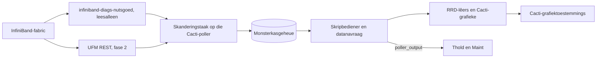

<!-- Source: README.md; SHA256: ce5af61a1bc993ec2aae6d4f22c3885694632f2b1d5eb94e2ce88b8390e96f1e -->

<!-- translations:start -->
[English](../../../README.md) | [简体中文](../zh-CN/README.md) | [हिन्दी](../hi-IN/README.md) | [Español (España)](../es-ES/README.md) | [Español (Latinoamérica)](../es-419/README.md) | [العربية (السعودية)](../ar-SA/README.md) | [Afrikaans](README.md) | [አማርኛ](../am-ET/README.md) | [العربية (مصر)](../ar-EG/README.md) | [العربية (المغرب)](../ar-MA/README.md) | [বাংলা](../bn-BD/README.md) | [Deutsch](../de-DE/README.md) | [فارسی](../fa-IR/README.md) | [Filipino](../fil-PH/README.md) | [Français](../fr-FR/README.md) | [Français (Maroc)](../fr-MA/README.md) | [Français (Sénégal)](../fr-SN/README.md) | [Hausa](../ha-NG/README.md) | [עברית](../he-IL/README.md) | [Bahasa Indonesia](../id-ID/README.md) | [Igbo](../ig-NG/README.md) | [Italiano](../it-IT/README.md) | [日本語](../ja-JP/README.md) | [한국어](../ko-KR/README.md) | [Malagasy](../mg-MG/README.md) | [मराठी](../mr-IN/README.md) | [Bahasa Melayu](../ms-MY/README.md) | [Nederlands](../nl-NL/README.md) | [Polski](../pl-PL/README.md) | [Português (Brasil)](../pt-BR/README.md) | [Русский](../ru-RU/README.md) | [Kinyarwanda](../rw-RW/README.md) | [Soomaali](../so-SO/README.md) | [Svenska](../sv-SE/README.md) | [Kiswahili](../sw-KE/README.md) | [தமிழ்](../ta-IN/README.md) | [తెలుగు](../te-IN/README.md) | [ไทย](../th-TH/README.md) | [Türkçe](../tr-TR/README.md) | [Українська](../uk-UA/README.md) | [اردو](../ur-PK/README.md) | [Tiếng Việt](../vi-VN/README.md) | [isiXhosa](../xh-ZA/README.md) | [Yorùbá](../yo-NG/README.md) | [繁體中文](../zh-TW/README.md) | [isiZulu](../zu-ZA/README.md)
<!-- translations:end -->

# plugin_fabric

'n Cacti 1.2-inpropmodule wat InfiniBand-poorttellers, skakelwydte en -spoed, en opeenhopingsaanwysers as gewone toestelle, databronne en grafieke na Cacti bring. 'n Skakel wat teen 1X in plaas van 4X opgelei het, verskyn dan as 'n grafiek en 'n Thold-waarskuwing langs die gasheer wat dit bedien, onder Cacti se toestemmings, en Maint kan dit onderdruk.

> **Status: onder ontwikkeling, nog geen vrystelling nie.** Mylpaal 2 (grondslag) is op `main` saamgesmelt, en mylpaal 3 (Cacti-objekte en waarskuwings) word tans hersien. Mylpaal 1 het die ontwerp teenoor dokumentasie en stroomop-bronkode bevestig (PR #71); die resultate, met bronne, is in [docs/research/](../../research). Mylpaal 2 voeg die inpropmodule se grondslag by:
>
> - installasie, opgradering, verwydering en die PHP 8.2-wag
> - View-, Operator- en Admin-sfere, en instellings
> - fabric-rekords
> - die leesalleen-opdraggrens vir `perfquery`, `ibnetdiscover` en `iblinkinfo`
> - voorraad volgens GUID, met identiteitskonflikte en herkoppelingsvoorstelle
> - skakelstatus en die teller-skanderingskasgeheue
> - voorraad-, admin- en gesondheidsbladsye
>
> Mylpaal 3 voeg die Cacti-objekte by:
>
> - toestel-, data- en grafieksjablone wat as Cacti-sjabloon-XML verskeep word, en die "Fabric Port"-datanavraag
> - koppeling van 'n nodus aan 'n Cacti-toestel, of die skepping van een ná bevestiging ([ADR 0010](../../decisions/0010-one-device-per-node.md))
> - tellerdatabronne vir grafieke, en GAUGE-skakelstatus- en tempodatabronne vir Thold ([ADR 0011](../../decisions/0011-derive-counters-and-gauge-alert-values.md))
> - hantering van onderbrekings en versadigde basistellers wat as onbekend gelees word ([ADR 0012](../../decisions/0012-saturated-basic-counters-read-as-unknown.md)), tellergeldigheid en grafiekskakels op die poortbladsy, en 'n opeenhopingsranglys
> - 'n end-tot-end-toets met ongewysigde Thold v1.8.2 en Maint v1.3, en 'n CI-taak wat die werklike diagnostiese nutsgoed teen 'n gesimuleerde fabric uitvoer
>
> 'n Fabric kan slegs vanaf die hoof-poller geskandeer word totdat afgeleë dataversamelaars in fase 3 ondersteun word. Dit is teen nagemaakte nutsgoed en die ibsim-fabric-simulator getoets, nog nooit op 'n InfiniBand-fabric nie. Kontroles wat 'n fabric vereis, bly oop in elke navorsingsbladsy se tabel vir lewendige kontroles. Hierdie projek is nie met die Cacti-projek geaffilieer nie.

## Toegangsrolle

| Sfeer | Toegang |
| --- | --- |
| Fabric View | Bestaande moniteringsbladsye. |
| Fabric Operator | Monitering plus die Operations-bladsy en persoonlike siftingsbevestigings. |
| Fabric Admin | Operator-toegang plus die bestaande konfigurasie- en administratiewe aksies. |

Nadat opgraderingslêers gekopieer is, maak die Plugins-bladsy as 'n administrateur oop
om die nuwe sfeer te registreer. Ken die Operator-sfeer uitdruklik toe onder **Configuration > Users** of gebruikersgroepe.
Opgraderings behou die bestaande View- en Admin-sfeer-ID's en -toekennings. Admin-toegang
erf Operator-toegang, en Operator-toegang erf View-toegang met elke versoek;
dit voeg nie gestoorde toekennings by gebruikers of groepe nie. Inpropmodule-instellings vereis ook
Fabric Admin-toegang benewens Cacti se Settings-toestemming.

Cacti-toesteltoestemmings beperk steeds die rye en aksies wat vir elke gebruiker beskikbaar is; ongekoppelde objekte vereis 'n administrateur.
Geloofsbriewe, konfigurasie, koppeling, verwydering en ander administratiewe veranderinge
bly op die administratiewe bladsye. Bevestigings duur slegs in die huidige
gebruiker se sessie, vir hoogstens een uur en slegs terwyl dieselfde waarneming vars
bly. Nuwe of veranderde waarnemings maak dit ongeldig. Dit merk nooit 'n mislukte
meting as gesond nie en onderdruk nooit waarskuwings nie.

## Waarom

'n Gedegradeerde InfiniBand-skakel dra steeds verkeer oor. 'n 4X-skakel wat teen 1X heroplei, laat die poort "aktief", en die gasheer se SNMP-koppelvlakgrafieke lyk normaal, maar nou gekoppelde take vertraag. Die bewyse lê in die fabric: elke poort rapporteer sy aktiewe, geaktiveerde en ondersteunde wydte en spoed, plus fout- en opeenhopingstellers. Om dit te lees vereis die InfiniBand-diagnostiese nutsgoed of 'n fabric-bestuurder-API. Wanneer dit met die hand uitgevoer word, laat dit drie gapings:

- **Geen geskiedenis nie.** `perfquery` en `iblinkinfo` wys die hede, dus is 'n skakel wat verlede week gedegradeer het onsigbaar.
- **Geen toestelkonteks nie.** Fabric-poorte is nie Cacti-objekte nie, dus kan 'n poort nie langs die gasheer wat dit voed gegrafiek word nie.
- **Geen pad na Cacti-waarskuwings nie.** Thold en Maint werk op Cacti-databronne en -toestelle.

Die inpropmodule sluit hierdie gapings deur die fabric deur sy eie diagnostiese nutsgoed (en later deur UFM) te lees, nodusse en poorte volgens GUID te identifiseer, en tellers en skakelstatus as Cacti-databronne te publiseer. Dit lees slegs: dit stel nooit tellers terug of verander poortstatus nie.

## Eerste ontdekking

'n Nuwe fabric het geen nodusse nie, en skanderings begin vanaf die skripbediener slegs vir 'n nodus wat aan 'n Cacti-toestel gekoppel is. Die eerste ontdekking is dus 'n handmatige stap. Nadat 'n geaktiveerde fabric gestoor is, voer dit een keer uit op die poller waaraan die fabric toegewys is, as die poller se rekening, met `/path/to/cacti` vervang deur jou Cacti-gids (die absolute pad werk ook vanaf cron):

```
php /path/to/cacti/plugins/fabric/fabric_sweep.php --fabric=ID --force
```

Die voorraad vul dan in. Koppel nodusse aan Cacti-toestelle op die Fabric Admin-bladsy; latere skanderings begin vanaf die datanavraag. Terwyl geen nodus van 'n fabric gekoppel is nie, verfris niks sy voorraad nie, dus voer dieselfde opdrag weer uit, vanaf cron as jy wil, om nuwe of ontbrekende nodusse aan te teken. Die gesondheidsbladsy wys hierdie opdrag vir 'n geaktiveerde fabric wat nog nie ontdek is nie of geen gekoppelde nodus het nie.

## Beplande omvang

| Fase | Omvang | Mylpale |
|---|---|---|
| 0, navorsing | Weergawematriks, bevestiging van stroomop-gedrag, tellergedrag op hardeware, voorregmodel, MAD-begroting, UFM-API | [M1](https://github.com/somethingwithproof/plugin_fabric/milestone/1) |
| 1, waarneming | Voorraad volgens GUID, Cacti-toestelle, poort-datanavraag, teller- en skakelstatus-databronne, Thold-waarskuwings, Maint-onderdrukking, gesondheidsbladsy | [M2](https://github.com/somethingwithproof/plugin_fabric/milestone/2), [M3](https://github.com/somethingwithproof/plugin_fabric/milestone/3), [M4](https://github.com/somethingwithproof/plugin_fabric/milestone/4) |
| 2, UFM | Leesalleen-UFM-REST-agterkant, geloofsbriefhantering, identiteitskontinuïteit tussen agterkante | [M5](https://github.com/somethingwithproof/plugin_fabric/milestone/5) |
| 3, afgeleë | Afgeleë dataversamelaars, replikasie, `remote_agent`-aksies, geskerfde skanderings vir groot fabrics | [M6](https://github.com/somethingwithproof/plugin_fabric/milestone/6) |

Buite omvang: verandering van fabric-status, vervanging van 'n fabric-bestuurder of subnetbestuurder, 'n inpropmodule-eie waarskuwingsenjin, 'n pasgemaakte demon of netwerkprotokol, en Ethernet- of RoCE-fabrics (navorsing).

## Versoenbaarheidsteikens

| Komponent | Teiken |
|---|---|
| Cacti | 1.2.31 of later, geen kernaanpassings nie |
| PHP | 8.2 of later; `setup.php` bly ontleedbaar op 8.0 sodat 'n nie-ondersteunde looptyd 'n weiering kry in plaas van 'n stukkende Cacti-koppelvlak |
| InfiniBand-nutsgoed | infiniband-diags vanaf rdma-core; uitvoerformate gekontroleer teen v66.0-bronkode |
| UFM | UFM Enterprise REST API, fase 2; vrystellingsmatriks is 'n mylpaal 1-aflewerbare |
| Thold, Maint | Geen veranderinge vereis nie |

Hou Cacti se skrip-uitteltyd op sy verstekwaarde van 25 sekondes of hoër. 'n Skandering wat deur 'n datanavraag-lesing begin word, beperk die uitvoering van nutsgoed tot daardie uitteltyd minus vyf sekondes, wat tyd reserveer om die kasgeheue te lees en te antwoord. Wanneer die begroting verstryk, lewer die navraag die laaste huidige monster of onbekend; die volgende siklus probeer die skandering weer. Hierdie beperking geld ook vir die PHP-poller. 'n Uitteltyd van vyf sekondes of minder laat geen tyd om 'n nutsding te begin nie.

## Ontwerp

- [docs/PLAN.md](../../PLAN.md) is die volledige plan: argitektuur, stroomop-feite waarvan dit afhang (met bronne) en aannames wat nog bevestig moet word, identiteitsmodel, teller- en skakelstatusreëls, sekuriteitsgrense, werkverrigtingberekening, toetsing en risiko's.
- [docs/decisions/](../../decisions) bevat argitektuurbesluitrekords vir keuses wat reeds gemaak is.
- [docs/REQUIREMENTS.md](../../REQUIREMENTS.md) koppel elke vereiste-ID aan sy kwessie.



## Hoe werk nagespoor word

- **Mylpale** volg die plan se mylpale. Elkeen het 'n epiese kwessie wat sy subkwessies en uitgangsbewyse lys.
- **Kwessies** word volgens etiket getipeer: `type: requirement`, `type: research`, `type: decision`, `type: epic`. Vereistekwessies meld genommerde, toetsbare vereistes (`REQ-AREA-NNN`) en aanvaardingskriteria.
- **Etikette** dra ook `area:`, `phase:`, `priority:` en `status:`. Sien [CONTRIBUTING.md](../../../CONTRIBUTING.md#labels).
- Die [projekbord](https://github.com/users/somethingwithproof/projects/8) wys alle kwessies oor mylpale heen.

## Bydraes

Lees [CONTRIBUTING.md](../../../CONTRIBUTING.md). Commits benodig 'n DCO-aftekening. Ontwerpbespreking vind op kwessies plaas; oop besluite dra die `type: decision`-etiket.

## Sekuriteit

Meld kwesbaarhede privaat aan; sien [SECURITY.md](../../../SECURITY.md).

## Lisensie

GNU General Public License v2.0, dieselfde lisensie as Cacti en sy inpropmodules. Sien [LICENSE](../../../LICENSE).
