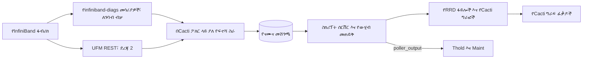

<!-- Source: README.md; SHA256: ce5af61a1bc993ec2aae6d4f22c3885694632f2b1d5eb94e2ce88b8390e96f1e -->

<!-- translations:start -->
[English](../../../README.md) | [简体中文](../zh-CN/README.md) | [हिन्दी](../hi-IN/README.md) | [Español (España)](../es-ES/README.md) | [Español (Latinoamérica)](../es-419/README.md) | [العربية (السعودية)](../ar-SA/README.md) | [Afrikaans](../af-ZA/README.md) | [አማርኛ](README.md) | [العربية (مصر)](../ar-EG/README.md) | [العربية (المغرب)](../ar-MA/README.md) | [বাংলা](../bn-BD/README.md) | [Bosanski](../bs-BA/README.md) | [Deutsch](../de-DE/README.md) | [فارسی](../fa-IR/README.md) | [Filipino](../fil-PH/README.md) | [Français](../fr-FR/README.md) | [Français (Maroc)](../fr-MA/README.md) | [Français (Sénégal)](../fr-SN/README.md) | [Hausa](../ha-NG/README.md) | [עברית](../he-IL/README.md) | [Hrvatski](../hr-HR/README.md) | [Bahasa Indonesia](../id-ID/README.md) | [Igbo](../ig-NG/README.md) | [Italiano](../it-IT/README.md) | [日本語](../ja-JP/README.md) | [한국어](../ko-KR/README.md) | [Malagasy](../mg-MG/README.md) | [मराठी](../mr-IN/README.md) | [Bahasa Melayu](../ms-MY/README.md) | [Nederlands](../nl-NL/README.md) | [Polski](../pl-PL/README.md) | [Português (Brasil)](../pt-BR/README.md) | [Русский](../ru-RU/README.md) | [Kinyarwanda](../rw-RW/README.md) | [Soomaali](../so-SO/README.md) | [Српски](../sr-RS/README.md) | [Svenska](../sv-SE/README.md) | [Kiswahili](../sw-KE/README.md) | [தமிழ்](../ta-IN/README.md) | [తెలుగు](../te-IN/README.md) | [ไทย](../th-TH/README.md) | [Türkçe](../tr-TR/README.md) | [Українська](../uk-UA/README.md) | [اردو](../ur-PK/README.md) | [Tiếng Việt](../vi-VN/README.md) | [isiXhosa](../xh-ZA/README.md) | [Yorùbá](../yo-NG/README.md) | [繁體中文](../zh-TW/README.md) | [isiZulu](../zu-ZA/README.md)
<!-- translations:end -->

# plugin_fabric

የInfiniBand ወደብ ቆጣሪዎችን፣ የአገናኝ ስፋትና ፍጥነትን እና የመጨናነቅ አመልካቾችን እንደ መደበኛ መሳሪያዎች፣ የውሂብ ምንጮች እና ግራፎች ወደ Cacti የሚያመጣ የCacti 1.2 ተሰኪ ነው። በ4X ፈንታ በ1X የሰለጠነ አገናኝ ከዚያም በCacti ፈቃዶች ስር ከሚያገለግለው አስተናጋጅ ጎን እንደ ግራፍ እና እንደ Thold ማንቂያ ሆኖ ይታያል፣ Maint ደግሞ ሊገድበው ይችላል።

> **ሁኔታ፦ በልማት ላይ፣ ገና የተለቀቀ የለም።** ምዕራፍ 2 (መሠረት) በ`main` ላይ ተዋህዷል፣ እና ምዕራፍ 3 (የCacti ነገሮች እና ማንቂያ) በግምገማ ላይ ነው። ምዕራፍ 1 ንድፉን ከሰነዶች እና ከዋናው ምንጭ ኮድ ጋር አረጋግጧል (PR #71)፤ ውጤቶቹ ከምንጮቻቸው ጋር በ[docs/research/](../../research) ውስጥ ይገኛሉ። ምዕራፍ 2 የተሰኪውን መሠረት ያክላል፦
>
> - መጫን፣ ማሻሻል፣ ማራገፍ እና የPHP 8.2 ጥበቃ
> - የView፣ የOperator እና የAdmin ክልሎች እና ቅንብሮች
> - የፋብሪክ መዝገቦች
> - ለ`perfquery`፣ `ibnetdiscover` እና `iblinkinfo` የንባብ-ብቻ ትዕዛዝ ወሰን
> - በGUID መሠረት ቆጠራ፣ ከማንነት ግጭቶች እና ከዳግም-ማገናኘት ሀሳቦች ጋር
> - የአገናኝ ሁኔታ እና የቆጣሪ ፍተሻ መሸጎጫ
> - የቆጠራ፣ የአስተዳደር እና የጤና ገጾች
>
> ምዕራፍ 3 የCacti ነገሮችን ያክላል፦
>
> - እንደ Cacti አብነት XML ተዘጋጅተው የሚቀርቡ የመሳሪያ፣ የውሂብ እና የግራፍ አብነቶች፣ እና የ«Fabric Port» የውሂብ መጠይቅ
> - ኖድን ከCacti መሳሪያ ጋር ማዛመድ፣ ወይም ሲረጋገጥ አንድ መፍጠር ([ADR 0010](../../decisions/0010-one-device-per-node.md))
> - ለግራፎች የቆጣሪ የውሂብ ምንጮች፣ እና ለThold የGAUGE የአገናኝ ሁኔታ እና የፍጥነት የውሂብ ምንጮች ([ADR 0011](../../decisions/0011-derive-counters-and-gauge-alert-values.md))
> - የማቋረጥ አያያዝ እና እንደ የማይታወቅ የሚነበቡ የሞሉ መሠረታዊ ቆጣሪዎች ([ADR 0012](../../decisions/0012-saturated-basic-counters-read-as-unknown.md))፣ በወደብ ገጹ ላይ የቆጣሪ ትክክለኛነት እና የግራፍ አገናኞች፣ እና የመጨናነቅ ደረጃ አሰጣጥ
> - ያልተቀየሩ Thold v1.8.2 እና Maint v1.3 በመጠቀም ከጫፍ እስከ ጫፍ የሚደረግ ሙከራ፣ እና እውነተኛ የምርመራ መሳሪያዎችን በተመሰለ ፋብሪክ ላይ የሚያስኬድ የCI ስራ
>
> የርቀት ውሂብ ሰብሳቢዎች በደረጃ 3 እስኪደገፉ ድረስ አንድ ፋብሪክ ሊፈተሽ የሚችለው ከዋናው ፖለር ብቻ ነው። የተሞከረው በውሸት መሳሪያዎች እና በibsim ፋብሪክ አስመሳይ ላይ እንጂ በእውነተኛ የInfiniBand ፋብሪክ ላይ ሆኖ አያውቅም። ፋብሪክ የሚያስፈልጋቸው ፍተሻዎች በእያንዳንዱ የምርምር ገጽ የቀጥታ-ፍተሻ ሰንጠረዥ ውስጥ ክፍት ሆነው ይቆያሉ። ይህ ፕሮጀክት ከCacti ፕሮጀክት ጋር ግንኙነት የለውም።

## የመዳረሻ ሚናዎች

| ክልል | መዳረሻ |
| --- | --- |
| Fabric View | ነባር የክትትል ገጾች። |
| Fabric Operator | ክትትል እና የOperations ገጽ እንዲሁም የግል የቅድሚያ ግምገማ ማረጋገጫዎች። |
| Fabric Admin | የOperator መዳረሻ እና ነባር የውቅርና የአስተዳደር እርምጃዎች። |

የማሻሻያ ፋይሎችን ከቀዱ በኋላ አዲሱን ክልል ለመመዝገብ እንደ አስተዳዳሪ የPlugins ገጹን ይክፈቱ።
የOperator ክልሉን በ**Configuration > Users** ወይም በተጠቃሚ ቡድኖች ስር በግልጽ ይመድቡ።
ማሻሻያዎች ነባር የView እና የAdmin ክልል መለያዎችን እና ፈቃዶችን ይጠብቃሉ። የAdmin መዳረሻ
የOperator መዳረሻን ይወርሳል፣ የOperator መዳረሻም በእያንዳንዱ ጥያቄ የView መዳረሻን ይወርሳል፤
ይህ ለተጠቃሚዎች ወይም ለቡድኖች የተከማቹ ፈቃዶችን አያክልም። የተሰኪው ቅንብሮች ከCacti
የSettings ፈቃድ በተጨማሪ የFabric Admin መዳረሻንም ይጠይቃሉ።

የCacti መሳሪያ ፈቃዶች ለእያንዳንዱ ተጠቃሚ የሚገኙትን ረድፎች እና እርምጃዎች አሁንም ይገድባሉ፤ ያልተዛመዱ ነገሮች አስተዳዳሪን ይጠይቃሉ።
የምስክር ወረቀቶች፣ ውቅር፣ ማዛመድ፣ መሰረዝ እና ሌሎች የአስተዳደር ለውጦች
በአስተዳደር ገጾች ውስጥ ይቆያሉ። ማረጋገጫዎች የሚቆዩት በአሁኑ የተጠቃሚ ክፍለ-ጊዜ ውስጥ
ብቻ፣ ቢበዛ ለአንድ ሰዓት እና ያው ምልከታ ትኩስ ሆኖ እስካለ ድረስ ብቻ ነው።
አዲስ ወይም የተለወጡ ምልከታዎች ውድቅ ያደርጓቸዋል። የወደቀ መለኪያን ጤናማ
አድርገው ምልክት አያደርጉም ወይም ማንቂያዎችን አይገድቡም።

## ለምን

የተዳከመ የInfiniBand አገናኝ አሁንም ትራፊክ ያሳልፋል። በ1X ዳግም የሰለጠነ የ4X አገናኝ ወደቡን «active» አድርጎ ይተወዋል፣ እና የአስተናጋጁ የSNMP በይነገጽ ግራፎች መደበኛ ይመስላሉ፣ ነገር ግን በቅርበት የተሳሰሩ ስራዎች ይዘገያሉ። ማስረጃው በፋብሪኩ ውስጥ ነው ያለው፦ እያንዳንዱ ወደብ ንቁ፣ የነቃ እና የሚደገፍ ስፋቱንና ፍጥነቱን፣ እንዲሁም የስህተት እና የመጨናነቅ ቆጣሪዎችን ሪፖርት ያደርጋል። እሱን ለማንበብ የInfiniBand መመርመሪያ መሳሪያዎችን ወይም የፋብሪክ አስተዳዳሪ API ይጠይቃል። በእጅ ሲሰሩ ሶስት ክፍተቶችን ይተዋሉ፦

- **ታሪክ የለም።** `perfquery` እና `iblinkinfo` የአሁኑን ጊዜ ብቻ ያሳያሉ፣ ስለዚህ ባለፈው ሳምንት የተዳከመ አገናኝ አይታይም።
- **የመሳሪያ አውድ የለም።** የፋብሪክ ወደቦች የCacti ነገሮች አይደሉም፣ ስለዚህ አንድ ወደብ ከሚመግበው አስተናጋጅ ጎን በግራፍ ሊቀመጥ አይችልም።
- **ወደ Cacti ማንቂያ መንገድ የለም።** Thold እና Maint የሚሰሩት በCacti የውሂብ ምንጮች እና መሳሪያዎች ላይ ነው።

ተሰኪው ፋብሪኩን በራሱ የምርመራ መሳሪያዎች (እና በኋላም በUFM) በማንበብ፣ ኖዶችንና ወደቦችን በGUID በመለየት፣ እንዲሁም ቆጣሪዎችንና የአገናኝ ሁኔታን እንደ Cacti የውሂብ ምንጮች በማተም እነዚህን ክፍተቶች ይዘጋል። የሚያነበው ብቻ ነው፦ ቆጣሪዎችን ፈጽሞ ዳግም አያስጀምርም ወይም የወደብ ሁኔታን አይለውጥም።

## የመጀመሪያ ግኝት

አዲስ ፋብሪክ ምንም ኖዶች የሉትም፣ እና ፍተሻዎች ከስክሪፕት ሰርቨሩ የሚጀምሩት ከCacti መሳሪያ ጋር ለተዛመደ ኖድ ብቻ ነው። ስለዚህ የመጀመሪያው ግኝት በእጅ የሚከናወን እርምጃ ነው። የነቃ ፋብሪክ ካስቀመጡ በኋላ፣ `/path/to/cacti` በእርስዎ የCacti ማውጫ ተተክቶ፣ ፋብሪኩ በተመደበለት ፖለር ላይ እንደ ፖለሩ መለያ ሆነው ይህንን አንድ ጊዜ ያስኪዱ (ፍጹም መንገዱ ከcronም ይሰራል)፦

```
php /path/to/cacti/plugins/fabric/fabric_sweep.php --fabric=ID --force
```

ከዚያም ቆጠራው ይሞላል። በFabric Admin ገጽ ላይ ኖዶችን ከCacti መሳሪያዎች ጋር ያዛምዱ፤ ቀጣይ ፍተሻዎች ከውሂብ መጠይቁ ይጀምራሉ። የአንድ ፋብሪክ ምንም ኖድ ባልተዛመደበት ጊዜ ቆጠራውን የሚያድስ ነገር የለም፣ ስለዚህ አዲስ ወይም የጠፉ ኖዶችን ለመመዝገብ ከፈለጉ ከcron ላይ ተመሳሳዩን ትዕዛዝ እንደገና ያስኪዱ። የጤና ገጹ ላልተገኘ ወይም ምንም የተዛመደ ኖድ ለሌለው የነቃ ፋብሪክ ይህንን ትዕዛዝ ያሳያል።

## የታቀደ ወሰን

| ደረጃ | ወሰን | ምዕራፎች |
|---|---|---|
| 0፣ ምርምር | የስሪት ማትሪክስ፣ የዋናው ምንጭ ባህሪ ማረጋገጫ፣ በሃርድዌር ላይ የቆጣሪ ባህሪ፣ የፈቃድ ሞዴል፣ የMAD በጀት፣ UFM API | [M1](https://github.com/somethingwithproof/plugin_fabric/milestone/1) |
| 1፣ መከታተል | በGUID መሠረት ቆጠራ፣ የCacti መሳሪያዎች፣ የወደብ ውሂብ መጠይቅ፣ የቆጣሪ እና የአገናኝ-ሁኔታ የውሂብ ምንጮች፣ የThold ማንቂያ፣ የMaint ገደብ፣ የጤና ገጽ | [M2](https://github.com/somethingwithproof/plugin_fabric/milestone/2), [M3](https://github.com/somethingwithproof/plugin_fabric/milestone/3), [M4](https://github.com/somethingwithproof/plugin_fabric/milestone/4) |
| 2፣ UFM | ለንባብ-ብቻ የሆነ የUFM REST ጀርባ፣ የምስክር ወረቀት አያያዝ፣ በጀርባዎች መካከል የማንነት ቀጣይነት | [M5](https://github.com/somethingwithproof/plugin_fabric/milestone/5) |
| 3፣ የርቀት | የርቀት ውሂብ ሰብሳቢዎች፣ ማባዛት፣ የ`remote_agent` እርምጃዎች፣ ለትላልቅ ፋብሪኮች የተከፋፈሉ ፍተሻዎች | [M6](https://github.com/somethingwithproof/plugin_fabric/milestone/6) |

ከወሰን ውጭ፦ የፋብሪክ ሁኔታን መለወጥ፣ የፋብሪክ አስተዳዳሪን ወይም የሳብኔት አስተዳዳሪን መተካት፣ በተሰኪው ባለቤትነት የተያዘ የማንቂያ ሞተር፣ ብጁ ዴመን ወይም የአውታረ መረብ ፕሮቶኮል፣ እና የEthernet ወይም የRoCE ፋብሪኮች (ምርምር)።

## የተኳኋኝነት ዒላማዎች

| አካል | ዒላማ |
|---|---|
| Cacti | 1.2.31 ወይም ከዚያ በላይ፣ ምንም የዋና ኮድ ጥገናዎች የሉም |
| PHP | 8.2 ወይም ከዚያ በላይ፤ ያልተደገፈ የስራ ጊዜ ከተሰበረ የCacti UI ፈንታ እምቢታ እንዲያገኝ `setup.php` በ8.0 ላይ ሊተነተን የሚችል ሆኖ ይቆያል |
| የInfiniBand መሳሪያዎች | ከrdma-core የተገኘ infiniband-diags፤ የውጤት ቅርጸቶች ከv66.0 ምንጭ ጋር ተረጋግጠዋል |
| UFM | UFM Enterprise REST API፣ ደረጃ 2፤ የመልቀቂያ ማትሪክስ የምዕራፍ 1 ውጤት ነው |
| Thold, Maint | ምንም ለውጥ አያስፈልግም |

የCacti ስክሪፕት የጊዜ ገደብን በነባሪው 25 ሰከንድ ወይም ከዚያ በላይ ያቆዩት። በውሂብ-መጠይቅ ንባብ የተጀመረ ፍተሻ መሸጎጫውን ለማንበብ እና መልስ ለመስጠት ጊዜ በመቆጠብ የመሳሪያውን አፈጻጸም ከዚያ የጊዜ ገደብ አምስት ሰከንድ በመቀነስ ይገድባል። በጀቱ ሲያልቅ መጠይቁ የመጨረሻውን ወቅታዊ ናሙና ወይም የማይታወቅ ውጤት ያቀርባል፤ ቀጣዩ ዑደት ፍተሻውን እንደገና ይሞክራል። ይህ ገደብ ለPHP ፖለርም ይሠራል። የአምስት ሰከንድ ወይም ከዚያ ያነሰ የጊዜ ገደብ መሳሪያ ለመጀመር ምንም ጊዜ አይተውም።

## ንድፍ

- [docs/PLAN.md](../../PLAN.md) ሙሉው እቅድ ነው፦ አርክቴክቸር፣ የሚመረኮዝባቸው የዋናው ምንጭ እውነታዎች (ከምንጮች ጋር) እና ገና የሚረጋገጡ ግምቶች፣ የማንነት ሞዴል፣ የቆጣሪ እና የአገናኝ-ሁኔታ ደንቦች፣ የደህንነት ወሰኖች፣ የአፈጻጸም ስሌት፣ ሙከራ እና ስጋቶች።
- [docs/decisions/](../../decisions) አስቀድመው ለተደረጉ ምርጫዎች የአርክቴክቸር ውሳኔ መዝገቦችን ይይዛል።
- [docs/REQUIREMENTS.md](../../REQUIREMENTS.md) እያንዳንዱን የመስፈርት መለያ ከችግሩ ጋር ያዛምዳል።



## ስራ እንዴት እንደሚከታተል

- **ምዕራፎች** የእቅዱን ምዕራፎች ይከተላሉ። እያንዳንዱ ንዑስ-ችግሮቹን እና የመውጫ ማስረጃዎችን የሚዘረዝር ኤፒክ ጉዳይ አለው።
- **ጉዳዮች** በመለያ ይከፋፈላሉ፦ `type: requirement`፣ `type: research`፣ `type: decision`፣ `type: epic`። የመስፈርት ጉዳዮች ቁጥር የተሰጣቸውን፣ ሊሞከሩ የሚችሉ መስፈርቶችን (`REQ-AREA-NNN`) እና የመቀበያ መስፈርቶችን ይገልጻሉ።
- **መለያዎች** እንዲሁ `area:`፣ `phase:`፣ `priority:` እና `status:` ይይዛሉ። [CONTRIBUTING.md](../../../CONTRIBUTING.md#labels)ን ይመልከቱ።
- [የፕሮጀክት ሰሌዳው](https://github.com/users/somethingwithproof/projects/8) በሁሉም ምዕራፎች ውስጥ ያሉትን ጉዳዮች ሁሉ ያሳያል።

## አስተዋጽኦ ማድረግ

[CONTRIBUTING.md](../../../CONTRIBUTING.md)ን ያንብቡ። ኮሚቶች የDCO ፊርማ ያስፈልጋቸዋል። የንድፍ ውይይት የሚካሄደው በጉዳዮች ላይ ነው፤ ክፍት ውሳኔዎች `type: decision` መለያን ይይዛሉ።

## ደህንነት

የደህንነት ክፍተቶችን በግል ሪፖርት ያድርጉ፤ [SECURITY.md](../../../SECURITY.md)ን ይመልከቱ።

## ፈቃድ

GNU General Public License v2.0፣ ከCacti እና ከተሰኪዎቹ ጋር ተመሳሳይ ፈቃድ ነው። [LICENSE](../../../LICENSE)ን ይመልከቱ።
