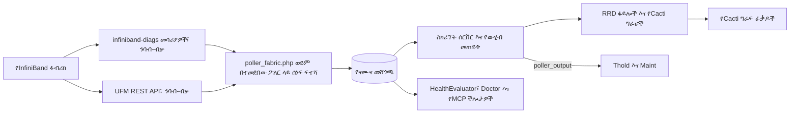

<!-- Source: README.md; SHA256: 79a16fb906f96ee79de2c719f18c38836f555440a7571a4a5ba38c64bb5b099f -->

<!-- translations:start -->
[English](../../../README.md) | [简体中文](../zh-CN/README.md) | [हिन्दी](../hi-IN/README.md) | [Español (España)](../es-ES/README.md) | [Español (Latinoamérica)](../es-419/README.md) | [العربية (السعودية)](../ar-SA/README.md) | [Afrikaans](../af-ZA/README.md) | [አማርኛ](README.md) | [العربية (مصر)](../ar-EG/README.md) | [العربية (المغرب)](../ar-MA/README.md) | [বাংলা](../bn-BD/README.md) | [Bosanski](../bs-BA/README.md) | [Deutsch](../de-DE/README.md) | [فارسی](../fa-IR/README.md) | [Filipino](../fil-PH/README.md) | [Français](../fr-FR/README.md) | [Français (Maroc)](../fr-MA/README.md) | [Français (Sénégal)](../fr-SN/README.md) | [Hausa](../ha-NG/README.md) | [עברית](../he-IL/README.md) | [Hrvatski](../hr-HR/README.md) | [Bahasa Indonesia](../id-ID/README.md) | [Igbo](../ig-NG/README.md) | [Italiano](../it-IT/README.md) | [日本語](../ja-JP/README.md) | [한국어](../ko-KR/README.md) | [Malagasy](../mg-MG/README.md) | [मराठी](../mr-IN/README.md) | [Bahasa Melayu](../ms-MY/README.md) | [Nederlands](../nl-NL/README.md) | [Polski](../pl-PL/README.md) | [Português (Brasil)](../pt-BR/README.md) | [Русский](../ru-RU/README.md) | [Kinyarwanda](../rw-RW/README.md) | [Soomaali](../so-SO/README.md) | [Српски](../sr-RS/README.md) | [Svenska](../sv-SE/README.md) | [Kiswahili](../sw-KE/README.md) | [தமிழ்](../ta-IN/README.md) | [తెలుగు](../te-IN/README.md) | [ไทย](../th-TH/README.md) | [Türkçe](../tr-TR/README.md) | [Українська](../uk-UA/README.md) | [اردو](../ur-PK/README.md) | [Tiếng Việt](../vi-VN/README.md) | [isiXhosa](../xh-ZA/README.md) | [Yorùbá](../yo-NG/README.md) | [繁體中文](../zh-TW/README.md) | [isiZulu](../zu-ZA/README.md)
<!-- translations:end -->

# plugin_fabric

የInfiniBand ወደብ ቆጣሪዎችን፣ የአገናኝ ስፋትና ፍጥነትን እና የመጨናነቅ አመልካቾችን እንደ መደበኛ መሳሪያዎች፣ የውሂብ ምንጮች እና ግራፎች ወደ Cacti የሚያመጣ የCacti 1.2 ተሰኪ (`fabric`፣ ስሪት `0.1.0-dev`) ነው። በ4X ፈንታ በ1X የሰለጠነ አገናኝ ከዚያም በCacti ፈቃዶች ስር ከሚያገለግለው አስተናጋጅ ጎን እንደ ግራፍ እና እንደ Thold ማንቂያ ሆኖ ይታያል፣ ከMaint ግንዛቤ እና የማፈን ችሎታ ጋር።

> **ሁኔታ፦ በልማት ላይ፣ ገና የተለቀቀ የለም።** ይህ ቅርንጫፍ የተሰኪውን መሠረት፣ የCacti ነገሮችን እና ማንቂያዎችን፣ የታቀዱ የጀርባ ፖለር ፍተሻዎችን፣ የርቀት ሰብሳቢ ማባዛትን፣ የተመሰጠረ የምስክር ወረቀት ካዝና ያለው የንባብ-ብቻ NVIDIA UFM REST ጀርባን፣ የConfiguration-as-Code (CasC) CLI አስተዳደርን እና የCacti ስነ-ምህዳር መንጠቆዎችን (CasC፣ Doctor እና MCP / Abilities API v2) ተግባራዊ ያደርጋል። የተሞከረው በውሸት መሳሪያዎች፣ በሰው ሰራሽ የUFM ትራንስፖርቶች እና በ`ibsim` ፋብሪክ አስመሳይ (rdma-core 50.0) ላይ እንጂ በአካላዊ የInfiniBand ፋብሪክ ወይም በቀጥታ UFM አገልጋይ ላይ ሆኖ አያውቅም። ሃርድዌር የሚያስፈልጋቸው ፍተሻዎች በ[docs/research/](../../research/) ውስጥ ክፍት ሆነው ይቆያሉ። ይህ ፕሮጀክት ከCacti ፕሮጀክት ጋር ግንኙነት የለውም።

## የተተገበሩት

- **የህይወት ዑደት እና ስኪማ (v3)**፦ መጫን፣ ተደጋጋሚ-አስተማማኝ ማሻሻያ፣ ማራገፍ (የተሰኪ ሠንጠረዦችን በነባሪነት በማስቀመጥ)፣ እና የመግቢያ ነጥቦች በPHP 8.0 ላይ ሊተነተኑ የሚችሉ ሆነው እያለ የPHP 8.2 መስፈርት ጥበቃ።
- **የመዳረሻ ሚናዎች እና ገጾች**፦ `Fabric View` (`fabric.php`)፣ `Fabric Operator` (`fabric_operator.php`) እና `Fabric Admin` (`fabric_admin.php`፣ `fabric_health.php`) ክልሎች፣ እንዲሁም በ**Configuration > Settings > Fabrics** ስር የሚገኝ የSettings ትር።
- **የንባብ-ብቻ የምርመራ ጀርባ (`diags`)**፦ የ`perfquery`፣ `ibnetdiscover` እና `iblinkinfo` ጥብቅ የአርግዩመንት-ቬክተር አፈጻጸም፣ የማንነት ግጭት መለየትና የዳግም-ማገናኘት ሀሳቦች ያሉት በGUID የተቆጠረ ቆጠራ፣ የአገናኝ-ሁኔታ ግምገማ እና በእያንዳንዱ ኖድ የሚደረጉ የቆጣሪ ፍተሻዎች።
- **የንባብ-ብቻ NVIDIA UFM REST ጀርባ (`ufm`) እና የተመሰጠረ ካዝና**፦ ልክ እንደ `diags` ተመሳሳይ የቆጠራ፣ የአገናኝ-ሁኔታ፣ የናሙና እና የጤና ሠንጠረዦችን የሚመግብ GET-ብቻ የተፈቀዱ የREST ደንበኛ (`/ufmRest/resources/ports`፣ `/ufmRest/resources/systems`፣ `/ufmRest/monitoring/session/0/data` እና ለቶከን ማረጋገጫ የ`/ufmRestV3/...` አቻዎች)። የምስክር ወረቀቶች (`token` ወይም `basic`) በ`fabric_vault_key_file` የተዋቀረ ውጫዊ ባለ 256-ቢት ቁልፍ ፋይል በመጠቀም በAES-256-GCM ተመስጠረው በ`plugin_fabric_secret` ውስጥ ይቀመጣሉ። የUFM ፋብሪኮች በCasC (`cli/fabric.php`) ወይም በማከማቻዎች በኩል ሊገለጹ ይችላሉ፤ የድር አስተዳደር ቅጹ በአሁኑ ጊዜ የ`diags` መስኮችን ያሳያል።
- **የCacti ነገሮች፣ Thold እና Maint**፦ የCacti መሳሪያ፣ ውሂብ እና ግራፍ አብነቶች (`templates/fabric-templates.xml`)፣ የ«Fabric Port» ስክሪፕት-ሰርቨር ውሂብ መጠይቅ (`scripts/ss_fabric_ports.php`፣ `resource/script_server/fabric_ports.xml`)፣ ለThold የ`DERIVE` ቆጣሪ ውሂብ ምንጮች እና የ`GAUGE` አገናኝ-ሁኔታ/ፍጥነት ውሂብ ምንጮች፣ የማቋረጥ ክትትል እና እንደ `U` ሪፖርት የሚደረጉ የሞሉ መሠረታዊ ቆጣሪዎች። የMaint ውህደት (`MaintMaintenance`) `plugin_maint_check_cacti_host()`ን ይጠይቃል (ወደ `is_device_in_maintenance` መንጠቆ በመመለስ)፣ በንቃት ጥገና ላይ ያሉ ኖዶች ለየብቻ እንዲቆጠሩ እና ከወደቁ ፍተሻዎችና ከተዳከሙ ወደብ የጤና ማስጠንቀቂያዎች እንዲገለሉ ያደርጋል።
- **የታቀዱ ፍተሻዎች፣ ክፍፍል እና የርቀት ሰብሳቢዎች**፦ `poller_bottom` ለአሁኑ ፖለር ለተመደቡና ጊዜያቸው ለደረሰ ፋብሪኮች በጀርባ ውስጥ `poller_fabric.php`ን ያስነሳል፣ በስክሪፕት ሰርቨሩ ከሚቀሰቀሱ ሰነፍ ፍተሻዎች ጎን ለጎን። `INFO` `remote_collect:1, remote_poller:1`ን ያውጃል፣ `poller_fabric.php` በኖድ GUID የተወሰነ ክፍፍልን (`--shard=K/N`) ይደግፋል፣ እና `replicate_out` ሚስጥራዊ ያልሆኑ የ`plugin_fabric_fabric` ረድፎችን ወደ የርቀት ሰብሳቢዎች (`poller_id >= 2`) ያባዛል። የካዝና ግቤቶች (`plugin_fabric_secret`) እና ውጫዊ ቁልፍ ፋይሎች ፈጽሞ አይባዙም።
- **የCasC CLI እና የስነ-ምህዳር መንጠቆዎች**፦ ለYAML/XML ወደ ውጭ መላክ፣ ማረጋገጥ፣ የደረቅ-ሙከራ ልዩነት እቅድ፣ በማረጋገጫ የተገደበ አተገባበር እና የጤና ሪፖርት `cli/fabric.php`፣ እንዲሁም `casc_register_providers`፣ `doctor_register_checks` እና `abilities_register` መንጠቆዎች።

## የመዳረሻ ሚናዎች

| ክልል | መዳረሻ |
| --- | --- |
| Fabric View | የክትትል ቆጠራ እና የወደብ እይታዎች (`fabric.php`)። |
| Fabric Operator | የView መዳረሻ እና የOperations ገጽ (`fabric_operator.php`) እንዲሁም የግል የቅድሚያ ግምገማ ማረጋገጫዎች። |
| Fabric Admin | የOperator መዳረሻ እና ውቅር፣ የአስተዳደር እርምጃዎች (`fabric_admin.php`) እና የጤና ገጹ (`fabric_health.php`)። |

የማሻሻያ ፋይሎችን ከቀዱ በኋላ አዲሶቹን ክልሎችና መንጠቆዎች ለመመዝገብ እንደ አስተዳዳሪ የPlugins ገጹን ይክፈቱ። የOperator ክልሉን በ**Configuration > Users** ወይም በተጠቃሚ ቡድኖች ስር በግልጽ ይመድቡ። ማሻሻያዎች ነባር የView እና የAdmin ክልል መለያዎችንና ፈቃዶችን ይጠብቃሉ። በእያንዳንዱ ጥያቄ ላይ የAdmin መዳረሻ የOperator መዳረሻን ይወርሳል፣ የOperator መዳረሻም የView መዳረሻን ይወርሳል፤ ይህ ለተጠቃሚዎች ወይም ለቡድኖች የተከማቹ ፈቃዶችን አያክልም። የተሰኪው ቅንብሮች ከCacti የSettings ፈቃድ በተጨማሪ የFabric Admin መዳረሻንም ይጠይቃሉ።

የCacti መሳሪያ ፈቃዶች ለእያንዳንዱ ተጠቃሚ የሚገኙትን ረድፎች እና እርምጃዎች ይገድባሉ፤ ያልተዛመዱ ነገሮች አስተዳዳሪን ይጠይቃሉ። የምስክር ወረቀቶች፣ ውቅር፣ ማዛመድ፣ መሰረዝ እና ሌሎች የአስተዳደር ለውጦች በአስተዳደር ገጾች ወይም በCLI ውስጥ ይቆያሉ። ማረጋገጫዎች የሚቆዩት በአሁኑ የተጠቃሚ ክፍለ-ጊዜ ውስጥ ብቻ፣ ቢበዛ ለአንድ ሰዓት እና ያው ምልከታ ትኩስ ሆኖ እስካለ ድረስ ብቻ ነው። አዲስ ወይም የተለወጡ ምልከታዎች ውድቅ ያደርጓቸዋል። የወደቀ መለኪያን ጤናማ አድርገው ምልክት አያደርጉም ወይም ማንቂያዎችን አይገድቡም።

## ለምን

የተዳከመ የInfiniBand አገናኝ አሁንም ትራፊክ ያሳልፋል። በ1X ዳግም የሰለጠነ የ4X አገናኝ ወደቡን «active» አድርጎ ይተወዋል፣ እና የአስተናጋጁ የSNMP በይነገጽ ግራፎች መደበኛ ይመስላሉ፣ ነገር ግን በቅርበት የተሳሰሩ ስራዎች ይዘገያሉ። ማስረጃው በፋብሪኩ ውስጥ ነው ያለው፦ እያንዳንዱ ወደብ ንቁ፣ የነቃ እና የሚደገፍ ስፋቱንና ፍጥነቱን፣ እንዲሁም የስህተት እና የመጨናነቅ ቆጣሪዎችን ሪፖርት ያደርጋል። እሱን ለማንበብ የInfiniBand መመርመሪያ መሳሪያዎችን ወይም የፋብሪክ አስተዳዳሪ API ይጠይቃል። በእጅ ሲሰሩ ሶስት ክፍተቶችን ይተዋሉ፦

- **ታሪክ የለም።** `perfquery` እና `iblinkinfo` የአሁኑን ጊዜ ብቻ ያሳያሉ፣ ስለዚህ ባለፈው ሳምንት የተዳከመ አገናኝ አይታይም።
- **የመሳሪያ አውድ የለም።** የፋብሪክ ወደቦች የCacti ነገሮች አይደሉም፣ ስለዚህ አንድ ወደብ ከሚመግበው አስተናጋጅ ጎን በግራፍ ሊቀመጥ አይችልም።
- **ወደ Cacti ማንቂያ መንገድ የለም።** Thold እና Maint የሚሰሩት በCacti የውሂብ ምንጮች እና መሳሪያዎች ላይ ነው።

ተሰኪው ፋብሪኩን በ`infiniband-diags` ወይም በNVIDIA UFM REST API በኩል በማንበብ፣ ኖዶችንና ወደቦችን በGUID በመለየት፣ እንዲሁም ቆጣሪዎችንና የአገናኝ ሁኔታን እንደ Cacti የውሂብ ምንጮች በማተም እነዚህን ክፍተቶች ይዘጋል። የሚያነበው ብቻ ነው፦ ቆጣሪዎችን ፈጽሞ ዳግም አያስጀምርም ወይም የወደብ ሁኔታን አይለውጥም።

## ኦፕሬሽንስ እና CLI

### የጀርባ ፖለር እና በእጅ የሚደረጉ ፍተሻዎች

`fabric_poller_bottom()` ለዚያ `poller_id` የተመደቡ እና ፍተሻቸው የደረሰ የነቁ ፋብሪኮችን በእያንዳንዱ ፖለር ላይ በጀርባ ውስጥ `poller_fabric.php`ን ያስጀምራል። እንዲሁም በተመደበው ፖለር ላይ እንደ ፖለሩ ተጠቃሚ ሆነው የፖለር አስፈጻሚውን ወይም በእጅ ፍተሻን በቀጥታ ማስኬድ ይችላሉ (`/path/to/cacti`ን በእርስዎ የCacti ማውጫ በመተካት)፦

```sh
php /path/to/cacti/plugins/fabric/poller_fabric.php [--fabric=ID] [--shard=K/N] [--force] [--debug]
php /path/to/cacti/plugins/fabric/fabric_sweep.php --fabric=ID [--node=GUID] [--force]
```

- `poller_fabric.php` ለአካባቢያዊ ፖለር የደረሱ ሁሉንም ፋብሪኮች (ወይም በ`--fabric=ID` አንድ ፋብሪክ) ያስኬዳል፣ የCactiን የሂደት መዝገብ ቆልፍ እና የ`ClaimRepository` ኪራዮችን በ`max(30, intdiv(sweep_interval, 2))` ሰከንዶች የጊዜ በጀት ያስፈጽማል፣ እንዲሁም የ`diags` ኖድ ቆጣሪ ፍተሻዎችን በኖድ GUID በተወሰነ መልኩ ለመከፋፈል `--shard=K/N` (`0 <= K < N`)ን ይደግፋል።
- `fabric_sweep.php` ለአካባቢያዊ ፖለር የተመደበ አንድ የነቃ ፋብሪክ (ወይም በ`--node=GUID` አንድ ኖድ) በጥያቄ ላይ የተመሰረተ ፍተሻ ያስኬዳል። `--force` የይገባኛል ጥያቄዎችን እያከበረ ፋብሪኩ ጊዜው መድረሱን ችላ ይላል።

የመጀመሪያው ግኝት ቆጠራውን ከሞላ በኋላ በFabric Admin ገጽ ላይ ኖዶችን ከCacti መሳሪያዎች ጋር ያዛምዱ። የCacti ስክሪፕት የጊዜ ገደብን በ25 ሰከንድ ወይም ከዚያ በላይ ያቆዩት፦ በውሂብ-መጠይቅ ንባብ የተጀመረ ሰነፍ ፍተሻ የስክሪፕት ሰርቨሩ በመጨረሻ የተከማቸ ናሙና ወይም `U` ይዞ በሰዓቱ እንዲመለስ የመሳሪያውን አፈጻጸም በ`script_timeout - 5` ሰከንዶች ይገድባል።

### የNVIDIA UFM REST ጀርባ እና የምስክር ወረቀት ካዝና

አንድ `ufm` ፋብሪክ የተካተቱ የምስክር ወረቀቶች፣ የመጠይቅ ሕብረቁምፊዎች ወይም ቁርጥራጮች የሌሉበት `https://` URL ያስፈልገዋል። `UfmSocketTransport` የTLS አቻ እና የአስተናጋጅ ስም ማረጋገጫን ያስገድዳል፣ አቅጣጫ ማዞሮችን ውድቅ ያደርጋል፣ እና አማራጭ የCA ጥቅል (`ufm_ca_file`) እና SHA-256 SPKI ፒን (`ufm_spki_pin`) ይደግፋል።

የUFM ምስክር ወረቀቶችን በ`plugin_fabric_secret` ውስጥ ለማከማቸት፣ በ**Configuration > Settings > Fabrics** ስር `fabric_vault_key_file`ን በፖለሩ ተጠቃሚ ባለቤትነት የተያዘ መደበኛ ፋይል ፍጹም መንገድ ያዋቅሩ (በማንኛውም የወላጅ ማውጫ ውስጥ ምንም ሲምሊንክ የሌለው፣ ሁነታ `0600`፣ እንደ `openssl rand -hex 32` ያሉ 64 የሄክስ ቁምፊዎችን ወይም 32 የዘፈቀደ የማይታተሙ ባይቶችን የያዘ)። ተሰኪው ቁልፍ ፋይሉን ፈጽሞ አይፈጥርም ወይም አይጽፍም፣ እና `replicate_out` ፈጽሞ `plugin_fabric_secret`ን ወይም ቁልፍ ፋይሎችን ወደ የርቀት ፖለሮች አያባዛም።

### Configuration-as-Code እና የጤና CLI

`cli/fabric.php` የተሰኪ ቅንብሮችን እና የፋብሪክ ትርጓሜዎችን በYAML ወይም በXML በግልጽ መንገድ ያስተዳድራል፣ እና የቀጥታ ፍተሻዎችን ሳያስኬድ ከጥገና ጋር የተገናዘበ ጤናን ሪፖርት ያደርጋል፦

```sh
php /path/to/cacti/plugins/fabric/cli/fabric.php export [--format=yaml|xml] [--file=PATH]
php /path/to/cacti/plugins/fabric/cli/fabric.php validate --file=PATH [--format=yaml|xml]
php /path/to/cacti/plugins/fabric/cli/fabric.php plan --file=PATH [--format=yaml|xml]
php /path/to/cacti/plugins/fabric/cli/fabric.php apply --file=PATH --confirm=PLAN_HASH [--format=yaml|xml]
php /path/to/cacti/plugins/fabric/cli/fabric.php health [--format=text|json]
```

`export` አዲስ ፋይሎችን በ`0600` ሁነታ ይፈጥራል፣ `fabric_vault_key_file`ን እንደ `[REDACTED]` ይደብቃል፣ እና ከሚስጥሮች ይልቅ የተሰየሙ የ`ufm_credential_ref` ማጣቀሻዎችን ያወጣል። `plan` እና `apply` በመስመር ውስጥ ያሉ `ufm_token`፣ `ufm_password`፣ `secret` እና `fabric_vault_key_file` እሴቶችን ውድቅ ያደርጋሉ። `apply` በ`plan` የተፈጠረውን ትክክለኛ `--confirm=PLAN_HASH` ይፈልጋል።

### የስነ-ምህዳር መንጠቆዎች

ተዛማጅ የCacti ተሰኪዎች ወይም የአስተናጋጅ ውህደቶች ሲኖሩ `setup.php` የሚከተሉትን ይመዘግባል፦

- `casc_register_providers`፦ የ`fabric` ውቅርን (`yaml` እና `xml`፣ ስኪማ v1) በሚስጥር መደበቅ ወደ ውጭ ይልካል፣ ያረጋግጣል፣ ያቅዳል እና በማረጋገጫ ይተገብራል።
- `doctor_register_checks`፦ አራት የንባብ-ብቻ የምርመራ ፍተሻዎችን (`fabric.schema`፣ `fabric.poller_freshness`፣ `fabric.identity_conflicts`፣ `fabric.ufm_vault`) ያቀርባል።
- `abilities_register`፦ በ`fabric` ምድብ ስር በFabric View ክልል (እና ለወደብ ስህተቶች በCacti መሳሪያ ፈቃዶች) የሚገደቡ ሶስት የንባብ-ብቻ፣ የማያፈርሱ፣ ተደጋጋሚ-አስተማማኝ ችሎታዎችን ይመዘግባል፦ `fabric-list-fabrics`፣ `fabric-get-health` እና `fabric-list-port-errors`።

## ወሰን እና ድንበሮች

ከወሰን ውጭ፦ የፋብሪክ ሁኔታን መለወጥ፣ ቆጣሪዎችን ዳግም ማስጀመር፣ የፋብሪክ አስተዳዳሪን ወይም የሳብኔት አስተዳዳሪን መተካት፣ በተሰኪው ባለቤትነት የተያዘ የማንቂያ ሞተር፣ ብጁ ዴመን ወይም የአውታረ መረብ ፕሮቶኮል፣ እና የEthernet ወይም የRoCE ፋብሪኮች።

## መስፈርቶች እና ተኳኋኝነት

| አካል | ዒላማ |
|---|---|
| Cacti | 1.2.31 ወይም ከዚያ በላይ (`compat = 1.2.31`)፣ ምንም የዋና ኮድ ጥገናዎች የሉም |
| PHP | 8.2 ወይም ከዚያ በላይ፤ የማይደገፍ የስራ ጊዜ ከተሰበረ የCacti UI ፈንታ እምቢታ እንዲያገኝ የመግቢያ ነጥቦች በ8.0 ላይ ሊተነተኑ የሚችሉ ሆነው ይቆያሉ እና በ8.1 ላይ ማንቃትን ይከለክላሉ |
| የInfiniBand መሳሪያዎች | ከ`rdma-core` የተገኘ `infiniband-diags` (በCI ውስጥ በ`ibsim` ስር ከrdma-core 50.0 ጋር ተፈትኗል፤ የውጤት ቅርጸቶች ከv66.0 ምንጭ ጋር ተረጋግጠዋል) |
| UFM | የNVIDIA UFM Enterprise REST API (`ufmRest` እና `ufmRestV3` የንባብ-ብቻ የመጨረሻ ነጥቦች፤ በዩኒት ሙከራዎች ውስጥ በሰው ሰራሽ ትራንስፖርቶች ላይ ተፈትኗል) |
| Thold, Maint | ምንም ለውጥ አያስፈልግም፤ CI ካልተቀየሩ Thold v1.8.2 እና Maint v1.3 ጋር ከጫፍ እስከ ጫፍ ሙከራን ያስኬዳል |

## ልማት እና ሙከራ

የCI የስራ ፍሰት (`.github/workflows/plugin-ci-workflow.yml`) PHP 8.2 እስከ 8.5ን ከCacti `release/1.2.31` እና `1.2.x` ጋር፣ የPHP 8.0 መግቢያ-ነጥብ ሊንቲንግን፣ የPHP 8.1 እምቢታን፣ PHPStanን፣ gettext/የትርጉም ማረጋገጫን፣ REUSE ፈቃድ አሰጣጥን፣ የስራ ፍሰት ሊንቲንግን፣ የThold/Maint ከጫፍ እስከ ጫፍ ድጋሚ ማጫወትን እና የ`ibsim` ፋብሪክ ማስመሰልን ይፈትሻል።

በCacti የተቆለፈ የጋራ Pest ተሰኪ መገልገያ (`CACTI_PEST_BIN`) እና ሊጣል የሚችል የCacti ዳታቤዝ በመጠቀም፦

```sh
# Unit tests
"$CACTI_PEST_BIN" --configuration=phpunit.xml

# Lifecycle integration tests (disposable database only)
CACTI_PATH=/path/to/cacti FABRIC_TEST_DATABASE=disposable "$CACTI_PEST_BIN" --configuration=phpunit-integration.xml

# Static analysis (against Cacti 1.2.31)
CACTI_PATH=/path/to/cacti phpstan analyse -c phpstan.neon --no-progress

# Translation template, catalogs, and localized README checks
sh locales/build_gettext.sh --check

# Simulated ibsim fixture parser check
php tests/bin/check-ibsim-fixtures.php tests/fixtures/ibsim
```

## ንድፍ

- [docs/PLAN.md](../../PLAN.md) የአርክቴክቸር እና የንድፍ እቅዱ ነው፦ ከምንጮች ጋር የዋናው ምንጭ እውነታዎች፣ ክፍት የሃርድዌር ፍተሻዎች፣ የማንነት ሞዴል፣ የቆጣሪ እና የአገናኝ-ሁኔታ ደንቦች፣ የደህንነት ወሰኖች፣ የአፈጻጸም ስሌት፣ ሙከራ እና ስጋቶች።
- [docs/decisions/](../../decisions/) የአርክቴክቸር ውሳኔ መዝገቦችን ይይዛል።
- [docs/REQUIREMENTS.md](../../REQUIREMENTS.md) እያንዳንዱን የመስፈርት መለያ ከችግሩ ጋር ያዛምዳል።



## ስራ እንዴት እንደሚከታተል

- **ምዕራፎች** የእቅዱን ምዕራፎች ይከተላሉ። እያንዳንዱ ንዑስ-ችግሮቹን እና የመውጫ ማስረጃዎቹን የሚዘረዝር የኤፒክ ችግር አለው።
- **ችግሮች** በመለያ ተከፋፍለዋል፦ `type: requirement`፣ `type: research`፣ `type: decision`፣ `type: epic`። የመስፈርት ችግሮች ቁጥር የተሰጣቸውን፣ ሊፈተኑ የሚችሉ መስፈርቶችን (`REQ-AREA-NNN`) እና የመቀበያ መስፈርቶችን ይገልጻሉ።
- **መለያዎች** እንዲሁ `area:`፣ `phase:`፣ `priority:` እና `status:` ይይዛሉ። [CONTRIBUTING.md](../../../CONTRIBUTING.md#labels)ን ይመልከቱ።
- [የፕሮጀክት ሰሌዳው](https://github.com/users/somethingwithproof/projects/8) በሁሉም ምዕራፎች ያሉ ችግሮችን ሁሉ ያሳያል።

## አስተዋጽኦ ማድረግ

[CONTRIBUTING.md](../../../CONTRIBUTING.md)ን ያንብቡ። ኮሚቶች የDCO ፊርማ (`git commit -s`) ያስፈልጋቸዋል። የንድፍ ውይይት በችግሮች ላይ ይካሄዳል፤ ክፍት ውሳኔዎች `type: decision` መለያ ይይዛሉ።

## ደህንነት

ድክመቶችን በግል ሪፖርት ያድርጉ፤ [SECURITY.md](../../../SECURITY.md)ን ይመልከቱ።

## ፈቃድ

GNU General Public License v2.0፣ ልክ እንደ Cacti እና ተሰኪዎቹ ተመሳሳይ ፈቃድ። [LICENSE](../../../LICENSE)ን ይመልከቱ።
