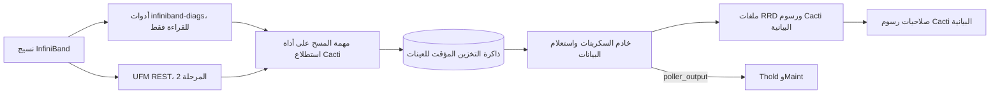

<!-- Source: README.md; SHA256: ce5af61a1bc993ec2aae6d4f22c3885694632f2b1d5eb94e2ce88b8390e96f1e -->

<!-- translations:start -->
[English](../../../README.md) | [简体中文](../zh-CN/README.md) | [हिन्दी](../hi-IN/README.md) | [Español (España)](../es-ES/README.md) | [Español (Latinoamérica)](../es-419/README.md) | [العربية (السعودية)](../ar-SA/README.md) | [Afrikaans](../af-ZA/README.md) | [አማርኛ](../am-ET/README.md) | [العربية (مصر)](README.md) | [العربية (المغرب)](../ar-MA/README.md) | [বাংলা](../bn-BD/README.md) | [Bosanski](../bs-BA/README.md) | [Deutsch](../de-DE/README.md) | [فارسی](../fa-IR/README.md) | [Filipino](../fil-PH/README.md) | [Français](../fr-FR/README.md) | [Français (Maroc)](../fr-MA/README.md) | [Français (Sénégal)](../fr-SN/README.md) | [Hausa](../ha-NG/README.md) | [עברית](../he-IL/README.md) | [Hrvatski](../hr-HR/README.md) | [Bahasa Indonesia](../id-ID/README.md) | [Igbo](../ig-NG/README.md) | [Italiano](../it-IT/README.md) | [日本語](../ja-JP/README.md) | [한국어](../ko-KR/README.md) | [Malagasy](../mg-MG/README.md) | [मराठी](../mr-IN/README.md) | [Bahasa Melayu](../ms-MY/README.md) | [Nederlands](../nl-NL/README.md) | [Polski](../pl-PL/README.md) | [Português (Brasil)](../pt-BR/README.md) | [Русский](../ru-RU/README.md) | [Kinyarwanda](../rw-RW/README.md) | [Soomaali](../so-SO/README.md) | [Српски](../sr-RS/README.md) | [Svenska](../sv-SE/README.md) | [Kiswahili](../sw-KE/README.md) | [தமிழ்](../ta-IN/README.md) | [తెలుగు](../te-IN/README.md) | [ไทย](../th-TH/README.md) | [Türkçe](../tr-TR/README.md) | [Українська](../uk-UA/README.md) | [اردو](../ur-PK/README.md) | [Tiếng Việt](../vi-VN/README.md) | [isiXhosa](../xh-ZA/README.md) | [Yorùbá](../yo-NG/README.md) | [繁體中文](../zh-TW/README.md) | [isiZulu](../zu-ZA/README.md)
<!-- translations:end -->

# plugin_fabric

إضافة لـ Cacti 1.2 تجلب عدّادات منافذ InfiniBand، وعرض الرابط وسرعته، ومؤشرات الازدحام إلى داخل Cacti كأجهزة، ومصادر بيانات، ورسوم بيانية اعتيادية. وبذلك يظهر الرابط الذي استقر تدريبه على 1X بدلاً من 4X كرسم بياني وتنبيه Thold بجانب المضيف الذي يخدمه، ضمن صلاحيات Cacti، مع قدرة Maint على كتم هذا التنبيه.

> **الحالة: قيد التطوير، لا يوجد إصدار بعد.** تم دمج المرحلة الرئيسية 2 (التأسيس) على الفرع `main`، والمرحلة الرئيسية 3 (كائنات Cacti والتنبيه) قيد المراجعة. أكّدت المرحلة الرئيسية 1 التصميم مقارنةً بالوثائق والمصدر الأساسي (PR #71)؛ وتتوفر النتائج مع المصادر في [docs/research/](../../research). وتضيف المرحلة الرئيسية 2 أساس الإضافة:
>
> - التثبيت، والترقية، وإزالة التثبيت، والتحقق الوقائي لإصدار PHP 8.2
> - نطاقات الصلاحيات (realms) للعرض (View) والمشغّل (Operator) والمسؤول (Admin)، والإعدادات
> - سجلات النسيج (fabric records)
> - حدود الأوامر للقراءة فقط لكل من `perfquery` و`ibnetdiscover` و`iblinkinfo`
> - الجرد حسب معرّف GUID، مع معالجة تعارضات الهوية ومقترحات إعادة الربط
> - حالة الرابط وذاكرة التخزين المؤقت لمسح العدّادات
> - صفحات الجرد، والإدارة، والحالة الصحية
>
> وتضيف المرحلة الرئيسية 3 كائنات Cacti:
>
> - قوالب الأجهزة والبيانات والرسوم البيانية المرفقة بصيغة Cacti template XML، واستعلام البيانات "Fabric Port"
> - ربط العقدة بجهاز Cacti، أو إنشاء جهاز عند التأكيد ([ADR 0010](../../decisions/0010-one-device-per-node.md))
> - مصادر بيانات العدّادات للرسوم البيانية، ومصادر بيانات حالة الرابط والمعدل من نوع GAUGE لأداة Thold ([ADR 0011](../../decisions/0011-derive-counters-and-gauge-alert-values.md))
> - معالجة الانقطاعات وقراءة العدّادات الأساسية المشبعة كقيمة غير معروفة ([ADR 0012](../../decisions/0012-saturated-basic-counters-read-as-unknown.md))، وصلاحية العدّادات وروابط الرسوم البيانية في صفحة المنفذ، وتصنيف الازدحام
> - اختبار شامل مع Thold v1.8.2 وMaint v1.3 دون تعديلهما، ومهمة تكامل مستمر (CI) تشغّل أدوات التشخيص الفعلية مقابل نسيج مُحاكى
>
> لا يمكن مسح النسيج إلا من أداة الاستطلاع الرئيسية (main poller) إلى أن يتم دعم مجمّعات البيانات البعيدة في المرحلة 3. تم اختبار الإضافة باستخدام أدوات محاكاة وهمية ومحاكِي النسيج ibsim، ولم تُختبر مطلقًا على نسيج InfiniBand فعلي. وتبقى الفحوصات التي تتطلب نسيجًا فعليًا مفتوحة في جدول الفحوصات الحية بكل صفحة بحثية. هذا المشروع غير تابع لمشروع Cacti.

## أدوار الوصول

| النطاق | الصلاحية |
| --- | --- |
| Fabric View | صفحات المراقبة الحالية. |
| Fabric Operator | المراقبة بالإضافة إلى صفحة العمليات (Operations) وإقرارات الفرز الشخصية. |
| Fabric Admin | صلاحيات المشغّل بالإضافة إلى إجراءات التهيئة والإدارة الحالية. |

بعد نسخ ملفات الترقية، افتح صفحة الإضافات (Plugins) بصفتك مسؤولًا لتسجيل
النطاق الجديد. عيّن نطاق المشغّل (Operator) صراحةً ضمن **Configuration > Users** أو مجموعات المستخدمين.
تحتفظ الترقيات بمعرّفات ومنح نطاقَي العرض (View) والمسؤول (Admin) الحالية. ترث صلاحية المسؤول
صلاحية المشغّل، وترث صلاحية المشغّل صلاحية العرض في كل طلب؛
ولا يضيف ذلك منحًا مخزّنة إلى المستخدمين أو المجموعات. كما تتطلب إعدادات الإضافة
صلاحية Fabric Admin بالإضافة إلى إذن الإعدادات في Cacti.

تظل أذونات أجهزة Cacti تحدّ من الصفوف والإجراءات المتاحة لكل مستخدم؛ وتتطلب الكائنات غير المربوطة مسؤولًا.
وتبقى بيانات الاعتماد، والتهيئة، والربط، والحذف، والتغييرات الإدارية الأخرى
في الصفحات الإدارية. وتستمر الإقرارات في جلسة المستخدم الحالية فقط،
لمدة ساعة واحدة كحد أقصى وطالما بقيت الملاحظة نفسها حديثة.
وتُبطلها أي ملاحظات جديدة أو متغيرة. وهي لا تُعلّم أي قياس فاشل على أنه سليم ولا تكتم التنبيهات أبدًا.

## لماذا

لا يزال رابط InfiniBand المتدهور يمرّر حركة البيانات. فعندما يعيد رابط 4X التدريب عند 1X يظل المنفذ في حالة «نشط»، وتبدو الرسوم البيانية لواجهة SNMP الخاصة بالمضيف طبيعية، لكن المهام المترابطة بإحكام تتباطأ. الدليل موجود داخل النسيج نفسه: فكل منفذ يُبلغ عن العرض والسرعة النشطين والمُمكّنين والمدعومين، بالإضافة إلى عدّادات الأخطاء والازدحام. وتتطلب قراءة هذه البيانات أدوات تشخيص InfiniBand أو واجهة برمجة تطبيقات مدير النسيج. وعند تشغيلها يدويًا، تترك ثلاث فجوات:

- **لا يوجد سجل تاريخي.** تعرض أداتا `perfquery` و`iblinkinfo` الحالة الراهنة فقط، لذلك لا يمكن رؤية رابط تدهور الأسبوع الماضي.
- **لا يوجد سياق للأجهزة.** منافذ النسيج ليست كائنات في Cacti، وبالتالي لا يمكن رسم المنفذ بيانيًا بجانب المضيف الذي يغذيه.
- **لا يوجد مسار إلى تنبيهات Cacti.** تعمل أداتا Thold وMaint على مصادر بيانات وأجهزة Cacti.

تسدّ الإضافة هذه الفجوات عبر قراءة النسيج من خلال أدوات التشخيص الخاصة بها (ولاحقًا عبر UFM)، وتحديد العقد والمنافذ بواسطة GUID، ونشر العدّادات وحالة الرابط كمصادر بيانات في Cacti. وهي للقراءة فقط: لا تقوم أبدًا بإعادة تعيين العدّادات أو تغيير حالة المنفذ.

## الاكتشاف الأول

لا يحتوي النسيج الجديد على أي عقد، وتبدأ عمليات المسح من خادم السكربتات فقط للعقدة المربوطة بجهاز Cacti. لذلك يُعد الاكتشاف الأول خطوة يدوية. بعد حفظ نسيج مُمكّن، شغّل هذا الأمر مرة واحدة على أداة الاستطلاع (poller) المُعيّن لها النسيج، بحساب أداة الاستطلاع، مع استبدال `/path/to/cacti` بمسار مجلد Cacti لديك (يعمل المسار المطلق أيضًا من cron):

```
php /path/to/cacti/plugins/fabric/fabric_sweep.php --fabric=ID --force
```

بعد ذلك يمتلئ الجرد. اربط العقد بأجهزة Cacti في صفحة Fabric Admin؛ وتبدأ عمليات المسح اللاحقة من استعلام البيانات. وما لم يتم ربط أي عقدة من النسيج، لن يقوم أي شيء بتحديث جرده، لذا شغّل الأمر نفسه مرة أخرى، عبر cron إذا أردت، لتسجيل العقد الجديدة أو المفقودة. وتعرض صفحة الحالة الصحية هذا الأمر لأي نسيج مُمكّن لم يُكتشف بعد أو لا يحتوي على عقدة مربوطة.

## النطاق المخطط له

| المرحلة | النطاق | المراحل الرئيسية |
|---|---|---|
| 0، البحث | مصفوفة الإصدارات، تأكيد السلوك في المصدر الأساسي، سلوك العدّادات على العتاد، نموذج الصلاحيات، ميزانية MAD، واجهة UFM API | [M1](https://github.com/somethingwithproof/plugin_fabric/milestone/1) |
| 1، المراقبة | الجرد بواسطة GUID، أجهزة Cacti، استعلام بيانات المنفذ، مصادر بيانات العدّادات وحالة الرابط، تنبيهات Thold، الكتم عبر Maint، صفحة الحالة الصحية | [M2](https://github.com/somethingwithproof/plugin_fabric/milestone/2)، [M3](https://github.com/somethingwithproof/plugin_fabric/milestone/3)، [M4](https://github.com/somethingwithproof/plugin_fabric/milestone/4) |
| 2، UFM | واجهة خلفية UFM REST للقراءة فقط، إدارة بيانات الاعتماد، استمرارية الهوية بين الواجهات الخلفية | [M5](https://github.com/somethingwithproof/plugin_fabric/milestone/5) |
| 3، التشغيل البعيد | مجمّعات البيانات البعيدة، النسخ المتماثل، إجراءات `remote_agent`، عمليات مسح مجزّأة للأنسجة الكبيرة | [M6](https://github.com/somethingwithproof/plugin_fabric/milestone/6) |

خارج النطاق: تغيير حالة النسيج، استبدال مدير النسيج أو مدير الشبكة الفرعية، محرك تنبيهات خاص بالإضافة، خدمة خلفية أو بروتوكول شبكة مخصص، وأنسجة Ethernet أو RoCE (قيد البحث).

## أهداف التوافق

| المكوّن | الهدف |
|---|---|
| Cacti | 1.2.31 أو أحدث، دون تعديلات على النواة |
| PHP | 8.2 أو أحدث؛ يظل `setup.php` قابلًا للتحليل على 8.0 بحيث تحصل بيئة التشغيل غير المدعومة على رفض واضح بدلًا من تعطل واجهة Cacti |
| أدوات InfiniBand | infiniband-diags من rdma-core؛ تم التحقق من تنسيقات المخرجات مقابل مصدر v66.0 |
| UFM | واجهة UFM Enterprise REST API، المرحلة 2؛ مصفوفة الإصدارات من مخرجات المرحلة الرئيسية 1 |
| Thold وMaint | لا تتطلب أي تغييرات |

حافظ على مهلة السكربت في Cacti عند قيمتها الافتراضية 25 ثانية أو أعلى. عند بدء مسح عبر قراءة استعلام البيانات، يتم تقييد تنفيذ الأداة بهذه المهلة مطروحًا منها خمس ثوانٍ، لحجز وقت لقراءة الذاكرة المؤقتة والرد. وعند انتهاء الوقت المخصص، يقدّم الاستعلام آخر عينة حالية أو قيمة غير معروفة؛ وتعيد الدورة التالية محاولة المسح. ينطبق هذا الحد أيضًا على أداة استطلاع PHP. فالمهلة التي تبلغ خمس ثوانٍ أو أقل لا تترك وقتًا لبدء تشغيل أي أداة.

## التصميم

- [docs/PLAN.md](../../PLAN.md) هي الخطة الكاملة: البنية المعمارية، والحقائق الأساسية التي تعتمد عليها (مع المصادر) والافتراضات التي لا تزال بحاجة للتأكيد، ونموذج الهوية، وقواعد العدّادات وحالة الرابط، والحدود الأمنية، وحسابات الأداء، والاختبارات، والمخاطر.
- يحتوي [docs/decisions/](../../decisions) على سجلات القرارات المعمارية للخيارات التي تم حسمها بالفعل.
- يربط [docs/REQUIREMENTS.md](../../REQUIREMENTS.md) كل معرّف متطلب بالمشكلة الخاصة به.



## كيفية تتبّع العمل

- تتبع **المراحل الرئيسية** المراحل الرئيسية للخطة. ولكل منها مشكلة رئيسية (epic) تسرد مشكلاتها الفرعية وأدلة الاكتمال.
- تُصنّف **المشكلات** حسب التسمية: `type: requirement`، و`type: research`، و`type: decision`، و`type: epic`. وتنص مشكلات المتطلبات على متطلبات مرقّمة وقابلة للاختبار (`REQ-AREA-NNN`) ومعايير القبول.
- تحمل **التسميات** أيضًا `area:` و`phase:` و`priority:` و`status:`. راجع [CONTRIBUTING.md](../../../CONTRIBUTING.md#labels).
- تعرض [لوحة المشروع](https://github.com/users/somethingwithproof/projects/8) جميع المشكلات عبر المراحل الرئيسية.

## المساهمة

اقرأ [CONTRIBUTING.md](../../../CONTRIBUTING.md). تتطلب الإيداعات توقيع DCO sign-off. تجري مناقشات التصميم داخل المشكلات؛ وتحمل القرارات المفتوحة التسمية `type: decision`.

## الأمان

أبلغ عن الثغرات الأمنية بشكل خاص؛ راجع [SECURITY.md](../../../SECURITY.md).

## الترخيص

رخصة GNU General Public License v2.0، وهي نفس رخصة Cacti وإضافاته. راجع [LICENSE](../../../LICENSE).
