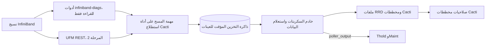

<!-- Source: README.md; SHA256: ce5af61a1bc993ec2aae6d4f22c3885694632f2b1d5eb94e2ce88b8390e96f1e -->

<!-- translations:start -->
[English](../../../README.md) | [简体中文](../zh-CN/README.md) | [हिन्दी](../hi-IN/README.md) | [Español (España)](../es-ES/README.md) | [Español (Latinoamérica)](../es-419/README.md) | [العربية (السعودية)](../ar-SA/README.md) | [Afrikaans](../af-ZA/README.md) | [አማርኛ](../am-ET/README.md) | [العربية (مصر)](../ar-EG/README.md) | [العربية (المغرب)](README.md) | [বাংলা](../bn-BD/README.md) | [Bosanski](../bs-BA/README.md) | [Deutsch](../de-DE/README.md) | [فارسی](../fa-IR/README.md) | [Filipino](../fil-PH/README.md) | [Français](../fr-FR/README.md) | [Français (Maroc)](../fr-MA/README.md) | [Français (Sénégal)](../fr-SN/README.md) | [Hausa](../ha-NG/README.md) | [עברית](../he-IL/README.md) | [Hrvatski](../hr-HR/README.md) | [Bahasa Indonesia](../id-ID/README.md) | [Igbo](../ig-NG/README.md) | [Italiano](../it-IT/README.md) | [日本語](../ja-JP/README.md) | [한국어](../ko-KR/README.md) | [Malagasy](../mg-MG/README.md) | [मराठी](../mr-IN/README.md) | [Bahasa Melayu](../ms-MY/README.md) | [Nederlands](../nl-NL/README.md) | [Polski](../pl-PL/README.md) | [Português (Brasil)](../pt-BR/README.md) | [Русский](../ru-RU/README.md) | [Kinyarwanda](../rw-RW/README.md) | [Soomaali](../so-SO/README.md) | [Српски](../sr-RS/README.md) | [Svenska](../sv-SE/README.md) | [Kiswahili](../sw-KE/README.md) | [தமிழ்](../ta-IN/README.md) | [తెలుగు](../te-IN/README.md) | [ไทย](../th-TH/README.md) | [Türkçe](../tr-TR/README.md) | [Українська](../uk-UA/README.md) | [اردو](../ur-PK/README.md) | [Tiếng Việt](../vi-VN/README.md) | [isiXhosa](../xh-ZA/README.md) | [Yorùbá](../yo-NG/README.md) | [繁體中文](../zh-TW/README.md) | [isiZulu](../zu-ZA/README.md)
<!-- translations:end -->

# plugin_fabric

إضافة (plugin) لـ Cacti 1.2 تُدرج عدّادات منافذ InfiniBand، وعرض وسرعة الرابط، ومؤشرات الازدحام في Cacti كأجهزة ومصادر بيانات ومخططات عادية. وبذلك، يظهر أي رابط جرى تدريبه على 1X بدلاً من 4X كمخطط وكتنبيه Thold بجانب المضيف (host) الذي يخدمه، ضمن صلاحيات Cacti، مع إمكانية كتمه عبر Maint.

> **الحالة: قيد التطوير، لا يوجد إصدار رسمي بعد.** تم دمج المرحلة 2 (الأساس) في `main`، والمرحلة 3 (كائنات Cacti والتنبيهات) قيد المراجعة. أكدت المرحلة 1 التصميم استناداً إلى التوثيق والكود المصدري الأصلي (PR #71)؛ والنتائج، مع مصادرها، متوفرة في [docs/research/](../../research). تضيف المرحلة 2 أساس الإضافة:
>
> - التثبيت، والترقية، وإلغاء التثبيت، وحماية PHP 8.2
> - صلاحيات (realms) View وOperator وAdmin، والإعدادات
> - سجلات النسيج (fabric records)
> - واجهة الأوامر للقراءة فقط لـ `perfquery` و`ibnetdiscover` و`iblinkinfo`
> - الجرد حسب GUID، مع تعارضات الهوية ومقترحات إعادة الربط
> - حالة الرابط وذاكرة التخزين المؤقت لمسح العدّادات
> - صفحات الجرد والإدارة والحالة الصحية
>
> تضيف المرحلة 3 كائنات Cacti:
>
> - قوالب الأجهزة والبيانات والمخططات بصيغة XML لقوالب Cacti، واستعلام بيانات "Fabric Port"
> - ربط عقدة (node) بجهاز Cacti، أو إنشاء جهاز عند التأكيد ([ADR 0010](../../decisions/0010-one-device-per-node.md))
> - مصادر بيانات العدّادات للمخططات، ومصادر بيانات GAUGE لحالة الرابط والمعدل لـ Thold ([ADR 0011](../../decisions/0011-derive-counters-and-gauge-alert-values.md))
> - التعامل مع الانقطاعات والعدّادات الأساسية المشبعة المقروءة كغير معروفة ([ADR 0012](../../decisions/0012-saturated-basic-counters-read-as-unknown.md))، وصلاحية العدّادات وروابط المخططات في صفحة المنفذ، وترتيب الازدحام
> - اختبار شامل (end-to-end) مع Thold v1.8.2 وMaint v1.3 بدون تعديل، ومهمة CI تشغّل أدوات التشخيص الحقيقية على نسيج محاكى
>
> لا يمكن مسح النسيج إلا من أداة الاستطلاع الرئيسية (main poller) إلى حين دعم مجمّعات البيانات البعيدة في المرحلة 3. وقد تم اختباره باستخدام أدوات وهمية ومحاكِي النسيج ibsim، ولم يُختبر قط على نسيج InfiniBand حقيقي. تبقى الفحوصات التي تتطلب نسيجاً فعلياً مفتوحة في جدول الفحوصات المباشرة في كل صفحة بحث. هذا المشروع غير تابع لمشروع Cacti.

## أدوار الوصول

| النطاق (Realm) | الوصول |
| --- | --- |
| Fabric View | صفحات المراقبة الحالية. |
| Fabric Operator | المراقبة بالإضافة إلى صفحة العمليات وإقرارات الفرز الشخصية (triage acknowledgments). |
| Fabric Admin | وصول المشغّل (Operator) بالإضافة إلى الإعدادات الحالية والإجراءات الإدارية. |

بعد نسخ ملفات الترقية، افتح صفحة الإضافات (Plugins) بصفتك مديراً لتسجيل النطاق الجديد. عيّن نطاق Operator بشكل صريح ضمن **Configuration > Users** أو مجموعات المستخدمين. تحتفظ الترقيات بمعرّفات نطاقي View وAdmin الحالية ومنحهما. يرث وصول Admin وصول Operator، ويرث وصول Operator وصول View في كل طلب؛ ولا يضيف هذا منحاً مخزّنة للمستخدمين أو المجموعات. كما تتطلب إعدادات الإضافة صلاحية Fabric Admin بالإضافة إلى صلاحية Settings في Cacti.

تستمر صلاحيات أجهزة Cacti في تقييد الصفوف والإجراءات المتاحة لكل مستخدم؛ وتتطلب الكائنات غير المربوطة مديراً. تبقى بيانات الاعتماد، والإعدادات، والربط، والحذف، وسائر التغييرات الإدارية في الصفحات الإدارية. وتستمر الإقرارات فقط في جلسة المستخدم الحالية، لمدة ساعة واحدة على الأكثر، وفقط ما دامت الملاحظة نفسها حديثة (fresh). وتُبطلها الملاحظات الجديدة أو المتغيرة. كما أنها لا تجعل أبداً قياساً فاشلاً يبدو سليماً ولا تكتم التنبيهات.

## لماذا

لا يزال رابط InfiniBand المتدهور يمرّر حركة البيانات. فالرابط 4X الذي يُعاد تدريبه على 1X يُبقي المنفذ في حالة «نشط» (active)، وتبدو مخططات واجهة SNMP الخاصة بالمضيف طبيعية، غير أن المهام مترابطة التنفيذ (tightly coupled jobs) تتباطأ. والدليل موجود في النسيج نفسه: إذ يبلّغ كل منفذ عن عرضه وسرعته النشطة والمفعّلة والمدعومة، إضافة إلى عدّادات الأخطاء والازدحام. وتتطلب قراءة ذلك أدوات تشخيص InfiniBand أو واجهة برمجة تطبيقات مدير النسيج. وعند تشغيلها يدوياً، تترك ثلاث فجوات:

- **انعدام السجل التاريخي.** تعرض `perfquery` و`iblinkinfo` الحالة الراهنة فقط، مما يجعل الرابط الذي تدهور الأسبوع الماضي غير مرئي.
- **غياب سياق الجهاز.** منافذ النسيج ليست كائنات في Cacti، لذا لا يمكن رسم مخطط للمنفذ بجانب المضيف الذي يغذّيه.
- **انعدام المسار نحو تنبيهات Cacti.** تعمل Thold وMaint على مصادر بيانات وأجهزة Cacti.

تسدّ الإضافة هذه الفجوات عبر قراءة النسيج من خلال أدوات التشخيص الخاصة به (ولاحقاً عبر UFM)، وتحديد العقد والمنافذ بواسطة GUID، ونشر العدّادات وحالة الرابط كمصادر بيانات في Cacti. وهي للقراءة فقط: لا تُعيد تعيين العدّادات ولا تغيّر حالة المنفذ أبداً.

## الاكتشاف الأول

لا يحتوي النسيج الجديد على أي عقد، ولا تبدأ عمليات المسح من خادم السكربتات (script server) إلا لعقدة مربوطة بجهاز Cacti. لذا يُعدّ الاكتشاف الأول خطوة يدوية. بعد حفظ نسيج مفعّل، شغّل هذا الأمر مرة واحدة على أداة الاستطلاع (poller) المُعيّن لها النسيج، بحساب أداة الاستطلاع، مع استبدال `/path/to/cacti` بمسار دليل Cacti لديك (يعمل المسار المطلق أيضاً من cron):

```
php /path/to/cacti/plugins/fabric/fabric_sweep.php --fabric=ID --force
```

عندها يمتلئ المخزون (inventory). اربط العقد بأجهزة Cacti في صفحة Fabric Admin؛ وتبدأ عمليات المسح اللاحقة من استعلام البيانات. وما دامت أي عقدة في النسيج غير مربوطة، فلن يُحدّث شيء مخزونه، لذلك أعد تشغيل الأمر نفسه، من cron إن شئت، لتسجيل العقد الجديدة أو المفقودة. وتعرض صفحة الحالة الصحية هذا الأمر لأي نسيج مفعّل لم يُكتشف بعد أو لا يحتوي على أي عقدة مربوطة.

## النطاق المخطط

| المرحلة | النطاق | المعالم (Milestones) |
|---|---|---|
| 0، البحث | مصفوفة الإصدارات، تأكيد السلوك الأصلي، سلوك العدّادات على العتاد، نموذج الصلاحيات، ميزانية MAD، واجهة برمجة تطبيقات UFM | [M1](https://github.com/somethingwithproof/plugin_fabric/milestone/1) |
| 1، المراقبة | الجرد حسب GUID، أجهزة Cacti، استعلام بيانات المنافذ، مصادر بيانات العدّادات وحالة الرابط، تنبيهات Thold، الكتم عبر Maint، صفحة الحالة الصحية | [M2](https://github.com/somethingwithproof/plugin_fabric/milestone/2)، [M3](https://github.com/somethingwithproof/plugin_fabric/milestone/3)، [M4](https://github.com/somethingwithproof/plugin_fabric/milestone/4) |
| 2، UFM | واجهة خلفية UFM REST للقراءة فقط، معالجة بيانات الاعتماد، استمرارية الهوية بين الواجهات الخلفية | [M5](https://github.com/somethingwithproof/plugin_fabric/milestone/5) |
| 3، البُعد | مجمّعات البيانات البعيدة، النسخ المتماثل، إجراءات `remote_agent`، عمليات المسح المجزّأة للأنسجة الكبيرة | [M6](https://github.com/somethingwithproof/plugin_fabric/milestone/6) |

خارج النطاق: تغيير حالة النسيج، أو استبدال مدير النسيج أو مدير الشبكة الفرعية (subnet manager)، أو إنشاء محرك تنبيهات خاص بالإضافة، أو برنامج خفي (daemon) أو بروتوكول شبكة مخصص، وشبكات Ethernet أو RoCE (قيد البحث).

## أهداف التوافق

| المكوّن | الهدف |
|---|---|
| Cacti | 1.2.31 أو أحدث، دون تعديلات على النواة |
| PHP | 8.2 أو أحدث؛ يبقى `setup.php` قابلاً للتحليل على 8.0 بحيث يتلقى وقت التشغيل غير المدعوم رفضاً بدلاً من تعطل واجهة Cacti |
| أدوات InfiniBand | infiniband-diags من rdma-core؛ تم التحقق من صيغ المخرجات مقابل الكود المصدري للإصدار v66.0 |
| UFM | واجهة UFM Enterprise REST API، المرحلة 2؛ مصفوفة الإصدارات من مخرجات المعلم 1 |
| Thold، Maint | لا يتطلبان أي تغييرات |

أبقِ مهلة السكربت في Cacti عند قيمتها الافتراضية البالغة 25 ثانية أو أعلى. فالمسح الذي تبدؤه قراءة استعلام بيانات يقيّد تنفيذ الأداة بتلك المهلة ناقص خمس ثوانٍ، لحجز وقت لقراءة ذاكرة التخزين المؤقت والرد. وعند انتهاء الميزانية الزمنية، يقدّم الاستعلام آخر عينة حالية أو قيمة غير معروفة (unknown)؛ وتعيد الدورة التالية محاولة المسح. ينطبق هذا القيد أيضاً على أداة استطلاع PHP (PHP poller). ولا تترك مهلة خمس ثوانٍ أو أقل أي وقت لبدء تشغيل أداة.

## التصميم

- [docs/PLAN.md](../../PLAN.md) هي الخطة الكاملة: البنية المعمارية، والحقائق الأصلية التي تعتمد عليها (مع المصادر) والافتراضات التي لا تزال بحاجة إلى تأكيد، ونموذج الهوية، وقواعد العدّادات وحالة الرابط، والحدود الأمنية، وحسابات الأداء، والاختبارات، والمخاطر.
- [docs/decisions/](../../decisions) يحتوي على سجلات القرارات المعمارية للخيارات المتخذة بالفعل.
- [docs/REQUIREMENTS.md](../../REQUIREMENTS.md) يربط كل معرّف متطلب بتذكرته (issue).



## كيفية تتبع العمل

- **المعالم (Milestones)** تتبع معالم الخطة. لكل معلم تذكرة رئيسية (epic) تسرد التذاكر الفرعية وأدلة الإنجاز.
- **التذاكر (Issues)** مصنّفة بالوسوم: `type: requirement`، `type: research`، `type: decision`، `type: epic`. تحدد تذاكر المتطلبات متطلبات مرقّمة وقابلة للاختبار (`REQ-AREA-NNN`) ومعايير القبول.
- **الوسوم (Labels)** تحمل أيضاً `area:` و`phase:` و`priority:` و`status:`. راجع [CONTRIBUTING.md](../../../CONTRIBUTING.md#labels).
- تعرض [لوحة المشروع](https://github.com/users/somethingwithproof/projects/8) جميع التذاكر عبر المعالم.

## المساهمة

اقرأ [CONTRIBUTING.md](../../../CONTRIBUTING.md). تتطلب الإيداعات (commits) توقيع DCO (sign-off). وتجري مناقشة التصميم في التذاكر؛ وتحمل القرارات المفتوحة الوسم `type: decision`.

## الأمان

بلّغ عن الثغرات الأمنية بشكل خاص؛ راجع [SECURITY.md](../../../SECURITY.md).

## الترخيص

رخصة GNU العمومية الإصدار 2.0 (GNU General Public License v2.0)، وهي الرخصة نفسها الخاصة بـ Cacti وإضافاته. راجع [LICENSE](../../../LICENSE).
