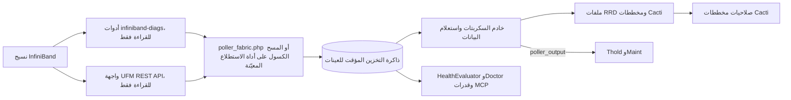

<!-- Source: README.md; SHA256: 79a16fb906f96ee79de2c719f18c38836f555440a7571a4a5ba38c64bb5b099f -->

<!-- translations:start -->
[English](../../../README.md) | [简体中文](../zh-CN/README.md) | [हिन्दी](../hi-IN/README.md) | [Español (España)](../es-ES/README.md) | [Español (Latinoamérica)](../es-419/README.md) | [العربية (السعودية)](../ar-SA/README.md) | [Afrikaans](../af-ZA/README.md) | [አማርኛ](../am-ET/README.md) | [العربية (مصر)](../ar-EG/README.md) | [العربية (المغرب)](README.md) | [বাংলা](../bn-BD/README.md) | [Bosanski](../bs-BA/README.md) | [Deutsch](../de-DE/README.md) | [فارسی](../fa-IR/README.md) | [Filipino](../fil-PH/README.md) | [Français](../fr-FR/README.md) | [Français (Maroc)](../fr-MA/README.md) | [Français (Sénégal)](../fr-SN/README.md) | [Hausa](../ha-NG/README.md) | [עברית](../he-IL/README.md) | [Hrvatski](../hr-HR/README.md) | [Bahasa Indonesia](../id-ID/README.md) | [Igbo](../ig-NG/README.md) | [Italiano](../it-IT/README.md) | [日本語](../ja-JP/README.md) | [한국어](../ko-KR/README.md) | [Malagasy](../mg-MG/README.md) | [मराठी](../mr-IN/README.md) | [Bahasa Melayu](../ms-MY/README.md) | [Nederlands](../nl-NL/README.md) | [Polski](../pl-PL/README.md) | [Português (Brasil)](../pt-BR/README.md) | [Русский](../ru-RU/README.md) | [Kinyarwanda](../rw-RW/README.md) | [Soomaali](../so-SO/README.md) | [Српски](../sr-RS/README.md) | [Svenska](../sv-SE/README.md) | [Kiswahili](../sw-KE/README.md) | [தமிழ்](../ta-IN/README.md) | [తెలుగు](../te-IN/README.md) | [ไทย](../th-TH/README.md) | [Türkçe](../tr-TR/README.md) | [Українська](../uk-UA/README.md) | [اردو](../ur-PK/README.md) | [Tiếng Việt](../vi-VN/README.md) | [isiXhosa](../xh-ZA/README.md) | [Yorùbá](../yo-NG/README.md) | [繁體中文](../zh-TW/README.md) | [isiZulu](../zu-ZA/README.md)
<!-- translations:end -->

# plugin_fabric

إضافة (plugin) لـ Cacti 1.2 (`fabric`، الإصدار `0.1.0-dev`) تُدرج عدّادات منافذ InfiniBand، وعرض وسرعة الرابط، ومؤشرات الازدحام في Cacti كأجهزة ومصادر بيانات ومخططات عادية. وبذلك، يظهر أي رابط جرى تدريبه على 1X بدلاً من 4X كمخطط وكتنبيه Thold بجانب المضيف الذي يخدمه، ضمن صلاحيات Cacti، مع الوعي بـ Maint وكتم التنبيهات بواسطته.

> **الحالة: قيد التطوير، لا يوجد إصدار رسمي بعد.** ينفّذ هذا الفرع أساس الإضافة، وكائنات Cacti والتنبيهات، وعمليات المسح المجدولة في الخلفية لأداة الاستطلاع، والنسخ المتماثل إلى مجمّعات البيانات البعيدة، وواجهة خلفية لـ NVIDIA UFM REST للقراءة فقط مع خزنة مشفرة لبيانات الاعتماد، وإدارة Configuration-as-Code (CasC) عبر سطر الأوامر، وخطافات منظومة Cacti (CasC وDoctor وMCP / Abilities API v2). وقد جرى اختبارها مقابل أدوات وهمية، ووسائط نقل UFM اصطناعية، ومحاكِي النسيج `ibsim` (rdma-core 50.0)، ولم تُختبر قط على نسيج InfiniBand فعلي أو خادم UFM مباشر. تبقى الفحوصات التي تتطلب عتاداً مفتوحة في [docs/research/](../../research/). هذا المشروع غير تابع لمشروع Cacti.

## ما تم تنفيذه

- **دورة الحياة والمخطط (v3)**: التثبيت، والترقية المتكررة دون أثر جانبي، وإلغاء التثبيت (مع الإبقاء على جداول الإضافة افتراضياً)، وحارس متطلب PHP 8.2 مع إبقاء نقاط الدخول قابلة للتحليل على PHP 8.0.
- **أدوار الوصول والصفحات**: نطاقات الصلاحيات `Fabric View` (`fabric.php`) و`Fabric Operator` (`fabric_operator.php`) و`Fabric Admin` (`fabric_admin.php` و`fabric_health.php`)، إضافةً إلى علامة تبويب للإعدادات ضمن **Configuration > Settings > Fabrics**.
- **واجهة تشخيص خلفية للقراءة فقط (`diags`)**: تنفيذ صارم بمتجه المعاملات لأدوات `perfquery` و`ibnetdiscover` و`iblinkinfo`، والجرد حسب GUID مع اكتشاف تعارضات الهوية ومقترحات إعادة الربط، وتقييم حالة الرابط، وعمليات مسح العدّادات لكل عقدة.
- **واجهة NVIDIA UFM REST خلفية للقراءة فقط (`ufm`) وخزنة مشفرة**: عميل REST يقتصر على GET وبقائمة مسموح بها (`/ufmRest/resources/ports` و`/ufmRest/resources/systems` و`/ufmRest/monitoring/session/0/data` وما يقابلها في `/ufmRestV3/...` لمصادقة الرمز المميز) يغذّي جداول الجرد وحالة الرابط والعينات والحالة الصحية نفسها التي تغذّيها `diags`. تُخزّن بيانات الاعتماد (`token` أو `basic`) مشفرة بخوارزمية AES-256-GCM في `plugin_fabric_secret` باستخدام ملف مفتاح خارجي بطول 256 بت مهيأ عبر `fabric_vault_key_file`. يمكن تعريف أنسجة UFM عبر CasC (`cli/fabric.php`) أو المستودعات؛ ويعرض نموذج إدارة الويب حاليًا حقول `diags`.
- **كائنات Cacti وThold وMaint**: قوالب الأجهزة والبيانات والمخططات لـ Cacti (`templates/fabric-templates.xml`)، واستعلام بيانات خادم السكربتات "Fabric Port" (`scripts/ss_fabric_ports.php` و`resource/script_server/fabric_ports.xml`)، ومصادر بيانات العدّادات `DERIVE` ومصادر بيانات `GAUGE` لحالة الرابط ومعدلاته لأداة Thold، وتتبع الانقطاعات، وإبلاغ العدّادات الأساسية المشبعة كقيمة `U`. يستعلم تكامل Maint (`MaintMaintenance`) عن `plugin_maint_check_cacti_host()` (مع الرجوع إلى خطاف `is_device_in_maintenance`) لعدّ العقد الموجودة في صيانة نشطة بشكل منفصل واستبعادها من تحذيرات الحالة الصحية الخاصة بعمليات المسح الفاشلة والمنافذ المتدهورة.
- **عمليات المسح المجدولة والتجزئة ومجمّعات البيانات البعيدة**: يشغّل `poller_bottom` ملف `poller_fabric.php` في الخلفية للأنسجة المستحقة المعيّنة لأداة الاستطلاع الحالية، إلى جانب عمليات المسح الكسولة التي يطلقها خادم السكربتات. يعلن `INFO` عن `remote_collect:1, remote_poller:1`، ويدعم `poller_fabric.php` التجزئة الحتمية حسب GUID (`--shard=K/N`)، وينسخ `replicate_out` صفوف `plugin_fabric_fabric` غير السرية إلى مجمّعات البيانات البعيدة (`poller_id >= 2`). لا تُنسخ أبداً إدخالات الخزنة (`plugin_fabric_secret`) ولا ملفات المفاتيح الخارجية.
- **واجهة سطر أوامر CasC وخطافات المنظومة**: `cli/fabric.php` لتصدير YAML/XML والتحقق والتخطيط التجريبي للفروقات والتطبيق المقترن بالتأكيد وإعداد تقارير الحالة الصحية، إضافةً إلى خطافات `casc_register_providers` و`doctor_register_checks` و`abilities_register`.

## أدوار الوصول

| النطاق | الصلاحية |
| --- | --- |
| Fabric View | مراقبة المخزون وعروض المنافذ (`fabric.php`). |
| Fabric Operator | صلاحية View بالإضافة إلى صفحة العمليات (`fabric_operator.php`) وإقرارات الفرز الشخصية. |
| Fabric Admin | صلاحية Operator بالإضافة إلى الإعدادات والإجراءات الإدارية (`fabric_admin.php`) وصفحة الحالة الصحية (`fabric_health.php`). |

بعد نسخ ملفات الترقية، افتح صفحة الإضافات (Plugins) بصفتك مديراً لتسجيل النطاقات والخطافات الجديدة. عيّن نطاق Operator بشكل صريح ضمن **Configuration > Users** أو مجموعات المستخدمين. تحتفظ الترقيات بمعرّفات نطاقي View وAdmin الحالية ومنحهما. يرث وصول Admin وصول Operator، ويرث وصول Operator وصول View في كل طلب؛ ولا يضيف هذا منحاً مخزّنة للمستخدمين أو المجموعات. كما تتطلب إعدادات الإضافة صلاحية Fabric Admin بالإضافة إلى صلاحية Settings في Cacti.

تقيّد صلاحيات أجهزة Cacti الصفوف والإجراءات المتاحة لكل مستخدم؛ وتتطلب الكائنات غير المربوطة مديراً. تبقى بيانات الاعتماد، والإعدادات، والربط، والحذف، وسائر التغييرات الإدارية في الصفحات الإدارية أو سطر الأوامر. وتستمر الإقرارات فقط في جلسة المستخدم الحالية، لمدة ساعة واحدة على الأكثر، وفقط ما دامت الملاحظة نفسها حديثة. وتُبطلها الملاحظات الجديدة أو المتغيرة. كما أنها لا تجعل أبداً قياساً فاشلاً يبدو سليماً ولا تكتم التنبيهات.

## لماذا

لا يزال رابط InfiniBand المتدهور يمرّر حركة البيانات. فالرابط 4X الذي يُعاد تدريبه على 1X يُبقي المنفذ في حالة «نشط»، وتبدو مخططات واجهة SNMP الخاصة بالمضيف طبيعية، غير أن المهام مترابطة التنفيذ تتباطأ. والدليل موجود في النسيج نفسه: إذ يبلّغ كل منفذ عن عرضه وسرعته النشطة والمفعّلة والمدعومة، إضافةً إلى عدّادات الأخطاء والازدحام. وتتطلب قراءة ذلك أدوات تشخيص InfiniBand أو واجهة برمجة تطبيقات مدير النسيج. وعند تشغيلها يدوياً، تترك ثلاث فجوات:

- **انعدام السجل التاريخي.** تعرض `perfquery` و`iblinkinfo` الحالة الراهنة فقط، مما يجعل الرابط الذي تدهور الأسبوع الماضي غير مرئي.
- **غياب سياق الجهاز.** منافذ النسيج ليست كائنات في Cacti، لذا لا يمكن رسم مخطط للمنفذ بجانب المضيف الذي يغذّيه.
- **انعدام المسار نحو تنبيهات Cacti.** تعمل Thold وMaint على مصادر بيانات وأجهزة Cacti.

تسدّ الإضافة هذه الفجوات عبر قراءة النسيج من خلال `infiniband-diags` أو واجهة NVIDIA UFM REST API، وتحديد العقد والمنافذ بواسطة GUID، ونشر العدّادات وحالة الرابط كمصادر بيانات في Cacti. وهي للقراءة فقط: لا تُعيد تعيين العدّادات ولا تغيّر حالة المنفذ أبداً.

## العمليات وسطر الأوامر

### أداة الاستطلاع في الخلفية وعمليات المسح اليدوية

يبدأ `fabric_poller_bottom()` تشغيل `poller_fabric.php` في الخلفية على كل أداة استطلاع للأنسجة المفعّلة المعيّنة لذلك الـ `poller_id` والتي حان موعد مسحها. يمكنك أيضاً تشغيل منفّذ أداة الاستطلاع أو مسح يدوي مباشرة على أداة الاستطلاع المعيّنة بحساب أداة الاستطلاع (مع استبدال `/path/to/cacti` بمسار دليل Cacti لديك):

```sh
php /path/to/cacti/plugins/fabric/poller_fabric.php [--fabric=ID] [--shard=K/N] [--force] [--debug]
php /path/to/cacti/plugins/fabric/fabric_sweep.php --fabric=ID [--node=GUID] [--force]
```

- يشغّل `poller_fabric.php` جميع الأنسجة المستحقة لأداة الاستطلاع المحلية (أو نسيجاً واحداً عبر `--fabric=ID`)، ويفرض قفل سجل العمليات في Cacti وعقود `ClaimRepository` بميزانية زمنية قدرها `max(30, intdiv(sweep_interval, 2))` ثانية، ويدعم `--shard=K/N` (`0 <= K < N`) لتجزئة عمليات مسح عدّادات عقد `diags` بشكل حتمي حسب GUID العقدة.
- يشغّل `fabric_sweep.php` مسحاً عند الطلب لنسيج واحد مفعّل (أو لعقدة واحدة عبر `--node=GUID`) معيّن لأداة الاستطلاع المحلية. يتجاهل `--force` ما إذا كان النسيج مستحقاً مع الاستمرار في احترام المطالبات.

بعد أن يملأ الاكتشاف الأول المخزون، اربط العقد بأجهزة Cacti في صفحة Fabric Admin. أبقِ مهلة السكربت في Cacti عند 25 ثانية أو أعلى: فالمسح الكسول الذي تبدؤه قراءة استعلام بيانات يقيّد تنفيذ الأداة بـ `script_timeout - 5` ثوانٍ حتى يعود خادم السكربتات في الوقت المناسب بآخر عينة مخزّنة أو `U`.

### واجهة NVIDIA UFM REST الخلفية وخزنة بيانات الاعتماد

يتطلب نسيج `ufm` عنوان URL بصيغة `https://` دون بيانات اعتماد مضمّنة أو سلاسل استعلام أو أجزاء. يفرض `UfmSocketTransport` التحقق من النظير واسم المضيف عبر TLS، ويرفض عمليات إعادة التوجيه، ويدعم حزمة CA اختيارية (`ufm_ca_file`) وتثبيت SHA-256 SPKI (`ufm_spki_pin`).

لتخزين بيانات اعتماد UFM في `plugin_fabric_secret`، اضبط `fabric_vault_key_file` ضمن **Configuration > Settings > Fabrics** بمسار مطلق إلى ملف عادي مملوك لمستخدم أداة الاستطلاع (دون روابط رمزية في أي دليل أب، بالوضع `0600`، ويحتوي على 64 محرفاً ست عشرياً مثل `openssl rand -hex 32` أو 32 بايت عشوائياً غير قابل للطباعة). لا تنشئ الإضافة ملف المفتاح ولا تكتب فيه أبداً، ولا ينسخ `replicate_out` جدول `plugin_fabric_secret` أو ملفات المفاتيح إلى أدوات الاستطلاع البعيدة أبداً.

### Configuration-as-Code وسطر أوامر الحالة الصحية

يدير `cli/fabric.php` إعدادات الإضافة وتعريفات الأنسجة تصريحياً بصيغة YAML أو XML، ويبلّغ عن الحالة الصحية مع الوعي بالصيانة دون تشغيل عمليات مسح مباشرة:

```sh
php /path/to/cacti/plugins/fabric/cli/fabric.php export [--format=yaml|xml] [--file=PATH]
php /path/to/cacti/plugins/fabric/cli/fabric.php validate --file=PATH [--format=yaml|xml]
php /path/to/cacti/plugins/fabric/cli/fabric.php plan --file=PATH [--format=yaml|xml]
php /path/to/cacti/plugins/fabric/cli/fabric.php apply --file=PATH --confirm=PLAN_HASH [--format=yaml|xml]
php /path/to/cacti/plugins/fabric/cli/fabric.php health [--format=text|json]
```

ينشئ `export` ملفات جديدة بالوضع `0600`، ويحجب `fabric_vault_key_file` كـ `[REDACTED]`، ويصدر مراجع مسمّاة `ufm_credential_ref` بدلاً من الأسرار. ويرفض `plan` و`apply` قيم `ufm_token` و`ufm_password` و`secret` و`fabric_vault_key_file` المضمّنة. ويتطلب `apply` القيمة الدقيقة `--confirm=PLAN_HASH` التي أنتجها `plan`.

### خطافات المنظومة

عند وجود إضافات Cacti أو تكاملات المضيف المقابلة، يسجّل `setup.php`:

- `casc_register_providers`: يصدر ويتحقق ويخطط ويطبق بعد التأكيد تهيئة `fabric` (`yaml` و`xml`، المخطط v1) مع حجب الأسرار.
- `doctor_register_checks`: يقدّم أربعة فحوصات تشخيصية للقراءة فقط (`fabric.schema` و`fabric.poller_freshness` و`fabric.identity_conflicts` و`fabric.ufm_vault`).
- `abilities_register`: يسجّل ثلاث قدرات للقراءة فقط غير مدمّرة ومتكررة الأثر ضمن الفئة `fabric`، مقيّدة بنطاق صلاحيات Fabric View (وصلاحيات أجهزة Cacti لأخطاء المنافذ): `fabric-list-fabrics` و`fabric-get-health` و`fabric-list-port-errors`.

## النطاق والحدود

خارج النطاق: تغيير حالة النسيج، أو إعادة تعيين العدّادات، أو استبدال مدير النسيج أو مدير الشبكة الفرعية، أو محرك تنبيهات مملوك للإضافة، أو برنامج خفي أو بروتوكول شبكة مخصص، وأنسجة Ethernet أو RoCE.

## المتطلبات والتوافق

| المكوّن | الهدف |
|---|---|
| Cacti | 1.2.31 أو أحدث (`compat = 1.2.31`)، دون تعديلات على النواة |
| PHP | 8.2 أو أحدث؛ تبقى نقاط الدخول قابلة للتحليل على 8.0 وترفض التفعيل على 8.1 بحيث يتلقى وقت التشغيل غير المدعوم رفضاً بدلاً من تعطل واجهة Cacti |
| أدوات InfiniBand | `infiniband-diags` من `rdma-core` (مختبرة في CI مع rdma-core 50.0 تحت `ibsim`؛ تم التحقق من صيغ المخرجات مقابل الكود المصدري للإصدار v66.0) |
| UFM | واجهة NVIDIA UFM Enterprise REST API (نقاط نهاية القراءة فقط `ufmRest` و`ufmRestV3`؛ مختبرة مقابل وسائط نقل اصطناعية في اختبارات الوحدة) |
| Thold، Maint | لا يتطلبان أي تغييرات؛ يشغّل CI اختباراً شاملاً مع Thold v1.8.2 وMaint v1.3 بدون تعديل |

## التطوير والاختبار

يختبر مسار CI (`.github/workflows/plugin-ci-workflow.yml`) إصدارات PHP 8.2 إلى 8.5 مقابل Cacti `release/1.2.31` و`1.2.x`، وفحص نحو نقاط الدخول على PHP 8.0، والرفض على PHP 8.1، وPHPStan، والتحقق من gettext والترجمات، وترخيص REUSE، وفحص مسارات العمل، وإعادة التشغيل الشاملة لـ Thold وMaint، ومحاكاة النسيج `ibsim`.

باستخدام حزمة اختبار إضافات Pest المشتركة والمقفلة الخاصة بـ Cacti (`CACTI_PEST_BIN`) وقاعدة بيانات Cacti مؤقتة:

```sh
# Unit tests
"$CACTI_PEST_BIN" --configuration=phpunit.xml

# Lifecycle integration tests (disposable database only)
CACTI_PATH=/path/to/cacti FABRIC_TEST_DATABASE=disposable "$CACTI_PEST_BIN" --configuration=phpunit-integration.xml

# Static analysis (against Cacti 1.2.31)
CACTI_PATH=/path/to/cacti phpstan analyse -c phpstan.neon --no-progress

# Translation template, catalogs, and localized README checks
sh locales/build_gettext.sh --check

# Simulated ibsim fixture parser check
php tests/bin/check-ibsim-fixtures.php tests/fixtures/ibsim
```

## التصميم

- [docs/PLAN.md](../../PLAN.md) هي خطة البنية والتصميم: الحقائق الأساسية مع مصادرها، وفحوصات العتاد المفتوحة، ونموذج الهوية، وقواعد العدّادات وحالة الرابط، والحدود الأمنية، وحسابات الأداء، والاختبارات، والمخاطر.
- يحتوي [docs/decisions/](../../decisions/) على سجلات القرارات المعمارية.
- يربط [docs/REQUIREMENTS.md](../../REQUIREMENTS.md) كل معرّف متطلب بتذكرته.



## كيفية تتبع العمل

- **المعالم** تتبع معالم الخطة. لكل معلم تذكرة ملحمية تسرد تذاكرها الفرعية وأدلة الإغلاق.
- **التذاكر** مصنفة حسب التسمية: `type: requirement` و`type: research` و`type: decision` و`type: epic`. تنص تذاكر المتطلبات على متطلبات مرقمة وقابلة للاختبار (`REQ-AREA-NNN`) ومعايير القبول.
- **التسميات** تحمل أيضاً `area:` و`phase:` و`priority:` و`status:`. راجع [CONTRIBUTING.md](../../../CONTRIBUTING.md#labels).
- تعرض [لوحة المشروع](https://github.com/users/somethingwithproof/projects/8) جميع التذاكر عبر المعالم.

## المساهمة

اقرأ [CONTRIBUTING.md](../../../CONTRIBUTING.md). تحتاج الإيداعات إلى توقيع DCO (`git commit -s`). تجري مناقشة التصميم في التذاكر؛ وتحمل القرارات المفتوحة التسمية `type: decision`.

## الأمان

أبلغ عن الثغرات الأمنية بشكل خاص؛ راجع [SECURITY.md](../../../SECURITY.md).

## الترخيص

رخصة GNU العمومية الإصدار 2.0 (GNU General Public License v2.0)، وهي الرخصة نفسها لـ Cacti وإضافاته. راجع [LICENSE](../../../LICENSE).
