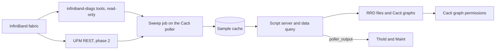

<!-- Source: README.md; SHA256: ce5af61a1bc993ec2aae6d4f22c3885694632f2b1d5eb94e2ce88b8390e96f1e -->

<!-- translations:start -->
[English](../../../README.md) | [简体中文](../zh-CN/README.md) | [हिन्दी](../hi-IN/README.md) | [Español (España)](../es-ES/README.md) | [Español (Latinoamérica)](../es-419/README.md) | [العربية (السعودية)](README.md) | [Afrikaans](../af-ZA/README.md) | [አማርኛ](../am-ET/README.md) | [العربية (مصر)](../ar-EG/README.md) | [العربية (المغرب)](../ar-MA/README.md) | [বাংলা](../bn-BD/README.md) | [Deutsch](../de-DE/README.md) | [فارسی](../fa-IR/README.md) | [Filipino](../fil-PH/README.md) | [Français](../fr-FR/README.md) | [Français (Maroc)](../fr-MA/README.md) | [Français (Sénégal)](../fr-SN/README.md) | [Hausa](../ha-NG/README.md) | [עברית](../he-IL/README.md) | [Bahasa Indonesia](../id-ID/README.md) | [Igbo](../ig-NG/README.md) | [Italiano](../it-IT/README.md) | [日本語](../ja-JP/README.md) | [한국어](../ko-KR/README.md) | [Malagasy](../mg-MG/README.md) | [मराठी](../mr-IN/README.md) | [Bahasa Melayu](../ms-MY/README.md) | [Nederlands](../nl-NL/README.md) | [Polski](../pl-PL/README.md) | [Português (Brasil)](../pt-BR/README.md) | [Русский](../ru-RU/README.md) | [Kinyarwanda](../rw-RW/README.md) | [Soomaali](../so-SO/README.md) | [Svenska](../sv-SE/README.md) | [Kiswahili](../sw-KE/README.md) | [தமிழ்](../ta-IN/README.md) | [తెలుగు](../te-IN/README.md) | [ไทย](../th-TH/README.md) | [Türkçe](../tr-TR/README.md) | [Українська](../uk-UA/README.md) | [اردو](../ur-PK/README.md) | [Tiếng Việt](../vi-VN/README.md) | [isiXhosa](../xh-ZA/README.md) | [Yorùbá](../yo-NG/README.md) | [繁體中文](../zh-TW/README.md) | [isiZulu](../zu-ZA/README.md)
<!-- translations:end -->

<a id="plugin_fabric"></a>
# plugin_fabric

إضافة لـ Cacti 1.2 تُدخل عدّادات منافذ InfiniBand وعرض الروابط وسرعتها ومؤشرات الازدحام إلى Cacti كأجهزة ومصادر بيانات ورسوم عادية. يظهر الرابط الذي تفاوض على 1X بدلًا من 4X كرسم وتنبيه Thold بجانب المضيف الذي يخدمه، ضمن أذونات Cacti ومع إمكانية كبح التنبيه بواسطة Maint.

> **الحالة: قيد التطوير، لم يصدر إصدار بعد.** دُمجت المرحلة المرحلية 2 (الأساس) في `main`، وتخضع المرحلة 3 (كائنات Cacti والتنبيهات) للمراجعة. أكدت المرحلة 1 التصميم بمقارنته بالوثائق والشيفرة الأصلية (PR #71)؛ توجد النتائج ومصادرها في [docs/research/](../../research). تضيف المرحلة 2 أساس الإضافة:
>
> - التثبيت والترقية وإلغاء التثبيت والتحقق من PHP 8.2
> - نطاقات أذونات View وOperator وAdmin والإعدادات
> - سجلات شبكات الربط
> - حدود أوامر للقراءة فقط لأدوات `perfquery` و`ibnetdiscover` و`iblinkinfo`
> - مخزون حسب GUID مع تعارضات الهوية واقتراحات إعادة الربط
> - حالة الروابط وذاكرة مؤقتة لفحوص العدّادات
> - صفحات المخزون والإدارة والحالة الصحية
>
> تضيف المرحلة 3 كائنات Cacti:
>
> - قوالب أجهزة وبيانات ورسوم بصيغة XML لقوالب Cacti، واستعلام البيانات «Fabric Port»
> - ربط عقدة بجهاز Cacti، أو إنشاؤه بعد التأكيد ([ADR 0010](../../decisions/0010-one-device-per-node.md))
> - مصادر بيانات عدّادات للرسوم، ومصادر GAUGE لحالة الروابط ومعدلاتها لاستخدام Thold ([ADR 0011](../../decisions/0011-derive-counters-and-gauge-alert-values.md))
> - معالجة الانقطاعات وقراءة العدّادات الأساسية المشبعة كقيم غير معروفة ([ADR 0012](../../decisions/0012-saturated-basic-counters-read-as-unknown.md))، وصلاحية العدّادات وروابط الرسوم في صفحة المنافذ، وترتيب الازدحام
> - اختبار شامل باستخدام Thold v1.8.2 وMaint v1.3 دون تعديل، ومهمة CI تشغّل أدوات التشخيص الحقيقية على شبكة ربط محاكاة
>
> لا يمكن فحص شبكة الربط إلا من المُستطلِع الرئيسي حتى تُدعم جامعات البيانات البعيدة في المرحلة 3. اختُبرت باستخدام أدوات وهمية ومحاكي شبكات الربط ibsim، ولم تُختبر على شبكة InfiniBand حقيقية. تظل الفحوص التي تحتاج إلى شبكة فعلية معلّقة في جدول الفحوص المباشرة لكل صفحة بحث. هذا المشروع غير تابع لمشروع Cacti.

<a id="access-roles"></a>
## أدوار الوصول

| نطاق الأذونات | الوصول |
| --- | --- |
| Fabric View | صفحات المراقبة الحالية. |
| Fabric Operator | المراقبة وصفحة العمليات والإقرارات الشخصية أثناء التحقيق. |
| Fabric Admin | وصول المشغّل مع الإعدادات والإجراءات الإدارية الحالية. |

بعد نسخ ملفات الترقية، افتح صفحة الإضافات بصفتك مسؤولًا لتسجيل نطاق الأذونات الجديد. امنح نطاق Operator صراحةً ضمن **الإعداد > المستخدمون** أو مجموعات المستخدمين. تحتفظ الترقيات بمعرّفات نطاقي View وAdmin ومنحهما الحالي. يرث Admin وصول Operator ويرث Operator وصول View في كل طلب؛ ولا يضيف ذلك منحًا مخزّنة للمستخدمين أو المجموعات. تتطلب إعدادات الإضافة أيضًا Fabric Admin بالإضافة إلى إذن الإعدادات في Cacti.

تظل أذونات أجهزة Cacti تقيّد الصفوف والإجراءات المتاحة لكل مستخدم؛ وتتطلب الكائنات غير المرتبطة مسؤولًا. تبقى بيانات الاعتماد والإعدادات والربط والحذف والتغييرات الإدارية الأخرى في الصفحات الإدارية. لا تستمر الإقرارات إلا في جلسة المستخدم الحالي، لمدة ساعة على الأكثر وفقط ما دامت الملاحظة نفسها حديثة. تُبطلها الملاحظات الجديدة أو المعدّلة. ولا تجعل قياسًا فاشلًا سليمًا أو تكبح التنبيهات مطلقًا.

<a id="why"></a>
## الدافع

يظل رابط InfiniBand المتدهور ينقل الحركة. الرابط 4X الذي يعيد التفاوض على 1X يترك المنفذ «نشطًا»، وتبدو رسوم واجهات SNMP للمضيف طبيعية، لكن المهام وثيقة الترابط تتباطأ. الدليل موجود في شبكة الربط: يبلغ كل منفذ عن العرض والسرعة النشطين والمفعّلين والمدعومين، إضافة إلى عدّادات الأخطاء والازدحام. تتطلب قراءتها أدوات تشخيص InfiniBand أو واجهة API لمدير شبكة الربط. يترك تشغيلها يدويًا ثلاث فجوات:

- **لا يوجد تاريخ.** تعرض `perfquery` و`iblinkinfo` الحاضر، لذا لا يظهر رابط تدهور الأسبوع الماضي.
- **لا يوجد سياق جهاز.** منافذ شبكة الربط ليست كائنات Cacti، فلا يمكن رسم منفذ بجانب المضيف الذي يغذيه.
- **لا يوجد مسار إلى تنبيهات Cacti.** يعمل Thold وMaint على مصادر بيانات Cacti وأجهزته.

تسد الإضافة هذه الفجوات بقراءة شبكة الربط عبر أدوات تشخيصها (ولاحقًا عبر UFM)، وتحديد العقد والمنافذ بواسطة GUID، ونشر العدّادات وحالة الروابط كمصادر بيانات Cacti. إنها تقرأ فقط: لا تعيد ضبط العدّادات ولا تغيّر حالة المنافذ مطلقًا.

## الاكتشاف الأول

لا تحتوي شبكة الربط الجديدة على عقد، ولا يبدأ الفحص من خادم النصوص إلا من عقدة مرتبطة بجهاز Cacti، لذا فالاكتشاف الأول خطوة يدوية. بعد حفظ شبكة ربط مفعّلة، شغّل الأمر التالي مرة واحدة على المُستطلِع المسندة إليه، بحساب المُستطلِع، مع استبدال `/path/to/cacti` بمسار دليل Cacti لديك (يعمل المسار المطلق أيضًا من cron):

```
php /path/to/cacti/plugins/fabric/fabric_sweep.php --fabric=ID --force
```

بعد ذلك يمتلئ المخزون. اربط العقد بأجهزة Cacti في صفحة Fabric Admin؛ وتبدأ الفحوص اللاحقة من استعلام البيانات. ما دامت شبكة الربط بلا أي عقدة مرتبطة فلا شيء يُحدِّث مخزونها، لذا شغّل الأمر نفسه مجددًا، ومن cron إن شئت، لتسجيل العقد الجديدة أو المفقودة. تعرض صفحة الصحة هذا الأمر لشبكة ربط مفعّلة لم تُكتشف أو لا تحتوي على عقدة مرتبطة.

<a id="planned-scope"></a>
## النطاق المخطط

| المرحلة | النطاق | المعالم |
|---|---|---|
| 0، البحث | مصفوفة الإصدارات، تأكيد السلوك الأصلي، سلوك العدّادات على العتاد، نموذج الامتيازات، ميزانية MAD، واجهة UFM API | [M1](https://github.com/somethingwithproof/plugin_fabric/milestone/1) |
| 1، المراقبة | مخزون حسب GUID، أجهزة Cacti، استعلام المنافذ، مصادر بيانات العدّادات وحالة الروابط، تنبيهات Thold، كبح Maint، صفحة الحالة الصحية | [M2](https://github.com/somethingwithproof/plugin_fabric/milestone/2)، [M3](https://github.com/somethingwithproof/plugin_fabric/milestone/3)، [M4](https://github.com/somethingwithproof/plugin_fabric/milestone/4) |
| 2، UFM | واجهة خلفية UFM REST للقراءة فقط، معالجة بيانات الاعتماد، استمرارية الهوية بين الواجهات الخلفية | [M5](https://github.com/somethingwithproof/plugin_fabric/milestone/5) |
| 3، البعيد | جامعات بيانات بعيدة، نسخ متماثل، إجراءات `remote_agent`، فحوص مجزّأة للشبكات الكبيرة | [M6](https://github.com/somethingwithproof/plugin_fabric/milestone/6) |

خارج النطاق: تغيير حالة شبكة الربط، واستبدال مدير شبكة الربط أو الشبكة الفرعية، ومحرك تنبيه خاص بالإضافة، وخدمة خلفية أو بروتوكول شبكة مخصص، وشبكات Ethernet أو RoCE (قيد البحث).

<a id="compatibility-targets"></a>
## أهداف التوافق

| المكوّن | الهدف |
|---|---|
| Cacti | 1.2.31 أو أحدث، دون ترقيعات للنواة |
| PHP | 8.2 أو أحدث؛ يظل `setup.php` قابلًا للتحليل على 8.0 لكي يُرفض وقت التشغيل غير المدعوم بدل تعطيل واجهة Cacti |
| أدوات InfiniBand | infiniband-diags من rdma-core؛ فُحصت تنسيقات الخرج مقابل مصدر v66.0 |
| UFM | واجهة UFM Enterprise REST API، المرحلة 2؛ مصفوفة الإصدارات من مخرجات المعلم 1 |
| Thold وMaint | لا يتطلبان تغييرات |

أبقِ مهلة البرامج النصية في Cacti عند القيمة الافتراضية 25 ثانية أو أكثر. يقيّد الفحص الذي يبدأ بقراءة استعلام بيانات تشغيل الأدوات بتلك المهلة ناقص خمس ثوانٍ، لحجز وقت لقراءة الذاكرة المؤقتة والرد. عند انتهاء الوقت، يعيد الاستعلام آخر عينة حديثة أو قيمة غير معروفة؛ وتعيد الدورة التالية محاولة الفحص. ينطبق هذا الحد على مُستطلِع PHP أيضًا. لا تترك مهلة خمس ثوانٍ أو أقل وقتًا لبدء أداة.

<a id="design"></a>
## التصميم

- [docs/PLAN.md](../../PLAN.md) هو الخطة الكاملة: البنية، والحقائق الأصلية التي تعتمد عليها مع مصادرها والافتراضات التي تنتظر التأكيد، ونموذج الهوية، وقواعد العدّادات وحالة الروابط، وحدود الأمان، وحسابات الأداء، والاختبارات والمخاطر.
- يحتوي [docs/decisions/](../../decisions) على سجلات قرارات البنية المتخذة بالفعل.
- يربط [docs/REQUIREMENTS.md](../../REQUIREMENTS.md) كل معرّف متطلب بمشكلته.



<a id="how-work-is-tracked"></a>
## تتبّع العمل

- تتبع **المعالم** معالم الخطة. لكل منها مشكلة ملحمية تسرد مشكلاتها الفرعية وأدلة اكتمالها.
- تُصنَّف **المشكلات** بالوسوم `type: requirement` و`type: research` و`type: decision` و`type: epic`. تتضمن مشكلات المتطلبات متطلبات مرقمة قابلة للاختبار (`REQ-AREA-NNN`) ومعايير قبول.
- تشمل **الوسوم** أيضًا `area:` و`phase:` و`priority:` و`status:`. راجع [CONTRIBUTING.md](../../../CONTRIBUTING.md#labels).
- تعرض [لوحة المشروع](https://github.com/users/somethingwithproof/projects/8) كل المشكلات عبر المعالم.

<a id="contributing"></a>
## المساهمة

اقرأ [CONTRIBUTING.md](../../../CONTRIBUTING.md). تتطلب عمليات الإيداع إقرار DCO. تجري مناقشة التصميم في المشكلات؛ وتحمل القرارات المفتوحة وسم `type: decision`.

<a id="security"></a>
## الأمان

أبلغ عن الثغرات على نحو خاص؛ راجع [SECURITY.md](../../../SECURITY.md).

<a id="license"></a>
## الترخيص

رخصة GNU العمومية العامة v2.0، وهي رخصة Cacti وإضافاته نفسها. راجع [LICENSE](../../../LICENSE).
