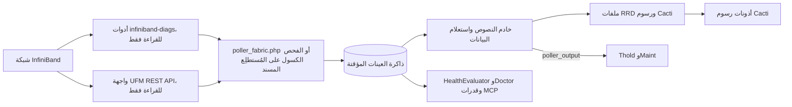

<!-- Source: README.md; SHA256: 79a16fb906f96ee79de2c719f18c38836f555440a7571a4a5ba38c64bb5b099f -->

<!-- translations:start -->
[English](../../../README.md) | [简体中文](../zh-CN/README.md) | [हिन्दी](../hi-IN/README.md) | [Español (España)](../es-ES/README.md) | [Español (Latinoamérica)](../es-419/README.md) | [العربية (السعودية)](README.md) | [Afrikaans](../af-ZA/README.md) | [አማርኛ](../am-ET/README.md) | [العربية (مصر)](../ar-EG/README.md) | [العربية (المغرب)](../ar-MA/README.md) | [বাংলা](../bn-BD/README.md) | [Bosanski](../bs-BA/README.md) | [Deutsch](../de-DE/README.md) | [فارسی](../fa-IR/README.md) | [Filipino](../fil-PH/README.md) | [Français](../fr-FR/README.md) | [Français (Maroc)](../fr-MA/README.md) | [Français (Sénégal)](../fr-SN/README.md) | [Hausa](../ha-NG/README.md) | [עברית](../he-IL/README.md) | [Hrvatski](../hr-HR/README.md) | [Bahasa Indonesia](../id-ID/README.md) | [Igbo](../ig-NG/README.md) | [Italiano](../it-IT/README.md) | [日本語](../ja-JP/README.md) | [한국어](../ko-KR/README.md) | [Malagasy](../mg-MG/README.md) | [मराठी](../mr-IN/README.md) | [Bahasa Melayu](../ms-MY/README.md) | [Nederlands](../nl-NL/README.md) | [Polski](../pl-PL/README.md) | [Português (Brasil)](../pt-BR/README.md) | [Русский](../ru-RU/README.md) | [Kinyarwanda](../rw-RW/README.md) | [Soomaali](../so-SO/README.md) | [Српски](../sr-RS/README.md) | [Svenska](../sv-SE/README.md) | [Kiswahili](../sw-KE/README.md) | [தமிழ்](../ta-IN/README.md) | [తెలుగు](../te-IN/README.md) | [ไทย](../th-TH/README.md) | [Türkçe](../tr-TR/README.md) | [Українська](../uk-UA/README.md) | [اردو](../ur-PK/README.md) | [Tiếng Việt](../vi-VN/README.md) | [isiXhosa](../xh-ZA/README.md) | [Yorùbá](../yo-NG/README.md) | [繁體中文](../zh-TW/README.md) | [isiZulu](../zu-ZA/README.md)
<!-- translations:end -->

# plugin_fabric

إضافة لـ Cacti 1.2 (`fabric`، الإصدار `0.1.0-dev`) تُدخل عدّادات منافذ InfiniBand وعرض الروابط وسرعتها ومؤشرات الازدحام إلى Cacti كأجهزة ومصادر بيانات ورسوم عادية. يظهر الرابط الذي تفاوض على 1X بدلًا من 4X كرسم وتنبيه Thold بجانب المضيف الذي يخدمه، ضمن أذونات Cacti، مع الوعي بـ Maint وكبح التنبيهات بواسطته.

> **الحالة: قيد التطوير، لم يصدر إصدار بعد.** ينفّذ هذا الفرع أساس الإضافة، وكائنات Cacti والتنبيهات، وفحوصات المُستطلِع المجدولة في الخلفية، والنسخ المتماثل إلى جامعات البيانات البعيدة، وواجهة خلفية لـ NVIDIA UFM REST للقراءة فقط مع خزنة بيانات اعتماد مشفرة، وإدارة Configuration-as-Code (CasC) عبر واجهة سطر الأوامر، وخطافات منظومة Cacti (CasC وDoctor وMCP / Abilities API v2). اختُبرت مقابل أدوات وهمية ووسائط نقل UFM اصطناعية ومحاكي شبكات الربط `ibsim` (rdma-core 50.0)، ولم تُختبر قط على شبكة InfiniBand مادية أو خادم UFM فعلي. تظل الفحوصات التي تتطلب عتادًا مفتوحة في [docs/research/](../../research/). هذا المشروع غير تابع لمشروع Cacti.

## ما تم تنفيذه

- **دورة الحياة والمخطط (v3)**: التثبيت، والترقية المتكررة دون آثار جانبية، وإلغاء التثبيت (مع الإبقاء على جداول الإضافة افتراضيًا)، وحارس متطلب PHP 8.2 مع بقاء نقاط الدخول قابلة للتحليل على PHP 8.0.
- **أدوار الوصول والصفحات**: نطاقات الأذونات `Fabric View` (`fabric.php`) و`Fabric Operator` (`fabric_operator.php`) و`Fabric Admin` (`fabric_admin.php` و`fabric_health.php`)، إضافة إلى تبويب إعدادات ضمن **Configuration > Settings > Fabrics**.
- **واجهة تشخيص خلفية للقراءة فقط (`diags`)**: تنفيذ صارم بمتجه الوسائط لأدوات `perfquery` و`ibnetdiscover` و`iblinkinfo`، ومخزون حسب GUID مع اكتشاف تعارضات الهوية ومقترحات إعادة الربط، وتقييم حالة الروابط، وفحوصات العدّادات لكل عقدة.
- **واجهة NVIDIA UFM REST خلفية للقراءة فقط (`ufm`) وخزنة مشفرة**: عميل REST يقتصر على GET وبقائمة مسموح بها (`/ufmRest/resources/ports` و`/ufmRest/resources/systems` و`/ufmRest/monitoring/session/0/data` وما يقابلها في `/ufmRestV3/...` لمصادقة الرمز المميز) يغذّي جداول المخزون وحالة الروابط والعينات والصحة نفسها التي تغذّيها `diags`. تُخزّن بيانات الاعتماد (`token` أو `basic`) مشفرة بخوارزمية AES-256-GCM في `plugin_fabric_secret` باستخدام ملف مفتاح خارجي بطول 256 بت مهيأ عبر `fabric_vault_key_file`. يمكن تعريف شبكات UFM عبر CasC (`cli/fabric.php`) أو المستودعات؛ ويعرض نموذج إدارة الويب حاليًا حقول `diags`.
- **كائنات Cacti وThold وMaint**: قوالب أجهزة وبيانات ورسوم Cacti (`templates/fabric-templates.xml`)، واستعلام بيانات خادم النصوص "Fabric Port" (`scripts/ss_fabric_ports.php` و`resource/script_server/fabric_ports.xml`)، ومصادر بيانات عدّادات `DERIVE` ومصادر بيانات `GAUGE` لحالة الروابط ومعدلاتها لاستخدام Thold، وتتبع الانقطاعات، وإبلاغ العدّادات الأساسية المشبعة كـ `U`. يستعلم تكامل Maint (`MaintMaintenance`) عن `plugin_maint_check_cacti_host()` (مع الرجوع إلى خطاف `is_device_in_maintenance`) لعدّ العقد الموجودة في صيانة نشطة بشكل منفصل واستبعادها من تحذيرات الصحة الخاصة بالفحوصات الفاشلة والمنافذ المتدهورة.
- **الفحوصات المجدولة والتجزئة وجامعات البيانات البعيدة**: يُطلق `poller_bottom` ملف `poller_fabric.php` في الخلفية للشبكات المستحقة المسندة إلى المُستطلِع الحالي، إلى جانب الفحوصات الكسولة التي يشغّلها خادم النصوص. يعلن `INFO` عن `remote_collect:1, remote_poller:1`، ويدعم `poller_fabric.php` التجزئة الحتمية حسب GUID (`--shard=K/N`)، وينسخ `replicate_out` صفوف `plugin_fabric_fabric` غير السرية إلى جامعات البيانات البعيدة (`poller_id >= 2`). لا تُنسخ إدخالات الخزنة (`plugin_fabric_secret`) وملفات المفاتيح الخارجية أبدًا.
- **واجهة سطر أوامر CasC وخطافات المنظومة**: `cli/fabric.php` لتصدير YAML/XML والتحقق والتخطيط التجريبي للفروقات والتطبيق المقترن بالتأكيد وإعداد تقارير الصحة، إضافة إلى خطافات `casc_register_providers` و`doctor_register_checks` و`abilities_register`.

## أدوار الوصول

| نطاق الأذونات | الوصول |
| --- | --- |
| Fabric View | مراقبة المخزون وعروض المنافذ (`fabric.php`). |
| Fabric Operator | وصول View بالإضافة إلى صفحة العمليات (`fabric_operator.php`) والإقرارات الشخصية أثناء التحقيق. |
| Fabric Admin | وصول Operator بالإضافة إلى الإعدادات والإجراءات الإدارية (`fabric_admin.php`) وصفحة الصحة (`fabric_health.php`). |

بعد نسخ ملفات الترقية، افتح صفحة الإضافات بصفتك مسؤولًا لتسجيل نطاقات الأذونات والخطافات الجديدة. امنح نطاق Operator صراحةً ضمن **Configuration > Users** أو مجموعات المستخدمين. تحتفظ الترقيات بمعرّفات نطاقي View وAdmin ومنحهما الحالي. يرث وصول Admin وصول Operator ويرث وصول Operator وصول View في كل طلب؛ ولا يضيف ذلك منحًا مخزّنة للمستخدمين أو المجموعات. تتطلب إعدادات الإضافة أيضًا وصول Fabric Admin بالإضافة إلى إذن Settings في Cacti.

تقيّد أذونات أجهزة Cacti الصفوف والإجراءات المتاحة لكل مستخدم؛ وتتطلب الكائنات غير المرتبطة مسؤولًا. تبقى بيانات الاعتماد والإعدادات والربط والحذف والتغييرات الإدارية الأخرى في الصفحات الإدارية أو واجهة سطر الأوامر. لا تستمر الإقرارات إلا في جلسة المستخدم الحالي، لمدة ساعة واحدة على الأكثر وفقط ما دامت الملاحظة نفسها حديثة. تُبطلها الملاحظات الجديدة أو المعدّلة. ولا تجعل قياسًا فاشلًا سليمًا أو تكبح التنبيهات مطلقًا.

## الدافع

يظل رابط InfiniBand المتدهور ينقل الحركة. الرابط 4X الذي يعيد التفاوض على 1X يترك المنفذ «نشطًا»، وتبدو رسوم واجهات SNMP للمضيف طبيعية، لكن المهام وثيقة الترابط تتباطأ. الدليل موجود في شبكة الربط: يبلغ كل منفذ عن العرض والسرعة النشطين والمفعّلين والمدعومين، إضافة إلى عدّادات الأخطاء والازدحام. تتطلب قراءتها أدوات تشخيص InfiniBand أو واجهة API لمدير شبكة الربط. يترك تشغيلها يدويًا ثلاث فجوات:

- **لا يوجد تاريخ.** تعرض `perfquery` و`iblinkinfo` الحاضر، لذا لا يظهر رابط تدهور الأسبوع الماضي.
- **لا يوجد سياق جهاز.** منافذ شبكة الربط ليست كائنات Cacti، فلا يمكن رسم منفذ بجانب المضيف الذي يغذيه.
- **لا يوجد مسار إلى تنبيهات Cacti.** يعمل Thold وMaint على مصادر بيانات Cacti وأجهزته.

تسد الإضافة هذه الفجوات بقراءة شبكة الربط عبر `infiniband-diags` أو واجهة NVIDIA UFM REST API، وتحديد العقد والمنافذ بواسطة GUID، ونشر العدّادات وحالة الروابط كمصادر بيانات Cacti. إنها تقرأ فقط: لا تعيد ضبط العدّادات ولا تغيّر حالة المنافذ مطلقًا.

## العمليات وواجهة سطر الأوامر

### المُستطلِع في الخلفية والفحوصات اليدوية

يبدأ `fabric_poller_bottom()` تشغيل `poller_fabric.php` في الخلفية على كل مُستطلِع للشبكات المفعّلة المسندة إلى ذلك `poller_id` والتي حان موعد فحصها. يمكنك أيضًا تشغيل منفّذ المُستطلِع أو فحص يدوي مباشرة على المُستطلِع المسندة إليه بحساب المُستطلِع (مع استبدال `/path/to/cacti` بمسار دليل Cacti لديك):

```sh
php /path/to/cacti/plugins/fabric/poller_fabric.php [--fabric=ID] [--shard=K/N] [--force] [--debug]
php /path/to/cacti/plugins/fabric/fabric_sweep.php --fabric=ID [--node=GUID] [--force]
```

- يشغّل `poller_fabric.php` جميع الشبكات المستحقة للمُستطلِع المحلي (أو شبكة واحدة باستخدام `--fabric=ID`)، ويفرض قفل سجل العمليات في Cacti وعقود `ClaimRepository` بميزانية وقت قدرها `max(30, intdiv(sweep_interval, 2))` ثانية، ويدعم `--shard=K/N` (`0 <= K < N`) لتجزئة فحوصات عدّادات عقد `diags` بشكل حتمي حسب GUID العقدة.
- يشغّل `fabric_sweep.php` فحصًا عند الطلب لشبكة ربط مفعّلة واحدة (أو لعقدة واحدة باستخدام `--node=GUID`) مسندة إلى المُستطلِع المحلي. يتجاهل `--force` ما إذا كانت الشبكة مستحقة مع الاستمرار في احترام المطالبات.

بعد أن يملأ الاكتشاف الأول المخزون، اربط العقد بأجهزة Cacti في صفحة Fabric Admin. أبقِ مهلة البرامج النصية في Cacti عند 25 ثانية أو أكثر: يقيّد الفحص الكسول الذي تبدؤه قراءة استعلام بيانات تنفيذ الأدوات بـ `script_timeout - 5` ثوانٍ حتى يعود خادم النصوص في الوقت المناسب بآخر عينة مخزنة أو `U`.

### واجهة NVIDIA UFM REST الخلفية وخزنة بيانات الاعتماد

تتطلب شبكة `ufm` عنوان URL يبدأ بـ `https://` دون بيانات اعتماد مضمنة أو سلاسل استعلام أو أجزاء. يفرض `UfmSocketTransport` التحقق من النظير واسم المضيف عبر TLS، ويرفض عمليات إعادة التوجيه، ويدعم حزمة CA اختيارية (`ufm_ca_file`) وتثبيت SHA-256 SPKI (`ufm_spki_pin`).

لتخزين بيانات اعتماد UFM في `plugin_fabric_secret`، اضبط `fabric_vault_key_file` ضمن **Configuration > Settings > Fabrics** بمسار مطلق إلى ملف عادي مملوك لمستخدم المُستطلِع (دون روابط رمزية في أي مجلد أب، بالوضع `0600`، ويحوي 64 محرفًا ست عشريًا مثل `openssl rand -hex 32` أو 32 بايت عشوائيًا غير قابل للطباعة). لا تنشئ الإضافة ملف المفتاح ولا تكتب فيه أبدًا، ولا ينسخ `replicate_out` جدول `plugin_fabric_secret` أو ملفات المفاتيح إلى المُستطلِعات البعيدة أبدًا.

### Configuration-as-Code وواجهة سطر أوامر الصحة

يدير `cli/fabric.php` إعدادات الإضافة وتعريفات شبكات الربط تصريحيًا بصيغة YAML أو XML، ويبلّغ عن الحالة الصحية مع الوعي بالصيانة دون تشغيل فحوصات مباشرة:

```sh
php /path/to/cacti/plugins/fabric/cli/fabric.php export [--format=yaml|xml] [--file=PATH]
php /path/to/cacti/plugins/fabric/cli/fabric.php validate --file=PATH [--format=yaml|xml]
php /path/to/cacti/plugins/fabric/cli/fabric.php plan --file=PATH [--format=yaml|xml]
php /path/to/cacti/plugins/fabric/cli/fabric.php apply --file=PATH --confirm=PLAN_HASH [--format=yaml|xml]
php /path/to/cacti/plugins/fabric/cli/fabric.php health [--format=text|json]
```

ينشئ `export` الملفات الجديدة بالوضع `0600`، ويحجب `fabric_vault_key_file` كـ `[REDACTED]`، ويصدر مراجع مسمّاة `ufm_credential_ref` بدلًا من الأسرار. يرفض `plan` و`apply` قيم `ufm_token` و`ufm_password` و`secret` و`fabric_vault_key_file` المضمّنة. ويتطلب `apply` القيمة الدقيقة `--confirm=PLAN_HASH` التي أنتجها `plan`.

### خطافات المنظومة

عند وجود إضافات Cacti أو تكاملات المضيف المقابلة، يسجّل `setup.php`:

- `casc_register_providers`: يصدر ويتحقق ويخطط ويطبق بعد التأكيد تهيئة `fabric` (`yaml` و`xml`، المخطط v1) مع حجب الأسرار.
- `doctor_register_checks`: يوفّر أربعة فحوصات تشخيصية للقراءة فقط (`fabric.schema` و`fabric.poller_freshness` و`fabric.identity_conflicts` و`fabric.ufm_vault`).
- `abilities_register`: يسجّل ثلاث قدرات للقراءة فقط غير مدمّرة ومتكررة الأثر ضمن الفئة `fabric`، مقيدة بنطاق أذونات Fabric View (وأذونات أجهزة Cacti لأخطاء المنافذ): `fabric-list-fabrics` و`fabric-get-health` و`fabric-list-port-errors`.

## النطاق والحدود

خارج النطاق: تغيير حالة شبكة الربط، وإعادة ضبط العدّادات، واستبدال مدير شبكة الربط أو مدير الشبكة الفرعية، ومحرك تنبيه خاص بالإضافة، وخدمة خلفية أو بروتوكول شبكة مخصص، وشبكات Ethernet أو RoCE.

## المتطلبات والتوافق

| المكوّن | الهدف |
|---|---|
| Cacti | 1.2.31 أو أحدث (`compat = 1.2.31`)، دون ترقيعات للنواة |
| PHP | 8.2 أو أحدث؛ تبقى نقاط الدخول قابلة للتحليل على 8.0 وترفض التفعيل على 8.1 لكي يتلقى وقت التشغيل غير المدعوم رفضًا بدل تعطل واجهة Cacti |
| أدوات InfiniBand | `infiniband-diags` من `rdma-core` (مختبرة في CI مع rdma-core 50.0 تحت `ibsim`؛ فُحصت تنسيقات الخرج مقابل مصدر v66.0) |
| UFM | واجهة NVIDIA UFM Enterprise REST API (نقاط نهاية القراءة فقط `ufmRest` و`ufmRestV3`؛ مختبرة مقابل وسائط نقل اصطناعية في اختبارات الوحدة) |
| Thold وMaint | لا يتطلبان أي تغييرات؛ يشغّل CI اختبارًا شاملًا مع Thold v1.8.2 وMaint v1.3 دون تعديل |

## التطوير والاختبار

يختبر سير عمل CI (`.github/workflows/plugin-ci-workflow.yml`) إصدارات PHP 8.2 حتى 8.5 مقابل Cacti `release/1.2.31` و`1.2.x`، وفحص نحو نقاط الدخول على PHP 8.0، والرفض على PHP 8.1، وPHPStan، والتحقق من gettext والترجمات، وترخيص REUSE، وفحص سير العمل، وإعادة التشغيل الشاملة لـ Thold وMaint، ومحاكاة شبكة الربط `ibsim`.

باستخدام حزمة اختبار إضافات Pest المشتركة والمقفلة الخاصة بـ Cacti (`CACTI_PEST_BIN`) وقاعدة بيانات Cacti مؤقتة:

```sh
# Unit tests
"$CACTI_PEST_BIN" --configuration=phpunit.xml

# Lifecycle integration tests (disposable database only)
CACTI_PATH=/path/to/cacti FABRIC_TEST_DATABASE=disposable "$CACTI_PEST_BIN" --configuration=phpunit-integration.xml

# Static analysis (against Cacti 1.2.31)
CACTI_PATH=/path/to/cacti phpstan analyse -c phpstan.neon --no-progress

# Translation template, catalogs, and localized README checks
sh locales/build_gettext.sh --check

# Simulated ibsim fixture parser check
php tests/bin/check-ibsim-fixtures.php tests/fixtures/ibsim
```

## التصميم

- [docs/PLAN.md](../../PLAN.md) هو خطة البنية والتصميم: الحقائق الأساسية مع مصادرها، وفحوصات العتاد المفتوحة، ونموذج الهوية، وقواعد العدّادات وحالة الروابط، وحدود الأمان، وحسابات الأداء، والاختبارات، والمخاطر.
- يحتوي [docs/decisions/](../../decisions/) على سجلات قرارات البنية.
- يربط [docs/REQUIREMENTS.md](../../REQUIREMENTS.md) كل معرّف متطلب بمشكلته.



## كيفية تتبع العمل

- **المعالم** تتبع معالم الخطة. ولكل منها مشكلة ملحمية تسرد مشكلاتها الفرعية وأدلة الإغلاق.
- **المشكلات** مصنفة حسب التسمية: `type: requirement` و`type: research` و`type: decision` و`type: epic`. تنص مشكلات المتطلبات على متطلبات مرقمة وقابلة للاختبار (`REQ-AREA-NNN`) ومعايير قبول.
- **التسميات** تحمل أيضًا `area:` و`phase:` و`priority:` و`status:`. راجع [CONTRIBUTING.md](../../../CONTRIBUTING.md#labels).
- تعرض [لوحة المشروع](https://github.com/users/somethingwithproof/projects/8) جميع المشكلات عبر المعالم.

## المساهمة

اقرأ [CONTRIBUTING.md](../../../CONTRIBUTING.md). تتطلب الإيداعات توقيع DCO (`git commit -s`). تجري مناقشة التصميم في المشكلات؛ وتحمل القرارات المفتوحة التسمية `type: decision`.

## الأمان

أبلغ عن الثغرات الأمنية بشكل خاص؛ راجع [SECURITY.md](../../../SECURITY.md).

## الترخيص

رخصة GNU العمومية الإصدار 2.0 (GNU General Public License v2.0)، وهي الرخصة نفسها لـ Cacti وإضافاته. راجع [LICENSE](../../../LICENSE).
