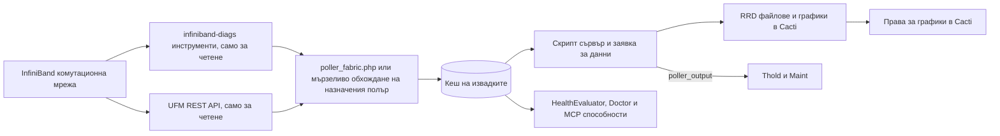

<!-- Source: README.md; SHA256: 79a16fb906f96ee79de2c719f18c38836f555440a7571a4a5ba38c64bb5b099f -->

<!-- translations:start -->
[English](../../../README.md) | [简体中文](../zh-CN/README.md) | [हिन्दी](../hi-IN/README.md) | [Español (España)](../es-ES/README.md) | [Español (Latinoamérica)](../es-419/README.md) | [العربية (السعودية)](../ar-SA/README.md) | [Afrikaans](../af-ZA/README.md) | [አማርኛ](../am-ET/README.md) | [العربية (مصر)](../ar-EG/README.md) | [العربية (المغرب)](../ar-MA/README.md) | [Български](README.md) | [বাংলা](../bn-BD/README.md) | [Bosanski](../bs-BA/README.md) | [Deutsch](../de-DE/README.md) | [Ελληνικά](../el-GR/README.md) | [فارسی](../fa-IR/README.md) | [Filipino](../fil-PH/README.md) | [Français](../fr-FR/README.md) | [Français (Maroc)](../fr-MA/README.md) | [Français (Sénégal)](../fr-SN/README.md) | [Hausa](../ha-NG/README.md) | [עברית](../he-IL/README.md) | [Hrvatski](../hr-HR/README.md) | [Bahasa Indonesia](../id-ID/README.md) | [Igbo](../ig-NG/README.md) | [Italiano](../it-IT/README.md) | [日本語](../ja-JP/README.md) | [ქართული](../ka-GE/README.md) | [한국어](../ko-KR/README.md) | [Latviešu](../lv-LV/README.md) | [Malagasy](../mg-MG/README.md) | [मराठी](../mr-IN/README.md) | [Bahasa Melayu](../ms-MY/README.md) | [Nederlands](../nl-NL/README.md) | [Polski](../pl-PL/README.md) | [Português (Brasil)](../pt-BR/README.md) | [Português (Portugal)](../pt-PT/README.md) | [Русский](../ru-RU/README.md) | [Kinyarwanda](../rw-RW/README.md) | [Soomaali](../so-SO/README.md) | [Српски](../sr-RS/README.md) | [Svenska](../sv-SE/README.md) | [Kiswahili](../sw-KE/README.md) | [தமிழ்](../ta-IN/README.md) | [తెలుగు](../te-IN/README.md) | [ไทย](../th-TH/README.md) | [Türkçe](../tr-TR/README.md) | [Українська](../uk-UA/README.md) | [اردو](../ur-PK/README.md) | [Tiếng Việt](../vi-VN/README.md) | [isiXhosa](../xh-ZA/README.md) | [Yorùbá](../yo-NG/README.md) | [繁體中文](../zh-TW/README.md) | [isiZulu](../zu-ZA/README.md)
<!-- translations:end -->

# plugin_fabric

Плъгин за Cacti 1.2 (`fabric`, версия `0.1.0-dev`), който внася броячите на InfiniBand портовете, ширината и скоростта на връзките и индикаторите за претоварване в Cacti като обикновени устройства, източници на данни и графики. Връзка, която се е обучила на 1X вместо на 4X, се появява като графика и Thold известие до обслужвания хост, под правата на Cacti, с осведоменост и потискане чрез Maint.

> **Състояние: в разработка, все още няма издадена версия.** Този клон реализира основата на плъгина, обектите в Cacti и известяването, планираните фонови обхождания на полъра, репликацията към отдалечени събирачи, REST бекенд само за четене за NVIDIA UFM с криптирано хранилище за идентификационни данни, CLI управление „Конфигурация като код“ (CasC) и куки за екосистемата на Cacti (CasC, Doctor и MCP / Abilities API v2). Тестван е с имитирани инструменти, синтетични UFM транспорти и симулатора за комутационни мрежи `ibsim` (rdma-core 50.0), никога върху физическа InfiniBand мрежа или работещ UFM сървър. Проверките, изискващи хардуер, остават отворени в [docs/research/](../../research/). Този проект не е свързан с проекта Cacti.

## Какво е реализирано

- **Жизнен цикъл и схема (v3)**: инсталиране, идемпотентно надграждане, деинсталиране (запазващо таблиците на плъгина по подразбиране) и защита за изискване на PHP 8.2, като входните точки остават синтактично валидни на PHP 8.0.
- **Роли за достъп и страници**: области на достъп `Fabric View` (`fabric.php`), `Fabric Operator` (`fabric_operator.php`) и `Fabric Admin` (`fabric_admin.php`, `fabric_health.php`), плюс раздел с настройки в **Конфигурация > Настройки > Комутационни мрежи**.
- **Диагностичен бекенд само за четене (`diags`)**: стриктно изпълнение чрез вектор от аргументи на `perfquery`, `ibnetdiscover` и `iblinkinfo`, инвентар с ключ по GUID с откриване на конфликти на идентичност и предложения за повторно свързване, оценка на състоянието на връзките и обхождане на броячите по възли.
- **REST бекенд само за четене за NVIDIA UFM (`ufm`) и криптирано хранилище**: разрешен REST клиент само за GET (`/ufmRest/resources/ports`, `/ufmRest/resources/systems`, `/ufmRest/monitoring/session/0/data` и еквивалентите `/ufmRestV3/...` за автентикация с токен), захранващ същите таблици за инвентар, състояние на връзките, извадки и състояние като `diags`. Идентификационните данни (`token` или `basic`) се съхраняват криптирани с AES-256-GCM в `plugin_fabric_secret` чрез външен 256-битов ключов файл, конфигуриран чрез `fabric_vault_key_file`. UFM комутационните мрежи могат да се дефинират чрез CasC (`cli/fabric.php`) или хранилищата; уеб формата за администриране засега показва полетата за `diags`.
- **Обекти в Cacti, Thold и Maint**: шаблони за устройства, данни и графики в Cacti (`templates/fabric-templates.xml`), заявка за данни на скрипт сървъра „Fabric Port“ (`scripts/ss_fabric_ports.php`, `resource/script_server/fabric_ports.xml`), източници на данни `DERIVE` за броячи и `GAUGE` за състояние на връзките/честоти за Thold, проследяване на прекъсвания и наситени базови броячи, докладвани като `U`. Интеграцията с Maint (`MaintMaintenance`) извиква `plugin_maint_check_cacti_host()` (с резервен вариант куката `is_device_in_maintenance`), така че възлите в активна поддръжка се отчитат отделно и се изключват от предупрежденията за неуспешно обхождане и влошени портове.
- **Планирани обхождания, шардиране и отдалечени събирачи**: `poller_bottom` стартира `poller_fabric.php` във фонов режим за настъпили обхождания на комутационни мрежи, назначени на текущия полър, заедно с мързеливи (lazy) обхождания, задействани от скрипт сървъра. `INFO` декларира `remote_collect:1, remote_poller:1`, `poller_fabric.php` поддържа детерминирано шардиране по GUID (`--shard=K/N`), а `replicate_out` репликира несекретните редове на `plugin_fabric_fabric` към отдалечените събирачи (`poller_id >= 2`). Записите в хранилището (`plugin_fabric_secret`) и външните ключови файлове никога не се репликират.
- **CasC CLI и куки за екосистемата**: `cli/fabric.php` за YAML/XML експорт, валидиране, планиране на разлики в пробен режим, прилагане с потвърждение и докладване на състоянието, плюс куките `casc_register_providers`, `doctor_register_checks` и `abilities_register`.

## Роли за достъп

| Област на достъп | Достъп |
| --- | --- |
| Преглед на комутационни мрежи (Fabric View) | Инвентар за наблюдение и изгледи на портовете (`fabric.php`). |
| Оператор на комутационни мрежи (Fabric Operator) | Достъп за преглед плюс страницата „Операции“ (`fabric_operator.php`) и лични потвърждения за преглед при триаж. |
| Администриране на комутационни мрежи (Fabric Admin) | Операторски достъп плюс конфигурация, административни действия (`fabric_admin.php`) и страницата за състоянието (`fabric_health.php`). |

След копиране на файловете за надграждане отворете страницата „Плъгини“ като администратор, за да регистрирате новите области на достъп и куки. Назначете областта „Оператор“ изрично в **Конфигурация > Потребители** или в потребителски групи. Надгражданията запазват съществуващите идентификатори и права на областите View и Admin. Администраторският достъп наследява операторския, а операторският наследява достъпа за преглед при всяка заявка; това не добавя записани права към потребители или групи. Настройките на плъгина изискват също достъп Fabric Admin в допълнение към правото за „Настройки“ в Cacti.

Правата за устройства в Cacti ограничават редовете и действията, достъпни за всеки потребител; несвързаните обекти изискват администратор. Идентификационните данни, конфигурацията, свързването, изтриването и другите административни промени остават в административните страници или в CLI. Потвържденията са валидни само в текущата сесия на потребителя, най-много за един час и само докато същото наблюдение остава актуално. Нови или променени наблюдения ги обезсилват. Те никога не отбелязват неуспешно измерване като изправно и не потискат известия.

## Защо

Влошена InfiniBand връзка продължава да предава трафик. Връзка 4X, която се преобучи на 1X, оставя порта „активен“, а SNMP графиките за интерфейса на хоста изглеждат нормални, но тясно свързаните изчислителни задачи се забавят. Доказателството е в самата комутационна мрежа: всеки порт отчита активната, разрешената и поддържаната си ширина и скорост, както и броячи за грешки и претоварване. Четенето им изисква диагностичните инструменти на InfiniBand или API на мениджър на мрежата. Изпълнявани ръчно, те оставят три празнини:

- **Липса на история.** `perfquery` и `iblinkinfo` показват настоящето, така че връзка, влошила се миналата седмица, остава невидима.
- **Липса на контекст на устройството.** Портовете на комутационната мрежа не са обекти в Cacti, затова даден порт не може да бъде изчертан до хоста, който захранва.
- **Липса на път към известяването в Cacti.** Thold и Maint работят върху източници на данни и устройства в Cacti.

Плъгинът запълва тези празнини, като чете комутационната мрежа чрез `infiniband-diags` или REST API на NVIDIA UFM, идентифицира възлите и портовете по GUID и публикува броячите и състоянието на връзките като източници на данни в Cacti. Той работи само за четене: никога не нулира броячи и не променя състоянието на портовете.

## Операции и CLI

### Фонов полър и ръчни обхождания

`fabric_poller_bottom()` стартира `poller_fabric.php` във фонов режим на всеки полър за активираните комутационни мрежи, назначени на този `poller_id`, чието обхождане е настъпило. Можете също да стартирате полъра или ръчно обхождане директно на назначения полър като потребителя на полъра (като замените `/path/to/cacti` с вашата директория на Cacti):

```sh
php /path/to/cacti/plugins/fabric/poller_fabric.php [--fabric=ID] [--shard=K/N] [--force] [--debug]
php /path/to/cacti/plugins/fabric/fabric_sweep.php --fabric=ID [--node=GUID] [--force]
```

- `poller_fabric.php` обработва всички настъпили комутационни мрежи за локалния полър (или една с `--fabric=ID`), прилага заключването на регистъра на процесите в Cacti и наемите на `ClaimRepository` с времеви бюджет `max(30, intdiv(sweep_interval, 2))` секунди и поддържа `--shard=K/N` (`0 <= K < N`) за детерминирано шардиране на `diags` обхожданията на броячи по GUID на възела.
- `fabric_sweep.php` изпълнява обхождане при поискване на една активирана комутационна мрежа (или един възел с `--node=GUID`), назначена на локалния полър. `--force` игнорира дали е дошло време за обхождане, като продължава да спазва заключванията.

След като първото откриване попълни инвентара, свържете възлите с устройства в Cacti на страницата „Администриране на комутационни мрежи“. Поддържайте времето за изчакване на скриптовете в Cacti поне 25 секунди: мързеливо обхождане, стартирано от четене на заявка за данни, ограничава изпълнението на инструмента до `script_timeout - 5` секунди, така че скрипт сървърът да върне навреме последната записана извадка или `U`.

### REST бекенд за NVIDIA UFM и хранилище за идентификационни данни

Комутационна мрежа от тип `ufm` изисква `https://` URL адрес без вградени идентификационни данни, низове за заявки или фрагменти. `UfmSocketTransport` налага проверка на TLS сертификата и името на хоста, отхвърля пренасочвания и поддържа незадължителен CA пакет (`ufm_ca_file`) и SHA-256 SPKI закрепване (`ufm_spki_pin`).

За да съхранявате UFM идентификационни данни в `plugin_fabric_secret`, конфигурирайте `fabric_vault_key_file` в **Конфигурация > Настройки > Комутационни мрежи** с абсолютен път до обикновен файл, притежаван от потребителя на полъра (без символни връзки в родителските директории, права `0600`, съдържащ 64 шестнадесетични знака, например от `openssl rand -hex 32`, или 32 случайни непечатни байта). Плъгинът никога не създава и не записва ключовия файл, а `replicate_out` никога не репликира `plugin_fabric_secret` или ключови файлове към отдалечени полъри.

### Конфигурация като код (CasC) и CLI за състоянието

`cli/fabric.php` управлява настройките на плъгина и дефинициите на комутационните мрежи декларативно в YAML или XML и докладва състоянието с отчитане на поддръжката, без да изпълнява обхождания на живо:

```sh
php /path/to/cacti/plugins/fabric/cli/fabric.php export [--format=yaml|xml] [--file=PATH]
php /path/to/cacti/plugins/fabric/cli/fabric.php validate --file=PATH [--format=yaml|xml]
php /path/to/cacti/plugins/fabric/cli/fabric.php plan --file=PATH [--format=yaml|xml]
php /path/to/cacti/plugins/fabric/cli/fabric.php apply --file=PATH --confirm=PLAN_HASH [--format=yaml|xml]
php /path/to/cacti/plugins/fabric/cli/fabric.php health [--format=text|json]
```

`export` създава нови файлове с права `0600`, прикрива `fabric_vault_key_file` като `[REDACTED]` и извежда именувани препратки `ufm_credential_ref` вместо тайни. `plan` и `apply` отхвърлят вградени стойности на `ufm_token`, `ufm_password`, `secret` и вграден `fabric_vault_key_file`. `apply` изисква точния `--confirm=PLAN_HASH`, изведен от `plan`.

### Куки за екосистемата

Когато съответните плъгини на Cacti или интеграции на хоста са налични, `setup.php` регистрира:

- `casc_register_providers`: експортира, валидира, планира и прилага с потвърждение конфигурацията на `fabric` (`yaml` и `xml`, схема v1) с прикриване на тайните.
- `doctor_register_checks`: предоставя четири диагностични проверки само за четене (`fabric.schema`, `fabric.poller_freshness`, `fabric.identity_conflicts`, `fabric.ufm_vault`).
- `abilities_register`: регистрира три способности само за четене, недеструктивни и идемпотентни в категория `fabric`, ограничени от областта Fabric View (и правата за устройства в Cacti за грешки на портовете): `fabric-list-fabrics`, `fabric-get-health` и `fabric-list-port-errors`.

## Обхват и граници

Извън обхвата: промяна на състоянието на комутационната мрежа, нулиране на броячи, замяна на мениджър на мрежата или подмрежата, собствен механизъм за известяване в плъгина, собствен демон или мрежов протокол, както и Ethernet или RoCE мрежи.

## Изисквания и съвместимост

| Компонент | Цел |
|---|---|
| Cacti | 1.2.31 или по-нова (`compat = 1.2.31`), без кръпки в ядрото |
| PHP | 8.2 или по-нова; входните точки остават синтактично валидни на 8.0 и отказват активиране на 8.1, така че неподдържана среда получава отказ вместо счупен интерфейс на Cacti |
| InfiniBand инструменти | `infiniband-diags` от `rdma-core` (тествано в CI с rdma-core 50.0 под `ibsim`; форматите на изхода са проверени спрямо кода на v66.0) |
| UFM | NVIDIA UFM Enterprise REST API (крайни точки само за четене `ufmRest` и `ufmRestV3`; тествано със синтетични транспорти в модулни тестове) |
| Thold, Maint | Не се изискват промени; CI изпълнява тест от край до край с непроменени Thold v1.8.2 и Maint v1.3 |

## Разработка и тестване

Работният процес в CI (`.github/workflows/plugin-ci-workflow.yml`) тества PHP 8.2 до 8.5 спрямо Cacti `release/1.2.31` и `1.2.x`, синтактична проверка на входните точки на PHP 8.0, отказ на PHP 8.1, PHPStan, проверка на gettext/преводите, лицензиране по REUSE, проверка на работните процеси, повторение от край до край с Thold/Maint и симулация на мрежа с `ibsim`.

Със заключената споделена Pest тестова среда за плъгини на Cacti (`CACTI_PEST_BIN`) и временна база данни на Cacti:

```sh
# Unit tests
"$CACTI_PEST_BIN" --configuration=phpunit.xml

# Lifecycle integration tests (disposable database only)
CACTI_PATH=/path/to/cacti FABRIC_TEST_DATABASE=disposable "$CACTI_PEST_BIN" --configuration=phpunit-integration.xml

# Static analysis (against Cacti 1.2.31)
CACTI_PATH=/path/to/cacti phpstan analyse -c phpstan.neon --no-progress

# Translation template, catalogs, and localized README checks
sh locales/build_gettext.sh --check

# Simulated ibsim fixture parser check
php tests/bin/check-ibsim-fixtures.php tests/fixtures/ibsim
```

## Дизайн

- [docs/PLAN.md](../../PLAN.md) е планът за архитектурата и дизайна: upstream факти с източници, отворени хардуерни проверки, модел на идентичността, правила за броячите и състоянието на връзките, граници на сигурност, изчисления за производителност, тестване и рискове.
- [docs/decisions/](../../decisions/) съдържа записи на архитектурни решения.
- [docs/REQUIREMENTS.md](../../REQUIREMENTS.md) свързва всеки идентификатор на изискване с неговата задача (issue).



## Как се проследява работата

- **Етапите (Milestones)** следват етапите от плана. Всеки има епична задача (epic issue), изброяваща подзадачите и доказателствата за завършване.
- **Задачите (Issues)** се класифицират чрез етикети: `type: requirement`, `type: research`, `type: decision`, `type: epic`. Задачите за изисквания формулират номерирани, проверими изисквания (`REQ-AREA-NNN`) и критерии за приемане.
- **Етикетите** съдържат също `area:`, `phase:`, `priority:` и `status:`. Вижте [CONTRIBUTING.md](../../../CONTRIBUTING.md#labels).
- [Таблото на проекта](https://github.com/users/somethingwithproof/projects/8) показва всички задачи по етапи.

## Принос

Прочетете [CONTRIBUTING.md](../../../CONTRIBUTING.md). Комитите изискват DCO подпис (`git commit -s`). Дискусиите по дизайна се водят в задачите; отворените решения носят етикета `type: decision`.

## Сигурност

Докладвайте уязвимости поверително; вижте [SECURITY.md](../../../SECURITY.md).

## Лиценз

GNU General Public License v2.0 — същият лиценз като Cacti и неговите плъгини. Вижте [LICENSE](../../../LICENSE).
