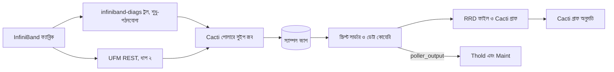

<!-- Source: README.md; SHA256: ce5af61a1bc993ec2aae6d4f22c3885694632f2b1d5eb94e2ce88b8390e96f1e -->

<!-- translations:start -->
[English](../../../README.md) | [简体中文](../zh-CN/README.md) | [हिन्दी](../hi-IN/README.md) | [Español (España)](../es-ES/README.md) | [Español (Latinoamérica)](../es-419/README.md) | [العربية (السعودية)](../ar-SA/README.md) | [Afrikaans](../af-ZA/README.md) | [አማርኛ](../am-ET/README.md) | [العربية (مصر)](../ar-EG/README.md) | [العربية (المغرب)](../ar-MA/README.md) | [বাংলা](README.md) | [Bosanski](../bs-BA/README.md) | [Deutsch](../de-DE/README.md) | [فارسی](../fa-IR/README.md) | [Filipino](../fil-PH/README.md) | [Français](../fr-FR/README.md) | [Français (Maroc)](../fr-MA/README.md) | [Français (Sénégal)](../fr-SN/README.md) | [Hausa](../ha-NG/README.md) | [עברית](../he-IL/README.md) | [Hrvatski](../hr-HR/README.md) | [Bahasa Indonesia](../id-ID/README.md) | [Igbo](../ig-NG/README.md) | [Italiano](../it-IT/README.md) | [日本語](../ja-JP/README.md) | [한국어](../ko-KR/README.md) | [Malagasy](../mg-MG/README.md) | [मराठी](../mr-IN/README.md) | [Bahasa Melayu](../ms-MY/README.md) | [Nederlands](../nl-NL/README.md) | [Polski](../pl-PL/README.md) | [Português (Brasil)](../pt-BR/README.md) | [Русский](../ru-RU/README.md) | [Kinyarwanda](../rw-RW/README.md) | [Soomaali](../so-SO/README.md) | [Српски](../sr-RS/README.md) | [Svenska](../sv-SE/README.md) | [Kiswahili](../sw-KE/README.md) | [தமிழ்](../ta-IN/README.md) | [తెలుగు](../te-IN/README.md) | [ไทย](../th-TH/README.md) | [Türkçe](../tr-TR/README.md) | [Українська](../uk-UA/README.md) | [اردو](../ur-PK/README.md) | [Tiếng Việt](../vi-VN/README.md) | [isiXhosa](../xh-ZA/README.md) | [Yorùbá](../yo-NG/README.md) | [繁體中文](../zh-TW/README.md) | [isiZulu](../zu-ZA/README.md)
<!-- translations:end -->

# plugin_fabric

একটি Cacti 1.2 প্লাগইন যা InfiniBand পোর্ট কাউন্টার, লিংকের প্রস্থ ও গতি এবং কনজেশন নির্দেশকগুলোকে সাধারণ ডিভাইস, ডেটা সোর্স ও গ্রাফ হিসেবে Cacti-তে নিয়ে আসে। ফলে 4X-এর পরিবর্তে 1X-এ ট্রেইন হওয়া কোনো লিংক সেটি যে হোস্টকে সেবা দেয় তার পাশেই একটি গ্রাফ এবং Thold সতর্কবার্তা হিসেবে প্রদর্শিত হয়—Cacti-এর অনুমতির আওতায়, যেখানে Maint সেটি সাময়িকভাবে দমন (suppress) করতে পারে।

> **অবস্থা: উন্নয়নাধীন, এখনো কোনো রিলিজ হয়নি।** মাইলস্টোন ২ (ভিত্তি) `main` ব্রাঞ্চে মার্জ করা হয়েছে এবং মাইলস্টোন ৩ (Cacti অবজেক্ট ও সতর্কবার্তা) পর্যালোচনাধীন রয়েছে। মাইলস্টোন ১ নথিপত্র ও আপস্ট্রিম সোর্সের সাথে নকশাটি যাচাই করেছে (PR #71); উৎসসহ ফলাফল [docs/research/](../../research)-এ রয়েছে। মাইলস্টোন ২ প্লাগইনের ভিত্তি যুক্ত করে:
>
> - ইনস্টল, আপগ্রেড, আনইনস্টল এবং PHP 8.2 গার্ড
> - View, Operator এবং Admin রিয়েলম ও সেটিংস
> - ফ্যাব্রিক রেকর্ড
> - `perfquery`, `ibnetdiscover` এবং `iblinkinfo`-এর জন্য শুধু-পঠনযোগ্য (read-only) কমান্ড সীমা
> - GUID অনুযায়ী ইনভেন্টরি, আইডেন্টিটি দ্বন্দ্ব এবং পুনঃসংযোগ (re-link) প্রস্তাবনাসহ
> - লিংকের অবস্থা এবং কাউন্টার সুইপ ক্যাশ
> - ইনভেন্টরি, অ্যাডমিন এবং হেলথ পৃষ্ঠা
>
> মাইলস্টোন ৩ Cacti অবজেক্টসমূহ যুক্ত করে:
>
> - Cacti টেমপ্লেট XML হিসেবে সরবরাহকৃত ডিভাইস, ডেটা ও গ্রাফ টেমপ্লেট এবং "Fabric Port" ডেটা কোয়েরি
> - একটি নোডকে Cacti ডিভাইসের সাথে ম্যাপ করা, অথবা নিশ্চিতকরণের পর একটি নতুন ডিভাইস তৈরি করা ([ADR 0010](../../decisions/0010-one-device-per-node.md))
> - গ্রাফের জন্য কাউন্টার ডেটা সোর্স এবং Thold-এর জন্য GAUGE লিংক অবস্থা ও রেট ডেটা সোর্স ([ADR 0011](../../decisions/0011-derive-counters-and-gauge-alert-values.md))
> - বিচ্ছিন্নতা (discontinuity) ব্যবস্থাপনা ও সম্পৃক্ত মৌলিক কাউন্টারগুলোকে অজানা (unknown) হিসেবে পড়া ([ADR 0012](../../decisions/0012-saturated-basic-counters-read-as-unknown.md)), পোর্ট পৃষ্ঠায় কাউন্টারের বৈধতা ও গ্রাফ লিংক এবং কনজেশন র‍্যাংকিং
> - অপরিবর্তিত Thold v1.8.2 ও Maint v1.3-এর সাথে একটি এন্ড-টু-এন্ড পরীক্ষা এবং একটি CI জব যা সিমুলেটেড ফ্যাব্রিকের বিরুদ্ধে প্রকৃত ডায়াগনস্টিক টুলগুলো চালায়
>
> তৃতীয় ধাপে (phase 3) রিমোট ডেটা কালেক্টর সমর্থন যুক্ত না হওয়া পর্যন্ত একটি ফ্যাব্রিক কেবল প্রধান পোলার (main poller) থেকেই সুইপ করা যাবে। এটি ফেক টুল এবং ibsim ফ্যাব্রিক সিমুলেটরের বিরুদ্ধে পরীক্ষা করা হয়েছে, প্রকৃত কোনো InfiniBand ফ্যাব্রিকে কখনো নয়। যেসব পরীক্ষার জন্য প্রকৃত ফ্যাব্রিক প্রয়োজন, সেগুলো প্রতিটি গবেষণা পৃষ্ঠার live-checks টেবিলে উন্মুক্ত রয়েছে। এই প্রকল্পটি Cacti প্রকল্পের সাথে সংশ্লিষ্ট নয়।

## প্রবেশাধিকার ভূমিকা (Access roles)

| রিয়েলম | প্রবেশাধিকার |
| --- | --- |
| Fabric View | বিদ্যমান পর্যবেক্ষণ (monitoring) পৃষ্ঠাগুলো। |
| Fabric Operator | পর্যবেক্ষণের পাশাপাশি অপারেশনস পৃষ্ঠা এবং ব্যক্তিগত ট্রায়াজ স্বীকৃতি (acknowledgments)। |
| Fabric Admin | অপারেটর প্রবেশাধিকারসহ বিদ্যমান কনফিগারেশন ও প্রশাসনিক কার্যক্রম। |

আপগ্রেড ফাইলগুলো কপি করার পর, নতুন রিয়েলমটি নিবন্ধন করতে অ্যাডমিনিস্ট্রেটর হিসেবে Plugins পৃষ্ঠাটি খুলুন। **Configuration > Users** অথবা ইউজার গ্রুপের অধীনে Operator রিয়েলমটি স্পষ্টভাবে নির্ধারণ করে দিন। আপগ্রেড করলে বিদ্যমান View এবং Admin রিয়েলম আইডি ও অনুমোদনসমূহ অপরিবর্তিত থাকে। প্রতিটি রিকোয়েস্টে Admin প্রবেশাধিকার স্বয়ংক্রিয়ভাবে Operator প্রবেশাধিকার লাভ করে এবং Operator প্রবেশাধিকার View প্রবেশাধিকার লাভ করে; এটি ব্যবহারকারী বা গ্রুপে কোনো সংরক্ষিত অনুমোদন যুক্ত করে না। প্লাগইন সেটিংসের জন্য Cacti-এর Settings অনুমতির পাশাপাশি Fabric Admin প্রবেশাধিকারও প্রয়োজন হয়।

Cacti ডিভাইস অনুমতি এখনো প্রতিটি ব্যবহারকারীর জন্য প্রদর্শিত সারি ও কার্যক্রম সীমিত রাখে; ম্যাপ না করা অবজেক্টগুলোর জন্য অ্যাডমিনিস্ট্রেটর প্রয়োজন হয়। ক্রেডেনশিয়াল, কনফিগারেশন, ম্যাপিং, মুছে ফেলা এবং অন্যান্য প্রশাসনিক পরিবর্তন প্রশাসনিক পৃষ্ঠাগুলোতেই থাকে। স্বীকৃতিগুলো কেবল বর্তমান ব্যবহারকারীর সেশনেই, সর্বোচ্চ এক ঘণ্টার জন্য এবং যতক্ষণ একই পর্যবেক্ষণ সতেজ (fresh) থাকে ততক্ষণ পর্যন্তই কার্যকর থাকে। নতুন বা পরিবর্তিত পর্যবেক্ষণ সেগুলোকে বাতিল করে দেয়। এগুলো কখনোই কোনো ব্যর্থ পরিমাপকে সুস্থ হিসেবে চিহ্নিত করে না বা সতর্কবার্তা দমন করে না।

## কেন এই প্লাগইন

একটি অবনমিত (degraded) InfiniBand লিংক দিয়েও ট্রাফিক চলাচল অব্যাহত থাকে। একটি 4X লিংক পুনরায় 1X-এ ট্রেইন হলে পোর্টটি "active" অবস্থায় থাকে এবং হোস্টের SNMP ইন্টারফেস গ্রাফগুলোও স্বাভাবিক দেখায়, কিন্তু টাইটলি কাপলড (tightly coupled) জবগুলো ধীরগতির হয়ে যায়। এর প্রমাণ ফ্যাব্রিকের ভেতরেই থাকে: প্রতিটি পোর্ট তার active, enabled এবং supported প্রস্থ ও গতি, পাশাপাশি ত্রুটি (error) ও কনজেশন কাউন্টার রিপোর্ট করে। এগুলো পড়ার জন্য InfiniBand ডায়াগনস্টিক টুল বা একটি ফ্যাব্রিক ম্যানেজার API প্রয়োজন হয়। হাতে চালানো হলে এগুলো তিনটি শূন্যতা তৈরি করে:

- **কোনো ইতিহাস নেই।** `perfquery` এবং `iblinkinfo` কেবল বর্তমান অবস্থা দেখায়, তাই গত সপ্তাহে অবনমিত হওয়া কোনো লিংক অদৃশ্যই থেকে যায়।
- **ডিভাইসের সাথে কোনো প্রাসঙ্গিক সংযোগ নেই।** ফ্যাব্রিক পোর্টগুলো Cacti অবজেক্ট নয়, ফলে কোনো পোর্টকে সেটি যে হোস্টকে সংযোগ দেয় তার পাশে গ্রাফ আকারে দেখানো যায় না।
- **Cacti সতর্কবার্তা ব্যবস্থায় কোনো প্রবেশপথ নেই।** Thold এবং Maint কেবল Cacti ডেটা সোর্স ও ডিভাইসের ওপর কাজ করে।

প্লাগইনটি নিজস্ব ডায়াগনস্টিক টুলের মাধ্যমে (এবং পরবর্তীতে UFM-এর মাধ্যমে) ফ্যাব্রিক পড়ে, GUID দিয়ে নোড ও পোর্ট শনাক্ত করে এবং কাউন্টার ও লিংকের অবস্থাগুলোকে Cacti ডেটা সোর্স হিসেবে প্রকাশ করে এই শূন্যতাগুলো দূর করে। এটি কেবল পড়ে (read-only): এটি কখনো কাউন্টার রিসেট করে না বা পোর্টের অবস্থা পরিবর্তন করে না।

## প্রথম আবিষ্কার (First discovery)

একটি নতুন ফ্যাব্রিকে কোনো নোড থাকে না, এবং কেবল Cacti ডিভাইসের সাথে ম্যাপ করা নোডের জন্যই স্ক্রিপ্ট সার্ভার থেকে সুইপ শুরু হয়। তাই প্রথম আবিষ্কারটি একটি ম্যানুয়াল ধাপ। একটি সক্রিয় (enabled) ফ্যাব্রিক সংরক্ষণ করার পর, ফ্যাব্রিকটি যে পোলারে নির্ধারিত আছে সেখানে পোলারের অ্যাকাউন্ট হিসেবে এটি একবার চালান, যেখানে `/path/to/cacti`-এর পরিবর্তে আপনার Cacti ডিরেক্টরি বসাবেন (পূর্ণ পাথ cron থেকেও কাজ করে):

```
php /path/to/cacti/plugins/fabric/fabric_sweep.php --fabric=ID --force
```

এরপর ইনভেন্টরি পূর্ণ হয়। Fabric Admin পৃষ্ঠায় নোডগুলোকে Cacti ডিভাইসের সাথে ম্যাপ করুন; পরবর্তী সুইপগুলো ডেটা কোয়েরি থেকে শুরু হবে। কোনো ফ্যাব্রিকের কোনো নোড ম্যাপ করা না থাকা পর্যন্ত কোনো কিছুই এর ইনভেন্টরি হালনাগাদ করে না, তাই নতুন বা হারিয়ে যাওয়া নোড নথিভুক্ত করতে চাইলে প্রয়োজনে cron থেকে একই কমান্ড আবার চালান। যে সক্রিয় ফ্যাব্রিক এখনো আবিষ্কৃত হয়নি বা যার কোনো ম্যাপ করা নোড নেই, তার জন্য হেলথ পৃষ্ঠায় এই কমান্ডটি দেখানো হয়।

## পরিকল্পিত পরিধি

| ধাপ | পরিধি | মাইলস্টোন |
|---|---|---|
| ০, গবেষণা | সংস্করণ ম্যাট্রিক্স, আপস্ট্রিম আচরণ যাচাই, হার্ডওয়্যারে কাউন্টার আচরণ, প্রিভিলেজ মডেল, MAD বাজেট, UFM API | [M1](https://github.com/somethingwithproof/plugin_fabric/milestone/1) |
| ১, পর্যবেক্ষণ | GUID অনুযায়ী ইনভেন্টরি, Cacti ডিভাইস, পোর্ট ডেটা কোয়েরি, কাউন্টার ও লিংক-অবস্থা ডেটা সোর্স, Thold সতর্কবার্তা, Maint দমন (suppression), হেলথ পৃষ্ঠা | [M2](https://github.com/somethingwithproof/plugin_fabric/milestone/2), [M3](https://github.com/somethingwithproof/plugin_fabric/milestone/3), [M4](https://github.com/somethingwithproof/plugin_fabric/milestone/4) |
| ২, UFM | শুধু-পঠনযোগ্য UFM REST ব্যাকএন্ড, ক্রেডেনশিয়াল ব্যবস্থাপনা, ব্যাকএন্ডগুলোর মধ্যে আইডেন্টিটি ধারাবাহিকতা | [M5](https://github.com/somethingwithproof/plugin_fabric/milestone/5) |
| ৩, রিমোট | রিমোট ডেটা কালেক্টর, রেপ্লিকেশন, `remote_agent` কার্যক্রম, বৃহৎ ফ্যাব্রিকের জন্য শার্ডেড সুইপ | [M6](https://github.com/somethingwithproof/plugin_fabric/milestone/6) |

পরিধির বাইরে: ফ্যাব্রিকের অবস্থা পরিবর্তন করা, ফ্যাব্রিক ম্যানেজার বা সাবনেট ম্যানেজার প্রতিস্থাপন করা, প্লাগইনের নিজস্ব সতর্কবার্তা ইঞ্জিন, কাস্টম ডেমন বা নেটওয়ার্ক প্রোটোকল, এবং Ethernet বা RoCE ফ্যাব্রিক (গবেষণা)।

## সামঞ্জস্যতার লক্ষ্যমাত্রা

| উপাদান | লক্ষ্যমাত্রা |
|---|---|
| Cacti | 1.2.31 বা তার পরবর্তী, কোনো কোর প্যাচ ছাড়াই |
| PHP | 8.2 বা তার পরবর্তী; `setup.php` ফাইলটি 8.0-তেও পার্সযোগ্য থাকে যাতে অসমর্থিত রানটাইমে Cacti UI ভেঙে যাওয়ার বদলে প্রত্যাখ্যান বার্তা পাওয়া যায় |
| InfiniBand টুলসমূহ | rdma-core থেকে infiniband-diags; আউটপুট ফরম্যাট v66.0 সোর্সের বিপরীতে যাচাইকৃত |
| UFM | UFM Enterprise REST API, ধাপ ২; রিলিজ ম্যাট্রিক্স মাইলস্টোন ১-এর একটি ডেলিভারেবল |
| Thold, Maint | কোনো পরিবর্তনের প্রয়োজন নেই |

Cacti-এর স্ক্রিপ্ট টাইমআউট ডিফল্ট ২৫ সেকেন্ড বা তার বেশি রাখুন। ডেটা-কোয়েরি রিডের মাধ্যমে শুরু হওয়া একটি সুইপ টুল চালানোর সময়সীমা ওই টাইমআউট থেকে পাঁচ সেকেন্ড কম ধরে সীমাবদ্ধ রাখে, যাতে ক্যাশ পড়া এবং উত্তর দেওয়ার জন্য সময় সংরক্ষিত থাকে। নির্ধারিত সময় শেষ হয়ে গেলে কোয়েরিটি সর্বশেষ বর্তমান নমুনা অথবা অজানা (unknown) মান প্রদান করে; পরবর্তী চক্রে সুইপটি পুনরায় চেষ্টা করা হয়। এই সীমা PHP পোলারের ক্ষেত্রেও প্রযোজ্য। পাঁচ সেকেন্ড বা তার কম টাইমআউট নির্ধারণ করলে কোনো টুল শুরু করার সময়ই অবশিষ্ট থাকে না।

## নকশা

- [docs/PLAN.md](../../PLAN.md) হলো পূর্ণাঙ্গ পরিকল্পনা: আর্কিটেকচার, এটি যে আপস্ট্রিম তথ্যের ওপর নির্ভর করে (উৎসসহ) এবং যেসব অনুমান এখনো নিশ্চিত করার বাকি আছে, আইডেন্টিটি মডেল, কাউন্টার ও লিংক-অবস্থার নিয়ম, নিরাপত্তার সীমা, পারফরম্যান্সের হিসাব, পরীক্ষা এবং ঝুঁকিসমূহ।
- [docs/decisions/](../../decisions)-এ ইতিমধ্যে নেওয়া সিদ্ধান্তগুলোর আর্কিটেকচার ডিসিশন রেকর্ড সংরক্ষিত আছে।
- [docs/REQUIREMENTS.md](../../REQUIREMENTS.md) প্রতিটি রিকোয়ারমেন্ট আইডিকে তার সংশ্লিষ্ট ইস্যুর সাথে ম্যাপ করে।



## কাজ যেভাবে ট্র্যাক করা হয়

- **মাইলস্টোনসমূহ** পরিকল্পনার মাইলস্টোনগুলোকে অনুসরণ করে। প্রতিটির একটি এপিক ইস্যু রয়েছে যেখানে এর সাব-ইস্যু এবং সমাপ্তির প্রমাণ তালিকাভুক্ত থাকে।
- **ইস্যুসমূহ** লেবেল অনুযায়ী শ্রেণিবদ্ধ: `type: requirement`, `type: research`, `type: decision`, `type: epic`। রিকোয়ারমেন্ট ইস্যুগুলোতে নম্বরযুক্ত, পরীক্ষাযোগ্য রিকোয়ারমেন্ট (`REQ-AREA-NNN`) এবং গ্রহণযোগ্যতার মানদণ্ড উল্লেখ থাকে।
- **লেবেলগুলোতে** `area:`, `phase:`, `priority:` এবং `status:` নির্দেশকও থাকে। [CONTRIBUTING.md](../../../CONTRIBUTING.md#labels) দেখুন।
- [প্রজেক্ট বোর্ডে](https://github.com/users/somethingwithproof/projects/8) সব মাইলস্টোনের সকল ইস্যু দেখা যায়।

## অবদান রাখা

[CONTRIBUTING.md](../../../CONTRIBUTING.md) পড়ুন। কমিটগুলোতে DCO সাইন-অফ প্রয়োজন। নকশা সংক্রান্ত আলোচনা ইস্যুগুলোতে হয়; অমীমাংসিত সিদ্ধান্তগুলোতে `type: decision` লেবেল থাকে।

## নিরাপত্তা

নিরাপত্তা দুর্বলতা ব্যক্তিগতভাবে (privately) রিপোর্ট করুন; [SECURITY.md](../../../SECURITY.md) দেখুন।

## লাইসেন্স

GNU General Public License v2.0, যা Cacti এবং এর প্লাগইনগুলোরও লাইসেন্স। [LICENSE](../../../LICENSE) দেখুন।
