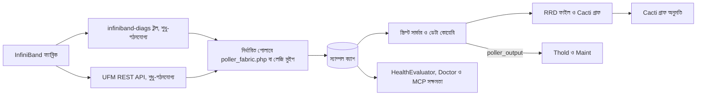

<!-- Source: README.md; SHA256: 79a16fb906f96ee79de2c719f18c38836f555440a7571a4a5ba38c64bb5b099f -->

<!-- translations:start -->
[English](../../../README.md) | [简体中文](../zh-CN/README.md) | [हिन्दी](../hi-IN/README.md) | [Español (España)](../es-ES/README.md) | [Español (Latinoamérica)](../es-419/README.md) | [العربية (السعودية)](../ar-SA/README.md) | [Afrikaans](../af-ZA/README.md) | [አማርኛ](../am-ET/README.md) | [العربية (مصر)](../ar-EG/README.md) | [العربية (المغرب)](../ar-MA/README.md) | [Български](../bg-BG/README.md) | [বাংলা](README.md) | [Bosanski](../bs-BA/README.md) | [Deutsch](../de-DE/README.md) | [Ελληνικά](../el-GR/README.md) | [فارسی](../fa-IR/README.md) | [Filipino](../fil-PH/README.md) | [Français](../fr-FR/README.md) | [Français (Maroc)](../fr-MA/README.md) | [Français (Sénégal)](../fr-SN/README.md) | [Hausa](../ha-NG/README.md) | [עברית](../he-IL/README.md) | [Hrvatski](../hr-HR/README.md) | [Bahasa Indonesia](../id-ID/README.md) | [Igbo](../ig-NG/README.md) | [Italiano](../it-IT/README.md) | [日本語](../ja-JP/README.md) | [ქართული](../ka-GE/README.md) | [한국어](../ko-KR/README.md) | [Latviešu](../lv-LV/README.md) | [Malagasy](../mg-MG/README.md) | [मराठी](../mr-IN/README.md) | [Bahasa Melayu](../ms-MY/README.md) | [Nederlands](../nl-NL/README.md) | [Polski](../pl-PL/README.md) | [Português (Brasil)](../pt-BR/README.md) | [Português (Portugal)](../pt-PT/README.md) | [Русский](../ru-RU/README.md) | [Kinyarwanda](../rw-RW/README.md) | [Soomaali](../so-SO/README.md) | [Српски](../sr-RS/README.md) | [Svenska](../sv-SE/README.md) | [Kiswahili](../sw-KE/README.md) | [தமிழ்](../ta-IN/README.md) | [తెలుగు](../te-IN/README.md) | [ไทย](../th-TH/README.md) | [Türkçe](../tr-TR/README.md) | [Українська](../uk-UA/README.md) | [اردو](../ur-PK/README.md) | [Tiếng Việt](../vi-VN/README.md) | [isiXhosa](../xh-ZA/README.md) | [Yorùbá](../yo-NG/README.md) | [繁體中文](../zh-TW/README.md) | [isiZulu](../zu-ZA/README.md)
<!-- translations:end -->

# plugin_fabric

একটি Cacti 1.2 প্লাগইন (`fabric`, সংস্করণ `0.1.0-dev`) যা InfiniBand পোর্ট কাউন্টার, লিংকের প্রস্থ ও গতি এবং কনজেশন নির্দেশকগুলোকে সাধারণ ডিভাইস, ডেটা সোর্স ও গ্রাফ হিসেবে Cacti-তে নিয়ে আসে। ফলে 4X-এর পরিবর্তে 1X-এ ট্রেইন হওয়া কোনো লিংক সেটি যে হোস্টকে সেবা দেয় তার পাশেই একটি গ্রাফ এবং Thold সতর্কবার্তা হিসেবে প্রদর্শিত হয়, Cacti-এর অনুমতির আওতায়, এবং Maint সচেতনতা ও দমন (suppression) সুবিধাসহ।

> **অবস্থা: উন্নয়নাধীন, এখনো কোনো রিলিজ হয়নি।** এই ব্রাঞ্চে প্লাগইনের ভিত্তি, Cacti অবজেক্ট ও সতর্কবার্তা, নির্ধারিত ব্যাকগ্রাউন্ড পোলার সুইপ, রিমোট কালেক্টর রেপ্লিকেশন, এনক্রিপ্টেড ক্রেডেনশিয়াল ভল্টসহ শুধু-পঠনযোগ্য NVIDIA UFM REST ব্যাকএন্ড, Configuration-as-Code (CasC) CLI ব্যবস্থাপনা এবং Cacti ইকোসিস্টেম হুক (CasC, Doctor এবং MCP / Abilities API v2) বাস্তবায়ন করা হয়েছে। এটি ফেক টুল, সিন্থেটিক UFM ট্রান্সপোর্ট এবং `ibsim` ফ্যাব্রিক সিমুলেটরের (rdma-core 50.0) বিপরীতে পরীক্ষা করা হয়েছে, কখনোই বাস্তব InfiniBand ফ্যাব্রিক বা লাইভ UFM সার্ভারে নয়। যেসব পরীক্ষার জন্য হার্ডওয়্যার প্রয়োজন সেগুলো [docs/research/](../../research/)-এ উন্মুক্ত রয়েছে। এই প্রকল্পটি Cacti প্রকল্পের সাথে সংশ্লিষ্ট নয়।

## কী কী বাস্তবায়ন করা হয়েছে

- **লাইফসাইকেল ও স্কিমা (v3)**: ইনস্টল, আইডেমপোটেন্ট আপগ্রেড, আনইনস্টল (ডিফল্টভাবে প্লাগইন টেবিলগুলো সংরক্ষণ করে) এবং এন্ট্রি পয়েন্টগুলো PHP 8.0-এ পার্সযোগ্য রেখে PHP 8.2 প্রয়োজনীয়তা গার্ড।
- **প্রবেশাধিকার ভূমিকা ও পৃষ্ঠা**: `Fabric View` (`fabric.php`), `Fabric Operator` (`fabric_operator.php`), এবং `Fabric Admin` (`fabric_admin.php`, `fabric_health.php`) রিয়েলম এবং **Configuration > Settings > Fabrics**-এর অধীনে একটি Settings ট্যাব।
- **শুধু-পঠনযোগ্য ডায়াগনস্টিকস ব্যাকএন্ড (`diags`)**: `perfquery`, `ibnetdiscover` এবং `iblinkinfo`-এর কঠোর আর্গুমেন্ট-ভেক্টর চালনা, আইডেন্টিটি দ্বন্দ্ব শনাক্তকরণ ও পুনঃসংযোগ প্রস্তাবনাসহ GUID-ভিত্তিক ইনভেন্টরি, লিংক-অবস্থা মূল্যায়ন এবং প্রতি-নোড কাউন্টার সুইপ।
- **শুধু-পঠনযোগ্য NVIDIA UFM REST ব্যাকএন্ড (`ufm`) ও এনক্রিপ্টেড ভল্ট**: কেবল-GET অনুমোদিত তালিকার (allowlisted) REST ক্লায়েন্ট (`/ufmRest/resources/ports`, `/ufmRest/resources/systems`, `/ufmRest/monitoring/session/0/data`, এবং টোকেন অথেনটিকেশনের জন্য `/ufmRestV3/...` সমতুল্য এন্ডপয়েন্ট) যা `diags`-এর মতোই একই ইনভেন্টরি, লিংক-অবস্থা, নমুনা ও হেলথ টেবিলগুলোতে ডেটা সরবরাহ করে। ক্রেডেনশিয়াল (`token` বা `basic`) `fabric_vault_key_file` দিয়ে কনফিগার করা একটি বাহ্যিক 256-বিট কী-ফাইল ব্যবহার করে AES-256-GCM দ্বারা এনক্রিপ্ট করে `plugin_fabric_secret`-এ সংরক্ষণ করা হয়। UFM ফ্যাব্রিক CasC (`cli/fabric.php`) বা রিপোজিটরিগুলোর মাধ্যমে সংজ্ঞায়িত করা যায়; ওয়েব অ্যাডমিন ফর্ম বর্তমানে `diags` ফিল্ডসমূহ প্রদর্শন করে।
- **Cacti অবজেক্ট, Thold ও Maint**: Cacti ডিভাইস, ডেটা ও গ্রাফ টেমপ্লেট (`templates/fabric-templates.xml`), "Fabric Port" স্ক্রিপ্ট-সার্ভার ডেটা কোয়েরি (`scripts/ss_fabric_ports.php`, `resource/script_server/fabric_ports.xml`), Thold-এর জন্য `DERIVE` কাউন্টার ডেটা সোর্স ও `GAUGE` লিংক-অবস্থা/রেট ডেটা সোর্স, বিচ্ছিন্নতা (discontinuity) ট্র্যাকিং এবং `U` হিসেবে রিপোর্ট করা সম্পৃক্ত মৌলিক কাউন্টার। Maint ইন্টিগ্রেশন (`MaintMaintenance`) `plugin_maint_check_cacti_host()` কোয়েরি করে (`is_device_in_maintenance` হুকে ফলব্যাক করে) যাতে সক্রিয় রক্ষণাবেক্ষণে থাকা নোডগুলো আলাদাভাবে গণনা করা যায় এবং ব্যর্থ-সুইপ ও অবনমিত-পোর্ট হেলথ সতর্কবার্তা থেকে বাদ দেওয়া যায়।
- **নির্ধারিত সুইপ, শার্ডিং ও রিমোট কালেক্টর**: `poller_bottom` বর্তমান পোলারে নির্ধারিত ও সময়োত্তীর্ণ ফ্যাব্রিকগুলোর জন্য ব্যাকগ্রাউন্ডে `poller_fabric.php` চালু করে, পাশাপাশি স্ক্রিপ্ট সার্ভারের মাধ্যমে ট্রিগার হওয়া লেজি সুইপও চলে। `INFO` ঘোষণা করে `remote_collect:1, remote_poller:1`, `poller_fabric.php` নির্ধারণমূলক GUID শার্ডিং (`--shard=K/N`) সমর্থন করে এবং `replicate_out` অ-গোপনীয় `plugin_fabric_fabric` সারিগুলো রিমোট কালেক্টরে (`poller_id >= 2`) রেপ্লিকেট করে। ভল্ট এন্ট্রি (`plugin_fabric_secret`) ও বাহ্যিক কী-ফাইল কখনোই রেপ্লিকেট হয় না।
- **CasC CLI ও ইকোসিস্টেম হুক**: YAML/XML এক্সপোর্ট, যাচাইকরণ, ড্রাই-রান ডিফ পরিকল্পনা, নিশ্চিতকরণ-সাপেক্ষ প্রয়োগ এবং হেলথ রিপোর্টিংয়ের জন্য `cli/fabric.php`, পাশাপাশি `casc_register_providers`, `doctor_register_checks` এবং `abilities_register` হুকসমূহ।

## প্রবেশাধিকার ভূমিকা

| রিয়েলম | প্রবেশাধিকার |
| --- | --- |
| Fabric View | ইনভেন্টরি এবং পোর্ট ভিউ পর্যবেক্ষণ (`fabric.php`)। |
| Fabric Operator | View প্রবেশাধিকারের পাশাপাশি Operations পৃষ্ঠা (`fabric_operator.php`) এবং ব্যক্তিগত ট্রায়াজ স্বীকৃতি। |
| Fabric Admin | Operator প্রবেশাধিকারের পাশাপাশি কনফিগারেশন, প্রশাসনিক কার্যক্রম (`fabric_admin.php`) এবং হেলথ পৃষ্ঠা (`fabric_health.php`)। |

আপগ্রেড ফাইলগুলো কপি করার পর, নতুন রিয়েলম ও হুকগুলো নিবন্ধন করতে অ্যাডমিনিস্ট্রেটর হিসেবে Plugins পৃষ্ঠাটি খুলুন। **Configuration > Users** অথবা ইউজার গ্রুপের অধীনে Operator রিয়েলমটি স্পষ্টভাবে নির্ধারণ করে দিন। আপগ্রেড করলে বিদ্যমান View এবং Admin রিয়েলম আইডি ও অনুমোদনসমূহ অপরিবর্তিত থাকে। প্রতিটি রিকোয়েস্টে Admin প্রবেশাধিকার স্বয়ংক্রিয়ভাবে Operator প্রবেশাধিকার লাভ করে এবং Operator প্রবেশাধিকার View প্রবেশাধিকার লাভ করে; এটি ব্যবহারকারী বা গ্রুপে কোনো সংরক্ষিত অনুমোদন যুক্ত করে না। প্লাগইন সেটিংসের জন্য Cacti-এর Settings অনুমতির পাশাপাশি Fabric Admin প্রবেশাধিকারও প্রয়োজন হয়।

Cacti ডিভাইস অনুমতি প্রতিটি ব্যবহারকারীর জন্য প্রদর্শিত সারি ও কার্যক্রম সীমিত রাখে; ম্যাপ না করা অবজেক্টগুলোর জন্য অ্যাডমিনিস্ট্রেটর প্রয়োজন হয়। ক্রেডেনশিয়াল, কনফিগারেশন, ম্যাপিং, মুছে ফেলা এবং অন্যান্য প্রশাসনিক পরিবর্তন প্রশাসনিক পৃষ্ঠাগুলোতে বা CLI-তে থাকে। স্বীকৃতিগুলো কেবল বর্তমান ব্যবহারকারীর সেশনেই, সর্বোচ্চ এক ঘণ্টার জন্য এবং যতক্ষণ একই পর্যবেক্ষণ সতেজ থাকে ততক্ষণ পর্যন্তই কার্যকর থাকে। নতুন বা পরিবর্তিত পর্যবেক্ষণ সেগুলোকে বাতিল করে দেয়। এগুলো কখনোই কোনো ব্যর্থ পরিমাপকে সুস্থ হিসেবে চিহ্নিত করে না বা সতর্কবার্তা দমন করে না।

## কেন এই প্লাগইন

একটি অবনমিত InfiniBand লিংক দিয়েও ট্রাফিক চলাচল অব্যাহত থাকে। একটি 4X লিংক পুনরায় 1X-এ ট্রেইন হলে পোর্টটি "active" অবস্থায় থাকে এবং হোস্টের SNMP ইন্টারফেস গ্রাফগুলোও স্বাভাবিক দেখায়, কিন্তু টাইটলি কাপলড জবগুলো ধীরগতির হয়ে যায়। এর প্রমাণ ফ্যাব্রিকের ভেতরেই থাকে: প্রতিটি পোর্ট তার active, enabled এবং supported প্রস্থ ও গতি, পাশাপাশি ত্রুটি ও কনজেশন কাউন্টার রিপোর্ট করে। এগুলো পড়ার জন্য InfiniBand ডায়াগনস্টিক টুল বা একটি ফ্যাব্রিক ম্যানেজার API প্রয়োজন হয়। হাতে চালানো হলে এগুলো তিনটি শূন্যতা তৈরি করে:

- **কোনো ইতিহাস নেই।** `perfquery` এবং `iblinkinfo` কেবল বর্তমান অবস্থা দেখায়, তাই গত সপ্তাহে অবনমিত হওয়া কোনো লিংক অদৃশ্যই থেকে যায়।
- **ডিভাইসের সাথে কোনো প্রাসঙ্গিক সংযোগ নেই।** ফ্যাব্রিক পোর্টগুলো Cacti অবজেক্ট নয়, ফলে কোনো পোর্টকে সেটি যে হোস্টকে সেবা দেয় তার পাশে গ্রাফ আকারে দেখানো যায় না।
- **Cacti সতর্কবার্তা ব্যবস্থায় কোনো প্রবেশপথ নেই।** Thold এবং Maint কেবল Cacti ডেটা সোর্স ও ডিভাইসের ওপর কাজ করে।

প্লাগইনটি `infiniband-diags` অথবা NVIDIA UFM REST API-এর মাধ্যমে ফ্যাব্রিক পড়ে, GUID দিয়ে নোড ও পোর্ট শনাক্ত করে এবং কাউন্টার ও লিংকের অবস্থাগুলোকে Cacti ডেটা সোর্স হিসেবে প্রকাশ করে এই শূন্যতাগুলো দূর করে। এটি কেবল পড়ে: এটি কখনো কাউন্টার রিসেট করে না বা পোর্টের অবস্থা পরিবর্তন করে না।

## অপারেশন ও CLI

### ব্যাকগ্রাউন্ড পোলার এবং ম্যানুয়াল সুইপ

`fabric_poller_bottom()` প্রতিটি পোলারে সেই `poller_id`-তে নির্ধারিত এবং সুইপের সময় হয়েছে এমন সক্রিয় ফ্যাব্রিকগুলোর জন্য ব্যাকগ্রাউন্ডে `poller_fabric.php` চালু করে। আপনি সরাসরি নির্ধারিত পোলারে পোলার ব্যবহারকারী হিসেবে পোলার রানার বা ম্যানুয়াল সুইপ চালাতে পারেন (`/path/to/cacti`-এর পরিবর্তে আপনার Cacti ডিরেক্টরি বসিয়ে):

```sh
php /path/to/cacti/plugins/fabric/poller_fabric.php [--fabric=ID] [--shard=K/N] [--force] [--debug]
php /path/to/cacti/plugins/fabric/fabric_sweep.php --fabric=ID [--node=GUID] [--force]
```

- `poller_fabric.php` স্থানীয় পোলারের জন্য নির্ধারিত সময়ের সব ফ্যাব্রিক (অথবা `--fabric=ID` দিয়ে একটি ফ্যাব্রিক) চালায়, `max(30, intdiv(sweep_interval, 2))` সেকেন্ডের সময়সীমার মধ্যে Cacti-এর প্রসেস রেজিস্ট্রি লক ও `ClaimRepository` লিজ কার্যকর করে এবং নোড GUID অনুযায়ী `diags` নোড কাউন্টার সুইপ নির্ধারণমূলকভাবে ভাগ করতে `--shard=K/N` (`0 <= K < N`) সমর্থন করে।
- `fabric_sweep.php` স্থানীয় পোলারে নির্ধারিত একটি সক্রিয় ফ্যাব্রিক (বা `--node=GUID` দিয়ে একটি নোড) তাৎক্ষণিক সুইপ চালায়। `--force` ফ্যাব্রিকটির সুইপের সময় হয়েছে কি না তা উপেক্ষা করে, তবে ক্লেইমগুলো তখনও মেনে চলে।

প্রথম আবিষ্কারে ইনভেন্টরি পূর্ণ হওয়ার পর, Fabric Admin পৃষ্ঠায় নোডগুলোকে Cacti ডিভাইসের সাথে ম্যাপ করুন। Cacti-এর স্ক্রিপ্ট টাইমআউট ২৫ সেকেন্ড বা তার বেশি রাখুন: ডেটা-কোয়েরি রিডের মাধ্যমে শুরু হওয়া একটি লেজি সুইপ টুল চালানোর সময়সীমা `script_timeout - 5` সেকেন্ডে সীমাবদ্ধ রাখে, যাতে স্ক্রিপ্ট সার্ভার সর্বশেষ সংরক্ষিত নমুনা অথবা `U` নিয়ে সময়মতো ফিরে আসতে পারে।

### NVIDIA UFM REST ব্যাকএন্ড ও ক্রেডেনশিয়াল ভল্ট

একটি `ufm` ফ্যাব্রিকের জন্য এমবেডেড ক্রেডেনশিয়াল, কোয়েরি স্ট্রিং বা ফ্র্যাগমেন্টবিহীন একটি `https://` URL প্রয়োজন। `UfmSocketTransport` TLS পিয়ার ও হোস্টনেম যাচাইকরণ বাধ্যতামূলক করে, রিডাইরেক্ট প্রত্যাখ্যান করে এবং ঐচ্ছিক CA বান্ডেল (`ufm_ca_file`) ও SHA-256 SPKI পিন (`ufm_spki_pin`) সমর্থন করে।

`plugin_fabric_secret`-এ UFM ক্রেডেনশিয়াল সংরক্ষণ করতে, **Configuration > Settings > Fabrics**-এর অধীনে `fabric_vault_key_file`-এ পোলার ব্যবহারকারীর মালিকানাধীন একটি সাধারণ ফাইলের পূর্ণ পাথ কনফিগার করুন (কোনো প্যারেন্ট ডিরেক্টরিতে সিমলিংক থাকবে না, মোড `0600`, এবং `openssl rand -hex 32`-এর মতো ৬৪টি হেক্স অক্ষর অথবা ৩২টি এলোমেলো নন-প্রিন্টেবল বাইট ধারণ করবে)। প্লাগইনটি কখনোই কী-ফাইল তৈরি বা লেখে না এবং `replicate_out` কখনোই `plugin_fabric_secret` বা কী-ফাইল রিমোট পোলারে রেপ্লিকেট করে না।

### Configuration-as-Code এবং হেলথ CLI

`cli/fabric.php` YAML বা XML-এ ঘোষণামূলকভাবে প্লাগইন সেটিংস ও ফ্যাব্রিক সংজ্ঞা পরিচালনা করে এবং লাইভ সুইপ না চালিয়েই রক্ষণাবেক্ষণ-সচেতন হেলথ রিপোর্ট করে:

```sh
php /path/to/cacti/plugins/fabric/cli/fabric.php export [--format=yaml|xml] [--file=PATH]
php /path/to/cacti/plugins/fabric/cli/fabric.php validate --file=PATH [--format=yaml|xml]
php /path/to/cacti/plugins/fabric/cli/fabric.php plan --file=PATH [--format=yaml|xml]
php /path/to/cacti/plugins/fabric/cli/fabric.php apply --file=PATH --confirm=PLAN_HASH [--format=yaml|xml]
php /path/to/cacti/plugins/fabric/cli/fabric.php health [--format=text|json]
```

`export` নতুন ফাইল `0600` মোডে তৈরি করে, `fabric_vault_key_file`-কে `[REDACTED]` হিসেবে গোপন করে এবং গোপনীয় তথ্যের পরিবর্তে নামযুক্ত `ufm_credential_ref` রেফারেন্স প্রদান করে। `plan` এবং `apply` ইনলাইন `ufm_token`, `ufm_password`, `secret` এবং ইনলাইন `fabric_vault_key_file` মান প্রত্যাখ্যান করে। `apply` চালানোর জন্য `plan` থেকে প্রাপ্ত হুবহু `--confirm=PLAN_HASH` প্রয়োজন।

### ইকোসিস্টেম হুকসমূহ

সংশ্লিষ্ট Cacti প্লাগইন বা হোস্ট ইন্টিগ্রেশন উপস্থিত থাকলে `setup.php` নিবন্ধন করে:

- `casc_register_providers`: গোপনীয় তথ্য গোপন রেখে `fabric` কনফিগারেশন (`yaml` এবং `xml`, স্কিমা v1) এক্সপোর্ট, যাচাই, পরিকল্পনা এবং নিশ্চিতকরণ-সাপেক্ষ প্রয়োগ করে।
- `doctor_register_checks`: চারটি শুধু-পঠনযোগ্য ডায়াগনস্টিক পরীক্ষা সরবরাহ করে (`fabric.schema`, `fabric.poller_freshness`, `fabric.identity_conflicts`, `fabric.ufm_vault`)।
- `abilities_register`: `fabric` ক্যাটাগরির অধীনে তিনটি শুধু-পঠনযোগ্য, অ-ধ্বংসাত্মক ও আইডেমপোটেন্ট সক্ষমতা নিবন্ধন করে, যা Fabric View রিয়েলম (এবং পোর্ট ত্রুটির জন্য Cacti ডিভাইস অনুমতি) দ্বারা নিয়ন্ত্রিত: `fabric-list-fabrics`, `fabric-get-health` এবং `fabric-list-port-errors`।

## পরিধি ও সীমানা

পরিধির বাইরে: ফ্যাব্রিকের অবস্থা পরিবর্তন করা, কাউন্টার রিসেট করা, ফ্যাব্রিক ম্যানেজার বা সাবনেট ম্যানেজার প্রতিস্থাপন করা, প্লাগইনের নিজস্ব সতর্কবার্তা ইঞ্জিন, কাস্টম ডেমন বা নেটওয়ার্ক প্রোটোকল, এবং Ethernet বা RoCE ফ্যাব্রিক।

## প্রয়োজনীয়তা ও সামঞ্জস্যতা

| উপাদান | লক্ষ্যমাত্রা |
|---|---|
| Cacti | 1.2.31 বা তার পরবর্তী (`compat = 1.2.31`), কোনো কোর প্যাচ ছাড়াই |
| PHP | 8.2 বা তার পরবর্তী; এন্ট্রি পয়েন্টগুলো 8.0-এ পার্সযোগ্য থাকে এবং 8.1-এ সক্রিয়করণ প্রত্যাখ্যান করে যাতে অসমর্থিত রানটাইম ভেঙে যাওয়া Cacti UI-এর বদলে প্রত্যাখ্যান বার্তা পায় |
| InfiniBand টুলসমূহ | `rdma-core` থেকে `infiniband-diags` (CI-তে `ibsim`-এর অধীনে rdma-core 50.0 দিয়ে পরীক্ষিত; আউটপুট ফরম্যাট v66.0 সোর্সের বিপরীতে যাচাইকৃত) |
| UFM | NVIDIA UFM Enterprise REST API (`ufmRest` ও `ufmRestV3` শুধু-পঠনযোগ্য এন্ডপয়েন্ট; ইউনিট টেস্টে সিন্থেটিক ট্রান্সপোর্টের বিপরীতে পরীক্ষিত) |
| Thold, Maint | কোনো পরিবর্তনের প্রয়োজন নেই; CI অপরিবর্তিত Thold v1.8.2 ও Maint v1.3-এর সাথে এন্ড-টু-এন্ড পরীক্ষা চালায় |

## উন্নয়ন ও পরীক্ষা

CI ওয়ার্কফ্লো (`.github/workflows/plugin-ci-workflow.yml`) Cacti `release/1.2.31` এবং `1.2.x`-এর বিপরীতে PHP 8.2 থেকে 8.5, PHP 8.0 এন্ট্রি-পয়েন্ট লিন্টিং, PHP 8.1 প্রত্যাখ্যান, PHPStan, gettext/অনুবাদ যাচাইকরণ, REUSE লাইসেন্সিং, ওয়ার্কফ্লো লিন্টিং, Thold/Maint এন্ড-টু-এন্ড রিপ্লে এবং `ibsim` ফ্যাব্রিক সিমুলেশন পরীক্ষা করে।

Cacti-এর লক করা শেয়ার্ড Pest প্লাগইন হারনেস (`CACTI_PEST_BIN`) এবং একটি ডিসপোজেবল Cacti ডাটাবেসসহ:

```sh
# Unit tests
"$CACTI_PEST_BIN" --configuration=phpunit.xml

# Lifecycle integration tests (disposable database only)
CACTI_PATH=/path/to/cacti FABRIC_TEST_DATABASE=disposable "$CACTI_PEST_BIN" --configuration=phpunit-integration.xml

# Static analysis (against Cacti 1.2.31)
CACTI_PATH=/path/to/cacti phpstan analyse -c phpstan.neon --no-progress

# Translation template, catalogs, and localized README checks
sh locales/build_gettext.sh --check

# Simulated ibsim fixture parser check
php tests/bin/check-ibsim-fixtures.php tests/fixtures/ibsim
```

## নকশা

- [docs/PLAN.md](../../PLAN.md) হলো আর্কিটেকচার ও নকশা পরিকল্পনা: উৎসসহ আপস্ট্রিম তথ্য, উন্মুক্ত হার্ডওয়্যার পরীক্ষা, আইডেন্টিটি মডেল, কাউন্টার ও লিংক-অবস্থার নিয়ম, নিরাপত্তার সীমা, পারফরম্যান্সের হিসাব, পরীক্ষা এবং ঝুঁকিসমূহ।
- [docs/decisions/](../../decisions/)-এ আর্কিটেকচার ডিসিশন রেকর্ড সংরক্ষিত আছে।
- [docs/REQUIREMENTS.md](../../REQUIREMENTS.md) প্রতিটি রিকোয়ারমেন্ট আইডিকে তার সংশ্লিষ্ট ইস্যুর সাথে ম্যাপ করে।



## কাজ যেভাবে ট্র্যাক করা হয়

- **মাইলস্টোন** পরিকল্পনার মাইলস্টোনগুলো অনুসরণ করে। প্রতিটিতে একটি এপিক ইস্যু থাকে যেখানে এর সাব-ইস্যু এবং সমাপ্তির প্রমাণ তালিকাভুক্ত থাকে।
- **ইস্যুগুলো** লেবেল অনুযায়ী শ্রেণিবদ্ধ: `type: requirement`, `type: research`, `type: decision`, `type: epic`। রিকোয়ারমেন্ট ইস্যুতে নম্বরযুক্ত, পরীক্ষামূলকভাবে যাচাইযোগ্য রিকোয়ারমেন্ট (`REQ-AREA-NNN`) এবং গ্রহণযোগ্যতার মানদণ্ড উল্লেখ থাকে।
- **লেবেলে** `area:`, `phase:`, `priority:` এবং `status:` থাকে। দেখুন [CONTRIBUTING.md](../../../CONTRIBUTING.md#labels)।
- [প্রকল্প বোর্ড](https://github.com/users/somethingwithproof/projects/8) সব মাইলস্টোন জুড়ে সমস্ত ইস্যু প্রদর্শন করে।

## অবদান রাখা

[CONTRIBUTING.md](../../../CONTRIBUTING.md) পড়ুন। কমিটের জন্য DCO সাইন-অফ (`git commit -s`) প্রয়োজন। নকশা সংক্রান্ত আলোচনা ইস্যুগুলোতে হয়; অমীমাংসিত সিদ্ধান্তগুলোতে `type: decision` লেবেল থাকে।

## নিরাপত্তা

দুর্বলতাগুলো গোপনে রিপোর্ট করুন; দেখুন [SECURITY.md](../../../SECURITY.md)।

## লাইসেন্স

GNU General Public License v2.0, যেটি Cacti ও এর প্লাগইনগুলোর লাইসেন্স। দেখুন [LICENSE](../../../LICENSE)।
