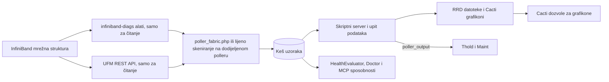

<!-- Source: README.md; SHA256: 79a16fb906f96ee79de2c719f18c38836f555440a7571a4a5ba38c64bb5b099f -->

<!-- translations:start -->
[English](../../../README.md) | [简体中文](../zh-CN/README.md) | [हिन्दी](../hi-IN/README.md) | [Español (España)](../es-ES/README.md) | [Español (Latinoamérica)](../es-419/README.md) | [العربية (السعودية)](../ar-SA/README.md) | [Afrikaans](../af-ZA/README.md) | [አማርኛ](../am-ET/README.md) | [العربية (مصر)](../ar-EG/README.md) | [العربية (المغرب)](../ar-MA/README.md) | [বাংলা](../bn-BD/README.md) | [Bosanski](README.md) | [Deutsch](../de-DE/README.md) | [فارسی](../fa-IR/README.md) | [Filipino](../fil-PH/README.md) | [Français](../fr-FR/README.md) | [Français (Maroc)](../fr-MA/README.md) | [Français (Sénégal)](../fr-SN/README.md) | [Hausa](../ha-NG/README.md) | [עברית](../he-IL/README.md) | [Hrvatski](../hr-HR/README.md) | [Bahasa Indonesia](../id-ID/README.md) | [Igbo](../ig-NG/README.md) | [Italiano](../it-IT/README.md) | [日本語](../ja-JP/README.md) | [한국어](../ko-KR/README.md) | [Malagasy](../mg-MG/README.md) | [मराठी](../mr-IN/README.md) | [Bahasa Melayu](../ms-MY/README.md) | [Nederlands](../nl-NL/README.md) | [Polski](../pl-PL/README.md) | [Português (Brasil)](../pt-BR/README.md) | [Русский](../ru-RU/README.md) | [Kinyarwanda](../rw-RW/README.md) | [Soomaali](../so-SO/README.md) | [Српски](../sr-RS/README.md) | [Svenska](../sv-SE/README.md) | [Kiswahili](../sw-KE/README.md) | [தமிழ்](../ta-IN/README.md) | [తెలుగు](../te-IN/README.md) | [ไทย](../th-TH/README.md) | [Türkçe](../tr-TR/README.md) | [Українська](../uk-UA/README.md) | [اردو](../ur-PK/README.md) | [Tiếng Việt](../vi-VN/README.md) | [isiXhosa](../xh-ZA/README.md) | [Yorùbá](../yo-NG/README.md) | [繁體中文](../zh-TW/README.md) | [isiZulu](../zu-ZA/README.md)
<!-- translations:end -->

# plugin_fabric

Dodatak za Cacti 1.2 (`fabric`, verzija `0.1.0-dev`) koji u Cacti donosi brojače InfiniBand portova, širinu i brzinu linka te pokazatelje zagušenja kao standardne uređaje, izvore podataka i grafikone. Link koji se umjesto na 4X uspostavio na 1X tada se prikazuje kao grafikon i Thold upozorenje uz računar kojem služi, u okviru Cacti dozvola, uz prepoznavanje i potiskivanje putem Mainta.

> **Status: u razvoju, još nema izdanja.** Ova grana implementira osnovu dodatka, Cacti objekte i upozoravanje, zakazana pozadinska skeniranja pollera, replikaciju na udaljene prikupljače podataka, NVIDIA UFM REST pozadinski sistem samo za čitanje sa šifriranim trezorom pristupnih podataka, Configuration-as-Code (CasC) CLI upravljanje te Cacti ekosistemske hookove (CasC, Doctor i MCP / Abilities API v2). Testirano je sa lažnim alatima, sintetičkim UFM transportima i simulatorom mrežne strukture `ibsim` (rdma-core 50.0), nikada na fizičkoj InfiniBand mrežnoj strukturi ili živom UFM serveru. Provjere koje zahtijevaju hardver ostaju otvorene u [docs/research/](../../research/). Ovaj projekat nije povezan sa projektom Cacti.

## Šta je implementirano

- **Životni ciklus i šema (v3)**: instalacija, idempotentna nadogradnja, deinstalacija (podrazumijevano zadržava tabele dodatka) i provjera zahtjeva za PHP 8.2 uz održavanje ulaznih tačaka ispravnim za parsiranje na PHP 8.0.
- **Uloge pristupa i stranice**: oblasti `Fabric View` (`fabric.php`), `Fabric Operator` (`fabric_operator.php`) i `Fabric Admin` (`fabric_admin.php`, `fabric_health.php`), plus kartica postavki pod **Configuration > Settings > Fabrics**.
- **Dijagnostički pozadinski sistem samo za čitanje (`diags`)**: strogo izvršavanje putem vektora argumenata za `perfquery`, `ibnetdiscover` i `iblinkinfo`, inventar po GUID-u sa otkrivanjem sukoba identiteta i prijedlozima ponovnog povezivanja, procjena stanja linka i skeniranje brojača po čvoru.
- **NVIDIA UFM REST pozadinski sistem samo za čitanje (`ufm`) i šifrirani trezor**: REST klijent samo za GET sa listom dozvoljenih putanja (`/ufmRest/resources/ports`, `/ufmRest/resources/systems`, `/ufmRest/monitoring/session/0/data`, te `/ufmRestV3/...` ekvivalenti za autentifikaciju tokenom) koji puni iste tabele inventara, stanja linka, uzoraka i zdravlja kao i `diags`. Pristupni podaci (`token` ili `basic`) čuvaju se šifrirani algoritmom AES-256-GCM u `plugin_fabric_secret` pomoću vanjske 256-bitne datoteke ključa podešene preko `fabric_vault_key_file`. UFM mrežne strukture mogu se definisati putem CasC-a (`cli/fabric.php`) ili repozitorija; web obrazac za administraciju trenutno prikazuje `diags` polja.
- **Cacti objekti, Thold i Maint**: Cacti šabloni uređaja, podataka i grafikona (`templates/fabric-templates.xml`), upit podataka skriptnog servera "Fabric Port" (`scripts/ss_fabric_ports.php`, `resource/script_server/fabric_ports.xml`), `DERIVE` izvori podataka brojača i `GAUGE` izvori podataka stanja/stope linka za Thold, praćenje prekida kontinuiteta i zasićeni osnovni brojači prijavljeni kao `U`. Maint integracija (`MaintMaintenance`) poziva `plugin_maint_check_cacti_host()` (uz povratak na hook `is_device_in_maintenance`) kako bi se čvorovi u aktivnom održavanju brojali odvojeno i isključili iz zdravstvenih upozorenja za neuspjela skeniranja i degradirane portove.
- **Zakazana skeniranja, dijeljenje na fragmente i udaljeni prikupljači**: `poller_bottom` pokreće `poller_fabric.php` u pozadini za dospjele mrežne strukture dodijeljene trenutnom polleru, uz lijena skeniranja pokrenuta iz skriptnog servera. `INFO` deklariše `remote_collect:1, remote_poller:1`, `poller_fabric.php` podržava determinističko GUID dijeljenje (`--shard=K/N`), a `replicate_out` replicira netajne redove tabele `plugin_fabric_fabric` na udaljene prikupljače (`poller_id >= 2`). Unosi trezora (`plugin_fabric_secret`) i vanjske datoteke ključeva nikada se ne repliciraju.
- **CasC CLI i ekosistemski hookovi**: `cli/fabric.php` za YAML/XML izvoz, validaciju, probno planiranje razlika, primjenu uslovljenu potvrdom i izvještavanje o zdravlju, plus hookovi `casc_register_providers`, `doctor_register_checks` i `abilities_register`.

## Uloge pristupa

| Oblast | Pristup |
| --- | --- |
| Fabric View | Nadzor inventara i pregledi portova (`fabric.php`). |
| Fabric Operator | View pristup plus stranica Operacije (`fabric_operator.php`) i lične potvrde uvida za trijažu. |
| Fabric Admin | Operator pristup plus konfigurisanje, administrativne radnje (`fabric_admin.php`) i stranica zdravlja (`fabric_health.php`). |

Nakon kopiranja datoteka za nadogradnju, otvorite stranicu Dodaci kao administrator da registrujete nove oblasti i hookove. Dodijelite oblast Operator izričito pod **Configuration > Users** ili u korisničkim grupama. Nadogradnje zadržavaju postojeće ID-ove i dodjele oblasti View i Admin. Pristup Admin nasljeđuje pristup Operator, a pristup Operator nasljeđuje pristup View pri svakom zahtjevu; time se korisnicima ni grupama ne dodaju pohranjene dodjele. Postavke dodatka također zahtijevaju pristup Fabric Admin pored Cacti dozvole za postavke.

Cacti dozvole za uređaje ograničavaju redove i radnje dostupne svakom korisniku; nemapirani objekti zahtijevaju administratora. Pristupni podaci, konfiguracija, mapiranje, brisanje i druge administrativne izmjene ostaju na administrativnim stranicama ili u CLI-u. Potvrde uvida traju samo u trenutnoj sesiji korisnika, najviše jedan sat i samo dok isto zapažanje ostane svježe. Nova ili promijenjena zapažanja ih poništavaju. One nikada ne označavaju neuspjelo mjerenje kao ispravno niti potiskuju upozorenja.

## Zašto

Degradiran InfiniBand link i dalje prenosi saobraćaj. Link širine 4X koji se ponovo uspostavi na 1X ostavlja port u stanju "active", pa SNMP grafikoni mrežnih interfejsa na računaru izgledaju normalno, ali čvrsto spregnuti poslovi usporavaju. Dokaz se nalazi u samoj mrežnoj strukturi: svaki port prijavljuje svoju aktivnu, omogućenu i podržanu širinu i brzinu, uz brojače grešaka i zagušenja. Za njihovo čitanje potrebni su InfiniBand dijagnostički alati ili API upravitelja mrežne strukture. Kada se pokreću ručno, ostavljaju tri praznine:

- **Nema historije.** `perfquery` i `iblinkinfo` prikazuju samo trenutno stanje, pa link koji je bio degradiran prošle sedmice ostaje nevidljiv.
- **Nema konteksta uređaja.** Portovi mrežne strukture nisu Cacti objekti, pa port ne može biti prikazan na grafikonu pored računara koji napaja.
- **Nema puta do Cacti upozorenja.** Thold i Maint rade nad Cacti izvorima podataka i uređajima.

Dodatak popunjava ove praznine čitajući mrežnu strukturu putem `infiniband-diags` ili NVIDIA UFM REST API-ja, identifikujući čvorove i portove po GUID-u i objavljujući brojače i stanje linka kao Cacti izvore podataka. Radi isključivo u režimu čitanja: nikada ne resetuje brojače niti mijenja stanje porta.

## Operacije i CLI

### Pozadinski poller i ručna skeniranja

`fabric_poller_bottom()` pokreće `poller_fabric.php` u pozadini na svakom polleru za omogućene mrežne strukture dodijeljene tom `poller_id`-u čije je skeniranje dospjelo. Također možete pokrenuti izvršioca pollera ili ručno skeniranje direktno na dodijeljenom polleru kao korisnik pollera (zamjenjujući `/path/to/cacti` vašim Cacti direktorijem):

```sh
php /path/to/cacti/plugins/fabric/poller_fabric.php [--fabric=ID] [--shard=K/N] [--force] [--debug]
php /path/to/cacti/plugins/fabric/fabric_sweep.php --fabric=ID [--node=GUID] [--force]
```

- `poller_fabric.php` pokreće sve dospjele mrežne strukture za lokalni poller (ili jednu mrežnu strukturu sa `--fabric=ID`), provodi Cacti zaključavanje registra procesa i `ClaimRepository` zakupe sa vremenskim budžetom od `max(30, intdiv(sweep_interval, 2))` sekundi, te podržava `--shard=K/N` (`0 <= K < N`) za determinističku podjelu `diags` skeniranja brojača čvorova prema GUID-u čvora.
- `fabric_sweep.php` pokreće skeniranje na zahtjev za jednu omogućenu mrežnu strukturu (ili jedan čvor sa `--node=GUID`) dodijeljenu lokalnom polleru. `--force` zanemaruje da li je mrežna struktura dospjela dok i dalje poštuje zahtjeve za zakup.

Nakon što prvo otkrivanje popuni inventar, mapirajte čvorove na Cacti uređaje na stranici Fabric Admin. Zadržite Cacti vremensko ograničenje skripte na 25 sekundi ili više: lijeno skeniranje pokrenuto čitanjem upita podataka ograničava izvršavanje alata na `script_timeout - 5` sekundi kako bi skriptni server vratio odgovor na vrijeme sa posljednjim sačuvanim uzorkom ili `U`.

### NVIDIA UFM REST pozadinski sistem i trezor pristupnih podataka

Mrežna struktura tipa `ufm` zahtijeva `https://` URL bez ugrađenih pristupnih podataka, nizova upita ili fragmenata. `UfmSocketTransport` provodi TLS verifikaciju partnera i imena hosta, odbija preusmjeravanja i podržava opcioni CA paket (`ufm_ca_file`) i SHA-256 SPKI pin (`ufm_spki_pin`).

Za pohranu UFM pristupnih podataka u `plugin_fabric_secret`, podesite `fabric_vault_key_file` pod **Configuration > Settings > Fabrics** sa apsolutnom putanjom do obične datoteke u vlasništvu korisnika pollera (bez simboličkih veza u bilo kojem roditeljskom direktoriju, režim `0600`, koja sadrži 64 heksadecimalna znaka kao `openssl rand -hex 32` ili 32 nasumična neispisiva bajta). Dodatak nikada ne kreira niti piše datoteku ključa, a `replicate_out` nikada ne replicira `plugin_fabric_secret` niti datoteke ključeva na udaljene pollere.

### Configuration-as-Code i CLI za zdravlje

`cli/fabric.php` upravlja postavkama dodatka i definicijama mrežnih struktura deklarativno u YAML ili XML formatu, te izvještava o zdravlju uz uvažavanje održavanja bez pokretanja skeniranja uživo:

```sh
php /path/to/cacti/plugins/fabric/cli/fabric.php export [--format=yaml|xml] [--file=PATH]
php /path/to/cacti/plugins/fabric/cli/fabric.php validate --file=PATH [--format=yaml|xml]
php /path/to/cacti/plugins/fabric/cli/fabric.php plan --file=PATH [--format=yaml|xml]
php /path/to/cacti/plugins/fabric/cli/fabric.php apply --file=PATH --confirm=PLAN_HASH [--format=yaml|xml]
php /path/to/cacti/plugins/fabric/cli/fabric.php health [--format=text|json]
```

`export` kreira nove datoteke sa režimom `0600`, maskira `fabric_vault_key_file` kao `[REDACTED]`, i ispisuje imenovane reference `ufm_credential_ref` umjesto tajni. `plan` i `apply` odbijaju ugrađene vrijednosti `ufm_token`, `ufm_password`, `secret` i ugrađenu vrijednost `fabric_vault_key_file`. `apply` zahtijeva tačan `--confirm=PLAN_HASH` koji je proizveo `plan`.

### Ekosistemski hookovi

Kada su prisutni odgovarajući Cacti dodaci ili integracije hosta, `setup.php` registruje:

- `casc_register_providers`: izvozi, validira, planira i nakon potvrde primjenjuje konfiguraciju `fabric` (`yaml` i `xml`, šema v1) uz maskiranje tajni.
- `doctor_register_checks`: obezbjeđuje četiri dijagnostičke provjere samo za čitanje (`fabric.schema`, `fabric.poller_freshness`, `fabric.identity_conflicts`, `fabric.ufm_vault`).
- `abilities_register`: registruje tri sposobnosti samo za čitanje, nedestruktivne i idempotentne pod kategorijom `fabric`, ograničene oblašću Fabric View (i Cacti dozvolama za uređaje za greške portova): `fabric-list-fabrics`, `fabric-get-health` i `fabric-list-port-errors`.

## Opseg i granice

Izvan opsega: izmjena stanja mrežne strukture, resetovanje brojača, zamjena upravitelja mrežne strukture ili podmreže, vlastiti sistem za upozorenja unutar dodatka, poseban daemon ili mrežni protokol, te Ethernet ili RoCE mrežne strukture.

## Zahtjevi i kompatibilnost

| Komponenta | Cilj |
|---|---|
| Cacti | 1.2.31 ili noviji (`compat = 1.2.31`), bez izmjena jezgra |
| PHP | 8.2 ili noviji; ulazne tačke ostaju ispravne za parsiranje na 8.0 i odbijaju aktivaciju na 8.1 kako bi nepodržano okruženje dobilo odbijanje umjesto pokvarenog Cacti interfejsa |
| InfiniBand alati | `infiniband-diags` iz `rdma-core` (testirano u CI sa rdma-core 50.0 pod `ibsim`; formati izlaza provjereni prema izvornom kodu v66.0) |
| UFM | NVIDIA UFM Enterprise REST API (`ufmRest` i `ufmRestV3` krajnje tačke samo za čitanje; testirano sa sintetičkim transportima u jediničnim testovima) |
| Thold, Maint | Nisu potrebne izmjene; CI pokreće test od početka do kraja sa neizmijenjenim Thold v1.8.2 i Maint v1.3 |

## Razvoj i testiranje

CI radni tok (`.github/workflows/plugin-ci-workflow.yml`) testira PHP 8.2 do 8.5 protiv Cacti `release/1.2.31` i `1.2.x`, provjeru sintakse ulaznih tačaka na PHP 8.0, odbijanje na PHP 8.1, PHPStan, provjeru gettext/prijevoda, REUSE licenciranje, provjeru radnog toka, Thold/Maint ponovno izvršavanje od početka do kraja i `ibsim` simulaciju mrežne strukture.

Sa Cacti zaključanim dijeljenim Pest okvirom za dodatke (`CACTI_PEST_BIN`) i jednokratnom Cacti bazom podataka:

```sh
# Unit tests
"$CACTI_PEST_BIN" --configuration=phpunit.xml

# Lifecycle integration tests (disposable database only)
CACTI_PATH=/path/to/cacti FABRIC_TEST_DATABASE=disposable "$CACTI_PEST_BIN" --configuration=phpunit-integration.xml

# Static analysis (against Cacti 1.2.31)
CACTI_PATH=/path/to/cacti phpstan analyse -c phpstan.neon --no-progress

# Translation template, catalogs, and localized README checks
sh locales/build_gettext.sh --check

# Simulated ibsim fixture parser check
php tests/bin/check-ibsim-fixtures.php tests/fixtures/ibsim
```

## Dizajn

- [docs/PLAN.md](../../PLAN.md) je plan arhitekture i dizajna: činjenice o uzvodnim sistemima sa izvorima, otvorene hardverske provjere, model identiteta, pravila za brojače i stanje linka, sigurnosne granice, proračuni performansi, testiranje i rizici.
- [docs/decisions/](../../decisions/) sadrži zapise o arhitekturnim odlukama (ADR).
- [docs/REQUIREMENTS.md](../../REQUIREMENTS.md) povezuje svaki ID zahtjeva sa njegovim zadatkom.



## Kako se prati rad

- **Prekretnice** prate prekretnice plana. Svaka ima epik zadatak koji navodi njegove podzadatke i dokaze o završetku.
- **Zadaci** su označeni prema tipu: `type: requirement`, `type: research`, `type: decision`, `type: epic`. Zadaci zahtjeva navode numerisane, provjerljive zahtjeve (`REQ-AREA-NNN`) i kriterije prihvatanja.
- **Oznake** također nose `area:`, `phase:`, `priority:` i `status:`. Pogledajte [CONTRIBUTING.md](../../../CONTRIBUTING.md#labels).
- [Ploča projekta](https://github.com/users/somethingwithproof/projects/8) prikazuje sve zadatke kroz prekretnice.

## Doprinos

Pročitajte [CONTRIBUTING.md](../../../CONTRIBUTING.md). Commitovi zahtijevaju DCO potpis (`git commit -s`). Rasprava o dizajnu vodi se na zadacima; otvorene odluke nose oznaku `type: decision`.

## Sigurnost

Prijavite ranjivosti privatno; pogledajte [SECURITY.md](../../../SECURITY.md).

## Licenca

GNU General Public License v2.0, ista licenca kao Cacti i njegovi dodaci. Pogledajte [LICENSE](../../../LICENSE).
