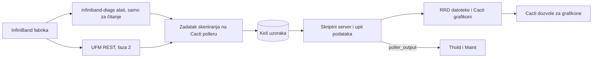

<!-- Source: README.md; SHA256: ce5af61a1bc993ec2aae6d4f22c3885694632f2b1d5eb94e2ce88b8390e96f1e -->

<!-- translations:start -->
[English](../../../README.md) | [简体中文](../zh-CN/README.md) | [हिन्दी](../hi-IN/README.md) | [Español (España)](../es-ES/README.md) | [Español (Latinoamérica)](../es-419/README.md) | [العربية (السعودية)](../ar-SA/README.md) | [Afrikaans](../af-ZA/README.md) | [አማርኛ](../am-ET/README.md) | [العربية (مصر)](../ar-EG/README.md) | [العربية (المغرب)](../ar-MA/README.md) | [বাংলা](../bn-BD/README.md) | [Bosanski](README.md) | [Deutsch](../de-DE/README.md) | [فارسی](../fa-IR/README.md) | [Filipino](../fil-PH/README.md) | [Français](../fr-FR/README.md) | [Français (Maroc)](../fr-MA/README.md) | [Français (Sénégal)](../fr-SN/README.md) | [Hausa](../ha-NG/README.md) | [עברית](../he-IL/README.md) | [Hrvatski](../hr-HR/README.md) | [Bahasa Indonesia](../id-ID/README.md) | [Igbo](../ig-NG/README.md) | [Italiano](../it-IT/README.md) | [日本語](../ja-JP/README.md) | [한국어](../ko-KR/README.md) | [Malagasy](../mg-MG/README.md) | [मराठी](../mr-IN/README.md) | [Bahasa Melayu](../ms-MY/README.md) | [Nederlands](../nl-NL/README.md) | [Polski](../pl-PL/README.md) | [Português (Brasil)](../pt-BR/README.md) | [Русский](../ru-RU/README.md) | [Kinyarwanda](../rw-RW/README.md) | [Soomaali](../so-SO/README.md) | [Српски](../sr-RS/README.md) | [Svenska](../sv-SE/README.md) | [Kiswahili](../sw-KE/README.md) | [தமிழ்](../ta-IN/README.md) | [తెలుగు](../te-IN/README.md) | [ไทย](../th-TH/README.md) | [Türkçe](../tr-TR/README.md) | [Українська](../uk-UA/README.md) | [اردو](../ur-PK/README.md) | [Tiếng Việt](../vi-VN/README.md) | [isiXhosa](../xh-ZA/README.md) | [Yorùbá](../yo-NG/README.md) | [繁體中文](../zh-TW/README.md) | [isiZulu](../zu-ZA/README.md)
<!-- translations:end -->

# plugin_fabric

Dodatak za Cacti 1.2 koji u Cacti donosi brojače InfiniBand portova, širinu i brzinu linka te pokazatelje zagušenja kao standardne uređaje, izvore podataka i grafikone. Link koji se umjesto na 4X uspostavio na 1X tada se prikazuje kao grafikon i Thold upozorenje uz računar kojem služi, u okviru Cacti dozvola, uz mogućnost da ga Maint privremeno potisne.

> **Status: u razvoju, još nema izdanja.** Prekretnica 2 (osnova) je spojena u granu `main`, a prekretnica 3 (Cacti objekti i upozorenja) nalazi se na pregledu. Prekretnica 1 je potvrdila dizajn na osnovu dokumentacije i izvornog koda uzvodnih projekata (PR #71); rezultati sa izvorima nalaze se u [docs/research/](../../../docs/research/). Prekretnica 2 dodaje osnovu dodatka:
>
> - instalaciju, nadogradnju, deinstalaciju i provjeru verzije PHP 8.2
> - oblasti dozvola View, Operator i Admin, te postavke
> - zapise fabrike
> - granicu komandi samo za čitanje za `perfquery`, `ibnetdiscover` i `iblinkinfo`
> - inventar po GUID-u, sa sukobima identiteta i prijedlozima ponovnog povezivanja
> - stanje linka i keš skeniranja brojača
> - stranice inventara, administracije i zdravlja
>
> Prekretnica 3 dodaje Cacti objekte:
>
> - šablone uređaja, podataka i grafikona isporučene kao Cacti XML šabloni, te upit podataka "Fabric Port"
> - mapiranje čvora na Cacti uređaj ili kreiranje novog nakon potvrde ([ADR 0010](../../../docs/decisions/0010-one-device-per-node.md))
> - izvore podataka brojača za grafikone, kao i GAUGE izvore podataka za stanje linka i stope za Thold ([ADR 0011](../../../docs/decisions/0011-derive-counters-and-gauge-alert-values.md))
> - obradu prekida kontinuiteta i očitavanje zasićenih osnovnih brojača kao nepoznatih ([ADR 0012](../../../docs/decisions/0012-saturated-basic-counters-read-as-unknown.md)), ispravnost brojača i linkove grafikona na stranici porta, te rang-listu zagušenja
> - testiranje od početka do kraja sa neizmijenjenim Thold v1.8.2 i Maint v1.3, te CI zadatak koji pokreće stvarne dijagnostičke alate nad simuliranom fabrikom
>
> Fabrika se može skenirati samo sa glavnog pollera dok se u fazi 3 ne doda podrška za udaljene prikupljače podataka. Dodatak je testiran sa lažnim alatima i simulatorom fabrike ibsim, ali nikada na stvarnoj InfiniBand fabrici. Provjere koje zahtijevaju stvarnu fabriku ostaju otvorene u tabeli provjera uživo na svakoj istraživačkoj stranici. Ovaj projekat nije povezan sa projektom Cacti.

## Uloge pristupa

| Oblast | Pristup |
| --- | --- |
| Fabric View | Postojeće stranice za nadzor. |
| Fabric Operator | Nadzor plus stranica Operacije i lične potvrde uvida za trijažu. |
| Fabric Admin | Pristup operatera plus postojeće radnje konfigurisanja i administracije. |

Nakon kopiranja datoteka za nadogradnju, otvorite stranicu Dodaci kao administrator da registrujete novu oblast. Dodijelite oblast Operator izričito pod **Configuration > Users** ili u korisničkim grupama. Nadogradnje zadržavaju postojeće ID-ove i dodjele oblasti View i Admin. Pristup Admin nasljeđuje pristup Operator, a pristup Operator nasljeđuje pristup View pri svakom zahtjevu; time se korisnicima ni grupama ne dodaju trajne dodjele. Postavke dodatka također zahtijevaju pristup Fabric Admin pored Cacti dozvole za postavke.

Cacti dozvole za uređaje i dalje ograničavaju redove i radnje dostupne svakom korisniku; nemapirani objekti zahtijevaju administratora. Pristupni podaci, konfiguracija, mapiranje, brisanje i druge administrativne izmjene ostaju na administrativnim stranicama. Potvrde uvida traju samo u trenutnoj sesiji korisnika, najviše jedan sat i samo dok isto zapažanje ostane svježe. Nova ili promijenjena zapažanja ih poništavaju. One nikada ne označavaju neuspjelo mjerenje kao ispravno niti potiskuju upozorenja.

## Zašto

Degradiran InfiniBand link i dalje prenosi saobraćaj. Link širine 4X koji se ponovo uspostavi na 1X ostavlja port u stanju "active", pa SNMP grafikoni mrežnih interfejsa na računaru izgledaju normalno, ali čvrsto spregnuti poslovi usporavaju. Dokaz se nalazi u samoj fabrici: svaki port prijavljuje svoju aktivnu, omogućenu i podržanu širinu i brzinu, uz brojače grešaka i zagušenja. Za njihovo čitanje potrebni su InfiniBand dijagnostički alati ili API upravitelja fabrike. Kada se pokreću ručno, ostavljaju tri praznine:

- **Nema historije.** `perfquery` i `iblinkinfo` prikazuju samo trenutno stanje, pa link koji je bio degradiran prošle sedmice ostaje nevidljiv.
- **Nema konteksta uređaja.** Portovi fabrike nisu Cacti objekti, pa port ne može biti prikazan na grafikonu pored računara koji napaja.
- **Nema puta do Cacti upozorenja.** Thold i Maint rade nad Cacti izvorima podataka i uređajima.

Dodatak popunjava ove praznine čitajući fabriku putem njenih dijagnostičkih alata (a kasnije i putem UFM-a), identifikujući čvorove i portove po GUID-u i objavljujući brojače i stanje linka kao Cacti izvore podataka. Radi isključivo u režimu čitanja: nikada ne resetuje brojače niti mijenja stanje porta.

## Prvo otkrivanje

Nova fabrika nema čvorova, a skeniranja sa skriptnog servera pokreću se samo za čvor mapiran na Cacti uređaj. Prvo otkrivanje je zato ručni korak. Nakon što sačuvate omogućenu fabriku, pokrenite ovu komandu jednom na polleru kojem je fabrika dodijeljena, pod nalogom pollera, pri čemu `/path/to/cacti` zamjenjujete svojim Cacti direktorijem (apsolutna putanja radi i iz cron-a):

```
php /path/to/cacti/plugins/fabric/fabric_sweep.php --fabric=ID --force
```

Inventar se tada popunjava. Mapirajte čvorove na Cacti uređaje na stranici Fabric administracija; kasnija skeniranja pokreću se iz upita podataka. Dok nijedan čvor fabrike nije mapiran, ništa ne osvježava njen inventar, pa po želji ponovo pokrenite istu komandu, na primjer putem cron-a, kako biste zabilježili nove ili nedostajuće čvorove. Stranica zdravlja prikazuje ovu komandu za svaku omogućenu fabriku koja još nije otkrivena ili nema mapiran čvor.

## Planirani opseg

| Faza | Opseg | Prekretnice |
|---|---|---|
| 0, istraživanje | Matrica verzija, potvrda ponašanja uzvodnih projekata, ponašanje brojača na hardveru, model privilegija, MAD budžet, UFM API | [M1](https://github.com/somethingwithproof/plugin_fabric/milestone/1) |
| 1, posmatranje | Inventar po GUID-u, Cacti uređaji, upit podataka za portove, izvori podataka za brojače i stanje linka, Thold upozorenja, Maint potiskivanje, stranica zdravlja | [M2](https://github.com/somethingwithproof/plugin_fabric/milestone/2), [M3](https://github.com/somethingwithproof/plugin_fabric/milestone/3), [M4](https://github.com/somethingwithproof/plugin_fabric/milestone/4) |
| 2, UFM | UFM REST pozadinski sistem samo za čitanje, upravljanje pristupnim podacima, kontinuitet identiteta između pozadinskih sistema | [M5](https://github.com/somethingwithproof/plugin_fabric/milestone/5) |
| 3, udaljeni rad | Udaljeni prikupljači podataka, replikacija, `remote_agent` radnje, podijeljena skeniranja za velike fabrike | [M6](https://github.com/somethingwithproof/plugin_fabric/milestone/6) |

Izvan opsega: izmjena stanja fabrike, zamjena upravitelja fabrike ili podmreže, vlastiti sistem za upozorenja unutar dodatka, poseban daemon ili mrežni protokol, te Ethernet ili RoCE fabrike (istraživanje).

## Ciljevi kompatibilnosti

| Komponenta | Cilj |
|---|---|
| Cacti | 1.2.31 ili noviji, bez izmjena jezgra |
| PHP | 8.2 ili noviji; `setup.php` ostaje ispravan za parsiranje na 8.0 kako bi nepodržano okruženje dobilo odbijanje umjesto pokvarenog Cacti interfejsa |
| InfiniBand alati | infiniband-diags iz rdma-core; formati izlaza provjereni prema izvornom kodu v66.0 |
| UFM | UFM Enterprise REST API, faza 2; matrica izdanja je isporuka prekretnice 1 |
| Thold, Maint | Nisu potrebne izmjene |

Zadržite Cacti vremensko ograničenje skripte na podrazumijevanoj vrijednosti od 25 sekundi ili više. Skeniranje pokrenuto čitanjem upita podataka ograničava izvršavanje alata na to vremensko ograničenje umanjeno za pet sekundi, čuvajući vrijeme za čitanje keša i odgovor. Kada budžet istekne, upit vraća posljednji aktuelni uzorak ili nepoznatu vrijednost; sljedeći ciklus ponovo pokušava skeniranje. Ovo ograničenje važi i za PHP poller. Vremensko ograničenje od pet sekundi ili manje ne ostavlja vrijeme za pokretanje alata.

## Dizajn

- [docs/PLAN.md](../../../docs/PLAN.md) sadrži potpun plan: arhitekturu, činjenice o uzvodnim sistemima na koje se oslanja (sa izvorima) i pretpostavke koje tek treba potvrditi, model identiteta, pravila za brojače i stanje linka, sigurnosne granice, proračune performansi, testiranje i rizike.
- [docs/decisions/](../../../docs/decisions/) sadrži zapise o arhitekturnim odlukama (ADR) za već donesene izbore.
- [docs/REQUIREMENTS.md](../../../docs/REQUIREMENTS.md) povezuje svaki ID zahtjeva sa njegovim zadatkom.



## Kako se prati rad

- **Prekretnice** prate prekretnice iz plana. Svaka ima krovni zadatak (epic) koji navodi podzadatke i dokaze o završetku.
- **Zadaci** su označeni prema tipu: `type: requirement`, `type: research`, `type: decision`, `type: epic`. Zadaci zahtjeva navode numerisane, provjerljive zahtjeve (`REQ-AREA-NNN`) i kriterije prihvatanja.
- **Oznake** također sadrže `area:`, `phase:`, `priority:` i `status:`. Pogledajte [CONTRIBUTING.md](../../../CONTRIBUTING.md#labels).
- [Tabla projekta](https://github.com/users/somethingwithproof/projects/8) prikazuje sve zadatke kroz sve prekretnice.

## Doprinos

Pročitajte [CONTRIBUTING.md](../../../CONTRIBUTING.md). Commit-ovi zahtijevaju DCO potpis. Rasprave o dizajnu vode se u zadacima; otvorene odluke nose oznaku `type: decision`.

## Sigurnost

Ranjivosti prijavljujte privatno; pogledajte [SECURITY.md](../../../SECURITY.md).

## Licenca

GNU General Public License v2.0, ista licenca kao Cacti i njegovi dodaci. Pogledajte [LICENSE](../../../LICENSE).
