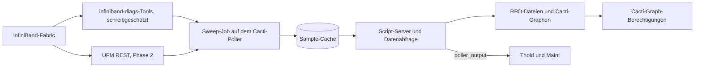

<!-- Source: README.md; SHA256: ce5af61a1bc993ec2aae6d4f22c3885694632f2b1d5eb94e2ce88b8390e96f1e -->

<!-- translations:start -->
[English](../../../README.md) | [简体中文](../zh-CN/README.md) | [हिन्दी](../hi-IN/README.md) | [Español (España)](../es-ES/README.md) | [Español (Latinoamérica)](../es-419/README.md) | [العربية (السعودية)](../ar-SA/README.md) | [Afrikaans](../af-ZA/README.md) | [አማርኛ](../am-ET/README.md) | [العربية (مصر)](../ar-EG/README.md) | [العربية (المغرب)](../ar-MA/README.md) | [বাংলা](../bn-BD/README.md) | [Deutsch](README.md) | [فارسی](../fa-IR/README.md) | [Filipino](../fil-PH/README.md) | [Français](../fr-FR/README.md) | [Français (Maroc)](../fr-MA/README.md) | [Français (Sénégal)](../fr-SN/README.md) | [Hausa](../ha-NG/README.md) | [עברית](../he-IL/README.md) | [Bahasa Indonesia](../id-ID/README.md) | [Igbo](../ig-NG/README.md) | [Italiano](../it-IT/README.md) | [日本語](../ja-JP/README.md) | [한국어](../ko-KR/README.md) | [Malagasy](../mg-MG/README.md) | [मराठी](../mr-IN/README.md) | [Bahasa Melayu](../ms-MY/README.md) | [Nederlands](../nl-NL/README.md) | [Polski](../pl-PL/README.md) | [Português (Brasil)](../pt-BR/README.md) | [Русский](../ru-RU/README.md) | [Kinyarwanda](../rw-RW/README.md) | [Soomaali](../so-SO/README.md) | [Svenska](../sv-SE/README.md) | [Kiswahili](../sw-KE/README.md) | [தமிழ்](../ta-IN/README.md) | [తెలుగు](../te-IN/README.md) | [ไทย](../th-TH/README.md) | [Türkçe](../tr-TR/README.md) | [Українська](../uk-UA/README.md) | [اردو](../ur-PK/README.md) | [Tiếng Việt](../vi-VN/README.md) | [isiXhosa](../xh-ZA/README.md) | [Yorùbá](../yo-NG/README.md) | [繁體中文](../zh-TW/README.md) | [isiZulu](../zu-ZA/README.md)
<!-- translations:end -->

# plugin_fabric

Ein Cacti-1.2-Plugin, das InfiniBand-Port-Zähler, Link-Breite und -Geschwindigkeit sowie Congestion-Indikatoren als reguläre Geräte, Datenquellen und Graphen in Cacti bereitstellt. Ein Link, der mit 1X statt 4X ausgehandelt wurde, erscheint dann als Graph und als Thold-Warnung neben dem zugehörigen Host – unter den Berechtigungen von Cacti und mit der Möglichkeit zur Unterdrückung über Maint.

> **Status: in Entwicklung, noch kein Release.** Meilenstein 2 (Grundlage) wurde in `main` gemergt und Meilenstein 3 (Cacti-Objekte und Alarmierung) befindet sich im Review. Meilenstein 1 hat das Design anhand der Dokumentation und des Upstream-Quellcodes bestätigt (PR #71); die Ergebnisse mit Quellenangaben finden Sie unter [docs/research/](../../research). Meilenstein 2 ergänzt die Plugin-Grundlage:
>
> - Installation, Upgrade, Deinstallation und die PHP-8.2-Prüfung
> - Realms für View, Operator und Admin sowie Einstellungen
> - Fabric-Datensätze
> - die schreibgeschützte Befehlsgrenze für `perfquery`, `ibnetdiscover` und `iblinkinfo`
> - Inventarisierung nach GUID, mit Identitätskonflikten und Vorschlägen zur Neuverknüpfung
> - Link-Status und der Cache für Zähler-Sweeps
> - Seiten für Inventar, Administration und Systemzustand
>
> Meilenstein 3 ergänzt die Cacti-Objekte:
>
> - Geräte-, Daten- und Graph-Vorlagen als Cacti-Template-XML sowie die Datenabfrage „Fabric Port“
> - Zuordnung eines Knotens zu einem Cacti-Gerät oder dessen Erstellung nach Bestätigung ([ADR 0010](../../decisions/0010-one-device-per-node.md))
> - Zähler-Datenquellen für Graphen sowie GAUGE-Datenquellen für Link-Status und -Raten für Thold ([ADR 0011](../../decisions/0011-derive-counters-and-gauge-alert-values.md))
> - Behandlung von Diskontinuitäten und gesättigte Basis-Zähler als „unknown“ ([ADR 0012](../../decisions/0012-saturated-basic-counters-read-as-unknown.md)), Zählervalidität und Graph-Links auf der Port-Seite sowie ein Congestion-Ranking
> - ein End-to-End-Test mit unverändertem Thold v1.8.2 und Maint v1.3 sowie ein CI-Job, der die echten Diagnose-Tools gegen eine simulierte Fabric ausführt
>
> Bis Remote-Datensammler in Phase 3 unterstützt werden, kann eine Fabric nur vom Haupt-Poller aus abgefragt werden. Das Plugin wurde bislang gegen Mock-Tools und den Fabric-Simulator ibsim getestet, noch nie auf einer realen InfiniBand-Fabric. Prüfungen, die eine echte Fabric erfordern, bleiben in der Live-Checks-Tabelle der jeweiligen Research-Seite offen. Dieses Projekt steht in keiner Verbindung zum Cacti-Projekt.

## Zugriffsrollen

| Realm | Zugriff |
| --- | --- |
| Fabric View | Bestehende Monitoring-Seiten. |
| Fabric Operator | Monitoring sowie die Operations-Seite und persönliche Triage-Bestätigungen. |
| Fabric Admin | Operator-Zugriff sowie die bestehenden Konfigurations- und Verwaltungsaktionen. |

Nach dem Kopieren der Upgrade-Dateien öffnen Sie als Administrator die Plugins-Seite, um das neue Realm zu registrieren. Weisen Sie das Operator-Realm explizit unter **Configuration > Users** oder den Benutzergruppen zu. Upgrades behalten die bestehenden IDs und Berechtigungen der View- und Admin-Realms bei. Admin-Zugriff erbt Operator-Zugriff, und Operator-Zugriff erbt View-Zugriff bei jeder Anfrage; dadurch werden keine dauerhaften Berechtigungen zu Benutzern oder Gruppen hinzugefügt. Plugin-Einstellungen erfordern zusätzlich zur Settings-Berechtigung von Cacti auch den Fabric-Admin-Zugriff.

Cacti-Geräteberechtigungen schränken weiterhin die für jeden Benutzer verfügbaren Zeilen und Aktionen ein; nicht zugeordnete Objekte erfordern einen Administrator. Zugangsdaten, Konfiguration, Zuordnungen, Löschungen und sonstige administrative Änderungen verbleiben auf den Verwaltungsseiten. Bestätigungen gelten nur in der aktuellen Benutzersitzung, für höchstens eine Stunde und nur solange dieselbe Beobachtung aktuell bleibt. Neue oder geänderte Beobachtungen machen sie ungültig. Sie markieren eine fehlgeschlagene Messung niemals als fehlerfrei und unterdrücken keine Alarme.

## Warum

Ein beeinträchtigter InfiniBand-Link überträgt weiterhin Datenverkehr. Ein 4X-Link, der auf 1X neu ausgehandelt wird, belässt den Port im Zustand „active“, und die SNMP-Schnittstellengraphen des Hosts sehen normal aus, doch eng gekoppelte Jobs verlangsamen sich. Die Hinweise liegen in der Fabric: Jeder Port meldet seine aktive, aktivierte und unterstützte Breite und Geschwindigkeit sowie Fehler- und Congestion-Zähler. Um diese auszulesen, sind die InfiniBand-Diagnose-Tools oder eine Fabric-Manager-API erforderlich. Bei manueller Ausführung bleiben drei Lücken:

- **Keine Historie.** `perfquery` und `iblinkinfo` zeigen nur den aktuellen Zustand, sodass ein Link, der letzte Woche beeinträchtigt war, unsichtbar bleibt.
- **Kein Gerätekontext.** Fabric-Ports sind keine Cacti-Objekte, sodass ein Port nicht neben dem Host, den er versorgt, als Graph dargestellt werden kann.
- **Keine Anbindung an die Cacti-Alarmierung.** Thold und Maint arbeiten auf Basis von Cacti-Datenquellen und -Geräten.

Das Plugin schließt diese Lücken, indem es die Fabric über die eigenen Diagnose-Tools (und später über UFM) ausliest, Knoten und Ports anhand ihrer GUID identifiziert und Zähler sowie Link-Status als Cacti-Datenquellen veröffentlicht. Es arbeitet ausschließlich lesend: Es setzt niemals Zähler zurück und ändert niemals den Port-Status.

## Erste Erkennung

Eine neue Fabric enthält noch keine Knoten, und Sweeps werden vom Script-Server nur für Knoten gestartet, die einem Cacti-Gerät zugeordnet sind. Die erste Erkennung ist daher ein manueller Schritt. Nachdem Sie eine aktivierte Fabric gespeichert haben, führen Sie diesen Befehl einmalig auf dem Poller aus, dem die Fabric zugewiesen ist – unter dem Benutzerkonto des Pollers, wobei `/path/to/cacti` durch Ihr Cacti-Verzeichnis ersetzt wird (der absolute Pfad funktioniert auch über Cron):

```
php /path/to/cacti/plugins/fabric/fabric_sweep.php --fabric=ID --force
```

Anschließend füllt sich das Inventar. Ordnen Sie die Knoten auf der Seite „Fabric Admin“ Cacti-Geräten zu; spätere Sweeps starten dann über die Datenabfrage. Solange kein Knoten einer Fabric zugeordnet ist, aktualisiert nichts ihr Inventar; führen Sie denselben Befehl daher bei Bedarf erneut aus – gerne auch per Cron –, um neue oder fehlende Knoten zu erfassen. Die Statusseite zeigt diesen Befehl für jede aktivierte Fabric an, die noch nicht erkannt wurde oder keinen zugeordneten Knoten besitzt.

## Geplanter Umfang

| Phase | Umfang | Meilensteine |
|---|---|---|
| 0, Forschung | Versionsmatrix, Bestätigung des Upstream-Verhaltens, Zählerverhalten auf Hardware, Berechtigungsmodell, MAD-Budget, UFM-API | [M1](https://github.com/somethingwithproof/plugin_fabric/milestone/1) |
| 1, Beobachtung | Inventarisierung nach GUID, Cacti-Geräte, Port-Datenabfrage, Zähler- und Link-Status-Datenquellen, Thold-Alarmierung, Maint-Unterdrückung, Statusseite | [M2](https://github.com/somethingwithproof/plugin_fabric/milestone/2), [M3](https://github.com/somethingwithproof/plugin_fabric/milestone/3), [M4](https://github.com/somethingwithproof/plugin_fabric/milestone/4) |
| 2, UFM | Schreibgeschütztes UFM-REST-Backend, Verwaltung von Zugangsdaten, Identitätskontinuität zwischen Backends | [M5](https://github.com/somethingwithproof/plugin_fabric/milestone/5) |
| 3, Remote | Remote-Datensammler, Replikation, `remote_agent`-Aktionen, aufgeteilte Sweeps für große Fabrics | [M6](https://github.com/somethingwithproof/plugin_fabric/milestone/6) |

Nicht im Umfang enthalten: Änderung des Fabric-Status, Ersatz eines Fabric-Managers oder Subnet-Managers, eine eigene Alarmierungs-Engine im Plugin, ein eigener Daemon oder ein eigenes Netzwerkprotokoll sowie Ethernet- oder RoCE-Fabrics (Forschung).

## Kompatibilitätsziele

| Komponente | Ziel |
|---|---|
| Cacti | 1.2.31 oder neuer, ohne Core-Patches |
| PHP | 8.2 oder neuer; `setup.php` bleibt unter 8.0 parsbar, sodass eine nicht unterstützte Laufzeitumgebung eine saubere Ablehnung statt einer defekten Cacti-Oberfläche erhält |
| InfiniBand-Tools | infiniband-diags aus rdma-core; Ausgabeformate gegen den Quellcode von v66.0 geprüft |
| UFM | UFM Enterprise REST API, Phase 2; die Release-Matrix ist ein Ergebnis von Meilenstein 1 |
| Thold, Maint | Keine Änderungen erforderlich |

Belassen Sie das Skript-Timeout von Cacti beim Standardwert von 25 Sekunden oder höher. Ein durch das Auslesen einer Datenabfrage gestarteter Sweep begrenzt die Tool-Ausführung auf dieses Timeout abzüglich fünf Sekunden, um Zeit für das Lesen des Caches und die Antwort zu reservieren. Läuft das Zeitbudget ab, liefert die Abfrage den letzten aktuellen Messwert oder „unknown“; im nächsten Zyklus wird der Sweep erneut versucht. Diese Begrenzung gilt auch für den PHP-Poller. Ein Timeout von fünf Sekunden oder weniger lässt keine Zeit, ein Tool zu starten.

## Design

- [docs/PLAN.md](../../PLAN.md) enthält den vollständigen Plan: Architektur, zugrunde liegende Upstream-Fakten (mit Quellen) und noch zu bestätigende Annahmen, Identitätsmodell, Regeln für Zähler und Link-Status, Sicherheitsgrenzen, Performance-Berechnungen, Tests und Risiken.
- [docs/decisions/](../../decisions) enthält Architecture Decision Records (ADRs) für bereits getroffene Entscheidungen.
- [docs/REQUIREMENTS.md](../../REQUIREMENTS.md) ordnet jede Anforderungs-ID dem jeweiligen Issue zu.



## Nachverfolgung der Arbeit

- **Meilensteine** folgen den Meilensteinen des Plans. Jeder besitzt ein Epic-Issue, das seine Unter-Issues und Abschlussnachweise auflistet.
- **Issues** werden per Label typisiert: `type: requirement`, `type: research`, `type: decision`, `type: epic`. Anforderungs-Issues definieren nummerierte, testbare Anforderungen (`REQ-AREA-NNN`) und Akzeptanzkriterien.
- **Labels** enthalten außerdem `area:`, `phase:`, `priority:` und `status:`. Siehe [CONTRIBUTING.md](../../../CONTRIBUTING.md#labels).
- Das [Projektboard](https://github.com/users/somethingwithproof/projects/8) zeigt alle Issues über alle Meilensteine hinweg.

## Mitwirken

Lesen Sie [CONTRIBUTING.md](../../../CONTRIBUTING.md). Commits benötigen ein DCO-Sign-off. Design-Diskussionen finden in den Issues statt; offene Entscheidungen tragen das Label `type: decision`.

## Sicherheit

Melden Sie Sicherheitslücken vertraulich; siehe [SECURITY.md](../../../SECURITY.md).

## Lizenz

GNU General Public License v2.0, dieselbe Lizenz wie Cacti und seine Plugins. Siehe [LICENSE](../../../LICENSE).
