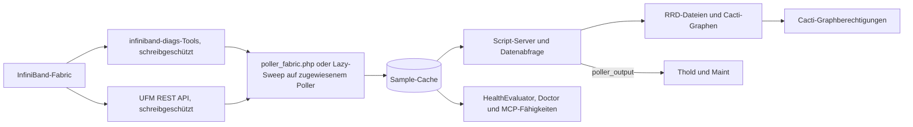

<!-- Source: README.md; SHA256: 79a16fb906f96ee79de2c719f18c38836f555440a7571a4a5ba38c64bb5b099f -->

<!-- translations:start -->
[English](../../../README.md) | [简体中文](../zh-CN/README.md) | [हिन्दी](../hi-IN/README.md) | [Español (España)](../es-ES/README.md) | [Español (Latinoamérica)](../es-419/README.md) | [العربية (السعودية)](../ar-SA/README.md) | [Afrikaans](../af-ZA/README.md) | [አማርኛ](../am-ET/README.md) | [العربية (مصر)](../ar-EG/README.md) | [العربية (المغرب)](../ar-MA/README.md) | [বাংলা](../bn-BD/README.md) | [Bosanski](../bs-BA/README.md) | [Deutsch](README.md) | [فارسی](../fa-IR/README.md) | [Filipino](../fil-PH/README.md) | [Français](../fr-FR/README.md) | [Français (Maroc)](../fr-MA/README.md) | [Français (Sénégal)](../fr-SN/README.md) | [Hausa](../ha-NG/README.md) | [עברית](../he-IL/README.md) | [Hrvatski](../hr-HR/README.md) | [Bahasa Indonesia](../id-ID/README.md) | [Igbo](../ig-NG/README.md) | [Italiano](../it-IT/README.md) | [日本語](../ja-JP/README.md) | [한국어](../ko-KR/README.md) | [Malagasy](../mg-MG/README.md) | [मराठी](../mr-IN/README.md) | [Bahasa Melayu](../ms-MY/README.md) | [Nederlands](../nl-NL/README.md) | [Polski](../pl-PL/README.md) | [Português (Brasil)](../pt-BR/README.md) | [Русский](../ru-RU/README.md) | [Kinyarwanda](../rw-RW/README.md) | [Soomaali](../so-SO/README.md) | [Српски](../sr-RS/README.md) | [Svenska](../sv-SE/README.md) | [Kiswahili](../sw-KE/README.md) | [தமிழ்](../ta-IN/README.md) | [తెలుగు](../te-IN/README.md) | [ไทย](../th-TH/README.md) | [Türkçe](../tr-TR/README.md) | [Українська](../uk-UA/README.md) | [اردو](../ur-PK/README.md) | [Tiếng Việt](../vi-VN/README.md) | [isiXhosa](../xh-ZA/README.md) | [Yorùbá](../yo-NG/README.md) | [繁體中文](../zh-TW/README.md) | [isiZulu](../zu-ZA/README.md)
<!-- translations:end -->

# plugin_fabric

Ein Cacti-1.2-Plugin (`fabric`, Version `0.1.0-dev`), das InfiniBand-Port-Zähler, Link-Breite und -Geschwindigkeit sowie Congestion-Indikatoren als reguläre Geräte, Datenquellen und Graphen in Cacti bereitstellt. Ein Link, der mit 1X statt 4X ausgehandelt wurde, erscheint dann als Graph und als Thold-Warnung neben dem zugehörigen Host, unter den Berechtigungen von Cacti und mit Maint-Erkennung sowie -Unterdrückung.

> **Status: in Entwicklung, noch kein Release.** Dieser Branch implementiert die Plugin-Grundlage, Cacti-Objekte und Alarmierung, geplante Hintergrund-Poller-Sweeps, Replikation auf Remote-Datensammler, ein schreibgeschütztes NVIDIA-UFM-REST-Backend mit verschlüsseltem Zugangsdatentresor, Configuration-as-Code-(CasC-)CLI-Verwaltung sowie Cacti-Ökosystem-Hooks (CasC, Doctor und MCP / Abilities API v2). Es wurde gegen Mock-Tools, synthetische UFM-Transporte und den Fabric-Simulator `ibsim` (rdma-core 50.0) getestet, noch nie auf einer physischen InfiniBand-Fabric oder einem Live-UFM-Server. Prüfungen, die Hardware erfordern, bleiben unter [docs/research/](../../research/) offen. Dieses Projekt steht in keiner Verbindung zum Cacti-Projekt.

## Was implementiert ist

- **Lebenszyklus und Schema (v3)**: Installation, idempotentes Upgrade, Deinstallation (Plugin-Tabellen bleiben standardmäßig erhalten) sowie eine PHP-8.2-Anforderungsprüfung, während Einstiegspunkte unter PHP 8.0 parsbar bleiben.
- **Zugriffsrollen und Seiten**: die Realms `Fabric View` (`fabric.php`), `Fabric Operator` (`fabric_operator.php`) und `Fabric Admin` (`fabric_admin.php`, `fabric_health.php`) sowie ein Einstellungs-Tab unter **Configuration > Settings > Fabrics**.
- **Schreibgeschütztes Diagnose-Backend (`diags`)**: strikte Argumentvektor-Ausführung von `perfquery`, `ibnetdiscover` und `iblinkinfo`, GUID-basiertes Inventar mit Erkennung von Identitätskonflikten und Vorschlägen zur Neuverknüpfung, Link-Status-Auswertung sowie Zähler-Sweeps pro Knoten.
- **Schreibgeschütztes NVIDIA-UFM-REST-Backend (`ufm`) und verschlüsselter Tresor**: reiner GET-REST-Client mit Positivliste (`/ufmRest/resources/ports`, `/ufmRest/resources/systems`, `/ufmRest/monitoring/session/0/data` sowie `/ufmRestV3/...`-Pendants für Token-Authentifizierung), der dieselben Inventar-, Link-Status-, Messwert- und Zustandstabellen wie `diags` speist. Zugangsdaten (`token` oder `basic`) werden mit AES-256-GCM verschlüsselt in `plugin_fabric_secret` gespeichert, wobei eine über `fabric_vault_key_file` konfigurierte externe 256-Bit-Schlüsseldatei verwendet wird. UFM-Fabrics können über CasC (`cli/fabric.php`) oder die Repositories definiert werden; das Web-Admin-Formular stellt derzeit `diags`-Felder bereit.
- **Cacti-Objekte, Thold und Maint**: Cacti-Geräte-, Daten- und Graph-Vorlagen (`templates/fabric-templates.xml`), die Script-Server-Datenabfrage „Fabric Port“ (`scripts/ss_fabric_ports.php`, `resource/script_server/fabric_ports.xml`), `DERIVE`-Zähler-Datenquellen und `GAUGE`-Link-Status-/Raten-Datenquellen für Thold, Diskontinuitätsverfolgung sowie als `U` gemeldete gesättigte Basis-Zähler. Die Maint-Integration (`MaintMaintenance`) fragt `plugin_maint_check_cacti_host()` ab (mit Fallback auf den Hook `is_device_in_maintenance`), sodass Knoten in aktiver Wartung separat gezählt und von Gesundheitswarnungen wegen fehlgeschlagener Sweeps und beeinträchtigter Ports ausgenommen werden.
- **Geplante Sweeps, Sharding und Remote-Datensammler**: `poller_bottom` startet `poller_fabric.php` im Hintergrund für fällige Fabrics, die dem aktuellen Poller zugewiesen sind, neben vom Script-Server ausgelösten Lazy-Sweeps. `INFO` deklariert `remote_collect:1, remote_poller:1`, `poller_fabric.php` unterstützt deterministisches GUID-Sharding (`--shard=K/N`), und `replicate_out` repliziert nicht-geheime Zeilen aus `plugin_fabric_fabric` auf Remote-Datensammler (`poller_id >= 2`). Tresoreinträge (`plugin_fabric_secret`) und externe Schlüsseldateien werden niemals repliziert.
- **CasC-CLI und Ökosystem-Hooks**: `cli/fabric.php` für YAML/XML-Export, Validierung, Dry-Run-Diff-Planung, bestätigungsgebundene Anwendung und Zustandsberichte sowie die Hooks `casc_register_providers`, `doctor_register_checks` und `abilities_register`.

## Zugriffsrollen

| Realm | Zugriff |
| --- | --- |
| Fabric View | Überwachung von Inventar und Port-Ansichten (`fabric.php`). |
| Fabric Operator | View-Zugriff plus Operations-Seite (`fabric_operator.php`) und persönliche Triage-Bestätigungen. |
| Fabric Admin | Operator-Zugriff plus Konfiguration, administrative Aktionen (`fabric_admin.php`) und Systemzustandsseite (`fabric_health.php`). |

Nach dem Kopieren der Upgrade-Dateien öffnen Sie als Administrator die Plugins-Seite, um neue Realms und Hooks zu registrieren. Weisen Sie das Operator-Realm explizit unter **Configuration > Users** oder in Benutzergruppen zu. Upgrades behalten bestehende IDs und Berechtigungen der View- und Admin-Realms bei. Admin-Zugriff erbt Operator-Zugriff, und Operator-Zugriff erbt View-Zugriff bei jeder Anfrage; dadurch werden keine dauerhaften Berechtigungen zu Benutzern oder Gruppen hinzugefügt. Plugin-Einstellungen erfordern zusätzlich zur Settings-Berechtigung von Cacti auch den Fabric-Admin-Zugriff.

Cacti-Geräteberechtigungen schränken die für jeden Benutzer verfügbaren Zeilen und Aktionen ein; nicht zugeordnete Objekte erfordern einen Administrator. Zugangsdaten, Konfiguration, Zuordnungen, Löschungen und sonstige administrative Änderungen verbleiben auf den Verwaltungsseiten oder in der CLI. Bestätigungen gelten nur in der aktuellen Benutzersitzung, für höchstens eine Stunde und nur solange dieselbe Beobachtung aktuell bleibt. Neue oder geänderte Beobachtungen machen sie ungültig. Sie markieren eine fehlgeschlagene Messung niemals als fehlerfrei und unterdrücken keine Alarme.

## Warum

Ein beeinträchtigter InfiniBand-Link überträgt weiterhin Datenverkehr. Ein 4X-Link, der auf 1X neu ausgehandelt wird, belässt den Port im Zustand „active“, und die SNMP-Schnittstellengraphen des Hosts sehen normal aus, doch eng gekoppelte Jobs verlangsamen sich. Die Hinweise liegen in der Fabric: Jeder Port meldet seine aktive, aktivierte und unterstützte Breite und Geschwindigkeit sowie Fehler- und Congestion-Zähler. Um diese auszulesen, sind die InfiniBand-Diagnose-Tools oder eine Fabric-Manager-API erforderlich. Bei manueller Ausführung bleiben drei Lücken:

- **Keine Historie.** `perfquery` und `iblinkinfo` zeigen nur den aktuellen Zustand, sodass ein Link, der letzte Woche beeinträchtigt war, unsichtbar bleibt.
- **Kein Gerätekontext.** Fabric-Ports sind keine Cacti-Objekte, sodass ein Port nicht neben dem Host, den er versorgt, als Graph dargestellt werden kann.
- **Keine Anbindung an die Cacti-Alarmierung.** Thold und Maint arbeiten auf Basis von Cacti-Datenquellen und -Geräten.

Das Plugin schließt diese Lücken, indem es die Fabric über `infiniband-diags` oder die NVIDIA UFM REST API ausliest, Knoten und Ports anhand ihrer GUID identifiziert und Zähler sowie Link-Status als Cacti-Datenquellen veröffentlicht. Es arbeitet ausschließlich lesend: Es setzt niemals Zähler zurück und ändert niemals den Port-Status.

## Betrieb und CLI

### Hintergrund-Poller und manuelle Sweeps

`fabric_poller_bottom()` startet `poller_fabric.php` auf jedem Poller im Hintergrund für aktivierte Fabrics, die dieser `poller_id` zugewiesen sind und deren Sweep fällig ist. Sie können den Poller-Runner oder einen manuellen Sweep auch direkt auf dem zugewiesenen Poller als Poller-Benutzer ausführen (wobei Sie `/path/to/cacti` durch Ihr Cacti-Verzeichnis ersetzen):

```sh
php /path/to/cacti/plugins/fabric/poller_fabric.php [--fabric=ID] [--shard=K/N] [--force] [--debug]
php /path/to/cacti/plugins/fabric/fabric_sweep.php --fabric=ID [--node=GUID] [--force]
```

- `poller_fabric.php` führt alle fälligen Fabrics für den lokalen Poller aus (oder eine einzelne Fabric mit `--fabric=ID`), erzwingt die Prozessregistrierungs-Sperre von Cacti sowie `ClaimRepository`-Leases mit einem Zeitbudget von `max(30, intdiv(sweep_interval, 2))` Sekunden und unterstützt `--shard=K/N` (`0 <= K < N`), um `diags`-Knotenzähler-Sweeps deterministisch nach Knoten-GUID aufzuteilen.
- `fabric_sweep.php` führt einen Bedarfs-Sweep einer aktivierten Fabric (oder eines Knotens mit `--node=GUID`) aus, die dem lokalen Poller zugewiesen ist. `--force` ignoriert, ob die Fabric fällig ist, beachtet aber weiterhin Leases.

Nachdem die erste Erkennung das Inventar gefüllt hat, ordnen Sie die Knoten auf der Seite „Fabric Admin“ Cacti-Geräten zu. Belassen Sie das Skript-Timeout von Cacti bei 25 Sekunden oder höher: Ein durch das Auslesen einer Datenabfrage gestarteter Lazy-Sweep begrenzt die Tool-Ausführung auf `script_timeout - 5` Sekunden, damit der Script-Server rechtzeitig mit dem letzten gespeicherten Messwert oder `U` antwortet.

### NVIDIA-UFM-REST-Backend und Zugangsdatentresor

Eine `ufm`-Fabric erfordert eine `https://`-URL ohne eingebettete Zugangsdaten, Query-Strings oder Fragmente. `UfmSocketTransport` erzwingt TLS-Peer- und Hostnamen-Verifizierung, lehnt Weiterleitungen ab und unterstützt ein optionales CA-Bundle (`ufm_ca_file`) sowie einen SHA-256-SPKI-Pin (`ufm_spki_pin`).

Um UFM-Zugangsdaten in `plugin_fabric_secret` zu speichern, konfigurieren Sie `fabric_vault_key_file` unter **Configuration > Settings > Fabrics** mit einem absoluten Pfad zu einer regulären Datei im Besitz des Poller-Benutzers (keine Symlinks in einem übergeordneten Verzeichnis, Modus `0600`, mit 64 Hex-Zeichen wie aus `openssl rand -hex 32` oder 32 zufälligen nicht druckbaren Bytes). Das Plugin erstellt oder schreibt die Schlüsseldatei niemals, und `replicate_out` repliziert niemals `plugin_fabric_secret` oder Schlüsseldateien auf Remote-Poller.

### Configuration-as-Code und Zustands-CLI

`cli/fabric.php` verwaltet Plugin-Einstellungen und Fabric-Definitionen deklarativ in YAML oder XML und meldet den wartungsbewussten Systemzustand, ohne Live-Sweeps auszuführen:

```sh
php /path/to/cacti/plugins/fabric/cli/fabric.php export [--format=yaml|xml] [--file=PATH]
php /path/to/cacti/plugins/fabric/cli/fabric.php validate --file=PATH [--format=yaml|xml]
php /path/to/cacti/plugins/fabric/cli/fabric.php plan --file=PATH [--format=yaml|xml]
php /path/to/cacti/plugins/fabric/cli/fabric.php apply --file=PATH --confirm=PLAN_HASH [--format=yaml|xml]
php /path/to/cacti/plugins/fabric/cli/fabric.php health [--format=text|json]
```

`export` erstellt neue Dateien mit Modus `0600`, schwärzt `fabric_vault_key_file` als `[REDACTED]` und gibt benannte `ufm_credential_ref`-Referenzen statt Geheimnissen aus. `plan` und `apply` lehnen Inline-Werte für `ufm_token`, `ufm_password`, `secret` sowie Inline-Werte für `fabric_vault_key_file` ab. `apply` erfordert exakt das von `plan` erzeugte `--confirm=PLAN_HASH`.

### Ökosystem-Hooks

Wenn die entsprechenden Cacti-Plugins oder Host-Integrationen vorhanden sind, registriert `setup.php`:

- `casc_register_providers`: exportiert, validiert, plant und wendet nach Bestätigung die `fabric`-Konfiguration (`yaml` und `xml`, Schema v1) mit Schwärzung von Geheimnissen an.
- `doctor_register_checks`: stellt vier schreibgeschützte Diagnoseprüfungen bereit (`fabric.schema`, `fabric.poller_freshness`, `fabric.identity_conflicts`, `fabric.ufm_vault`).
- `abilities_register`: registriert drei schreibgeschützte, nicht-destruktive, idempotente Fähigkeiten unter der Kategorie `fabric`, geschützt durch das Realm Fabric View (und Cacti-Geräteberechtigungen für Portfehler): `fabric-list-fabrics`, `fabric-get-health` und `fabric-list-port-errors`.

## Umfang und Grenzen

Nicht im Umfang enthalten: Änderung des Fabric-Status, Zurücksetzen von Zählern, Ersatz eines Fabric-Managers oder Subnet-Managers, eine eigene Alarmierungs-Engine im Plugin, ein eigener Daemon oder ein eigenes Netzwerkprotokoll sowie Ethernet- oder RoCE-Fabrics.

## Anforderungen und Kompatibilität

| Komponente | Ziel |
|---|---|
| Cacti | 1.2.31 oder neuer (`compat = 1.2.31`), ohne Core-Patches |
| PHP | 8.2 oder neuer; Einstiegspunkte bleiben unter 8.0 parsbar und lehnen die Aktivierung unter 8.1 ab, sodass eine nicht unterstützte Laufzeitumgebung eine Ablehnung statt einer defekten Cacti-Oberfläche erhält |
| InfiniBand-Tools | `infiniband-diags` aus `rdma-core` (in CI mit rdma-core 50.0 unter `ibsim` getestet; Ausgabeformate gegen den Quellcode von v66.0 geprüft) |
| UFM | NVIDIA UFM Enterprise REST API (schreibgeschützte Endpunkte `ufmRest` und `ufmRestV3`; in Unit-Tests gegen synthetische Transporte getestet) |
| Thold, Maint | Keine Änderungen erforderlich; CI führt einen End-to-End-Test mit unverändertem Thold v1.8.2 und Maint v1.3 aus |

## Entwicklung und Testen

Der CI-Workflow (`.github/workflows/plugin-ci-workflow.yml`) testet PHP 8.2 bis 8.5 gegen Cacti `release/1.2.31` und `1.2.x`, PHP-8.0-Einstiegspunkt-Linting, PHP-8.1-Ablehnung, PHPStan, gettext-/Übersetzungsprüfung, REUSE-Lizenzierung, Workflow-Linting, Thold/Maint-End-to-End-Replay und `ibsim`-Fabric-Simulation.

Mit dem gesperrten gemeinsamen Pest-Plugin-Harness von Cacti (`CACTI_PEST_BIN`) und einer Wegwerf-Cacti-Datenbank:

```sh
# Unit tests
"$CACTI_PEST_BIN" --configuration=phpunit.xml

# Lifecycle integration tests (disposable database only)
CACTI_PATH=/path/to/cacti FABRIC_TEST_DATABASE=disposable "$CACTI_PEST_BIN" --configuration=phpunit-integration.xml

# Static analysis (against Cacti 1.2.31)
CACTI_PATH=/path/to/cacti phpstan analyse -c phpstan.neon --no-progress

# Translation template, catalogs, and localized README checks
sh locales/build_gettext.sh --check

# Simulated ibsim fixture parser check
php tests/bin/check-ibsim-fixtures.php tests/fixtures/ibsim
```

## Design

- [docs/PLAN.md](../../PLAN.md) ist der Architektur- und Designplan: Upstream-Fakten mit Quellen, offene Hardware-Prüfungen, Identitätsmodell, Regeln für Zähler und Link-Status, Sicherheitsgrenzen, Performance-Arithmetik, Tests und Risiken.
- [docs/decisions/](../../decisions/) enthält Architecture Decision Records.
- [docs/REQUIREMENTS.md](../../REQUIREMENTS.md) ordnet jede Anforderungs-ID dem jeweiligen Issue zu.



## Wie Arbeit nachverfolgt wird

- **Meilensteine** folgen den Meilensteinen des Plans. Jeder hat ein Epic-Issue, das seine Unter-Issues und Abschlussnachweise auflistet.
- **Issues** werden nach Label typisiert: `type: requirement`, `type: research`, `type: decision`, `type: epic`. Anforderungs-Issues benennen nummerierte, testbare Anforderungen (`REQ-AREA-NNN`) und Akzeptanzkriterien.
- **Labels** tragen außerdem `area:`, `phase:`, `priority:` und `status:`. Siehe [CONTRIBUTING.md](../../../CONTRIBUTING.md#labels).
- Das [Projektboard](https://github.com/users/somethingwithproof/projects/8) zeigt alle Issues über alle Meilensteine hinweg.

## Mitwirken

Lesen Sie [CONTRIBUTING.md](../../../CONTRIBUTING.md). Commits benötigen ein DCO-Sign-off (`git commit -s`). Design-Diskussionen finden in Issues statt; offene Entscheidungen tragen das Label `type: decision`.

## Sicherheit

Melden Sie Sicherheitslücken privat; siehe [SECURITY.md](../../../SECURITY.md).

## Lizenz

GNU General Public License v2.0, dieselbe Lizenz wie Cacti und seine Plugins. Siehe [LICENSE](../../../LICENSE).
