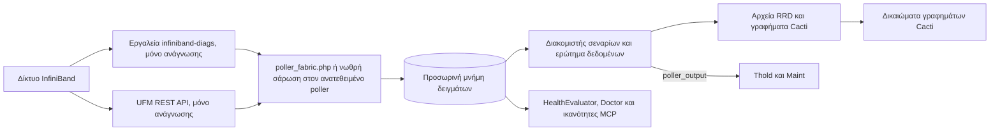

<!-- Source: README.md; SHA256: 79a16fb906f96ee79de2c719f18c38836f555440a7571a4a5ba38c64bb5b099f -->

<!-- translations:start -->
[English](../../../README.md) | [简体中文](../zh-CN/README.md) | [हिन्दी](../hi-IN/README.md) | [Español (España)](../es-ES/README.md) | [Español (Latinoamérica)](../es-419/README.md) | [العربية (السعودية)](../ar-SA/README.md) | [Afrikaans](../af-ZA/README.md) | [አማርኛ](../am-ET/README.md) | [العربية (مصر)](../ar-EG/README.md) | [العربية (المغرب)](../ar-MA/README.md) | [Български](../bg-BG/README.md) | [বাংলা](../bn-BD/README.md) | [Bosanski](../bs-BA/README.md) | [Deutsch](../de-DE/README.md) | [Ελληνικά](README.md) | [فارسی](../fa-IR/README.md) | [Filipino](../fil-PH/README.md) | [Français](../fr-FR/README.md) | [Français (Maroc)](../fr-MA/README.md) | [Français (Sénégal)](../fr-SN/README.md) | [Hausa](../ha-NG/README.md) | [עברית](../he-IL/README.md) | [Hrvatski](../hr-HR/README.md) | [Bahasa Indonesia](../id-ID/README.md) | [Igbo](../ig-NG/README.md) | [Italiano](../it-IT/README.md) | [日本語](../ja-JP/README.md) | [ქართული](../ka-GE/README.md) | [한국어](../ko-KR/README.md) | [Latviešu](../lv-LV/README.md) | [Malagasy](../mg-MG/README.md) | [मराठी](../mr-IN/README.md) | [Bahasa Melayu](../ms-MY/README.md) | [Nederlands](../nl-NL/README.md) | [Polski](../pl-PL/README.md) | [Português (Brasil)](../pt-BR/README.md) | [Português (Portugal)](../pt-PT/README.md) | [Русский](../ru-RU/README.md) | [Kinyarwanda](../rw-RW/README.md) | [Soomaali](../so-SO/README.md) | [Српски](../sr-RS/README.md) | [Svenska](../sv-SE/README.md) | [Kiswahili](../sw-KE/README.md) | [தமிழ்](../ta-IN/README.md) | [తెలుగు](../te-IN/README.md) | [ไทย](../th-TH/README.md) | [Türkçe](../tr-TR/README.md) | [Українська](../uk-UA/README.md) | [اردو](../ur-PK/README.md) | [Tiếng Việt](../vi-VN/README.md) | [isiXhosa](../xh-ZA/README.md) | [Yorùbá](../yo-NG/README.md) | [繁體中文](../zh-TW/README.md) | [isiZulu](../zu-ZA/README.md)
<!-- translations:end -->

# plugin_fabric

Ένα πρόσθετο για το Cacti 1.2 (`fabric`, έκδοση `0.1.0-dev`) που φέρνει τους μετρητές θυρών InfiniBand, το εύρος και την ταχύτητα σύνδεσης και τους δείκτες συμφόρησης στο Cacti ως κανονικές συσκευές, πηγές δεδομένων και γραφήματα. Μια σύνδεση που συγχρονίστηκε σε 1X αντί για 4X εμφανίζεται τότε ως γράφημα και ειδοποίηση Thold δίπλα στον κεντρικό υπολογιστή που εξυπηρετεί, υπό τα δικαιώματα του Cacti, με επίγνωση και καταστολή Maint.

> **Κατάσταση: υπό ανάπτυξη, δεν υπάρχει ακόμη κυκλοφορία.** Αυτός ο κλάδος υλοποιεί τη βάση του πρόσθετου, τα αντικείμενα Cacti και τις ειδοποιήσεις, προγραμματισμένες σαρώσεις poller παρασκηνίου, αναπαραγωγή απομακρυσμένων συλλεκτών, σύστημα υποστήριξης NVIDIA UFM REST μόνο ανάγνωσης με κρυπτογραφημένο θησαυροφυλάκιο διαπιστευτηρίων, διαχείριση CLI Configuration-as-Code (CasC) και σημεία επέκτασης οικοσυστήματος Cacti (CasC, Doctor και MCP / Abilities API v2). Έχει δοκιμαστεί έναντι εικονικών εργαλείων, συνθετικών μεταφορών UFM και του προσομοιωτή δικτύου `ibsim` (rdma-core 50.0), ποτέ σε φυσικό δίκτυο InfiniBand ή ζωντανό διακομιστή UFM. Οι έλεγχοι που απαιτούν υλικό παραμένουν ανοιχτοί στον κατάλογο [docs/research/](../../research/). Αυτό το έργο δεν συνδέεται με το έργο Cacti.

## Τι έχει υλοποιηθεί

- **Κύκλος ζωής και σχήμα βάσης (v3)**: εγκατάσταση, αμετάβλητη (idempotent) αναβάθμιση, απεγκατάσταση (με διατήρηση των πινάκων του πρόσθετου από προεπιλογή) και έλεγχος απαίτησης PHP 8.2, διατηρώντας παράλληλα τα σημεία εισόδου συντακτικά αναλύσιμα σε PHP 8.0.
- **Ρόλοι πρόσβασης και σελίδες**: πεδία δικαιωμάτων `Fabric View` (`fabric.php`), `Fabric Operator` (`fabric_operator.php`) και `Fabric Admin` (`fabric_admin.php`, `fabric_health.php`), καθώς και καρτέλα Ρυθμίσεων υπό **Configuration > Settings > Fabrics**.
- **Διαγνωστικό σύστημα υποστήριξης μόνο ανάγνωσης (`diags`)**: αυστηρή εκτέλεση διανύσματος ορισμάτων των `perfquery`, `ibnetdiscover` και `iblinkinfo`, απογραφή με κλειδί GUID με εντοπισμό διενέξεων ταυτότητας και προτάσεις επανασύνδεσης, αξιολόγηση κατάστασης σύνδεσης και σαρώσεις μετρητών ανά κόμβο.
- **Σύστημα υποστήριξης NVIDIA UFM REST μόνο ανάγνωσης (`ufm`) και κρυπτογραφημένο θησαυροφυλάκιο**: πελάτης REST μόνο GET με λίστα επιτρεπόμενων (`/ufmRest/resources/ports`, `/ufmRest/resources/systems`, `/ufmRest/monitoring/session/0/data` και ισοδύναμα `/ufmRestV3/...` για έλεγχο ταυτότητας με διακριτικό) που τροφοδοτεί τους ίδιους πίνακες απογραφής, κατάστασης σύνδεσης, δειγμάτων και υγείας με το `diags`. Τα διαπιστευτήρια (`token` ή `basic`) αποθηκεύονται κρυπτογραφημένα με AES-256-GCM στον πίνακα `plugin_fabric_secret` χρησιμοποιώντας εξωτερικό αρχείο κλειδιού 256 bit που ρυθμίζεται από το `fabric_vault_key_file`. Τα δίκτυα Fabric τύπου UFM μπορούν να οριστούν μέσω CasC (`cli/fabric.php`) ή των αποθετηρίων· η φόρμα διαχείρισης ιστού εκθέτει προς το παρόν πεδία `diags`.
- **Αντικείμενα Cacti, Thold και Maint**: πρότυπα συσκευής, δεδομένων και γραφημάτων Cacti (`templates/fabric-templates.xml`), το ερώτημα δεδομένων διακομιστή σεναρίων «Fabric Port» (`scripts/ss_fabric_ports.php`, `resource/script_server/fabric_ports.xml`), πηγές δεδομένων μετρητών `DERIVE` και πηγές δεδομένων κατάστασης/ρυθμού σύνδεσης `GAUGE` για το Thold, παρακολούθηση ασυνεχειών και αναφορά κορεσμένων βασικών μετρητών ως `U`. Η ενσωμάτωση Maint (`MaintMaintenance`) υποβάλλει ερώτημα στη `plugin_maint_check_cacti_host()` (με εναλλακτική το σημείο επέκτασης `is_device_in_maintenance`), ώστε οι κόμβοι σε ενεργή συντήρηση να προσμετρώνται ξεχωριστά και να εξαιρούνται από προειδοποιήσεις αποτυχημένης σάρωσης και υποβαθμισμένης θύρας.
- **Προγραμματισμένες σαρώσεις, καταμερισμός και απομακρυσμένοι συλλέκτες**: το `poller_bottom` εκκινεί το `poller_fabric.php` στο παρασκήνιο για τα δίκτυα Fabric που έχουν ανατεθεί στον τρέχοντα poller και ήρθε η ώρα σάρωσής τους, παράλληλα με τις νωθρές σαρώσεις (lazy sweeps) που ενεργοποιούνται από τον διακομιστή σεναρίων. Το `INFO` δηλώνει `remote_collect:1, remote_poller:1`, το `poller_fabric.php` υποστηρίζει ντετερμινιστικό καταμερισμό GUID (`--shard=K/N`) και το `replicate_out` αναπαράγει μη απόρρητες γραμμές `plugin_fabric_fabric` σε απομακρυσμένους συλλέκτες (`poller_id >= 2`). Οι καταχωρήσεις θησαυροφυλακίου (`plugin_fabric_secret`) και τα εξωτερικά αρχεία κλειδιών δεν αναπαράγονται ποτέ.
- **CasC CLI και σημεία επέκτασης οικοσυστήματος**: το `cli/fabric.php` για εξαγωγή YAML/XML, επικύρωση, σχεδιασμό διαφορών δοκιμαστικής εκτέλεσης, εφαρμογή με απαίτηση επιβεβαίωσης και αναφορά υγείας, καθώς και σημεία επέκτασης `casc_register_providers`, `doctor_register_checks` και `abilities_register`.

## Ρόλοι πρόσβασης

| Πεδίο δικαιωμάτων | Πρόσβαση |
| --- | --- |
| Προβολή Fabric (Fabric View) | Παρακολούθηση απογραφής και προβολών θυρών (`fabric.php`). |
| Χειριστής Fabric (Fabric Operator) | Πρόσβαση View συν τη σελίδα Λειτουργιών (`fabric_operator.php`) και προσωπικές επιβεβαιώσεις διαλογής. |
| Διαχειριστής Fabric (Fabric Admin) | Πρόσβαση Operator συν διαμόρφωση, διαχειριστικές ενέργειες (`fabric_admin.php`) και τη σελίδα υγείας (`fabric_health.php`). |

Αφού αντιγράψετε τα αρχεία αναβάθμισης, ανοίξτε τη σελίδα «Πρόσθετα» (Plugins) ως διαχειριστής για να καταχωρηθούν τα νέα πεδία δικαιωμάτων και σημεία επέκτασης. Εκχωρήστε ρητά το πεδίο Operator από **Configuration > Users** ή από ομάδες χρηστών. Οι αναβαθμίσεις διατηρούν τα υπάρχοντα αναγνωριστικά και τις παραχωρήσεις των πεδίων View και Admin. Η πρόσβαση Admin κληρονομεί την πρόσβαση Operator και η πρόσβαση Operator κληρονομεί την πρόσβαση View σε κάθε αίτημα· αυτό δεν προσθέτει αποθηκευμένες παραχωρήσεις σε χρήστες ή ομάδες. Οι ρυθμίσεις του πρόσθετου απαιτούν επίσης πρόσβαση Fabric Admin επιπλέον του δικαιώματος Settings του Cacti.

Τα δικαιώματα συσκευών του Cacti περιορίζουν τις γραμμές και τις ενέργειες που είναι διαθέσιμες σε κάθε χρήστη· τα μη αντιστοιχισμένα αντικείμενα απαιτούν διαχειριστή. Τα διαπιστευτήρια, η διαμόρφωση, η αντιστοίχιση, η διαγραφή και άλλες διαχειριστικές αλλαγές παραμένουν στις σελίδες διαχείρισης ή στο CLI. Οι επιβεβαιώσεις διαρκούν μόνο στην τρέχουσα συνεδρία του χρήστη, για το πολύ μία ώρα και μόνο όσο η ίδια παρατήρηση παραμένει επίκαιρη. Νέες ή τροποποιημένες παρατηρήσεις τις ακυρώνουν. Δεν χαρακτηρίζουν ποτέ μια αποτυχημένη μέτρηση ως υγιή ούτε καταστέλλουν ειδοποιήσεις.

## Γιατί

Μια υποβαθμισμένη σύνδεση InfiniBand εξακολουθεί να μεταφέρει κίνηση. Μια σύνδεση 4X που επανασυγχρονίζεται σε 1X αφήνει τη θύρα «ενεργή» και τα γραφήματα διεπαφών SNMP του κεντρικού υπολογιστή φαίνονται κανονικά, αλλά οι στενά συζευγμένες εργασίες επιβραδύνονται. Οι αποδείξεις βρίσκονται στο δίκτυο Fabric: κάθε θύρα αναφέρει το ενεργό, ενεργοποιημένο και υποστηριζόμενο εύρος και ταχύτητα, καθώς και μετρητές σφαλμάτων και συμφόρησης. Η ανάγνωσή τους απαιτεί τα διαγνωστικά εργαλεία InfiniBand ή ένα API διαχειριστή δικτύου Fabric. Όταν εκτελούνται χειροκίνητα, αφήνουν τρία κενά:

- **Χωρίς ιστορικό.** Τα `perfquery` και `iblinkinfo` δείχνουν το παρόν, επομένως μια σύνδεση που υποβαθμίστηκε την περασμένη εβδομάδα είναι αόρατη.
- **Χωρίς συμφραζόμενο συσκευής.** Οι θύρες Fabric δεν είναι αντικείμενα Cacti, επομένως μια θύρα δεν μπορεί να σχεδιαστεί σε γράφημα δίπλα στον κεντρικό υπολογιστή που τροφοδοτεί.
- **Χωρίς διαδρομή προς τις ειδοποιήσεις Cacti.** Τα Thold και Maint λειτουργούν πάνω σε πηγές δεδομένων και συσκευές Cacti.

Το πρόσθετο καλύπτει αυτά τα κενά διαβάζοντας το δίκτυο Fabric μέσω `infiniband-diags` ή του NVIDIA UFM REST API, αναγνωρίζοντας κόμβους και θύρες βάσει GUID και δημοσιεύοντας μετρητές και κατάσταση σύνδεσης ως πηγές δεδομένων Cacti. Εκτελεί μόνο ανάγνωση: δεν επαναφέρει ποτέ μετρητές ούτε αλλάζει την κατάσταση θυρών.

## Λειτουργίες και CLI

### Poller παρασκηνίου και χειροκίνητες σαρώσεις

Η `fabric_poller_bottom()` εκκινεί το `poller_fabric.php` στο παρασκήνιο σε κάθε poller για ενεργοποιημένα δίκτυα Fabric που έχουν ανατεθεί σε αυτό το `poller_id` και των οποίων η σάρωση είναι προγραμματισμένη. Μπορείτε επίσης να εκτελέσετε τον εκτελεστή poller ή μια χειροκίνητη σάρωση απευθείας στον ανατεθειμένο poller ως χρήστης του poller (αντικαθιστώντας το `/path/to/cacti` με τον κατάλογο του Cacti σας):

```sh
php /path/to/cacti/plugins/fabric/poller_fabric.php [--fabric=ID] [--shard=K/N] [--force] [--debug]
php /path/to/cacti/plugins/fabric/fabric_sweep.php --fabric=ID [--node=GUID] [--force]
```

- Το `poller_fabric.php` εκτελεί όλα τα δίκτυα Fabric που ήρθε η ώρα σάρωσής τους για τον τοπικό poller (ή ένα δίκτυο Fabric με `--fabric=ID`), επιβάλλει το κλείδωμα μητρώου διεργασιών του Cacti και τις μισθώσεις `ClaimRepository` με χρονικό περιθώριο `max(30, intdiv(sweep_interval, 2))` δευτερολέπτων, και υποστηρίζει `--shard=K/N` (`0 <= K < N`) για ντετερμινιστικό καταμερισμό των σαρώσεων μετρητών κόμβων `diags` βάσει GUID κόμβου.
- Το `fabric_sweep.php` εκτελεί κατ' απαίτηση σάρωση ενός ενεργοποιημένου δικτύου Fabric (ή ενός κόμβου με `--node=GUID`) που έχει ανατεθεί στον τοπικό poller. Η επιλογή `--force` αγνοεί αν ήρθε η ώρα σάρωσης του δικτύου Fabric, ενώ συνεχίζει να σέβεται τις μισθώσεις (claims).

Αφού η πρώτη ανακάλυψη συμπληρώσει την απογραφή, αντιστοιχίστε κόμβους σε συσκευές Cacti στη σελίδα Διαχειριστής Fabric. Διατηρήστε το χρονικό όριο σεναρίων (script timeout) του Cacti στα 25 δευτερόλεπτα ή υψηλότερα: μια νωθρή σάρωση που ξεκινά από ανάγνωση ερωτήματος δεδομένων περιορίζει την εκτέλεση εργαλείου στα `script_timeout - 5` δευτερόλεπτα, ώστε ο διακομιστής σεναρίων να επιστρέφει εγκαίρως με το τελευταίο αποθηκευμένο δείγμα ή `U`.

### Σύστημα υποστήριξης NVIDIA UFM REST και θησαυροφυλάκιο διαπιστευτηρίων

Ένα δίκτυο Fabric τύπου `ufm` απαιτεί URL `https://` χωρίς ενσωματωμένα διαπιστευτήρια, συμβολοσειρές ερωτήματος ή τμήματα. Το `UfmSocketTransport` επιβάλλει επαλήθευση ομότιμου TLS και ονόματος κεντρικού υπολογιστή, απορρίπτει ανακατευθύνσεις και υποστηρίζει προαιρετική δέσμη CA (`ufm_ca_file`) και καρφίτσωμα SPKI SHA-256 (`ufm_spki_pin`).

Για να αποθηκεύσετε διαπιστευτήρια UFM στον πίνακα `plugin_fabric_secret`, ρυθμίστε το `fabric_vault_key_file` υπό **Configuration > Settings > Fabrics** με μια απόλυτη διαδρομή προς ένα κανονικό αρχείο που ανήκει στον χρήστη του poller (χωρίς συμβολικούς συνδέσμους σε κανέναν γονικό κατάλογο, δικαιώματα `0600`, το οποίο περιέχει 64 δεκαεξαδικούς χαρακτήρες όπως από `openssl rand -hex 32` ή 32 τυχαία μη εκτυπώσιμα byte). Το πρόσθετο δεν δημιουργεί και δεν γράφει ποτέ το αρχείο κλειδιού, και το `replicate_out` δεν αναπαράγει ποτέ το `plugin_fabric_secret` ή αρχεία κλειδιών σε απομακρυσμένους pollers.

### Configuration-as-Code και CLI υγείας

Το `cli/fabric.php` διαχειρίζεται δηλωτικά τις ρυθμίσεις του πρόσθετου και τους ορισμούς δικτύων Fabric σε YAML ή XML και αναφέρει υγεία με επίγνωση συντήρησης χωρίς να εκτελεί ζωντανές σαρώσεις:

```sh
php /path/to/cacti/plugins/fabric/cli/fabric.php export [--format=yaml|xml] [--file=PATH]
php /path/to/cacti/plugins/fabric/cli/fabric.php validate --file=PATH [--format=yaml|xml]
php /path/to/cacti/plugins/fabric/cli/fabric.php plan --file=PATH [--format=yaml|xml]
php /path/to/cacti/plugins/fabric/cli/fabric.php apply --file=PATH --confirm=PLAN_HASH [--format=yaml|xml]
php /path/to/cacti/plugins/fabric/cli/fabric.php health [--format=text|json]
```

Το `export` δημιουργεί νέα αρχεία με δικαιώματα `0600`, αποκρύπτει το `fabric_vault_key_file` ως `[REDACTED]` και εκδίδει επώνυμες αναφορές `ufm_credential_ref` αντί για μυστικά. Τα `plan` και `apply` απορρίπτουν ενσωματωμένες τιμές `ufm_token`, `ufm_password`, `secret` και `fabric_vault_key_file`. Το `apply` απαιτεί το ακριβές `--confirm=PLAN_HASH` που παράγεται από το `plan`.

### Σημεία επέκτασης οικοσυστήματος

Όταν υπάρχουν τα αντίστοιχα πρόσθετα Cacti ή ενσωματώσεις κεντρικού υπολογιστή, το `setup.php` καταχωρεί:

- `casc_register_providers`: εξάγει, επικυρώνει, σχεδιάζει και εφαρμόζει με επιβεβαίωση τη διαμόρφωση `fabric` (`yaml` και `xml`, schema v1) με απόκρυψη μυστικών.
- `doctor_register_checks`: παρέχει τέσσερις διαγνωστικούς ελέγχους μόνο ανάγνωσης (`fabric.schema`, `fabric.poller_freshness`, `fabric.identity_conflicts`, `fabric.ufm_vault`).
- `abilities_register`: καταχωρεί τρεις αμετάβλητες (idempotent), μη καταστροφικές ικανότητες μόνο ανάγνωσης υπό την κατηγορία `fabric`, προστατευμένες από το πεδίο Fabric View (και τα δικαιώματα συσκευών Cacti για σφάλματα θυρών): `fabric-list-fabrics`, `fabric-get-health` και `fabric-list-port-errors`.

## Εύρος και όρια

Εκτός εύρους: αλλαγή κατάστασης δικτύου Fabric, επαναφορά μετρητών, αντικατάσταση διαχειριστή δικτύου Fabric ή διαχειριστή υποδικτύου, ιδιόκτητη μηχανή ειδοποιήσεων του πρόσθετου, προσαρμοσμένος δαίμονας ή πρωτόκολλο δικτύου και δίκτυα Ethernet ή RoCE.

## Απαιτήσεις και συμβατότητα

| Στοιχείο | Στόχος |
|---|---|
| Cacti | 1.2.31 ή νεότερη (`compat = 1.2.31`), χωρίς τροποποιήσεις στον πυρήνα |
| PHP | 8.2 ή νεότερη· τα σημεία εισόδου παραμένουν συντακτικά αναλύσιμα στην 8.0 και απορρίπτουν την ενεργοποίηση στην 8.1 ώστε ένα μη υποστηριζόμενο περιβάλλον εκτέλεσης να λαμβάνει απόρριψη αντί για κατεστραμμένη διεπαφή Cacti |
| Εργαλεία InfiniBand | `infiniband-diags` από το `rdma-core` (δοκιμασμένο στο CI με rdma-core 50.0 υπό `ibsim`· οι μορφές εξόδου ελέγχθηκαν έναντι πηγαίου κώδικα v66.0) |
| UFM | NVIDIA UFM Enterprise REST API (τελικά σημεία μόνο ανάγνωσης `ufmRest` και `ufmRestV3`· δοκιμασμένο έναντι συνθετικών μεταφορών σε δοκιμές μονάδας) |
| Thold, Maint | Δεν απαιτούνται αλλαγές· το CI εκτελεί δοκιμή από άκρο σε άκρο με αμετάβλητα Thold v1.8.2 και Maint v1.3 |

## Ανάπτυξη και δοκιμές

Η ροή εργασίας CI (`.github/workflows/plugin-ci-workflow.yml`) δοκιμάζει PHP 8.2 έως 8.5 έναντι Cacti `release/1.2.31` και `1.2.x`, συντακτικό έλεγχο σημείων εισόδου PHP 8.0, απόρριψη PHP 8.1, PHPStan, επαλήθευση gettext/μεταφράσεων, αδειοδότηση REUSE, έλεγχο ροών εργασίας, επανάληψη Thold/Maint από άκρο σε άκρο και προσομοίωση δικτύου Fabric με `ibsim`.

Με το κλειδωμένο κοινόχρηστο πλαίσιο Pest πρόσθετων του Cacti (`CACTI_PEST_BIN`) και μια προσωρινή βάση δεδομένων Cacti:

```sh
# Unit tests
"$CACTI_PEST_BIN" --configuration=phpunit.xml

# Lifecycle integration tests (disposable database only)
CACTI_PATH=/path/to/cacti FABRIC_TEST_DATABASE=disposable "$CACTI_PEST_BIN" --configuration=phpunit-integration.xml

# Static analysis (against Cacti 1.2.31)
CACTI_PATH=/path/to/cacti phpstan analyse -c phpstan.neon --no-progress

# Translation template, catalogs, and localized README checks
sh locales/build_gettext.sh --check

# Simulated ibsim fixture parser check
php tests/bin/check-ibsim-fixtures.php tests/fixtures/ibsim
```

## Σχεδιασμός

- Το [docs/PLAN.md](../../PLAN.md) είναι το σχέδιο αρχιτεκτονικής και σχεδιασμού: δεδομένα upstream με πηγές, ανοιχτοί έλεγχοι υλικού, μοντέλο ταυτότητας, κανόνες μετρητών και κατάστασης σύνδεσης, όρια ασφάλειας, αριθμητική απόδοσης, δοκιμές και κίνδυνοι.
- Ο κατάλογος [docs/decisions/](../../decisions/) περιέχει αρχεία αρχιτεκτονικών αποφάσεων.
- Το [docs/REQUIREMENTS.md](../../REQUIREMENTS.md) αντιστοιχίζει κάθε αναγνωριστικό απαίτησης στο αντίστοιχο ζήτημα.



## Πώς παρακολουθείται η εργασία

- Τα **Ορόσημα (Milestones)** ακολουθούν τα ορόσημα του σχεδίου. Καθένα έχει ένα επικό ζήτημα (epic issue) που παραθέτει τα επιμέρους ζητήματα και τα αποδεικτικά στοιχεία ολοκλήρωσης.
- Τα **Ζητήματα (Issues)** κατηγοριοποιούνται με ετικέτες: `type: requirement`, `type: research`, `type: decision`, `type: epic`. Τα ζητήματα απαιτήσεων δηλώνουν αριθμημένες, ελέγξιμες απαιτήσεις (`REQ-AREA-NNN`) και κριτήρια αποδοχής.
- Οι **Ετικέτες (Labels)** φέρουν επίσης προθέματα `area:`, `phase:`, `priority:` και `status:`. Δείτε το [CONTRIBUTING.md](../../../CONTRIBUTING.md#labels).
- Ο [πίνακας έργου](https://github.com/users/somethingwithproof/projects/8) εμφανίζει όλα τα ζητήματα σε όλα τα ορόσημα.

## Συνεισφορά

Διαβάστε το [CONTRIBUTING.md](../../../CONTRIBUTING.md). Οι καταχωρήσεις (commits) απαιτούν υπογραφή DCO (`git commit -s`). Η συζήτηση σχεδιασμού γίνεται στα ζητήματα· οι ανοιχτές αποφάσεις φέρουν την ετικέτα `type: decision`.

## Ασφάλεια

Αναφέρετε ευπάθειες ιδιωτικά· δείτε το [SECURITY.md](../../../SECURITY.md).

## Άδεια χρήσης

GNU General Public License v2.0, η ίδια άδεια με το Cacti και τα πρόσθετά του. Δείτε το [LICENSE](../../../LICENSE).
