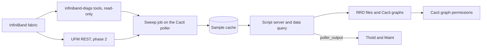

<!-- Source: README.md; SHA256: 19164b87c715ee79192e7772b7cd0029dc6c5e3c07d8ddc7dc44ebabb34ece2b -->

<!-- translations:start -->
[English](../../../README.md) | [简体中文](../zh-CN/README.md) | [हिन्दी](../hi-IN/README.md) | [Español (España)](../es-ES/README.md) | [Español (Latinoamérica)](README.md) | [العربية](../ar-SA/README.md)
<!-- translations:end -->

# plugin_fabric

Un complemento para Cacti 1.2 que incorpora contadores de puertos InfiniBand, anchura y velocidad de enlaces e indicadores de congestión como dispositivos, fuentes de datos y gráficos normales de Cacti. Un enlace que negoció 1X en lugar de 4X aparece así como un gráfico y una alerta Thold junto al host al que sirve, bajo los permisos de Cacti y con posibilidad de supresión mediante Maint.

> **Estado: en desarrollo, todavía sin publicación.** El hito 2 (base) está integrado en `main` y el hito 3 (objetos Cacti y alertas) está en revisión. El hito 1 contrastó el diseño con la documentación y el código original (PR #71); los resultados y sus fuentes están en [docs/research/](../../research). El hito 2 añade la base del complemento:
>
> - instalación, actualización, desinstalación y comprobación de PHP 8.2
> - permisos View, Operator y Admin, y ajustes
> - registros de redes InfiniBand
> - límites de comandos de solo lectura para `perfquery`, `ibnetdiscover` e `iblinkinfo`
> - inventario por GUID, con conflictos de identidad y propuestas de reasociación
> - estado de enlaces y caché de consultas de contadores
> - páginas de inventario, administración y estado
>
> El hito 3 añade los objetos Cacti:
>
> - plantillas de dispositivos, datos y gráficos distribuidas como XML de plantillas Cacti, y la consulta de datos «Fabric Port»
> - asociación de un nodo a un dispositivo Cacti, o creación de uno tras confirmación ([ADR 0010](../../decisions/0010-one-device-per-node.md))
> - fuentes de datos de contadores para gráficos y fuentes GAUGE de estado y velocidad de enlaces para Thold ([ADR 0011](../../decisions/0011-derive-counters-and-gauge-alert-values.md))
> - gestión de discontinuidades y lectura de contadores básicos saturados como desconocidos ([ADR 0012](../../decisions/0012-saturated-basic-counters-read-as-unknown.md)), validez de contadores y enlaces a gráficos en la página de puertos, y clasificación de congestión
> - una prueba integral con Thold v1.8.2 y Maint v1.3 sin modificar, y un trabajo de CI que ejecuta las herramientas reales de diagnóstico sobre una red simulada
>
> Solo el sondeador principal puede consultar una red hasta que se admitan recolectores remotos en la fase 3. Se ha probado con herramientas simuladas y con el simulador de redes ibsim, nunca en una red InfiniBand. Las comprobaciones que requieren una red real siguen pendientes en la tabla de pruebas en vivo de cada página de investigación. Este proyecto no está afiliado al proyecto Cacti.

## Roles de acceso

| Permiso | Acceso |
| --- | --- |
| Fabric View | Páginas de supervisión existentes. |
| Fabric Operator | Supervisión, página de operaciones y acuses personales de investigación. |
| Fabric Admin | Acceso de operador más configuración y acciones administrativas existentes. |

Después de copiar los archivos de actualización, abra la página Complementos como administrador para registrar el nuevo permiso. Asigne expresamente Operator en **Configuración > Usuarios** o en los grupos de usuarios. Las actualizaciones conservan los identificadores y las concesiones de View y Admin. En cada petición, Admin hereda el acceso Operator y Operator hereda View; esto no añade concesiones almacenadas a usuarios ni grupos. Los ajustes del complemento también requieren Fabric Admin, además del permiso Ajustes de Cacti.

Los permisos de dispositivos de Cacti siguen limitando las filas y acciones disponibles para cada usuario; los objetos sin asociación requieren un administrador. Credenciales, configuración, asociaciones, eliminación y otros cambios administrativos permanecen en las páginas administrativas. Los acuses solo duran en la sesión del usuario actual, como máximo una hora y mientras la misma observación siga vigente. Las observaciones nuevas o modificadas los invalidan. Nunca marcan como correcta una medición fallida ni suprimen alertas.

## Motivo

Un enlace InfiniBand degradado sigue transportando tráfico. Un enlace 4X que renegocia a 1X deja el puerto «activo», y los gráficos SNMP de interfaces del host parecen normales, pero los trabajos estrechamente acoplados se ralentizan. La evidencia está en la red: cada puerto informa de anchura y velocidad activas, habilitadas y admitidas, además de contadores de errores y congestión. Leerlos requiere las herramientas de diagnóstico InfiniBand o una API de gestión de red. Su ejecución manual deja tres carencias:

- **Sin historial.** `perfquery` e `iblinkinfo` muestran el presente, por lo que un enlace degradado la semana anterior resulta invisible.
- **Sin contexto de dispositivo.** Los puertos de la red no son objetos Cacti, de modo que no se puede representar un puerto junto al host al que sirve.
- **Sin integración con las alertas de Cacti.** Thold y Maint trabajan con fuentes de datos y dispositivos Cacti.

El complemento cubre esas carencias leyendo la red mediante sus herramientas de diagnóstico (y posteriormente mediante UFM), identificando nodos y puertos por GUID y publicando contadores y estados de enlaces como fuentes de datos Cacti. Solo lee: nunca reinicia contadores ni cambia el estado de los puertos.

## Alcance previsto

| Fase | Alcance | Hitos |
|---|---|---|
| 0, investigación | Matriz de versiones, confirmación del comportamiento original, comportamiento de contadores en hardware, modelo de privilegios, presupuesto MAD, API UFM | [M1](https://github.com/somethingwithproof/plugin_fabric/milestone/1) |
| 1, observación | Inventario por GUID, dispositivos Cacti, consulta de puertos, fuentes de contadores y estado de enlaces, alertas Thold, supresión Maint, página de estado | [M2](https://github.com/somethingwithproof/plugin_fabric/milestone/2), [M3](https://github.com/somethingwithproof/plugin_fabric/milestone/3), [M4](https://github.com/somethingwithproof/plugin_fabric/milestone/4) |
| 2, UFM | Motor REST UFM de solo lectura, gestión de credenciales, continuidad de identidad entre motores | [M5](https://github.com/somethingwithproof/plugin_fabric/milestone/5) |
| 3, remoto | Recolectores remotos, replicación, acciones `remote_agent`, consultas divididas para redes grandes | [M6](https://github.com/somethingwithproof/plugin_fabric/milestone/6) |

Fuera de alcance: modificar el estado de la red, sustituir un gestor de red o de subred, un motor de alertas propio, un servicio o protocolo de red personalizado y redes Ethernet o RoCE (en investigación).

## Objetivos de compatibilidad

| Componente | Objetivo |
|---|---|
| Cacti | 1.2.31 o posterior, sin parches del núcleo |
| PHP | 8.2 o posterior; `setup.php` sigue siendo interpretable en 8.0 para rechazar un entorno no compatible sin romper la interfaz de Cacti |
| Herramientas InfiniBand | infiniband-diags de rdma-core; formatos de salida contrastados con el código v66.0 |
| UFM | API REST UFM Enterprise, fase 2; la matriz de versiones es una entrega del hito 1 |
| Thold, Maint | No requieren cambios |

Mantenga el tiempo de espera de scripts de Cacti en su valor predeterminado de 25 segundos o más. Una consulta iniciada por una lectura de datos limita la ejecución de herramientas a ese tiempo menos cinco segundos, reservando tiempo para leer la caché y responder. Cuando se agota el presupuesto, la consulta devuelve la última muestra vigente o desconocido; el siguiente ciclo reintenta la consulta. Este límite también se aplica al sondeador PHP. Un tiempo de espera de cinco segundos o menos no deja tiempo para iniciar una herramienta.

## Diseño

- [docs/PLAN.md](../../PLAN.md) contiene el plan completo: arquitectura, hechos del software original de los que depende (con fuentes) y supuestos pendientes de confirmar, modelo de identidad, reglas de contadores y estados de enlaces, límites de seguridad, cálculos de rendimiento, pruebas y riesgos.
- [docs/decisions/](../../decisions) contiene los registros de decisiones de arquitectura ya tomadas.
- [docs/REQUIREMENTS.md](../../REQUIREMENTS.md) relaciona cada identificador de requisito con su incidencia.

## Seguimiento del trabajo

- Los **hitos** siguen los del plan. Cada uno tiene una incidencia épica con sus subincidencias y pruebas de finalización.
- Las **incidencias** se clasifican mediante `type: requirement`, `type: research`, `type: decision` y `type: epic`. Los requisitos indican condiciones numeradas y comprobables (`REQ-AREA-NNN`) y criterios de aceptación.
- Las **etiquetas** incluyen también `area:`, `phase:`, `priority:` y `status:`. Consulte [CONTRIBUTING.md](../../../CONTRIBUTING.md#labels).
- El [tablero del proyecto](https://github.com/users/somethingwithproof/projects/8) muestra todas las incidencias de los distintos hitos.

## Contribuir

Lea [CONTRIBUTING.md](../../../CONTRIBUTING.md). Los commits requieren la firma DCO. El diseño se debate en las incidencias; las decisiones abiertas llevan la etiqueta `type: decision`.

## Seguridad

Comunique las vulnerabilidades de forma privada; consulte [SECURITY.md](../../../SECURITY.md).

## Licencia

Licencia Pública General GNU v2.0, la misma que Cacti y sus complementos. Consulte [LICENSE](../../../LICENSE).
