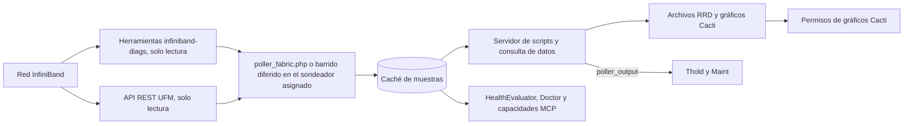

<!-- Source: README.md; SHA256: 79a16fb906f96ee79de2c719f18c38836f555440a7571a4a5ba38c64bb5b099f -->

<!-- translations:start -->
[English](../../../README.md) | [简体中文](../zh-CN/README.md) | [हिन्दी](../hi-IN/README.md) | [Español (España)](README.md) | [Español (Latinoamérica)](../es-419/README.md) | [العربية (السعودية)](../ar-SA/README.md) | [Afrikaans](../af-ZA/README.md) | [አማርኛ](../am-ET/README.md) | [العربية (مصر)](../ar-EG/README.md) | [العربية (المغرب)](../ar-MA/README.md) | [বাংলা](../bn-BD/README.md) | [Bosanski](../bs-BA/README.md) | [Deutsch](../de-DE/README.md) | [فارسی](../fa-IR/README.md) | [Filipino](../fil-PH/README.md) | [Français](../fr-FR/README.md) | [Français (Maroc)](../fr-MA/README.md) | [Français (Sénégal)](../fr-SN/README.md) | [Hausa](../ha-NG/README.md) | [עברית](../he-IL/README.md) | [Hrvatski](../hr-HR/README.md) | [Bahasa Indonesia](../id-ID/README.md) | [Igbo](../ig-NG/README.md) | [Italiano](../it-IT/README.md) | [日本語](../ja-JP/README.md) | [한국어](../ko-KR/README.md) | [Malagasy](../mg-MG/README.md) | [मराठी](../mr-IN/README.md) | [Bahasa Melayu](../ms-MY/README.md) | [Nederlands](../nl-NL/README.md) | [Polski](../pl-PL/README.md) | [Português (Brasil)](../pt-BR/README.md) | [Русский](../ru-RU/README.md) | [Kinyarwanda](../rw-RW/README.md) | [Soomaali](../so-SO/README.md) | [Српски](../sr-RS/README.md) | [Svenska](../sv-SE/README.md) | [Kiswahili](../sw-KE/README.md) | [தமிழ்](../ta-IN/README.md) | [తెలుగు](../te-IN/README.md) | [ไทย](../th-TH/README.md) | [Türkçe](../tr-TR/README.md) | [Українська](../uk-UA/README.md) | [اردو](../ur-PK/README.md) | [Tiếng Việt](../vi-VN/README.md) | [isiXhosa](../xh-ZA/README.md) | [Yorùbá](../yo-NG/README.md) | [繁體中文](../zh-TW/README.md) | [isiZulu](../zu-ZA/README.md)
<!-- translations:end -->

# plugin_fabric

Un complemento para Cacti 1.2 (`fabric`, versión `0.1.0-dev`) que incorpora contadores de puertos InfiniBand, anchura y velocidad de enlaces e indicadores de congestión en Cacti como dispositivos, fuentes de datos y gráficos ordinarios. Un enlace que negoció 1X en lugar de 4X aparece así como un gráfico y una alerta Thold junto al host al que sirve, bajo los permisos de Cacti, con conocimiento y supresión mediante Maint.

> **Estado: en desarrollo, todavía sin publicación.** Esta rama implementa la base del complemento, los objetos y alertas de Cacti, los barridos programados en segundo plano del sondeador, la replicación en recolectores remotos, un motor REST de NVIDIA UFM de solo lectura con un almacén cifrado de credenciales, la gestión por CLI mediante Configuration-as-Code (CasC) y los ganchos del ecosistema de Cacti (CasC, Doctor y MCP / Abilities API v2). Se ha probado con herramientas simuladas, transportes UFM sintéticos y el simulador de redes `ibsim` (rdma-core 50.0), nunca en una red InfiniBand física ni en un servidor UFM real. Las comprobaciones que requieren hardware siguen abiertas en [docs/research/](../../research/). Este proyecto no está afiliado al proyecto Cacti.

## Qué está implementado

- **Ciclo de vida y esquema (v3)**: instalación, actualización idempotente, desinstalación (conservando las tablas del complemento de forma predeterminada) y comprobación del requisito de PHP 8.2 manteniendo los puntos de entrada analizables en PHP 8.0.
- **Roles de acceso y páginas**: permisos `Fabric View` (`fabric.php`), `Fabric Operator` (`fabric_operator.php`) y `Fabric Admin` (`fabric_admin.php`, `fabric_health.php`), además de una pestaña de ajustes en **Configuration > Settings > Fabrics**.
- **Motor de diagnóstico de solo lectura (`diags`)**: ejecución estricta mediante vector de argumentos de `perfquery`, `ibnetdiscover` e `iblinkinfo`, inventario por GUID con detección de conflictos de identidad y propuestas de reasociación, evaluación del estado de enlaces y barridos de contadores por nodo.
- **Motor REST de NVIDIA UFM de solo lectura (`ufm`) y almacén cifrado**: cliente REST exclusivamente GET con lista blanca (`/ufmRest/resources/ports`, `/ufmRest/resources/systems`, `/ufmRest/monitoring/session/0/data` y los equivalentes `/ufmRestV3/...` para autenticación por token) que alimenta las mismas tablas de inventario, estado de enlaces, muestras y salud que `diags`. Las credenciales (`token` o `basic`) se guardan cifradas con AES-256-GCM en `plugin_fabric_secret` usando un archivo de clave externo de 256 bits configurado mediante `fabric_vault_key_file`. Las redes UFM pueden definirse mediante CasC (`cli/fabric.php`) o los repositorios; el formulario web de administración actualmente expone campos de `diags`.
- **Objetos de Cacti, Thold y Maint**: plantillas de dispositivos, datos y gráficos de Cacti (`templates/fabric-templates.xml`), la consulta de datos de servidor de scripts «Fabric Port» (`scripts/ss_fabric_ports.php`, `resource/script_server/fabric_ports.xml`), fuentes de datos de contadores `DERIVE` y fuentes de datos `GAUGE` de estado/tasa de enlaces para Thold, seguimiento de discontinuidades y contadores básicos saturados notificados como `U`. La integración con Maint (`MaintMaintenance`) consulta `plugin_maint_check_cacti_host()` (con respaldo al gancho `is_device_in_maintenance`) para contar por separado los nodos en mantenimiento activo y excluirlos de los avisos de salud por barridos fallidos y puertos degradados.
- **Barridos programados, fragmentación y recolectores remotos**: `poller_bottom` lanza `poller_fabric.php` en segundo plano para las redes pendientes asignadas al sondeador actual, junto con barridos diferidos activados por el servidor de scripts. `INFO` declara `remote_collect:1, remote_poller:1`, `poller_fabric.php` admite fragmentación determinista por GUID (`--shard=K/N`) y `replicate_out` replica las filas no secretas de `plugin_fabric_fabric` a los recolectores remotos (`poller_id >= 2`). Las entradas del almacén (`plugin_fabric_secret`) y los archivos de clave externos nunca se replican.
- **CLI de CasC y ganchos del ecosistema**: `cli/fabric.php` para exportación YAML/XML, validación, planificación de diferencias en simulación, aplicación sujeta a confirmación e informes de salud, además de los ganchos `casc_register_providers`, `doctor_register_checks` y `abilities_register`.

## Roles de acceso

| Permiso | Acceso |
| --- | --- |
| Fabric View | Supervisión de inventario y vistas de puertos (`fabric.php`). |
| Fabric Operator | Acceso View más la página de Operaciones (`fabric_operator.php`) y acuses personales de triaje. |
| Fabric Admin | Acceso Operator más configuración, acciones administrativas (`fabric_admin.php`) y la página de salud (`fabric_health.php`). |

Después de copiar los archivos de actualización, abra la página Complementos como administrador para registrar los nuevos permisos y ganchos. Asigne expresamente el permiso Operator en **Configuration > Users** o en los grupos de usuarios. Las actualizaciones conservan los identificadores y concesiones existentes de los permisos View y Admin. El acceso Admin hereda el acceso Operator y el acceso Operator hereda el acceso View en cada petición; esto no añade concesiones almacenadas a usuarios ni grupos. Los ajustes del complemento también requieren acceso Fabric Admin además del permiso Settings de Cacti.

Los permisos de dispositivos de Cacti limitan las filas y acciones disponibles para cada usuario; los objetos sin asociación requieren un administrador. Las credenciales, configuración, asociaciones, eliminación y otros cambios administrativos permanecen en las páginas administrativas o en la CLI. Los acuses solo duran en la sesión del usuario actual, como máximo una hora y únicamente mientras la misma observación siga vigente. Las observaciones nuevas o modificadas los invalidan. Nunca marcan una medición fallida como correcta ni suprimen alertas.

## Por qué

Un enlace InfiniBand degradado sigue transportando tráfico. Un enlace 4X que renegocia a 1X deja el puerto «activo», y los gráficos SNMP de interfaces del host parecen normales, pero los trabajos estrechamente acoplados se ralentizan. La evidencia está en la red: cada puerto informa de su anchura y velocidad activas, habilitadas y admitidas, además de contadores de errores y congestión. Leerlos requiere las herramientas de diagnóstico InfiniBand o una API de gestor de red. Su ejecución manual deja tres carencias:

- **Sin historial.** `perfquery` e `iblinkinfo` muestran el presente, de modo que un enlace degradado la semana pasada resulta invisible.
- **Sin contexto de dispositivo.** Los puertos de la red no son objetos Cacti, por lo que no se puede representar un puerto junto al host al que sirve.
- **Sin acceso a las alertas de Cacti.** Thold y Maint trabajan sobre fuentes de datos y dispositivos Cacti.

El complemento cubre estas carencias leyendo la red mediante `infiniband-diags` o la API REST de NVIDIA UFM, identificando nodos y puertos por GUID y publicando contadores y estado de enlaces como fuentes de datos Cacti. Solo lee: nunca reinicia contadores ni cambia el estado de los puertos.

## Operaciones y CLI

### Sondeador en segundo plano y barridos manuales

`fabric_poller_bottom()` inicia `poller_fabric.php` en segundo plano en cada sondeador para las redes habilitadas asignadas a ese `poller_id` cuyo barrido esté vencido. También puede ejecutar directamente el ejecutor del sondeador o un barrido manual en el sondeador asignado con la cuenta del sondeador (sustituyendo `/path/to/cacti` por su directorio de Cacti):

```sh
php /path/to/cacti/plugins/fabric/poller_fabric.php [--fabric=ID] [--shard=K/N] [--force] [--debug]
php /path/to/cacti/plugins/fabric/fabric_sweep.php --fabric=ID [--node=GUID] [--force]
```

- `poller_fabric.php` ejecuta todas las redes vencidas para el sondeador local (o una red con `--fabric=ID`), aplica el bloqueo del registro de procesos de Cacti y las concesiones de `ClaimRepository` con un presupuesto de tiempo de `max(30, intdiv(sweep_interval, 2))` segundos, y admite `--shard=K/N` (`0 <= K < N`) para fragmentar los barridos de contadores de nodos `diags` de manera determinista por GUID de nodo.
- `fabric_sweep.php` ejecuta un barrido bajo demanda de una red habilitada (o de un nodo con `--node=GUID`) asignada al sondeador local. `--force` ignora si la red está vencida mientras sigue respetando los reclamos.

Una vez que el primer descubrimiento llene el inventario, asocie los nodos a dispositivos de Cacti en la página Fabric Admin. Mantenga el tiempo de espera de scripts de Cacti en 25 segundos o más: un barrido diferido iniciado por una lectura de consulta de datos limita la ejecución de herramientas a `script_timeout - 5` segundos para que el servidor de scripts responda a tiempo con la última muestra almacenada o `U`.

### Motor REST de NVIDIA UFM y almacén de credenciales

Una red `ufm` requiere una URL `https://` sin credenciales incrustadas, cadenas de consulta ni fragmentos. `UfmSocketTransport` exige verificación TLS de par y nombre de host, rechaza redirecciones y admite un paquete de CA opcional (`ufm_ca_file`) y fijación SPKI SHA-256 (`ufm_spki_pin`).

Para guardar credenciales UFM en `plugin_fabric_secret`, configure `fabric_vault_key_file` en **Configuration > Settings > Fabrics** con una ruta absoluta a un archivo regular propiedad del usuario del sondeador (sin enlaces simbólicos en ningún directorio padre, modo `0600`, que contenga 64 caracteres hexadecimales como `openssl rand -hex 32` o 32 bytes aleatorios no imprimibles). El complemento nunca crea ni escribe el archivo de clave, y `replicate_out` nunca replica `plugin_fabric_secret` ni archivos de clave a los sondeadores remotos.

### Configuration-as-Code y CLI de salud

`cli/fabric.php` gestiona los ajustes del complemento y las definiciones de redes de forma declarativa en YAML o XML, e informa de la salud teniendo en cuenta el mantenimiento sin ejecutar barridos en vivo:

```sh
php /path/to/cacti/plugins/fabric/cli/fabric.php export [--format=yaml|xml] [--file=PATH]
php /path/to/cacti/plugins/fabric/cli/fabric.php validate --file=PATH [--format=yaml|xml]
php /path/to/cacti/plugins/fabric/cli/fabric.php plan --file=PATH [--format=yaml|xml]
php /path/to/cacti/plugins/fabric/cli/fabric.php apply --file=PATH --confirm=PLAN_HASH [--format=yaml|xml]
php /path/to/cacti/plugins/fabric/cli/fabric.php health [--format=text|json]
```

`export` crea archivos nuevos con modo `0600`, censura `fabric_vault_key_file` como `[REDACTED]` y emite referencias nombradas `ufm_credential_ref` en lugar de secretos. `plan` y `apply` rechazan valores en línea de `ufm_token`, `ufm_password`, `secret` y `fabric_vault_key_file`. `apply` requiere exactamente el `--confirm=PLAN_HASH` generado por `plan`.

### Ganchos del ecosistema

Cuando están presentes los complementos de Cacti o las integraciones de host correspondientes, `setup.php` registra:

- `casc_register_providers`: exporta, valida, planifica y aplica tras confirmación la configuración de `fabric` (`yaml` y `xml`, esquema v1) con censura de secretos.
- `doctor_register_checks`: proporciona cuatro comprobaciones de diagnóstico de solo lectura (`fabric.schema`, `fabric.poller_freshness`, `fabric.identity_conflicts`, `fabric.ufm_vault`).
- `abilities_register`: registra tres capacidades de solo lectura, no destructivas e idempotentes bajo la categoría `fabric`, controladas por el permiso Fabric View (y los permisos de dispositivos Cacti para errores de puerto): `fabric-list-fabrics`, `fabric-get-health` y `fabric-list-port-errors`.

## Alcance y límites

Fuera de alcance: cambiar el estado de la red, reiniciar contadores, sustituir un gestor de red o de subred, un motor de alertas propio del complemento, un demonio o protocolo de red personalizado y redes Ethernet o RoCE.

## Requisitos y compatibilidad

| Componente | Objetivo |
|---|---|
| Cacti | 1.2.31 o posterior (`compat = 1.2.31`), sin parches del núcleo |
| PHP | 8.2 o posterior; los puntos de entrada siguen siendo analizables en 8.0 y rechazan la activación en 8.1 para que un entorno no compatible reciba un rechazo en lugar de una interfaz de Cacti rota |
| Herramientas InfiniBand | `infiniband-diags` de `rdma-core` (probado en CI con rdma-core 50.0 bajo `ibsim`; formatos de salida contrastados con el código fuente v66.0) |
| UFM | API REST de NVIDIA UFM Enterprise (endpoints de solo lectura `ufmRest` y `ufmRestV3`; probado frente a transportes sintéticos en pruebas unitarias) |
| Thold, Maint | No requieren cambios; CI ejecuta una prueba integral con Thold v1.8.2 y Maint v1.3 sin modificar |

## Desarrollo y pruebas

El flujo de CI (`.github/workflows/plugin-ci-workflow.yml`) prueba PHP 8.2 hasta 8.5 frente a Cacti `release/1.2.31` y `1.2.x`, análisis sintáctico de puntos de entrada en PHP 8.0, rechazo en PHP 8.1, PHPStan, verificación de gettext y traducciones, licencias REUSE, análisis de flujos de trabajo, reproducción integral con Thold/Maint y simulación de redes `ibsim`.

Con el entorno compartido bloqueado de Pest para complementos de Cacti (`CACTI_PEST_BIN`) y una base de datos Cacti desechable:

```sh
# Unit tests
"$CACTI_PEST_BIN" --configuration=phpunit.xml

# Lifecycle integration tests (disposable database only)
CACTI_PATH=/path/to/cacti FABRIC_TEST_DATABASE=disposable "$CACTI_PEST_BIN" --configuration=phpunit-integration.xml

# Static analysis (against Cacti 1.2.31)
CACTI_PATH=/path/to/cacti phpstan analyse -c phpstan.neon --no-progress

# Translation template, catalogs, and localized README checks
sh locales/build_gettext.sh --check

# Simulated ibsim fixture parser check
php tests/bin/check-ibsim-fixtures.php tests/fixtures/ibsim
```

## Diseño

- [docs/PLAN.md](../../PLAN.md) es el plan de arquitectura y diseño: hechos del software original con fuentes, comprobaciones de hardware abiertas, modelo de identidad, reglas de contadores y estado de enlaces, límites de seguridad, aritmética de rendimiento, pruebas y riesgos.
- [docs/decisions/](../../decisions/) contiene los registros de decisiones de arquitectura.
- [docs/REQUIREMENTS.md](../../REQUIREMENTS.md) relaciona cada identificador de requisito con su incidencia.



## Cómo se sigue el trabajo

- **Hitos** siguen los hitos del plan. Cada uno tiene una incidencia épica que enumera sus subincidencias y evidencias de cierre.
- **Incidencias** se clasifican por etiqueta: `type: requirement`, `type: research`, `type: decision`, `type: epic`. Las incidencias de requisitos establecen requisitos numerados y verificables (`REQ-AREA-NNN`) y criterios de aceptación.
- **Etiquetas** también llevan `area:`, `phase:`, `priority:` y `status:`. Véase [CONTRIBUTING.md](../../../CONTRIBUTING.md#labels).
- El [tablero del proyecto](https://github.com/users/somethingwithproof/projects/8) muestra todas las incidencias entre hitos.

## Contribución

Lea [CONTRIBUTING.md](../../../CONTRIBUTING.md). Los commits necesitan una firma DCO (`git commit -s`). La discusión de diseño ocurre en las incidencias; las decisiones abiertas llevan la etiqueta `type: decision`.

## Seguridad

Informe de vulnerabilidades de forma privada; véase [SECURITY.md](../../../SECURITY.md).

## Licencia

GNU General Public License v2.0, la misma licencia que Cacti y sus complementos. Véase [LICENSE](../../../LICENSE).
