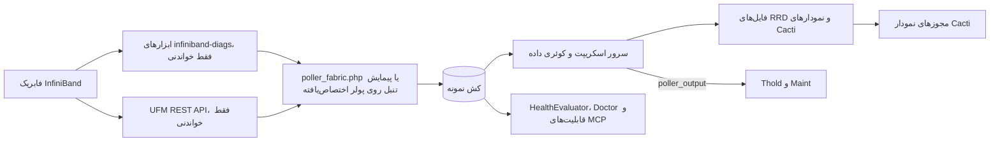

<!-- Source: README.md; SHA256: 79a16fb906f96ee79de2c719f18c38836f555440a7571a4a5ba38c64bb5b099f -->

<!-- translations:start -->
[English](../../../README.md) | [简体中文](../zh-CN/README.md) | [हिन्दी](../hi-IN/README.md) | [Español (España)](../es-ES/README.md) | [Español (Latinoamérica)](../es-419/README.md) | [العربية (السعودية)](../ar-SA/README.md) | [Afrikaans](../af-ZA/README.md) | [አማርኛ](../am-ET/README.md) | [العربية (مصر)](../ar-EG/README.md) | [العربية (المغرب)](../ar-MA/README.md) | [Български](../bg-BG/README.md) | [বাংলা](../bn-BD/README.md) | [Bosanski](../bs-BA/README.md) | [Deutsch](../de-DE/README.md) | [Ελληνικά](../el-GR/README.md) | [فارسی](README.md) | [Filipino](../fil-PH/README.md) | [Français](../fr-FR/README.md) | [Français (Maroc)](../fr-MA/README.md) | [Français (Sénégal)](../fr-SN/README.md) | [Hausa](../ha-NG/README.md) | [עברית](../he-IL/README.md) | [Hrvatski](../hr-HR/README.md) | [Bahasa Indonesia](../id-ID/README.md) | [Igbo](../ig-NG/README.md) | [Italiano](../it-IT/README.md) | [日本語](../ja-JP/README.md) | [ქართული](../ka-GE/README.md) | [한국어](../ko-KR/README.md) | [Latviešu](../lv-LV/README.md) | [Malagasy](../mg-MG/README.md) | [मराठी](../mr-IN/README.md) | [Bahasa Melayu](../ms-MY/README.md) | [Nederlands](../nl-NL/README.md) | [Polski](../pl-PL/README.md) | [Português (Brasil)](../pt-BR/README.md) | [Português (Portugal)](../pt-PT/README.md) | [Русский](../ru-RU/README.md) | [Kinyarwanda](../rw-RW/README.md) | [Soomaali](../so-SO/README.md) | [Српски](../sr-RS/README.md) | [Svenska](../sv-SE/README.md) | [Kiswahili](../sw-KE/README.md) | [தமிழ்](../ta-IN/README.md) | [తెలుగు](../te-IN/README.md) | [ไทย](../th-TH/README.md) | [Türkçe](../tr-TR/README.md) | [Українська](../uk-UA/README.md) | [اردو](../ur-PK/README.md) | [Tiếng Việt](../vi-VN/README.md) | [isiXhosa](../xh-ZA/README.md) | [Yorùbá](../yo-NG/README.md) | [繁體中文](../zh-TW/README.md) | [isiZulu](../zu-ZA/README.md)
<!-- translations:end -->

# plugin_fabric

یک افزونه برای Cacti 1.2 (`fabric`، نسخه `0.1.0-dev`) که شمارنده‌های پورت InfiniBand، پهنا و سرعت لینک، و شاخص‌های ازدحام را به‌عنوان دستگاه‌ها، منابع داده و نمودارهای عادی به Cacti می‌آورد. در نتیجه، لینکی که به‌جای 4X روی 1X برقرار (train) شده باشد، به‌صورت یک نمودار و یک هشدار Thold در کنار میزبانِ مورد خدمت خود، تحت مجوزهای Cacti و با آگاهی از وضعیت Maint و سرکوب هشدار نمایش داده می‌شود.

> **وضعیت: در حال توسعه، هنوز نسخه‌ای منتشر نشده است.** این شاخه زیرساخت افزونه، اشیای Cacti و هشداردهی، پیمایش‌های زمان‌بندی‌شده پولر در پس‌زمینه، تکرارسازی (replication) روی جمع‌آوری‌کننده‌های راه دور، بک‌اند REST فقط خواندنی NVIDIA UFM همراه با خزانه (vault) رمزنگاری‌شده اعتبارنامه‌ها، مدیریت خط فرمان پیکربندی به‌عنوان کد (CasC) و قلاب‌های (hooks) اکوسیستم Cacti (شامل CasC، Doctor و MCP / Abilities API v2) را پیاده‌سازی می‌کند. این افزونه با ابزارهای ساختگی، انتقال‌های مصنوعی UFM و شبیه‌ساز فابریک `ibsim` (نسخه rdma-core 50.0) آزمایش شده است و هرگز روی یک فابریک InfiniBand فیزیکی یا سرور زنده UFM آزمایش نشده است. بررسی‌هایی که به سخت‌افزار نیاز دارند همچنان در [docs/research/](../../research/) باز هستند. این پروژه وابسته به پروژه Cacti نیست.

## موارد پیاده‌سازی‌شده

- **چرخه حیات و طرحواره (v3)**: نصب، ارتقای یکنواخت (idempotent)، حذف (با نگه داشتن جدول‌های افزونه به‌صورت پیش‌فرض) و محافظ نیازمندی PHP 8.2 همراه با حفظ قابلیت تجزیه نقاط ورود روی PHP 8.0.
- **نقش‌های دسترسی و صفحات**: حوزه‌های (realm) `Fabric View` (`fabric.php`)، `Fabric Operator` (`fabric_operator.php`) و `Fabric Admin` (`fabric_admin.php`، `fabric_health.php`)، به‌علاوه یک برگه تنظیمات در **Configuration > Settings > Fabrics**.
- **بک‌اند عیب‌یابی فقط خواندنی (`diags`)**: اجرای سخت‌گیرانه بردار آرگومان برای `perfquery`، `ibnetdiscover` و `iblinkinfo`، موجودی بر پایه GUID همراه با تشخیص تعارض هویت و پیشنهادهای پیوند مجدد، ارزیابی وضعیت لینک و پیمایش‌های شمارنده به ازای هر گره.
- **بک‌اند REST فقط خواندنی NVIDIA UFM (`ufm`) و خزانه رمزنگاری‌شده**: کلاینت REST مجاز فقط با متد GET (`/ufmRest/resources/ports`، `/ufmRest/resources/systems`، `/ufmRest/monitoring/session/0/data` و معادل‌های `/ufmRestV3/...` برای احراز هویت با توکن) که همان جدول‌های موجودی، وضعیت لینک، نمونه و سلامت را مانند `diags` تغذیه می‌کند. اعتبارنامه‌ها (`token` یا `basic`) با رمزنگاری AES-256-GCM در `plugin_fabric_secret` و با استفاده از یک فایل کلید خارجی ۲۵۶ بیتی پیکربندی‌شده توسط `fabric_vault_key_file` ذخیره می‌شوند. فابریک‌های UFM را می‌توان از طریق CasC (`cli/fabric.php`) یا مخازن (repositories) تعریف کرد؛ فرم مدیریت وب در حال حاضر فیلدهای `diags` را نمایش می‌دهد.
- **اشیای Cacti، Thold و Maint**: قالب‌های دستگاه، داده و نمودار Cacti (`templates/fabric-templates.xml`)، کوئری داده سرور اسکریپت «Fabric Port» (`scripts/ss_fabric_ports.php`، `resource/script_server/fabric_ports.xml`)، منابع داده شمارنده `DERIVE` و منابع داده وضعیت لینک/نرخ `GAUGE` برای Thold، مدیریت ناپیوستگی‌ها و گزارش شمارنده‌های پایه اشباع‌شده به‌عنوان `U`. یکپارچه‌سازی Maint (`MaintMaintenance`) تابع `plugin_maint_check_cacti_host()` را فراخوانی می‌کند (و در صورت نبود به قلاب `is_device_in_maintenance` برمی‌گردد) تا گره‌هایی که در دوره نگهداری فعال هستند جداگانه شمارش شوند و از هشدارهای سلامت مربوط به پیمایش ناموفق و پورت افت‌یافته مستثنی گردند.
- **پیمایش‌های زمان‌بندی‌شده، تکه‌بندی (sharding) و جمع‌آوری‌کننده‌های راه دور**: `poller_bottom` اسکریپت `poller_fabric.php` را در پس‌زمینه برای فابریک‌های موعددار اختصاص‌یافته به پولر فعلی اجرا می‌کند، در کنار پیمایش‌های تنبل (lazy) که از طریق سرور اسکریپت آغاز می‌شوند. `INFO` مقدار `remote_collect:1, remote_poller:1` را اعلام می‌کند، `poller_fabric.php` از تکه‌بندی قطعی بر اساس GUID (`--shard=K/N`) پشتیبانی می‌کند، و `replicate_out` ردیف‌های غیرمحرمانه `plugin_fabric_fabric` را به جمع‌آوری‌کننده‌های راه دور (`poller_id >= 2`) تکرار می‌کند. ورودی‌های خزانه (`plugin_fabric_secret`) و فایل‌های کلید خارجی هرگز تکرار نمی‌شوند.
- **خط فرمان CasC و قلاب‌های اکوسیستم**: `cli/fabric.php` برای خروجی گرفتن YAML/XML، اعتبارسنجی، برنامه‌ریزی diff آزمایشی (dry-run)، اعمال منوط به تأیید و گزارش سلامت، به همراه قلاب‌های `casc_register_providers`، `doctor_register_checks` و `abilities_register`.

## نقش‌های دسترسی

| حوزه (Realm) | دسترسی |
| --- | --- |
| Fabric View | نمای پایش موجودی و پورت‌ها (`fabric.php`). |
| Fabric Operator | دسترسی View به علاوه صفحه عملیات (`fabric_operator.php`) و تأییدیه‌های شخصی بررسی اولیه (triage). |
| Fabric Admin | دسترسی Operator به علاوه پیکربندی، اقدام‌های مدیریتی (`fabric_admin.php`) و صفحه سلامت (`fabric_health.php`). |

پس از کپی کردن فایل‌های ارتقا، صفحه Plugins را به‌عنوان مدیر باز کنید تا حوزه‌ها و قلاب‌های جدید ثبت شوند. حوزه Operator را به‌صورت صریح در بخش **Configuration > Users** یا گروه‌های کاربری تخصیص دهید. ارتقاها شناسه‌ها و مجوزهای موجود حوزه‌های View و Admin را حفظ می‌کنند. دسترسی Admin در هر درخواست دسترسی Operator را به ارث می‌برد، و دسترسی Operator دسترسی View را به ارث می‌برد؛ این کار مجوز ذخیره‌شده‌ای به کاربران یا گروه‌ها اضافه نمی‌کند. تنظیمات افزونه نیز علاوه بر مجوز Settings در Cacti، به دسترسی Fabric Admin نیاز دارد.

مجوزهای دستگاه Cacti ردیف‌ها و اقدام‌های در دسترس هر کاربر را محدود می‌کنند؛ اشیای نگاشت‌نشده به مدیر نیاز دارند. اعتبارنامه‌ها، پیکربندی، نگاشت، حذف و سایر تغییرات مدیریتی همچنان در صفحات مدیریتی یا CLI باقی می‌مانند. تأییدیه‌ها فقط در نشست فعلی کاربر، حداکثر برای یک ساعت و فقط تا زمانی که همان مشاهده تازه باقی بماند دوام دارند. مشاهدات جدید یا تغییریافته آن‌ها را باطل می‌کنند. آن‌ها هرگز یک اندازه‌گیری ناموفق را سالم علامت‌گذاری نمی‌کنند یا هشدارها را سرکوب نمی‌کنند.

## چرا

یک لینک InfiniBand افت‌یافته همچنان ترافیک را عبور می‌دهد. یک لینک 4X که دوباره با سرعت 1X برقرار (retrain) می‌شود پورت را «active» نگه می‌دارد و نمودارهای رابط SNMP میزبان عادی به نظر می‌رسند، اما کارهای به‌هم‌وابسته کند می‌شوند. شواهد در خود فابریک است: هر پورت پهنا و سرعت فعال، فعال‌شده و پشتیبانی‌شده خود را به همراه شمارنده‌های خطا و ازدحام گزارش می‌دهد. خواندن این اطلاعات نیازمند ابزارهای عیب‌یابی InfiniBand یا رابط برنامه‌نویسی مدیر فابریک است. اجرای دستی آن‌ها سه شکاف بر جای می‌گذارد:

- **نبود تاریخچه.** `perfquery` و `iblinkinfo` وضعیت فعلی را نشان می‌دهند، بنابراین لینکی که هفته گذشته دچار افت شده دیده نمی‌شود.
- **نبود زمینه دستگاه.** پورت‌های فابریک جزو اشیای Cacti نیستند، بنابراین نمی‌توان یک پورت را در کنار میزبانی که تغذیه می‌کند روی نمودار نشان داد.
- **نبود مسیر به هشداردهی Cacti.** Thold و Maint روی منابع داده و دستگاه‌های Cacti کار می‌کنند.

این افزونه با خواندن فابریک از طریق `infiniband-diags` یا NVIDIA UFM REST API، شناسایی گره‌ها و پورت‌ها بر اساس GUID، و انتشار شمارنده‌ها و وضعیت لینک به‌عنوان منابع داده Cacti، این شکاف‌ها را پر می‌کند. این افزونه فقط خواندنی است: هرگز شمارنده‌ها را بازنشانی نمی‌کند یا وضعیت پورت را تغییر نمی‌دهد.

## عملیات و خط فرمان

### پولر پس‌زمینه و پیمایش‌های دستی

تابع `fabric_poller_bottom()` اسکریپت `poller_fabric.php` را در پس‌زمینه روی هر پولر برای فابریک‌های فعال اختصاص‌یافته به آن `poller_id` که موعد پیمایش آن‌ها رسیده است، اجرا می‌کند. همچنین می‌توانید اجراکننده پولر یا یک پیمایش دستی را مستقیماً روی پولر اختصاص‌یافته با حساب کاربری پولر اجرا کنید (و `/path/to/cacti` را با مسیر Cacti خود جایگزین نمایید):

```sh
php /path/to/cacti/plugins/fabric/poller_fabric.php [--fabric=ID] [--shard=K/N] [--force] [--debug]
php /path/to/cacti/plugins/fabric/fabric_sweep.php --fabric=ID [--node=GUID] [--force]
```

- `poller_fabric.php` تمام فابریک‌های موعددار مربوط به پولر محلی (یا یک فابریک را با `--fabric=ID`) اجرا می‌کند، قفل رجیستری فرایند Cacti و اجاره‌های `ClaimRepository` را با بودجه زمانی `max(30, intdiv(sweep_interval, 2))` ثانیه اعمال می‌کند، و از `--shard=K/N` (`0 <= K < N`) برای تکه‌بندی قطعی پیمایش‌های شمارنده گره `diags` بر اساس GUID گره پشتیبانی می‌کند.
- `fabric_sweep.php` یک پیمایش درخواستی از یک فابریک فعال (یا یک گره با `--node=GUID`) اختصاص‌یافته به پولر محلی را اجرا می‌کند. `--force` موعددار بودن فابریک را نادیده می‌گیرد اما همچنان به اجاره‌ها (claims) احترام می‌گذارد.

پس از اینکه نخستین کشف، فهرست موجودی را پر کرد، گره‌ها را در صفحه Fabric Admin به دستگاه‌های Cacti نگاشت کنید. زمان انتظار اسکریپت Cacti را روی ۲۵ ثانیه یا بیشتر نگه دارید: پیمایش تنبلی که با خواندن کوئری داده آغاز می‌شود، اجرای ابزار را به `script_timeout - 5` ثانیه محدود می‌کند تا سرور اسکریپت به‌موقع با آخرین نمونه ذخیره‌شده یا `U` پاسخ دهد.

### بک‌اند REST NVIDIA UFM و خزانه اعتبارنامه

یک فابریک `ufm` نیازمند یک نشانی `https://` بدون اعتبارنامه‌های تعبیه‌شده، رشته‌های کوئری یا fragment است. `UfmSocketTransport` راستی‌آزمایی همتا (peer) و نام میزبان TLS را اعمال می‌کند، تغییر مسیرها (redirects) را رد می‌کند، و از بسته CA اختیاری (`ufm_ca_file`) و پین SHA-256 SPKI (`ufm_spki_pin`) پشتیبانی می‌کند.

برای ذخیره اعتبارنامه‌های UFM در `plugin_fabric_secret`، گزینه `fabric_vault_key_file` را در **Configuration > Settings > Fabrics** با یک مسیر مطلق به یک فایل عادی متعلق به کاربر پولر پیکربندی کنید (بدون پیوند نمادین در هیچ دایرکتوری والد، با مجوز `0600`، و شامل ۶۴ نویسه هگزادسیمال مانند `openssl rand -hex 32` یا ۳۲ بایت تصادفی غیرقابل چاپ). افزونه هرگز فایل کلید را ایجاد یا بازنویسی نمی‌کند و `replicate_out` هرگز `plugin_fabric_secret` یا فایل‌های کلید را به پولرهای راه دور تکرار نمی‌کند.

### پیکربندی به‌عنوان کد و خط فرمان سلامت

`cli/fabric.php` تنظیمات افزونه و تعریف‌های فابریک را به‌صورت اعلانی در قالب YAML یا XML مدیریت می‌کند و سلامت آگاه از نگهداری (maintenance-aware) را بدون اجرای پیمایش‌های زنده گزارش می‌دهد:

```sh
php /path/to/cacti/plugins/fabric/cli/fabric.php export [--format=yaml|xml] [--file=PATH]
php /path/to/cacti/plugins/fabric/cli/fabric.php validate --file=PATH [--format=yaml|xml]
php /path/to/cacti/plugins/fabric/cli/fabric.php plan --file=PATH [--format=yaml|xml]
php /path/to/cacti/plugins/fabric/cli/fabric.php apply --file=PATH --confirm=PLAN_HASH [--format=yaml|xml]
php /path/to/cacti/plugins/fabric/cli/fabric.php health [--format=text|json]
```

دستور `export` فایل‌های جدید را با مجوز `0600` ایجاد می‌کند، `fabric_vault_key_file` را به‌صورت `[REDACTED]` سانسور می‌کند، و به‌جای اسرار، ارجاع‌های نام‌گذاری‌شده `ufm_credential_ref` را تولید می‌کند. `plan` و `apply` مقادیر درون‌خطی `ufm_token`، `ufm_password`، `secret` و `fabric_vault_key_file` را رد می‌کنند. `apply` نیازمند `--confirm=PLAN_HASH` دقیق تولیدشده توسط `plan` است.

### قلاب‌های اکوسیستم

هنگامی که افزونه‌های متناظر Cacti یا یکپارچه‌سازی‌های میزبان حضور داشته باشند، `setup.php` موارد زیر را ثبت می‌کند:

- `casc_register_providers`: پیکربندی `fabric` (`yaml` و `xml`، طرحواره v1) را با سانسور اسرار خروجی می‌گیرد، اعتبارسنجی می‌کند، برنامه‌ریزی می‌کند و با تأیید اعمال می‌کند.
- `doctor_register_checks`: چهار بررسی تشخیصی فقط خواندنی ارائه می‌دهد (`fabric.schema`، `fabric.poller_freshness`، `fabric.identity_conflicts`، `fabric.ufm_vault`).
- `abilities_register`: سه قابلیت فقط خواندنی، غیرمخرب و یکنواخت را تحت دسته `fabric` ثبت می‌کند که با حوزه Fabric View (و مجوزهای دستگاه Cacti برای خطاهای پورت) محافظت می‌شوند: `fabric-list-fabrics`، `fabric-get-health` و `fabric-list-port-errors`.

## محدوده و مرزها

خارج از محدوده: تغییر وضعیت فابریک، بازنشانی شمارنده‌ها، جایگزینی مدیر فابریک یا مدیر زیرشبکه (subnet manager)، موتور هشداردهی اختصاصی افزونه، دیمون یا پروتکل شبکه سفارشی، و فابریک‌های Ethernet یا RoCE.

## نیازمندی‌ها و سازگاری

| مؤلفه | هدف |
|---|---|
| Cacti | نسخه 1.2.31 یا بالاتر (`compat = 1.2.31`)، بدون پچ هسته |
| PHP | نسخه 8.2 یا بالاتر؛ نقاط ورود روی 8.0 قابل تجزیه باقی می‌مانند و فعال‌سازی را روی 8.1 رد می‌کنند تا محیط اجرای پشتیبانی‌نشده به‌جای خراب کردن رابط کاربری Cacti، پیام رد دریافت کند |
| ابزارهای InfiniBand | `infiniband-diags` از `rdma-core` (آزمایش‌شده در CI با rdma-core 50.0 تحت `ibsim`؛ قالب‌های خروجی در برابر کد منبع نسخه v66.0 بررسی شده‌اند) |
| UFM | NVIDIA UFM Enterprise REST API (نقاط پایانی فقط خواندنی `ufmRest` و `ufmRestV3`؛ آزمایش‌شده در برابر انتقال‌های مصنوعی در آزمون‌های واحد) |
| Thold، Maint | بدون نیاز به هیچ تغییری؛ CI یک آزمون سرتاسری با Thold v1.8.2 و Maint v1.3 بدون تغییر اجرا می‌کند |

## توسعه و آزمون

گردش کار CI (`.github/workflows/plugin-ci-workflow.yml`) نسخه‌های PHP 8.2 تا 8.5 را در برابر شاخه‌های `release/1.2.31` و `1.2.x` از Cacti، بررسی نحوی نقاط ورود روی PHP 8.0، رد شدن روی PHP 8.1، PHPStan، راستی‌آزمایی gettext/ترجمه، مجوزدهی REUSE، بررسی گردش کار، بازپخش سرتاسری Thold/Maint و شبیه‌سازی فابریک `ibsim` آزمایش می‌کند.

با استفاده از بستر آزمایشی مشترک و قفل‌شده Pest در Cacti (`CACTI_PEST_BIN`) و یک پایگاه داده یک‌بارمصرف Cacti:

```sh
# Unit tests
"$CACTI_PEST_BIN" --configuration=phpunit.xml

# Lifecycle integration tests (disposable database only)
CACTI_PATH=/path/to/cacti FABRIC_TEST_DATABASE=disposable "$CACTI_PEST_BIN" --configuration=phpunit-integration.xml

# Static analysis (against Cacti 1.2.31)
CACTI_PATH=/path/to/cacti phpstan analyse -c phpstan.neon --no-progress

# Translation template, catalogs, and localized README checks
sh locales/build_gettext.sh --check

# Simulated ibsim fixture parser check
php tests/bin/check-ibsim-fixtures.php tests/fixtures/ibsim
```

## طراحی

- [docs/PLAN.md](../../PLAN.md) طرح معماری و طراحی است: واقعیت‌های بالادستی با منابع، بررسی‌های باز سخت‌افزاری، مدل هویت، قوانین شمارنده و وضعیت لینک، مرزهای امنیتی، محاسبات کارایی، آزمون و ریسک‌ها.
- [docs/decisions/](../../decisions/) رکوردهای تصمیم معماری را نگه می‌دارد.
- [docs/REQUIREMENTS.md](../../REQUIREMENTS.md) هر شناسه نیازمندی را به issue مربوط به آن نگاشت می‌کند.



## نحوه پیگیری کارها

- **مایلستون‌ها** از مایلستون‌های طرح پیروی می‌کنند. هر مایلستون یک issue حماسی دارد که زیرمسئله‌ها و شواهد خروج آن را فهرست می‌کند.
- **مسئله‌ها (Issues)** با برچسب دسته‌بندی می‌شوند: `type: requirement`، `type: research`، `type: decision`، `type: epic`. مسئله‌های نیازمندی، نیازمندی‌های شماره‌گذاری‌شده و آزمون‌پذیر (`REQ-AREA-NNN`) و معیارهای پذیرش را بیان می‌کنند.
- **برچسب‌ها** همچنین شامل `area:`، `phase:`، `priority:` و `status:` هستند. [CONTRIBUTING.md](../../../CONTRIBUTING.md#labels) را ببینید.
- [تابلوی پروژه](https://github.com/users/somethingwithproof/projects/8) همه مسئله‌ها را در سراسر مایلستون‌ها نشان می‌دهد.

## مشارکت

[CONTRIBUTING.md](../../../CONTRIBUTING.md) را بخوانید. کامیت‌ها به امضای DCO نیاز دارند (`git commit -s`). بحث‌های طراحی در issueها انجام می‌شوند؛ تصمیم‌های باز دارای برچسب `type: decision` هستند.

## امنیت

آسیب‌پذیری‌ها را به‌صورت خصوصی گزارش کنید؛ [SECURITY.md](../../../SECURITY.md) را ببینید.

## مجوز

مجوز GNU General Public License v2.0، همان مجوز Cacti و افزونه‌های آن. [LICENSE](../../../LICENSE) را ببینید.
