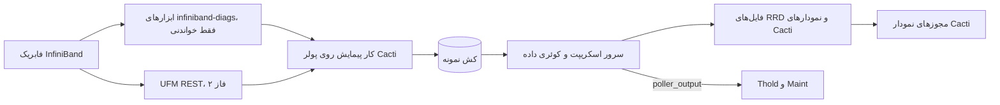

<!-- Source: README.md; SHA256: ce5af61a1bc993ec2aae6d4f22c3885694632f2b1d5eb94e2ce88b8390e96f1e -->

<!-- translations:start -->
[English](../../../README.md) | [简体中文](../zh-CN/README.md) | [हिन्दी](../hi-IN/README.md) | [Español (España)](../es-ES/README.md) | [Español (Latinoamérica)](../es-419/README.md) | [العربية (السعودية)](../ar-SA/README.md) | [Afrikaans](../af-ZA/README.md) | [አማርኛ](../am-ET/README.md) | [العربية (مصر)](../ar-EG/README.md) | [العربية (المغرب)](../ar-MA/README.md) | [বাংলা](../bn-BD/README.md) | [Deutsch](../de-DE/README.md) | [فارسی](README.md) | [Filipino](../fil-PH/README.md) | [Français](../fr-FR/README.md) | [Français (Maroc)](../fr-MA/README.md) | [Français (Sénégal)](../fr-SN/README.md) | [Hausa](../ha-NG/README.md) | [עברית](../he-IL/README.md) | [Bahasa Indonesia](../id-ID/README.md) | [Igbo](../ig-NG/README.md) | [Italiano](../it-IT/README.md) | [日本語](../ja-JP/README.md) | [한국어](../ko-KR/README.md) | [Malagasy](../mg-MG/README.md) | [मराठी](../mr-IN/README.md) | [Bahasa Melayu](../ms-MY/README.md) | [Nederlands](../nl-NL/README.md) | [Polski](../pl-PL/README.md) | [Português (Brasil)](../pt-BR/README.md) | [Русский](../ru-RU/README.md) | [Kinyarwanda](../rw-RW/README.md) | [Soomaali](../so-SO/README.md) | [Svenska](../sv-SE/README.md) | [Kiswahili](../sw-KE/README.md) | [தமிழ்](../ta-IN/README.md) | [తెలుగు](../te-IN/README.md) | [ไทย](../th-TH/README.md) | [Türkçe](../tr-TR/README.md) | [Українська](../uk-UA/README.md) | [اردو](../ur-PK/README.md) | [Tiếng Việt](../vi-VN/README.md) | [isiXhosa](../xh-ZA/README.md) | [Yorùbá](../yo-NG/README.md) | [繁體中文](../zh-TW/README.md) | [isiZulu](../zu-ZA/README.md)
<!-- translations:end -->

# plugin_fabric

یک افزونه برای Cacti 1.2 که شمارنده‌های پورت InfiniBand، پهنا و سرعت لینک، و شاخص‌های ازدحام را به‌عنوان دستگاه‌ها، منابع داده و نمودارهای عادی به Cacti می‌آورد. در نتیجه، لینکی که به‌جای 4X روی 1X برقرار (train) شده باشد، به‌صورت یک نمودار و یک هشدار Thold در کنار میزبانِ مورد خدمت خود، تحت مجوزهای Cacti و با امکان سرکوب توسط Maint نمایش داده می‌شود.

> **وضعیت: در حال توسعه، هنوز نسخه‌ای منتشر نشده است.** مایلستون ۲ (زیرساخت) در شاخه `main` ادغام شده است و مایلستون ۳ (اشیای Cacti و هشداردهی) در حال بررسی است. مایلستون ۱ طراحی را در برابر مستندات و کد منبع بالادستی (PR #71) تأیید کرد؛ نتایج به همراه منابع در [docs/research/](../../research) قرار دارند. مایلستون ۲ زیرساخت افزونه را اضافه می‌کند:
>
> - نصب، ارتقا، حذف و محافظ نسخه PHP 8.2
> - حوزه‌های (realm) نمایش، اپراتور و مدیر، و تنظیمات
> - رکوردهای فابریک
> - مرز دستورات فقط خواندنی برای `perfquery`، `ibnetdiscover` و `iblinkinfo`
> - موجودی بر اساس GUID، همراه با تعارض‌های هویت و پیشنهادهای پیوند مجدد
> - وضعیت لینک و کش پیمایش (sweep) شمارنده‌ها
> - صفحات موجودی، مدیریت و سلامت
>
> مایلستون ۳ اشیای Cacti را اضافه می‌کند:
>
> - قالب‌های دستگاه، داده و نمودار که به‌صورت XML قالب Cacti عرضه می‌شوند، و کوئری داده «Fabric Port»
> - نگاشت یک گره (node) به یک دستگاه Cacti، یا ایجاد یک دستگاه در صورت تأیید ([ADR 0010](../../decisions/0010-one-device-per-node.md))
> - منابع داده شمارنده برای نمودارها، و منابع داده وضعیت لینک و نرخ از نوع GAUGE برای Thold ([ADR 0011](../../decisions/0011-derive-counters-and-gauge-alert-values.md))
> - مدیریت ناپیوستگی‌ها و خواندن شمارنده‌های پایه اشباع‌شده به‌عنوان مقدار نامشخص ([ADR 0012](../../decisions/0012-saturated-basic-counters-read-as-unknown.md))، اعتبارسنجی شمارنده‌ها و پیوندهای نمودار در صفحه پورت، و رتبه‌بندی ازدحام
> - یک آزمون سرتاسری با Thold v1.8.2 و Maint v1.3 بدون تغییر، و یک کار CI که ابزارهای عیب‌یابی واقعی را روی یک فابریک شبیه‌سازی‌شده اجرا می‌کند
>
> تا زمانی که جمع‌آوری‌کننده‌های داده راه دور در فاز ۳ پشتیبانی نشوند، یک فابریک را فقط می‌توان از پولر (poller) اصلی پیمایش کرد. این افزونه با ابزارهای ساختگی و شبیه‌ساز فابریک ibsim آزمایش شده است و هرگز روی یک فابریک InfiniBand واقعی آزمایش نشده است. بررسی‌هایی که به فابریک واقعی نیاز دارند در جدول بررسی‌های زنده هر صفحه پژوهش همچنان باز هستند. این پروژه وابسته به پروژه Cacti نیست.

## نقش‌های دسترسی

| حوزه (Realm) | دسترسی |
| --- | --- |
| Fabric View | صفحات پایش موجود. |
| Fabric Operator | پایش به علاوه صفحه عملیات و تأییدیه‌های شخصی بررسی اولیه (triage). |
| Fabric Admin | دسترسی Operator به علاوه پیکربندی و اقدام‌های مدیریتی موجود. |

پس از کپی کردن فایل‌های ارتقا، صفحه Plugins را به‌عنوان مدیر باز کنید تا حوزه جدید ثبت شود. حوزه Operator را به‌صورت صریح در بخش **Configuration > Users** یا گروه‌های کاربری تخصیص دهید.
ارتقاها شناسه‌ها و مجوزهای موجود حوزه‌های View و Admin را حفظ می‌کنند. دسترسی Admin در هر درخواست دسترسی Operator را به ارث می‌برد، و دسترسی Operator دسترسی View را به ارث می‌برد؛ این کار مجوز ذخیره‌شده‌ای به کاربران یا گروه‌ها اضافه نمی‌کند. تنظیمات افزونه نیز علاوه بر مجوز Settings در Cacti، به دسترسی Fabric Admin نیاز دارد.

مجوزهای دستگاه Cacti همچنان ردیف‌ها و اقدام‌های در دسترس هر کاربر را محدود می‌کنند؛ اشیای نگاشت‌نشده به مدیر نیاز دارند.
اعتبارنامه‌ها، پیکربندی، نگاشت، حذف و سایر تغییرات مدیریتی همچنان در صفحات مدیریتی باقی می‌مانند. تأییدیه‌ها فقط در نشست فعلی کاربر، حداکثر برای یک ساعت و فقط تا زمانی که همان مشاهده تازه باقی بماند دوام دارند. مشاهدات جدید یا تغییریافته آن‌ها را باطل می‌کنند. آن‌ها هرگز یک اندازه‌گیری ناموفق را سالم علامت‌گذاری نمی‌کنند یا هشدارها را سرکوب نمی‌کنند.

## چرا

یک لینک InfiniBand افت‌یافته همچنان ترافیک را عبور می‌دهد. یک لینک 4X که دوباره با سرعت 1X برقرار (retrain) می‌شود پورت را «active» نگه می‌دارد و نمودارهای رابط SNMP میزبان عادی به نظر می‌رسند، اما کارهای به‌هم‌وابسته کند می‌شوند. شواهد در خود فابریک است: هر پورت پهنا و سرعت فعال، فعال‌شده و پشتیبانی‌شده خود را به همراه شمارنده‌های خطا و ازدحام گزارش می‌دهد. خواندن این اطلاعات نیازمند ابزارهای عیب‌یابی InfiniBand یا رابط برنامه‌نویسی مدیر فابریک است. اجرای دستی آن‌ها سه شکاف بر جای می‌گذارد:

- **نبود تاریخچه.** `perfquery` و `iblinkinfo` وضعیت فعلی را نشان می‌دهند، بنابراین لینکی که هفته گذشته دچار افت شده دیده نمی‌شود.
- **نبود زمینه دستگاه.** پورت‌های فابریک جزو اشیای Cacti نیستند، بنابراین نمی‌توان یک پورت را در کنار میزبانی که تغذیه می‌کند روی نمودار نشان داد.
- **نبود مسیر به هشداردهی Cacti.** Thold و Maint روی منابع داده و دستگاه‌های Cacti کار می‌کنند.

این افزونه با خواندن فابریک از طریق ابزارهای عیب‌یابی خود (و بعدها از طریق UFM)، شناسایی گره‌ها و پورت‌ها بر اساس GUID، و انتشار شمارنده‌ها و وضعیت لینک به‌عنوان منابع داده Cacti، این شکاف‌ها را پر می‌کند. این افزونه فقط خواندنی است: هرگز شمارنده‌ها را بازنشانی نمی‌کند یا وضعیت پورت را تغییر نمی‌دهد.

## نخستین کشف

یک فابریک جدید هیچ گره‌ای ندارد و پیمایش‌ها از سرور اسکریپت فقط برای گره‌ای آغاز می‌شوند که به یک دستگاه Cacti نگاشت شده باشد. بنابراین نخستین کشف یک گام دستی است. پس از ذخیره یک فابریک فعال، این دستور را یک بار روی پولری که فابریک به آن تخصیص داده شده است، با حساب کاربری پولر اجرا کنید و `/path/to/cacti` را با مسیر Cacti خود جایگزین نمایید (مسیر مطلق از طریق cron نیز کار می‌کند):

```
php /path/to/cacti/plugins/fabric/fabric_sweep.php --fabric=ID --force
```

در نتیجه فهرست موجودی پر می‌شود. گره‌ها را در صفحه Fabric Admin به دستگاه‌های Cacti نگاشت کنید؛ پیمایش‌های بعدی از طریق کوئری داده آغاز می‌شوند. تا زمانی که هیچ گره‌ای از یک فابریک نگاشت نشده باشد، هیچ‌چیز موجودی آن را تازه‌سازی نمی‌کند؛ بنابراین برای ثبت گره‌های جدید یا مفقود، در صورت تمایل همین دستور را دوباره (یا از طریق cron) اجرا کنید. صفحه سلامت این دستور را برای هر فابریک فعالی که هنوز کشف نشده یا هیچ گره نگاشت‌شده‌ای ندارد نمایش می‌دهد.

## محدوده برنامه‌ریزی‌شده

| فاز | محدوده | مایلستون‌ها |
|---|---|---|
| 0، پژوهش | ماتریس نسخه‌ها، تأیید رفتار بالادستی، رفتار شمارنده‌ها روی سخت‌افزار، مدل مجوزها، بودجه MAD، رابط UFM API | [M1](https://github.com/somethingwithproof/plugin_fabric/milestone/1) |
| 1، مشاهده | موجودی بر اساس GUID، دستگاه‌های Cacti، کوئری داده پورت، منابع داده شمارنده و وضعیت لینک، هشداردهی Thold، سرکوب Maint، صفحه سلامت | [M2](https://github.com/somethingwithproof/plugin_fabric/milestone/2)، [M3](https://github.com/somethingwithproof/plugin_fabric/milestone/3)، [M4](https://github.com/somethingwithproof/plugin_fabric/milestone/4) |
| 2، UFM | بک‌اند REST فقط خواندنی UFM، مدیریت اعتبارنامه‌ها، پیوستگی هویت بین بک‌اندها | [M5](https://github.com/somethingwithproof/plugin_fabric/milestone/5) |
| 3، راه دور | جمع‌آوری‌کننده‌های داده راه دور، همگام‌سازی، اقدام‌های `remote_agent`، پیمایش تکه‌بندی‌شده برای فابریک‌های بزرگ | [M6](https://github.com/somethingwithproof/plugin_fabric/milestone/6) |

خارج از محدوده: تغییر وضعیت فابریک، جایگزینی مدیر فابریک یا مدیر زیرشبکه (subnet manager)، موتور هشداردهی اختصاصی افزونه، دیمون یا پروتکل شبکه سفارشی، و فابریک‌های Ethernet یا RoCE (پژوهش).

## اهداف سازگاری

| مؤلفه | هدف |
|---|---|
| Cacti | نسخه 1.2.31 یا بالاتر، بدون پچ هسته |
| PHP | نسخه 8.2 یا بالاتر؛ `setup.php` روی نسخه 8.0 قابل تجزیه باقی می‌ماند تا محیط اجرای پشتیبانی‌نشده به‌جای خراب کردن رابط کاربری Cacti، پیام رد دریافت کند |
| ابزارهای InfiniBand | infiniband-diags از rdma-core؛ قالب‌های خروجی در برابر کد منبع نسخه v66.0 بررسی شده‌اند |
| UFM | رابط UFM Enterprise REST API، فاز ۲؛ ماتریس نسخه‌ها یکی از خروجی‌های مایلستون ۱ است |
| Thold، Maint | بدون نیاز به هیچ تغییری |

زمان انتظار اسکریپت Cacti را روی مقدار پیش‌فرض ۲۵ ثانیه یا بیشتر نگه دارید. پیمایشی که با خواندن کوئری داده آغاز می‌شود، اجرای ابزار را به این زمان انتظار منهای پنج ثانیه محدود می‌کند تا زمانی برای خواندن کش و پاسخ‌دهی باقی بماند. هنگامی که بودجه زمانی تمام شود، کوئری آخرین نمونه معتبر یا مقدار نامشخص را برمی‌گرداند؛ چرخه بعدی پیمایش را دوباره تلاش می‌کند. این محدودیت برای پولر PHP نیز اعمال می‌شود. زمان انتظار پنج ثانیه یا کمتر، هیچ زمانی برای شروع ابزار باقی نمی‌گذارد.

## طراحی

- [docs/PLAN.md](../../PLAN.md) طرح کامل است: معماری، واقعیت‌های بالادستی که به آن‌ها وابسته است (به همراه منابع) و فرض‌هایی که هنوز باید تأیید شوند، مدل هویت، قوانین شمارنده و وضعیت لینک، مرزهای امنیتی، محاسبات کارایی، آزمون و ریسک‌ها.
- [docs/decisions/](../../decisions) رکوردهای تصمیم معماری را برای انتخاب‌هایی که از قبل انجام شده‌اند نگه می‌دارد.
- [docs/REQUIREMENTS.md](../../REQUIREMENTS.md) هر شناسه نیازمندی را به issue مربوط به آن نگاشت می‌کند.



## نحوه پیگیری کارها

- **مایلستون‌ها** از مایلستون‌های طرح پیروی می‌کنند. هر مایلستون یک issue حماسی دارد که زیرمسئله‌ها و شواهد خروج آن را فهرست می‌کند.
- **مسئله‌ها (Issues)** با برچسب دسته‌بندی می‌شوند: `type: requirement`، `type: research`، `type: decision`، `type: epic`. مسئله‌های نیازمندی، نیازمندی‌های شماره‌گذاری‌شده و آزمون‌پذیر (`REQ-AREA-NNN`) و معیارهای پذیرش را بیان می‌کنند.
- **برچسب‌ها** همچنین شامل `area:`، `phase:`، `priority:` و `status:` هستند. [CONTRIBUTING.md](../../../CONTRIBUTING.md#labels) را ببینید.
- [تابلوی پروژه](https://github.com/users/somethingwithproof/projects/8) همه مسئله‌ها را در سراسر مایلستون‌ها نشان می‌دهد.

## مشارکت

[CONTRIBUTING.md](../../../CONTRIBUTING.md) را بخوانید. کامیت‌ها به امضای DCO نیاز دارند. بحث‌های طراحی در issueها انجام می‌شوند؛ تصمیم‌های باز دارای برچسب `type: decision` هستند.

## امنیت

آسیب‌پذیری‌ها را به‌صورت خصوصی گزارش کنید؛ [SECURITY.md](../../../SECURITY.md) را ببینید.

## مجوز

مجوز GNU General Public License v2.0، همان مجوز Cacti و افزونه‌های آن. [LICENSE](../../../LICENSE) را ببینید.
