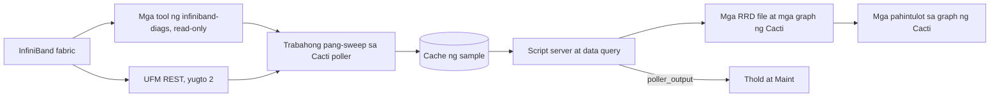

<!-- Source: README.md; SHA256: ce5af61a1bc993ec2aae6d4f22c3885694632f2b1d5eb94e2ce88b8390e96f1e -->

<!-- translations:start -->
[English](../../../README.md) | [简体中文](../zh-CN/README.md) | [हिन्दी](../hi-IN/README.md) | [Español (España)](../es-ES/README.md) | [Español (Latinoamérica)](../es-419/README.md) | [العربية (السعودية)](../ar-SA/README.md) | [Afrikaans](../af-ZA/README.md) | [አማርኛ](../am-ET/README.md) | [العربية (مصر)](../ar-EG/README.md) | [العربية (المغرب)](../ar-MA/README.md) | [বাংলা](../bn-BD/README.md) | [Bosanski](../bs-BA/README.md) | [Deutsch](../de-DE/README.md) | [فارسی](../fa-IR/README.md) | [Filipino](README.md) | [Français](../fr-FR/README.md) | [Français (Maroc)](../fr-MA/README.md) | [Français (Sénégal)](../fr-SN/README.md) | [Hausa](../ha-NG/README.md) | [עברית](../he-IL/README.md) | [Hrvatski](../hr-HR/README.md) | [Bahasa Indonesia](../id-ID/README.md) | [Igbo](../ig-NG/README.md) | [Italiano](../it-IT/README.md) | [日本語](../ja-JP/README.md) | [한국어](../ko-KR/README.md) | [Malagasy](../mg-MG/README.md) | [मराठी](../mr-IN/README.md) | [Bahasa Melayu](../ms-MY/README.md) | [Nederlands](../nl-NL/README.md) | [Polski](../pl-PL/README.md) | [Português (Brasil)](../pt-BR/README.md) | [Русский](../ru-RU/README.md) | [Kinyarwanda](../rw-RW/README.md) | [Soomaali](../so-SO/README.md) | [Српски](../sr-RS/README.md) | [Svenska](../sv-SE/README.md) | [Kiswahili](../sw-KE/README.md) | [தமிழ்](../ta-IN/README.md) | [తెలుగు](../te-IN/README.md) | [ไทย](../th-TH/README.md) | [Türkçe](../tr-TR/README.md) | [Українська](../uk-UA/README.md) | [اردو](../ur-PK/README.md) | [Tiếng Việt](../vi-VN/README.md) | [isiXhosa](../xh-ZA/README.md) | [Yorùbá](../yo-NG/README.md) | [繁體中文](../zh-TW/README.md) | [isiZulu](../zu-ZA/README.md)
<!-- translations:end -->

# plugin_fabric

Isang plugin ng Cacti 1.2 na nagdadala ng mga port counter ng InfiniBand, lapad at bilis ng link, at mga tagapagpahiwatig ng pagsisikip sa Cacti bilang mga karaniwang device, data source, at graph. Ang isang link na nag-train sa 1X sa halip na 4X ay lalabas bilang graph at isang alerto sa Thold katabi ng host na pinaglilingkuran nito, sa ilalim ng mga pahintulot ng Cacti, kung saan maaari itong pigilin ng Maint.

> **Katayuan: kasalukuyang binubuo, wala pang release.** Ang Milestone 2 (pundasyon) ay naka-merge na sa `main`, at ang milestone 3 (mga bagay sa Cacti at pag-alerto) ay sinusuri pa. Kinumpirma ng Milestone 1 ang disenyo laban sa dokumentasyon at upstream source (PR #71); ang mga resulta, kasama ang mga sanggunian, ay nasa [docs/research/](../../research). Idinagdag ng Milestone 2 ang pundasyon ng plugin:
>
> - pag-install, pag-upgrade, pag-uninstall, at ang bantay para sa PHP 8.2
> - mga realm na View, Operator at Admin, at mga setting
> - mga tala ng fabric
> - ang read-only na hangganan ng command para sa `perfquery`, `ibnetdiscover`, at `iblinkinfo`
> - imbentaryo ayon sa GUID, na may mga salungatan sa pagkakakilanlan at mga panukala sa muling pag-link
> - estado ng link at ang counter sweep cache
> - mga pahina ng imbentaryo, admin, at kalusugan
>
> Idinagdag ng Milestone 3 ang mga bagay sa Cacti:
>
> - mga template ng device, data, at graph na ipinapadala bilang Cacti template XML, at ang data query na "Fabric Port"
> - pagmamapa ng isang node sa isang Cacti device, o paglikha ng isa kapag nakumpirma ([ADR 0010](../../decisions/0010-one-device-per-node.md))
> - mga counter data source para sa mga graph, at mga GAUGE na link state at rate data source para sa Thold ([ADR 0011](../../decisions/0011-derive-counters-and-gauge-alert-values.md))
> - pangangasiwa sa diskontinuwidad at mga saturated na pangunahing counter na binabasa bilang unknown ([ADR 0012](../../decisions/0012-saturated-basic-counters-read-as-unknown.md)), pagiging wasto ng counter at mga link ng graph sa pahina ng port, at isang pagraranggo ng pagsisikip
> - isang end-to-end na pagsubok gamit ang hindi binagong Thold v1.8.2 at Maint v1.3, at isang CI job na nagpapatakbo ng mga totoong diagnostic tool laban sa isang simulate na fabric
>
> Maaari lamang i-sweep ang isang fabric mula sa pangunahing poller hanggang sa suportahan ang mga remote data collector sa yugto 3. Nasubukan ito laban sa mga pekeng tool at sa ibsim fabric simulator, ngunit hindi pa kailanman sa isang totoong InfiniBand fabric. Ang mga pagsusuring nangangailangan ng fabric ay nananatiling bukas sa talahanayan ng mga live check ng bawat pahina ng pananaliksik. Ang proyektong ito ay walang kaugnayan sa proyektong Cacti.

## Mga tungkulin sa pag-access

| Realm | Pag-access |
| --- | --- |
| Fabric View | Mga kasalukuyang pahina ng pagsubaybay. |
| Fabric Operator | Pagsubaybay kasama ang pahina ng Operations at mga personal na pagkilala sa triage. |
| Fabric Admin | Pag-access ng Operator kasama ang mga kasalukuyang pagsasaayos at mga aksyong pang-administratibo. |

Pagkatapos kopyahin ang mga upgrade file, buksan ang pahina ng Plugins bilang administrator upang irehistro ang bagong realm. Tahasang italaga ang realm ng Operator sa ilalim ng **Configuration > Users** o mga user group. Pinapanatili ng mga upgrade ang mga kasalukuyang ID at grant ng View at Admin realm. Minamana ng pag-access ng Admin ang pag-access ng Operator, at minamana ng pag-access ng Operator ang pag-access ng View sa bawat kahilingan; hindi ito nagdaragdag ng mga naka-store na grant sa mga user o grupo. Kinakailangan din ng mga setting ng plugin ang pag-access ng Fabric Admin bilang karagdagan sa pahintulot sa Settings ng Cacti.

Nililimitahan pa rin ng mga pahintulot ng Cacti device ang mga row at aksyon na magagamit ng bawat user; ang mga hindi naka-map na bagay ay nangangailangan ng administrator. Ang mga kredensyal, pagsasaayos, pagmamapa, pagtanggal at iba pang mga pagbabagong pang-administratibo ay nananatili sa mga pahinang pang-administratibo. Ang mga pagkilala ay tumatagal lamang sa kasalukuyang session ng user, sa loob ng hindi hihigit sa isang oras at hangga't nananatiling sariwa ang parehong obserbasyon. Ang mga bago o nabagong obserbasyon ay nagpapawalang-bisa sa mga ito. Hindi kailanman minamarkahan ng mga ito bilang malusog ang isang nabigong pagsukat o pinipigilan ang mga alerto.

## Bakit

Ang isang humihinang link ng InfiniBand ay nagpapadaan pa rin ng trapiko. Ang isang 4X link na nagre-retrain sa 1X ay nag-iiwan sa port na "active", at mukhang normal ang mga SNMP interface graph ng host, ngunit bumabagal ang mga mahigpit na magkakaugnay na trabaho. Ang ebidensya ay nasa fabric: iniuulat ng bawat port ang aktibo, pinagana, at sinusuportahang lapad at bilis nito, kasama ang mga error at congestion counter. Upang mabasa ito, kailangan ang mga InfiniBand diagnostic tool o isang fabric manager API. Kapag pinatakbo nang mano-mano, nag-iiwan ang mga ito ng tatlong puwang:

- **Walang kasaysayan.** Ipinapakita ng `perfquery` at `iblinkinfo` ang kasalukuyan, kaya hindi nakikita ang isang link na humina noong nakaraang linggo.
- **Walang konteksto ng device.** Ang mga fabric port ay hindi mga Cacti object, kaya hindi maaaring i-graph ang isang port katabi ng host na pinaglalaanan nito.
- **Walang landas patungo sa pag-alerto ng Cacti.** Gumagana ang Thold at Maint sa mga data source at device ng Cacti.

Isinasara ng plugin ang mga puwang na ito sa pamamagitan ng pagbabasa ng fabric gamit ang sarili nitong mga diagnostic tool (at sa kalaunan ay sa pamamagitan ng UFM), pagtukoy sa mga node at port ayon sa GUID, at paglalathala ng mga counter at estado ng link bilang mga Cacti data source. Nagbabasa lamang ito: hindi ito kailanman nagre-reset ng mga counter o nagbabago ng estado ng port.

## Unang pagtuklas

Ang isang bagong fabric ay walang mga node, at nagsisimula lamang ang mga sweep mula sa script server para sa isang node na naka-map sa isang Cacti device. Samakatuwid, ang unang pagtuklas ay isang manu-manong hakbang. Pagkatapos i-save ang isang pinaganang fabric, patakbuhin ito nang isang beses sa poller kung saan nakatalaga ang fabric, bilang account ng poller, kung saan papalitan ang `/path/to/cacti` ng iyong direktoryo ng Cacti (gumagana rin ang absolute path mula sa cron):

```
php /path/to/cacti/plugins/fabric/fabric_sweep.php --fabric=ID --force
```

Pagkatapos ay mapupuno ang imbentaryo. I-map ang mga node sa mga Cacti device sa pahina ng Fabric Admin; ang mga susunod na sweep ay magsisimula mula sa data query. Habang walang node ng isang fabric ang naka-map, walang nagre-refresh ng imbentaryo nito, kaya patakbuhin muli ang parehong command, mula sa cron kung nais mo, upang maitala ang mga bago o nawawalang node. Ipinapakita ng pahina ng kalusugan ang command na ito para sa isang pinaganang fabric na hindi pa natutuklasan o walang naka-map na node.

## Nakaplanong saklaw

| Yugto | Saklaw | Mga Milestone |
|---|---|---|
| 0, pananaliksik | Matrix ng bersyon, pagkumpirma ng gawi sa upstream, gawi ng counter sa hardware, modelo ng pribilehiyo, badyet ng MAD, UFM API | [M1](https://github.com/somethingwithproof/plugin_fabric/milestone/1) |
| 1, pagmasid | Imbentaryo ayon sa GUID, mga Cacti device, port data query, mga counter at link-state data source, pag-alerto ng Thold, pagpigil ng Maint, pahina ng kalusugan | [M2](https://github.com/somethingwithproof/plugin_fabric/milestone/2), [M3](https://github.com/somethingwithproof/plugin_fabric/milestone/3), [M4](https://github.com/somethingwithproof/plugin_fabric/milestone/4) |
| 2, UFM | Read-only na UFM REST backend, pangangasiwa sa kredensyal, pagpapatuloy ng pagkakakilanlan sa pagitan ng mga backend | [M5](https://github.com/somethingwithproof/plugin_fabric/milestone/5) |
| 3, remote | Mga remote data collector, pagkopya, mga aksyon ng `remote_agent`, mga sharded sweep para sa malalaking fabric | [M6](https://github.com/somethingwithproof/plugin_fabric/milestone/6) |

Hindi saklaw: pagbabago ng estado ng fabric, pagpapalit ng fabric manager o subnet manager, isang alerting engine na pagmamay-ari ng plugin, isang custom daemon o network protocol, at mga Ethernet o RoCE fabric (pananaliksik).

## Mga target sa pagiging tugma

| Bahagi | Target |
|---|---|
| Cacti | 1.2.31 o mas bago, walang core patch |
| PHP | 8.2 o mas bago; nananatiling na-parse ang `setup.php` sa 8.0 upang makatanggap ng pagtanggi ang hindi sinusuportahang runtime sa halip na sirang Cacti UI |
| Mga InfiniBand tool | infiniband-diags mula sa rdma-core; sinuri ang mga format ng output laban sa source ng v66.0 |
| UFM | UFM Enterprise REST API, yugto 2; ang matrix ng release ay isang deliverable ng milestone 1 |
| Thold, Maint | Walang kinakailangang pagbabago |

Panatilihin ang script timeout ng Cacti sa default nitong 25 segundo o mas mataas. Ang isang sweep na sinimulan ng isang pagbasa ng data-query ay naglilimita sa pagpapatupad ng tool sa timeout na iyon bawas ang limang segundo, na nagrereserba ng oras upang basahin ang cache at tumugon. Kapag nag-expire ang badyet, ihahatid ng query ang huling kasalukuyang sample o unknown; susubukan muli ng susunod na cycle ang sweep. Nalalapat din ang limitasyong ito sa PHP poller. Ang timeout na limang segundo o mas mababa ay walang iniiwang oras upang magsimula ng isang tool.

## Disenyo

- Ang [docs/PLAN.md](../../PLAN.md) ay ang buong plano: arkitektura, mga katotohanan sa upstream na pinagbabatayan nito (kasama ang mga sanggunian) at mga palagay na kailangan pang kumpirmahin, modelo ng pagkakakilanlan, mga panuntunan sa counter at link-state, mga hangganan ng seguridad, aritmetika ng pagganap, pagsubok, at mga panganib.
- Ang [docs/decisions/](../../decisions) ay naglalaman ng mga tala ng desisyon sa arkitektura para sa mga pagpiling nagawa na.
- Iniuugnay ng [docs/REQUIREMENTS.md](../../REQUIREMENTS.md) ang bawat requirement ID sa issue nito.



## Paano sinusubaybayan ang trabaho

- Sinusundan ng **Mga Milestone** ang mga milestone ng plano. Bawat isa ay may epic issue na naglilista ng mga sub-issue nito at katibayan ng pagtatapos.
- Ang **Mga Issue** ay inuri ayon sa label: `type: requirement`, `type: research`, `type: decision`, `type: epic`. Ang mga requirement issue ay nagsasaad ng mga may bilang at nasusubok na kinakailangan (`REQ-AREA-NNN`) at pamantayan sa pagtanggap.
- Nagtataglay din ang **Mga Label** ng `area:`, `phase:`, `priority:`, at `status:`. Tingnan ang [CONTRIBUTING.md](../../../CONTRIBUTING.md#labels).
- Ipinapakita ng [board ng proyekto](https://github.com/users/somethingwithproof/projects/8) ang lahat ng issue sa lahat ng milestone.

## Pag-ambag

Basahin ang [CONTRIBUTING.md](../../../CONTRIBUTING.md). Kailangan ng mga commit ng DCO sign-off. Nangyayari ang talakayan ng disenyo sa mga issue; ang mga bukas na desisyon ay may label na `type: decision`.

## Seguridad

Iulat ang mga kahinaan nang pribado; tingnan ang [SECURITY.md](../../../SECURITY.md).

## Lisensya

GNU General Public License v2.0, ang parehong lisensya gaya ng Cacti at mga plugin nito. Tingnan ang [LICENSE](../../../LICENSE).
