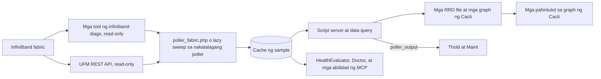

<!-- Source: README.md; SHA256: 79a16fb906f96ee79de2c719f18c38836f555440a7571a4a5ba38c64bb5b099f -->

<!-- translations:start -->
[English](../../../README.md) | [简体中文](../zh-CN/README.md) | [हिन्दी](../hi-IN/README.md) | [Español (España)](../es-ES/README.md) | [Español (Latinoamérica)](../es-419/README.md) | [العربية (السعودية)](../ar-SA/README.md) | [Afrikaans](../af-ZA/README.md) | [አማርኛ](../am-ET/README.md) | [العربية (مصر)](../ar-EG/README.md) | [العربية (المغرب)](../ar-MA/README.md) | [বাংলা](../bn-BD/README.md) | [Bosanski](../bs-BA/README.md) | [Deutsch](../de-DE/README.md) | [فارسی](../fa-IR/README.md) | [Filipino](README.md) | [Français](../fr-FR/README.md) | [Français (Maroc)](../fr-MA/README.md) | [Français (Sénégal)](../fr-SN/README.md) | [Hausa](../ha-NG/README.md) | [עברית](../he-IL/README.md) | [Hrvatski](../hr-HR/README.md) | [Bahasa Indonesia](../id-ID/README.md) | [Igbo](../ig-NG/README.md) | [Italiano](../it-IT/README.md) | [日本語](../ja-JP/README.md) | [한국어](../ko-KR/README.md) | [Malagasy](../mg-MG/README.md) | [मराठी](../mr-IN/README.md) | [Bahasa Melayu](../ms-MY/README.md) | [Nederlands](../nl-NL/README.md) | [Polski](../pl-PL/README.md) | [Português (Brasil)](../pt-BR/README.md) | [Русский](../ru-RU/README.md) | [Kinyarwanda](../rw-RW/README.md) | [Soomaali](../so-SO/README.md) | [Српски](../sr-RS/README.md) | [Svenska](../sv-SE/README.md) | [Kiswahili](../sw-KE/README.md) | [தமிழ்](../ta-IN/README.md) | [తెలుగు](../te-IN/README.md) | [ไทย](../th-TH/README.md) | [Türkçe](../tr-TR/README.md) | [Українська](../uk-UA/README.md) | [اردو](../ur-PK/README.md) | [Tiếng Việt](../vi-VN/README.md) | [isiXhosa](../xh-ZA/README.md) | [Yorùbá](../yo-NG/README.md) | [繁體中文](../zh-TW/README.md) | [isiZulu](../zu-ZA/README.md)
<!-- translations:end -->

# plugin_fabric

Isang plugin ng Cacti 1.2 (`fabric`, bersyon `0.1.0-dev`) na nagdadala ng mga port counter ng InfiniBand, lapad at bilis ng link, at mga tagapagpahiwatig ng pagsisikip sa Cacti bilang mga karaniwang device, data source, at graph. Ang isang link na nag-train sa 1X sa halip na 4X ay lalabas bilang graph at isang alerto sa Thold katabi ng host na pinaglilingkuran nito, sa ilalim ng mga pahintulot ng Cacti, nang may kamalayan at pagpigil mula sa Maint.

> **Katayuan: kasalukuyang binubuo, wala pang release.** Ipinatutupad ng branch na ito ang pundasyon ng plugin, mga bagay sa Cacti at pag-alerto, mga nakaiskedyul na sweep ng poller sa background, replikasyon sa mga remote collector, isang read-only na NVIDIA UFM REST backend na may naka-encrypt na vault ng kredensyal, pamamahala ng Configuration-as-Code (CasC) sa CLI, at mga hook sa ecosystem ng Cacti (CasC, Doctor, at MCP / Abilities API v2). Nasubukan ito laban sa mga pekeng tool, sintetikong transport ng UFM, at sa `ibsim` fabric simulator (rdma-core 50.0), at hindi pa kailanman sa isang pisikal na InfiniBand fabric o live na UFM server. Ang mga pagsusuring nangangailangan ng hardware ay nananatiling bukas sa [docs/research/](../../research/). Ang proyektong ito ay walang kaugnayan sa proyektong Cacti.

## Ano ang naipatupad

- **Lifecycle at schema (v3)**: pag-install, idempotent na pag-upgrade, pag-uninstall (pinapanatili ang mga talahanayan ng plugin bilang default), at isang bantay sa kinakailangang PHP 8.2 habang pinananatiling na-parse ang mga entry point sa PHP 8.0.
- **Mga tungkulin sa pag-access at mga pahina**: mga realm na `Fabric View` (`fabric.php`), `Fabric Operator` (`fabric_operator.php`), at `Fabric Admin` (`fabric_admin.php`, `fabric_health.php`), kasama ang tab ng Mga Setting sa ilalim ng **Configuration > Settings > Fabrics**.
- **Read-only na diagnostics backend (`diags`)**: mahigpit na pagpapatupad ng argument-vector para sa `perfquery`, `ibnetdiscover`, at `iblinkinfo`, imbentaryo na nakabase sa GUID na may pagtuklas ng salungatan sa pagkakakilanlan at mga panukala sa muling pag-link, pagsusuri sa estado ng link, at mga counter sweep bawat node.
- **Read-only na NVIDIA UFM REST backend (`ufm`) at naka-encrypt na vault**: GET-only na pinapayagang REST client (`/ufmRest/resources/ports`, `/ufmRest/resources/systems`, `/ufmRest/monitoring/session/0/data`, at mga katumbas na `/ufmRestV3/...` para sa token auth) na nagpapakain sa parehong mga talahanayan ng imbentaryo, estado ng link, sample, at kalusugan gaya ng `diags`. Ang mga kredensyal (`token` o `basic`) ay iniimbak nang naka-encrypt gamit ang AES-256-GCM sa `plugin_fabric_secret` gamit ang isang panlabas na 256-bit na keyfile na naka-configure sa `fabric_vault_key_file`. Maaaring tukuyin ang mga UFM fabric sa pamamagitan ng CasC (`cli/fabric.php`) o ng mga repository; kasalukuyang nagpapakita ng mga field ng `diags` ang web admin form.
- **Mga bagay sa Cacti, Thold, at Maint**: mga template ng device, data, at graph sa Cacti (`templates/fabric-templates.xml`), ang script-server data query na "Fabric Port" (`scripts/ss_fabric_ports.php`, `resource/script_server/fabric_ports.xml`), mga `DERIVE` counter data source at `GAUGE` link-state/rate data source para sa Thold, pagsubaybay sa diskontinuwidad, at mga saturated na pangunahing counter na iniuulat bilang `U`. Nagtatanong ang integrasyon ng Maint (`MaintMaintenance`) sa `plugin_maint_check_cacti_host()` (bumabagsak sa `is_device_in_maintenance` hook) upang ang mga node na nasa aktibong maintenance ay mabilang nang hiwalay at maibukod sa mga babala sa kalusugan ng nabigong sweep at humihinang port.
- **Mga nakaiskedyul na sweep, sharding, at mga remote collector**: sinisimulan ng `poller_bottom` ang `poller_fabric.php` sa background para sa mga fabric na nakatakdang i-sweep na nakatalaga sa kasalukuyang poller, kasabay ng mga lazy sweep na pinapagana ng script server. Nagpapahayag ang `INFO` ng `remote_collect:1, remote_poller:1`, sinusuportahan ng `poller_fabric.php` ang deterministikong GUID sharding (`--shard=K/N`), at kinokopya ng `replicate_out` ang mga hindi lihim na row ng `plugin_fabric_fabric` patungo sa mga remote collector (`poller_id >= 2`). Ang mga entry sa vault (`plugin_fabric_secret`) at mga panlabas na keyfile ay hindi kailanman kinokopya.
- **CasC CLI at mga hook ng ecosystem**: `cli/fabric.php` para sa pag-export ng YAML/XML, pag-validate, dry-run na pagpaplano ng diff, paglalapat na may gate ng kumpirmasyon, at pag-uulat ng kalusugan, kasama ang mga hook na `casc_register_providers`, `doctor_register_checks`, at `abilities_register`.

## Mga tungkulin sa pag-access

| Realm | Pag-access |
| --- | --- |
| Fabric View | Pagsubaybay sa mga view ng imbentaryo at port (`fabric.php`). |
| Fabric Operator | Pag-access ng View kasama ang pahina ng Operations (`fabric_operator.php`) at mga personal na pagkilala sa triage. |
| Fabric Admin | Pag-access ng Operator kasama ang pagsasaayos, mga aksyong pang-administratibo (`fabric_admin.php`), at ang pahina ng kalusugan (`fabric_health.php`). |

Pagkatapos kopyahin ang mga upgrade file, buksan ang pahina ng Plugins bilang administrator upang irehistro ang mga bagong realm at hook. Tahasang italaga ang realm ng Operator sa ilalim ng **Configuration > Users** o mga user group. Pinananatili ng mga upgrade ang mga kasalukuyang ID at grant ng View at Admin realm. Minamana ng pag-access ng Admin ang pag-access ng Operator, at minamana ng pag-access ng Operator ang pag-access ng View sa bawat kahilingan; hindi ito nagdaragdag ng mga naka-store na grant sa mga user o grupo. Kinakailangan din ng mga setting ng plugin ang pag-access ng Fabric Admin bilang karagdagan sa pahintulot sa Settings ng Cacti.

Nililimitahan ng mga pahintulot ng Cacti device ang mga row at aksyon na magagamit ng bawat user; ang mga hindi naka-map na bagay ay nangangailangan ng administrator. Ang mga kredensyal, pagsasaayos, pagmamapa, pagtanggal, at iba pang mga pagbabagong pang-administratibo ay nananatili sa mga pahinang pang-administratibo o CLI. Ang mga pagkilala ay tumatagal lamang sa kasalukuyang session ng user, sa loob ng hindi hihigit sa isang oras at hangga't nananatiling sariwa ang parehong obserbasyon. Ang mga bago o nabagong obserbasyon ay nagpapawalang-bisa sa mga ito. Hindi kailanman minamarkahan ng mga ito bilang malusog ang isang nabigong pagsukat o pinipigilan ang mga alerto.

## Bakit

Ang isang humihinang link ng InfiniBand ay nagpapadaan pa rin ng trapiko. Ang isang 4X link na nagre-retrain sa 1X ay nag-iiwan sa port na "active", at mukhang normal ang mga SNMP interface graph ng host, ngunit bumabagal ang mga mahigpit na magkakaugnay na trabaho. Ang ebidensya ay nasa fabric: iniuulat ng bawat port ang aktibo, pinagana, at sinusuportahang lapad at bilis nito, kasama ang mga error at congestion counter. Upang mabasa ito, kailangan ang mga InfiniBand diagnostic tool o isang fabric manager API. Kapag pinatakbo nang mano-mano, nag-iiwan ang mga ito ng tatlong puwang:

- **Walang kasaysayan.** Ipinapakita ng `perfquery` at `iblinkinfo` ang kasalukuyan, kaya hindi nakikita ang isang link na humina noong nakaraang linggo.
- **Walang konteksto ng device.** Ang mga fabric port ay hindi mga Cacti object, kaya hindi maaaring i-graph ang isang port katabi ng host na pinaglalaanan nito.
- **Walang landas patungo sa pag-alerto ng Cacti.** Gumagana ang Thold at Maint sa mga data source at device ng Cacti.

Isinasara ng plugin ang mga puwang na ito sa pamamagitan ng pagbabasa ng fabric gamit ang `infiniband-diags` o ang NVIDIA UFM REST API, pagtukoy sa mga node at port ayon sa GUID, at paglalathala ng mga counter at estado ng link bilang mga Cacti data source. Nagbabasa lamang ito: hindi ito kailanman nagre-reset ng mga counter o nagbabago ng estado ng port.

## Mga Operasyon at CLI

### Poller sa background at mga manu-manong sweep

Sinisimulan ng `fabric_poller_bottom()` ang `poller_fabric.php` sa background sa bawat poller para sa mga pinaganang fabric na nakatalaga sa `poller_id` na iyon na nakatakda nang i-sweep. Maaari mo ring patakbuhin ang runner ng poller o isang manu-manong sweep nang direkta sa nakatalagang poller bilang user ng poller (papalitan ang `/path/to/cacti` ng iyong direktoryo ng Cacti):

```sh
php /path/to/cacti/plugins/fabric/poller_fabric.php [--fabric=ID] [--shard=K/N] [--force] [--debug]
php /path/to/cacti/plugins/fabric/fabric_sweep.php --fabric=ID [--node=GUID] [--force]
```

- Pinatatakbo ng `poller_fabric.php` ang lahat ng nakatakdang fabric para sa lokal na poller (o isang fabric gamit ang `--fabric=ID`), ipinapatupad ang process registry lock ng Cacti at mga lease ng `ClaimRepository` na may badyet sa oras na `max(30, intdiv(sweep_interval, 2))` segundo, at sinusuportahan ang `--shard=K/N` (`0 <= K < N`) upang deterministikong hatiin sa mga shard ang mga node counter sweep ng `diags` ayon sa node GUID.
- Nagpapatakbo ang `fabric_sweep.php` ng on-demand na sweep ng isang pinaganang fabric (o isang node gamit ang `--node=GUID`) na nakatalaga sa lokal na poller. Binabalewala ng `--force` kung nakatakda na ang fabric habang iginagalang pa rin ang mga claim.

Pagkatapos punan ng unang pagtuklas ang imbentaryo, i-map ang mga node sa mga Cacti device sa pahina ng Fabric Admin. Panatilihin ang script timeout ng Cacti sa 25 segundo o mas mataas: nililimitahan ng isang lazy sweep na sinimulan ng isang pagbasa ng data-query ang pagpapatupad ng tool sa `script_timeout - 5` segundo upang makabalik sa oras ang script server kasama ang huling naka-store na sample o `U`.

### NVIDIA UFM REST backend at vault ng kredensyal

Nangangailangan ang isang `ufm` fabric ng isang `https://` URL na walang naka-embed na kredensyal, query string, o fragment. Ipinapatupad ng `UfmSocketTransport` ang pagberipika ng TLS peer at hostname, tinatanggihan ang mga redirect, at sinusuportahan ang opsyonal na CA bundle (`ufm_ca_file`) at SHA-256 SPKI pin (`ufm_spki_pin`).

Upang mag-imbak ng mga kredensyal ng UFM sa `plugin_fabric_secret`, i-configure ang `fabric_vault_key_file` sa ilalim ng **Configuration > Settings > Fabrics** gamit ang isang absolute path patungo sa isang regular na file na pagmamay-ari ng user ng poller (walang symlink sa anumang parent directory, mode `0600`, naglalaman ng 64 hex character gaya ng `openssl rand -hex 32` o 32 random na hindi napi-print na byte). Hindi kailanman lumilikha o sumusulat ang plugin sa keyfile, at hindi kailanman kinokopya ng `replicate_out` ang `plugin_fabric_secret` o mga keyfile sa mga remote poller.

### Configuration-as-Code at health CLI

Pinamamahalaan ng `cli/fabric.php` ang mga setting ng plugin at mga kahulugan ng fabric sa paraang declarative sa YAML o XML, at nag-uulat ng kalusugang may kamalayan sa maintenance nang hindi nagpapatakbo ng mga live na sweep:

```sh
php /path/to/cacti/plugins/fabric/cli/fabric.php export [--format=yaml|xml] [--file=PATH]
php /path/to/cacti/plugins/fabric/cli/fabric.php validate --file=PATH [--format=yaml|xml]
php /path/to/cacti/plugins/fabric/cli/fabric.php plan --file=PATH [--format=yaml|xml]
php /path/to/cacti/plugins/fabric/cli/fabric.php apply --file=PATH --confirm=PLAN_HASH [--format=yaml|xml]
php /path/to/cacti/plugins/fabric/cli/fabric.php health [--format=text|json]
```

Lumilikha ang `export` ng mga bagong file na may mode `0600`, tinatakpan ang `fabric_vault_key_file` bilang `[REDACTED]`, at naglalabas ng mga pinangalanang sanggunian na `ufm_credential_ref` sa halip na mga lihim. Tinatanggihan ng `plan` at `apply` ang mga inline na halaga ng `ufm_token`, `ufm_password`, `secret`, at inline na `fabric_vault_key_file`. Kinakailangan ng `apply` ang eksaktong `--confirm=PLAN_HASH` na ginawa ng `plan`.

### Mga hook ng ecosystem

Kapag naroroon ang kaukulang mga plugin ng Cacti o mga integrasyon ng host, nirerehistro ng `setup.php` ang:

- `casc_register_providers`: nag-e-export, nagba-validate, nagpaplano, at naglalapat nang may kumpirmasyon ng configuration ng `fabric` (`yaml` at `xml`, schema v1) na may pagtatakip ng lihim.
- `doctor_register_checks`: nagbibigay ng apat na read-only na diagnostic check (`fabric.schema`, `fabric.poller_freshness`, `fabric.identity_conflicts`, `fabric.ufm_vault`).
- `abilities_register`: nagrerehistro ng tatlong read-only, hindi mapanira, at idempotent na abilidad sa ilalim ng kategoryang `fabric`, na binabantayan ng realm ng Fabric View (at mga pahintulot ng Cacti device para sa mga error sa port): `fabric-list-fabrics`, `fabric-get-health`, at `fabric-list-port-errors`.

## Saklaw at mga hangganan

Hindi saklaw: pagbabago ng estado ng fabric, pag-reset ng mga counter, pagpapalit ng fabric manager o subnet manager, isang alerting engine na pagmamay-ari ng plugin, isang custom daemon o network protocol, at mga Ethernet o RoCE fabric.

## Mga kinakailangan at pagiging tugma

| Bahagi | Target |
|---|---|
| Cacti | 1.2.31 o mas bago (`compat = 1.2.31`), walang core patch |
| PHP | 8.2 o mas bago; nananatiling na-parse ang mga entry point sa 8.0 at tinatanggihan ang pag-activate sa 8.1 upang makatanggap ng pagtanggi ang hindi sinusuportahang runtime sa halip na sirang Cacti UI |
| Mga InfiniBand tool | `infiniband-diags` mula sa `rdma-core` (nasubukan sa CI gamit ang rdma-core 50.0 sa ilalim ng `ibsim`; sinuri ang mga format ng output laban sa source ng v66.0) |
| UFM | NVIDIA UFM Enterprise REST API (mga read-only na endpoint ng `ufmRest` at `ufmRestV3`; nasubukan laban sa mga sintetikong transport sa mga unit test) |
| Thold, Maint | Walang kinakailangang pagbabago; nagpapatakbo ang CI ng end-to-end na pagsubok gamit ang hindi binagong Thold v1.8.2 at Maint v1.3 |

## Pagbuo at pagsubok

Sinusubukan ng CI workflow (`.github/workflows/plugin-ci-workflow.yml`) ang PHP 8.2 hanggang 8.5 laban sa Cacti `release/1.2.31` at `1.2.x`, PHP 8.0 entry-point linting, pagtanggi ng PHP 8.1, PHPStan, pagberipika ng gettext/pagsasalin, paglilisensya ng REUSE, pag-lint ng workflow, end-to-end na pag-replay ng Thold/Maint, at simulation ng fabric gamit ang `ibsim`.

Gamit ang naka-lock na nakabahaging Pest plugin harness ng Cacti (`CACTI_PEST_BIN`) at isang disposable na Cacti database:

```sh
# Unit tests
"$CACTI_PEST_BIN" --configuration=phpunit.xml

# Lifecycle integration tests (disposable database only)
CACTI_PATH=/path/to/cacti FABRIC_TEST_DATABASE=disposable "$CACTI_PEST_BIN" --configuration=phpunit-integration.xml

# Static analysis (against Cacti 1.2.31)
CACTI_PATH=/path/to/cacti phpstan analyse -c phpstan.neon --no-progress

# Translation template, catalogs, and localized README checks
sh locales/build_gettext.sh --check

# Simulated ibsim fixture parser check
php tests/bin/check-ibsim-fixtures.php tests/fixtures/ibsim
```

## Disenyo

- Ang [docs/PLAN.md](../../PLAN.md) ay ang plano ng arkitektura at disenyo: mga katotohanan sa upstream na may mga sanggunian, mga bukas na pagsusuri sa hardware, modelo ng pagkakakilanlan, mga panuntunan sa counter at link-state, mga hangganan ng seguridad, aritmetika ng pagganap, pagsubok, at mga panganib.
- Ang [docs/decisions/](../../decisions/) ay naglalaman ng mga tala ng desisyon sa arkitektura.
- Iniuugnay ng [docs/REQUIREMENTS.md](../../REQUIREMENTS.md) ang bawat requirement ID sa issue nito.



## Paano sinusubaybayan ang trabaho

- Sinusundan ng **Mga Milestone** ang mga milestone ng plano. Bawat isa ay may epic issue na naglilista ng mga sub-issue nito at katibayan ng pagtatapos.
- Ang **Mga Issue** ay inuri ayon sa label: `type: requirement`, `type: research`, `type: decision`, `type: epic`. Ang mga requirement issue ay nagsasaad ng mga may bilang at nasusubok na kinakailangan (`REQ-AREA-NNN`) at pamantayan sa pagtanggap.
- Nagtataglay din ang **Mga Label** ng `area:`, `phase:`, `priority:`, at `status:`. Tingnan ang [CONTRIBUTING.md](../../../CONTRIBUTING.md#labels).
- Ipinapakita ng [board ng proyekto](https://github.com/users/somethingwithproof/projects/8) ang lahat ng issue sa lahat ng milestone.

## Pag-ambag

Basahin ang [CONTRIBUTING.md](../../../CONTRIBUTING.md). Kailangan ng mga commit ng DCO sign-off (`git commit -s`). Nangyayari ang talakayan ng disenyo sa mga issue; ang mga bukas na desisyon ay may label na `type: decision`.

## Seguridad

Iulat ang mga kahinaan nang pribado; tingnan ang [SECURITY.md](../../../SECURITY.md).

## Lisensya

GNU General Public License v2.0, ang parehong lisensya gaya ng Cacti at mga plugin nito. Tingnan ang [LICENSE](../../../LICENSE).
