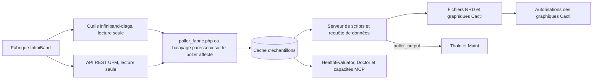

<!-- Source: README.md; SHA256: 79a16fb906f96ee79de2c719f18c38836f555440a7571a4a5ba38c64bb5b099f -->

<!-- translations:start -->
[English](../../../README.md) | [简体中文](../zh-CN/README.md) | [हिन्दी](../hi-IN/README.md) | [Español (España)](../es-ES/README.md) | [Español (Latinoamérica)](../es-419/README.md) | [العربية (السعودية)](../ar-SA/README.md) | [Afrikaans](../af-ZA/README.md) | [አማርኛ](../am-ET/README.md) | [العربية (مصر)](../ar-EG/README.md) | [العربية (المغرب)](../ar-MA/README.md) | [Български](../bg-BG/README.md) | [বাংলা](../bn-BD/README.md) | [Bosanski](../bs-BA/README.md) | [Deutsch](../de-DE/README.md) | [Ελληνικά](../el-GR/README.md) | [فارسی](../fa-IR/README.md) | [Filipino](../fil-PH/README.md) | [Français](../fr-FR/README.md) | [Français (Maroc)](README.md) | [Français (Sénégal)](../fr-SN/README.md) | [Hausa](../ha-NG/README.md) | [עברית](../he-IL/README.md) | [Hrvatski](../hr-HR/README.md) | [Bahasa Indonesia](../id-ID/README.md) | [Igbo](../ig-NG/README.md) | [Italiano](../it-IT/README.md) | [日本語](../ja-JP/README.md) | [ქართული](../ka-GE/README.md) | [한국어](../ko-KR/README.md) | [Latviešu](../lv-LV/README.md) | [Malagasy](../mg-MG/README.md) | [मराठी](../mr-IN/README.md) | [Bahasa Melayu](../ms-MY/README.md) | [Nederlands](../nl-NL/README.md) | [Polski](../pl-PL/README.md) | [Português (Brasil)](../pt-BR/README.md) | [Português (Portugal)](../pt-PT/README.md) | [Русский](../ru-RU/README.md) | [Kinyarwanda](../rw-RW/README.md) | [Soomaali](../so-SO/README.md) | [Српски](../sr-RS/README.md) | [Svenska](../sv-SE/README.md) | [Kiswahili](../sw-KE/README.md) | [தமிழ்](../ta-IN/README.md) | [తెలుగు](../te-IN/README.md) | [ไทย](../th-TH/README.md) | [Türkçe](../tr-TR/README.md) | [Українська](../uk-UA/README.md) | [اردو](../ur-PK/README.md) | [Tiếng Việt](../vi-VN/README.md) | [isiXhosa](../xh-ZA/README.md) | [Yorùbá](../yo-NG/README.md) | [繁體中文](../zh-TW/README.md) | [isiZulu](../zu-ZA/README.md)
<!-- translations:end -->

# plugin_fabric

Un plugin Cacti 1.2 (`fabric`, version `0.1.0-dev`) qui intègre les compteurs de ports InfiniBand, la largeur et la vitesse des liens ainsi que les indicateurs de congestion dans Cacti en tant qu'équipements, sources de données et graphiques ordinaires. Un lien négocié à 1X au lieu de 4X apparaît ainsi sous forme de graphique et d'alerte Thold à côté de l'hôte qu'il dessert, dans le respect des autorisations de Cacti, avec prise en compte et inhibition par Maint.

> **Statut : en cours de développement, aucune version publiée pour le moment.** Cette branche implémente les fondations du plugin, les objets Cacti et les alertes, les balayages planifiés en arrière-plan par le poller, la réplication vers les collecteurs distants, un backend REST NVIDIA UFM en lecture seule avec coffre-fort chiffré d'identifiants, la gestion en CLI par Configuration-as-Code (CasC) ainsi que les hooks de l'écosystème Cacti (CasC, Doctor et MCP / Abilities API v2). Elle a été testée avec des outils simulés, des transports UFM synthétiques et le simulateur de fabrique `ibsim` (rdma-core 50.0), jamais sur une fabrique InfiniBand physique ni sur un serveur UFM en direct. Les vérifications nécessitant du matériel restent ouvertes dans [docs/research/](../../research/). Ce projet n'est pas affilié au projet Cacti.

## Ce qui est implémenté

- **Cycle de vie et schéma (v3)** : installation, mise à niveau idempotente, désinstallation (en conservant les tables du plugin par défaut) et garde-fou de version PHP 8.2 tout en gardant les points d'entrée analysables sous PHP 8.0.
- **Rôles d'accès et pages** : domaines `Fabric View` (`fabric.php`), `Fabric Operator` (`fabric_operator.php`) et `Fabric Admin` (`fabric_admin.php`, `fabric_health.php`), ainsi qu'un onglet de paramètres sous **Configuration > Settings > Fabrics**.
- **Backend de diagnostic en lecture seule (`diags`)** : exécution stricte par vecteur d'arguments de `perfquery`, `ibnetdiscover` et `iblinkinfo`, inventaire indexé par GUID avec détection des conflits d'identité et propositions de réassociation, évaluation de l'état des liens et balayages de compteurs par nœud.
- **Backend REST NVIDIA UFM en lecture seule (`ufm`) et coffre-fort chiffré** : client REST en liste blanche limité à GET (`/ufmRest/resources/ports`, `/ufmRest/resources/systems`, `/ufmRest/monitoring/session/0/data`, et leurs équivalents `/ufmRestV3/...` pour l'authentification par jeton) alimentant les mêmes tables d'inventaire, d'état des liens, d'échantillons et de santé que `diags`. Les identifiants (`token` ou `basic`) sont stockés chiffrés en AES-256-GCM dans `plugin_fabric_secret` à l'aide d'un fichier clé externe de 256 bits configuré par `fabric_vault_key_file`. Les fabriques UFM peuvent être définies via CasC (`cli/fabric.php`) ou les dépôts ; le formulaire d'administration web expose actuellement les champs `diags`.
- **Objets Cacti, Thold et Maint** : modèles d'équipement, de données et de graphique Cacti (`templates/fabric-templates.xml`), requête de données du serveur de scripts « Fabric Port » (`scripts/ss_fabric_ports.php`, `resource/script_server/fabric_ports.xml`), sources de données de compteurs `DERIVE` et sources de données d'état de lien et de débit `GAUGE` pour Thold, suivi des discontinuités et compteurs de base saturés signalés comme `U`. L'intégration Maint (`MaintMaintenance`) interroge `plugin_maint_check_cacti_host()` (avec repli sur le hook `is_device_in_maintenance`) afin que les nœuds en maintenance active soient comptés séparément et exclus des avertissements de santé liés aux balayages échoués et aux ports dégradés.
- **Balayages planifiés, partitionnement et collecteurs distants** : `poller_bottom` lance `poller_fabric.php` en arrière-plan pour les fabriques arrivées à échéance affectées au poller courant, en plus des balayages paresseux déclenchés par le serveur de scripts. `INFO` déclare `remote_collect:1, remote_poller:1`, `poller_fabric.php` prend en charge le partitionnement déterministe par GUID (`--shard=K/N`), et `replicate_out` réplique les lignes non secrètes de `plugin_fabric_fabric` vers les collecteurs distants (`poller_id >= 2`). Les entrées du coffre-fort (`plugin_fabric_secret`) et les fichiers clés externes ne sont jamais répliqués.
- **CLI CasC et hooks d'écosystème** : `cli/fabric.php` pour l'exportation YAML/XML, la validation, la planification des différences à blanc, l'application soumise à confirmation et le rapport de santé, ainsi que les hooks `casc_register_providers`, `doctor_register_checks` et `abilities_register`.

## Rôles d'accès

| Domaine | Accès |
| --- | --- |
| Fabric View | Supervision des vues d'inventaire et de ports (`fabric.php`). |
| Fabric Operator | Accès View, plus la page Opérations (`fabric_operator.php`) et les acquittements personnels de triage. |
| Fabric Admin | Accès Operator, plus la configuration, les actions d'administration (`fabric_admin.php`) et la page de santé (`fabric_health.php`). |

Après avoir copié les fichiers de mise à niveau, ouvrez la page Plugins en tant qu'administrateur pour enregistrer les nouveaux domaines et hooks. Attribuez explicitement le domaine Operator sous **Configuration > Users** ou aux groupes d'utilisateurs. Les mises à niveau conservent les identifiants et les droits existants des domaines View et Admin. L'accès Admin hérite de l'accès Operator, et l'accès Operator hérite de l'accès View à chaque requête ; cela n'ajoute pas de droits enregistrés aux utilisateurs ni aux groupes. Les paramètres du plugin exigent également l'accès Fabric Admin en plus de l'autorisation Settings de Cacti.

Les autorisations d'équipement Cacti limitent les lignes et les actions accessibles à chaque utilisateur ; les objets non associés requièrent un administrateur. Les identifiants, la configuration, l'association, la suppression et les autres modifications d'administration restent dans les pages d'administration ou la CLI. Les acquittements ne durent que le temps de la session de l'utilisateur courant, pendant une heure au maximum et uniquement tant que la même observation reste fraîche. Toute observation nouvelle ou modifiée les invalide. Ils ne marquent jamais une mesure en échec comme saine et n'inhibent jamais les alertes.

## Pourquoi

Un lien InfiniBand dégradé continue d'acheminer du trafic. Un lien 4X qui se renégocie en 1X laisse le port « active », et les graphiques d'interface SNMP de l'hôte semblent normaux, mais les tâches fortement couplées ralentissent. La preuve se trouve dans la fabrique : chaque port signale sa largeur et sa vitesse actives, activées et prises en charge, ainsi que ses compteurs d'erreurs et de congestion. Leur lecture nécessite les outils de diagnostic InfiniBand ou l'API d'un gestionnaire de fabrique. Exécutés manuellement, ils laissent trois lacunes :

- **Aucun historique.** `perfquery` et `iblinkinfo` affichent l'instant présent ; un lien qui s'est dégradé la semaine dernière reste donc invisible.
- **Aucun contexte d'équipement.** Les ports de la fabrique ne sont pas des objets Cacti ; un port ne peut donc pas être représenté en graphique à côté de l'hôte qu'il alimente.
- **Aucun lien vers les alertes Cacti.** Thold et Maint fonctionnent sur des sources de données et des équipements Cacti.

Le plugin comble ces lacunes en lisant la fabrique via `infiniband-diags` ou l'API REST NVIDIA UFM, en identifiant les nœuds et les ports par GUID, et en publiant les compteurs et l'état des liens sous forme de sources de données Cacti. Il fonctionne uniquement en lecture seule : il ne réinitialise jamais les compteurs et ne modifie jamais l'état d'un port.

## Opérations et CLI

### Poller en arrière-plan et balayages manuels

`fabric_poller_bottom()` lance `poller_fabric.php` en arrière-plan sur chaque poller pour les fabriques activées affectées à ce `poller_id` dont le balayage est dû. Vous pouvez également exécuter le lanceur du poller ou un balayage manuel directement sur le poller affecté sous le compte du poller (en remplaçant `/path/to/cacti` par votre répertoire Cacti) :

```sh
php /path/to/cacti/plugins/fabric/poller_fabric.php [--fabric=ID] [--shard=K/N] [--force] [--debug]
php /path/to/cacti/plugins/fabric/fabric_sweep.php --fabric=ID [--node=GUID] [--force]
```

- `poller_fabric.php` exécute toutes les fabriques échues pour le poller local (ou une seule fabrique avec `--fabric=ID`), applique le verrou du registre de processus de Cacti et les baux `ClaimRepository` avec un budget temps de `max(30, intdiv(sweep_interval, 2))` secondes, et prend en charge `--shard=K/N` (`0 <= K < N`) pour partitionner de façon déterministe les balayages de compteurs par nœud `diags` selon le GUID du nœud.
- `fabric_sweep.php` exécute un balayage à la demande d'une fabrique activée (ou d'un nœud avec `--node=GUID`) affectée au poller local. `--force` ignore si la fabrique est échue tout en continuant à respecter les prises en charge.

Une fois que la première découverte a rempli l'inventaire, associez les nœuds aux équipements Cacti sur la page Fabric Admin. Maintenez le délai d'expiration des scripts Cacti à 25 secondes ou plus : un balayage paresseux déclenché par une lecture de requête de données limite l'exécution de l'outil à `script_timeout - 5` secondes afin que le serveur de scripts réponde à temps avec le dernier échantillon stocké ou `U`.

### Backend REST NVIDIA UFM et coffre-fort d'identifiants

Une fabrique `ufm` requiert une URL `https://` sans identifiants intégrés, ni chaînes de requête, ni fragments. `UfmSocketTransport` applique la vérification TLS du pair et du nom d'hôte, rejette les redirections et prend en charge un ensemble de certificats CA facultatif (`ufm_ca_file`) ainsi qu'une empreinte SHA-256 SPKI (`ufm_spki_pin`).

Pour stocker les identifiants UFM dans `plugin_fabric_secret`, configurez `fabric_vault_key_file` sous **Configuration > Settings > Fabrics** avec un chemin absolu vers un fichier ordinaire appartenant à l'utilisateur du poller (sans lien symbolique dans aucun répertoire parent, en mode `0600`, contenant 64 caractères hexadécimaux tels que `openssl rand -hex 32` ou 32 octets aléatoires non imprimables). Le plugin ne crée ni n'écrit jamais le fichier clé, et `replicate_out` ne réplique jamais `plugin_fabric_secret` ni les fichiers clés vers les pollers distants.

### Configuration-as-Code et CLI de santé

`cli/fabric.php` gère les paramètres du plugin et les définitions de fabrique de façon déclarative en YAML ou en XML, et rapporte la santé en tenant compte de la maintenance sans exécuter de balayages en direct :

```sh
php /path/to/cacti/plugins/fabric/cli/fabric.php export [--format=yaml|xml] [--file=PATH]
php /path/to/cacti/plugins/fabric/cli/fabric.php validate --file=PATH [--format=yaml|xml]
php /path/to/cacti/plugins/fabric/cli/fabric.php plan --file=PATH [--format=yaml|xml]
php /path/to/cacti/plugins/fabric/cli/fabric.php apply --file=PATH --confirm=PLAN_HASH [--format=yaml|xml]
php /path/to/cacti/plugins/fabric/cli/fabric.php health [--format=text|json]
```

`export` crée les nouveaux fichiers en mode `0600`, masque `fabric_vault_key_file` en tant que `[REDACTED]` et émet des références nommées `ufm_credential_ref` plutôt que des secrets. `plan` et `apply` rejettent les valeurs en ligne `ufm_token`, `ufm_password`, `secret` et `fabric_vault_key_file`. `apply` exige le `--confirm=PLAN_HASH` exact produit par `plan`.

### Hooks d'écosystème

Lorsque les plugins Cacti correspondants ou les intégrations hôtes sont présents, `setup.php` enregistre :

- `casc_register_providers` : exporte, valide, planifie et applique sur confirmation la configuration `fabric` (`yaml` et `xml`, schéma v1) avec masquage des secrets.
- `doctor_register_checks` : fournit quatre vérifications de diagnostic en lecture seule (`fabric.schema`, `fabric.poller_freshness`, `fabric.identity_conflicts`, `fabric.ufm_vault`).
- `abilities_register` : enregistre trois capacités en lecture seule, non destructives et idempotentes dans la catégorie `fabric`, contrôlées par le domaine Fabric View (et les autorisations d'équipement Cacti pour les erreurs de port) : `fabric-list-fabrics`, `fabric-get-health` et `fabric-list-port-errors`.

## Périmètre et limites

Hors périmètre : modification de l'état de la fabrique, réinitialisation des compteurs, remplacement d'un gestionnaire de fabrique ou d'un gestionnaire de sous-réseau, moteur d'alertes propre au plugin, démon ou protocole réseau personnalisé, et fabriques Ethernet ou RoCE.

## Exigences et compatibilité

| Composant | Cible |
|---|---|
| Cacti | 1.2.31 ou version ultérieure (`compat = 1.2.31`), sans correctif du cœur |
| PHP | 8.2 ou version ultérieure ; les points d'entrée restent analysables sous 8.0 et refusent l'activation sous 8.1 afin qu'un environnement d'exécution non pris en charge reçoive un refus plutôt qu'une interface Cacti cassée |
| Outils InfiniBand | `infiniband-diags` issu de `rdma-core` (testé en CI avec rdma-core 50.0 sous `ibsim` ; formats de sortie vérifiés par rapport aux sources de la version v66.0) |
| UFM | API REST NVIDIA UFM Enterprise (points de terminaison en lecture seule `ufmRest` et `ufmRestV3` ; testés avec des transports synthétiques dans les tests unitaires) |
| Thold, Maint | Aucune modification requise ; la CI exécute un test de bout en bout avec Thold v1.8.2 et Maint v1.3 non modifiés |

## Développement et tests

Le workflow CI (`.github/workflows/plugin-ci-workflow.yml`) teste PHP 8.2 à 8.5 par rapport à Cacti `release/1.2.31` et `1.2.x`, l'analyse syntaxique des points d'entrée PHP 8.0, le refus PHP 8.1, PHPStan, la vérification gettext/traductions, la gestion de licence REUSE, l'analyse des workflows, la relecture de bout en bout Thold/Maint et la simulation de fabrique `ibsim`.

Avec le harnais de plugin Pest partagé et verrouillé de Cacti (`CACTI_PEST_BIN`) et une base de données Cacti jetable :

```sh
# Unit tests
"$CACTI_PEST_BIN" --configuration=phpunit.xml

# Lifecycle integration tests (disposable database only)
CACTI_PATH=/path/to/cacti FABRIC_TEST_DATABASE=disposable "$CACTI_PEST_BIN" --configuration=phpunit-integration.xml

# Static analysis (against Cacti 1.2.31)
CACTI_PATH=/path/to/cacti phpstan analyse -c phpstan.neon --no-progress

# Translation template, catalogs, and localized README checks
sh locales/build_gettext.sh --check

# Simulated ibsim fixture parser check
php tests/bin/check-ibsim-fixtures.php tests/fixtures/ibsim
```

## Conception

- [docs/PLAN.md](../../PLAN.md) constitue le plan d'architecture et de conception : faits en amont avec sources, vérifications matérielles ouvertes, modèle d'identité, règles des compteurs et d'état des liens, frontières de sécurité, calculs de performance, tests et risques.
- [docs/decisions/](../../decisions/) contient les comptes rendus de décisions d'architecture.
- [docs/REQUIREMENTS.md](../../REQUIREMENTS.md) associe chaque identifiant d'exigence à son ticket.



## Suivi des travaux

- **Jalons** : suivent les jalons du plan. Chacun dispose d'un ticket épique listant ses sous-tickets et les preuves de sortie.
- **Tickets** : typés par étiquette : `type: requirement`, `type: research`, `type: decision`, `type: epic`. Les tickets d'exigence énoncent des exigences numérotées et testables (`REQ-AREA-NNN`) ainsi que des critères d'acceptation.
- **Étiquettes** : portent également `area:`, `phase:`, `priority:` et `status:`. Consultez [CONTRIBUTING.md](../../../CONTRIBUTING.md#labels).
- Le [tableau de projet](https://github.com/users/somethingwithproof/projects/8) présente l'ensemble des tickets à travers les jalons.

## Contribution

Consultez [CONTRIBUTING.md](../../../CONTRIBUTING.md). Les commits nécessitent une signature DCO (`git commit -s`). Les discussions de conception ont lieu sur les tickets ; les décisions ouvertes portent l'étiquette `type: decision`.

## Sécurité

Signalez les vulnérabilités en privé ; consultez [SECURITY.md](../../../SECURITY.md).

## Licence

Licence publique générale GNU version 2.0 (GNU General Public License v2.0), la même licence que Cacti et ses plugins. Consultez [LICENSE](../../../LICENSE).
