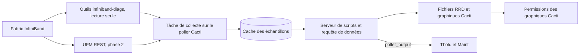

<!-- Source: README.md; SHA256: ce5af61a1bc993ec2aae6d4f22c3885694632f2b1d5eb94e2ce88b8390e96f1e -->

<!-- translations:start -->
[English](../../../README.md) | [简体中文](../zh-CN/README.md) | [हिन्दी](../hi-IN/README.md) | [Español (España)](../es-ES/README.md) | [Español (Latinoamérica)](../es-419/README.md) | [العربية (السعودية)](../ar-SA/README.md) | [Afrikaans](../af-ZA/README.md) | [አማርኛ](../am-ET/README.md) | [العربية (مصر)](../ar-EG/README.md) | [العربية (المغرب)](../ar-MA/README.md) | [বাংলা](../bn-BD/README.md) | [Bosanski](../bs-BA/README.md) | [Deutsch](../de-DE/README.md) | [فارسی](../fa-IR/README.md) | [Filipino](../fil-PH/README.md) | [Français](../fr-FR/README.md) | [Français (Maroc)](../fr-MA/README.md) | [Français (Sénégal)](README.md) | [Hausa](../ha-NG/README.md) | [עברית](../he-IL/README.md) | [Hrvatski](../hr-HR/README.md) | [Bahasa Indonesia](../id-ID/README.md) | [Igbo](../ig-NG/README.md) | [Italiano](../it-IT/README.md) | [日本語](../ja-JP/README.md) | [한국어](../ko-KR/README.md) | [Malagasy](../mg-MG/README.md) | [मराठी](../mr-IN/README.md) | [Bahasa Melayu](../ms-MY/README.md) | [Nederlands](../nl-NL/README.md) | [Polski](../pl-PL/README.md) | [Português (Brasil)](../pt-BR/README.md) | [Русский](../ru-RU/README.md) | [Kinyarwanda](../rw-RW/README.md) | [Soomaali](../so-SO/README.md) | [Српски](../sr-RS/README.md) | [Svenska](../sv-SE/README.md) | [Kiswahili](../sw-KE/README.md) | [தமிழ்](../ta-IN/README.md) | [తెలుగు](../te-IN/README.md) | [ไทย](../th-TH/README.md) | [Türkçe](../tr-TR/README.md) | [Українська](../uk-UA/README.md) | [اردو](../ur-PK/README.md) | [Tiếng Việt](../vi-VN/README.md) | [isiXhosa](../xh-ZA/README.md) | [Yorùbá](../yo-NG/README.md) | [繁體中文](../zh-TW/README.md) | [isiZulu](../zu-ZA/README.md)
<!-- translations:end -->

# plugin_fabric

Un plugin pour Cacti 1.2 qui intègre les compteurs de ports InfiniBand, la largeur et la vitesse des liens ainsi que les indicateurs de congestion dans Cacti sous forme d'équipements, de sources de données et de graphiques standard. Un lien ayant négocié en 1X au lieu de 4X apparaît ainsi sous forme de graphique et d'alerte Thold à côté de l'hôte qu'il dessert, selon les permissions de Cacti, avec la possibilité pour Maint de le mettre en sourdine.

> **Statut : en cours de développement, aucune version publiée pour le moment.** Le jalon 2 (fondations) est fusionné sur `main`, et le jalon 3 (objets Cacti et alertes) est en cours de révision. Le jalon 1 a validé la conception par rapport à la documentation et au code source amont (PR #71) ; les résultats, accompagnés des sources, figurent dans [docs/research/](../../research). Le jalon 2 ajoute les fondations du plugin :
>
> - installation, mise à niveau, désinstallation et vérification de la version PHP 8.2
> - domaines d'accès View, Operator et Admin, ainsi que les paramètres
> - enregistrements de fabrics
> - interface d'exécution en lecture seule pour `perfquery`, `ibnetdiscover` et `iblinkinfo`
> - inventaire par GUID, avec gestion des conflits d'identité et propositions de réassociation
> - état des liens et cache de collecte des compteurs
> - pages d'inventaire, d'administration et d'état de santé
>
> Le jalon 3 ajoute les objets Cacti :
>
> - modèles d'équipement, de données et de graphique fournis au format XML Cacti, et la requête de données « Fabric Port »
> - association d'un nœud à un équipement Cacti, ou création d'un équipement après confirmation ([ADR 0010](../../decisions/0010-one-device-per-node.md))
> - sources de données de type compteur pour les graphiques, et sources de données GAUGE pour l'état des liens et les débits destinées à Thold ([ADR 0011](../../decisions/0011-derive-counters-and-gauge-alert-values.md))
> - gestion des discontinuités et lecture en tant que valeur inconnue des compteurs de base saturés ([ADR 0012](../../decisions/0012-saturated-basic-counters-read-as-unknown.md)), validité des compteurs et liens vers les graphiques sur la page du port, ainsi qu'un classement de la congestion
> - un test de bout en bout avec Thold v1.8.2 et Maint v1.3 non modifiés, et une tâche CI qui exécute les véritables outils de diagnostic sur un fabric simulé
>
> Un fabric ne peut être collecté que depuis le poller principal tant que les collecteurs de données distants ne sont pas pris en charge à la phase 3. Le plugin a été testé avec des outils simulés et le simulateur de fabric ibsim, jamais sur un véritable fabric InfiniBand. Les vérifications nécessitant un fabric réel restent ouvertes dans le tableau des contrôles en direct de chaque page de recherche. Ce projet n'est pas affilié au projet Cacti.

## Rôles d'accès

| Domaine | Accès |
| --- | --- |
| Fabric View | Pages de supervision existantes. |
| Fabric Operator | Supervision, plus la page Opérations et les acquittements personnels de triage. |
| Fabric Admin | Accès Operator, plus les actions de configuration et d'administration existantes. |

Après avoir copié les fichiers de mise à niveau, ouvrez la page des plugins en tant qu'administrateur pour enregistrer le nouveau domaine d'accès. Attribuez explicitement le domaine Operator dans **Configuration > Utilisateurs** ou au niveau des groupes d'utilisateurs. Les mises à niveau conservent les identifiants et les droits existants des domaines View et Admin. L'accès Admin hérite de l'accès Operator, et l'accès Operator hérite de l'accès View à chaque requête ; cela n'ajoute pas de droits enregistrés aux utilisateurs ni aux groupes. Les paramètres du plugin exigent également l'accès Fabric Admin en plus de la permission Settings de Cacti.

Les permissions d'équipement de Cacti continuent de restreindre les lignes et les actions disponibles pour chaque utilisateur ; les objets non associés requièrent un administrateur. Les identifiants, la configuration, l'association, la suppression et les autres modifications d'administration restent dans les pages d'administration. Les acquittements ne durent que pendant la session en cours de l'utilisateur, pour une durée maximale d'une heure et uniquement tant que la même observation reste récente. Toute observation nouvelle ou modifiée les invalide. Ils ne marquent jamais une mesure en échec comme saine et ne suppriment pas les alertes.

## Pourquoi ce plugin

Un lien InfiniBand dégradé continue de transporter du trafic. Un lien 4X qui renégocie en 1X laisse le port « actif », et les graphiques d'interface SNMP de l'hôte semblent normaux, mais les traitements fortement couplés ralentissent. La preuve se trouve dans le fabric : chaque port signale sa largeur et sa vitesse actives, activées et prises en charge, ainsi que des compteurs d'erreurs et de congestion. Leur lecture nécessite les outils de diagnostic InfiniBand ou l'API d'un gestionnaire de fabric. Exécutés manuellement, ils laissent trois lacunes :

- **Aucun historique.** `perfquery` et `iblinkinfo` affichent l'état instantané ; un lien dégradé la semaine précédente est donc invisible.
- **Aucun contexte d'équipement.** Les ports du fabric ne sont pas des objets Cacti ; un port ne peut donc pas être représenté graphiquement à côté de l'hôte qu'il alimente.
- **Aucun chemin vers les alertes Cacti.** Thold et Maint opèrent sur les sources de données et les équipements Cacti.

Le plugin comble ces lacunes en lisant le fabric via ses propres outils de diagnostic (et ultérieurement via UFM), en identifiant les nœuds et les ports par GUID, et en publiant les compteurs et l'état des liens en tant que sources de données Cacti. Il fonctionne exclusivement en lecture seule : il ne réinitialise jamais les compteurs et ne modifie jamais l'état des ports.

## Première découverte

Un nouveau fabric ne contient aucun nœud, et les collectes ne démarrent depuis le serveur de scripts que pour un nœud associé à un équipement Cacti. La première découverte constitue donc une étape manuelle. Après avoir enregistré un fabric activé, exécutez cette commande une fois sur le poller auquel le fabric est affecté, avec le compte du poller, en remplaçant `/path/to/cacti` par votre répertoire Cacti (le chemin absolu fonctionne également depuis cron) :

```
php /path/to/cacti/plugins/fabric/fabric_sweep.php --fabric=ID --force
```

L'inventaire se remplit alors. Associez les nœuds aux équipements Cacti sur la page Fabric Admin ; les collectes ultérieures démarreront depuis la requête de données. Tant qu'aucun nœud d'un fabric n'est associé, rien n'actualise son inventaire ; exécutez donc de nouveau la même commande, depuis cron si vous le souhaitez, pour enregistrer les nœuds ajoutés ou manquants. La page d'état de santé affiche cette commande pour tout fabric activé qui n'a pas encore été découvert ou qui ne possède aucun nœud associé.

## Périmètre prévu

| Phase | Périmètre | Jalons |
|---|---|---|
| 0, recherche | Matrice de versions, confirmation du comportement amont, comportement des compteurs sur matériel, modèle de privilèges, budget MAD, API UFM | [M1](https://github.com/somethingwithproof/plugin_fabric/milestone/1) |
| 1, observation | Inventaire par GUID, équipements Cacti, requête de données des ports, sources de données de compteurs et d'état des liens, alertes Thold, mise en sourdine Maint, page d'état de santé | [M2](https://github.com/somethingwithproof/plugin_fabric/milestone/2), [M3](https://github.com/somethingwithproof/plugin_fabric/milestone/3), [M4](https://github.com/somethingwithproof/plugin_fabric/milestone/4) |
| 2, UFM | Backend REST UFM en lecture seule, gestion des identifiants, continuité d'identité entre backends | [M5](https://github.com/somethingwithproof/plugin_fabric/milestone/5) |
| 3, distant | Collecteurs de données distants, réplication, actions `remote_agent`, collectes partitionnées pour les grands fabrics | [M6](https://github.com/somethingwithproof/plugin_fabric/milestone/6) |

Hors périmètre : modification de l'état du fabric, remplacement d'un gestionnaire de fabric ou d'un gestionnaire de sous-réseau, moteur d'alertes propre au plugin, démon ou protocole réseau personnalisé, et fabrics Ethernet ou RoCE (à l'étude).

## Objectifs de compatibilité

| Composant | Cible |
|---|---|
| Cacti | 1.2.31 ou version ultérieure, sans correctif du noyau |
| PHP | 8.2 ou version ultérieure ; `setup.php` reste analysable sous 8.0 afin qu'un environnement d'exécution non pris en charge reçoive un refus plutôt que de casser l'interface de Cacti |
| Outils InfiniBand | infiniband-diags issu de rdma-core ; formats de sortie vérifiés par rapport au code source de la v66.0 |
| UFM | API REST UFM Enterprise, phase 2 ; la matrice des versions est un livrable du jalon 1 |
| Thold, Maint | Aucune modification requise |

Conservez le délai d'expiration des scripts Cacti à sa valeur par défaut de 25 secondes ou plus. Une collecte déclenchée par une lecture de requête de données limite l'exécution des outils à ce délai moins cinq secondes, réservant ainsi du temps pour lire le cache et répondre. Lorsque ce budget est épuisé, la requête renvoie le dernier échantillon disponible ou la valeur inconnue ; le cycle suivant relance la collecte. Cette limite s'applique également au poller PHP. Un délai d'expiration de cinq secondes ou moins ne laisse aucun temps pour démarrer un outil.

## Conception

- [docs/PLAN.md](../../PLAN.md) constitue le plan complet : architecture, faits amont dont il dépend (avec sources) et hypothèses restant à confirmer, modèle d'identité, règles des compteurs et d'état des liens, limites de sécurité, calculs de performance, tests et risques.
- [docs/decisions/](../../decisions) contient les dossiers de décision d'architecture (ADR) relatifs aux choix déjà arrêtés.
- [docs/REQUIREMENTS.md](../../REQUIREMENTS.md) associe chaque identifiant d'exigence à son ticket.



## Suivi des travaux

- **Jalons** : ils suivent les jalons du plan. Chacun dispose d'un ticket épique énumérant ses sous-tickets et ses preuves de validation.
- **Tickets** : ils sont typés par étiquette : `type: requirement`, `type: research`, `type: decision`, `type: epic`. Les tickets d'exigence énoncent des exigences numérotées et testables (`REQ-AREA-NNN`) ainsi que des critères d'acceptation.
- **Étiquettes** : elles portent également les préfixes `area:`, `phase:`, `priority:` et `status:`. Consultez [CONTRIBUTING.md](../../../CONTRIBUTING.md#labels).
- Le [tableau de suivi du projet](https://github.com/users/somethingwithproof/projects/8) présente l'ensemble des tickets à travers les jalons.

## Contribution

Lisez [CONTRIBUTING.md](../../../CONTRIBUTING.md). Les commits nécessitent une signature DCO (`Signed-off-by`). Les discussions de conception ont lieu dans les tickets ; les décisions ouvertes portent l'étiquette `type: decision`.

## Sécurité

Signalez les vulnérabilités en privé ; consultez [SECURITY.md](../../../SECURITY.md).

## Licence

GNU General Public License v2.0, la même licence que Cacti et ses plugins. Consultez [LICENSE](../../../LICENSE).
