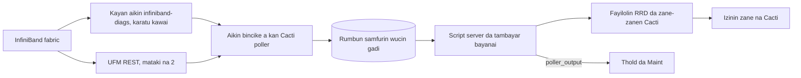

<!-- Source: README.md; SHA256: ce5af61a1bc993ec2aae6d4f22c3885694632f2b1d5eb94e2ce88b8390e96f1e -->

<!-- translations:start -->
[English](../../../README.md) | [简体中文](../zh-CN/README.md) | [हिन्दी](../hi-IN/README.md) | [Español (España)](../es-ES/README.md) | [Español (Latinoamérica)](../es-419/README.md) | [العربية (السعودية)](../ar-SA/README.md) | [Afrikaans](../af-ZA/README.md) | [አማርኛ](../am-ET/README.md) | [العربية (مصر)](../ar-EG/README.md) | [العربية (المغرب)](../ar-MA/README.md) | [বাংলা](../bn-BD/README.md) | [Deutsch](../de-DE/README.md) | [فارسی](../fa-IR/README.md) | [Filipino](../fil-PH/README.md) | [Français](../fr-FR/README.md) | [Français (Maroc)](../fr-MA/README.md) | [Français (Sénégal)](../fr-SN/README.md) | [Hausa](README.md) | [עברית](../he-IL/README.md) | [Bahasa Indonesia](../id-ID/README.md) | [Igbo](../ig-NG/README.md) | [Italiano](../it-IT/README.md) | [日本語](../ja-JP/README.md) | [한국어](../ko-KR/README.md) | [Malagasy](../mg-MG/README.md) | [मराठी](../mr-IN/README.md) | [Bahasa Melayu](../ms-MY/README.md) | [Nederlands](../nl-NL/README.md) | [Polski](../pl-PL/README.md) | [Português (Brasil)](../pt-BR/README.md) | [Русский](../ru-RU/README.md) | [Kinyarwanda](../rw-RW/README.md) | [Soomaali](../so-SO/README.md) | [Svenska](../sv-SE/README.md) | [Kiswahili](../sw-KE/README.md) | [தமிழ்](../ta-IN/README.md) | [తెలుగు](../te-IN/README.md) | [ไทย](../th-TH/README.md) | [Türkçe](../tr-TR/README.md) | [Українська](../uk-UA/README.md) | [اردو](../ur-PK/README.md) | [Tiếng Việt](../vi-VN/README.md) | [isiXhosa](../xh-ZA/README.md) | [Yorùbá](../yo-NG/README.md) | [繁體中文](../zh-TW/README.md) | [isiZulu](../zu-ZA/README.md)
<!-- translations:end -->

# plugin_fabric

Wani ƙarin manhaja (plugin) na Cacti 1.2 wanda ke kawo ma'aunin tashoshi (port counters) na InfiniBand, faɗi da gudun haɗi (link width and speed), da alamomin cunkoso cikin Cacti a matsayin na'urori na yau da kullun, tushen bayanai (data sources), da zane-zanen bayanai (graphs). Haɗin da ya yi horo a 1X maimakon 4X zai bayyana a matsayin zane da gargaɗin Thold kusa da uwar garken da yake yi wa aiki, ƙarƙashin izinin Cacti, tare da damar Maint na dakatar da shi.

> **Matsayi: ana kan haɓakawa, ba a sake shi ba tukuna.** An haɗa Milestone 2 (tushe) a kan `main`, kuma Milestone 3 (abubuwan Cacti da gargaɗi) yana cikin bitawa. Milestone 1 ya tabbatar da tsarin bisa ga takardu da lambar tushe ta sama (PR #71); sakamakon, tare da majiyoyi, suna cikin [docs/research/](../../research). Milestone 2 yana ƙara tushen plugin ɗin:
>
> - shigarwa, haɓakawa, cirewa, da kariyar PHP 8.2
> - ɓangarorin View, Operator da Admin, da saituna
> - bayanan fabric
> - iyakar umarni na karatu kawai don `perfquery`, `ibnetdiscover`, da `iblinkinfo`
> - lissafin kayayyaki ta GUID, tare da rikicin ainihi da shawarwarin sake haɗawa
> - yanayin haɗi da rumbun ajiyar wucin gadi na zagayen ma'auni (counter sweep cache)
> - shafukan lissafi, gudanarwa, da lafiya
>
> Milestone 3 yana ƙara abubuwan Cacti:
>
> - samfuran na'ura, bayanai, da zane da aka haɗa a matsayin Cacti template XML, da tambayar bayanai (data query) ta "Fabric Port"
> - haɗa node zuwa na'urar Cacti, ko ƙirƙirar guda ɗaya idan an tabbatar ([ADR 0010](../../decisions/0010-one-device-per-node.md))
> - tushen bayanai na ma'auni don zane-zane, da tushen bayanai na yanayin haɗi na GAUGE da ƙima don Thold ([ADR 0011](../../decisions/0011-derive-counters-and-gauge-alert-values.md))
> - sarrafa katsewa da cikakkun ma'auni na asali da ake karantawa a matsayin waɗanda ba a sani ba ([ADR 0012](../../decisions/0012-saturated-basic-counters-read-as-unknown.md)), ingancin ma'auni da hanyoyin zane a shafin tashar, da jerin matsayin cunkoso
> - gwaji na ƙarshe-zuwa-ƙarshe tare da Thold v1.8.2 da Maint v1.3 da ba a canza su ba, da aikin CI da ke gudanar da kayan aikin bincike na gaske a kan kwaikwayon fabric
>
> Ana iya bincikar fabric ne kawai daga babban poller har sai an tallafa wa masu tattara bayanai na nesa (remote data collectors) a mataki na 3. An gwada shi da kayan aikin kwaikwayo da na'urar kwaikwayo ta ibsim fabric simulator, ba a taɓa gwada shi a kan InfiniBand fabric na gaske ba. Binciken da ke buƙatar fabric ya kasance a buɗe a teburin binciken kai-tsaye na kowane shafin bincike. Wannan aikin ba shi da alaƙa da aikin Cacti.

## Matsayin shiga

| Ɓangare | Dama |
| --- | --- |
| Fabric View | Shafukan sa ido da ke akwai. |
| Fabric Operator | Sa ido tare da shafin Operations da amincewar binciken kai na mutum ɗaya. |
| Fabric Admin | Damar Operator tare da saituna da ayyukan gudanarwa da ke akwai. |

Bayan kwafin fayilolin haɓakawa, buɗe shafin Plugins a matsayin mai gudanarwa (administrator) don yin rijistar sabon ɓangaren (realm). Sanya ɓangaren Operator a fili ƙarƙashin **Configuration > Users** ko rukunin masu amfani.
Haɓakawa yana riƙe lambobin ID da izinin View da Admin da ke akwai. Damar Admin
tana gadar damar Operator, kuma damar Operator tana gadar damar View a kan kowace buƙata;
wannan ba ya ƙara izini na dindindin ga masu amfani ko rukunoni. Saitunan plugin kuma suna buƙatar
damar Fabric Admin ƙari ga izinin Settings na Cacti.

Izinin na'urar Cacti har yanzu suna iyakance layuka da ayyukan da kowane mai amfani zai iya gani; abubuwan da ba a haɗa su ba suna buƙatar mai gudanarwa.
Bayanan sirri, saituna, haɗawa, gogewa da sauran sauye-sauyen gudanarwa
suna ci gaba da zama a shafukan gudanarwa. Amincewa (acknowledgments) tana aiki ne kawai a zaman
mai amfani na yanzu, na tsawon awa ɗaya a mafi yawa kuma kawai yayin da wannan lura ta kasance
sabuwa. Sabbin abubuwan lura ko waɗanda suka canza suna soke su. Ba sa taɓa nuna ma'aunin da ya gaza
a matsayin mai lafiya ko dakatar da gargaɗi.

## Dalili

Haɗin InfiniBand da ya raunana har yanzu yana wucewa da zirga-zirgar bayanai. Haɗin 4X da ya sake horo a 1X yana barin tashar a matsayin "active", kuma zane-zanen SNMP na uwar garken suna da kyau, amma ayyukan da ke haɗe sosai suna jinkiri. Shaidar tana cikin fabric ɗin: kowace tasha tana ba da rahoton faɗi da gudu masu aiki, waɗanda aka kunna, da waɗanda ake tallafawa, tare da ma'aunin kuskure da cunkoso. Karanta shi yana ɗaukar kayan aikin bincike na InfiniBand ko API na mai sarrafa fabric. Gudanar da su da hannu yana barin giɓi uku:

- **Babu tarihi.** `perfquery` da `iblinkinfo` suna nuna halin yanzu, don haka haɗin da ya raunana a makon da ya gabata ba a ganin sa.
- **Babu mahallin na'ura.** Tashoshin fabric ba abubuwan Cacti ba ne, don haka ba za a iya zana tasha kusa da uwar garken da take ciyarwa ba.
- **Babu hanya zuwa gargaɗin Cacti.** Thold da Maint suna aiki ne a kan tushen bayanai da na'urorin Cacti.

Plugin ɗin yana cike waɗannan giɓin ta hanyar karanta fabric ta kayan aikin bincike nasa (kuma daga baya ta hanyar UFM), gano nodes da tashoshi ta GUID, da buga ma'auni da yanayin haɗi a matsayin tushen bayanai na Cacti. Karatu kawai yake yi: ba ya taɓa sake saita ma'auni ko canza yanayin tasha.

## Binciken farko

Sabon fabric ba shi da nodes, kuma bincike yana farawa daga script server ne kawai don node da aka haɗa da na'urar Cacti. Saboda haka binciken farko mataki ne na hannu. Bayan adana fabric da aka kunna, gudanar da wannan sau ɗaya a kan poller ɗin da aka sanya wa fabric ɗin, a matsayin asusun poller ɗin, tare da maye gurbin `/path/to/cacti` da kundin adireshin Cacti naka (cikakken hanyar kuma tana aiki daga cron):

```
php /path/to/cacti/plugins/fabric/fabric_sweep.php --fabric=ID --force
```

Bayan haka jerin kayayyaki zai cika. Haɗa nodes zuwa na'urorin Cacti a shafin Fabric Admin; bincike na gaba yana farawa daga tambayar bayanai (data query). Yayin da babu wani node na fabric da aka haɗa, babu abin da ke sabunta lissafin kayayyakinsa, don haka sake gudanar da wannan umarnin, daga cron idan kana so, don yin rijistar sabbin nodes ko waɗanda suka ɓace. Shafin lafiya yana nuna wannan umarnin don fabric da aka kunna wanda ba a gano shi ba tukuna ko ba shi da node da aka haɗa.

## Iyakar da aka tsara

| Mataki | Iyaka | Milestones |
|---|---|---|
| 0, bincike | Jerin sigogi, tabbatar da halayen sama, halayen ma'auni a kan kayan aiki, tsarin izini, kasafin MAD, UFM API | [M1](https://github.com/somethingwithproof/plugin_fabric/milestone/1) |
| 1, lura | Lissafi ta GUID, na'urorin Cacti, tambayar bayanai ta tasha, tushen bayanai na ma'auni da yanayin haɗi, gargaɗin Thold, dakatarwar Maint, shafin lafiya | [M2](https://github.com/somethingwithproof/plugin_fabric/milestone/2), [M3](https://github.com/somethingwithproof/plugin_fabric/milestone/3), [M4](https://github.com/somethingwithproof/plugin_fabric/milestone/4) |
| 2, UFM | UFM REST backend na karatu kawai, sarrafa bayanan sirri, ci gaban ainihi tsakanin backends | [M5](https://github.com/somethingwithproof/plugin_fabric/milestone/5) |
| 3, na nesa | Masu tattara bayanai na nesa, kwaikwayo (replication), ayyukan `remote_agent`, rarraba bincike don manyan fabrics | [M6](https://github.com/somethingwithproof/plugin_fabric/milestone/6) |

Abubuwan da ba sa cikin iyaka: canza yanayin fabric, maye gurbin mai sarrafa fabric ko mai sarrafa subnet, injin gargaɗi na plugin ɗin kawai, daemon na musamman ko ka'idar hanyar sadarwa, da Ethernet ko RoCE fabrics (bincike).

## Maƙasudin dacewa

| Bangare | Maƙasudi |
|---|---|
| Cacti | 1.2.31 ko sabo, babu gyare-gyaren core |
| PHP | 8.2 ko sabo; `setup.php` yana ci gaba da kasancewa mai karantuwa a kan 8.0 don yanayin da ba a tallafawa ba ya sami ƙi maimakon karyayyen Cacti UI |
| Kayan aikin InfiniBand | infiniband-diags daga rdma-core; an duba tsarin fitarwa a kan tushen v66.0 |
| UFM | UFM Enterprise REST API, mataki na 2; jerin fitarwa aiki ne na milestone 1 |
| Thold, Maint | Ba a buƙatar canje-canje |

Rike lokacin ƙarewa na rubutun Cacti (script timeout) a tsohon sa na daƙiƙa 25 ko fiye. Binciken da karanta tambayar bayanai (data-query) ya fara yana iyakance aiwatar da kayan aiki zuwa wannan lokacin ƙarewa ragi daƙiƙa biyar, yana adana lokaci don karanta cache da amsawa. Lokacin da kasafin lokaci ya ƙare, tambayar tana ba da samfurin yanzu na ƙarshe ko abin da ba a sani ba; zagaye na gaba yana sake gwada binciken. Wannan iyaka kuma tana aiki ga PHP poller. Lokacin ƙarewa na daƙiƙa biyar ko ƙasa da haka ba ya barin lokaci don fara kayan aiki.

## Zane

- [docs/PLAN.md](../../PLAN.md) shine cikakken shirin: tsari, gaskiyar sama da ya dogara da ita (tare da majiyoyi) da zato da har yanzu za a tabbatar, tsarin ainihi, dokokin ma'auni da yanayin haɗi, iyakokin tsaro, lissafin aiki, gwaji, da haɗari.
- [docs/decisions/](../../decisions) yana riƙe da bayanan yanke shawara na tsari don zaɓuɓɓukan da aka riga aka yi.
- [docs/REQUIREMENTS.md](../../REQUIREMENTS.md) yana haɗa kowane ID na buƙata zuwa batunsa (issue).



## Yadda ake bin diddigin aiki

- **Milestones** suna bin milestones na shirin. Kowane yana da babban batu (epic issue) da ke jera ƙananan batutuwa da shaidar fita.
- **Issues** ana rarraba su da lakabi: `type: requirement`, `type: research`, `type: decision`, `type: epic`. Batutuwan buƙatu suna bayyana buƙatu masu lamba, masu gwaji (`REQ-AREA-NNN`) da ƙa'idodin karɓa.
- **Lakabi (Labels)** kuma suna ɗauke da `area:`, `phase:`, `priority:`, da `status:`. Duba [CONTRIBUTING.md](../../../CONTRIBUTING.md#labels).
- [Allon aiki (project board)](https://github.com/users/somethingwithproof/projects/8) yana nuna duk batutuwa a duk milestones.

## Ba da gudummawa

Karanta [CONTRIBUTING.md](../../../CONTRIBUTING.md). Ayyukan commit suna buƙatar sa hannu na DCO (DCO sign-off). Tattaunawar tsari tana faruwa a kan batutuwa (issues); yanke shawara a buɗe suna ɗauke da lakabin `type: decision`.

## Tsaro

Bayar da rahoton raunin tsaro a keɓe; duba [SECURITY.md](../../../SECURITY.md).

## Lasisi

GNU General Public License v2.0, iri ɗaya da lasisin Cacti da ƙarin manhajojinsa. Duba [LICENSE](../../../LICENSE).
