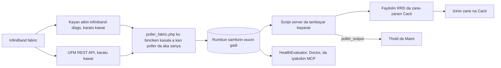

<!-- Source: README.md; SHA256: 79a16fb906f96ee79de2c719f18c38836f555440a7571a4a5ba38c64bb5b099f -->

<!-- translations:start -->
[English](../../../README.md) | [简体中文](../zh-CN/README.md) | [हिन्दी](../hi-IN/README.md) | [Español (España)](../es-ES/README.md) | [Español (Latinoamérica)](../es-419/README.md) | [العربية (السعودية)](../ar-SA/README.md) | [Afrikaans](../af-ZA/README.md) | [አማርኛ](../am-ET/README.md) | [العربية (مصر)](../ar-EG/README.md) | [العربية (المغرب)](../ar-MA/README.md) | [বাংলা](../bn-BD/README.md) | [Bosanski](../bs-BA/README.md) | [Deutsch](../de-DE/README.md) | [فارسی](../fa-IR/README.md) | [Filipino](../fil-PH/README.md) | [Français](../fr-FR/README.md) | [Français (Maroc)](../fr-MA/README.md) | [Français (Sénégal)](../fr-SN/README.md) | [Hausa](README.md) | [עברית](../he-IL/README.md) | [Hrvatski](../hr-HR/README.md) | [Bahasa Indonesia](../id-ID/README.md) | [Igbo](../ig-NG/README.md) | [Italiano](../it-IT/README.md) | [日本語](../ja-JP/README.md) | [한국어](../ko-KR/README.md) | [Malagasy](../mg-MG/README.md) | [मराठी](../mr-IN/README.md) | [Bahasa Melayu](../ms-MY/README.md) | [Nederlands](../nl-NL/README.md) | [Polski](../pl-PL/README.md) | [Português (Brasil)](../pt-BR/README.md) | [Русский](../ru-RU/README.md) | [Kinyarwanda](../rw-RW/README.md) | [Soomaali](../so-SO/README.md) | [Српски](../sr-RS/README.md) | [Svenska](../sv-SE/README.md) | [Kiswahili](../sw-KE/README.md) | [தமிழ்](../ta-IN/README.md) | [తెలుగు](../te-IN/README.md) | [ไทย](../th-TH/README.md) | [Türkçe](../tr-TR/README.md) | [Українська](../uk-UA/README.md) | [اردو](../ur-PK/README.md) | [Tiếng Việt](../vi-VN/README.md) | [isiXhosa](../xh-ZA/README.md) | [Yorùbá](../yo-NG/README.md) | [繁體中文](../zh-TW/README.md) | [isiZulu](../zu-ZA/README.md)
<!-- translations:end -->

# plugin_fabric

Wani ƙarin manhaja (plugin) na Cacti 1.2 (`fabric`, sigar `0.1.0-dev`) wanda ke kawo ma'aunin tashoshi na InfiniBand, faɗi da gudun haɗi, da alamomin cunkoso cikin Cacti a matsayin na'urori na yau da kullun, tushen bayanai, da zane-zanen bayanai. Haɗin da ya yi horo a 1X maimakon 4X zai bayyana a matsayin zane da gargaɗin Thold kusa da uwar garken da yake yi wa aiki, ƙarƙashin izinin Cacti, tare da sanin yanayin Maint da dakatar da gargaɗi.

> **Matsayi: ana kan haɓakawa, ba a sake shi ba tukuna.** Wannan reshe yana aiwatar da tushen plugin ɗin, abubuwan Cacti da gargaɗi, zagayen binciken poller da aka tsara a baya, kwaikwayo zuwa masu tattara bayanai na nesa, NVIDIA UFM REST backend na karatu kawai tare da rumbun sirri mai rufaffiyar kariya, sarrafa Configuration-as-Code (CasC) ta CLI, da ƙugiyoyin yanayin Cacti (CasC, Doctor, da MCP / Abilities API v2). An gwada shi da kayan aikin kwaikwayo, hanyoyin sadarwar UFM na wucin gadi, da na'urar kwaikwayo ta `ibsim` fabric simulator (rdma-core 50.0), ba a taɓa gwada shi a kan InfiniBand fabric na gaske ko uwar garken UFM mai aiki kai tsaye ba. Binciken da ke buƙatar kayan aiki na gaske ya kasance a buɗe a cikin [docs/research/](../../research/). Wannan aikin ba shi da alaƙa da aikin Cacti.

## Abubuwan da aka aiwatar

- **Zagayen rayuwa da tsarin bayanai (v3)**: shigarwa, haɓakawa mai maimaituwa ba tare da matsala ba (idempotent), cirewa (tare da ajiye teburin plugin ta tsohuwa), da kariyar buƙatar PHP 8.2 yayin da ake barin wuraren shiga su kasance masu karantuwa a PHP 8.0.
- **Matsayin shiga da shafuka**: ɓangarorin `Fabric View` (`fabric.php`), `Fabric Operator` (`fabric_operator.php`), da `Fabric Admin` (`fabric_admin.php`, `fabric_health.php`), tare da shafin Saituna ƙarƙashin **Configuration > Settings > Fabrics**.
- **Backend na bincike na karatu kawai (`diags`)**: tsauraran aiwatar da jerin hujjoji na `perfquery`, `ibnetdiscover`, da `iblinkinfo`, lissafin kayayyaki mai mabuɗin GUID tare da gano rikicin ainihi da shawarwarin sake haɗawa, kimanta yanayin haɗi, da zagayen ma'auni ga kowane node.
- **NVIDIA UFM REST backend na karatu kawai (`ufm`) da rumbun sirri mai rufi**: abokin ciniki na REST da aka yarda wa GET kawai (`/ufmRest/resources/ports`, `/ufmRest/resources/systems`, `/ufmRest/monitoring/session/0/data`, da makamantansu na `/ufmRestV3/...` don tabbatar da alama) da ke ciyar da teburin lissafi, yanayin haɗi, samfuri, da lafiya iri ɗaya da `diags`. Ana adana bayanan sirri (`token` ko `basic`) a rufe da AES-256-GCM cikin `plugin_fabric_secret` ta amfani da fayil ɗin mabuɗi na waje mai bit 256 da `fabric_vault_key_file` ya saita. Ana iya ayyana UFM fabrics ta CasC (`cli/fabric.php`) ko ta rumbunan ajiya; fom ɗin gudanarwa na yanar gizo a halin yanzu yana nuna filayen `diags`.
- **Abubuwan Cacti, Thold, da Maint**: samfuran na'ura, bayanai, da zane na Cacti (`templates/fabric-templates.xml`), tambayar bayanai ta script-server "Fabric Port" (`scripts/ss_fabric_ports.php`, `resource/script_server/fabric_ports.xml`), tushen bayanai na ma'aunin `DERIVE` da tushen bayanai na yanayin haɗi/ƙima na `GAUGE` don Thold, bin diddigin katsewa, da cikakkun ma'auni na asali da ake bayar da rahotonsu a matsayin `U`. Haɗin Maint (`MaintMaintenance`) yana tambayar `plugin_maint_check_cacti_host()` (yana komawa ga ƙugiyar `is_device_in_maintenance` idan babu) domin a kirga nodes da ke cikin kulawa mai aiki daban kuma a cire su daga gargaɗin lafiya na binciken da ya gaza da tashar da ta raunana.
- **Binciken da aka tsara, rarrabawa (sharding), da masu tattara bayanai na nesa**: `poller_bottom` yana fara `poller_fabric.php` a baya don fabrics da lokacinsu ya yi da aka sanya wa poller na yanzu, tare da binciken kasala (lazy sweeps) da script server ya kunna. `INFO` yana bayyana `remote_collect:1, remote_poller:1`, `poller_fabric.php` yana goyan bayan rarrabawa tabbatacce ta GUID (`--shard=K/N`), kuma `replicate_out` yana kwaikwayon layukan `plugin_fabric_fabric` da ba na sirri ba zuwa masu tattara bayanai na nesa (`poller_id >= 2`). Ba a taɓa kwaikwayon bayanan rumbun sirri (`plugin_fabric_secret`) da fayilolin mabuɗi na waje ba.
- **CasC CLI da ƙugiyoyin yanayin aiki**: `cli/fabric.php` don fitar da YAML/XML, tantancewa, tsara bambancin gwaji (dry-run), aiwatarwa mai buƙatar tabbaci, da rahoton lafiya, tare da ƙugiyoyin `casc_register_providers`, `doctor_register_checks`, da `abilities_register`.

## Matsayin shiga

| Ɓangare | Dama |
| --- | --- |
| Fabric View | Sa ido kan ra'ayoyin lissafi da tashoshi (`fabric.php`). |
| Fabric Operator | Damar View tare da shafin Operations (`fabric_operator.php`) da amincewar binciken kai na mutum ɗaya. |
| Fabric Admin | Damar Operator tare da saituna, ayyukan gudanarwa (`fabric_admin.php`), da shafin lafiya (`fabric_health.php`). |

Bayan kwafin fayilolin haɓakawa, buɗe shafin Plugins a matsayin mai gudanarwa don yin rijistar sabbin ɓangarori da ƙugiyoyi. Sanya ɓangaren Operator a fili ƙarƙashin **Configuration > Users** ko rukunin masu amfani. Haɓakawa yana riƙe lambobin ID da izinin View da Admin da ke akwai. Damar Admin tana gadar damar Operator, kuma damar Operator tana gadar damar View a kan kowace buƙata; wannan ba ya ƙara izini na dindindin ga masu amfani ko rukunoni. Saitunan plugin kuma suna buƙatar damar Fabric Admin ƙari ga izinin Settings na Cacti.

Izinin na'urar Cacti suna iyakance layuka da ayyukan da kowane mai amfani zai iya samu; abubuwan da ba a haɗa su ba suna buƙatar mai gudanarwa. Bayanan sirri, saituna, haɗawa, gogewa, da sauran sauye-sauyen gudanarwa suna ci gaba da zama a shafukan gudanarwa ko CLI. Amincewa (acknowledgments) tana aiki ne kawai a zaman mai amfani na yanzu, na tsawon awa ɗaya a mafi yawa kuma kawai yayin da wannan lura ta kasance sabuwa. Sabbin abubuwan lura ko waɗanda suka canza suna soke su. Ba sa taɓa nuna ma'aunin da ya gaza a matsayin mai lafiya ko dakatar da gargaɗi.

## Dalili

Haɗin InfiniBand da ya raunana har yanzu yana wucewa da zirga-zirgar bayanai. Haɗin 4X da ya sake horo a 1X yana barin tashar a matsayin "active", kuma zane-zanen SNMP na uwar garken suna da kyau, amma ayyukan da ke haɗe sosai suna jinkiri. Shaidar tana cikin fabric ɗin: kowace tasha tana ba da rahoton faɗi da gudu masu aiki, waɗanda aka kunna, da waɗanda ake tallafawa, tare da ma'aunin kuskure da cunkoso. Karanta shi yana ɗaukar kayan aikin bincike na InfiniBand ko API na mai sarrafa fabric. Gudanar da su da hannu yana barin giɓi uku:

- **Babu tarihi.** `perfquery` da `iblinkinfo` suna nuna halin yanzu, don haka haɗin da ya raunana a makon da ya gabata ba a ganin sa.
- **Babu mahallin na'ura.** Tashoshin fabric ba abubuwan Cacti ba ne, don haka ba za a iya zana tasha kusa da uwar garken da take ciyarwa ba.
- **Babu hanya zuwa gargaɗin Cacti.** Thold da Maint suna aiki a kan tushen bayanai da na'urorin Cacti.

Plugin ɗin yana cike waɗannan giɓin ta hanyar karanta fabric ta `infiniband-diags` ko NVIDIA UFM REST API, gano nodes da tashoshi ta GUID, da buga ma'auni da yanayin haɗi a matsayin tushen bayanai na Cacti. Karatu kawai yake yi: ba ya taɓa sake saita ma'auni ko canza yanayin tasha.

## Ayyuka da CLI

### Poller na baya da binciken hannu

`fabric_poller_bottom()` yana fara `poller_fabric.php` a baya a kan kowane poller don fabrics da aka kunna da aka sanya wa wannan `poller_id` waɗanda lokacin bincikensu ya yi. Haka kuma kana iya gudanar da mai gudanar da poller ko binciken hannu kai tsaye a kan poller ɗin da aka sanya wa aikin a matsayin mai amfani na poller (tare da maye gurbin `/path/to/cacti` da kundin adireshin Cacti naka):

```sh
php /path/to/cacti/plugins/fabric/poller_fabric.php [--fabric=ID] [--shard=K/N] [--force] [--debug]
php /path/to/cacti/plugins/fabric/fabric_sweep.php --fabric=ID [--node=GUID] [--force]
```

- `poller_fabric.php` yana gudanar da duk fabrics da lokacinsu ya yi don poller na gida (ko fabric guda ɗaya da `--fabric=ID`), yana aiwatar da makullin rajistar tsari na Cacti da hayar `ClaimRepository` tare da kasafin lokaci na `max(30, intdiv(sweep_interval, 2))` daƙiƙa, kuma yana goyan bayan `--shard=K/N` (`0 <= K < N`) don rarraba binciken ma'aunin node na `diags` ta hanyar da ta dace bisa GUID na node.
- `fabric_sweep.php` yana gudanar da bincike na buƙata na fabric ɗaya da aka kunna (ko node guda ɗaya da `--node=GUID`) da aka sanya wa poller na gida. `--force` yana watsi da ko lokacin fabric ɗin ya yi yayin da yake ci gaba da mutunta hayar aiki (claims).

Bayan binciken farko ya cika lissafin kayayyaki, haɗa nodes zuwa na'urorin Cacti a shafin Fabric Admin. Rike lokacin ƙarewa na rubutun Cacti a daƙiƙa 25 ko fiye: binciken kasala da karanta tambayar bayanai ya fara yana iyakance aiwatar da kayan aiki zuwa `script_timeout - 5` daƙiƙa domin script server ya dawo a kan lokaci da samfurin ƙarshe da aka adana ko `U`.

### NVIDIA UFM REST backend da rumbun sirri

Fabric na `ufm` yana buƙatar URL na `https://` ba tare da bayanan sirri da aka saka ciki, jimlolin tambaya, ko gutsuttsura (fragments) ba. `UfmSocketTransport` yana tabbatar da abokin hulɗa da sunan uwar garke na TLS, yana ƙin tura kai (redirects), kuma yana goyan bayan tarin takaddun shaida na CA na zaɓi (`ufm_ca_file`) da alamar SHA-256 SPKI (`ufm_spki_pin`).

Don adana bayanan sirri na UFM a cikin `plugin_fabric_secret`, saita `fabric_vault_key_file` ƙarƙashin **Configuration > Settings > Fabrics** tare da cikakken hanya zuwa fayil na yau da kullun mallakar mai amfani na poller (babu symlinks a kowane kundin adireshi na sama, yanayin `0600`, mai ɗauke da haruffan hex 64 kamar `openssl rand -hex 32` ko bytes 32 bazuwar da ba sa buguwa). Plugin ɗin ba ya taɓa ƙirƙira ko rubuta fayil ɗin mabuɗi, kuma `replicate_out` ba ya taɓa kwaikwayon `plugin_fabric_secret` ko fayilolin mabuɗi zuwa pollers na nesa.

### Configuration-as-Code da CLI na lafiya

`cli/fabric.php` yana sarrafa saitunan plugin da bayanan fabric a tsarin YAML ko XML, kuma yana ba da rahoton lafiya mai la'akari da kulawa ba tare da gudanar da bincike kai tsaye ba:

```sh
php /path/to/cacti/plugins/fabric/cli/fabric.php export [--format=yaml|xml] [--file=PATH]
php /path/to/cacti/plugins/fabric/cli/fabric.php validate --file=PATH [--format=yaml|xml]
php /path/to/cacti/plugins/fabric/cli/fabric.php plan --file=PATH [--format=yaml|xml]
php /path/to/cacti/plugins/fabric/cli/fabric.php apply --file=PATH --confirm=PLAN_HASH [--format=yaml|xml]
php /path/to/cacti/plugins/fabric/cli/fabric.php health [--format=text|json]
```

`export` yana ƙirƙirar sabbin fayiloli da yanayin `0600`, yana rufe `fabric_vault_key_file` a matsayin `[REDACTED]`, kuma yana fitar da nassoshi masu suna `ufm_credential_ref` maimakon bayanan sirri. `plan` da `apply` suna ƙin ƙimar `ufm_token`, `ufm_password`, `secret`, da ƙimar `fabric_vault_key_file` da aka rubuta kai tsaye a ciki. `apply` yana buƙatar ainihin `--confirm=PLAN_HASH` da `plan` ya samar.

### Ƙugiyoyin yanayin aiki

Lokacin da ƙarin manhajojin Cacti da suka dace ko haɗin uwar garke suke akwai, `setup.php` yana yin rijistar:

- `casc_register_providers`: yana fitarwa, tantancewa, tsarawa, da aiwatarwa tare da tabbaci na saitin `fabric` (`yaml` da `xml`, tsarin v1) tare da rufe bayanan sirri.
- `doctor_register_checks`: yana ba da binciken ganowa guda huɗu na karatu kawai (`fabric.schema`, `fabric.poller_freshness`, `fabric.identity_conflicts`, `fabric.ufm_vault`).
- `abilities_register`: yana yin rijistar iyawa guda uku na karatu kawai, marasa lalacewa, masu maimaituwa ƙarƙashin rukunin `fabric`, waɗanda ɓangaren Fabric View (da izinin na'urar Cacti don kurakuran tasha) ke kiyayewa: `fabric-list-fabrics`, `fabric-get-health`, da `fabric-list-port-errors`.

## Iyaka da iyakoki

Abubuwan da ba sa cikin iyaka: canza yanayin fabric, sake saita ma'auni, maye gurbin mai sarrafa fabric ko mai sarrafa subnet, injin gargaɗi na plugin ɗin kawai, daemon na musamman ko ka'idar hanyar sadarwa, da Ethernet ko RoCE fabrics.

## Buƙatu da dacewa

| Bangare | Maƙasudi |
|---|---|
| Cacti | 1.2.31 ko sabo (`compat = 1.2.31`), babu gyare-gyaren core |
| PHP | 8.2 ko sabo; wuraren shiga suna ci gaba da kasancewa masu karantuwa a 8.0 kuma suna ƙin kunnawa a 8.1 domin yanayin da ba a tallafawa ba ya sami ƙi maimakon karyayyen Cacti UI |
| Kayan aikin InfiniBand | `infiniband-diags` daga `rdma-core` (an gwada a CI da rdma-core 50.0 ƙarƙashin `ibsim`; an duba tsarin fitarwa a kan tushen v66.0) |
| UFM | NVIDIA UFM Enterprise REST API (wuraren ƙarewa na karatu kawai `ufmRest` da `ufmRestV3`; an gwada da hanyoyin sadarwa na wucin gadi a gwaje-gwajen unit) |
| Thold, Maint | Ba a buƙatar canje-canje; CI tana gudanar da gwajin ƙarshe-zuwa-ƙarshe tare da Thold v1.8.2 da Maint v1.3 da ba a canza su ba |

## Haɓakawa da gwaji

Tsarin aikin CI (`.github/workflows/plugin-ci-workflow.yml`) yana gwada PHP 8.2 zuwa 8.5 a kan Cacti `release/1.2.31` da `1.2.x`, duba tsarin wuraren shiga na PHP 8.0, ƙin PHP 8.1, PHPStan, tabbatar da gettext/fassara, lasisin REUSE, duba tsarin aiki (workflow linting), sake kunna gwajin Thold/Maint na ƙarshe-zuwa-ƙarshe, da kwaikwayon fabric na `ibsim`.

Tare da kullellen kayan gwajin plugin na Pest na Cacti (`CACTI_PEST_BIN`) da rumbun bayanai na Cacti mai yuwuwar zubarwa:

```sh
# Unit tests
"$CACTI_PEST_BIN" --configuration=phpunit.xml

# Lifecycle integration tests (disposable database only)
CACTI_PATH=/path/to/cacti FABRIC_TEST_DATABASE=disposable "$CACTI_PEST_BIN" --configuration=phpunit-integration.xml

# Static analysis (against Cacti 1.2.31)
CACTI_PATH=/path/to/cacti phpstan analyse -c phpstan.neon --no-progress

# Translation template, catalogs, and localized README checks
sh locales/build_gettext.sh --check

# Simulated ibsim fixture parser check
php tests/bin/check-ibsim-fixtures.php tests/fixtures/ibsim
```

## Zane

- [docs/PLAN.md](../../PLAN.md) shine shirin tsari da zane: gaskiyar sama tare da majiyoyi, binciken kayan aiki da ke buɗe, tsarin ainihi, dokokin ma'auni da yanayin haɗi, iyakokin tsaro, lissafin aiki, gwaji, da haɗari.
- [docs/decisions/](../../decisions/) yana riƙe da bayanan yanke shawara na tsari.
- [docs/REQUIREMENTS.md](../../REQUIREMENTS.md) yana haɗa kowane ID na buƙata zuwa batunsa.



## Yadda ake bin diddigin aiki

- **Milestones** suna bin milestones na shirin. Kowane yana da babban batu (epic issue) da ke jera ƙananan batutuwa da shaidar fita.
- **Issues** ana rarraba su da lakabi: `type: requirement`, `type: research`, `type: decision`, `type: epic`. Batutuwan buƙatu suna bayyana buƙatu masu lamba, masu gwaji (`REQ-AREA-NNN`) da ƙa'idodin karɓa.
- **Lakabi (Labels)** kuma suna ɗauke da `area:`, `phase:`, `priority:`, da `status:`. Duba [CONTRIBUTING.md](../../../CONTRIBUTING.md#labels).
- [Allon aiki](https://github.com/users/somethingwithproof/projects/8) yana nuna duk batutuwa a duk milestones.

## Ba da gudummawa

Karanta [CONTRIBUTING.md](../../../CONTRIBUTING.md). Ayyukan commit suna buƙatar sa hannu na DCO (`git commit -s`). Tattaunawar tsari tana faruwa a kan batutuwa; yanke shawara a buɗe suna ɗauke da lakabin `type: decision`.

## Tsaro

Bayar da rahoton raunin tsaro a keɓe; duba [SECURITY.md](../../../SECURITY.md).

## Lasisi

GNU General Public License v2.0, iri ɗaya da lasisin Cacti da ƙarin manhajojinsa. Duba [LICENSE](../../../LICENSE).
