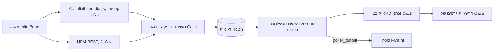

<!-- Source: README.md; SHA256: ce5af61a1bc993ec2aae6d4f22c3885694632f2b1d5eb94e2ce88b8390e96f1e -->

<!-- translations:start -->
[English](../../../README.md) | [简体中文](../zh-CN/README.md) | [हिन्दी](../hi-IN/README.md) | [Español (España)](../es-ES/README.md) | [Español (Latinoamérica)](../es-419/README.md) | [العربية (السعودية)](../ar-SA/README.md) | [Afrikaans](../af-ZA/README.md) | [አማርኛ](../am-ET/README.md) | [العربية (مصر)](../ar-EG/README.md) | [العربية (المغرب)](../ar-MA/README.md) | [বাংলা](../bn-BD/README.md) | [Bosanski](../bs-BA/README.md) | [Deutsch](../de-DE/README.md) | [فارسی](../fa-IR/README.md) | [Filipino](../fil-PH/README.md) | [Français](../fr-FR/README.md) | [Français (Maroc)](../fr-MA/README.md) | [Français (Sénégal)](../fr-SN/README.md) | [Hausa](../ha-NG/README.md) | [עברית](README.md) | [Hrvatski](../hr-HR/README.md) | [Bahasa Indonesia](../id-ID/README.md) | [Igbo](../ig-NG/README.md) | [Italiano](../it-IT/README.md) | [日本語](../ja-JP/README.md) | [한국어](../ko-KR/README.md) | [Malagasy](../mg-MG/README.md) | [मराठी](../mr-IN/README.md) | [Bahasa Melayu](../ms-MY/README.md) | [Nederlands](../nl-NL/README.md) | [Polski](../pl-PL/README.md) | [Português (Brasil)](../pt-BR/README.md) | [Русский](../ru-RU/README.md) | [Kinyarwanda](../rw-RW/README.md) | [Soomaali](../so-SO/README.md) | [Српски](../sr-RS/README.md) | [Svenska](../sv-SE/README.md) | [Kiswahili](../sw-KE/README.md) | [தமிழ்](../ta-IN/README.md) | [తెలుగు](../te-IN/README.md) | [ไทย](../th-TH/README.md) | [Türkçe](../tr-TR/README.md) | [Українська](../uk-UA/README.md) | [اردو](../ur-PK/README.md) | [Tiếng Việt](../vi-VN/README.md) | [isiXhosa](../xh-ZA/README.md) | [Yorùbá](../yo-NG/README.md) | [繁體中文](../zh-TW/README.md) | [isiZulu](../zu-ZA/README.md)
<!-- translations:end -->

# plugin_fabric

תוסף ל-Cacti 1.2 המביא מוני פורטים, רוחב ומהירות קישור ומחווני גודש של InfiniBand אל תוך Cacti כהתקנים, מקורות נתונים וגרפים רגילים. קישור שהתאמן ב-1X במקום ב-4X מופיע לאחר מכן כגרף וכהתראת Thold לצד המארח שהוא משרת, תחת ההרשאות של Cacti, כאשר Maint יכול לדכא אותה.

> **סטטוס: בפיתוח, טרם פורסמה גרסה.** אבן דרך 2 (תשתית) מוזגה ל-`main`, ואבן דרך 3 (אובייקטי Cacti והתראות) נמצאת בסקירה. אבן דרך 1 אימתה את התכנון מול התיעוד וקוד המקור במעלה הזרם (PR #71); התוצאות, בצירוף מקורות, נמצאות ב-[docs/research/](../../research). אבן דרך 2 מוסיפה את תשתית התוסף:
>
> - התקנה, שדרוג, הסרה ובדיקת התאמה ל-PHP 8.2
> - תחומי הרשאה מסוג View, Operator ו-Admin, והגדרות
> - רשומות מארג
> - גבול הפקודות לקריאה בלבד עבור `perfquery`, `ibnetdiscover` ו-`iblinkinfo`
> - מצאי לפי GUID, כולל התנגשויות זהות והצעות לקישור מחדש
> - מצב קישור ומטמון סריקת המונים
> - דפי מצאי, ניהול ותקינות
>
> אבן דרך 3 מוסיפה את אובייקטי Cacti:
>
> - תבניות התקנים, נתונים וגרפים המסופקות כ-XML של תבניות Cacti, ושאילתת הנתונים "Fabric Port"
> - מיפוי צומת להתקן Cacti, או יצירת התקן חדש לאחר אישור ([ADR 0010](../../decisions/0010-one-device-per-node.md))
> - מקורות נתונים של מונים עבור גרפים, ומקורות נתונים מסוג GAUGE של מצב קישור וקצב עבור Thold ([ADR 0011](../../decisions/0011-derive-counters-and-gauge-alert-values.md))
> - טיפול באי-רציפויות וקריאת מונים בסיסיים רוויים כ-unknown ([ADR 0012](../../decisions/0012-saturated-basic-counters-read-as-unknown.md)), תקינות מונים וקישורים לגרפים בדף הפורט, ודירוג גודש
> - בדיקה מקצה לקצה עם Thold v1.8.2 ו-Maint v1.3 ללא שינוי, ומשימת CI המריצה את כלי האבחון האמיתיים מול מארג מדומה
>
> ניתן לסרוק מארג רק מהדוגם הראשי עד שתתווסף תמיכה באוספי נתונים מרוחקים בשלב 3. התוסף נבדק מול כלים מדומים ומול מדמה המארג ibsim, ומעולם לא נבדק על מארג InfiniBand אמיתי. בדיקות הדורשות מארג אמיתי נותרות פתוחות בטבלת הבדיקות החיות שבכל דף מחקר. פרויקט זה אינו משויך לפרויקט Cacti.

## תפקידי גישה

| תחום הרשאה | גישה |
| --- | --- |
| Fabric View | דפי הניטור הקיימים. |
| Fabric Operator | ניטור, בנוסף לדף התפעול ולאישורי מיון ראשוני אישיים. |
| Fabric Admin | גישת Operator, בנוסף לפעולות התצורה והניהול הקיימות. |

לאחר העתקת קובצי השדרוג, פתחו את דף ה-Plugins כמנהלי מערכת כדי לרשום
את תחום ההרשאה החדש. הקצו את תחום ה-Operator במפורש תחת **Configuration > Users** או לקבוצות משתמשים.
שדרוגים שומרים על מזהי תחומי ההרשאה הקיימים של View ו-Admin ועל ההרשאות שניתנו להם. גישת Admin
יורשת את גישת Operator, וגישת Operator יורשת את גישת View בכל בקשה;
הדבר אינו מוסיף הרשאות שמורות למשתמשים או לקבוצות. הגדרות התוסף דורשות גם
גישת Fabric Admin בנוסף להרשאת Settings של Cacti.

הרשאות התקנים של Cacti עדיין מגבילות את השורות והפעולות הזמינות לכל משתמש; אובייקטים לא ממופים דורשים מנהל מערכת.
אישורי גישה, תצורה, מיפוי, מחיקה ושינויים ניהוליים אחרים
נותרים בדפי הניהול. אישורי מיון תקפים רק בהפעלה הנוכחית של
המשתמש, למשך שעה אחת לכל היותר ורק כל עוד אותה תצפית נותרת
עדכנית. תצפיות חדשות או שהשתנו מבטלות אותם. הם לעולם אינם מסמנים מדידה
שנכשלה כתקינה ואינם מדכאים התראות.

## מדוע

קישור InfiniBand פגום עדיין מעביר תעבורה. קישור 4X שעובר אימון מחדש ל-1X משאיר את הפורט במצב "active", וגרפי ממשק ה-SNMP של המארח נראים תקינים, אך משימות מצומדות היטב מואטות. הראיות נמצאות במארג: כל פורט מדווח על הרוחב והמהירות הפעילים, המאופשרים והנתמכים שלו, וכן על מוני שגיאות וגודש. קריאת מידע זה מצריכה את כלי האבחון של InfiniBand או ממשק API של מנהל מארג. הרצתם באופן ידני משאירה שלושה פערים:

- **ללא היסטוריה.** `perfquery` ו-`iblinkinfo` מציגים את המצב הנוכחי בלבד, כך שקישור שנפגע בשבוע שעבר אינו נראה.
- **ללא הקשר של התקן.** פורטים של המארג אינם אובייקטים של Cacti, ולכן לא ניתן להציג פורט בגרף לצד המארח שאותו הוא מזין.
- **ללא נתיב להתראות של Cacti.** Thold ו-Maint פועלים על מקורות נתונים והתקנים של Cacti.

התוסף סוגר פערים אלה על ידי קריאת המארג באמצעות כלי האבחון שלו (ובהמשך דרך UFM), זיהוי צמתים ופורטים לפי GUID, ופרסום מונים ומצב קישור כמקורות נתונים של Cacti. הוא מבצע קריאה בלבד: הוא לעולם אינו מאפס מונים ואינו משנה מצב פורט.

## גילוי ראשוני

למארג חדש אין צמתים, וסריקות מתחילות משרת הסקריפטים רק עבור צומת הממופה להתקן Cacti. לכן הגילוי הראשוני הוא שלב ידני. לאחר שמירת מארג מאופשר, הריצו פקודה זו פעם אחת בדוגם שאליו משויך המארג, תחת חשבון המשתמש של הדוגם, כאשר `/path/to/cacti` מוחלף בנתיב של תיקיית ה-Cacti שלכם (הנתיב המלא פועל גם מתוך cron):

```
php /path/to/cacti/plugins/fabric/fabric_sweep.php --fabric=ID --force
```

לאחר מכן המצאי מתמלא. מפו צמתים להתקני Cacti בדף Fabric Admin; סריקות עתידיות יתחילו מתוך שאילתת הנתונים. כל עוד אף צומת של מארג אינו ממופה, שום תהליך אינו מרענן את המצאי שלו, ולכן הריצו שוב את אותה פקודה, מתוך cron לפי הצורך, כדי לתעד צמתים חדשים או חסרים. דף התקינות מציג פקודה זו עבור מארג מאופשר שטרם התגלה או שאין לו צומת ממופה.

## היקף מתוכנן

| שלב | היקף | אבני דרך |
|---|---|---|
| 0, מחקר | מטריצת גרסאות, אימות התנהגות במעלה הזרם, התנהגות מונים על חומרה, מודל הרשאות, תקציב MAD, API של UFM | [M1](https://github.com/somethingwithproof/plugin_fabric/milestone/1) |
| 1, תצפית | מצאי לפי GUID, התקני Cacti, שאילתת נתוני פורט, מקורות נתונים של מונים ומצב קישור, התראות Thold, דיכוי Maint, דף תקינות | [M2](https://github.com/somethingwithproof/plugin_fabric/milestone/2), [M3](https://github.com/somethingwithproof/plugin_fabric/milestone/3), [M4](https://github.com/somethingwithproof/plugin_fabric/milestone/4) |
| 2, UFM | צד שרת REST של UFM לקריאה בלבד, ניהול אישורי גישה, רציפות זהות בין צדדי שרת | [M5](https://github.com/somethingwithproof/plugin_fabric/milestone/5) |
| 3, מרוחק | אוספי נתונים מרוחקים, שכפול, פעולות `remote_agent`, סריקות מבוזרות למארגים גדולים | [M6](https://github.com/somethingwithproof/plugin_fabric/milestone/6) |

מחוץ להיקף: שינוי מצב מארג, החלפת מנהל מארג או מנהל תת-רשת, מנוע התראות בבעלות התוסף, שירות רקע מותאם אישית או פרוטוקול רשת, ומארגי Ethernet או RoCE (מחקר).

## יעדי תאימות

| רכיב | יעד |
|---|---|
| Cacti | 1.2.31 ומעלה, ללא טלאי ליבה |
| PHP | 8.2 ומעלה; `setup.php` נשאר ניתן לפענוח ב-8.0 כדי שסביבת ריצה לא נתמכת תקבל הודעת סירוב במקום ממשק Cacti שבור |
| כלי InfiniBand | infiniband-diags מתוך rdma-core; תבניות הפלט נבדקו מול קוד המקור של v66.0 |
| UFM | UFM Enterprise REST API, שלב 2; מטריצת הגרסאות היא תוצר של אבן דרך 1 |
| Thold, Maint | אין צורך בשינויים |

שמרו על פסק הזמן של סקריפטים ב-Cacti בערך ברירת המחדל של 25 שניות ומעלה. סריקה המתחילה מקריאת שאילתת נתונים מגבילה את הרצת הכלי לפסק זמן זה פחות חמש שניות, כדי לשמור זמן לקריאת המטמון ולמתן תשובה. כאשר התקציב פוקע, השאילתה מחזירה את הדגימה העדכנית האחרונה או unknown; המחזור הבא מנסה לבצע את הסריקה מחדש. מגבלה זו חלה גם על הדוגם של PHP. פסק זמן של חמש שניות או פחות אינו משאיר זמן להפעלת כלי.

## תכנון

- [docs/PLAN.md](../../PLAN.md) היא התוכנית המלאה: ארכיטקטורה, עובדות במעלה הזרם שבהן היא תלויה (בצירוף מקורות) והנחות שעדיין יש לאמת, מודל זהות, כללי מונים ומצב קישור, גבולות אבטחה, חישובי ביצועים, בדיקות וסיכונים.
- [docs/decisions/](../../decisions) מכילה רשומות החלטות ארכיטקטורה עבור בחירות שכבר התקבלו.
- [docs/REQUIREMENTS.md](../../REQUIREMENTS.md) ממפה כל מזהה דרישה לסוגיה שלו.



## אופן מעקב העבודה

- **אבני דרך** עוקבות אחר אבני הדרך של התוכנית. לכל אחת יש סוגיית על המפרטת את תתי-הסוגיות ואת ראיות הסיום שלה.
- **סוגיות** מסווגות לפי תווית: `type: requirement`, `type: research`, `type: decision`, `type: epic`. סוגיות דרישה מציינות דרישות ממוספרות הניתנות לבדיקה (`REQ-AREA-NNN`) וקריטריוני קבלה.
- **תוויות** כוללות גם `area:`, `phase:`, `priority:` ו-`status:`. ראו [CONTRIBUTING.md](../../../CONTRIBUTING.md#labels).
- [לוח הפרויקט](https://github.com/users/somethingwithproof/projects/8) מציג את כל הסוגיות לאורך אבני הדרך.

## תרומה לפרויקט

קראו את [CONTRIBUTING.md](../../../CONTRIBUTING.md). קומיטים דורשים חתימת DCO. דיוני תכנון מתקיימים בסוגיות; החלטות פתוחות נושאות את התווית `type: decision`.

## אבטחה

דווחו על פגיעויות באופן פרטי; ראו [SECURITY.md](../../../SECURITY.md).

## רישיון

GNU General Public License v2.0, אותו רישיון כמו Cacti והתוספים שלו. ראו [LICENSE](../../../LICENSE).
