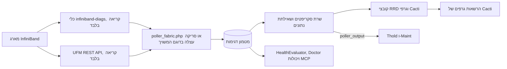

<!-- Source: README.md; SHA256: 79a16fb906f96ee79de2c719f18c38836f555440a7571a4a5ba38c64bb5b099f -->

<!-- translations:start -->
[English](../../../README.md) | [简体中文](../zh-CN/README.md) | [हिन्दी](../hi-IN/README.md) | [Español (España)](../es-ES/README.md) | [Español (Latinoamérica)](../es-419/README.md) | [العربية (السعودية)](../ar-SA/README.md) | [Afrikaans](../af-ZA/README.md) | [አማርኛ](../am-ET/README.md) | [العربية (مصر)](../ar-EG/README.md) | [العربية (المغرب)](../ar-MA/README.md) | [Български](../bg-BG/README.md) | [বাংলা](../bn-BD/README.md) | [Bosanski](../bs-BA/README.md) | [Deutsch](../de-DE/README.md) | [Ελληνικά](../el-GR/README.md) | [فارسی](../fa-IR/README.md) | [Filipino](../fil-PH/README.md) | [Français](../fr-FR/README.md) | [Français (Maroc)](../fr-MA/README.md) | [Français (Sénégal)](../fr-SN/README.md) | [Hausa](../ha-NG/README.md) | [עברית](README.md) | [Hrvatski](../hr-HR/README.md) | [Bahasa Indonesia](../id-ID/README.md) | [Igbo](../ig-NG/README.md) | [Italiano](../it-IT/README.md) | [日本語](../ja-JP/README.md) | [ქართული](../ka-GE/README.md) | [한국어](../ko-KR/README.md) | [Latviešu](../lv-LV/README.md) | [Malagasy](../mg-MG/README.md) | [मराठी](../mr-IN/README.md) | [Bahasa Melayu](../ms-MY/README.md) | [Nederlands](../nl-NL/README.md) | [Polski](../pl-PL/README.md) | [Português (Brasil)](../pt-BR/README.md) | [Português (Portugal)](../pt-PT/README.md) | [Русский](../ru-RU/README.md) | [Kinyarwanda](../rw-RW/README.md) | [Soomaali](../so-SO/README.md) | [Српски](../sr-RS/README.md) | [Svenska](../sv-SE/README.md) | [Kiswahili](../sw-KE/README.md) | [தமிழ்](../ta-IN/README.md) | [తెలుగు](../te-IN/README.md) | [ไทย](../th-TH/README.md) | [Türkçe](../tr-TR/README.md) | [Українська](../uk-UA/README.md) | [اردو](../ur-PK/README.md) | [Tiếng Việt](../vi-VN/README.md) | [isiXhosa](../xh-ZA/README.md) | [Yorùbá](../yo-NG/README.md) | [繁體中文](../zh-TW/README.md) | [isiZulu](../zu-ZA/README.md)
<!-- translations:end -->

# plugin_fabric

תוסף ל-Cacti 1.2 (`fabric`, גרסה `0.1.0-dev`) המביא מוני פורטים, רוחב ומהירות קישור ומחווני גודש של InfiniBand אל תוך Cacti כהתקנים, מקורות נתונים וגרפים רגילים. קישור שהתאמן ב-1X במקום ב-4X מופיע לאחר מכן כגרף וכהתראת Thold לצד המארח שהוא משרת, תחת ההרשאות של Cacti, עם מודעות ל-Maint ודיכוי התראות.

> **סטטוס: בפיתוח, טרם פורסמה גרסה.** ענף זה מממש את תשתית התוסף, אובייקטי Cacti והתראות, סריקות רקע מתוזמנות של הדוגם (poller), שכפול לאוספי נתונים מרוחקים, צד שרת REST לקריאה בלבד של NVIDIA UFM עם כספת אישורים מוצפנת, ניהול בשורת הפקודה באמצעות תצורה כקוד (CasC), ונקודות שילוב (hooks) במערכת האקולוגית של Cacti (CasC, Doctor ו-MCP / Abilities API v2). התוסף נבדק מול כלים מדומים, תעבורת UFM סינתטית ומדמה המארג `ibsim` (rdma-core 50.0), ומעולם לא נבדק על מארג InfiniBand פיזי או שרת UFM חי. בדיקות הדורשות חומרה נותרות פתוחות ב-[docs/research/](../../research/). פרויקט זה אינו משויך לפרויקט Cacti.

## מה מומש

- **מחזור חיים וסכימה (v3)**: התקנה, שדרוג אידמפוטנטי, הסרה (תוך שמירת טבלאות התוסף כברירת מחדל), ובדיקת הגנה לדרישת PHP 8.2 תוך השארת נקודות הכניסה ניתנות לפענוח ב-PHP 8.0.
- **תפקידי גישה ודפים**: תחומי ההרשאה `Fabric View` (`fabric.php`), `Fabric Operator` (`fabric_operator.php`) ו-`Fabric Admin` (`fabric_admin.php`, `fabric_health.php`), וכן לשונית הגדרות תחת **Configuration > Settings > Fabrics**.
- **צד שרת אבחון לקריאה בלבד (`diags`)**: הרצה קפדנית באמצעות וקטור ארגומנטים של `perfquery`, `ibnetdiscover` ו-`iblinkinfo`, מצאי מבוסס GUID עם זיהוי התנגשויות זהות והצעות לקישור מחדש, הערכת מצב קישור וסריקות מונים לפי צומת.
- **צד שרת REST לקריאה בלבד של NVIDIA UFM (`ufm`) וכספת מוצפנת**: לקוח REST ברשימת היתר ל-GET בלבד (`/ufmRest/resources/ports`, `/ufmRest/resources/systems`, `/ufmRest/monitoring/session/0/data`, ומקבילות `/ufmRestV3/...` לאימות באמצעות טוקן) המזין את אותן טבלאות מצאי, מצב קישור, דגימות ותקינות כמו `diags`. אישורי הגישה (`token` או `basic`) נשמרים מוצפנים ב-AES-256-GCM בטבלה `plugin_fabric_secret` באמצעות קובץ מפתח חיצוני של 256 סיביות המוגדר ב-`fabric_vault_key_file`. ניתן להגדיר מארגי UFM דרך CasC (`cli/fabric.php`) או דרך המאגרים; טופס הניהול בממשק הווב מציג כעת שדות `diags`.
- **אובייקטי Cacti, Thold ו-Maint**: תבניות התקן, נתונים וגרפים של Cacti (`templates/fabric-templates.xml`), שאילתת הנתונים של שרת הסקריפטים "Fabric Port" (`scripts/ss_fabric_ports.php`, `resource/script_server/fabric_ports.xml`), מקורות נתונים של מונים מסוג `DERIVE` ומקורות נתונים של מצב קישור/קצב מסוג `GAUGE` עבור Thold, מעקב אחר אי-רציפויות ודיווח של מונים בסיסיים רוויים כ-`U`. שילוב Maint (`MaintMaintenance`) שואל את `plugin_maint_check_cacti_host()` (עם נסיגה ל-hook `is_device_in_maintenance`) כך שצמתים בתחזוקה פעילה נספרים בנפרד ומוחרגים מאזהרות תקינות של סריקה שנכשלה ופורט פגום.
- **סריקות מתוזמנות, ביזור (sharding) ואוספים מרוחקים**: `poller_bottom` מפעיל את `poller_fabric.php` ברקע עבור מארגים שהגיע מועד סריקתם והמשויכים לדוגם הנוכחי, לצד סריקות עצלות (lazy sweeps) המופעלות על ידי שרת הסקריפטים. `INFO` מצהיר `remote_collect:1, remote_poller:1`, `poller_fabric.php` תומך בביזור דטרמיניסטי לפי GUID (`--shard=K/N`), ו-`replicate_out` משכפל שורות לא-סודיות של `plugin_fabric_fabric` לאוספים מרוחקים (`poller_id >= 2`). רשומות הכספת (`plugin_fabric_secret`) וקובצי מפתח חיצוניים לעולם אינם משוכפלים.
- **ממשק שורת הפקודה של CasC ו-hooks של המערכת האקולוגית**: `cli/fabric.php` לייצוא YAML/XML, אימות, תכנון diff יבש (dry-run), החלה מותנית באישור ודיווח תקינות, וכן ה-hooks `casc_register_providers`, `doctor_register_checks` ו-`abilities_register`.

## תפקידי גישה

| תחום הרשאה | גישה |
| --- | --- |
| Fabric View | ניטור תצוגות מצאי ופורטים (`fabric.php`). |
| Fabric Operator | גישת View, בנוסף לדף התפעול (`fabric_operator.php`) ולאישורי מיון ראשוני אישיים. |
| Fabric Admin | גישת Operator, בנוסף לתצורה, פעולות ניהול (`fabric_admin.php`) ודף התקינות (`fabric_health.php`). |

לאחר העתקת קובצי השדרוג, פתחו את דף ה-Plugins כמנהלי מערכת כדי לרשום את תחומי ההרשאה וה-hooks החדשים. הקצו את תחום ה-Operator במפורש תחת **Configuration > Users** או לקבוצות משתמשים. שדרוגים שומרים על מזהי תחומי ההרשאה הקיימים של View ו-Admin ועל ההרשאות שניתנו להם. גישת Admin יורשת את גישת Operator, וגישת Operator יורשת את גישת View בכל בקשה; הדבר אינו מוסיף הרשאות שמורות למשתמשים או לקבוצות. הגדרות התוסף דורשות גם גישת Fabric Admin בנוסף להרשאת Settings של Cacti.

הרשאות התקנים של Cacti מגבילות את השורות והפעולות הזמינות לכל משתמש; אובייקטים לא ממופים דורשים מנהל מערכת. אישורי גישה, תצורה, מיפוי, מחיקה ושינויים ניהוליים אחרים נותרים בדפי הניהול או ב-CLI. אישורי מיון תקפים רק בהפעלה הנוכחית של המשתמש, למשך שעה אחת לכל היותר ורק כל עוד אותה תצפית נותרת עדכנית. תצפיות חדשות או שהשתנו מבטלות אותם. הם לעולם אינם מסמנים מדידה שנכשלה כתקינה ואינם מדכאים התראות.

## מדוע

קישור InfiniBand פגום עדיין מעביר תעבורה. קישור 4X שעובר אימון מחדש ל-1X משאיר את הפורט במצב "active", וגרפי ממשק ה-SNMP של המארח נראים תקינים, אך משימות מצומדות היטב מואטות. הראיות נמצאות במארג: כל פורט מדווח על הרוחב והמהירות הפעילים, המאופשרים והנתמכים שלו, וכן על מוני שגיאות וגודש. קריאת מידע זה מצריכה את כלי האבחון של InfiniBand או ממשק API של מנהל מארג. הרצתם באופן ידני משאירה שלושה פערים:

- **ללא היסטוריה.** `perfquery` ו-`iblinkinfo` מציגים את המצב הנוכחי בלבד, כך שקישור שנפגע בשבוע שעבר אינו נראה.
- **ללא הקשר של התקן.** פורטים של המארג אינם אובייקטים של Cacti, ולכן לא ניתן להציג פורט בגרף לצד המארח שאותו הוא מזין.
- **ללא נתיב להתראות של Cacti.** Thold ו-Maint פועלים על מקורות נתונים והתקנים של Cacti.

התוסף סוגר פערים אלה על ידי קריאת המארג באמצעות `infiniband-diags` או NVIDIA UFM REST API, זיהוי צמתים ופורטים לפי GUID, ופרסום מונים ומצב קישור כמקורות נתונים של Cacti. הוא מבצע קריאה בלבד: הוא לעולם אינו מאפס מונים ואינו משנה מצב פורט.

## תפעול ושורת פקודה

### דוגם רקע וסריקות ידניות

הפונקציה `fabric_poller_bottom()` מפעילה את `poller_fabric.php` ברקע בכל דוגם עבור מארגים מאופשרים המשויכים לאותו `poller_id` ואשר מועד סריקתם הגיע. ניתן גם להריץ את מריץ הדוגם או סריקה ידנית ישירות בדוגם המשויך כמשתמש הדוגם (תוך החלפת `/path/to/cacti` בתיקיית ה-Cacti שלכם):

```sh
php /path/to/cacti/plugins/fabric/poller_fabric.php [--fabric=ID] [--shard=K/N] [--force] [--debug]
php /path/to/cacti/plugins/fabric/fabric_sweep.php --fabric=ID [--node=GUID] [--force]
```

- `poller_fabric.php` מריץ את כל המארגים שמועד סריקתם הגיע עבור הדוגם המקומי (או מארג אחד עם `--fabric=ID`), אוכף את נעילת רישום התהליכים של Cacti ואת חכירות `ClaimRepository` עם תקציב זמן של `max(30, intdiv(sweep_interval, 2))` שניות, ותומך ב-`--shard=K/N` (`0 <= K < N`) כדי לבזר באופן דטרמיניסטי סריקות מוני צמתים של `diags` לפי GUID הצומת.
- `fabric_sweep.php` מריץ סריקה לפי דרישה של מארג מאופשר אחד (או צומת אחד עם `--node=GUID`) המשויך לדוגם המקומי. `--force` מתעלם משאלת הגעת המועד של המארג תוך המשך כיבוד תפיסות (claims).

לאחר שהגילוי הראשוני ממלא את המצאי, מפו צמתים להתקני Cacti בדף Fabric Admin. שמרו על פסק הזמן של סקריפטים ב-Cacti על 25 שניות ומעלה: סריקה עצלה המופעלת על ידי קריאת שאילתת נתונים מגבילה את הרצת הכלי ל-`script_timeout - 5` שניות כדי ששרת הסקריפטים יחזיר תשובה בזמן עם הדגימה השמורה האחרונה או `U`.

### צד שרת REST של NVIDIA UFM וכספת אישורים

מארג `ufm` דורש כתובת `https://` ללא אישורי גישה מוטמעים, מחרוזות שאילתה או מקטעים (fragments). `UfmSocketTransport` אוכף אימות עמית ושם מארח ב-TLS, דוחה הפניות מחדש (redirects), ותומך בחבילת CA אופציונלית (`ufm_ca_file`) ובנעיצת SHA-256 SPKI (`ufm_spki_pin`).

כדי לשמור אישורי UFM ב-`plugin_fabric_secret`, הגדירו את `fabric_vault_key_file` תחת **Configuration > Settings > Fabrics** עם נתיב מוחלט לקובץ רגיל שבבעלות משתמש הדוגם (ללא קישורים סימבוליים באף תיקיית אב, הרשאות `0600`, המכיל 64 תווים הקסדצימליים כגון `openssl rand -hex 32` או 32 בתים אקראיים שאינם ניתנים להדפסה). התוסף לעולם אינו יוצר ואינו כותב לקובץ המפתח, ו-`replicate_out` לעולם אינו משכפל את `plugin_fabric_secret` או קובצי מפתח לדוגמים מרוחקים.

### תצורה כקוד ו-CLI תקינות

`cli/fabric.php` מנהל הגדרות תוסף והגדרות מארג באופן דקלרטיבי ב-YAML או ב-XML, ומדווח על תקינות מודעת-תחזוקה מבלי להריץ סריקות חיות:

```sh
php /path/to/cacti/plugins/fabric/cli/fabric.php export [--format=yaml|xml] [--file=PATH]
php /path/to/cacti/plugins/fabric/cli/fabric.php validate --file=PATH [--format=yaml|xml]
php /path/to/cacti/plugins/fabric/cli/fabric.php plan --file=PATH [--format=yaml|xml]
php /path/to/cacti/plugins/fabric/cli/fabric.php apply --file=PATH --confirm=PLAN_HASH [--format=yaml|xml]
php /path/to/cacti/plugins/fabric/cli/fabric.php health [--format=text|json]
```

`export` יוצר קבצים חדשים עם הרשאות `0600`, מצנזר את `fabric_vault_key_file` כ-`[REDACTED]`, ומפיק הפניות בשם `ufm_credential_ref` במקום סודות. `plan` ו-`apply` דוחים ערכים מוטבעים (inline) של `ufm_token`, `ufm_password`, `secret` וערכים מוטבעים של `fabric_vault_key_file`. `apply` דורש את ה-`--confirm=PLAN_HASH` המדויק שהופק על ידי `plan`.

### hooks של המערכת האקולוגית

כאשר תוספי Cacti המתאימים או שילובי מארח קיימים, `setup.php` רושם:

- `casc_register_providers`: מייצא, מאמת, מתכנן ומחיל לאחר אישור את תצורת `fabric` (`yaml` ו-`xml`, סכימה v1) עם צנזור סודות.
- `doctor_register_checks`: מספק ארבע בדיקות אבחון לקריאה בלבד (`fabric.schema`, `fabric.poller_freshness`, `fabric.identity_conflicts`, `fabric.ufm_vault`).
- `abilities_register`: רושם שלוש יכולות לקריאה בלבד, לא-הרסניות ואידמפוטנטיות תחת הקטגוריה `fabric`, המוגנות על ידי תחום ההרשאה Fabric View (והרשאות התקן Cacti עבור שגיאות פורט): `fabric-list-fabrics`, `fabric-get-health` ו-`fabric-list-port-errors`.

## היקף וגבולות

מחוץ להיקף: שינוי מצב מארג, איפוס מונים, החלפת מנהל מארג או מנהל תת-רשת, מנוע התראות בבעלות התוסף, שירות רקע מותאם אישית או פרוטוקול רשת, ומארגי Ethernet או RoCE.

## דרישות ותאימות

| רכיב | יעד |
|---|---|
| Cacti | 1.2.31 ומעלה (`compat = 1.2.31`), ללא טלאי ליבה |
| PHP | 8.2 ומעלה; נקודות הכניסה נשארות ניתנות לפענוח ב-8.0 ומסרבות להפעלה ב-8.1 כדי שסביבת ריצה לא נתמכת תקבל סירוב במקום ממשק Cacti שבור |
| כלי InfiniBand | `infiniband-diags` מתוך `rdma-core` (נבדק ב-CI עם rdma-core 50.0 תחת `ibsim`; תבניות הפלט נבדקו מול קוד המקור של v66.0) |
| UFM | NVIDIA UFM Enterprise REST API (נקודות קצה לקריאה בלבד `ufmRest` ו-`ufmRestV3`; נבדק מול תעבורות סינתטיות בבדיקות יחידה) |
| Thold, Maint | אין צורך בשינויים; ה-CI מריץ בדיקה מקצה לקצה עם Thold v1.8.2 ו-Maint v1.3 ללא שינוי |

## פיתוח ובדיקות

תהליך העבודה של CI (`.github/workflows/plugin-ci-workflow.yml`) בודק PHP 8.2 עד 8.5 מול Cacti `release/1.2.31` ו-`1.2.x`, בדיקת תחביר של נקודות כניסה ב-PHP 8.0, סירוב ב-PHP 8.1, PHPStan, אימות gettext/תרגומים, רישוי REUSE, בדיקת תקינות תהליכי עבודה, הרצה חוזרת מקצה לקצה של Thold/Maint והדמיית מארג `ibsim`.

עם רתמת בדיקות התוספים המשותפת והנעולה של Cacti (`CACTI_PEST_BIN`) ומסד נתונים חד-פעמי של Cacti:

```sh
# Unit tests
"$CACTI_PEST_BIN" --configuration=phpunit.xml

# Lifecycle integration tests (disposable database only)
CACTI_PATH=/path/to/cacti FABRIC_TEST_DATABASE=disposable "$CACTI_PEST_BIN" --configuration=phpunit-integration.xml

# Static analysis (against Cacti 1.2.31)
CACTI_PATH=/path/to/cacti phpstan analyse -c phpstan.neon --no-progress

# Translation template, catalogs, and localized README checks
sh locales/build_gettext.sh --check

# Simulated ibsim fixture parser check
php tests/bin/check-ibsim-fixtures.php tests/fixtures/ibsim
```

## תכנון

- [docs/PLAN.md](../../PLAN.md) היא תוכנית הארכיטקטורה והעיצוב: עובדות במעלה הזרם בצירוף מקורות, בדיקות חומרה פתוחות, מודל זהות, כללי מונים ומצב קישור, גבולות אבטחה, חישובי ביצועים, בדיקות וסיכונים.
- [docs/decisions/](../../decisions/) מכילה רשומות החלטות ארכיטקטורה.
- [docs/REQUIREMENTS.md](../../REQUIREMENTS.md) ממפה כל מזהה דרישה לסוגיה שלו.



## אופן מעקב העבודה

- **אבני דרך** עוקבות אחר אבני הדרך של התוכנית. לכל אחת יש סוגיית על המפרטת את תתי-הסוגיות ואת ראיות הסיום שלה.
- **סוגיות** מסווגות לפי תווית: `type: requirement`, `type: research`, `type: decision`, `type: epic`. סוגיות דרישה מציינות דרישות ממוספרות הניתנות לבדיקה (`REQ-AREA-NNN`) וקריטריוני קבלה.
- **תוויות** כוללות גם `area:`, `phase:`, `priority:` ו-`status:`. ראו [CONTRIBUTING.md](../../../CONTRIBUTING.md#labels).
- [לוח הפרויקט](https://github.com/users/somethingwithproof/projects/8) מציג את כל הסוגיות לאורך אבני הדרך.

## תרומה לפרויקט

קראו את [CONTRIBUTING.md](../../../CONTRIBUTING.md). קומיטים דורשים חתימת DCO (`git commit -s`). דיוני תכנון מתקיימים בסוגיות; החלטות פתוחות נושאות את התווית `type: decision`.

## אבטחה

דווחו על פגיעויות באופן פרטי; ראו [SECURITY.md](../../../SECURITY.md).

## רישיון

GNU General Public License v2.0, אותו רישיון כמו Cacti והתוספים שלו. ראו [LICENSE](../../../LICENSE).
