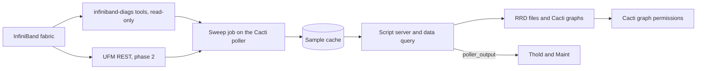

<!-- Source: README.md; SHA256: ce5af61a1bc993ec2aae6d4f22c3885694632f2b1d5eb94e2ce88b8390e96f1e -->

<!-- translations:start -->
[English](../../../README.md) | [简体中文](../zh-CN/README.md) | [हिन्दी](README.md) | [Español (España)](../es-ES/README.md) | [Español (Latinoamérica)](../es-419/README.md) | [العربية (السعودية)](../ar-SA/README.md) | [Afrikaans](../af-ZA/README.md) | [አማርኛ](../am-ET/README.md) | [العربية (مصر)](../ar-EG/README.md) | [العربية (المغرب)](../ar-MA/README.md) | [বাংলা](../bn-BD/README.md) | [Deutsch](../de-DE/README.md) | [فارسی](../fa-IR/README.md) | [Filipino](../fil-PH/README.md) | [Français](../fr-FR/README.md) | [Français (Maroc)](../fr-MA/README.md) | [Français (Sénégal)](../fr-SN/README.md) | [Hausa](../ha-NG/README.md) | [עברית](../he-IL/README.md) | [Bahasa Indonesia](../id-ID/README.md) | [Igbo](../ig-NG/README.md) | [Italiano](../it-IT/README.md) | [日本語](../ja-JP/README.md) | [한국어](../ko-KR/README.md) | [Malagasy](../mg-MG/README.md) | [मराठी](../mr-IN/README.md) | [Bahasa Melayu](../ms-MY/README.md) | [Nederlands](../nl-NL/README.md) | [Polski](../pl-PL/README.md) | [Português (Brasil)](../pt-BR/README.md) | [Русский](../ru-RU/README.md) | [Kinyarwanda](../rw-RW/README.md) | [Soomaali](../so-SO/README.md) | [Svenska](../sv-SE/README.md) | [Kiswahili](../sw-KE/README.md) | [தமிழ்](../ta-IN/README.md) | [తెలుగు](../te-IN/README.md) | [ไทย](../th-TH/README.md) | [Türkçe](../tr-TR/README.md) | [Українська](../uk-UA/README.md) | [اردو](../ur-PK/README.md) | [Tiếng Việt](../vi-VN/README.md) | [isiXhosa](../xh-ZA/README.md) | [Yorùbá](../yo-NG/README.md) | [繁體中文](../zh-TW/README.md) | [isiZulu](../zu-ZA/README.md)
<!-- translations:end -->

<a id="plugin_fabric"></a>
# plugin_fabric

यह Cacti 1.2 प्लगइन InfiniBand पोर्ट काउंटर, लिंक की चौड़ाई और गति तथा संकुलन संकेतकों को सामान्य Cacti डिवाइस, डेटा स्रोत और ग्राफ़ के रूप में लाता है। 4X के बजाय 1X पर लिंक स्थापित होने पर उसका ग्राफ़ और Thold अलर्ट संबंधित होस्ट के साथ दिखता है, Cacti अनुमतियों के अधीन रहता है और Maint उसे दबा सकता है।

> **स्थिति: विकास में, अभी रिलीज़ नहीं हुई।** माइलस्टोन 2 (आधार) `main` में मर्ज है और माइलस्टोन 3 (Cacti ऑब्जेक्ट और अलर्ट) की समीक्षा चल रही है। माइलस्टोन 1 ने दस्तावेज़ों और मूल स्रोत कोड से डिज़ाइन की पुष्टि की (PR #71); परिणाम और स्रोत [docs/research/](../../research) में हैं। माइलस्टोन 2 प्लगइन का आधार जोड़ता है:
>
> - स्थापना, अपग्रेड, स्थापना रद्द करना और PHP 8.2 जाँच
> - View, Operator और Admin अनुमति क्षेत्र तथा सेटिंग
> - फ़ैब्रिक रिकॉर्ड
> - `perfquery`, `ibnetdiscover` और `iblinkinfo` के लिए केवल-पठन कमांड सीमा
> - GUID आधारित सूची, पहचान विवाद और पुनः-जोड़ प्रस्ताव
> - लिंक स्थिति और काउंटर सर्वेक्षण कैश
> - सूची, प्रशासन और स्वास्थ्य पृष्ठ
>
> माइलस्टोन 3 Cacti ऑब्जेक्ट जोड़ता है:
>
> - Cacti टेम्पलेट XML के रूप में डिवाइस, डेटा और ग्राफ़ टेम्पलेट तथा "Fabric Port" डेटा क्वेरी
> - नोड को Cacti डिवाइस से मैप करना या पुष्टि के बाद नया बनाना ([ADR 0010](../../decisions/0010-one-device-per-node.md))
> - ग्राफ़ के लिए काउंटर डेटा स्रोत तथा Thold के लिए GAUGE लिंक स्थिति और दर डेटा स्रोत ([ADR 0011](../../decisions/0011-derive-counters-and-gauge-alert-values.md))
> - असातत्य संभालना और संतृप्त मूल काउंटर अज्ञात पढ़ना ([ADR 0012](../../decisions/0012-saturated-basic-counters-read-as-unknown.md)), पोर्ट पृष्ठ पर काउंटर वैधता और ग्राफ़ लिंक तथा संकुलन क्रम
> - अपरिवर्तित Thold v1.8.2 और Maint v1.3 के साथ शुरू से अंत तक परीक्षण और सिम्युलेटेड फ़ैब्रिक पर वास्तविक निदान उपकरण चलाने वाला CI कार्य
>
> चरण 3 में दूरस्थ डेटा कलेक्टर समर्थित होने तक केवल मुख्य पोलर फ़ैब्रिक का सर्वेक्षण कर सकता है। इसे नकली उपकरणों और ibsim फ़ैब्रिक सिम्युलेटर के साथ परखा गया है, कभी वास्तविक InfiniBand फ़ैब्रिक पर नहीं। फ़ैब्रिक की आवश्यकता वाली जाँचें हर शोध पृष्ठ की लाइव-जाँच तालिका में खुली हैं। यह परियोजना Cacti परियोजना से संबद्ध नहीं है।

<a id="access-roles"></a>
## पहुँच भूमिकाएँ

| अनुमति क्षेत्र | पहुँच |
| --- | --- |
| Fabric View | मौजूदा निगरानी पृष्ठ। |
| Fabric Operator | निगरानी के साथ संचालन पृष्ठ और व्यक्तिगत जाँच पुष्टि। |
| Fabric Admin | ऑपरेटर पहुँच के साथ मौजूदा कॉन्फ़िगरेशन और प्रशासनिक कार्रवाइयाँ। |

अपग्रेड फ़ाइलें कॉपी करने के बाद नया अनुमति क्षेत्र दर्ज करने के लिए व्यवस्थापक के रूप में प्लगइन पृष्ठ खोलें। **कॉन्फ़िगरेशन > उपयोगकर्ता** या उपयोगकर्ता समूहों में Operator अनुमति स्पष्ट रूप से दें। अपग्रेड मौजूदा View और Admin क्षेत्र के ID और अनुदान सुरक्षित रखते हैं। हर अनुरोध में Admin को Operator और Operator को View पहुँच विरासत में मिलती है; इससे उपयोगकर्ता या समूह में संग्रहीत अनुदान नहीं जुड़ते। प्लगइन सेटिंग के लिए Cacti की Settings अनुमति के अतिरिक्त Fabric Admin भी आवश्यक है।

Cacti डिवाइस अनुमतियाँ अब भी हर उपयोगकर्ता के लिए उपलब्ध पंक्तियाँ और कार्रवाइयाँ सीमित करती हैं; अनमैप ऑब्जेक्ट के लिए व्यवस्थापक चाहिए। क्रेडेंशियल, कॉन्फ़िगरेशन, मैपिंग, हटाना और अन्य प्रशासनिक बदलाव प्रशासनिक पृष्ठों में ही रहते हैं। पुष्टि केवल वर्तमान उपयोगकर्ता के सत्र में, अधिकतम एक घंटे तक और उसी अवलोकन के ताज़ा रहने तक रहती है। नए या बदले अवलोकन उसे अमान्य कर देते हैं। यह कभी विफल माप को स्वस्थ नहीं बताती या अलर्ट नहीं दबाती।

<a id="why"></a>
## क्यों

अवनत InfiniBand लिंक पर ट्रैफ़िक फिर भी चलता है। 4X लिंक के 1X पर फिर स्थापित होने पर पोर्ट "active" रहता है और होस्ट के SNMP इंटरफ़ेस ग्राफ़ सामान्य दिखते हैं, लेकिन कसकर जुड़े जॉब धीमे हो जाते हैं। प्रमाण फ़ैब्रिक में है: हर पोर्ट सक्रिय, सक्षम और समर्थित चौड़ाई तथा गति और त्रुटि व संकुलन काउंटर बताता है। इन्हें पढ़ने के लिए InfiniBand निदान उपकरण या फ़ैब्रिक प्रबंधक API चाहिए। हाथ से चलाने पर तीन कमियाँ रहती हैं:

- **इतिहास नहीं।** `perfquery` और `iblinkinfo` वर्तमान दिखाते हैं, इसलिए पिछले सप्ताह अवनत हुआ लिंक दिखता नहीं।
- **डिवाइस संदर्भ नहीं।** फ़ैब्रिक पोर्ट Cacti ऑब्जेक्ट नहीं हैं, इसलिए पोर्ट का ग्राफ़ संबंधित होस्ट के साथ नहीं रखा जा सकता।
- **Cacti अलर्ट से जुड़ाव नहीं।** Thold और Maint Cacti डेटा स्रोत और डिवाइस पर काम करते हैं।

प्लगइन फ़ैब्रिक के अपने निदान उपकरणों (और बाद में UFM) से पढ़कर, नोड और पोर्ट को GUID से पहचानकर और काउंटर तथा लिंक स्थिति को Cacti डेटा स्रोत बनाकर ये कमियाँ भरता है। यह केवल पढ़ता है: कभी काउंटर रीसेट या पोर्ट स्थिति नहीं बदलता।

## पहली खोज

नए फ़ैब्रिक में कोई नोड नहीं होता, और स्क्रिप्ट सर्वर से शुरू होने वाला सर्वेक्षण केवल Cacti डिवाइस से मैप किए गए नोड से शुरू होता है। इसलिए पहली खोज मैन्युअल चरण है। सक्षम फ़ैब्रिक सहेजने के बाद, जिस पोलर को वह दिया गया है उस पर पोलर के खाते से यह एक बार चलाएँ, जहाँ `/path/to/cacti` की जगह अपनी Cacti निर्देशिका लिखें (पूर्ण पथ cron में भी काम करता है):

```
php /path/to/cacti/plugins/fabric/fabric_sweep.php --fabric=ID --force
```

इसके बाद सूची भर जाती है। Fabric Admin पृष्ठ पर नोड को Cacti डिवाइस से मैप करें; बाद के सर्वेक्षण डेटा क्वेरी से शुरू होते हैं। जब तक फ़ैब्रिक का कोई नोड मैप नहीं है, उसकी सूची ताज़ा नहीं होती, इसलिए नए या गायब नोड दर्ज करने के लिए यही कमांड फिर चलाएँ, चाहें तो cron से। जिस सक्षम फ़ैब्रिक की खोज नहीं हुई या जिसका कोई नोड मैप नहीं है, उसके लिए स्वास्थ्य पृष्ठ यही कमांड दिखाता है।

<a id="planned-scope"></a>
## नियोजित दायरा

| चरण | दायरा | माइलस्टोन |
|---|---|---|
| 0, शोध | संस्करण मैट्रिक्स, मूल व्यवहार की पुष्टि, हार्डवेयर पर काउंटर व्यवहार, विशेषाधिकार मॉडल, MAD बजट, UFM API | [M1](https://github.com/somethingwithproof/plugin_fabric/milestone/1) |
| 1, अवलोकन | GUID सूची, Cacti डिवाइस, पोर्ट डेटा क्वेरी, काउंटर और लिंक स्थिति डेटा स्रोत, Thold अलर्ट, Maint दमन, स्वास्थ्य पृष्ठ | [M2](https://github.com/somethingwithproof/plugin_fabric/milestone/2), [M3](https://github.com/somethingwithproof/plugin_fabric/milestone/3), [M4](https://github.com/somethingwithproof/plugin_fabric/milestone/4) |
| 2, UFM | केवल-पठन UFM REST बैकएंड, क्रेडेंशियल संभालना, बैकएंड के बीच पहचान निरंतरता | [M5](https://github.com/somethingwithproof/plugin_fabric/milestone/5) |
| 3, दूरस्थ | दूरस्थ डेटा कलेक्टर, प्रतिकृति, `remote_agent` कार्रवाइयाँ, बड़े फ़ैब्रिक के लिए विभाजित सर्वेक्षण | [M6](https://github.com/somethingwithproof/plugin_fabric/milestone/6) |

दायरे से बाहर: फ़ैब्रिक स्थिति बदलना, फ़ैब्रिक या सबनेट प्रबंधक का स्थान लेना, प्लगइन का अपना अलर्ट इंजन, कस्टम डेमन या नेटवर्क प्रोटोकॉल और Ethernet या RoCE फ़ैब्रिक (शोध)।

<a id="compatibility-targets"></a>
## संगतता लक्ष्य

| घटक | लक्ष्य |
|---|---|
| Cacti | 1.2.31 या बाद, बिना कोर पैच |
| PHP | 8.2 या बाद; `setup.php` 8.0 पर भी पार्स हो सकता है ताकि असमर्थित रनटाइम पर Cacti UI टूटने के बजाय स्पष्ट अस्वीकृति मिले |
| InfiniBand उपकरण | rdma-core का infiniband-diags; आउटपुट प्रारूप v66.0 स्रोत से जाँचे गए |
| UFM | UFM Enterprise REST API, चरण 2; रिलीज़ मैट्रिक्स माइलस्टोन 1 की डिलीवरी है |
| Thold, Maint | बदलाव आवश्यक नहीं |

Cacti का स्क्रिप्ट टाइमआउट डिफ़ॉल्ट 25 सेकंड या अधिक रखें। डेटा क्वेरी पढ़ने से शुरू सर्वेक्षण उपकरण चलाने का समय उस सीमा से पाँच सेकंड कम रखता है, ताकि कैश पढ़ने और उत्तर देने का समय बचे। बजट समाप्त होने पर क्वेरी पिछला वर्तमान नमूना या अज्ञात लौटाती है; अगला चक्र सर्वेक्षण फिर आज़माता है। यह सीमा PHP पोलर पर भी लागू है। पाँच सेकंड या कम टाइमआउट उपकरण शुरू करने का समय नहीं छोड़ता।

<a id="design"></a>
## डिज़ाइन

- [docs/PLAN.md](../../PLAN.md) पूरा प्लान है: वास्तुकला, निर्भर मूल तथ्य (स्रोत सहित) और अपुष्ट धारणाएँ, पहचान मॉडल, काउंटर और लिंक स्थिति नियम, सुरक्षा सीमाएँ, प्रदर्शन गणना, परीक्षण और जोखिम।
- [docs/decisions/](../../decisions) में पहले से लिए गए वास्तुकला निर्णयों के रिकॉर्ड हैं।
- [docs/REQUIREMENTS.md](../../REQUIREMENTS.md) हर आवश्यकता ID को उसकी इश्यू से जोड़ता है।



<a id="how-work-is-tracked"></a>
## काम का अनुश्रवण

- **माइलस्टोन** प्लान का अनुसरण करते हैं। हर माइलस्टोन की एक एपिक इश्यू में उप-इश्यू और समापन प्रमाण हैं।
- **इश्यू** लेबल से वर्गीकृत हैं: `type: requirement`, `type: research`, `type: decision`, `type: epic`। आवश्यकता इश्यू में क्रमांकित, परीक्षण योग्य आवश्यकताएँ (`REQ-AREA-NNN`) और स्वीकृति मानदंड हैं।
- **लेबल** में `area:`, `phase:`, `priority:` और `status:` भी हैं। [CONTRIBUTING.md](../../../CONTRIBUTING.md#labels) देखें।
- [परियोजना बोर्ड](https://github.com/users/somethingwithproof/projects/8) सभी माइलस्टोन की इश्यू दिखाता है।

<a id="contributing"></a>
## योगदान

[CONTRIBUTING.md](../../../CONTRIBUTING.md) पढ़ें। कमिट में DCO sign-off आवश्यक है। डिज़ाइन चर्चा इश्यू में होती है; खुले निर्णयों पर `type: decision` लेबल है।

<a id="security"></a>
## सुरक्षा

कमज़ोरियाँ निजी रूप से रिपोर्ट करें; [SECURITY.md](../../../SECURITY.md) देखें।

<a id="license"></a>
## लाइसेंस

GNU General Public License v2.0, वही लाइसेंस जो Cacti और उसके प्लगइन का है। [LICENSE](../../../LICENSE) देखें।
