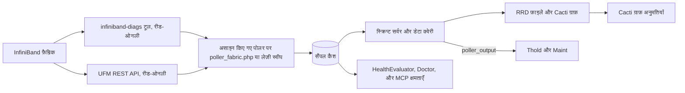

<!-- Source: README.md; SHA256: 79a16fb906f96ee79de2c719f18c38836f555440a7571a4a5ba38c64bb5b099f -->

<!-- translations:start -->
[English](../../../README.md) | [简体中文](../zh-CN/README.md) | [हिन्दी](README.md) | [Español (España)](../es-ES/README.md) | [Español (Latinoamérica)](../es-419/README.md) | [العربية (السعودية)](../ar-SA/README.md) | [Afrikaans](../af-ZA/README.md) | [አማርኛ](../am-ET/README.md) | [العربية (مصر)](../ar-EG/README.md) | [العربية (المغرب)](../ar-MA/README.md) | [Български](../bg-BG/README.md) | [বাংলা](../bn-BD/README.md) | [Bosanski](../bs-BA/README.md) | [Deutsch](../de-DE/README.md) | [Ελληνικά](../el-GR/README.md) | [فارسی](../fa-IR/README.md) | [Filipino](../fil-PH/README.md) | [Français](../fr-FR/README.md) | [Français (Maroc)](../fr-MA/README.md) | [Français (Sénégal)](../fr-SN/README.md) | [Hausa](../ha-NG/README.md) | [עברית](../he-IL/README.md) | [Hrvatski](../hr-HR/README.md) | [Bahasa Indonesia](../id-ID/README.md) | [Igbo](../ig-NG/README.md) | [Italiano](../it-IT/README.md) | [日本語](../ja-JP/README.md) | [ქართული](../ka-GE/README.md) | [한국어](../ko-KR/README.md) | [Latviešu](../lv-LV/README.md) | [Malagasy](../mg-MG/README.md) | [मराठी](../mr-IN/README.md) | [Bahasa Melayu](../ms-MY/README.md) | [Nederlands](../nl-NL/README.md) | [Polski](../pl-PL/README.md) | [Português (Brasil)](../pt-BR/README.md) | [Português (Portugal)](../pt-PT/README.md) | [Русский](../ru-RU/README.md) | [Kinyarwanda](../rw-RW/README.md) | [Soomaali](../so-SO/README.md) | [Српски](../sr-RS/README.md) | [Svenska](../sv-SE/README.md) | [Kiswahili](../sw-KE/README.md) | [தமிழ்](../ta-IN/README.md) | [తెలుగు](../te-IN/README.md) | [ไทย](../th-TH/README.md) | [Türkçe](../tr-TR/README.md) | [Українська](../uk-UA/README.md) | [اردو](../ur-PK/README.md) | [Tiếng Việt](../vi-VN/README.md) | [isiXhosa](../xh-ZA/README.md) | [Yorùbá](../yo-NG/README.md) | [繁體中文](../zh-TW/README.md) | [isiZulu](../zu-ZA/README.md)
<!-- translations:end -->

# plugin_fabric

एक Cacti 1.2 प्लगइन (`fabric`, संस्करण `0.1.0-dev`) जो InfiniBand पोर्ट काउंटर, लिंक की चौड़ाई और गति, तथा संकुलन संकेतकों को सामान्य डिवाइस, डेटा स्रोत और ग्राफ़ के रूप में Cacti में लाता है। 4X के बजाय 1X पर प्रशिक्षित हुआ लिंक फिर संबंधित होस्ट के बगल में एक ग्राफ़ और Thold अलर्ट के रूप में दिखता है, Cacti अनुमतियों के अधीन रहता है, और इसमें Maint जागरूकता तथा दमन सुविधा होती है।

> **स्थिति: विकास में, अभी कोई रिलीज़ नहीं हुई।** यह शाखा प्लगइन की नींव, Cacti ऑब्जेक्ट और अलर्टिंग, निर्धारित बैकग्राउंड पोलर स्वीप, रिमोट कलेक्टर प्रतिकृति, एन्क्रिप्टेड क्रेडेंशियल वॉल्ट के साथ रीड-ओनली NVIDIA UFM REST बैकएंड, कॉन्फ़िगरेशन-एज़-कोड (CasC) CLI प्रबंधन, और Cacti इकोसिस्टम हुक (CasC, Doctor, और MCP / Abilities API v2) को लागू करती है। इसका परीक्षण नकली उपकरणों, सिंथेटिक UFM ट्रांसपोर्ट और `ibsim` फ़ैब्रिक सिम्युलेटर (rdma-core 50.0) पर किया गया है, कभी किसी भौतिक InfiniBand फ़ैब्रिक या लाइव UFM सर्वर पर नहीं। जिन जाँचों के लिए हार्डवेयर आवश्यक है वे [docs/research/](../../research/) में खुली रहती हैं। यह परियोजना Cacti परियोजना से संबद्ध नहीं है।

## क्या लागू किया गया है

- **जीवनचक्र और स्कीमा (v3)**: इंस्टॉल, आइडेम्पोटेंट अपग्रेड, अनइंस्टॉल (डिफ़ॉल्ट रूप से प्लगइन तालिकाओं को रखते हुए), और प्रवेश बिंदुओं को PHP 8.0 पर पार्स करने योग्य रखते हुए PHP 8.2 आवश्यकता जांच।
- **एक्सेस भूमिकाएँ और पृष्ठ**: `Fabric View` (`fabric.php`), `Fabric Operator` (`fabric_operator.php`), और `Fabric Admin` (`fabric_admin.php`, `fabric_health.php`) अनुमति क्षेत्र, तथा **Configuration > Settings > Fabrics** के अंतर्गत एक Settings टैब।
- **रीड-ओनली डायग्नोस्टिक्स बैकएंड (`diags`)**: `perfquery`, `ibnetdiscover`, और `iblinkinfo` का सख्त आर्ग्यूमेंट-वेक्टर निष्पादन, पहचान-विवाद का पता लगाने और री-लिंक प्रस्तावों के साथ GUID-आधारित सूची, लिंक-स्थिति मूल्यांकन, और प्रति-नोड काउंटर स्वीप।
- **रीड-ओनली NVIDIA UFM REST बैकएंड (`ufm`) और एन्क्रिप्टेड वॉल्ट**: केवल-GET अनुमति-सूचीबद्ध REST क्लाइंट (`/ufmRest/resources/ports`, `/ufmRest/resources/systems`, `/ufmRest/monitoring/session/0/data`, और टोकन प्रमाणीकरण के लिए `/ufmRestV3/...` समकक्ष) जो `diags` वाली उन्हीं सूची, लिंक-स्थिति, नमूना और स्वास्थ्य तालिकाओं में डेटा भरता है। क्रेडेंशियल (`token` या `basic`) `fabric_vault_key_file` द्वारा कॉन्फ़िगर की गई बाहरी 256-बिट कीफ़ाइल का उपयोग करके AES-256-GCM के साथ `plugin_fabric_secret` में एन्क्रिप्टेड रूप से संग्रहीत होते हैं। UFM फ़ैब्रिक को CasC (`cli/fabric.php`) या रिपॉज़िटरी के माध्यम से परिभाषित किया जा सकता है; वेब एडमिन फ़ॉर्म वर्तमान में `diags` फ़ील्ड दिखाता है।
- **Cacti ऑब्जेक्ट, Thold, और Maint**: Cacti डिवाइस, डेटा और ग्राफ़ टेम्पलेट (`templates/fabric-templates.xml`), "Fabric Port" स्क्रिप्ट-सर्वर डेटा क्वेरी (`scripts/ss_fabric_ports.php`, `resource/script_server/fabric_ports.xml`), Thold के लिए `DERIVE` काउंटर डेटा स्रोत और `GAUGE` लिंक-स्थिति/दर डेटा स्रोत, असातत्य ट्रैकिंग, और `U` के रूप में रिपोर्ट किए गए संतृप्त मूल काउंटर। Maint एकीकरण (`MaintMaintenance`) `plugin_maint_check_cacti_host()` से पूछता है (`is_device_in_maintenance` हुक पर फ़ॉलबैक करते हुए) ताकि सक्रिय रखरखाव में रहने वाले नोड अलग से गिने जाएँ और विफल-स्वीप तथा अवनत-पोर्ट स्वास्थ्य चेतावनियों से बाहर रखे जाएँ।
- **निर्धारित स्वीप, शार्डिंग, और रिमोट कलेक्टर**: `poller_bottom` वर्तमान पोलर को सौंपे गए नियत फ़ैब्रिक के लिए पृष्ठभूमि में `poller_fabric.php` शुरू करता है, साथ ही स्क्रिप्ट सर्वर द्वारा ट्रिगर किए जाने वाले लेज़ी स्वीप भी चलते हैं। `INFO` `remote_collect:1, remote_poller:1` घोषित करता है, `poller_fabric.php` नियतात्मक GUID शार्डिंग (`--shard=K/N`) का समर्थन करता है, और `replicate_out` गैर-गोपनीय `plugin_fabric_fabric` पंक्तियों को रिमोट कलेक्टर (`poller_id >= 2`) पर प्रतिकृत करता है। वॉल्ट प्रविष्टियाँ (`plugin_fabric_secret`) और बाहरी कीफ़ाइलें कभी प्रतिकृत नहीं की जातीं।
- **CasC CLI और इकोसिस्टम हुक**: YAML/XML निर्यात, सत्यापन, ड्राई-रन डिफ़ प्लानिंग, पुष्टि-आधारित लागू करने और स्वास्थ्य रिपोर्टिंग के लिए `cli/fabric.php`, साथ ही `casc_register_providers`, `doctor_register_checks`, और `abilities_register` हुक।

## पहुँच भूमिकाएँ

| अनुमति क्षेत्र | पहुँच |
| --- | --- |
| Fabric View | निगरानी सूची और पोर्ट दृश्य (`fabric.php`)। |
| Fabric Operator | View पहुँच तथा संचालन पृष्ठ (`fabric_operator.php`) और व्यक्तिगत ट्रायज पुष्टियाँ। |
| Fabric Admin | Operator पहुँच तथा कॉन्फ़िगरेशन, प्रशासनिक कार्रवाइयाँ (`fabric_admin.php`), और स्वास्थ्य पृष्ठ (`fabric_health.php`)। |

अपग्रेड फ़ाइलें कॉपी करने के बाद, नए अनुमति क्षेत्र और हुक पंजीकृत करने के लिए व्यवस्थापक के रूप में Plugins पृष्ठ खोलें। **Configuration > Users** या उपयोगकर्ता समूहों के अंतर्गत Operator अनुमति क्षेत्र स्पष्ट रूप से असाइन करें। अपग्रेड मौजूदा View और Admin अनुमति क्षेत्र ID और अनुदान सुरक्षित रखते हैं। प्रत्येक अनुरोध पर Admin पहुँच Operator पहुँच को विरासत में लेती है, और Operator पहुँच View पहुँच को विरासत में लेती है; इससे उपयोगकर्ताओं या समूहों में संग्रहीत अनुदान नहीं जुड़ते। प्लगइन सेटिंग्स के लिए Cacti की Settings अनुमति के अलावा Fabric Admin पहुँच भी आवश्यक होती है।

Cacti डिवाइस अनुमतियाँ प्रत्येक उपयोगकर्ता के लिए उपलब्ध पंक्तियों और कार्रवाइयों को सीमित करती हैं; अनमैप किए गए ऑब्जेक्ट के लिए व्यवस्थापक की आवश्यकता होती है। क्रेडेंशियल, कॉन्फ़िगरेशन, मैपिंग, हटाना और अन्य प्रशासनिक परिवर्तन प्रशासनिक पृष्ठों या CLI में रहते हैं। पुष्टियाँ केवल वर्तमान उपयोगकर्ता के सत्र में, अधिकतम एक घंटे के लिए और केवल तब तक चलती हैं जब तक वही अवलोकन ताज़ा रहता है। नए या बदले हुए अवलोकन उन्हें अमान्य कर देते हैं। वे कभी भी विफल माप को स्वस्थ चिह्नित नहीं करतीं या अलर्ट नहीं दबातीं।

## क्यों

अवनत InfiniBand लिंक पर भी ट्रैफ़िक गुजरता रहता है। 1X पर फिर से प्रशिक्षित होने वाला 4X लिंक पोर्ट को "active" छोड़ देता है, और होस्ट के SNMP इंटरफ़ेस ग्राफ़ सामान्य दिखते हैं, लेकिन कसकर जुड़े जॉब धीमे हो जाते हैं। प्रमाण फ़ैब्रिक में है: प्रत्येक पोर्ट अपनी सक्रिय, सक्षम और समर्थित चौड़ाई तथा गति, साथ ही त्रुटि और संकुलन काउंटर रिपोर्ट करता है। इसे पढ़ने के लिए InfiniBand डायग्नोस्टिक टूल या फ़ैब्रिक मैनेजर API की आवश्यकता होती है। हाथ से चलाने पर तीन कमियाँ रह जाती हैं:

- **कोई इतिहास नहीं।** `perfquery` और `iblinkinfo` वर्तमान स्थिति दिखाते हैं, इसलिए पिछले सप्ताह अवनत हुआ लिंक अदृश्य रहता है।
- **कोई डिवाइस संदर्भ नहीं।** फ़ैब्रिक पोर्ट Cacti ऑब्जेक्ट नहीं हैं, इसलिए किसी पोर्ट को उसके द्वारा सेवित होस्ट के बगल में ग्राफ़ नहीं किया जा सकता।
- **Cacti अलर्टिंग तक कोई मार्ग नहीं।** Thold और Maint Cacti डेटा स्रोतों और डिवाइस पर काम करते हैं।

प्लगइन `infiniband-diags` या NVIDIA UFM REST API के माध्यम से फ़ैब्रिक को पढ़कर, GUID द्वारा नोड और पोर्ट की पहचान करके, तथा काउंटर और लिंक स्थिति को Cacti डेटा स्रोतों के रूप में प्रकाशित करके इन कमियों को पूरा करता है। यह केवल पढ़ता है: यह कभी काउंटर रीसेट नहीं करता या पोर्ट स्थिति नहीं बदलता।

## संचालन और CLI

### बैकग्राउंड पोलर और मैन्युअल स्वीप

`fabric_poller_bottom()` प्रत्येक पोलर पर उस `poller_id` को सौंपे गए सक्षम फ़ैब्रिक के लिए पृष्ठभूमि में `poller_fabric.php` शुरू करता है जिनका स्वीप नियत है। आप सीधे असाइन किए गए पोलर पर पोलर उपयोगकर्ता के रूप में पोलर रनर या मैन्युअल स्वीप भी चला सकते हैं (`/path/to/cacti` को अपनी Cacti निर्देशिका से बदलें):

```sh
php /path/to/cacti/plugins/fabric/poller_fabric.php [--fabric=ID] [--shard=K/N] [--force] [--debug]
php /path/to/cacti/plugins/fabric/fabric_sweep.php --fabric=ID [--node=GUID] [--force]
```

- `poller_fabric.php` स्थानीय पोलर के लिए सभी नियत फ़ैब्रिक (या `--fabric=ID` के साथ एक फ़ैब्रिक) चलाता है, `max(30, intdiv(sweep_interval, 2))` सेकंड के समय बजट के साथ Cacti की प्रक्रिया रजिस्ट्री लॉक और `ClaimRepository` लीज़ को लागू करता है, और नोड GUID द्वारा `diags` नोड काउंटर स्वीप को नियतात्मक रूप से शार्ड करने के लिए `--shard=K/N` (`0 <= K < N`) का समर्थन करता है।
- `fabric_sweep.php` स्थानीय पोलर को सौंपे गए एक सक्षम फ़ैब्रिक (या `--node=GUID` के साथ एक नोड) का ऑन-डिमांड स्वीप चलाता है। `--force` इस बात की अनदेखी करता है कि फ़ैब्रिक नियत है या नहीं, जबकि दावों का सम्मान फिर भी करता है।

पहली खोज से सूची भर जाने के बाद, Fabric Admin पृष्ठ पर नोड्स को Cacti डिवाइस से मैप करें। Cacti का स्क्रिप्ट टाइमआउट 25 सेकंड या अधिक रखें: डेटा-क्वेरी रीड द्वारा शुरू किया गया लेज़ी स्वीप टूल निष्पादन को `script_timeout - 5` सेकंड तक सीमित करता है ताकि स्क्रिप्ट सर्वर पिछले संग्रहीत नमूने या `U` के साथ समय पर लौट सके।

### NVIDIA UFM REST बैकएंड और क्रेडेंशियल वॉल्ट

एक `ufm` फ़ैब्रिक को एम्बेडेड क्रेडेंशियल, क्वेरी स्ट्रिंग या फ़्रैगमेंट के बिना एक `https://` URL की आवश्यकता होती है। `UfmSocketTransport` TLS पीयर और होस्टनाम सत्यापन लागू करता है, रीडायरेक्ट को अस्वीकार करता है, और एक वैकल्पिक CA बंडल (`ufm_ca_file`) तथा SHA-256 SPKI पिन (`ufm_spki_pin`) का समर्थन करता है।

`plugin_fabric_secret` में UFM क्रेडेंशियल संग्रहीत करने के लिए, **Configuration > Settings > Fabrics** के अंतर्गत `fabric_vault_key_file` को पोलर उपयोगकर्ता के स्वामित्व वाली एक नियमित फ़ाइल के पूर्ण पथ के साथ कॉन्फ़िगर करें (किसी भी पैरेंट निर्देशिका में कोई सिमलिंक नहीं, मोड `0600`, जिसमें 64 हेक्स वर्ण जैसे `openssl rand -hex 32` या 32 रैंडम नॉन-प्रिंटेबल बाइट्स हों)। प्लगइन कभी भी कीफ़ाइल नहीं बनाता या लिखता है, और `replicate_out` कभी भी `plugin_fabric_secret` या कीफ़ाइलों को रिमोट पोलर पर प्रतिकृत नहीं करता है।

### कॉन्फ़िगरेशन-एज़-कोड और स्वास्थ्य CLI

`cli/fabric.php` YAML या XML में प्लगइन सेटिंग्स और फ़ैब्रिक परिभाषाओं को घोषणात्मक रूप से प्रबंधित करता है, और लाइव स्वीप चलाए बिना रखरखाव-जागरूक स्वास्थ्य की रिपोर्ट करता है:

```sh
php /path/to/cacti/plugins/fabric/cli/fabric.php export [--format=yaml|xml] [--file=PATH]
php /path/to/cacti/plugins/fabric/cli/fabric.php validate --file=PATH [--format=yaml|xml]
php /path/to/cacti/plugins/fabric/cli/fabric.php plan --file=PATH [--format=yaml|xml]
php /path/to/cacti/plugins/fabric/cli/fabric.php apply --file=PATH --confirm=PLAN_HASH [--format=yaml|xml]
php /path/to/cacti/plugins/fabric/cli/fabric.php health [--format=text|json]
```

`export` `0600` मोड के साथ नई फ़ाइलें बनाता है, `fabric_vault_key_file` को `[REDACTED]` के रूप में छुपाता है, और गोपनीय जानकारी के बजाय नामित `ufm_credential_ref` संदर्भ उत्सर्जित करता है। `plan` और `apply` इनलाइन `ufm_token`, `ufm_password`, `secret`, और इनलाइन `fabric_vault_key_file` मानों को अस्वीकार करते हैं। `apply` के लिए `plan` द्वारा उत्पादित सटीक `--confirm=PLAN_HASH` की आवश्यकता होती है।

### इकोसिस्टम हुक

जब संबंधित Cacti प्लगइन या होस्ट एकीकरण मौजूद होते हैं, तो `setup.php` पंजीकृत करता है:

- `casc_register_providers`: गोपनीय डेटा छिपाने के साथ `fabric` कॉन्फ़िगरेशन (`yaml` और `xml`, स्कीमा v1) को निर्यात, सत्यापित, नियोजित और पुष्टि-आधारित लागू करता है।
- `doctor_register_checks`: चार रीड-ओनली डायग्नोस्टिक जाँचें प्रदान करता है (`fabric.schema`, `fabric.poller_freshness`, `fabric.identity_conflicts`, `fabric.ufm_vault`)।
- `abilities_register`: `fabric` श्रेणी के अंतर्गत तीन रीड-ओनली, गैर-विनाशकारी, आइडेम्पोटेंट क्षमताएँ पंजीकृत करता है, जो Fabric View अनुमति क्षेत्र (और पोर्ट त्रुटियों के लिए Cacti डिवाइस अनुमतियों) द्वारा नियंत्रित होती हैं: `fabric-list-fabrics`, `fabric-get-health`, और `fabric-list-port-errors`।

## दायरा और सीमाएँ

दायरे से बाहर: फ़ैब्रिक स्थिति बदलना, काउंटर रीसेट करना, फ़ैब्रिक मैनेजर या सबनेट मैनेजर को प्रतिस्थापित करना, प्लगइन के स्वामित्व वाला अलर्टिंग इंजन, कस्टम डेमन या नेटवर्क प्रोटोकॉल, और Ethernet या RoCE फ़ैब्रिक।

## आवश्यकताएँ और संगतता

| घटक | लक्ष्य |
|---|---|
| Cacti | 1.2.31 या बाद का (`compat = 1.2.31`), कोई कोर पैच नहीं |
| PHP | 8.2 या बाद का; प्रवेश बिंदु 8.0 पर पार्स करने योग्य रहते हैं और 8.1 पर सक्रियण से इनकार करते हैं ताकि असमर्थित रनटाइम को टूटे हुए Cacti UI के बजाय अस्वीकृति मिले |
| InfiniBand टूल | `rdma-core` से `infiniband-diags` (CI में `ibsim` के अंतर्गत rdma-core 50.0 के साथ परीक्षित; आउटपुट प्रारूप v66.0 स्रोत के विरुद्ध जाँचे गए) |
| UFM | NVIDIA UFM Enterprise REST API (`ufmRest` और `ufmRestV3` रीड-ओनली एंडपॉइंट; यूनिट परीक्षणों में सिंथेटिक ट्रांसपोर्ट पर परीक्षित) |
| Thold, Maint | किसी बदलाव की आवश्यकता नहीं; CI अपरिवर्तित Thold v1.8.2 और Maint v1.3 के साथ एक एंड-टू-एंड परीक्षण चलाता है |

## विकास और परीक्षण

CI वर्कफ़्लो (`.github/workflows/plugin-ci-workflow.yml`) Cacti `release/1.2.31` और `1.2.x` के विरुद्ध PHP 8.2 से 8.5, PHP 8.0 प्रवेश-बिंदु लिंटिंग, PHP 8.1 अस्वीकृति, PHPStan, gettext/अनुवाद सत्यापन, REUSE लाइसेंसिंग, वर्कफ़्लो लिंटिंग, Thold/Maint एंड-टू-एंड रीप्ले, और `ibsim` फ़ैब्रिक सिमुलेशन का परीक्षण करता है।

Cacti के लॉक किए गए साझा Pest प्लगइन हार्नेस (`CACTI_PEST_BIN`) और एक डिस्पोज़ेबल Cacti डेटाबेस के साथ:

```sh
# Unit tests
"$CACTI_PEST_BIN" --configuration=phpunit.xml

# Lifecycle integration tests (disposable database only)
CACTI_PATH=/path/to/cacti FABRIC_TEST_DATABASE=disposable "$CACTI_PEST_BIN" --configuration=phpunit-integration.xml

# Static analysis (against Cacti 1.2.31)
CACTI_PATH=/path/to/cacti phpstan analyse -c phpstan.neon --no-progress

# Translation template, catalogs, and localized README checks
sh locales/build_gettext.sh --check

# Simulated ibsim fixture parser check
php tests/bin/check-ibsim-fixtures.php tests/fixtures/ibsim
```

## डिज़ाइन

- [docs/PLAN.md](../../PLAN.md) आर्किटेक्चर और डिज़ाइन योजना है: स्रोतों सहित अपस्ट्रीम तथ्य, खुली हार्डवेयर जाँचें, पहचान मॉडल, काउंटर और लिंक-स्थिति नियम, सुरक्षा सीमाएँ, प्रदर्शन अंकगणित, परीक्षण और जोखिम।
- [docs/decisions/](../../decisions/) में आर्किटेक्चर निर्णय रिकॉर्ड रखे गए हैं।
- [docs/REQUIREMENTS.md](../../REQUIREMENTS.md) प्रत्येक आवश्यकता ID को उसकी इश्यू से मैप करता है।



## कार्य को कैसे ट्रैक किया जाता है

- **माइलस्टोन** योजना के माइलस्टोन का अनुसरण करते हैं। प्रत्येक में एक एपिक इश्यू होती है जो उसके उप-इश्यू और निकास साक्ष्य को सूचीबद्ध करती है।
- **इश्यू** को लेबल द्वारा वर्गीकृत किया गया है: `type: requirement`, `type: research`, `type: decision`, `type: epic`। आवश्यकता इश्यू क्रमांकित, परीक्षण योग्य आवश्यकताएँ (`REQ-AREA-NNN`) और स्वीकृति मानदंड बताती हैं।
- **लेबल** में `area:`, `phase:`, `priority:`, और `status:` भी होते हैं। [CONTRIBUTING.md](../../../CONTRIBUTING.md#labels) देखें।
- [प्रोजेक्ट बोर्ड](https://github.com/users/somethingwithproof/projects/8) सभी माइलस्टोन में सभी इश्यू दिखाता है।

## योगदान

[CONTRIBUTING.md](../../../CONTRIBUTING.md) पढ़ें। कमिट के लिए DCO साइन-ऑफ (`git commit -s`) आवश्यक है। डिज़ाइन चर्चा इश्यू पर होती है; खुले निर्णयों पर `type: decision` लेबल लगा होता है।

## सुरक्षा

कमज़ोरियों की रिपोर्ट निजी तौर पर करें; [SECURITY.md](../../../SECURITY.md) देखें।

## लाइसेंस

GNU General Public License v2.0, वही लाइसेंस जो Cacti और इसके प्लगइन्स का है। [LICENSE](../../../LICENSE) देखें।
