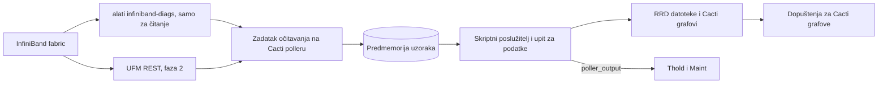

<!-- Source: README.md; SHA256: ce5af61a1bc993ec2aae6d4f22c3885694632f2b1d5eb94e2ce88b8390e96f1e -->

<!-- translations:start -->
[English](../../../README.md) | [简体中文](../zh-CN/README.md) | [हिन्दी](../hi-IN/README.md) | [Español (España)](../es-ES/README.md) | [Español (Latinoamérica)](../es-419/README.md) | [العربية (السعودية)](../ar-SA/README.md) | [Afrikaans](../af-ZA/README.md) | [አማርኛ](../am-ET/README.md) | [العربية (مصر)](../ar-EG/README.md) | [العربية (المغرب)](../ar-MA/README.md) | [বাংলা](../bn-BD/README.md) | [Bosanski](../bs-BA/README.md) | [Deutsch](../de-DE/README.md) | [فارسی](../fa-IR/README.md) | [Filipino](../fil-PH/README.md) | [Français](../fr-FR/README.md) | [Français (Maroc)](../fr-MA/README.md) | [Français (Sénégal)](../fr-SN/README.md) | [Hausa](../ha-NG/README.md) | [עברית](../he-IL/README.md) | [Hrvatski](README.md) | [Bahasa Indonesia](../id-ID/README.md) | [Igbo](../ig-NG/README.md) | [Italiano](../it-IT/README.md) | [日本語](../ja-JP/README.md) | [한국어](../ko-KR/README.md) | [Malagasy](../mg-MG/README.md) | [मराठी](../mr-IN/README.md) | [Bahasa Melayu](../ms-MY/README.md) | [Nederlands](../nl-NL/README.md) | [Polski](../pl-PL/README.md) | [Português (Brasil)](../pt-BR/README.md) | [Русский](../ru-RU/README.md) | [Kinyarwanda](../rw-RW/README.md) | [Soomaali](../so-SO/README.md) | [Српски](../sr-RS/README.md) | [Svenska](../sv-SE/README.md) | [Kiswahili](../sw-KE/README.md) | [தமிழ்](../ta-IN/README.md) | [తెలుగు](../te-IN/README.md) | [ไทย](../th-TH/README.md) | [Türkçe](../tr-TR/README.md) | [Українська](../uk-UA/README.md) | [اردو](../ur-PK/README.md) | [Tiếng Việt](../vi-VN/README.md) | [isiXhosa](../xh-ZA/README.md) | [Yorùbá](../yo-NG/README.md) | [繁體中文](../zh-TW/README.md) | [isiZulu](../zu-ZA/README.md)
<!-- translations:end -->

# plugin_fabric

Dodatak za Cacti 1.2 koji u sustav Cacti uvozi brojače priključaka InfiniBand, širinu i brzinu veze te pokazatelje zagušenja kao uobičajene uređaje, izvore podataka i grafove. Veza koja se umjesto na 4X uspostavila na 1X tada se prikazuje kao graf i Thold uzbuna uz računalo kojem služi, pod dopuštenjima sustava Cacti, uz mogućnost potiskivanja putem dodatka Maint.

> **Stanje: u razvoju, još bez izdanja.** Etapa 2 (temelj) spojena je u granu `main`, a etapa 3 (objekti sustava Cacti i uzbunjivanje) nalazi se na pregledu. Etapa 1 potvrdila je arhitekturu na temelju dokumentacije i izvornog koda izvornih projekata (PR #71); izvješća s izvorima dostupna su u [docs/research/](../../../docs/research/). Etapa 2 donosi temelje dodatka:
>
> - instalaciju, nadogradnju, uklanjanje i provjeru inačice PHP 8.2
> - područja dopuštenja View, Operator i Admin te postavke
> - zapise fabrica
> - granicu naredbi isključivo za čitanje za `perfquery`, `ibnetdiscover` i `iblinkinfo`
> - inventar prema GUID-u, uz sukobe identiteta i prijedloge ponovnog povezivanja
> - stanje veze i predmemoriju očitavanja brojača
> - stranice inventara, administracije i ispravnosti
>
> Etapa 3 donosi objekte sustava Cacti:
>
> - predloške uređaja, podataka i grafova isporučene u XML formatu za Cacti te upit za podatke "Fabric Port"
> - pridruživanje čvora uređaju sustava Cacti ili njegovo stvaranje nakon potvrde ([ADR 0010](../../../docs/decisions/0010-one-device-per-node.md))
> - izvore podataka brojača za grafove te GAUGE izvore podataka za stanje veze i stope namijenjene dodatku Thold ([ADR 0011](../../../docs/decisions/0011-derive-counters-and-gauge-alert-values.md))
> - obradu prekida kontinuiteta i očitavanje zasićenih osnovnih brojača kao nepoznatih ([ADR 0012](../../../docs/decisions/0012-saturated-basic-counters-read-as-unknown.md)), valjanost brojača i poveznice na grafove na stranici priključka te poredak zagušenja
> - cjeloviti test s neizmijenjenim dodacima Thold v1.8.2 i Maint v1.3 te CI zadatak koji pokreće stvarne dijagnostičke alate nad simuliranim fabricom
>
> Fabric se može očitavati samo s glavnog pollera dok se u fazi 3 ne uvede podrška za udaljene prikupljače podataka. Dodatak je ispitan uz lažne alate i simulator fabrica ibsim, ali nikada na stvarnom InfiniBand fabricu. Provjere koje zahtijevaju stvarni fabric ostaju otvorene u tablici provjera uživo na svakoj istraživačkoj stranici. Ovaj projekt nije povezan s projektom Cacti.

## Uloge pristupa

| Područje | Pristup |
| --- | --- |
| Fabric View | Postojeće nadzorne stranice. |
| Fabric Operator | Nadzor te stranica Operacije i osobne potvrde obrade za trijažu. |
| Fabric Admin | Pristup operatera te postojeće radnje konfiguriranja i upravljanja. |

Nakon kopiranja datoteka za nadogradnju otvorite stranicu Dodaci kao administrator kako biste registrirali novo područje. Dodijelite područje Operator izričito u izborniku **Configuration > Users** ili korisničkim skupinama. Nadogradnje zadržavaju postojeće oznake i dodjele područja View i Admin. Pristup Admin nasljeđuje pristup Operator, a pristup Operator nasljeđuje pristup View pri svakom zahtjevu; time se korisnicima ni skupinama ne spremaju trajne dodjele. Postavke dodatka zahtijevaju i pristup Fabric Admin uz Cacti dopuštenje za postavke.

Dopuštenja za uređaje u sustavu Cacti i dalje ograničavaju retke i radnje dostupne svakom korisniku; nepridruženi objekti zahtijevaju administratora. Vjerodajnice, konfiguracija, pridruživanje, brisanje i ostale administrativne izmjene ostaju na administrativnim stranicama. Potvrde vrijede samo tijekom trenutačne korisničke sesije, najdulje jedan sat i samo dok isto opažanje ostaje svježe. Nova ili izmijenjena opažanja ih poništavaju. Nikada ne označavaju neuspjelo mjerenje ispravnim niti potiskuju uzbune.

## Zašto

Degradirana InfiniBand veza i dalje propušta promet. Veza širine 4X koja se ponovno uspostavi na 1X ostavlja priključak u stanju "active", pa SNMP grafovi mrežnog sučelja poslužitelja izgledaju uobičajeno, ali čvrsto povezani poslovi usporavaju. Pokazatelji se nalaze u samom fabricu: svaki priključak prijavljuje svoju aktivnu, omogućenu i podržanu širinu i brzinu, uz brojače pogrešaka i zagušenja. Za njihovo čitanje potrebni su InfiniBand dijagnostički alati ili API upravitelja fabrica. Ručno pokretanje ostavlja tri praznine:

- **Bez povijesti.** Alati `perfquery` i `iblinkinfo` prikazuju trenutačno stanje pa veza koja je bila degradirana prošloga tjedna ostaje nevidljiva.
- **Bez konteksta uređaja.** Priključci fabrica nisu objekti sustava Cacti pa se priključak ne može prikazati na grafu uz poslužitelj koji opslužuje.
- **Bez poveznice prema Cacti uzbunjivanju.** Thold i Maint oslanjaju se na izvore podataka i uređaje sustava Cacti.

Dodatak zatvara te praznine čitanjem fabrica putem vlastitih dijagnostičkih alata (a kasnije putem sustava UFM), prepoznavanjem čvorova i priključaka prema GUID-u te objavljivanjem brojača i stanja veze kao izvora podataka sustava Cacti. Djeluje isključivo u načinu čitanja: nikada ne poništava brojače niti mijenja stanje priključaka.

## Prvo otkrivanje

Novi fabric nema čvorova, a očitavanja sa skriptnog poslužitelja pokreću se samo za čvor pridružen uređaju sustava Cacti. Prvo otkrivanje stoga je ručni korak. Nakon što spremite omogućen fabric, pokrenite sljedeću naredbu jednom na polleru kojem je fabric dodijeljen, pod računom pollera, pri čemu `/path/to/cacti` zamjenjujete svojim direktorijem sustava Cacti (apsolutna putanja radi i iz crona):

```
php /path/to/cacti/plugins/fabric/fabric_sweep.php --fabric=ID --force
```

Inventar se tada popunjava. Pridružite čvorove uređajima sustava Cacti na stranici Upravljanje Fabricom; sljedeća očitavanja pokreću se iz upita za podatke. Dok nijedan čvor fabrica nije pridružen, ništa ne osvježava njegov inventar pa po želji ponovno pokrenite istu naredbu, primjerice putem crona, kako biste zabilježili nove ili nedostajuće čvorove. Stranica ispravnosti prikazuje ovu naredbu za svaki omogućen fabric koji još nije otkriven ili nema pridružen čvor.

## Planirani opseg

| Faza | Opseg | Etape |
|---|---|---|
| 0, istraživanje | Matrica inačica, potvrda ponašanja izvornih projekata, ponašanje brojača na sklopovlju, model ovlasti, MAD proračun, UFM API | [M1](https://github.com/somethingwithproof/plugin_fabric/milestone/1) |
| 1, promatranje | Inventar prema GUID-u, uređaji sustava Cacti, upit za podatke priključaka, izvori podataka za brojače i stanje veze, Thold uzbunjivanje, Maint potiskivanje, stranica ispravnosti | [M2](https://github.com/somethingwithproof/plugin_fabric/milestone/2), [M3](https://github.com/somethingwithproof/plugin_fabric/milestone/3), [M4](https://github.com/somethingwithproof/plugin_fabric/milestone/4) |
| 2, UFM | Pozadinski sustav UFM REST samo za čitanje, upravljanje vjerodajnicama, kontinuitet identiteta između pozadinskih sustava | [M5](https://github.com/somethingwithproof/plugin_fabric/milestone/5) |
| 3, udaljeni rad | Udaljeni prikupljači podataka, replikacija, radnje `remote_agent`, podijeljena očitavanja za velike fabrice | [M6](https://github.com/somethingwithproof/plugin_fabric/milestone/6) |

Izvan opsega: izmjena stanja fabrica, zamjena upravitelja fabrica ili podmreže, vlastiti sustav uzbunjivanja u dodatku, zasebni pozadinski proces ili mrežni protokol te Ethernet ili RoCE fabrici (istraživanje).

## Ciljevi kompatibilnosti

| Komponenta | Cilj |
|---|---|
| Cacti | 1.2.31 ili noviji, bez zakrpa jezgre |
| PHP | 8.2 ili noviji; `setup.php` ostaje sintaksno čitljiv na 8.0 kako bi nepodržano izvodno okruženje dobilo jasnu odbijenicu umjesto neispravnog sučelja sustava Cacti |
| InfiniBand alati | infiniband-diags iz paketa rdma-core; oblici izlaza provjereni prema izvornom kodu v66.0 |
| UFM | UFM Enterprise REST API, faza 2; matrica izdanja je isporuka etape 1 |
| Thold, Maint | Nisu potrebne izmjene |

Zadržite istek vremena skripte u sustavu Cacti na zadanoj vrijednosti od 25 sekundi ili više. Očitavanje pokrenuto čitanjem upita za podatke ograničava izvođenje alata na taj istek umanjen za pet sekundi, čime čuva vrijeme za čitanje predmemorije i odgovor. Kada vremensko ograničenje istekne, upit vraća posljednji važeći uzorak ili nepoznatu vrijednost; u sljedećem ciklusu očitavanje se ponovno pokušava. To ograničenje vrijedi i za PHP poller. Istek vremena od pet sekundi ili manje ne ostavlja vremena za pokretanje alata.

## Arhitektura

- [docs/PLAN.md](../../../docs/PLAN.md) donosi cjelovit plan: arhitekturu, činjenice izvornih sustava na kojima se temelji (s izvorima) i pretpostavke koje još treba potvrditi, model identiteta, pravila za brojače i stanje veze, sigurnosne granice, proračun performansi, ispitivanje i rizike.
- [docs/decisions/](../../../docs/decisions/) sadrži zapise o arhitektonskim odlukama (ADR) za već donesene odluke.
- [docs/REQUIREMENTS.md](../../../docs/REQUIREMENTS.md) povezuje svaku oznaku zahtjeva s pripadajućim predmetom.



## Praćenje rada

- **Etape** slijede etape iz plana. Svaka ima krovni predmet (epic) s popisom podpredmeta i izlaznim dokazima.
- **Predmeti** su razvrstani oznakama vrste: `type: requirement`, `type: research`, `type: decision`, `type: epic`. Predmeti zahtjeva navode brojčano označene, provjerljive zahtjeve (`REQ-AREA-NNN`) i uvjete prihvaćanja.
- **Oznake** dodatno sadrže `area:`, `phase:`, `priority:` i `status:`. Pogledajte [CONTRIBUTING.md](../../../CONTRIBUTING.md#labels).
- [Ploča projekta](https://github.com/users/somethingwithproof/projects/8) prikazuje sve predmete po etapama.

## Doprinos

Pročitajte [CONTRIBUTING.md](../../../CONTRIBUTING.md). Commitovi zahtijevaju DCO potpis. Rasprave o dizajnu odvijaju se u predmetima; otvorene odluke nose oznaku `type: decision`.

## Sigurnost

Sigurnosne propuste prijavite povjerljivo; pogledajte [SECURITY.md](../../../SECURITY.md).

## Licencija

GNU General Public License v2.0, ista licencija kao Cacti i njegovi dodaci. Pogledajte [LICENSE](../../../LICENSE).
