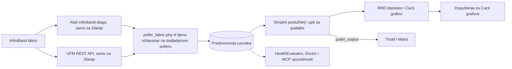

<!-- Source: README.md; SHA256: 79a16fb906f96ee79de2c719f18c38836f555440a7571a4a5ba38c64bb5b099f -->

<!-- translations:start -->
[English](../../../README.md) | [简体中文](../zh-CN/README.md) | [हिन्दी](../hi-IN/README.md) | [Español (España)](../es-ES/README.md) | [Español (Latinoamérica)](../es-419/README.md) | [العربية (السعودية)](../ar-SA/README.md) | [Afrikaans](../af-ZA/README.md) | [አማርኛ](../am-ET/README.md) | [العربية (مصر)](../ar-EG/README.md) | [العربية (المغرب)](../ar-MA/README.md) | [বাংলা](../bn-BD/README.md) | [Bosanski](../bs-BA/README.md) | [Deutsch](../de-DE/README.md) | [فارسی](../fa-IR/README.md) | [Filipino](../fil-PH/README.md) | [Français](../fr-FR/README.md) | [Français (Maroc)](../fr-MA/README.md) | [Français (Sénégal)](../fr-SN/README.md) | [Hausa](../ha-NG/README.md) | [עברית](../he-IL/README.md) | [Hrvatski](README.md) | [Bahasa Indonesia](../id-ID/README.md) | [Igbo](../ig-NG/README.md) | [Italiano](../it-IT/README.md) | [日本語](../ja-JP/README.md) | [한국어](../ko-KR/README.md) | [Malagasy](../mg-MG/README.md) | [मराठी](../mr-IN/README.md) | [Bahasa Melayu](../ms-MY/README.md) | [Nederlands](../nl-NL/README.md) | [Polski](../pl-PL/README.md) | [Português (Brasil)](../pt-BR/README.md) | [Русский](../ru-RU/README.md) | [Kinyarwanda](../rw-RW/README.md) | [Soomaali](../so-SO/README.md) | [Српски](../sr-RS/README.md) | [Svenska](../sv-SE/README.md) | [Kiswahili](../sw-KE/README.md) | [தமிழ்](../ta-IN/README.md) | [తెలుగు](../te-IN/README.md) | [ไทย](../th-TH/README.md) | [Türkçe](../tr-TR/README.md) | [Українська](../uk-UA/README.md) | [اردو](../ur-PK/README.md) | [Tiếng Việt](../vi-VN/README.md) | [isiXhosa](../xh-ZA/README.md) | [Yorùbá](../yo-NG/README.md) | [繁體中文](../zh-TW/README.md) | [isiZulu](../zu-ZA/README.md)
<!-- translations:end -->

# plugin_fabric

Dodatak za Cacti 1.2 (`fabric`, inačica `0.1.0-dev`) koji u sustav Cacti uvozi brojače priključaka InfiniBand, širinu i brzinu veze te pokazatelje zagušenja kao uobičajene uređaje, izvore podataka i grafove. Veza koja se umjesto na 4X uspostavila na 1X tada se prikazuje kao graf i Thold uzbuna uz računalo kojem služi, pod dopuštenjima sustava Cacti, uz prepoznavanje održavanja i potiskivanje putem dodatka Maint.

> **Stanje: u razvoju, još bez izdanja.** Ova grana implementira temelje dodatka, objekte sustava Cacti i uzbunjivanje, planirana pozadinska očitavanja pollera, replikaciju prema udaljenim prikupljačima, pozadinski sustav NVIDIA UFM REST samo za čitanje sa šifriranom riznicom vjerodajnica, upravljanje putem sučelja naredbenog retka Configuration-as-Code (CasC) te priključke (hooks) za ekosustav sustava Cacti (CasC, Doctor i MCP / Abilities API v2). Ispitan je uz lažne alate, sintetičke UFM prijenose i simulator fabrica `ibsim` (rdma-core 50.0), nikada na fizičkom InfiniBand fabricu ni na živom UFM poslužitelju. Provjere koje zahtijevaju sklopovlje ostaju otvorene u [docs/research/](../../research/). Ovaj projekt nije povezan s projektom Cacti.

## Što je implementirano

- **Životni ciklus i shema (v3)**: instalacija, idempotentna nadogradnja, uklanjanje (uz zadano zadržavanje tablica dodatka) te provjera zahtjeva za PHP 8.2 dok ulazne točke ostaju sintaksno čitljive na PHP 8.0.
- **Uloge pristupa i stranice**: područja dopuštenja `Fabric View` (`fabric.php`), `Fabric Operator` (`fabric_operator.php`) i `Fabric Admin` (`fabric_admin.php`, `fabric_health.php`) te kartica postavki pod **Configuration > Settings > Fabrics**.
- **Dijagnostički pozadinski sustav samo za čitanje (`diags`)**: strogo izvođenje nizom argumenata za `perfquery`, `ibnetdiscover` i `iblinkinfo`, inventar po GUID-u s otkrivanjem sukoba identiteta i prijedlozima ponovnog povezivanja, procjena stanja veze i očitavanja brojača po čvoru.
- **Pozadinski sustav NVIDIA UFM REST samo za čitanje (`ufm`) i šifrirana riznica**: REST klijent s popisom dopuštenih ruta isključivo za GET (`/ufmRest/resources/ports`, `/ufmRest/resources/systems`, `/ufmRest/monitoring/session/0/data` i ekvivalenti `/ufmRestV3/...` za autentikaciju tokenom) koji puni iste tablice inventara, stanja veze, uzoraka i ispravnosti kao `diags`. Vjerodajnice (`token` ili `basic`) pohranjuju se šifrirane algoritmom AES-256-GCM u `plugin_fabric_secret` pomoću vanjske 256-bitne datoteke ključa konfigurirane putem `fabric_vault_key_file`. UFM fabrici mogu se definirati putem CasC-a (`cli/fabric.php`) ili repozitorija; web obrazac za administraciju trenutačno prikazuje polja za `diags`.
- **Objekti sustava Cacti, Thold i Maint**: predlošci uređaja, podataka i grafova za Cacti (`templates/fabric-templates.xml`), upit za podatke skriptnog poslužitelja "Fabric Port" (`scripts/ss_fabric_ports.php`, `resource/script_server/fabric_ports.xml`), izvori podataka brojača `DERIVE` te izvori podataka za stanje veze i stopu `GAUGE` za Thold, praćenje prekida kontinuiteta i zasićeni osnovni brojači prijavljeni kao `U`. Integracija s dodatkom Maint (`MaintMaintenance`) poziva `plugin_maint_check_cacti_host()` (uz pričuvnu provjeru putem priključka `is_device_in_maintenance`) kako bi se čvorovi u aktivnom održavanju brojali zasebno i izuzeli iz upozorenja ispravnosti za neuspjela očitavanja i degradirane priključke.
- **Planirana očitavanja, podjela na dijelove (sharding) i udaljeni prikupljači**: `poller_bottom` pokreće `poller_fabric.php` u pozadini za dospjele fabrice dodijeljene trenutačnom polleru, uz lijena očitavanja pokrenuta iz skriptnog poslužitelja. `INFO` deklarira `remote_collect:1, remote_poller:1`, `poller_fabric.php` podržava determinističku podjelu prema GUID-u (`--shard=K/N`), a `replicate_out` replicira retke bez tajni iz `plugin_fabric_fabric` na udaljene prikupljače (`poller_id >= 2`). Unosi riznice (`plugin_fabric_secret`) i vanjske datoteke ključeva nikada se ne repliciraju.
- **CasC CLI i priključci ekosustava**: `cli/fabric.php` za izvoz YAML/XML, provjeru valjanosti, planiranje razlika na suho (dry-run), primjenu uvjetovanu potvrdom i izvješće o ispravnosti te priključci `casc_register_providers`, `doctor_register_checks` i `abilities_register`.

## Uloge pristupa

| Područje | Pristup |
| --- | --- |
| Fabric View | Nadzorni prikazi inventara i priključaka (`fabric.php`). |
| Fabric Operator | Pristup View uz stranicu Operacije (`fabric_operator.php`) i osobne potvrde trijaže. |
| Fabric Admin | Pristup Operator uz konfiguraciju, administrativne radnje (`fabric_admin.php`) i stranicu ispravnosti (`fabric_health.php`). |

Nakon kopiranja datoteka za nadogradnju otvorite stranicu Plugins kao administrator kako biste registrirali nova područja i priključke. Dodijelite područje Operator izričito u izborniku **Configuration > Users** ili korisničkim skupinama. Nadogradnje zadržavaju postojeće oznake i dodjele područja View i Admin. Pristup Admin nasljeđuje pristup Operator, a pristup Operator nasljeđuje pristup View pri svakom zahtjevu; time se korisnicima ni skupinama ne spremaju trajne dodjele. Postavke dodatka zahtijevaju i pristup Fabric Admin uz Cacti dopuštenje za Settings.

Dopuštenja za uređaje u sustavu Cacti ograničavaju retke i radnje dostupne svakom korisniku; nepridruženi objekti zahtijevaju administratora. Vjerodajnice, konfiguracija, pridruživanje, brisanje i ostale administrativne izmjene ostaju na administrativnim stranicama ili u CLI-ju. Potvrde vrijede samo tijekom trenutačne korisničke sesije, najdulje jedan sat i samo dok isto opažanje ostaje svježe. Nova ili izmijenjena opažanja ih poništavaju. Nikada ne označavaju neuspjelo mjerenje ispravnim niti potiskuju uzbune.

## Zašto

Degradirana InfiniBand veza i dalje propušta promet. Veza širine 4X koja se ponovno uspostavi na 1X ostavlja priključak u stanju "active", pa SNMP grafovi mrežnog sučelja poslužitelja izgledaju uobičajeno, ali čvrsto povezani poslovi usporavaju. Pokazatelji se nalaze u samom fabricu: svaki priključak prijavljuje svoju aktivnu, omogućenu i podržanu širinu i brzinu, uz brojače pogrešaka i zagušenja. Za njihovo čitanje potrebni su InfiniBand dijagnostički alati ili API upravitelja fabrica. Ručno pokretanje ostavlja tri praznine:

- **Bez povijesti.** Alati `perfquery` i `iblinkinfo` prikazuju trenutačno stanje pa veza koja je bila degradirana prošloga tjedna ostaje nevidljiva.
- **Bez konteksta uređaja.** Priključci fabrica nisu objekti sustava Cacti pa se priključak ne može prikazati na grafu uz poslužitelj koji opslužuje.
- **Bez poveznice prema Cacti uzbunjivanju.** Thold i Maint oslanjaju se na izvore podataka i uređaje sustava Cacti.

Dodatak zatvara te praznine čitanjem fabrica putem `infiniband-diags` ili NVIDIA UFM REST API-ja, prepoznavanjem čvorova i priključaka prema GUID-u te objavljivanjem brojača i stanja veze kao izvora podataka sustava Cacti. Djeluje isključivo u načinu čitanja: nikada ne poništava brojače niti mijenja stanje priključaka.

## Operacije i CLI

### Pozadinski poller i ručna očitavanja

`fabric_poller_bottom()` pokreće `poller_fabric.php` u pozadini na svakom polleru za omogućene fabrice dodijeljene tom `poller_id` čije je očitavanje dospjelo. Pokretač pollera ili ručno očitavanje možete pokrenuti i izravno na dodijeljenom polleru pod korisničkim računom pollera (pri čemu `/path/to/cacti` zamjenjujete svojim direktorijem sustava Cacti):

```sh
php /path/to/cacti/plugins/fabric/poller_fabric.php [--fabric=ID] [--shard=K/N] [--force] [--debug]
php /path/to/cacti/plugins/fabric/fabric_sweep.php --fabric=ID [--node=GUID] [--force]
```

- `poller_fabric.php` pokreće sve dospjele fabrice za lokalni poller (ili jedan fabric pomoću `--fabric=ID`), provodi zaključavanje registra procesa sustava Cacti i zakupe `ClaimRepository` s vremenskim proračunom od `max(30, intdiv(sweep_interval, 2))` sekundi te podržava `--shard=K/N` (`0 <= K < N`) za determinističku podjelu očitavanja brojača čvorova `diags` prema GUID-u čvora.
- `fabric_sweep.php` pokreće očitavanje na zahtjev jednog omogućenog fabrica (ili jednog čvora pomoću `--node=GUID`) dodijeljenog lokalnom polleru. `--force` zanemaruje je li fabric dospio, ali i dalje poštuje zakupe (claims).

Nakon što prvo otkrivanje popuni inventar, pridružite čvorove uređajima sustava Cacti na stranici Fabric Admin. Zadržite istek vremena skripte u sustavu Cacti na 25 sekundi ili više: lijeno očitavanje pokrenuto čitanjem upita za podatke ograničava izvođenje alata na `script_timeout - 5` sekundi kako bi skriptni poslužitelj na vrijeme vratio posljednji pohranjeni uzorak ili `U`.

### Pozadinski sustav NVIDIA UFM REST i riznica vjerodajnica

Fabric vrste `ufm` zahtijeva `https://` URL bez ugrađenih vjerodajnica, nizova upita ili fragmenata. `UfmSocketTransport` provodi TLS provjeru druge strane i naziva poslužitelja, odbija preusmjeravanja te podržava neobavezni skup CA certifikata (`ufm_ca_file`) i SHA-256 SPKI pribadaču (`ufm_spki_pin`).

Za pohranu UFM vjerodajnica u `plugin_fabric_secret`, konfigurirajte `fabric_vault_key_file` pod **Configuration > Settings > Fabrics** s apsolutnom putanjom do obične datoteke u vlasništvu korisnika pollera (bez simboličkih poveznica ni u jednom nadređenom direktoriju, način `0600`, koja sadrži 64 heksadekadska znaka kao što je `openssl rand -hex 32` ili 32 nasumična neispisiva bajta). Dodatak nikada ne stvara niti zapisuje datoteku ključa, a `replicate_out` nikada ne replicira `plugin_fabric_secret` niti datoteke ključeva na udaljene pollere.

### Configuration-as-Code i CLI za ispravnost

`cli/fabric.php` deklarativno upravlja postavkama dodatka i definicijama fabrica u YAML ili XML formatu te izvještava o ispravnosti uzimajući u obzir održavanje bez pokretanja očitavanja uživo:

```sh
php /path/to/cacti/plugins/fabric/cli/fabric.php export [--format=yaml|xml] [--file=PATH]
php /path/to/cacti/plugins/fabric/cli/fabric.php validate --file=PATH [--format=yaml|xml]
php /path/to/cacti/plugins/fabric/cli/fabric.php plan --file=PATH [--format=yaml|xml]
php /path/to/cacti/plugins/fabric/cli/fabric.php apply --file=PATH --confirm=PLAN_HASH [--format=yaml|xml]
php /path/to/cacti/plugins/fabric/cli/fabric.php health [--format=text|json]
```

`export` stvara nove datoteke s načinom `0600`, prekriva `fabric_vault_key_file` kao `[REDACTED]` te ispisuje imenovane reference `ufm_credential_ref` umjesto tajni. `plan` i `apply` odbijaju ugrađene (inline) vrijednosti `ufm_token`, `ufm_password`, `secret` te ugrađenu vrijednost `fabric_vault_key_file`. `apply` zahtijeva točan `--confirm=PLAN_HASH` koji je proizveo `plan`.

### Priključci ekosustava

Kada su prisutni odgovarajući dodaci za Cacti ili integracije poslužitelja, `setup.php` registrira:

- `casc_register_providers`: izvozi, provjerava valjanost, planira i uz potvrdu primjenjuje konfiguraciju `fabric` (`yaml` i `xml`, shema v1) s prekrivanjem tajni.
- `doctor_register_checks`: pruža četiri dijagnostičke provjere samo za čitanje (`fabric.schema`, `fabric.poller_freshness`, `fabric.identity_conflicts`, `fabric.ufm_vault`).
- `abilities_register`: registrira tri sposobnosti samo za čitanje, nedestruktivne i idempotentne pod kategorijom `fabric`, zaštićene područjem Fabric View (i dopuštenjima uređaja sustava Cacti za pogreške priključaka): `fabric-list-fabrics`, `fabric-get-health` i `fabric-list-port-errors`.

## Opseg i granice

Izvan opsega: izmjena stanja fabrica, poništavanje brojača, zamjena upravitelja fabrica ili podmreže, vlastiti sustav uzbunjivanja u dodatku, zasebni pozadinski proces ili mrežni protokol te Ethernet ili RoCE fabrici.

## Zahtjevi i kompatibilnost

| Komponenta | Cilj |
|---|---|
| Cacti | 1.2.31 ili noviji (`compat = 1.2.31`), bez zakrpa jezgre |
| PHP | 8.2 ili noviji; ulazne točke ostaju sintaksno čitljive na 8.0 i odbijaju aktivaciju na 8.1 kako bi nepodržano izvodno okruženje dobilo odbijenicu umjesto neispravnog sučelja sustava Cacti |
| InfiniBand alati | `infiniband-diags` iz paketa `rdma-core` (testirano u CI-ju s rdma-core 50.0 pod `ibsim`; oblici izlaza provjereni prema izvornom kodu v66.0) |
| UFM | NVIDIA UFM Enterprise REST API (krajnje točke samo za čitanje `ufmRest` i `ufmRestV3`; testirano na sintetičkim prijenosima u jediničnim testovima) |
| Thold, Maint | Nisu potrebne izmjene; CI pokreće cjeloviti test s neizmijenjenim dodacima Thold v1.8.2 i Maint v1.3 |

## Razvoj i testiranje

CI tijek rada (`.github/workflows/plugin-ci-workflow.yml`) testira PHP 8.2 do 8.5 na granama sustava Cacti `release/1.2.31` i `1.2.x`, sintaksnu provjeru ulaznih točaka za PHP 8.0, odbijanje za PHP 8.1, PHPStan, provjeru getteksta/prijevoda, REUSE licenciranje, provjeru tijeka rada, cjelovitu ponovnu reprodukciju za Thold/Maint te simulaciju fabrica `ibsim`.

Uz zaključanu dijeljenu Pest okolinu za dodatke sustava Cacti (`CACTI_PEST_BIN`) i jednokratnu bazu podataka sustava Cacti:

```sh
# Unit tests
"$CACTI_PEST_BIN" --configuration=phpunit.xml

# Lifecycle integration tests (disposable database only)
CACTI_PATH=/path/to/cacti FABRIC_TEST_DATABASE=disposable "$CACTI_PEST_BIN" --configuration=phpunit-integration.xml

# Static analysis (against Cacti 1.2.31)
CACTI_PATH=/path/to/cacti phpstan analyse -c phpstan.neon --no-progress

# Translation template, catalogs, and localized README checks
sh locales/build_gettext.sh --check

# Simulated ibsim fixture parser check
php tests/bin/check-ibsim-fixtures.php tests/fixtures/ibsim
```

## Arhitektura

- [docs/PLAN.md](../../PLAN.md) je plan arhitekture i dizajna: činjenice izvornih sustava s izvorima, otvorene provjere sklopovlja, model identiteta, pravila za brojače i stanje veze, sigurnosne granice, izračuni performansi, testiranje i rizici.
- [docs/decisions/](../../decisions/) sadrži zapise o arhitektonskim odlukama.
- [docs/REQUIREMENTS.md](../../REQUIREMENTS.md) povezuje svaku oznaku zahtjeva s pripadajućim predmetom.



## Praćenje rada

- **Etape** slijede etape iz plana. Svaka ima krovni predmet (epic) s popisom podpredmeta i izlaznim dokazima.
- **Predmeti** su razvrstani oznakama vrste: `type: requirement`, `type: research`, `type: decision`, `type: epic`. Predmeti zahtjeva navode brojčano označene, provjerljive zahtjeve (`REQ-AREA-NNN`) i uvjete prihvaćanja.
- **Oznake** dodatno sadrže `area:`, `phase:`, `priority:` i `status:`. Pogledajte [CONTRIBUTING.md](../../../CONTRIBUTING.md#labels).
- [Ploča projekta](https://github.com/users/somethingwithproof/projects/8) prikazuje sve predmete po etapama.

## Doprinos

Pročitajte [CONTRIBUTING.md](../../../CONTRIBUTING.md). Commitovi zahtijevaju DCO potpis (`git commit -s`). Rasprave o dizajnu odvijaju se u predmetima; otvorene odluke nose oznaku `type: decision`.

## Sigurnost

Sigurnosne propuste prijavite povjerljivo; pogledajte [SECURITY.md](../../../SECURITY.md).

## Licencija

GNU General Public License v2.0, ista licencija kao Cacti i njegovi dodaci. Pogledajte [LICENSE](../../../LICENSE).
