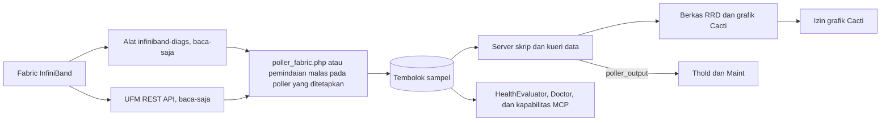

<!-- Source: README.md; SHA256: 79a16fb906f96ee79de2c719f18c38836f555440a7571a4a5ba38c64bb5b099f -->

<!-- translations:start -->
[English](../../../README.md) | [简体中文](../zh-CN/README.md) | [हिन्दी](../hi-IN/README.md) | [Español (España)](../es-ES/README.md) | [Español (Latinoamérica)](../es-419/README.md) | [العربية (السعودية)](../ar-SA/README.md) | [Afrikaans](../af-ZA/README.md) | [አማርኛ](../am-ET/README.md) | [العربية (مصر)](../ar-EG/README.md) | [العربية (المغرب)](../ar-MA/README.md) | [Български](../bg-BG/README.md) | [বাংলা](../bn-BD/README.md) | [Bosanski](../bs-BA/README.md) | [Deutsch](../de-DE/README.md) | [Ελληνικά](../el-GR/README.md) | [فارسی](../fa-IR/README.md) | [Filipino](../fil-PH/README.md) | [Français](../fr-FR/README.md) | [Français (Maroc)](../fr-MA/README.md) | [Français (Sénégal)](../fr-SN/README.md) | [Hausa](../ha-NG/README.md) | [עברית](../he-IL/README.md) | [Hrvatski](../hr-HR/README.md) | [Bahasa Indonesia](README.md) | [Igbo](../ig-NG/README.md) | [Italiano](../it-IT/README.md) | [日本語](../ja-JP/README.md) | [ქართული](../ka-GE/README.md) | [한국어](../ko-KR/README.md) | [Latviešu](../lv-LV/README.md) | [Malagasy](../mg-MG/README.md) | [मराठी](../mr-IN/README.md) | [Bahasa Melayu](../ms-MY/README.md) | [Nederlands](../nl-NL/README.md) | [Polski](../pl-PL/README.md) | [Português (Brasil)](../pt-BR/README.md) | [Português (Portugal)](../pt-PT/README.md) | [Русский](../ru-RU/README.md) | [Kinyarwanda](../rw-RW/README.md) | [Soomaali](../so-SO/README.md) | [Српски](../sr-RS/README.md) | [Svenska](../sv-SE/README.md) | [Kiswahili](../sw-KE/README.md) | [தமிழ்](../ta-IN/README.md) | [తెలుగు](../te-IN/README.md) | [ไทย](../th-TH/README.md) | [Türkçe](../tr-TR/README.md) | [Українська](../uk-UA/README.md) | [اردو](../ur-PK/README.md) | [Tiếng Việt](../vi-VN/README.md) | [isiXhosa](../xh-ZA/README.md) | [Yorùbá](../yo-NG/README.md) | [繁體中文](../zh-TW/README.md) | [isiZulu](../zu-ZA/README.md)
<!-- translations:end -->

# plugin_fabric

Plugin Cacti 1.2 (`fabric`, versi `0.1.0-dev`) yang memasukkan penghitung port InfiniBand, lebar dan kecepatan tautan, serta indikator kemacetan ke dalam Cacti sebagai perangkat, sumber data, dan grafik biasa. Tautan yang ternegosiasi pada 1X alih-alih 4X kemudian muncul sebagai grafik dan peringatan Thold di samping host yang dilayaninya, di bawah izin akses Cacti, dengan kesadaran dan peredaman Maint.

> **Status: dalam pengembangan, belum ada rilis.** Cabang ini mengimplementasikan fondasi plugin, objek Cacti dan peringatan, pemindaian poller latar belakang terjadwal, replikasi pengumpul jarak jauh, backend REST NVIDIA UFM baca-saja dengan brankas kredensial terenkripsi, pengelolaan CLI Configuration-as-Code (CasC), dan hook ekosistem Cacti (CasC, Doctor, dan MCP / Abilities API v2). Plugin ini telah diuji terhadap alat tiruan, transport UFM sintetis, dan simulator fabric `ibsim` (rdma-core 50.0), dan belum pernah diuji pada fabric InfiniBand fisik atau server UFM langsung. Pemeriksaan yang memerlukan perangkat keras tetap terbuka di [docs/research/](../../research/). Proyek ini tidak berafiliasi dengan proyek Cacti.

## Apa yang sudah diimplementasikan

- **Siklus hidup dan skema (v3)**: instalasi, pemutakhiran idempoten, penghapusan instalasi (mempertahankan tabel plugin secara bawaan), serta penjaga persyaratan PHP 8.2 sembari menjaga titik masuk tetap dapat diurai pada PHP 8.0.
- **Peran akses dan halaman**: realm `Fabric View` (`fabric.php`), `Fabric Operator` (`fabric_operator.php`), dan `Fabric Admin` (`fabric_admin.php`, `fabric_health.php`), ditambah tab Pengaturan di bawah **Configuration > Settings > Fabrics**.
- **Backend diagnostik baca-saja (`diags`)**: eksekusi vektor argumen yang ketat untuk `perfquery`, `ibnetdiscover`, dan `iblinkinfo`, inventaris berbasis GUID dengan deteksi konflik identitas dan usulan penautan ulang, evaluasi status tautan, dan pemindaian penghitung per simpul.
- **Backend REST NVIDIA UFM baca-saja (`ufm`) dan brankas terenkripsi**: klien REST daftar izin khusus GET (`/ufmRest/resources/ports`, `/ufmRest/resources/systems`, `/ufmRest/monitoring/session/0/data`, dan padanan `/ufmRestV3/...` untuk autentikasi token) yang mengisi tabel inventaris, status tautan, sampel, dan kesehatan yang sama dengan `diags`. Kredensial (`token` atau `basic`) disimpan terenkripsi dengan AES-256-GCM di `plugin_fabric_secret` menggunakan berkas kunci eksternal 256-bit yang dikonfigurasi oleh `fabric_vault_key_file`. Fabric UFM dapat didefinisikan melalui CasC (`cli/fabric.php`) atau repositori; formulir admin web saat ini menampilkan bidang `diags`.
- **Objek Cacti, Thold, dan Maint**: templat perangkat, data, dan grafik Cacti (`templates/fabric-templates.xml`), kueri data server skrip "Fabric Port" (`scripts/ss_fabric_ports.php`, `resource/script_server/fabric_ports.xml`), sumber data penghitung `DERIVE` dan sumber data status tautan/laju `GAUGE` untuk Thold, pelacakan diskontinuitas, dan penghitung dasar jenuh yang dilaporkan sebagai `U`. Integrasi Maint (`MaintMaintenance`) menanyakan `plugin_maint_check_cacti_host()` (jatuh kembali ke hook `is_device_in_maintenance`) sehingga simpul dalam pemeliharaan aktif dihitung terpisah dan dikecualikan dari peringatan kesehatan pemindaian gagal dan port terdegradasi.
- **Pemindaian terjadwal, sharding, dan pengumpul jarak jauh**: `poller_bottom` menjalankan `poller_fabric.php` di latar belakang untuk fabric yang jatuh tempo yang ditetapkan ke poller saat ini, bersama pemindaian malas (*lazy sweep*) yang dipicu oleh server skrip. `INFO` mendeklarasikan `remote_collect:1, remote_poller:1`, `poller_fabric.php` mendukung sharding GUID deterministik (`--shard=K/N`), dan `replicate_out` mereplikasi baris non-rahasia `plugin_fabric_fabric` ke pengumpul jarak jauh (`poller_id >= 2`). Entri brankas (`plugin_fabric_secret`) dan berkas kunci eksternal tidak pernah direplikasi.
- **CLI CasC dan hook ekosistem**: `cli/fabric.php` untuk ekspor YAML/XML, validasi, perencanaan diff uji coba (*dry-run*), penerapan dengan gerbang konfirmasi, dan pelaporan kesehatan, ditambah hook `casc_register_providers`, `doctor_register_checks`, dan `abilities_register`.

## Peran akses

| Realm | Akses |
| --- | --- |
| Fabric View | Memantau tampilan inventaris dan port (`fabric.php`). |
| Fabric Operator | Akses View ditambah halaman Operasi (`fabric_operator.php`) dan konfirmasi triase pribadi. |
| Fabric Admin | Akses Operator ditambah konfigurasi, tindakan administratif (`fabric_admin.php`), dan halaman kesehatan (`fabric_health.php`). |

Setelah menyalin berkas pemutakhiran, buka halaman Plugins sebagai administrator untuk mendaftarkan realm dan hook baru. Tetapkan realm Operator secara eksplisit di bawah **Configuration > Users** atau grup pengguna. Pemutakhiran mempertahankan ID dan hak akses realm View serta Admin yang sudah ada. Akses Admin mewarisi akses Operator, dan akses Operator mewarisi akses View pada setiap permintaan; hal ini tidak menambahkan izin tersimpan kepada pengguna atau grup. Pengaturan plugin juga memerlukan akses Fabric Admin selain izin Settings milik Cacti.

Izin perangkat Cacti membatasi baris dan tindakan yang tersedia bagi setiap pengguna; objek yang belum dipetakan memerlukan administrator. Kredensial, konfigurasi, pemetaan, penghapusan, dan perubahan administratif lainnya tetap berada di halaman administratif atau CLI. Konfirmasi triase hanya berlaku selama sesi pengguna saat ini, paling lama satu jam dan hanya selama pengamatan yang sama masih baru. Pengamatan baru atau yang berubah akan membatalkannya. Konfirmasi tersebut tidak pernah menandai pengukuran yang gagal sebagai sehat atau meredam peringatan.

## Mengapa

Tautan InfiniBand yang mengalami penurunan kualitas tetap meneruskan lalu lintas. Tautan 4X yang melakukan negosiasi ulang pada 1X tetap membuat port berstatus "active", dan grafik antarmuka SNMP host tampak normal, tetapi pekerjaan yang saling terikat erat melambat. Buktinya ada di dalam fabric: setiap port melaporkan lebar dan kecepatan yang aktif, diaktifkan, dan didukung, ditambah penghitung kesalahan serta kemacetan. Membacanya memerlukan alat diagnostik InfiniBand atau API pengelola fabric. Jika dijalankan secara manual, cara tersebut meninggalkan tiga celah:

- **Tidak ada riwayat.** `perfquery` dan `iblinkinfo` hanya menampilkan kondisi saat ini, sehingga tautan yang mengalami penurunan minggu lalu tidak terlihat.
- **Tidak ada konteks perangkat.** Port fabric bukan merupakan objek Cacti, sehingga port tidak dapat digrafikkan di samping host yang dilayaninya.
- **Tidak ada jalur ke sistem peringatan Cacti.** Thold dan Maint bekerja pada sumber data dan perangkat Cacti.

Plugin ini menutup celah-celah tersebut dengan membaca fabric melalui `infiniband-diags` atau NVIDIA UFM REST API, mengidentifikasi simpul dan port berdasarkan GUID, serta menerbitkan penghitung dan status tautan sebagai sumber data Cacti. Plugin ini bersifat baca-saja: tidak pernah mengatur ulang penghitung atau mengubah status port.

## Operasi dan CLI

### Poller latar belakang dan pemindaian manual

`fabric_poller_bottom()` menjalankan `poller_fabric.php` di latar belakang pada setiap poller untuk fabric yang diaktifkan dan ditetapkan ke `poller_id` tersebut yang sudah jatuh tempo. Anda juga dapat menjalankan pelaksana poller atau pemindaian manual secara langsung pada poller yang ditetapkan sebagai pengguna poller (dengan mengganti `/path/to/cacti` menjadi direktori Cacti Anda):

```sh
php /path/to/cacti/plugins/fabric/poller_fabric.php [--fabric=ID] [--shard=K/N] [--force] [--debug]
php /path/to/cacti/plugins/fabric/fabric_sweep.php --fabric=ID [--node=GUID] [--force]
```

- `poller_fabric.php` menjalankan seluruh fabric yang jatuh tempo untuk poller lokal (atau satu fabric dengan `--fabric=ID`), memberlakukan kunci registri proses Cacti dan sewa `ClaimRepository` dengan anggaran waktu `max(30, intdiv(sweep_interval, 2))` detik, serta mendukung `--shard=K/N` (`0 <= K < N`) untuk memecah pemindaian penghitung simpul `diags` secara deterministik berdasarkan GUID simpul.
- `fabric_sweep.php` menjalankan pemindaian sesuai permintaan untuk satu fabric yang diaktifkan (atau satu simpul dengan `--node=GUID`) yang ditetapkan ke poller lokal. `--force` mengabaikan apakah fabric sudah jatuh tempo sembari tetap menghormati klaim.

Setelah penemuan awal mengisi inventaris, petakan simpul ke perangkat Cacti pada halaman Fabric Admin. Pertahankan batas waktu skrip Cacti pada 25 detik atau lebih tinggi: pemindaian malas yang dimulai oleh pembacaan kueri data membatasi eksekusi alat hingga `script_timeout - 5` detik agar server skrip membalas tepat waktu dengan sampel tersimpan terakhir atau `U`.

### Backend REST NVIDIA UFM dan brankas kredensial

Fabric `ufm` memerlukan URL `https://` tanpa kredensial tertanam, string kueri, atau fragmen. `UfmSocketTransport` memberlakukan verifikasi peer dan nama host TLS, menolak pengalihan (*redirect*), serta mendukung bundel CA opsional (`ufm_ca_file`) dan pin SPKI SHA-256 (`ufm_spki_pin`).

Untuk menyimpan kredensial UFM di `plugin_fabric_secret`, konfigurasikan `fabric_vault_key_file` di bawah **Configuration > Settings > Fabrics** dengan jalur absolut ke berkas biasa milik pengguna poller (tanpa symlink di direktori induk mana pun, mode `0600`, berisi 64 karakter heksadesimal seperti `openssl rand -hex 32` atau 32 byte acak yang tidak dapat dicetak). Plugin tidak pernah membuat atau menulis berkas kunci, dan `replicate_out` tidak pernah mereplikasi `plugin_fabric_secret` atau berkas kunci ke poller jarak jauh.

### Configuration-as-Code dan CLI kesehatan

`cli/fabric.php` mengelola pengaturan plugin dan definisi fabric secara deklaratif dalam YAML atau XML, dan melaporkan kesehatan yang sadar pemeliharaan tanpa menjalankan pemindaian langsung:

```sh
php /path/to/cacti/plugins/fabric/cli/fabric.php export [--format=yaml|xml] [--file=PATH]
php /path/to/cacti/plugins/fabric/cli/fabric.php validate --file=PATH [--format=yaml|xml]
php /path/to/cacti/plugins/fabric/cli/fabric.php plan --file=PATH [--format=yaml|xml]
php /path/to/cacti/plugins/fabric/cli/fabric.php apply --file=PATH --confirm=PLAN_HASH [--format=yaml|xml]
php /path/to/cacti/plugins/fabric/cli/fabric.php health [--format=text|json]
```

`export` membuat berkas baru dengan mode `0600`, menyamarkan `fabric_vault_key_file` sebagai `[REDACTED]`, dan mengeluarkan referensi bernama `ufm_credential_ref` alih-alih rahasia. `plan` dan `apply` menolak nilai sebaris `ufm_token`, `ufm_password`, `secret`, serta nilai sebaris `fabric_vault_key_file`. `apply` memerlukan `--confirm=PLAN_HASH` persis yang dihasilkan oleh `plan`.

### Hook ekosistem

Ketika plugin Cacti atau integrasi host yang sesuai tersedia, `setup.php` mendaftarkan:

- `casc_register_providers`: mengekspor, memvalidasi, merencanakan, dan menerapkan dengan konfirmasi konfigurasi `fabric` (`yaml` dan `xml`, skema v1) disertai penyamaran rahasia.
- `doctor_register_checks`: menyediakan empat pemeriksaan diagnostik baca-saja (`fabric.schema`, `fabric.poller_freshness`, `fabric.identity_conflicts`, `fabric.ufm_vault`).
- `abilities_register`: mendaftarkan tiga kapabilitas baca-saja, non-destruktif, dan idempoten di bawah kategori `fabric`, dijaga oleh realm Fabric View (dan izin perangkat Cacti untuk kesalahan port): `fabric-list-fabrics`, `fabric-get-health`, dan `fabric-list-port-errors`.

## Ruang lingkup dan batasan

Di luar ruang lingkup: mengubah status fabric, mengatur ulang penghitung, menggantikan pengelola fabric atau pengelola subnet, mesin peringatan milik plugin sendiri, daemon atau protokol jaringan kustom, serta fabric Ethernet atau RoCE.

## Persyaratan dan kompatibilitas

| Komponen | Target |
|---|---|
| Cacti | 1.2.31 atau lebih baru (`compat = 1.2.31`), tanpa patch inti |
| PHP | 8.2 atau lebih baru; titik masuk tetap dapat diurai pada 8.0 dan menolak aktivasi pada 8.1 sehingga runtime yang tidak didukung menerima penolakan alih-alih merusak UI Cacti |
| Alat InfiniBand | `infiniband-diags` dari `rdma-core` (diuji di CI dengan rdma-core 50.0 di bawah `ibsim`; format keluaran diperiksa terhadap sumber v66.0) |
| UFM | NVIDIA UFM Enterprise REST API (titik akhir baca-saja `ufmRest` dan `ufmRestV3`; diuji terhadap transport sintetis dalam pengujian unit) |
| Thold, Maint | Tidak memerlukan perubahan; CI menjalankan pengujian menyeluruh (*end-to-end*) dengan Thold v1.8.2 dan Maint v1.3 yang tidak dimodifikasi |

## Pengembangan dan pengujian

Alur kerja CI (`.github/workflows/plugin-ci-workflow.yml`) menguji PHP 8.2 hingga 8.5 terhadap Cacti `release/1.2.31` dan `1.2.x`, linting titik masuk PHP 8.0, penolakan PHP 8.1, PHPStan, verifikasi gettext/terjemahan, lisensi REUSE, linting alur kerja, pemutaran ulang menyeluruh Thold/Maint, dan simulasi fabric `ibsim`.

Dengan rangkaian pengujian plugin Pest bersama milik Cacti yang terkunci (`CACTI_PEST_BIN`) dan basis data Cacti sekali pakai:

```sh
# Unit tests
"$CACTI_PEST_BIN" --configuration=phpunit.xml

# Lifecycle integration tests (disposable database only)
CACTI_PATH=/path/to/cacti FABRIC_TEST_DATABASE=disposable "$CACTI_PEST_BIN" --configuration=phpunit-integration.xml

# Static analysis (against Cacti 1.2.31)
CACTI_PATH=/path/to/cacti phpstan analyse -c phpstan.neon --no-progress

# Translation template, catalogs, and localized README checks
sh locales/build_gettext.sh --check

# Simulated ibsim fixture parser check
php tests/bin/check-ibsim-fixtures.php tests/fixtures/ibsim
```

## Desain

- [docs/PLAN.md](../../PLAN.md) adalah rencana arsitektur dan desain: fakta hulu beserta sumbernya, pemeriksaan perangkat keras yang masih terbuka, model identitas, aturan penghitung dan status tautan, batasan keamanan, perhitungan kinerja, pengujian, dan risiko.
- [docs/decisions/](../../decisions/) menyimpan catatan keputusan arsitektur.
- [docs/REQUIREMENTS.md](../../REQUIREMENTS.md) memetakan setiap ID persyaratan ke issue terkait.



## Pelacakan pekerjaan

- **Milestone** mengikuti milestone pada rencana. Masing-masing memiliki issue epik yang mencantumkan sub-issue dan bukti penyelesaiannya.
- **Issue** dikelompokkan berdasarkan label: `type: requirement`, `type: research`, `type: decision`, `type: epic`. Issue persyaratan menyatakan persyaratan bernomor yang dapat diuji (`REQ-AREA-NNN`) dan kriteria penerimaan.
- **Label** juga mencakup `area:`, `phase:`, `priority:`, dan `status:`. Lihat [CONTRIBUTING.md](../../../CONTRIBUTING.md#labels).
- [Papan proyek](https://github.com/users/somethingwithproof/projects/8) menampilkan seluruh issue di semua milestone.

## Kontribusi

Baca [CONTRIBUTING.md](../../../CONTRIBUTING.md). Setiap commit memerlukan tanda tangan persetujuan DCO (`git commit -s`). Diskusi desain berlangsung pada issue; keputusan yang masih terbuka menggunakan label `type: decision`.

## Keamanan

Laporkan kerentanan secara pribadi; lihat [SECURITY.md](../../../SECURITY.md).

## Lisensi

GNU General Public License v2.0, lisensi yang sama dengan Cacti dan plugin-pluginnya. Lihat [LICENSE](../../../LICENSE).
