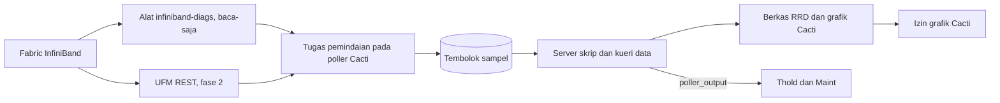

<!-- Source: README.md; SHA256: ce5af61a1bc993ec2aae6d4f22c3885694632f2b1d5eb94e2ce88b8390e96f1e -->

<!-- translations:start -->
[English](../../../README.md) | [简体中文](../zh-CN/README.md) | [हिन्दी](../hi-IN/README.md) | [Español (España)](../es-ES/README.md) | [Español (Latinoamérica)](../es-419/README.md) | [العربية (السعودية)](../ar-SA/README.md) | [Afrikaans](../af-ZA/README.md) | [አማርኛ](../am-ET/README.md) | [العربية (مصر)](../ar-EG/README.md) | [العربية (المغرب)](../ar-MA/README.md) | [বাংলা](../bn-BD/README.md) | [Deutsch](../de-DE/README.md) | [فارسی](../fa-IR/README.md) | [Filipino](../fil-PH/README.md) | [Français](../fr-FR/README.md) | [Français (Maroc)](../fr-MA/README.md) | [Français (Sénégal)](../fr-SN/README.md) | [Hausa](../ha-NG/README.md) | [עברית](../he-IL/README.md) | [Bahasa Indonesia](README.md) | [Igbo](../ig-NG/README.md) | [Italiano](../it-IT/README.md) | [日本語](../ja-JP/README.md) | [한국어](../ko-KR/README.md) | [Malagasy](../mg-MG/README.md) | [मराठी](../mr-IN/README.md) | [Bahasa Melayu](../ms-MY/README.md) | [Nederlands](../nl-NL/README.md) | [Polski](../pl-PL/README.md) | [Português (Brasil)](../pt-BR/README.md) | [Русский](../ru-RU/README.md) | [Kinyarwanda](../rw-RW/README.md) | [Soomaali](../so-SO/README.md) | [Svenska](../sv-SE/README.md) | [Kiswahili](../sw-KE/README.md) | [தமிழ்](../ta-IN/README.md) | [తెలుగు](../te-IN/README.md) | [ไทย](../th-TH/README.md) | [Türkçe](../tr-TR/README.md) | [Українська](../uk-UA/README.md) | [اردو](../ur-PK/README.md) | [Tiếng Việt](../vi-VN/README.md) | [isiXhosa](../xh-ZA/README.md) | [Yorùbá](../yo-NG/README.md) | [繁體中文](../zh-TW/README.md) | [isiZulu](../zu-ZA/README.md)
<!-- translations:end -->

# plugin_fabric

Plugin Cacti 1.2 yang memasukkan penghitung port InfiniBand, lebar dan kecepatan tautan, serta indikator kemacetan ke dalam Cacti sebagai perangkat, sumber data, dan grafik biasa. Tautan yang ternegosiasi pada 1X alih-alih 4X kemudian muncul sebagai grafik dan peringatan Thold di samping host yang dilayaninya, di bawah izin akses Cacti, dan dapat diredam menggunakan Maint.

> **Status: dalam pengembangan, belum ada rilis.** Milestone 2 (fondasi) telah digabungkan ke `main`, dan milestone 3 (objek Cacti dan peringatan) sedang dalam peninjauan. Milestone 1 mengonfirmasi desain terhadap dokumentasi dan kode sumber hulu (PR #71); hasilnya, beserta sumbernya, tersedia di [docs/research/](../../research). Milestone 2 menambahkan fondasi plugin:
>
> - instalasi, pemutakhiran, penghapusan instalasi, dan penjaga versi PHP 8.2
> - realm View, Operator, dan Admin, serta pengaturan
> - catatan fabric
> - batasan perintah baca-saja untuk `perfquery`, `ibnetdiscover`, dan `iblinkinfo`
> - inventaris berdasarkan GUID, disertai konflik identitas dan usulan penautan ulang
> - status tautan dan tembolok pemindaian penghitung
> - halaman inventaris, admin, dan kesehatan
>
> Milestone 3 menambahkan objek-objek Cacti:
>
> - templat perangkat, data, dan grafik yang disertakan sebagai XML templat Cacti, serta kueri data "Fabric Port"
> - pemetaan simpul ke perangkat Cacti, atau pembuatan perangkat baru setelah konfirmasi ([ADR 0010](../../decisions/0010-one-device-per-node.md))
> - sumber data penghitung untuk grafik, serta sumber data status tautan GAUGE dan laju untuk Thold ([ADR 0011](../../decisions/0011-derive-counters-and-gauge-alert-values.md))
> - penanganan diskontinuitas dan penghitung dasar jenuh yang dibaca sebagai *unknown* ([ADR 0012](../../decisions/0012-saturated-basic-counters-read-as-unknown.md)), validitas penghitung dan tautan grafik pada halaman port, serta pemeringkatan kemacetan
> - pengujian menyeluruh (*end-to-end*) dengan Thold v1.8.2 dan Maint v1.3 yang tidak dimodifikasi, serta tugas CI yang menjalankan alat diagnostik asli terhadap fabric tersimulasi
>
> Fabric hanya dapat dipindai dari poller utama hingga pengumpul data jarak jauh didukung pada fase 3. Plugin ini telah diuji terhadap alat tiruan dan simulator fabric ibsim, dan belum pernah diuji pada fabric InfiniBand sesungguhnya. Pemeriksaan yang memerlukan fabric tetap terbuka pada tabel pemeriksaan langsung di setiap halaman riset. Proyek ini tidak berafiliasi dengan proyek Cacti.

## Peran akses

| Realm | Akses |
| --- | --- |
| Fabric View | Halaman pemantauan yang ada. |
| Fabric Operator | Pemantauan ditambah halaman Operasi dan konfirmasi triase pribadi. |
| Fabric Admin | Akses Operator ditambah konfigurasi yang ada dan tindakan administratif. |

Setelah menyalin berkas pemutakhiran, buka halaman Plugins sebagai administrator untuk mendaftarkan
realm baru. Tetapkan realm Operator secara eksplisit di bawah **Configuration > Users** atau grup pengguna.
Pemutakhiran mempertahankan ID dan hak akses realm View serta Admin yang sudah ada. Akses Admin
mewarisi akses Operator, dan akses Operator mewarisi akses View pada setiap permintaan;
hal ini tidak menambahkan izin tersimpan kepada pengguna atau grup. Pengaturan plugin juga memerlukan
akses Fabric Admin selain izin Settings milik Cacti.

Izin perangkat Cacti tetap membatasi baris dan tindakan yang tersedia bagi setiap pengguna; objek yang belum dipetakan memerlukan administrator.
Kredensial, konfigurasi, pemetaan, penghapusan, dan perubahan administratif lainnya
tetap berada di halaman administratif. Konfirmasi triase hanya berlaku selama sesi pengguna
saat ini, paling lama satu jam dan hanya selama pengamatan yang sama masih
baru. Pengamatan baru atau yang berubah akan membatalkannya. Konfirmasi tersebut tidak pernah menandai
pengukuran yang gagal sebagai sehat atau meredam peringatan.

## Mengapa

Tautan InfiniBand yang mengalami penurunan kualitas tetap meneruskan lalu lintas. Tautan 4X yang melakukan negosiasi ulang pada 1X tetap membuat port berstatus "active", dan grafik antarmuka SNMP host tampak normal, tetapi pekerjaan yang saling terikat erat melambat. Buktinya ada di dalam fabric: setiap port melaporkan lebar dan kecepatan yang aktif, diaktifkan, dan didukung, ditambah penghitung kesalahan serta kemacetan. Membacanya memerlukan alat diagnostik InfiniBand atau API pengelola fabric. Jika dijalankan secara manual, cara tersebut meninggalkan tiga celah:

- **Tidak ada riwayat.** `perfquery` dan `iblinkinfo` hanya menampilkan kondisi saat ini, sehingga tautan yang mengalami penurunan minggu lalu tidak terlihat.
- **Tidak ada konteks perangkat.** Port fabric bukan merupakan objek Cacti, sehingga port tidak dapat digrafikkan di samping host yang dilayaninya.
- **Tidak ada jalur ke sistem peringatan Cacti.** Thold dan Maint bekerja pada sumber data dan perangkat Cacti.

Plugin ini menutup celah-celah tersebut dengan membaca fabric melalui alat diagnostiknya sendiri (dan kelak melalui UFM), mengidentifikasi simpul dan port berdasarkan GUID, serta menerbitkan penghitung dan status tautan sebagai sumber data Cacti. Plugin ini bersifat baca-saja: tidak pernah mengatur ulang penghitung atau mengubah status port.

## Penemuan awal

Fabric baru belum memiliki simpul, dan pemindaian hanya dimulai dari server skrip untuk simpul yang sudah dipetakan ke perangkat Cacti. Oleh karena itu, penemuan awal merupakan langkah manual. Setelah menyimpan fabric yang diaktifkan, jalankan perintah ini satu kali pada poller tempat fabric tersebut ditetapkan, menggunakan akun poller, dengan mengganti `/path/to/cacti` menjadi direktori Cacti Anda (jalur absolut juga dapat dijalankan dari cron):

```
php /path/to/cacti/plugins/fabric/fabric_sweep.php --fabric=ID --force
```

Inventaris kemudian akan terisi. Petakan simpul ke perangkat Cacti pada halaman Fabric Admin; pemindaian berikutnya dimulai dari kueri data. Selama belum ada simpul dalam suatu fabric yang dipetakan, tidak ada proses yang menyegarkan inventarisnya, sehingga jalankan kembali perintah yang sama, dari cron jika diinginkan, untuk mencatat simpul baru atau simpul yang hilang. Halaman kesehatan menampilkan perintah ini untuk fabric aktif yang belum ditemukan atau belum memiliki simpul yang dipetakan.

## Ruang lingkup yang direncanakan

| Fase | Ruang lingkup | Milestone |
|---|---|---|
| 0, riset | Matriks versi, konfirmasi perilaku hulu, perilaku penghitung pada perangkat keras, model hak istimewa, anggaran MAD, API UFM | [M1](https://github.com/somethingwithproof/plugin_fabric/milestone/1) |
| 1, observasi | Inventaris berdasarkan GUID, perangkat Cacti, kueri data port, sumber data penghitung dan status tautan, peringatan Thold, peredaman Maint, halaman kesehatan | [M2](https://github.com/somethingwithproof/plugin_fabric/milestone/2), [M3](https://github.com/somethingwithproof/plugin_fabric/milestone/3), [M4](https://github.com/somethingwithproof/plugin_fabric/milestone/4) |
| 2, UFM | Backend REST UFM baca-saja, penanganan kredensial, kesinambungan identitas antar-backend | [M5](https://github.com/somethingwithproof/plugin_fabric/milestone/5) |
| 3, jarak jauh | Pengumpul data jarak jauh, replikasi, tindakan `remote_agent`, pemindaian terpecah untuk fabric berukuran besar | [M6](https://github.com/somethingwithproof/plugin_fabric/milestone/6) |

Di luar ruang lingkup: mengubah status fabric, menggantikan pengelola fabric atau pengelola subnet, mesin peringatan milik plugin sendiri, daemon atau protokol jaringan kustom, serta fabric Ethernet atau RoCE (riset).

## Target kompatibilitas

| Komponen | Target |
|---|---|
| Cacti | 1.2.31 atau lebih baru, tanpa patch inti |
| PHP | 8.2 atau lebih baru; `setup.php` tetap dapat diurai pada 8.0 sehingga runtime yang tidak didukung menerima penolakan alih-alih merusak UI Cacti |
| Alat InfiniBand | infiniband-diags dari rdma-core; format keluaran diperiksa terhadap kode sumber v66.0 |
| UFM | UFM Enterprise REST API, fase 2; matriks rilis merupakan hasil serahan milestone 1 |
| Thold, Maint | Tidak memerlukan perubahan |

Pertahankan batas waktu skrip Cacti pada nilai bawaan 25 detik atau lebih tinggi. Pemindaian yang dimulai oleh pembacaan kueri data membatasi eksekusi alat hingga batas waktu tersebut dikurangi lima detik, guna menyisakan waktu untuk membaca tembolok dan membalas. Ketika alokasi waktu habis, kueri menyajikan sampel terkini terakhir atau *unknown*; siklus berikutnya akan mencoba ulang pemindaian. Batas ini juga berlaku untuk poller PHP. Batas waktu lima detik atau kurang tidak menyisakan waktu untuk menjalankan alat.

## Desain

- [docs/PLAN.md](../../PLAN.md) adalah rencana lengkap: arsitektur, fakta hulu yang menjadi landasannya (beserta sumber) serta asumsi yang masih perlu dikonfirmasi, model identitas, aturan penghitung dan status tautan, batasan keamanan, perhitungan kinerja, pengujian, dan risiko.
- [docs/decisions/](../../decisions) menyimpan catatan keputusan arsitektur untuk pilihan yang telah dibuat.
- [docs/REQUIREMENTS.md](../../REQUIREMENTS.md) memetakan setiap ID persyaratan ke issue terkait.



## Pelacakan pekerjaan

- **Milestone** mengikuti milestone pada rencana. Masing-masing memiliki issue epik yang mencantumkan sub-issue dan bukti penyelesaiannya.
- **Issue** dikelompokkan berdasarkan label: `type: requirement`, `type: research`, `type: decision`, `type: epic`. Issue persyaratan menyatakan persyaratan bernomor yang dapat diuji (`REQ-AREA-NNN`) dan kriteria penerimaan.
- **Label** juga mencakup `area:`, `phase:`, `priority:`, dan `status:`. Lihat [CONTRIBUTING.md](../../../CONTRIBUTING.md#labels).
- [Papan proyek](https://github.com/users/somethingwithproof/projects/8) menampilkan seluruh issue di semua milestone.

## Kontribusi

Baca [CONTRIBUTING.md](../../../CONTRIBUTING.md). Setiap commit memerlukan tanda tangan persetujuan DCO (*DCO sign-off*). Diskusi desain berlangsung pada issue; keputusan yang masih terbuka menggunakan label `type: decision`.

## Keamanan

Laporkan kerentanan secara pribadi; lihat [SECURITY.md](../../../SECURITY.md).

## Lisensi

GNU General Public License v2.0, lisensi yang sama dengan Cacti dan plugin-pluginnya. Lihat [LICENSE](../../../LICENSE).
