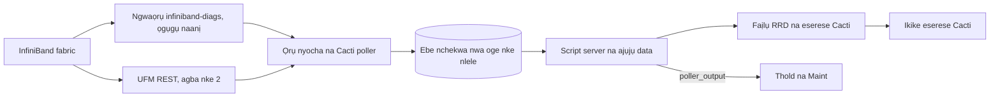

<!-- Source: README.md; SHA256: ce5af61a1bc993ec2aae6d4f22c3885694632f2b1d5eb94e2ce88b8390e96f1e -->

<!-- translations:start -->
[English](../../../README.md) | [简体中文](../zh-CN/README.md) | [हिन्दी](../hi-IN/README.md) | [Español (España)](../es-ES/README.md) | [Español (Latinoamérica)](../es-419/README.md) | [العربية (السعودية)](../ar-SA/README.md) | [Afrikaans](../af-ZA/README.md) | [አማርኛ](../am-ET/README.md) | [العربية (مصر)](../ar-EG/README.md) | [العربية (المغرب)](../ar-MA/README.md) | [বাংলা](../bn-BD/README.md) | [Deutsch](../de-DE/README.md) | [فارسی](../fa-IR/README.md) | [Filipino](../fil-PH/README.md) | [Français](../fr-FR/README.md) | [Français (Maroc)](../fr-MA/README.md) | [Français (Sénégal)](../fr-SN/README.md) | [Hausa](../ha-NG/README.md) | [עברית](../he-IL/README.md) | [Bahasa Indonesia](../id-ID/README.md) | [Igbo](README.md) | [Italiano](../it-IT/README.md) | [日本語](../ja-JP/README.md) | [한국어](../ko-KR/README.md) | [Malagasy](../mg-MG/README.md) | [मराठी](../mr-IN/README.md) | [Bahasa Melayu](../ms-MY/README.md) | [Nederlands](../nl-NL/README.md) | [Polski](../pl-PL/README.md) | [Português (Brasil)](../pt-BR/README.md) | [Русский](../ru-RU/README.md) | [Kinyarwanda](../rw-RW/README.md) | [Soomaali](../so-SO/README.md) | [Svenska](../sv-SE/README.md) | [Kiswahili](../sw-KE/README.md) | [தமிழ்](../ta-IN/README.md) | [తెలుగు](../te-IN/README.md) | [ไทย](../th-TH/README.md) | [Türkçe](../tr-TR/README.md) | [Українська](../uk-UA/README.md) | [اردو](../ur-PK/README.md) | [Tiếng Việt](../vi-VN/README.md) | [isiXhosa](../xh-ZA/README.md) | [Yorùbá](../yo-NG/README.md) | [繁體中文](../zh-TW/README.md) | [isiZulu](../zu-ZA/README.md)
<!-- translations:end -->

# plugin_fabric

Plugin Cacti 1.2 nke na-eweta ihe ngụta ọdụ InfiniBand, obosara na ọsọ njikọ, na ihe ngosi mkpọchi n'ime Cacti dị ka ngwaọrụ nkịtị, isi mmalite data, na eserese. Njikọ zụrụ na 1X kama 4X ga-apụta dị ka eserese na ọkwa Thold n'akụkụ host ọ na-ejere ozi, n'okpuru ikike Cacti, ebe Maint nwere ike igbochi ya.

> **Ọnọdụ: n'ime mmepe, enwebeghị mwepụta.** E jikọtala Milestone 2 (ntọala) na `main`, ma Milestone 3 (ihe Cacti na inye ọkwa) nọ na nyocha. Milestone 1 kwadoro atụmatụ ahụ megide akwụkwọ ntụziaka na koodu isi mmalite nke elu (PR #71); nsonaazụ ya, tinyere isi mmalite ha, dị na [docs/research/](../../research). Milestone 2 na-agbakwunye ntọala plugin:
>
> - ntinye, nkwalite, mwepụ, na nchedo PHP 8.2
> - ngalaba ikike View, Operator na Admin, na ntọala
> - ndekọ fabric
> - oke iwu ọgụgụ naanị maka `perfquery`, `ibnetdiscover`, na `iblinkinfo`
> - ndepụta ngwaọrụ site na GUID, tinyere esemokwu njirimara na atụmatụ njikọta ọhụrụ
> - ọnọdụ njikọ na ebe nchekwa nwa oge nke nyocha ihe ngụta
> - ibe ndepụta ngwaọrụ, ibe nchịkwa, na ibe ahụike
>
> Milestone 3 na-agbakwunye ihe Cacti:
>
> - ndebiri ngwaọrụ, data, na eserese e zigara dị ka XML ndebiri Cacti, na ajụjụ data "Fabric Port"
> - ijikọ node na ngwaọrụ Cacti, ma ọ bụ imepụta otu mgbe e kwadoro ([ADR 0010](../../decisions/0010-one-device-per-node.md))
> - isi mmalite data ihe ngụta maka eserese, na isi mmalite data ọnọdụ njikọ GAUGE na ọnụego maka Thold ([ADR 0011](../../decisions/0011-derive-counters-and-gauge-alert-values.md))
> - njikwa nkwụsị na ihe ngụta ntọala juru eju a na-agụ dị ka ihe a na-amaghị ([ADR 0012](../../decisions/0012-saturated-basic-counters-read-as-unknown.md)), izi ezi nke ihe ngụta na njikọ eserese na ibe ọdụ, na nhazi ọkwa mkpọchi
> - ule site na mmalite ruo ná njedebe na Thold v1.8.2 na Maint v1.3 na-agbanweghị, na ọrụ CI nke na-agba ezigbo ngwaọrụ nchọpụta nsogbu megide fabric e mepụtara na simulator
>
> Enwere ike ịnyocha fabric naanị site na isi poller ruo mgbe a ga-akwado ndị na-anakọta data dị n'ebe dị anya na agba nke 3. E nwalere ya megide ngwaọrụ adịgboroja na simulator fabric ibsim, ọ dịtụbeghị mgbe e nwalere ya na ezigbo fabric InfiniBand. Nlele ndị chọrọ fabric ka ghere oghe na tebụl nlele dị ndụ nke ibe nyocha nke ọ bụla. Ọrụ a enweghị njikọ na ọrụ Cacti.

## Ọrụ nnweta

| Ngalaba ikike | Nnweta |
| --- | --- |
| Fabric View | Ibe nlekọta ndị dị adị. |
| Fabric Operator | Nlekọta tinyere ibe Ọrụ (Operations) na nkwenye nhazi nke onwe. |
| Fabric Admin | Nnweta Operator tinyere nhazi dị adị na omume nchịkwa. |

Mgbe i detụchara faịlụ nkwalite, meghee ibe Plugins dị ka onye nchịkwa iji debanye aha
ngalaba ikike ọhụrụ ahụ. Nye ngalaba ikike Operator n'ụzọ doro anya n'okpuru **Configuration > Users** ma ọ bụ otu ndị ọrụ.
Nkwalite na-edobe ID na ikike nke ngalaba View na Admin dị adị. Nnweta Admin
na-eketa nnweta Operator, ma nnweta Operator na-eketa nnweta View na arịrịọ ọ bụla;
nke a anaghị agbakwunye ikike echekwara na ndị ọrụ ma ọ bụ otu. Ntọala plugin chọkwara
nnweta Fabric Admin na mgbakwunye na ikike Settings nke Cacti.

Ikike ngwaọrụ Cacti ka na-egbochi ahịrị na omume dịịrị onye ọrụ nke ọ bụla; ihe ndị a na-ejikọbeghị chọrọ onye nchịkwa.
Asambodo nzuzo, nhazi, njikọta, nhichapụ na mgbanwe nchịkwa ndị ọzọ
na-anọgide na ibe nchịkwa. Nkwenye na-adị naanị n'oge nnọkọ onye ọrụ
dị ugbu a, maka otu elekere kachasị na naanị mgbe otu nchọpụta ahụ ka dị
ọhụrụ. Nchọpụta ọhụrụ ma ọ bụ nke gbanwere na-eme ka ha ghara ịdị irè. Ha anaghị akara
nha dara ada dị ka nke dị mma ma ọ bụ gbochie ọkwa.

## Ihe kpatara ya

Njikọ InfiniBand dara ada ka na-ebufe okporo ụzọ data. Njikọ 4X nke zụgharịrị na 1X na-ahapụ ọdụ ahụ na "active", ma eserese interface SNMP nke host na-adị ka ọ dị mma, mana ọrụ ndị jikọtara ọnụ nke ukwuu na-eji nwayọọ. Ihe akaebe dị na fabric: ọdụ nke ọ bụla na-akọ obosara na ọsọ ya dị irè, nke e kwere, na nke a na-akwado, tinyere ihe ngụta njehie na mkpọchi. Ịgụ ya na-ewe ngwaọrụ nchọpụta nsogbu InfiniBand ma ọ bụ API onye njikwa fabric. Mgbe e ji aka gbaa ha, ha na-ahapụ oghere atọ:

- **Enweghị akụkọ ihe mere eme.** `perfquery` na `iblinkinfo` na-egosi ihe dị ugbu a, ya mere njikọ dara ada n'izu gara aga adịghị ahụ anya.
- **Enweghị gburugburu ngwaọrụ.** Ọdụ fabric abụghị ihe Cacti, ya mere a gaghị enwe ike ise eserese ọdụ n'akụkụ host ọ na-enye nri.
- **Enweghị ụzọ mbata na ọkwa Cacti.** Thold na Maint na-arụ ọrụ na isi mmalite data na ngwaọrụ Cacti.

Plugin ahụ na-emechi oghere ndị a site n'ịgụ fabric site na ngwaọrụ nchọpụta nsogbu nke ya (na mgbe e mesịrị site na UFM), na-achọpụta node na ọdụ site na GUID, ma na-ebipụta ihe ngụta na ọnọdụ njikọ dị ka isi mmalite data Cacti. Ọ na-agụ naanị: ọ dịtụghị mgbe ọ na-etọgharị ihe ngụta ma ọ bụ na-agbanwe ọnọdụ ọdụ.

## Nchọpụta mbụ

Fabric ọhụrụ enweghị node ọ bụla, ma nyocha na-amalite site na script server naanị maka node e jikọtara na ngwaọrụ Cacti. Ya mere, nchọpụta mbụ bụ nzọụkwụ e ji aka eme. Mgbe i chekwara fabric a rụnyere ọrụ, gbaa nke a otu ugboro na poller e kenyere fabric ahụ, dị ka akaụntụ poller ahụ, ma jiri ndekọ Cacti gị dochie `/path/to/cacti` (ụzọ zuru ezu na-arụkwa ọrụ site na cron):

```
php /path/to/cacti/plugins/fabric/fabric_sweep.php --fabric=ID --force
```

Ndepụta ngwaọrụ ga-ejupụta mgbe ahụ. Jikọọ node na ngwaọrụ Cacti na ibe Fabric Admin; nyocha ndị ga-abịa n'ihu ga-amalite site na ajụjụ data. Mgbe ọ dịghị node nke fabric a jikọtara, ọ dịghị ihe na-emegharị ndepụta ngwaọrụ ya, ya mere gbaa otu iwu ahụ ọzọ, site na cron ma ọ bụrụ na ịchọrọ, iji dekọọ node ọhụrụ ma ọ bụ ndị furu efu. Ibe ahụike na-egosi iwu a maka fabric a rụnyere ọrụ nke a na-achọpụtabeghị ma ọ bụ nke na-enweghị node e jikọtara.

## Oke ọrụ a tụrụ anya ya

| Agba | Oke ọrụ | Milestones |
|---|---|---|
| 0, nyocha | Tebụl ụdị nsụgharị, nkwenye omume koodu elu, omume ihe ngụta na ngwaike, ụdị ikike, mmefu ego MAD, UFM API | [M1](https://github.com/somethingwithproof/plugin_fabric/milestone/1) |
| 1, nlele | Ndepụta ngwaọrụ site na GUID, ngwaọrụ Cacti, ajụjụ data ọdụ, isi mmalite data ihe ngụta na ọnọdụ njikọ, ọkwa Thold, mgbochi Maint, ibe ahụike | [M2](https://github.com/somethingwithproof/plugin_fabric/milestone/2), [M3](https://github.com/somethingwithproof/plugin_fabric/milestone/3), [M4](https://github.com/somethingwithproof/plugin_fabric/milestone/4) |
| 2, UFM | Azụ UFM REST ọgụgụ naanị, njikwa asambodo nzuzo, ịga n'ihu njirimara n'etiti azụ | [M5](https://github.com/somethingwithproof/plugin_fabric/milestone/5) |
| 3, ebe dị anya | Ndị na-anakọta data dị n'ebe dị anya, mmepụtaghachi, omume `remote_agent`, nyocha e kewara ekewa maka nnukwu fabric | [M6](https://github.com/somethingwithproof/plugin_fabric/milestone/6) |

Ihe na-anọghị n'oke ọrụ: ịgbanwe ọnọdụ fabric, dochie onye njikwa fabric ma ọ bụ onye njikwa subnet, injin ọkwa nke plugin nwere, daemon ma ọ bụ usoro netwọkụ omenala, na fabric Ethernet ma ọ bụ RoCE (nyocha).

## Ebumnuche ndakọrịta

| Akụkụ | Ebumnuche |
|---|---|
| Cacti | 1.2.31 ma ọ bụ karịa, enweghị mgbanwe isi koodu |
| PHP | 8.2 ma ọ bụ karịa; `setup.php` na-anọgide na-enwe ike ịnyocha na 8.0 ka oge ọsọ a na-akwadoghị wee nweta ọjụjụ kama imebi Cacti UI |
| Ngwaọrụ InfiniBand | infiniband-diags sitere na rdma-core; e lere usoro mmepụta megide isi mmalite v66.0 |
| UFM | UFM Enterprise REST API, agba nke 2; tebụl mwepụta bụ ihe a ga-ewepụta na milestone 1 |
| Thold, Maint | Enweghị mgbanwe achọrọ |

Debe oge njedebe script nke Cacti na ndabere ya nke sekọnd 25 ma ọ bụ karịa. Nyocha nke ọgụgụ ajụjụ data malitere na-egbochi mmezu ngwaọrụ na oge njedebe ahụ wepụ sekọnd ise, na-echekwa oge iji gụọ ebe nchekwa nwa oge ma zaa. Mgbe oge e kenyere gwụrụ, ajụjụ ahụ na-enye nlele ikpeazụ dị ugbu a ma ọ bụ ihe a na-amaghị; okirikiri na-esote na-anwa nyocha ahụ ọzọ. Oke a na-emetụtakwa PHP poller. Oge njedebe nke sekọnd ise ma ọ bụ obere anaghị ahapụ oge ịmalite ngwaọrụ.

## Atụmatụ

- [docs/PLAN.md](../../PLAN.md) bụ atụmatụ zuru ezu: usoro ihe owuwu, eziokwu koodu elu ọ dabere na ha (tinyere isi mmalite) na echiche ndị a ka ga-akwado, ụdị njirimara, iwu ihe ngụta na ọnọdụ njikọ, oke nchekwa, ngụkọta arụmọrụ, ule, na ihe egwu.
- [docs/decisions/](../../decisions) nwere ndekọ mkpebi usoro ihe owuwu maka nhọrọ ndị e merela.
- [docs/REQUIREMENTS.md](../../REQUIREMENTS.md) na-ejikọ ID ihe achọrọ nke ọ bụla na okwu ya.



## Otu e si esochi ọrụ

- **Milestones** na-eso milestones nke atụmatụ ahụ. Nke ọ bụla nwere okwu epic nke depụtara okwu nta ya na ihe akaebe mpụ.
- **Okwu (Issues)** ka e ji akara hazie ụdị ha: `type: requirement`, `type: research`, `type: decision`, `type: epic`. Okwu ihe achọrọ na-ekwu ihe achọrọ nwere nọmba, nke a ga-enyocha (`REQ-AREA-NNN`) na ụkpụrụ nnabata.
- **Akara (Labels)** na-ebukwa `area:`, `phase:`, `priority:`, na `status:`. Hụ [CONTRIBUTING.md](../../../CONTRIBUTING.md#labels).
- [Bọọdụ ọrụ](https://github.com/users/somethingwithproof/projects/8) na-egosi okwu niile gafee milestones.

## Ntinye aka

Gụọ [CONTRIBUTING.md](../../../CONTRIBUTING.md). Commit chọrọ mbinye aka nkwado DCO. Mkparịta ụka atụmatụ na-eme na okwu; mkpebi ndị ghere oghe na-ebu akara `type: decision`.

## Nchekwa

Kọọ adịghị ike nchekwa na nzuzo; hụ [SECURITY.md](../../../SECURITY.md).

## Ikikere

GNU General Public License v2.0, otu ikikere ahụ dị ka Cacti na plugin ya. Hụ [LICENSE](../../../LICENSE).
