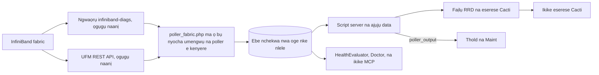

<!-- Source: README.md; SHA256: 79a16fb906f96ee79de2c719f18c38836f555440a7571a4a5ba38c64bb5b099f -->

<!-- translations:start -->
[English](../../../README.md) | [简体中文](../zh-CN/README.md) | [हिन्दी](../hi-IN/README.md) | [Español (España)](../es-ES/README.md) | [Español (Latinoamérica)](../es-419/README.md) | [العربية (السعودية)](../ar-SA/README.md) | [Afrikaans](../af-ZA/README.md) | [አማርኛ](../am-ET/README.md) | [العربية (مصر)](../ar-EG/README.md) | [العربية (المغرب)](../ar-MA/README.md) | [বাংলা](../bn-BD/README.md) | [Bosanski](../bs-BA/README.md) | [Deutsch](../de-DE/README.md) | [فارسی](../fa-IR/README.md) | [Filipino](../fil-PH/README.md) | [Français](../fr-FR/README.md) | [Français (Maroc)](../fr-MA/README.md) | [Français (Sénégal)](../fr-SN/README.md) | [Hausa](../ha-NG/README.md) | [עברית](../he-IL/README.md) | [Hrvatski](../hr-HR/README.md) | [Bahasa Indonesia](../id-ID/README.md) | [Igbo](README.md) | [Italiano](../it-IT/README.md) | [日本語](../ja-JP/README.md) | [한국어](../ko-KR/README.md) | [Malagasy](../mg-MG/README.md) | [मराठी](../mr-IN/README.md) | [Bahasa Melayu](../ms-MY/README.md) | [Nederlands](../nl-NL/README.md) | [Polski](../pl-PL/README.md) | [Português (Brasil)](../pt-BR/README.md) | [Русский](../ru-RU/README.md) | [Kinyarwanda](../rw-RW/README.md) | [Soomaali](../so-SO/README.md) | [Српски](../sr-RS/README.md) | [Svenska](../sv-SE/README.md) | [Kiswahili](../sw-KE/README.md) | [தமிழ்](../ta-IN/README.md) | [తెలుగు](../te-IN/README.md) | [ไทย](../th-TH/README.md) | [Türkçe](../tr-TR/README.md) | [Українська](../uk-UA/README.md) | [اردو](../ur-PK/README.md) | [Tiếng Việt](../vi-VN/README.md) | [isiXhosa](../xh-ZA/README.md) | [Yorùbá](../yo-NG/README.md) | [繁體中文](../zh-TW/README.md) | [isiZulu](../zu-ZA/README.md)
<!-- translations:end -->

# plugin_fabric

Plugin Cacti 1.2 (`fabric`, nsụgharị `0.1.0-dev`) nke na-eweta ihe ngụta ọdụ InfiniBand, obosara na ọsọ njikọ, na ihe ngosi mkpọchi n'ime Cacti dị ka ngwaọrụ nkịtị, isi mmalite data, na eserese. Njikọ zụrụ na 1X kama 4X ga-apụta dị ka eserese na ọkwa Thold n'akụkụ host ọ na-ejere ozi, n'okpuru ikike Cacti, nke nwere mmata na mgbochi Maint.

> **Ọnọdụ: n'ime mmepe, enwebeghị mwepụta.** Alaka a na-emejuputa ntọala plugin, ihe Cacti na inye ọkwa, nyocha poller nke ndabere a haziri oge ya, mmepụtaghachi na ndị na-anakọta data dị n'ebe dị anya, azụ NVIDIA UFM REST ọgụgụ naanị nwere ebe nchekwa nzuzo e zoro ezo, njikwa Configuration-as-Code (CasC) CLI, na hooks nke gburugburu Cacti (CasC, Doctor, na MCP / Abilities API v2). E nwalere ya megide ngwaọrụ adịgboroja, ụzọ mbufe UFM e chepụtara echepụta, na simulator fabric `ibsim` (rdma-core 50.0), ọ dịtụbeghị mgbe e nwalere ya na fabric InfiniBand anụ ahụ ma ọ bụ sava UFM dị ndụ. Nlele ndị chọrọ ngwaike ka ghere oghe na [docs/research/](../../research/). Ọrụ a enweghị njikọ na ọrụ Cacti.

## Ihe e mejuputara

- **Usoro ndụ na atụmatụ data (v3)**: ntinye, nkwalite idempotent, mwepụ (na-edobe tebụl plugin dị ka ndabere), na nchedo chọrọ PHP 8.2 ka ebe mbata na-anọgide na-enwe ike ịnyocha na PHP 8.0.
- **Ọrụ nnweta na ibe**: ngalaba ikike `Fabric View` (`fabric.php`), `Fabric Operator` (`fabric_operator.php`), na `Fabric Admin` (`fabric_admin.php`, `fabric_health.php`), tinyere taabụ Ntọala n'okpuru **Configuration > Settings > Fabrics**.
- **Azụ nchọpụta nsogbu ọgụgụ naanị (`diags`)**: mmezu siri ike nke usoro arụmụka maka `perfquery`, `ibnetdiscover`, na `iblinkinfo`, ndepụta ngwaọrụ nwere GUID nke nwere nchọpụta esemokwu njirimara na atụmatụ njikọta ọhụrụ, nyocha ọnọdụ njikọ, na nyocha ihe ngụta maka node nke ọ bụla.
- **Azụ NVIDIA UFM REST ọgụgụ naanị (`ufm`) na ebe nchekwa nzuzo e zoro ezo**: onye ahịa REST nke naanị GET e kwere (`/ufmRest/resources/ports`, `/ufmRest/resources/systems`, `/ufmRest/monitoring/session/0/data`, na ihe dakọtara `/ufmRestV3/...` maka nkwenye token) nke na-enye otu tebụl ndepụta ngwaọrụ, ọnọdụ njikọ, nlele, na ahụike dị ka `diags`. A na-echekwa asambodo nzuzo (`token` ma ọ bụ `basic`) n'ụzọ e zoro ezo na AES-256-GCM n'ime `plugin_fabric_secret` site n'iji faịlụ igodo dị n'èzí nke bit 256 nke `fabric_vault_key_file` haziri. Enwere ike ịkọwa UFM fabric site na CasC (`cli/fabric.php`) ma ọ bụ ebe nchekwa; fọm nchịkwa weebụ ugbu a na-egosi oghere `diags`.
- **Ihe Cacti, Thold, na Maint**: ndebiri ngwaọrụ, data, na eserese Cacti (`templates/fabric-templates.xml`), ajụjụ data script-server "Fabric Port" (`scripts/ss_fabric_ports.php`, `resource/script_server/fabric_ports.xml`), isi mmalite data ihe ngụta `DERIVE` na isi mmalite data ọnọdụ njikọ/ọnụego `GAUGE` maka Thold, nleba anya nkwụsị, na ihe ngụta ntọala juru eju a na-akọ dị ka `U`. Njikọ Maint (`MaintMaintenance`) na-ajụ `plugin_maint_check_cacti_host()` (na-adaba azụ na hook `is_device_in_maintenance`) ka e wee gụọ node nọ na mmezi na-arụ ọrụ iche ma wepụ ha na ịdọ aka ná ntị ahụike maka nyocha dara ada na ọdụ mebiri emebi.
- **Nyocha a haziri oge ya, sharding, na ndị na-anakọta data dị n'ebe dị anya**: `poller_bottom` na-amalite `poller_fabric.php` na ndabere maka fabric oge ya ruru e kenyere poller dị ugbu a, tinyere nyocha umengwụ (lazy sweeps) nke script server kpalitere. `INFO` na-ekwupụta `remote_collect:1, remote_poller:1`, `poller_fabric.php` na-akwado sharding GUID doro anya (`--shard=K/N`), ma `replicate_out` na-emepụtaghachi ahịrị `plugin_fabric_fabric` na-abụghị nke nzuzo gaa na ndị na-anakọta data dị n'ebe dị anya (`poller_id >= 2`). A naghị emepụtaghachi ndenye ebe nchekwa nzuzo (`plugin_fabric_secret`) na faịlụ igodo dị n'èzí.
- **CasC CLI na hooks nke gburugburu**: `cli/fabric.php` maka mbupụ YAML/XML, nkwenye, atụmatụ diff dry-run, itinye n'ọrụ nwere nkwenye, na akụkọ ahụike, tinyere hooks `casc_register_providers`, `doctor_register_checks`, na `abilities_register`.

## Ọrụ nnweta

| Ngalaba ikike | Nnweta |
| --- | --- |
| Fabric View | Nlekọta ndepụta ngwaọrụ na nlele ọdụ (`fabric.php`). |
| Fabric Operator | Nnweta View tinyere ibe Ọrụ (`fabric_operator.php`) na nkwenye nhazi nke onwe. |
| Fabric Admin | Nnweta Operator tinyere nhazi, omume nchịkwa (`fabric_admin.php`), na ibe ahụike (`fabric_health.php`). |

Mgbe i detụchara faịlụ nkwalite, meghee ibe Plugins dị ka onye nchịkwa iji debanye aha ngalaba ikike na hooks ọhụrụ. Nye ngalaba ikike Operator n'ụzọ doro anya n'okpuru **Configuration > Users** ma ọ bụ otu ndị ọrụ. Nkwalite na-edobe ID na ikike nke ngalaba View na Admin dị adị. Nnweta Admin na-eketa nnweta Operator, ma nnweta Operator na-eketa nnweta View na arịrịọ ọ bụla; nke a anaghị agbakwunye ikike echekwara na ndị ọrụ ma ọ bụ otu. Ntọala plugin chọkwara nnweta Fabric Admin na mgbakwunye na ikike Settings nke Cacti.

Ikike ngwaọrụ Cacti na-egbochi ahịrị na omume dịịrị onye ọrụ nke ọ bụla; ihe ndị a na-ejikọbeghị chọrọ onye nchịkwa. Asambodo nzuzo, nhazi, njikọta, nhichapụ, na mgbanwe nchịkwa ndị ọzọ na-anọgide na ibe nchịkwa ma ọ bụ CLI. Nkwenye na-adị naanị n'oge nnọkọ onye ọrụ dị ugbu a, maka otu elekere kachasị na naanị mgbe otu nchọpụta ahụ ka dị ọhụrụ. Nchọpụta ọhụrụ ma ọ bụ nke gbanwere na-eme ka ha ghara ịdị irè. Ha anaghị akara nha dara ada dị ka nke dị mma ma ọ bụ gbochie ọkwa.

## Ihe kpatara ya

Njikọ InfiniBand dara ada ka na-ebufe okporo ụzọ data. Njikọ 4X nke zụgharịrị na 1X na-ahapụ ọdụ ahụ na "active", ma eserese interface SNMP nke host na-adị ka ọ dị mma, mana ọrụ ndị jikọtara ọnụ nke ukwuu na-eji nwayọọ. Ihe akaebe dị na fabric: ọdụ nke ọ bụla na-akọ obosara na ọsọ ya dị irè, nke e kwere, na nke a na-akwado, tinyere ihe ngụta njehie na mkpọchi. Ịgụ ya na-ewe ngwaọrụ nchọpụta nsogbu InfiniBand ma ọ bụ API onye njikwa fabric. Mgbe e ji aka gbaa ha, ha na-ahapụ oghere atọ:

- **Enweghị akụkọ ihe mere eme.** `perfquery` na `iblinkinfo` na-egosi ihe dị ugbu a, ya mere njikọ dara ada n'izu gara aga adịghị ahụ anya.
- **Enweghị gburugburu ngwaọrụ.** Ọdụ fabric abụghị ihe Cacti, ya mere a gaghị enwe ike ise eserese ọdụ n'akụkụ host ọ na-enye nri.
- **Enweghị ụzọ mbata na ọkwa Cacti.** Thold na Maint na-arụ ọrụ na isi mmalite data na ngwaọrụ Cacti.

Plugin ahụ na-emechi oghere ndị a site n'ịgụ fabric site na `infiniband-diags` ma ọ bụ NVIDIA UFM REST API, na-achọpụta node na ọdụ site na GUID, ma na-ebipụta ihe ngụta na ọnọdụ njikọ dị ka isi mmalite data Cacti. Ọ na-agụ naanị: ọ dịtụghị mgbe ọ na-etọgharị ihe ngụta ma ọ bụ na-agbanwe ọnọdụ ọdụ.

## Ọrụ na CLI

### Poller ndabere na nyocha aka

`fabric_poller_bottom()` na-amalite `poller_fabric.php` na ndabere na poller nke ọ bụla maka fabric a rụnyere ọrụ e kenyere `poller_id` ahụ nke oge nyocha ya ruru. Ị nwekwara ike ịgba onye na-agba poller ma ọ bụ nyocha aka ozugbo na poller e kenyere dị ka onye ọrụ poller (na-eji ndekọ Cacti gị dochie `/path/to/cacti`):

```sh
php /path/to/cacti/plugins/fabric/poller_fabric.php [--fabric=ID] [--shard=K/N] [--force] [--debug]
php /path/to/cacti/plugins/fabric/fabric_sweep.php --fabric=ID [--node=GUID] [--force]
```

- `poller_fabric.php` na-agba fabric niile oge ha ruru maka poller mpaghara (ma ọ bụ otu fabric na `--fabric=ID`), na-etinye mkpọchi ndekọ usoro Cacti na mgbazite `ClaimRepository` nwere mmefu ego oge nke `max(30, intdiv(sweep_interval, 2))` sekọnd, ma na-akwado `--shard=K/N` (`0 <= K < N`) iji kewaa nyocha ihe ngụta node `diags` n'ụzọ doro anya site na GUID node.
- `fabric_sweep.php` na-agba nyocha mgbe achọrọ nke otu fabric a rụnyere ọrụ (ma ọ bụ otu node na `--node=GUID`) e kenyere poller mpaghara. `--force` na-eleghara ma oge fabric ahụ ruru ma na-asọpụrụkwa nkwenye mgbazite (claims).

Mgbe nchọpụta mbụ jupụtara ndepụta ngwaọrụ, jikọọ node na ngwaọrụ Cacti na ibe Fabric Admin. Debe oge njedebe script nke Cacti na sekọnd 25 ma ọ bụ karịa: nyocha umengwụ nke ọgụgụ ajụjụ data malitere na-egbochi mmezu ngwaọrụ na `script_timeout - 5` sekọnd ka script server wee zaa n'oge na nlele ikpeazụ e chekwara ma ọ bụ `U`.

### Azụ NVIDIA UFM REST na ebe nchekwa asambodo nzuzo

Fabric `ufm` chọrọ URL `https://` na-enweghị asambodo e tinyere n'ime, eriri ajụjụ, ma ọ bụ ibe (fragments). `UfmSocketTransport` na-eme ka nkwenye TLS peer na aha host dị irè, na-ajụ ntụgharị (redirects), ma na-akwado ngwugwu CA nhọrọ (`ufm_ca_file`) na ntụtụ SHA-256 SPKI (`ufm_spki_pin`).

Iji chekwaa asambodo UFM na `plugin_fabric_secret`, hazie `fabric_vault_key_file` n'okpuru **Configuration > Settings > Fabrics** nwere ụzọ zuru ezu gaa na faịlụ nkịtị nke onye ọrụ poller nwe (enweghị symlink na ndekọ nne na nna ọ bụla, ọnọdụ `0600`, nwere mkpụrụedemede hex 64 dị ka `openssl rand -hex 32` ma ọ bụ byte 32 na-abụghị nke a na-ebi ebi). Plugin ahụ anaghị emepụta ma ọ bụ dee faịlụ igodo ahụ, ma `replicate_out` anaghị emepụtaghachi `plugin_fabric_secret` ma ọ bụ faịlụ igodo gaa na ndị poller dị n'ebe dị anya.

### Configuration-as-Code na CLI ahụike

`cli/fabric.php` na-ejikwa ntọala plugin na nkọwa fabric n'ụzọ nkwupụta na YAML ma ọ bụ XML, ma na-akọ ahụike maara mmezi n'agbaghị nyocha dị ndụ:

```sh
php /path/to/cacti/plugins/fabric/cli/fabric.php export [--format=yaml|xml] [--file=PATH]
php /path/to/cacti/plugins/fabric/cli/fabric.php validate --file=PATH [--format=yaml|xml]
php /path/to/cacti/plugins/fabric/cli/fabric.php plan --file=PATH [--format=yaml|xml]
php /path/to/cacti/plugins/fabric/cli/fabric.php apply --file=PATH --confirm=PLAN_HASH [--format=yaml|xml]
php /path/to/cacti/plugins/fabric/cli/fabric.php health [--format=text|json]
```

`export` na-emepụta faịlụ ọhụrụ nwere ọnọdụ `0600`, na-ezochi `fabric_vault_key_file` dị ka `[REDACTED]`, ma na-ewepụta ntụaka akpọrọ aha `ufm_credential_ref` kama ihe nzuzo. `plan` na `apply` na-ajụ uru `ufm_token`, `ufm_password`, `secret` dị n'ahịrị, na uru `fabric_vault_key_file` dị n'ahịrị. `apply` chọrọ kpọmkwem `--confirm=PLAN_HASH` nke `plan` mepụtara.

### Hooks nke gburugburu

Mgbe plugin Cacti kwekọrọ ma ọ bụ njikọ host dị, `setup.php` na-edebanye aha:

- `casc_register_providers`: na-ebupụ, na-akwado, na-eme atụmatụ, ma na-etinye n'ọrụ mgbe e kwadoro nhazi `fabric` (`yaml` na `xml`, atụmatụ v1) nwere nzochi ihe nzuzo.
- `doctor_register_checks`: na-enye nlele nchọpụta nsogbu anọ ọgụgụ naanị (`fabric.schema`, `fabric.poller_freshness`, `fabric.identity_conflicts`, `fabric.ufm_vault`).
- `abilities_register`: na-edebanye aha ikike atọ ọgụgụ naanị, ndị na-adịghị emebi ihe, na idempotent n'okpuru ngalaba `fabric`, nke ngalaba ikike Fabric View (na ikike ngwaọrụ Cacti maka njehie ọdụ) na-echebe: `fabric-list-fabrics`, `fabric-get-health`, na `fabric-list-port-errors`.

## Oke ọrụ na ókè

Ihe na-anọghị n'oke ọrụ: ịgbanwe ọnọdụ fabric, ịtọgharị ihe ngụta, dochie onye njikwa fabric ma ọ bụ onye njikwa subnet, injin ọkwa nke plugin nwere, daemon ma ọ bụ usoro netwọkụ omenala, na fabric Ethernet ma ọ bụ RoCE.

## Ihe ndị a chọrọ na ndakọrịta

| Akụkụ | Ebumnuche |
|---|---|
| Cacti | 1.2.31 ma ọ bụ karịa (`compat = 1.2.31`), enweghị mgbanwe isi koodu |
| PHP | 8.2 ma ọ bụ karịa; ebe mbata na-anọgide na-enwe ike ịnyocha na 8.0 ma na-ajụ ịrụ ọrụ na 8.1 ka oge ọsọ a na-akwadoghị wee nweta ọjụjụ kama imebi Cacti UI |
| Ngwaọrụ InfiniBand | `infiniband-diags` sitere na `rdma-core` (e nwalere na CI na rdma-core 50.0 n'okpuru `ibsim`; e lere usoro mmepụta megide isi mmalite v66.0) |
| UFM | NVIDIA UFM Enterprise REST API (ebe njedebe ọgụgụ naanị `ufmRest` na `ufmRestV3`; e nwalere megide ụzọ mbufe e chepụtara echepụta n'ule otu) |
| Thold, Maint | Enweghị mgbanwe achọrọ; CI na-agba ule site na mmalite ruo ná njedebe na Thold v1.8.2 na Maint v1.3 na-agbanweghị |

## Mmepe na nyocha ule

Usoro ọrụ CI (`.github/workflows/plugin-ci-workflow.yml`) na-anwale PHP 8.2 ruo 8.5 megide Cacti `release/1.2.31` na `1.2.x`, nyocha ebe mbata PHP 8.0, ọjụjụ PHP 8.1, PHPStan, nkwenye gettext/nsụgharị, ikikere REUSE, nyocha usoro ọrụ, mmeghachi ule Thold/Maint site na mmalite ruo ná njedebe, na ngosipụta fabric `ibsim`.

Na ngwa ule plugin Pest ekekọrịtara nke Cacti (`CACTI_PEST_BIN`) na nchekwa data Cacti a na-atụfu atụfu:

```sh
# Unit tests
"$CACTI_PEST_BIN" --configuration=phpunit.xml

# Lifecycle integration tests (disposable database only)
CACTI_PATH=/path/to/cacti FABRIC_TEST_DATABASE=disposable "$CACTI_PEST_BIN" --configuration=phpunit-integration.xml

# Static analysis (against Cacti 1.2.31)
CACTI_PATH=/path/to/cacti phpstan analyse -c phpstan.neon --no-progress

# Translation template, catalogs, and localized README checks
sh locales/build_gettext.sh --check

# Simulated ibsim fixture parser check
php tests/bin/check-ibsim-fixtures.php tests/fixtures/ibsim
```

## Atụmatụ

- [docs/PLAN.md](../../PLAN.md) bụ atụmatụ usoro ihe owuwu na imewe: eziokwu koodu elu nwere isi mmalite, nlele ngwaike ghere oghe, ụdị njirimara, iwu ihe ngụta na ọnọdụ njikọ, oke nchekwa, ngụkọta arụmọrụ, ule, na ihe egwu.
- [docs/decisions/](../../decisions/) nwere ndekọ mkpebi usoro ihe owuwu.
- [docs/REQUIREMENTS.md](../../REQUIREMENTS.md) na-ejikọ ID ihe achọrọ nke ọ bụla na okwu ya.



## Otu e si esochi ọrụ

- **Milestones** na-eso milestones nke atụmatụ ahụ. Nke ọ bụla nwere okwu epic nke depụtara okwu nta ya na ihe akaebe mpụ.
- **Okwu (Issues)** ka e ji akara hazie ụdị ha: `type: requirement`, `type: research`, `type: decision`, `type: epic`. Okwu ihe achọrọ na-ekwu ihe achọrọ nwere nọmba, nke a ga-enyocha (`REQ-AREA-NNN`) na ụkpụrụ nnabata.
- **Akara (Labels)** na-ebukwa `area:`, `phase:`, `priority:`, na `status:`. Hụ [CONTRIBUTING.md](../../../CONTRIBUTING.md#labels).
- [Bọọdụ ọrụ](https://github.com/users/somethingwithproof/projects/8) na-egosi okwu niile gafee milestones.

## Ntinye aka

Gụọ [CONTRIBUTING.md](../../../CONTRIBUTING.md). Commit chọrọ mbinye aka nkwado DCO (`git commit -s`). Mkparịta ụka atụmatụ na-eme na okwu; mkpebi ndị ghere oghe na-ebu akara `type: decision`.

## Nchekwa

Kọọ adịghị ike nchekwa na nzuzo; hụ [SECURITY.md](../../../SECURITY.md).

## Ikikere

GNU General Public License v2.0, otu ikikere ahụ dị ka Cacti na plugin ya. Hụ [LICENSE](../../../LICENSE).
