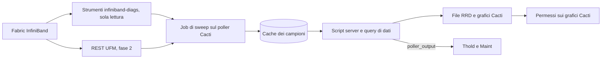

<!-- Source: README.md; SHA256: ce5af61a1bc993ec2aae6d4f22c3885694632f2b1d5eb94e2ce88b8390e96f1e -->

<!-- translations:start -->
[English](../../../README.md) | [简体中文](../zh-CN/README.md) | [हिन्दी](../hi-IN/README.md) | [Español (España)](../es-ES/README.md) | [Español (Latinoamérica)](../es-419/README.md) | [العربية (السعودية)](../ar-SA/README.md) | [Afrikaans](../af-ZA/README.md) | [አማርኛ](../am-ET/README.md) | [العربية (مصر)](../ar-EG/README.md) | [العربية (المغرب)](../ar-MA/README.md) | [বাংলা](../bn-BD/README.md) | [Deutsch](../de-DE/README.md) | [فارسی](../fa-IR/README.md) | [Filipino](../fil-PH/README.md) | [Français](../fr-FR/README.md) | [Français (Maroc)](../fr-MA/README.md) | [Français (Sénégal)](../fr-SN/README.md) | [Hausa](../ha-NG/README.md) | [עברית](../he-IL/README.md) | [Bahasa Indonesia](../id-ID/README.md) | [Igbo](../ig-NG/README.md) | [Italiano](README.md) | [日本語](../ja-JP/README.md) | [한국어](../ko-KR/README.md) | [Malagasy](../mg-MG/README.md) | [मराठी](../mr-IN/README.md) | [Bahasa Melayu](../ms-MY/README.md) | [Nederlands](../nl-NL/README.md) | [Polski](../pl-PL/README.md) | [Português (Brasil)](../pt-BR/README.md) | [Русский](../ru-RU/README.md) | [Kinyarwanda](../rw-RW/README.md) | [Soomaali](../so-SO/README.md) | [Svenska](../sv-SE/README.md) | [Kiswahili](../sw-KE/README.md) | [தமிழ்](../ta-IN/README.md) | [తెలుగు](../te-IN/README.md) | [ไทย](../th-TH/README.md) | [Türkçe](../tr-TR/README.md) | [Українська](../uk-UA/README.md) | [اردو](../ur-PK/README.md) | [Tiếng Việt](../vi-VN/README.md) | [isiXhosa](../xh-ZA/README.md) | [Yorùbá](../yo-NG/README.md) | [繁體中文](../zh-TW/README.md) | [isiZulu](../zu-ZA/README.md)
<!-- translations:end -->

# plugin_fabric

Un plugin per Cacti 1.2 che porta in Cacti i contatori delle porte InfiniBand, la larghezza e la velocità dei collegamenti e gli indicatori di congestione come normali dispositivi, origini dati e grafici. Un collegamento negoziato a 1X anziché a 4X viene quindi visualizzato come un grafico e un avviso Thold accanto all'host che serve, sotto il controllo dei permessi di Cacti, con la possibilità per Maint di sopprimerlo.

> **Stato: in fase di sviluppo, nessuna release ancora disponibile.** La milestone 2 (fondamenta) è stata integrata in `main` e la milestone 3 (oggetti Cacti e avvisi) è in fase di revisione. La milestone 1 ha confermato il progetto rispetto alla documentazione e al codice sorgente upstream (PR #71); i risultati, con le relative fonti, sono disponibili in [docs/research/](../../research). La milestone 2 introduce le fondamenta del plugin:
>
> - installazione, aggiornamento, disinstallazione e controllo della versione PHP 8.2
> - realm View, Operator e Admin e relative impostazioni
> - record del fabric
> - interfaccia di comando in sola lettura per `perfquery`, `ibnetdiscover` e `iblinkinfo`
> - inventario per GUID, con gestione dei conflitti di identità e proposte di ricollegamento
> - stato del collegamento e cache degli sweep dei contatori
> - pagine di inventario, amministrazione e stato di salute
>
> La milestone 3 introduce gli oggetti Cacti:
>
> - template di dispositivo, dati e grafici forniti come file XML di template Cacti e la query di dati "Fabric Port"
> - mappatura di un nodo su un dispositivo Cacti o creazione di un dispositivo su conferma ([ADR 0010](../../decisions/0010-one-device-per-node.md))
> - origini dati di tipo contatore per i grafici e origini dati GAUGE per stato del collegamento e velocità destinati a Thold ([ADR 0011](../../decisions/0011-derive-counters-and-gauge-alert-values.md))
> - gestione delle discontinuità e lettura come unknown dei contatori di base saturati ([ADR 0012](../../decisions/0012-saturated-basic-counters-read-as-unknown.md)), validità dei contatori e collegamenti ai grafici nella pagina della porta e classifica della congestione
> - un test end-to-end con Thold v1.8.2 e Maint v1.3 invariati e un job CI che esegue gli strumenti diagnostici reali su un fabric simulato
>
> Finché i collettori di dati remoti non saranno supportati nella fase 3, lo sweep di un fabric può essere eseguito esclusivamente dal poller principale. Il plugin è stato testato con strumenti simulati e con il simulatore di fabric ibsim, mai su un fabric InfiniBand reale. Le verifiche che richiedono un fabric fisico restano aperte nella tabella dei controlli dal vivo di ciascuna pagina di ricerca. Questo progetto non è affiliato al progetto Cacti.

## Ruoli di accesso

| Realm | Accesso |
| --- | --- |
| Fabric View | Pagine di monitoraggio esistenti. |
| Fabric Operator | Monitoraggio più la pagina Operations e conferme personali di triage. |
| Fabric Admin | Accesso Operator più la configurazione esistente e le azioni amministrative. |

Dopo aver copiato i file di aggiornamento, aprire la pagina Plugins come amministratore per registrare
il nuovo realm. Assegnare esplicitamente il realm Operator in **Configuration > Users** o ai gruppi di utenti.
Gli aggiornamenti mantengono gli ID e le autorizzazioni esistenti dei realm View e Admin. L'accesso Admin
eredita l'accesso Operator e l'accesso Operator eredita l'accesso View a ogni richiesta;
ciò non aggiunge autorizzazioni memorizzate agli utenti o ai gruppi. Le impostazioni del plugin richiedono inoltre
l'accesso Fabric Admin oltre al permesso Settings di Cacti.

I permessi sui dispositivi Cacti continuano a limitare le righe e le azioni disponibili per ciascun utente; gli oggetti non mappati richiedono un amministratore.
Credenziali, configurazione, mappatura, eliminazione e altre modifiche amministrative
rimangono nelle pagine di amministrazione. Le conferme di triage restano valide solo nella sessione
corrente dell'utente, per al massimo un'ora e solo finché la stessa osservazione rimane
attuale. Osservazioni nuove o modificate le invalidano. Non contrassegnano mai come integra una
misurazione fallita né sopprimono gli avvisi.

## Motivazioni

Un collegamento InfiniBand degradato continua a trasmettere traffico. Un collegamento 4X che si rinegozia a 1X mantiene la porta nello stato "active" e i grafici dell'interfaccia SNMP dell'host appaiono normali, ma i job strettamente accoppiati subiscono rallentamenti. L'evidenza si trova nel fabric: ciascuna porta segnala la larghezza e la velocità attive, abilitate e supportate, oltre ai contatori di errore e di congestione. Per leggere tali informazioni occorrono gli strumenti diagnostici InfiniBand o un'API del fabric manager. Eseguiti manualmente, lasciano tre lacune:

- **Nessuna cronologia.** `perfquery` e `iblinkinfo` mostrano soltanto il momento attuale, quindi un collegamento degradatosi la settimana precedente risulta invisibile.
- **Nessun contesto di dispositivo.** Le porte del fabric non sono oggetti Cacti, pertanto non è possibile rappresentare graficamente una porta accanto all'host che alimenta.
- **Nessun percorso verso il sistema di avvisi di Cacti.** Thold e Maint operano su origini dati e dispositivi Cacti.

Il plugin colma queste lacune leggendo il fabric tramite i propri strumenti diagnostici (e in seguito tramite UFM), identificando nodi e porte tramite GUID e pubblicando contatori e stato del collegamento come origini dati Cacti. Opera esclusivamente in lettura: non azzera mai i contatori né modifica lo stato delle porte.

## Prima rilevazione

Un nuovo fabric non ha nodi e gli sweep vengono avviati dallo script server soltanto per un nodo mappato su un dispositivo Cacti. La prima rilevazione è quindi un passaggio manuale. Dopo aver salvato un fabric abilitato, eseguire questo comando una volta sul poller a cui il fabric è assegnato, con l'account del poller, sostituendo `/path/to/cacti` con la propria directory di Cacti (il percorso assoluto funziona anche da cron):

```
php /path/to/cacti/plugins/fabric/fabric_sweep.php --fabric=ID --force
```

L'inventario viene quindi popolato. Mappare i nodi sui dispositivi Cacti nella pagina Fabric Admin; gli sweep successivi verranno avviati dalla query di dati. Finché nessun nodo di un fabric è mappato, nulla ne aggiorna l'inventario; eseguire quindi nuovamente lo stesso comando, eventualmente da cron, per registrare nodi nuovi o mancanti. La pagina dello stato di salute mostra questo comando per ogni fabric abilitato che non sia ancora stato rilevato o che non disponga di alcun nodo mappato.

## Ambito pianificato

| Fase | Ambito | Milestone |
|---|---|---|
| 0, ricerca | Matrice delle versioni, conferma del comportamento upstream, comportamento dei contatori sull'hardware, modello dei privilegi, budget MAD, API UFM | [M1](https://github.com/somethingwithproof/plugin_fabric/milestone/1) |
| 1, osservazione | Inventario per GUID, dispositivi Cacti, query di dati delle porte, origini dati per contatori e stato del collegamento, avvisi Thold, soppressione Maint, pagina dello stato di salute | [M2](https://github.com/somethingwithproof/plugin_fabric/milestone/2), [M3](https://github.com/somethingwithproof/plugin_fabric/milestone/3), [M4](https://github.com/somethingwithproof/plugin_fabric/milestone/4) |
| 2, UFM | Backend REST UFM in sola lettura, gestione delle credenziali, continuità delle identità tra backend | [M5](https://github.com/somethingwithproof/plugin_fabric/milestone/5) |
| 3, remoto | Collettori di dati remoti, replica, azioni `remote_agent`, sweep partizionati per fabric di grandi dimensioni | [M6](https://github.com/somethingwithproof/plugin_fabric/milestone/6) |

Fuori ambito: modifica dello stato del fabric, sostituzione di un fabric manager o subnet manager, motore di avvisi proprietario del plugin, demone o protocollo di rete personalizzato e fabric Ethernet o RoCE (oggetto di ricerca).

## Obiettivi di compatibilità

| Componente | Obiettivo |
|---|---|
| Cacti | 1.2.31 o successivo, nessuna patch al core |
| PHP | 8.2 o successivo; `setup.php` rimane analizzabile su 8.0 affinché un runtime non supportato riceva un rifiuto invece di compromettere l'interfaccia utente di Cacti |
| Strumenti InfiniBand | infiniband-diags da rdma-core; formati di output verificati rispetto al codice sorgente v66.0 |
| UFM | API REST UFM Enterprise, fase 2; la matrice delle release è un deliverable della milestone 1 |
| Thold, Maint | Nessuna modifica richiesta |

Mantenere il timeout degli script di Cacti al valore predefinito di 25 secondi o superiore. Uno sweep avviato dalla lettura di una query di dati limita l'esecuzione dello strumento a tale timeout meno cinque secondi, riservando il tempo necessario per leggere la cache e rispondere. Quando il budget scade, la query restituisce l'ultimo campione attuale oppure unknown; il ciclo successivo ritenta lo sweep. Questo limite si applica anche al poller PHP. Un timeout pari o inferiore a cinque secondi non lascia tempo per avviare alcuno strumento.

## Progettazione

- [docs/PLAN.md](../../PLAN.md) è il piano completo: architettura, fatti upstream su cui si basa (con relative fonti) e ipotesi ancora da confermare, modello di identità, regole per contatori e stato del collegamento, confini di sicurezza, calcoli delle prestazioni, test e rischi.
- [docs/decisions/](../../decisions) contiene gli Architecture Decision Record relativi alle scelte già effettuate.
- [docs/REQUIREMENTS.md](../../REQUIREMENTS.md) mappa ciascun ID di requisito alla relativa issue.



## Tracciamento del lavoro

- **Milestone**: seguono le milestone del piano. Ciascuna dispone di una issue epica che elenca le relative sotto-issue e le evidenze di chiusura.
- **Issue**: sono tipizzate tramite etichette: `type: requirement`, `type: research`, `type: decision`, `type: epic`. Le issue dei requisiti definiscono requisiti numerati e verificabili (`REQ-AREA-NNN`) e i relativi criteri di accettazione.
- **Etichette**: includono anche `area:`, `phase:`, `priority:` e `status:`. Vedere [CONTRIBUTING.md](../../../CONTRIBUTING.md#labels).
- La [bacheca del progetto](https://github.com/users/somethingwithproof/projects/8) mostra tutte le issue suddivise per milestone.

## Contributi

Leggere [CONTRIBUTING.md](../../../CONTRIBUTING.md). I commit richiedono un sign-off DCO. Le discussioni progettuali si svolgono nelle issue; le decisioni aperte riportano l'etichetta `type: decision`.

## Sicurezza

Segnalare le vulnerabilità privatamente; vedere [SECURITY.md](../../../SECURITY.md).

## Licenza

GNU General Public License v2.0, la stessa licenza di Cacti e dei suoi plugin. Vedere [LICENSE](../../../LICENSE).
