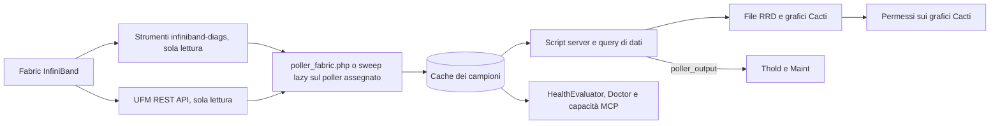

<!-- Source: README.md; SHA256: 79a16fb906f96ee79de2c719f18c38836f555440a7571a4a5ba38c64bb5b099f -->

<!-- translations:start -->
[English](../../../README.md) | [简体中文](../zh-CN/README.md) | [हिन्दी](../hi-IN/README.md) | [Español (España)](../es-ES/README.md) | [Español (Latinoamérica)](../es-419/README.md) | [العربية (السعودية)](../ar-SA/README.md) | [Afrikaans](../af-ZA/README.md) | [አማርኛ](../am-ET/README.md) | [العربية (مصر)](../ar-EG/README.md) | [العربية (المغرب)](../ar-MA/README.md) | [বাংলা](../bn-BD/README.md) | [Bosanski](../bs-BA/README.md) | [Deutsch](../de-DE/README.md) | [فارسی](../fa-IR/README.md) | [Filipino](../fil-PH/README.md) | [Français](../fr-FR/README.md) | [Français (Maroc)](../fr-MA/README.md) | [Français (Sénégal)](../fr-SN/README.md) | [Hausa](../ha-NG/README.md) | [עברית](../he-IL/README.md) | [Hrvatski](../hr-HR/README.md) | [Bahasa Indonesia](../id-ID/README.md) | [Igbo](../ig-NG/README.md) | [Italiano](README.md) | [日本語](../ja-JP/README.md) | [한국어](../ko-KR/README.md) | [Malagasy](../mg-MG/README.md) | [मराठी](../mr-IN/README.md) | [Bahasa Melayu](../ms-MY/README.md) | [Nederlands](../nl-NL/README.md) | [Polski](../pl-PL/README.md) | [Português (Brasil)](../pt-BR/README.md) | [Русский](../ru-RU/README.md) | [Kinyarwanda](../rw-RW/README.md) | [Soomaali](../so-SO/README.md) | [Српски](../sr-RS/README.md) | [Svenska](../sv-SE/README.md) | [Kiswahili](../sw-KE/README.md) | [தமிழ்](../ta-IN/README.md) | [తెలుగు](../te-IN/README.md) | [ไทย](../th-TH/README.md) | [Türkçe](../tr-TR/README.md) | [Українська](../uk-UA/README.md) | [اردو](../ur-PK/README.md) | [Tiếng Việt](../vi-VN/README.md) | [isiXhosa](../xh-ZA/README.md) | [Yorùbá](../yo-NG/README.md) | [繁體中文](../zh-TW/README.md) | [isiZulu](../zu-ZA/README.md)
<!-- translations:end -->

# plugin_fabric

Un plugin per Cacti 1.2 (`fabric`, versione `0.1.0-dev`) che porta in Cacti i contatori delle porte InfiniBand, la larghezza e la velocità dei collegamenti e gli indicatori di congestione come normali dispositivi, origini dati e grafici. Un collegamento negoziato a 1X anziché a 4X viene quindi visualizzato come un grafico e un avviso Thold accanto all'host che serve, sotto il controllo dei permessi di Cacti, con gestione consapevole di Maint e relativa soppressione.

> **Stato: in fase di sviluppo, nessuna release ancora disponibile.** Questo branch implementa le fondamenta del plugin, gli oggetti Cacti e gli avvisi, gli sweep pianificati del poller in background, la replica verso collettori remoti, un backend REST NVIDIA UFM in sola lettura con un vault cifrato delle credenziali, la gestione CLI Configuration-as-Code (CasC) e gli hook dell'ecosistema Cacti (CasC, Doctor e MCP / Abilities API v2). È stato testato con strumenti simulati, trasporti UFM sintetici e il simulatore di fabric `ibsim` (rdma-core 50.0), mai su un fabric InfiniBand fisico o su un server UFM reale. Le verifiche che richiedono hardware restano aperte in [docs/research/](../../research/). Questo progetto non è affiliato al progetto Cacti.

## Funzionalità implementate

- **Ciclo di vita e schema (v3)**: installazione, aggiornamento idempotente, disinstallazione (mantenendo per impostazione predefinita le tabelle del plugin) e controllo del requisito PHP 8.2 lasciando i punti di ingresso analizzabili su PHP 8.0.
- **Ruoli di accesso e pagine**: realm `Fabric View` (`fabric.php`), `Fabric Operator` (`fabric_operator.php`) e `Fabric Admin` (`fabric_admin.php`, `fabric_health.php`), oltre a una scheda delle impostazioni in **Configuration > Settings > Fabrics**.
- **Backend diagnostico in sola lettura (`diags`)**: esecuzione rigorosa tramite vettore di argomenti di `perfquery`, `ibnetdiscover` e `iblinkinfo`, inventario basato su GUID con rilevamento dei conflitti di identità e proposte di ricollegamento, valutazione dello stato del collegamento e sweep dei contatori per singolo nodo.
- **Backend REST NVIDIA UFM in sola lettura (`ufm`) e vault cifrato**: client REST con allowlist per sole richieste GET (`/ufmRest/resources/ports`, `/ufmRest/resources/systems`, `/ufmRest/monitoring/session/0/data` ed equivalenti `/ufmRestV3/...` per l'autenticazione con token) che alimenta le stesse tabelle di inventario, stato dei collegamenti, campioni e stato di salute di `diags`. Le credenziali (`token` o `basic`) sono salvate cifrate con AES-256-GCM in `plugin_fabric_secret` usando un file chiave esterno a 256 bit configurato da `fabric_vault_key_file`. I fabric UFM possono essere definiti tramite CasC (`cli/fabric.php`) o tramite i repository; il modulo di amministrazione web espone attualmente i campi `diags`.
- **Oggetti Cacti, Thold e Maint**: template di dispositivo, dati e grafici Cacti (`templates/fabric-templates.xml`), query di dati dello script server "Fabric Port" (`scripts/ss_fabric_ports.php`, `resource/script_server/fabric_ports.xml`), origini dati di tipo contatore `DERIVE` e origini dati di stato del collegamento e velocità `GAUGE` per Thold, tracciamento delle discontinuità e contatori di base saturati segnalati come `U`. L'integrazione Maint (`MaintMaintenance`) interroga `plugin_maint_check_cacti_host()` (con fallback sull'hook `is_device_in_maintenance`) in modo che i nodi in manutenzione attiva vengano conteggiati separatamente ed esclusi dagli avvisi di salute per sweep falliti e porte degradate.
- **Sweep pianificati, sharding e collettori remoti**: `poller_bottom` avvia `poller_fabric.php` in background per i fabric in scadenza assegnati al poller corrente, insieme agli sweep lazy attivati dallo script server. `INFO` dichiara `remote_collect:1, remote_poller:1`, `poller_fabric.php` supporta lo sharding deterministico per GUID (`--shard=K/N`) e `replicate_out` replica le righe non segrete di `plugin_fabric_fabric` verso i collettori remoti (`poller_id >= 2`). Le voci del vault (`plugin_fabric_secret`) e i file chiave esterni non vengono mai replicati.
- **CLI CasC e hook di ecosistema**: `cli/fabric.php` per esportazione YAML/XML, validazione, pianificazione delle differenze in dry-run, applicazione subordinata a conferma e report sullo stato di salute, oltre agli hook `casc_register_providers`, `doctor_register_checks` e `abilities_register`.

## Ruoli di accesso

| Realm | Accesso |
| --- | --- |
| Fabric View | Monitoraggio delle viste inventario e porte (`fabric.php`). |
| Fabric Operator | Accesso View più la pagina Operations (`fabric_operator.php`) e conferme personali di triage. |
| Fabric Admin | Accesso Operator più configurazione, azioni amministrative (`fabric_admin.php`) e la pagina dello stato di salute (`fabric_health.php`). |

Dopo aver copiato i file di aggiornamento, aprire la pagina Plugins come amministratore per registrare i nuovi realm e hook. Assegnare esplicitamente il realm Operator in **Configuration > Users** o ai gruppi di utenti. Gli aggiornamenti mantengono gli ID e le autorizzazioni esistenti dei realm View e Admin. L'accesso Admin eredita l'accesso Operator e l'accesso Operator eredita l'accesso View a ogni richiesta; ciò non aggiunge autorizzazioni memorizzate agli utenti o ai gruppi. Le impostazioni del plugin richiedono inoltre l'accesso Fabric Admin oltre al permesso Settings di Cacti.

I permessi sui dispositivi Cacti limitano le righe e le azioni disponibili per ciascun utente; gli oggetti non mappati richiedono un amministratore. Credenziali, configurazione, mappatura, eliminazione e altre modifiche amministrative rimangono nelle pagine di amministrazione o nella CLI. Le conferme di triage restano valide solo nella sessione corrente dell'utente, per al massimo un'ora e solo finché la stessa osservazione rimane attuale. Osservazioni nuove o modificate le invalidano. Non contrassegnano mai come integra una misurazione fallita né sopprimono gli avvisi.

## Motivazioni

Un collegamento InfiniBand degradato continua a trasmettere traffico. Un collegamento 4X che si rinegozia a 1X mantiene la porta nello stato "active" e i grafici dell'interfaccia SNMP dell'host appaiono normali, ma i job strettamente accoppiati subiscono rallentamenti. L'evidenza si trova nel fabric: ciascuna porta segnala la larghezza e la velocità attive, abilitate e supportate, oltre ai contatori di errore e di congestione. Per leggere tali informazioni occorrono gli strumenti diagnostici InfiniBand o un'API del fabric manager. Eseguiti manualmente, lasciano tre lacune:

- **Nessuna cronologia.** `perfquery` e `iblinkinfo` mostrano soltanto il momento attuale, quindi un collegamento degradatosi la settimana precedente risulta invisibile.
- **Nessun contesto di dispositivo.** Le porte del fabric non sono oggetti Cacti, pertanto non è possibile rappresentare graficamente una porta accanto all'host che alimenta.
- **Nessun percorso verso il sistema di avvisi di Cacti.** Thold e Maint operano su origini dati e dispositivi Cacti.

Il plugin colma queste lacune leggendo il fabric tramite `infiniband-diags` o l'API REST NVIDIA UFM, identificando nodi e porte tramite GUID e pubblicando contatori e stato del collegamento come origini dati Cacti. Opera esclusivamente in lettura: non azzera mai i contatori né modifica lo stato delle porte.

## Operazioni e CLI

### Poller in background e sweep manuali

`fabric_poller_bottom()` avvia `poller_fabric.php` in background su ciascun poller per i fabric abilitati assegnati a quel `poller_id` il cui sweep è dovuto. È inoltre possibile eseguire il runner del poller o uno sweep manuale direttamente sul poller assegnato con l'account del poller (sostituendo `/path/to/cacti` con la propria directory di Cacti):

```sh
php /path/to/cacti/plugins/fabric/poller_fabric.php [--fabric=ID] [--shard=K/N] [--force] [--debug]
php /path/to/cacti/plugins/fabric/fabric_sweep.php --fabric=ID [--node=GUID] [--force]
```

- `poller_fabric.php` esegue tutti i fabric dovuti per il poller locale (o un singolo fabric con `--fabric=ID`), applica il lock del registro dei processi di Cacti e i lease di `ClaimRepository` con un budget temporale di `max(30, intdiv(sweep_interval, 2))` secondi e supporta `--shard=K/N` (`0 <= K < N`) per partizionare in modo deterministico gli sweep dei contatori dei nodi `diags` in base al GUID del nodo.
- `fabric_sweep.php` esegue uno sweep su richiesta di un fabric abilitato (o di un nodo con `--node=GUID`) assegnato al poller locale. `--force` ignora se il fabric sia in scadenza continuando comunque a rispettare i claim.

Dopo che la prima rilevazione ha popolato l'inventario, mappare i nodi sui dispositivi Cacti nella pagina Fabric Admin. Mantenere il timeout degli script di Cacti a 25 secondi o superiore: uno sweep lazy avviato dalla lettura di una query di dati limita l'esecuzione dello strumento a `script_timeout - 5` secondi affinché lo script server risponda in tempo con l'ultimo campione memorizzato oppure `U`.

### Backend REST NVIDIA UFM e vault delle credenziali

Un fabric `ufm` richiede un URL `https://` privo di credenziali incorporate, query string o frammenti. `UfmSocketTransport` applica la verifica TLS di peer e hostname, rifiuta i reindirizzamenti e supporta un bundle CA opzionale (`ufm_ca_file`) e un pin SPKI SHA-256 (`ufm_spki_pin`).

Per memorizzare le credenziali UFM in `plugin_fabric_secret`, configurare `fabric_vault_key_file` in **Configuration > Settings > Fabrics** con un percorso assoluto verso un file regolare di proprietà dell'utente del poller (senza symlink in alcuna directory padre, modalità `0600`, contenente 64 caratteri esadecimali come `openssl rand -hex 32` oppure 32 byte casuali non stampabili). Il plugin non crea né scrive mai il file chiave e `replicate_out` non replica mai `plugin_fabric_secret` né i file chiave verso i poller remoti.

### Configuration-as-Code e CLI per lo stato di salute

`cli/fabric.php` gestisce le impostazioni del plugin e le definizioni dei fabric in modo dichiarativo in YAML o XML e segnala lo stato di salute tenendo conto della manutenzione senza eseguire sweep dal vivo:

```sh
php /path/to/cacti/plugins/fabric/cli/fabric.php export [--format=yaml|xml] [--file=PATH]
php /path/to/cacti/plugins/fabric/cli/fabric.php validate --file=PATH [--format=yaml|xml]
php /path/to/cacti/plugins/fabric/cli/fabric.php plan --file=PATH [--format=yaml|xml]
php /path/to/cacti/plugins/fabric/cli/fabric.php apply --file=PATH --confirm=PLAN_HASH [--format=yaml|xml]
php /path/to/cacti/plugins/fabric/cli/fabric.php health [--format=text|json]
```

`export` crea nuovi file con modalità `0600`, oscura `fabric_vault_key_file` come `[REDACTED]` ed emette riferimenti nominali `ufm_credential_ref` al posto dei segreti. `plan` e `apply` rifiutano i valori in linea `ufm_token`, `ufm_password`, `secret` e i valori in linea `fabric_vault_key_file`. `apply` richiede esattamente il `--confirm=PLAN_HASH` prodotto da `plan`.

### Hook di ecosistema

Quando i corrispondenti plugin Cacti o integrazioni dell'host sono presenti, `setup.php` registra:

- `casc_register_providers`: esporta, valida, pianifica e applica previa conferma la configurazione `fabric` (`yaml` e `xml`, schema v1) con oscuramento dei segreti.
- `doctor_register_checks`: fornisce quattro controlli diagnostici in sola lettura (`fabric.schema`, `fabric.poller_freshness`, `fabric.identity_conflicts`, `fabric.ufm_vault`).
- `abilities_register`: registra tre capacità in sola lettura, non distruttive e idempotenti sotto la categoria `fabric`, protette dal realm Fabric View (e dai permessi sui dispositivi Cacti per gli errori delle porte): `fabric-list-fabrics`, `fabric-get-health` e `fabric-list-port-errors`.

## Ambito e confini

Fuori ambito: modifica dello stato del fabric, azzeramento dei contatori, sostituzione di un fabric manager o subnet manager, motore di avvisi proprietario del plugin, demone o protocollo di rete personalizzato e fabric Ethernet o RoCE.

## Requisiti e compatibilità

| Componente | Obiettivo |
|---|---|
| Cacti | 1.2.31 o successivo (`compat = 1.2.31`), nessuna patch al core |
| PHP | 8.2 o successivo; i punti di ingresso rimangono analizzabili su 8.0 e rifiutano l'attivazione su 8.1 affinché un runtime non supportato riceva un rifiuto invece di compromettere l'interfaccia utente di Cacti |
| Strumenti InfiniBand | `infiniband-diags` da `rdma-core` (testato in CI con rdma-core 50.0 sotto `ibsim`; formati di output verificati rispetto al codice sorgente v66.0) |
| UFM | API REST NVIDIA UFM Enterprise (endpoint in sola lettura `ufmRest` e `ufmRestV3`; testati contro trasporti sintetici nei test unitari) |
| Thold, Maint | Nessuna modifica richiesta; la CI esegue un test end-to-end con Thold v1.8.2 e Maint v1.3 invariati |

## Sviluppo e test

Il workflow CI (`.github/workflows/plugin-ci-workflow.yml`) testa PHP da 8.2 a 8.5 contro Cacti `release/1.2.31` e `1.2.x`, il linting dei punti di ingresso su PHP 8.0, il rifiuto su PHP 8.1, PHPStan, la verifica di gettext/traduzioni, le licenze REUSE, il linting dei workflow, il replay end-to-end di Thold/Maint e la simulazione di fabric `ibsim`.

Con il harness di plugin Pest condiviso e bloccato di Cacti (`CACTI_PEST_BIN`) e un database Cacti usa e getta:

```sh
# Unit tests
"$CACTI_PEST_BIN" --configuration=phpunit.xml

# Lifecycle integration tests (disposable database only)
CACTI_PATH=/path/to/cacti FABRIC_TEST_DATABASE=disposable "$CACTI_PEST_BIN" --configuration=phpunit-integration.xml

# Static analysis (against Cacti 1.2.31)
CACTI_PATH=/path/to/cacti phpstan analyse -c phpstan.neon --no-progress

# Translation template, catalogs, and localized README checks
sh locales/build_gettext.sh --check

# Simulated ibsim fixture parser check
php tests/bin/check-ibsim-fixtures.php tests/fixtures/ibsim
```

## Progettazione

- [docs/PLAN.md](../../PLAN.md) è il piano di architettura e progettazione: fatti upstream con relative fonti, verifiche hardware aperte, modello di identità, regole per contatori e stato del collegamento, confini di sicurezza, calcoli delle prestazioni, test e rischi.
- [docs/decisions/](../../decisions/) contiene gli Architecture Decision Record.
- [docs/REQUIREMENTS.md](../../REQUIREMENTS.md) mappa ciascun ID di requisito alla relativa issue.



## Tracciamento del lavoro

- **Milestone**: seguono le milestone del piano. Ciascuna dispone di una issue epica che elenca le relative sotto-issue e le evidenze di chiusura.
- **Issue**: sono tipizzate tramite etichette: `type: requirement`, `type: research`, `type: decision`, `type: epic`. Le issue dei requisiti definiscono requisiti numerati e verificabili (`REQ-AREA-NNN`) e i relativi criteri di accettazione.
- **Etichette**: includono anche `area:`, `phase:`, `priority:` e `status:`. Vedere [CONTRIBUTING.md](../../../CONTRIBUTING.md#labels).
- La [bacheca del progetto](https://github.com/users/somethingwithproof/projects/8) mostra tutte le issue suddivise per milestone.

## Contributi

Leggere [CONTRIBUTING.md](../../../CONTRIBUTING.md). I commit richiedono un sign-off DCO (`git commit -s`). Le discussioni progettuali si svolgono nelle issue; le decisioni aperte riportano l'etichetta `type: decision`.

## Sicurezza

Segnalare le vulnerabilità privatamente; vedere [SECURITY.md](../../../SECURITY.md).

## Licenza

GNU General Public License v2.0, la stessa licenza di Cacti e dei suoi plugin. Vedere [LICENSE](../../../LICENSE).
