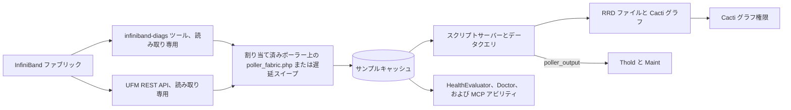

<!-- Source: README.md; SHA256: 79a16fb906f96ee79de2c719f18c38836f555440a7571a4a5ba38c64bb5b099f -->

<!-- translations:start -->
[English](../../../README.md) | [简体中文](../zh-CN/README.md) | [हिन्दी](../hi-IN/README.md) | [Español (España)](../es-ES/README.md) | [Español (Latinoamérica)](../es-419/README.md) | [العربية (السعودية)](../ar-SA/README.md) | [Afrikaans](../af-ZA/README.md) | [አማርኛ](../am-ET/README.md) | [العربية (مصر)](../ar-EG/README.md) | [العربية (المغرب)](../ar-MA/README.md) | [Български](../bg-BG/README.md) | [বাংলা](../bn-BD/README.md) | [Bosanski](../bs-BA/README.md) | [Deutsch](../de-DE/README.md) | [Ελληνικά](../el-GR/README.md) | [فارسی](../fa-IR/README.md) | [Filipino](../fil-PH/README.md) | [Français](../fr-FR/README.md) | [Français (Maroc)](../fr-MA/README.md) | [Français (Sénégal)](../fr-SN/README.md) | [Hausa](../ha-NG/README.md) | [עברית](../he-IL/README.md) | [Hrvatski](../hr-HR/README.md) | [Bahasa Indonesia](../id-ID/README.md) | [Igbo](../ig-NG/README.md) | [Italiano](../it-IT/README.md) | [日本語](README.md) | [ქართული](../ka-GE/README.md) | [한국어](../ko-KR/README.md) | [Latviešu](../lv-LV/README.md) | [Malagasy](../mg-MG/README.md) | [मराठी](../mr-IN/README.md) | [Bahasa Melayu](../ms-MY/README.md) | [Nederlands](../nl-NL/README.md) | [Polski](../pl-PL/README.md) | [Português (Brasil)](../pt-BR/README.md) | [Português (Portugal)](../pt-PT/README.md) | [Русский](../ru-RU/README.md) | [Kinyarwanda](../rw-RW/README.md) | [Soomaali](../so-SO/README.md) | [Српски](../sr-RS/README.md) | [Svenska](../sv-SE/README.md) | [Kiswahili](../sw-KE/README.md) | [தமிழ்](../ta-IN/README.md) | [తెలుగు](../te-IN/README.md) | [ไทย](../th-TH/README.md) | [Türkçe](../tr-TR/README.md) | [Українська](../uk-UA/README.md) | [اردو](../ur-PK/README.md) | [Tiếng Việt](../vi-VN/README.md) | [isiXhosa](../xh-ZA/README.md) | [Yorùbá](../yo-NG/README.md) | [繁體中文](../zh-TW/README.md) | [isiZulu](../zu-ZA/README.md)
<!-- translations:end -->

# plugin_fabric

InfiniBand のポートカウンター、リンク幅・リンク速度、および輻輳インジケーターを、通常のデバイス、データソース、グラフとして Cacti に取り込む Cacti 1.2 プラグイン（`fabric`、バージョン `0.1.0-dev`）です。4X ではなく 1X でトレーニングされたリンクは、Cacti の権限管理のもとで、接続先ホストの隣にグラフと Thold アラートとして表示され、Maint を認識してアラートを抑制できます。

> **ステータス: 開発中（リリース未定）。** このブランチでは、プラグイン基盤、Cacti オブジェクトおよびアラート機能、定期的なバックグラウンドポーラースイープ、リモートコレクターへのレプリケーション、暗号化認証情報ボルトを備えた読み取り専用 NVIDIA UFM REST バックエンド、Configuration-as-Code（CasC）CLI 管理、ならびに Cacti エコシステムフック（CasC、Doctor、MCP / Abilities API v2）を実装しています。テストはモックツール、合成 UFM トランスポート、および `ibsim` ファブリックシミュレーター（rdma-core 50.0）に対して実施されており、物理的な InfiniBand ファブリックや実稼働の UFM サーバーでは未実施です。実機ハードウェアを必要とする確認項目は [docs/research/](../../research/) に未完了のまま残っています。本プロジェクトは Cacti プロジェクトとは関係ありません。

## 実装済み機能

- **ライフサイクルとスキーマ（v3）**: インストール、冪等なアップグレード、アンインストール（デフォルトではプラグインテーブルを保持）、およびエントリーポイントを PHP 8.0 で構文解析可能に保ちつつの PHP 8.2 要件ガード。
- **アクセスロールとページ**: `Fabric View`（`fabric.php`）、`Fabric Operator`（`fabric_operator.php`）、`Fabric Admin`（`fabric_admin.php`、`fabric_health.php`）の各レルム、および **Configuration > Settings > Fabrics** 配下の設定タブ。
- **読み取り専用診断バックエンド（`diags`）**: `perfquery`、`ibnetdiscover`、`iblinkinfo` の厳格な引数ベクトル実行、ID 競合検出と再リンク提案を含む GUID キーのインベントリ、リンク状態評価、およびノード単位のカウンタースイープ。
- **読み取り専用 NVIDIA UFM REST バックエンド（`ufm`）および暗号化ボルト**: 許可リスト方式の GET 専用 REST クライアント（`/ufmRest/resources/ports`、`/ufmRest/resources/systems`、`/ufmRest/monitoring/session/0/data`、およびトークン認証向けの `/ufmRestV3/...` 相当エンドポイント）により、`diags` と同じインベントリ、リンク状態、サンプル、ヘルスの各テーブルにデータを供給します。認証情報（`token` または `basic`）は、`fabric_vault_key_file` で設定された外部 256 ビット鍵ファイルを使用して AES-256-GCM で暗号化され、`plugin_fabric_secret` に保存されます。UFM ファブリックは CasC（`cli/fabric.php`）またはリポジトリ経由で定義できます。Web 管理フォームは現在 `diags` フィールドを公開しています。
- **Cacti オブジェクト、Thold、および Maint**: Cacti デバイス・データ・グラフテンプレート（`templates/fabric-templates.xml`）、「Fabric Port」スクリプトサーバーデータクエリ（`scripts/ss_fabric_ports.php`、`resource/script_server/fabric_ports.xml`）、Thold 用の `DERIVE` カウンターデータソースおよび `GAUGE` リンク状態・レートデータソース、不連続性の追跡、ならびに `U` として報告される飽和した基本カウンター。Maint 統合（`MaintMaintenance`）は `plugin_maint_check_cacti_host()`（利用できない場合は `is_device_in_maintenance` フックにフォールバック）を照会し、アクティブなメンテナンス中のノードを別途集計して、スイープ失敗や劣化ポートのヘルス警告から除外します。
- **スケジュールスイープ、シャーディング、およびリモートコレクター**: `poller_bottom` は、現在のポーラーに割り当てられた実行予定のファブリックに対して `poller_fabric.php` をバックグラウンドで起動し、スクリプトサーバーからトリガーされる遅延スイープ（lazy sweep）と併用されます。`INFO` は `remote_collect:1, remote_poller:1` を宣言し、`poller_fabric.php` はノード GUID に基づく決定論的シャーディング（`--shard=K/N`）をサポートし、`replicate_out` は機密情報を含まない `plugin_fabric_fabric` 行をリモートコレクター（`poller_id >= 2`）にレプリケーションします。ボルト項目（`plugin_fabric_secret`）および外部鍵ファイルは一切レプリケーションされません。
- **CasC CLI とエコシステムフック**: YAML/XML のエクスポート、検証、ドライラン差分計画、確認付き適用、およびヘルスレポート用の `cli/fabric.php` に加え、`casc_register_providers`、`doctor_register_checks`、`abilities_register` フック。

## アクセスロール

| レルム | アクセス権 |
| --- | --- |
| Fabric View | インベントリおよびポートビューの監視（`fabric.php`）。 |
| Fabric Operator | View アクセス権に加え、Operations ページ（`fabric_operator.php`）および個人単位のトリアージ確認。 |
| Fabric Admin | Operator アクセス権に加え、設定、管理操作（`fabric_admin.php`）、およびヘルスページ（`fabric_health.php`）。 |

アップグレード用ファイルをコピーした後、管理者として Plugins ページを開き、新しいレルムとフックを登録してください。Operator レルムは **Configuration > Users** またはユーザーグループから明示的に割り当てる必要があります。アップグレード時には既存の View および Admin のレルム ID と付与済み権限が保持されます。各リクエストにおいて Admin アクセスは Operator アクセスを継承し、Operator アクセスは View アクセスを継承します。これによりユーザーやグループへ保存済みの権限が追加されることはありません。プラグイン設定には、Cacti の Settings 権限に加えて Fabric Admin アクセスも必要です。

各ユーザーが利用できる行と操作は Cacti のデバイス権限によって制限され、未マッピングのオブジェクトには管理者権限が必要です。認証情報、設定、マッピング、削除、その他の管理上の変更は管理ページまたは CLI に集約されています。確認（acknowledgment）は現在のユーザーセッション内でのみ、最大 1 時間、かつ同一の観測結果が最新である間のみ有効です。新規または変更された観測結果によって無効化されます。確認を行っても、失敗した計測が正常とみなされたり、アラートが抑制されたりすることはありません。

## 背景と目的

劣化した InfiniBand リンクであってもトラフィック自体は流れ続けます。4X のリンクが 1X で再トレーニングされてもポートは「active」のままであり、ホストの SNMP インターフェースグラフは正常に見えますが、密結合ジョブの性能は低下します。その根拠はファブリック側にあり、各ポートは active、enabled、supported のリンク幅と速度、さらにエラーカウンターと輻輳カウンターを報告しています。これらを読み取るには InfiniBand 診断ツールまたはファブリックマネージャー API が必要ですが、手動で実行するだけでは次の 3 つの課題が残ります。

- **履歴がない。** `perfquery` や `iblinkinfo` は現在の状態しか表示しないため、先週劣化したリンクを把握できません。
- **デバイスとの関連付けがない。** ファブリックポートは Cacti オブジェクトではないため、接続先のホストと並べてポートをグラフ化できません。
- **Cacti アラートへの経路がない。** Thold や Maint は Cacti のデータソースとデバイスに対して動作します。

本プラグインは、`infiniband-diags` または NVIDIA UFM REST API を通じてファブリックを読み取り、GUID によってノードとポートを識別し、カウンターとリンク状態を Cacti データソースとして公開することでこれらの課題を解決します。動作は読み取り専用であり、カウンターのリセットやポート状態の変更は一切行いません。

## 運用と CLI

### バックグラウンドポーラーと手動スイープ

`fabric_poller_bottom()` は、各ポーラー上で、その `poller_id` に割り当てられたスイープ予定の有効なファブリックに対して `poller_fabric.php` をバックグラウンド起動します。また、割り当てられたポーラー上でポーラーユーザーとして直接ポーラーランナーや手動スイープを実行することもできます（`/path/to/cacti` は実際の Cacti ディレクトリに置き換えてください）。

```sh
php /path/to/cacti/plugins/fabric/poller_fabric.php [--fabric=ID] [--shard=K/N] [--force] [--debug]
php /path/to/cacti/plugins/fabric/fabric_sweep.php --fabric=ID [--node=GUID] [--force]
```

- `poller_fabric.php` はローカルポーラー向けの実行予定ファブリックすべて（または `--fabric=ID` で指定した 1 つのファブリック）を実行し、`max(30, intdiv(sweep_interval, 2))` 秒の時間バジェットで Cacti のプロセスレジストリロックおよび `ClaimRepository` リースを適用し、`--shard=K/N`（`0 <= K < N`）によるノード GUID ベースの決定論的な `diags` ノードカウンタースイープのシャーディングをサポートします。
- `fabric_sweep.php` はローカルポーラーに割り当てられた有効な 1 つのファブリック（または `--node=GUID` で指定した 1 つのノード）のオンデマンドスイープを実行します。`--force` はファブリックが実行予定かどうかを無視しますが、リース（claim）は引き続き尊重します。

初回ディスカバリでインベントリが登録された後、Fabric Admin ページでノードを Cacti デバイスにマッピングしてください。Cacti のスクリプトタイムアウトは 25 秒以上に維持してください。データクエリの読み取りによって開始される遅延スイープでは、スクリプトサーバーが最新の保存済みサンプルまたは `U` を時間内に返せるよう、ツール実行を `script_timeout - 5` 秒に制限します。

### NVIDIA UFM REST バックエンドと認証情報ボルト

`ufm` ファブリックには、埋め込み認証情報、クエリ文字列、フラグメントを含まない `https://` URL が必要です。`UfmSocketTransport` は TLS のピア検証およびホスト名検証を強制し、リダイレクトを拒否し、オプションの CA バンドル（`ufm_ca_file`）および SHA-256 SPKI ピン（`ufm_spki_pin`）をサポートします。

UFM 認証情報を `plugin_fabric_secret` に保存するには、**Configuration > Settings > Fabrics** で `fabric_vault_key_file` にポーラーユーザーが所有する通常ファイルへの絶対パスを設定してください（親ディレクトリにシンボリックリンクを含まないこと、パーミッション `0600`、`openssl rand -hex 32` などの 64 文字の 16 進文字列または 32 バイトの非印字ランダムバイトを格納）。プラグインが鍵ファイルを作成したり書き込んだりすることはなく、`replicate_out` が `plugin_fabric_secret` や鍵ファイルをリモートポーラーへレプリケーションすることもありません。

### Configuration-as-Code とヘルス CLI

`cli/fabric.php` はプラグイン設定とファブリック定義を YAML または XML で宣言的に管理し、ライブスイープを実行せずにメンテナンスを考慮したヘルス状態を報告します。

```sh
php /path/to/cacti/plugins/fabric/cli/fabric.php export [--format=yaml|xml] [--file=PATH]
php /path/to/cacti/plugins/fabric/cli/fabric.php validate --file=PATH [--format=yaml|xml]
php /path/to/cacti/plugins/fabric/cli/fabric.php plan --file=PATH [--format=yaml|xml]
php /path/to/cacti/plugins/fabric/cli/fabric.php apply --file=PATH --confirm=PLAN_HASH [--format=yaml|xml]
php /path/to/cacti/plugins/fabric/cli/fabric.php health [--format=text|json]
```

`export` は新規ファイルをパーミッション `0600` で作成し、`fabric_vault_key_file` を `[REDACTED]` として伏字にし、機密値ではなく名前付き参照 `ufm_credential_ref` を出力します。`plan` と `apply` はインラインの `ufm_token`、`ufm_password`、`secret`、およびインラインの `fabric_vault_key_file` 値を拒否します。`apply` には `plan` が生成した正確な `--confirm=PLAN_HASH` が必要です。

### エコシステムフック

対応する Cacti プラグインまたはホスト統合が存在する場合、`setup.php` は以下を登録します。

- `casc_register_providers`: 機密情報の伏字化を伴う `fabric` 設定（`yaml` および `xml`、スキーマ v1）のエクスポート、検証、計画、および確認付き適用を行います。
- `doctor_register_checks`: 4 つの読み取り専用診断チェック（`fabric.schema`、`fabric.poller_freshness`、`fabric.identity_conflicts`、`fabric.ufm_vault`）を提供します。
- `abilities_register`: Fabric View レルム（およびポートエラーについては Cacti デバイス権限）で保護された、`fabric` カテゴリ配下の 3 つの読み取り専用・非破壊・冪等なアビリティ（`fabric-list-fabrics`、`fabric-get-health`、`fabric-list-port-errors`）を登録します。

## スコープと境界

スコープ外: ファブリック状態の変更、カウンターのリセット、ファブリックマネージャーまたはサブネットマネージャーの置き換え、プラグイン独自のアラートエンジン、カスタムデーモンまたは独自ネットワークプロトコル、および Ethernet または RoCE ファブリック。

## 要件と互換性

| コンポーネント | ターゲット |
|---|---|
| Cacti | 1.2.31 以降（`compat = 1.2.31`）、コアパッチ不要 |
| PHP | 8.2 以降。未対応ランタイムで Cacti UI が破損するのを防ぐため、エントリーポイントは 8.0 でも構文解析可能とし、8.1 では有効化を拒否して拒否メッセージを返します |
| InfiniBand ツール | `rdma-core` の `infiniband-diags`（CI では `ibsim` 環境下の rdma-core 50.0 でテスト済み。出力形式は v66.0 ソースと照合済み） |
| UFM | NVIDIA UFM Enterprise REST API（読み取り専用エンドポイント `ufmRest` および `ufmRestV3`。単体テストでは合成トランスポートに対してテスト済み） |
| Thold, Maint | 変更不要。CI では未改変の Thold v1.8.2 および Maint v1.3 を用いたエンドツーエンドテストを実行しています |

## 開発とテスト

CI ワークフロー（`.github/workflows/plugin-ci-workflow.yml`）では、Cacti `release/1.2.31` および `1.2.x` に対する PHP 8.2 から 8.5 のテスト、PHP 8.0 エントリーポイント構文チェック、PHP 8.1 拒否テスト、PHPStan、gettext/翻訳検証、REUSE ライセンスチェック、ワークフローリント、Thold/Maint エンドツーエンドリプレイ、および `ibsim` ファブリックシミュレーションを実行します。

ロックされた Cacti 共有 Pest プラグインテストハーネス（`CACTI_PEST_BIN`）と使い捨ての Cacti データベースを使用する場合:

```sh
# Unit tests
"$CACTI_PEST_BIN" --configuration=phpunit.xml

# Lifecycle integration tests (disposable database only)
CACTI_PATH=/path/to/cacti FABRIC_TEST_DATABASE=disposable "$CACTI_PEST_BIN" --configuration=phpunit-integration.xml

# Static analysis (against Cacti 1.2.31)
CACTI_PATH=/path/to/cacti phpstan analyse -c phpstan.neon --no-progress

# Translation template, catalogs, and localized README checks
sh locales/build_gettext.sh --check

# Simulated ibsim fixture parser check
php tests/bin/check-ibsim-fixtures.php tests/fixtures/ibsim
```

## 設計

- [docs/PLAN.md](../../PLAN.md) はアーキテクチャおよび設計計画です。出典付きのアップストリーム仕様、未完了のハードウェア確認項目、ID モデル、カウンターおよびリンク状態のルール、セキュリティ境界、性能試算、テスト、リスクを記載しています。
- [docs/decisions/](../../decisions/) にはアーキテクチャ決定記録（ADR）を格納しています。
- [docs/REQUIREMENTS.md](../../REQUIREMENTS.md) には、すべての要件 ID と対応する Issue の一覧を記載しています。



## 作業の管理方法

- **マイルストーン**は計画のマイルストーンに対応しています。各マイルストーンには、サブ Issue と完了条件の証跡をまとめたエピック Issue があります。
- **Issue** はラベルで分類されています（`type: requirement`、`type: research`、`type: decision`、`type: epic`）。要件 Issue には番号付きのテスト可能な要件（`REQ-AREA-NNN`）と受け入れ基準を記載しています。
- **ラベル**には `area:`、`phase:`、`priority:`、`status:` も付与されます。詳細は [CONTRIBUTING.md](../../../CONTRIBUTING.md#labels) をご覧ください。
- [プロジェクトボード](https://github.com/users/somethingwithproof/projects/8)では、全マイルストーンにわたるすべての Issue を確認できます。

## コントリビューション

[CONTRIBUTING.md](../../../CONTRIBUTING.md) をお読みください。コミットには DCO sign-off（`git commit -s`）が必要です。設計の議論は Issue 上で行われ、未決定事項には `type: decision` ラベルが付与されます。

## セキュリティ

脆弱性は非公開で報告してください。詳細は [SECURITY.md](../../../SECURITY.md) をご覧ください。

## ライセンス

Cacti およびそのプラグインと同じく GNU General Public License v2.0 です。詳細は [LICENSE](../../../LICENSE) をご覧ください。
