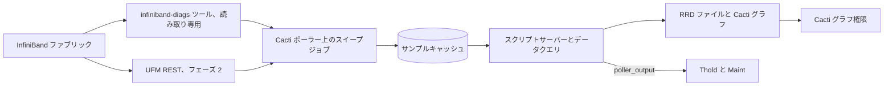

<!-- Source: README.md; SHA256: ce5af61a1bc993ec2aae6d4f22c3885694632f2b1d5eb94e2ce88b8390e96f1e -->

<!-- translations:start -->
[English](../../../README.md) | [简体中文](../zh-CN/README.md) | [हिन्दी](../hi-IN/README.md) | [Español (España)](../es-ES/README.md) | [Español (Latinoamérica)](../es-419/README.md) | [العربية (السعودية)](../ar-SA/README.md) | [Afrikaans](../af-ZA/README.md) | [አማርኛ](../am-ET/README.md) | [العربية (مصر)](../ar-EG/README.md) | [العربية (المغرب)](../ar-MA/README.md) | [বাংলা](../bn-BD/README.md) | [Bosanski](../bs-BA/README.md) | [Deutsch](../de-DE/README.md) | [فارسی](../fa-IR/README.md) | [Filipino](../fil-PH/README.md) | [Français](../fr-FR/README.md) | [Français (Maroc)](../fr-MA/README.md) | [Français (Sénégal)](../fr-SN/README.md) | [Hausa](../ha-NG/README.md) | [עברית](../he-IL/README.md) | [Hrvatski](../hr-HR/README.md) | [Bahasa Indonesia](../id-ID/README.md) | [Igbo](../ig-NG/README.md) | [Italiano](../it-IT/README.md) | [日本語](README.md) | [한국어](../ko-KR/README.md) | [Malagasy](../mg-MG/README.md) | [मराठी](../mr-IN/README.md) | [Bahasa Melayu](../ms-MY/README.md) | [Nederlands](../nl-NL/README.md) | [Polski](../pl-PL/README.md) | [Português (Brasil)](../pt-BR/README.md) | [Русский](../ru-RU/README.md) | [Kinyarwanda](../rw-RW/README.md) | [Soomaali](../so-SO/README.md) | [Српски](../sr-RS/README.md) | [Svenska](../sv-SE/README.md) | [Kiswahili](../sw-KE/README.md) | [தமிழ்](../ta-IN/README.md) | [తెలుగు](../te-IN/README.md) | [ไทย](../th-TH/README.md) | [Türkçe](../tr-TR/README.md) | [Українська](../uk-UA/README.md) | [اردو](../ur-PK/README.md) | [Tiếng Việt](../vi-VN/README.md) | [isiXhosa](../xh-ZA/README.md) | [Yorùbá](../yo-NG/README.md) | [繁體中文](../zh-TW/README.md) | [isiZulu](../zu-ZA/README.md)
<!-- translations:end -->

# plugin_fabric

InfiniBand のポートカウンター、リンク幅・リンク速度、および輻輳インジケーターを、通常のデバイス、データソース、グラフとして Cacti に取り込む Cacti 1.2 プラグインです。4X ではなく 1X でトレーニングされたリンクは、Cacti の権限管理のもとで、接続先ホストの隣にグラフと Thold アラートとして表示され、Maint によって抑制できます。

> **ステータス: 開発中（リリース未定）。** マイルストーン 2（基盤）は `main` にマージ済みで、マイルストーン 3（Cacti オブジェクトおよびアラート機能）はレビュー中です。マイルストーン 1 ではドキュメントおよびアップストリームのソースと照合して設計を確認しました（PR #71）。出典付きの結果は [docs/research/](../../research) にあります。マイルストーン 2 ではプラグインの基盤として以下を追加しました。
>
> - インストール、アップグレード、アンインストール、および PHP 8.2 ガード
> - View、Operator、Admin レルムおよび設定
> - ファブリックレコード
> - `perfquery`、`ibnetdiscover`、および `iblinkinfo` 用の読み取り専用コマンド境界
> - GUID によるインベントリ（ID 競合および再リンク提案を含む）
> - リンク状態およびカウンタースイープキャッシュ
> - インベントリ、管理、およびヘルスページ
>
> マイルストーン 3 では以下の Cacti オブジェクトを追加します。
>
> - Cacti テンプレート XML として同梱されるデバイス・データ・グラフテンプレート、および「Fabric Port」データクエリ
> - ノードの Cacti デバイスへのマッピング、または確認時のデバイス作成（[ADR 0010](../../decisions/0010-one-device-per-node.md)）
> - グラフ用のカウンターデータソース、および Thold 用の GAUGE リンク状態・レートデータソース（[ADR 0011](../../decisions/0011-derive-counters-and-gauge-alert-values.md)）
> - 不連続性の処理および飽和した基本カウンターの unknown としての読み取り（[ADR 0012](../../decisions/0012-saturated-basic-counters-read-as-unknown.md)）、ポートページ上のカウンター有効性とグラフリンク、および輻輳ランキング
> - 未改変の Thold v1.8.2 および Maint v1.3 を使用したエンドツーエンドテスト、およびシミュレートされたファブリックに対して実際の診断ツールを実行する CI ジョブ
>
> フェーズ 3 でリモートデータコレクターがサポートされるまで、ファブリックのスイープはメインポーラーからのみ実行できます。テストはモックツールおよび ibsim ファブリックシミュレーターに対して実施されており、実際の InfiniBand ファブリックでは未実施です。実機ファブリックを必要とする確認項目は、各リサーチページのライブチェック表に未完了のまま残っています。本プロジェクトは Cacti プロジェクトとは関係ありません。

## アクセスロール

| レルム | アクセス権 |
| --- | --- |
| Fabric View | 既存の監視ページ。 |
| Fabric Operator | 監視ページに加え、Operations ページおよび個人単位のトリアージ確認（acknowledgment）。 |
| Fabric Admin | Operator のアクセス権に加え、既存の設定および管理操作。 |

アップグレード用ファイルをコピーした後、管理者として Plugins ページを開き、新しいレルムを登録してください。Operator レルムは **Configuration > Users** またはユーザーグループから明示的に割り当てる必要があります。アップグレード時には既存の View および Admin のレルム ID と付与済み権限が保持されます。各リクエストにおいて Admin アクセスは Operator アクセスを継承し、Operator アクセスは View アクセスを継承します。これによりユーザーやグループへ保存済みの権限が追加されることはありません。プラグイン設定には、Cacti の Settings 権限に加えて Fabric Admin アクセスも必要です。

各ユーザーが利用できる行と操作は引き続き Cacti のデバイス権限によって制限され、未マッピングのオブジェクトには管理者権限が必要です。認証情報、設定、マッピング、削除、その他の管理上の変更は管理ページに集約されています。確認（acknowledgment）は現在のユーザーセッション内でのみ、最大 1 時間、かつ同一の観測結果が最新である間のみ有効です。新規または変更された観測結果によって無効化されます。確認を行っても、失敗した計測が正常とみなされたり、アラートが抑制されたりすることはありません。

## 背景と目的

劣化した InfiniBand リンクであってもトラフィック自体は流れ続けます。4X のリンクが 1X で再トレーニングされてもポートは「active」のままであり、ホストの SNMP インターフェースグラフは正常に見えますが、密結合ジョブの性能は低下します。その根拠はファブリック側にあり、各ポートは active、enabled、supported のリンク幅と速度、さらにエラーカウンターと輻輳カウンターを報告しています。これらを読み取るには InfiniBand 診断ツールまたはファブリックマネージャー API が必要ですが、手動で実行するだけでは次の 3 つの課題が残ります。

- **履歴がない。** `perfquery` や `iblinkinfo` は現在の状態しか表示しないため、先週劣化したリンクを把握できません。
- **デバイスとの関連付けがない。** ファブリックポートは Cacti オブジェクトではないため、接続先のホストと並べてポートをグラフ化できません。
- **Cacti アラートへの経路がない。** Thold や Maint は Cacti のデータソースとデバイスに対して動作します。

本プラグインは、独自の診断ツール（および将来的には UFM）を通じてファブリックを読み取り、GUID によってノードとポートを識別し、カウンターとリンク状態を Cacti データソースとして公開することでこれらの課題を解決します。動作は読み取り専用であり、カウンターのリセットやポート状態の変更は一切行いません。

## 初回ディスカバリ

新しく登録したファブリックにはノードが存在せず、スクリプトサーバーからのスイープは Cacti デバイスにマッピングされたノードに対してのみ開始されます。そのため、初回ディスカバリは手動で実行する必要があります。有効化したファブリックを保存した後、そのファブリックが割り当てられたポーラー上で、ポーラーの実行アカウントを使用して、`/path/to/cacti` を実際の Cacti ディレクトリに置き換えた次のコマンドを 1 回実行してください（絶対パスは cron からもそのまま動作します）。

```
php /path/to/cacti/plugins/fabric/fabric_sweep.php --fabric=ID --force
```

実行するとインベントリが登録されます。Fabric Admin ページでノードを Cacti デバイスにマッピングすると、以降のスイープはデータクエリから開始されるようになります。ファブリックにマッピング済みのノードが 1 つもない間はインベントリが自動更新されないため、新規ノードや欠落ノードを記録するには、必要に応じて cron などから同じコマンドを再実行してください。未ディスカバリまたはマッピング済みノードのない有効なファブリックについては、ヘルスページにもこのコマンドが表示されます。

## 予定されているスコープ

| フェーズ | スコープ | マイルストーン |
|---|---|---|
| 0、調査 | バージョンマトリックス、アップストリームの挙動確認、実機ハードウェア上のカウンター挙動、権限モデル、MAD バジェット、UFM API | [M1](https://github.com/somethingwithproof/plugin_fabric/milestone/1) |
| 1、監視 | GUID によるインベントリ、Cacti デバイス、ポートデータクエリ、カウンターおよびリンク状態データソース、Thold アラート、Maint 抑制、ヘルスページ | [M2](https://github.com/somethingwithproof/plugin_fabric/milestone/2), [M3](https://github.com/somethingwithproof/plugin_fabric/milestone/3), [M4](https://github.com/somethingwithproof/plugin_fabric/milestone/4) |
| 2、UFM | 読み取り専用 UFM REST バックエンド、認証情報の取り扱い、バックエンド間の ID 継続性 | [M5](https://github.com/somethingwithproof/plugin_fabric/milestone/5) |
| 3、リモート | リモートデータコレクター、レプリケーション、`remote_agent` アクション、大規模ファブリック向けのシャーディングスイープ | [M6](https://github.com/somethingwithproof/plugin_fabric/milestone/6) |

スコープ外: ファブリック状態の変更、ファブリックマネージャーまたはサブネットマネージャーの置き換え、プラグイン独自のアラートエンジン、カスタムデーモンまたは独自ネットワークプロトコル、および Ethernet / RoCE ファブリック（調査対象）。

## 互換性ターゲット

| コンポーネント | ターゲット |
|---|---|
| Cacti | 1.2.31 以降、コアパッチ不要 |
| PHP | 8.2 以降。未対応のランタイムで Cacti UI が破損するのを防ぐため、`setup.php` は 8.0 でも構文解析可能にして拒否メッセージを返すようにしています |
| InfiniBand ツール | rdma-core の infiniband-diags。出力形式は v66.0 ソースと照合済み |
| UFM | UFM Enterprise REST API（フェーズ 2）。リリース対応表はマイルストーン 1 の成果物 |
| Thold, Maint | 変更不要 |

Cacti のスクリプトタイムアウトはデフォルトの 25 秒以上に維持してください。データクエリの読み取りによって開始されるスイープでは、キャッシュの読み取りと応答に要する時間を確保するため、ツール実行の上限をそのタイムアウトから 5 秒差し引いた値に制限します。時間制限を超過した場合、クエリは最新の有効サンプルまたは unknown を返し、次のサイクルでスイープを再試行します。この制限は PHP ポーラーにも適用されます。タイムアウトを 5 秒以下に設定すると、ツールを起動する時間が確保できなくなります。

## 設計

- [docs/PLAN.md](../../PLAN.md) は全体計画です。アーキテクチャ、依存するアップストリームの仕様（出典付き）および未確認の前提条件、ID モデル、カウンターおよびリンク状態のルール、セキュリティ境界、性能試算、テスト、リスクを記載しています。
- [docs/decisions/](../../decisions) には、決定済みの選択に関するアーキテクチャ決定記録（ADR）を格納しています。
- [docs/REQUIREMENTS.md](../../REQUIREMENTS.md) には、すべての要件 ID と対応する Issue の一覧を記載しています。



## 作業の管理方法

- **マイルストーン**は計画のマイルストーンに対応しています。各マイルストーンには、サブ Issue と完了条件の証跡をまとめたエピック Issue があります。
- **Issue** はラベルで分類されています（`type: requirement`、`type: research`、`type: decision`、`type: epic`）。要件 Issue には番号付きのテスト可能な要件（`REQ-AREA-NNN`）と受け入れ基準を記載しています。
- **ラベル**には `area:`、`phase:`、`priority:`、`status:` も付与されます。詳細は [CONTRIBUTING.md](../../../CONTRIBUTING.md#labels) をご覧ください。
- [プロジェクトボード](https://github.com/users/somethingwithproof/projects/8)では、全マイルストーンにわたるすべての Issue を確認できます。

## コントリビューション

[CONTRIBUTING.md](../../../CONTRIBUTING.md) をお読みください。コミットには DCO sign-off が必要です。設計の議論は Issue 上で行われ、未決定事項には `type: decision` ラベルが付与されます。

## セキュリティ

脆弱性は非公開で報告してください。詳細は [SECURITY.md](../../../SECURITY.md) をご覧ください。

## ライセンス

Cacti およびそのプラグインと同じく GNU General Public License v2.0 です。詳細は [LICENSE](../../../LICENSE) をご覧ください。
