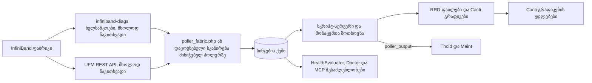

<!-- Source: README.md; SHA256: 79a16fb906f96ee79de2c719f18c38836f555440a7571a4a5ba38c64bb5b099f -->

<!-- translations:start -->
[English](../../../README.md) | [简体中文](../zh-CN/README.md) | [हिन्दी](../hi-IN/README.md) | [Español (España)](../es-ES/README.md) | [Español (Latinoamérica)](../es-419/README.md) | [العربية (السعودية)](../ar-SA/README.md) | [Afrikaans](../af-ZA/README.md) | [አማርኛ](../am-ET/README.md) | [العربية (مصر)](../ar-EG/README.md) | [العربية (المغرب)](../ar-MA/README.md) | [Български](../bg-BG/README.md) | [বাংলা](../bn-BD/README.md) | [Bosanski](../bs-BA/README.md) | [Deutsch](../de-DE/README.md) | [Ελληνικά](../el-GR/README.md) | [فارسی](../fa-IR/README.md) | [Filipino](../fil-PH/README.md) | [Français](../fr-FR/README.md) | [Français (Maroc)](../fr-MA/README.md) | [Français (Sénégal)](../fr-SN/README.md) | [Hausa](../ha-NG/README.md) | [עברית](../he-IL/README.md) | [Hrvatski](../hr-HR/README.md) | [Bahasa Indonesia](../id-ID/README.md) | [Igbo](../ig-NG/README.md) | [Italiano](../it-IT/README.md) | [日本語](../ja-JP/README.md) | [ქართული](README.md) | [한국어](../ko-KR/README.md) | [Latviešu](../lv-LV/README.md) | [Malagasy](../mg-MG/README.md) | [मराठी](../mr-IN/README.md) | [Bahasa Melayu](../ms-MY/README.md) | [Nederlands](../nl-NL/README.md) | [Polski](../pl-PL/README.md) | [Português (Brasil)](../pt-BR/README.md) | [Português (Portugal)](../pt-PT/README.md) | [Русский](../ru-RU/README.md) | [Kinyarwanda](../rw-RW/README.md) | [Soomaali](../so-SO/README.md) | [Српски](../sr-RS/README.md) | [Svenska](../sv-SE/README.md) | [Kiswahili](../sw-KE/README.md) | [தமிழ்](../ta-IN/README.md) | [తెలుగు](../te-IN/README.md) | [ไทย](../th-TH/README.md) | [Türkçe](../tr-TR/README.md) | [Українська](../uk-UA/README.md) | [اردو](../ur-PK/README.md) | [Tiếng Việt](../vi-VN/README.md) | [isiXhosa](../xh-ZA/README.md) | [Yorùbá](../yo-NG/README.md) | [繁體中文](../zh-TW/README.md) | [isiZulu](../zu-ZA/README.md)
<!-- translations:end -->

# plugin_fabric

Cacti 1.2-ის დანამატი (`fabric`, ვერსია `0.1.0-dev`), რომელიც Cacti-ში ასახავს InfiniBand პორტების მთვლელებს, ბმულის სიგანესა და სიჩქარეს და გადატვირთვის ინდიკატორებს ჩვეულებრივი მოწყობილობების, მონაცემთა წყაროებისა და გრაფიკების სახით. ბმული, რომელიც 4X-ის ნაცვლად 1X-ზე შეთანხმდა, ჩანს გრაფიკისა და Thold გაფრთხილების სახით იმ ჰოსტის გვერდით, რომელსაც ემსახურება, Cacti-ს უფლებების ქვეშ, Maint ინფორმირებულობითა და დათრგუნვით.

> **სტატუსი: დამუშავების პროცესშია, გამოშვება ჯერ არ არის.** ეს განშტოება ახორციელებს დანამატის ფუნდამენტს, Cacti ობიექტებსა და გაფრთხილებებს, დაგეგმილ ფონურ პოლერის სკანირებებს, დაშორებული შემგროვებლების რეპლიკაციას, მხოლოდ წაკითხვად NVIDIA UFM REST ბექენდს დაშიფრული ავტორიზაციის საცავით, Configuration-as-Code (CasC) CLI მართვას და Cacti-ს ეკოსისტემის ჰუკებს (CasC, Doctor და MCP / Abilities API v2). იგი შემოწმებულია იმიტირებულ ხელსაწყოებზე, სინთეტიკურ UFM ტრანსპორტებსა და `ibsim` ფაბრიკის სიმულატორზე (rdma-core 50.0), მაგრამ არასდროს ფიზიკურ InfiniBand ფაბრიკზე ან რეალურ UFM სერვერზე. აპარატურის საჭიროების მქონე შემოწმებები ღია რჩება [docs/research/](../../research/)-ში. ეს პროექტი არ არის აფილირებული Cacti პროექტთან.

## რა არის რეალიზებული

- **სასიცოცხლო ციკლი და სქემა (v3)**: ინსტალაცია, იდემპოტენტური განახლება, დეინსტალაცია (ნაგულისხმევად ინახავს დანამატის ცხრილებს) და PHP 8.2 მოთხოვნის დაცვა, მაშინ როცა შესასვლელი წერტილები წაკითხვადი რჩება PHP 8.0-ზე.
- **წვდომის როლები და გვერდები**: `Fabric View` (`fabric.php`), `Fabric Operator` (`fabric_operator.php`) და `Fabric Admin` (`fabric_admin.php`, `fabric_health.php`) უფლებების ზონები, ასევე პარამეტრების ჩანართი განყოფილებაში **Configuration > Settings > Fabrics**.
- **მხოლოდ წაკითხვადი დიაგნოსტიკის ბექენდი (`diags`)**: `perfquery`, `ibnetdiscover` და `iblinkinfo` ბრძანებების მკაცრი არგუმენტების ვექტორით გაშვება, GUID-ზე დაფუძნებული ინვენტარი იდენტობის კონფლიქტების აღმოჩენითა და ხელახლა მიბმის წინადადებებით, ბმულის მდგომარეობის შეფასება და თითოეული კვანძის მთვლელების სკანირებები.
- **მხოლოდ წაკითხვადი NVIDIA UFM REST ბექენდი (`ufm`) და დაშიფრული საცავი**: მხოლოდ GET დაშვებულთა სიის REST კლიენტი (`/ufmRest/resources/ports`, `/ufmRest/resources/systems`, `/ufmRest/monitoring/session/0/data` და `/ufmRestV3/...` ეკვივალენტები ტოკენით ავთენტიფიკაციისთვის), რომელიც ავსებს იმავე ინვენტარის, ბმულის მდგომარეობის, სინჯებისა და მდგომარეობის ცხრილებს, რასაც `diags`. ავტორიზაციის მონაცემები (`token` ან `basic`) ინახება AES-256-GCM-ით დაშიფრული `plugin_fabric_secret`-ში გარე 256-ბიტიანი გასაღების ფაილის გამოყენებით, რომელიც მითითებულია `fabric_vault_key_file`-ში. UFM ფაბრიკების განსაზღვრა შესაძლებელია CasC-ით (`cli/fabric.php`) ან რეპოზიტორიებით; ვებ ადმინისტრატორის ფორმა ამჟამად აჩვენებს `diags` ველებს.
- **Cacti ობიექტები, Thold და Maint**: Cacti მოწყობილობის, მონაცემთა და გრაფიკის შაბლონები (`templates/fabric-templates.xml`), „Fabric Port“ სკრიპტ-სერვერის მონაცემთა მოთხოვნა (`scripts/ss_fabric_ports.php`, `resource/script_server/fabric_ports.xml`), `DERIVE` მთვლელის მონაცემთა წყაროები და `GAUGE` ბმულის მდგომარეობის/სიჩქარის მონაცემთა წყაროები Thold-ისთვის, წყვეტების თვალყურის დევნება და გაჯერებული საბაზისო მთვლელების გამოქვეყნება როგორც `U`. Maint ინტეგრაცია (`MaintMaintenance`) მიმართავს `plugin_maint_check_cacti_host()`-ს (`is_device_in_maintenance` ჰუკზე გადართვით), რათა აქტიურ ტექნიკურ მომსახურებაში მყოფი კვანძები ცალკე დაითვალოს და გამოირიცხოს ჩაშლილი სკანირებისა და დეგრადირებული პორტების გაფრთხილებებიდან.
- **დაგეგმილი სკანირებები, შარდინგი და დაშორებული შემგროვებლები**: `poller_bottom` ფონურად უშვებს `poller_fabric.php`-ს მიმდინარე პოლერზე მინიჭებული დროული ფაბრიკებისთვის, სკრიპტ-სერვერის მიერ გამოწვეულ დაყოვნებულ სკანირებებთან ერთად. `INFO` აცხადებს `remote_collect:1, remote_poller:1`, `poller_fabric.php` მხარს უჭერს დეტერმინისტულ GUID შარდინგს (`--shard=K/N`), ხოლო `replicate_out` არეპლიცირებს არასაიდუმლო `plugin_fabric_fabric` სტრიქონებს დაშორებულ შემგროვებლებზე (`poller_id >= 2`). საცავის ჩანაწერები (`plugin_fabric_secret`) და გარე გასაღების ფაილები არასდროს რეპლიცირდება.
- **CasC CLI და ეკოსისტემის ჰუკები**: `cli/fabric.php` YAML/XML ექსპორტისთვის, ვალიდაციისთვის, საცდელი განსხვავებების დაგეგმვისთვის, დადასტურებით დაცული გამოყენებისა და მდგომარეობის ანგარიშგებისთვის, პლუს `casc_register_providers`, `doctor_register_checks` და `abilities_register` ჰუკები.

## წვდომის როლები

| უფლებების ზონა | წვდომა |
| --- | --- |
| Fabric View | ინვენტარისა და პორტების მონიტორინგის ხედები (`fabric.php`). |
| Fabric Operator | View წვდომა, ოპერაციების გვერდი (`fabric_operator.php`) და პერსონალური სორტირების დადასტურებები. |
| Fabric Admin | Operator წვდომა, კონფიგურაცია, ადმინისტრაციული მოქმედებები (`fabric_admin.php`) და მდგომარეობის გვერდი (`fabric_health.php`). |

განახლების ფაილების კოპირების შემდეგ ადმინისტრატორის სტატუსით გახსენით დანამატების (Plugins) გვერდი ახალი უფლებების ზონებისა და ჰუკების დასარეგისტრირებლად. Operator უფლებების ზონა მიანიჭეთ პირდაპირ განყოფილებაში **Configuration > Users** ან მომხმარებელთა ჯგუფებში. განახლებები ინარჩუნებს არსებულ View და Admin უფლებების ზონის ID-ებსა და მინიჭებებს. ყოველ მოთხოვნაზე Admin წვდომა მემკვიდრეობით იღებს Operator წვდომას, ხოლო Operator წვდომა — View წვდომას; ეს არ ამატებს შენახულ უფლებებს მომხმარებლებისთვის ან ჯგუფებისთვის. დანამატის პარამეტრები ასევე მოითხოვს Fabric Admin წვდომას Cacti-ს პარამეტრების (Settings) უფლებასთან ერთად.

Cacti-ს მოწყობილობის უფლებები ზღუდავს თითოეული მომხმარებლისთვის ხელმისაწვდომ სტრიქონებსა და მოქმედებებს; მიუბმელი ობიექტები საჭიროებს ადმინისტრატორს. ავტორიზაციის მონაცემები, კონფიგურაცია, მიბმა, წაშლა და სხვა ადმინისტრაციული ცვლილებები რჩება ადმინისტრაციულ გვერდებზე ან CLI-ში. დადასტურებები მოქმედებს მხოლოდ მიმდინარე მომხმარებლის სესიაში, არაუმეტეს ერთი საათის განმავლობაში და მხოლოდ მანამ, სანამ იგივე დაკვირვება აქტუალური რჩება. ახალი ან შეცვლილი დაკვირვებები აუქმებს მათ. ისინი არასდროს მონიშნავს ჩაშლილ გაზომვას გამართულად და არ თრგუნავს გაფრთხილებებს.

## რატომ

დეგრადირებული InfiniBand ბმული კვლავ ატარებს ტრაფიკს. 4X ბმული, რომელიც 1X-ზე გადაერთვება, პორტს „აქტიურად“ ტოვებს და ჰოსტის SNMP ინტერფეისის გრაფიკები ნორმალურად გამოიყურება, მაგრამ მჭიდროდ დაკავშირებული ამოცანები ნელდება. მტკიცებულება თავად ფაბრიკშია: თითოეული პორტი გადმოსცემს თავის აქტიურ, ჩართულ და მხარდაჭერილ სიგანესა და სიჩქარეს, პლუს შეცდომებისა და გადატვირთვის მთვლელებს. ამის წასაკითხად საჭიროა InfiniBand დიაგნოსტიკის ხელსაწყოები ან ფაბრიკის მენეჯერის API. ხელით გაშვებისას ისინი სამ ხარვეზს ტოვებს:

- **ისტორიის არარსებობა.** `perfquery` და `iblinkinfo` აჩვენებს აწმყოს, ამიტომ გასულ კვირას დეგრადირებული ბმული უხილავია.
- **მოწყობილობის კონტექსტის არარსებობა.** ფაბრიკის პორტები არ არის Cacti ობიექტები, ამიტომ პორტის გრაფიკი ვერ გამოისახება მის მიერ მომსახურებული ჰოსტის გვერდით.
- **Cacti-ს გაფრთხილებებში გადაცემის გზის არარსებობა.** Thold და Maint მუშაობს Cacti-ს მონაცემთა წყაროებსა და მოწყობილობებზე.

დანამატი ავსებს ამ ხარვეზებს ფაბრიკის წაკითხვით `infiniband-diags`-ის ან NVIDIA UFM REST API-ის მეშვეობით, კვანძებისა და პორტების GUID-ით იდენტიფიცირებით და მთვლელებისა და ბმულის მდგომარეობის Cacti-ს მონაცემთა წყაროებად გამოქვეყნებით. იგი მხოლოდ კითხულობს: არასდროს ანულებს მთვლელებს და არ ცვლის პორტის მდგომარეობას.

## ოპერაციები და CLI

### ფონური პოლერი და ხელით სკანირებები

`fabric_poller_bottom()` ფონურად უშვებს `poller_fabric.php`-ს თითოეულ პოლერზე ამ `poller_id`-ზე მინიჭებული ჩართული ფაბრიკებისთვის, რომელთა სკანირების დროც დადგა. ასევე შეგიძლიათ პოლერის გამშვები ან ხელით სკანირება პირდაპირ გაუშვათ მინიჭებულ პოლერზე პოლერის მომხმარებლით (`/path/to/cacti` შეცვალეთ თქვენი Cacti დირექტორიით):

```sh
php /path/to/cacti/plugins/fabric/poller_fabric.php [--fabric=ID] [--shard=K/N] [--force] [--debug]
php /path/to/cacti/plugins/fabric/fabric_sweep.php --fabric=ID [--node=GUID] [--force]
```

- `poller_fabric.php` ამუშავებს ყველა დროულ ფაბრიკს ლოკალური პოლერისთვის (ან ერთ ფაბრიკს `--fabric=ID`-ით), იცავს Cacti-ს პროცესების რეესტრის დაბლოკვას და `ClaimRepository` იჯარებს `max(30, intdiv(sweep_interval, 2))` წამის დროის ბიუჯეტით, და მხარს უჭერს `--shard=K/N`-ს (`0 <= K < N`) `diags` კვანძის მთვლელების სკანირების კვანძის GUID-ით დეტერმინისტულად დასაშარდად.
- `fabric_sweep.php` უშვებს ერთი ჩართული ფაბრიკის (ან ერთი კვანძის `--node=GUID`-ით) მოთხოვნით სკანირებას ლოკალურ პოლერზე. `--force` უგულებელყოფს, დადგა თუ არა ფაბრიკის დრო, მაგრამ კვლავ იცავს დაბლოკვებს.

პირველი აღმოჩენის მიერ ინვენტარის შევსების შემდეგ მიაბით კვანძები Cacti მოწყობილობებზე ფაბრიკის ადმინისტრატორის გვერდზე. შეინარჩუნეთ Cacti-ს სკრიპტის ტაიმაუტი 25 წამზე ან მეტზე: მონაცემთა მოთხოვნის წაკითხვით გაშვებული დაყოვნებული სკანირება ზღუდავს ხელსაწყოს შესრულებას `script_timeout - 5` წამით, რათა სკრიპტ-სერვერმა დროულად დააბრუნოს ბოლო შენახული სინჯი ან `U`.

### NVIDIA UFM REST ბექენდი და ავტორიზაციის საცავი

`ufm` ფაბრიკი მოითხოვს `https://` URL-ს ჩაშენებული ავტორიზაციის მონაცემების, მოთხოვნის სტრიქონებისა და ფრაგმენტების გარეშე. `UfmSocketTransport` ახორციელებს TLS სერტიფიკატისა და ჰოსტის სახელის შემოწმებას, უარყოფს გადამისამართებებს და მხარს უჭერს არასავალდებულო CA პაკეტს (`ufm_ca_file`) და SHA-256 SPKI მიმაგრებას (`ufm_spki_pin`).

`plugin_fabric_secret`-ში UFM ავტორიზაციის მონაცემების შესანახად დააკონფიგურირეთ `fabric_vault_key_file` განყოფილებაში **Configuration > Settings > Fabrics** აბსოლუტური გზით ჩვეულებრივ ფაილამდე, რომლის მფლობელიც პოლერის მომხმარებელია (არც ერთ მშობელ დირექტორიაში არ უნდა იყოს სიმბოლური ბმული, უფლებები `0600`, შეიცავს 64 თექვსმეტობით სიმბოლოს, მაგალითად `openssl rand -hex 32`, ან 32 შემთხვევით არაბეჭდვად ბაიტს). დანამატი არასდროს ქმნის ან წერს გასაღების ფაილს, ხოლო `replicate_out` არასდროს არეპლიცირებს `plugin_fabric_secret`-ს ან გასაღების ფაილებს დაშორებულ პოლერებზე.

### Configuration-as-Code და მდგომარეობის CLI

`cli/fabric.php` დეკლარაციულად მართავს დანამატის პარამეტრებსა და ფაბრიკის განსაზღვრებებს YAML ან XML ფორმატში და აჩვენებს ტექნიკური მომსახურების გათვალისწინებით მდგომარეობას ცოცხალი სკანირებების გაშვების გარეშე:

```sh
php /path/to/cacti/plugins/fabric/cli/fabric.php export [--format=yaml|xml] [--file=PATH]
php /path/to/cacti/plugins/fabric/cli/fabric.php validate --file=PATH [--format=yaml|xml]
php /path/to/cacti/plugins/fabric/cli/fabric.php plan --file=PATH [--format=yaml|xml]
php /path/to/cacti/plugins/fabric/cli/fabric.php apply --file=PATH --confirm=PLAN_HASH [--format=yaml|xml]
php /path/to/cacti/plugins/fabric/cli/fabric.php health [--format=text|json]
```

`export` ქმნის ახალ ფაილებს `0600` უფლებებით, შლის `fabric_vault_key_file`-ს როგორც `[REDACTED]` და საიდუმლოების ნაცვლად გამოაქვს სახელდებული `ufm_credential_ref` მიმართვები. `plan` და `apply` უარყოფს ჩაშენებულ `ufm_token`, `ufm_password`, `secret` და `fabric_vault_key_file` მნიშვნელობებს. `apply` მოითხოვს `plan`-ის მიერ დაბეჭდილ ზუსტ `--confirm=PLAN_HASH`-ს.

### ეკოსისტემის ჰუკები

როდესაც შესაბამისი Cacti დანამატები ან ჰოსტის ინტეგრაციები არსებობს, `setup.php` არეგისტრირებს:

- `casc_register_providers`: ახორციელებს `fabric` კონფიგურაციის (`yaml` და `xml`, სქემა v1) ექსპორტს, ვალიდაციას, დაგეგმვას და დადასტურებით გამოყენებას საიდუმლოების დაფარვით.
- `doctor_register_checks`: უზრუნველყოფს ოთხ მხოლოდ წაკითხვად დიაგნოსტიკურ შემოწმებას (`fabric.schema`, `fabric.poller_freshness`, `fabric.identity_conflicts`, `fabric.ufm_vault`).
- `abilities_register`: არეგისტრირებს სამ მხოლოდ წაკითხვად, არადესტრუქციულ, იდემპოტენტურ შესაძლებლობას კატეგორიაში `fabric`, შეზღუდულს Fabric View უფლებების ზონით (და Cacti მოწყობილობის უფლებებით პორტის შეცდომებისთვის): `fabric-list-fabrics`, `fabric-get-health` და `fabric-list-port-errors`.

## ფარგლები და საზღვრები

ფარგლებს გარეთაა: ფაბრიკის მდგომარეობის შეცვლა, მთვლელების განულება, ფაბრიკის მენეჯერის ან ქვექსელის მენეჯერის ჩანაცვლება, დანამატის საკუთარი გაფრთხილების ძრავა, მორგებული დემონი ან ქსელური პროტოკოლი და Ethernet ან RoCE ფაბრიკები.

## მოთხოვნები და თავსებადობა

| კომპონენტი | მიზანი |
|---|---|
| Cacti | 1.2.31 ან უფრო ახალი (`compat = 1.2.31`), ბირთვის პატჩების გარეშე |
| PHP | 8.2 ან უფრო ახალი; შესასვლელი წერტილები რჩება წაკითხვადი 8.0-ზე და უარყოფს აქტივაციას 8.1-ზე, რათა მხარდაუჭერელ გარემოში მიიღოთ უარი და არა დაზიანებული Cacti UI |
| InfiniBand ხელსაწყოები | `infiniband-diags` პაკეტიდან `rdma-core` (შემოწმებულია CI-ში rdma-core 50.0-ით `ibsim`-ის ქვეშ; გამომავალი ფორმატები შემოწმებულია v66.0 კოდთან) |
| UFM | NVIDIA UFM Enterprise REST API (`ufmRest` და `ufmRestV3` მხოლოდ წაკითხვადი საბოლოო წერტილები; შემოწმებულია სინთეტიკურ ტრანსპორტებზე ერთეულოვან ტესტებში) |
| Thold, Maint | ცვლილებები არ არის საჭირო; CI უშვებს სრული ციკლის ტესტს უცვლელ Thold v1.8.2-სა და Maint v1.3-თან |

## დამუშავება და ტესტირება

CI სამუშაო პროცესი (`.github/workflows/plugin-ci-workflow.yml`) ამოწმებს PHP 8.2-დან 8.5-მდე Cacti `release/1.2.31`-სა და `1.2.x`-ზე, PHP 8.0 შესასვლელი წერტილების სინტაქსს, PHP 8.1-ზე უარის თქმას, PHPStan-ს, gettext/თარგმანების შემოწმებას, REUSE ლიცენზირებას, სამუშაო პროცესების ლინტინგს, Thold/Maint სრული ციკლის გამეორებას და `ibsim` ფაბრიკის სიმულაციას.

Cacti-ს ჩაკეტილი გაზიარებული Pest დანამატის ჩარჩოთი (`CACTI_PEST_BIN`) და ერთჯერადი Cacti მონაცემთა ბაზით:

```sh
# Unit tests
"$CACTI_PEST_BIN" --configuration=phpunit.xml

# Lifecycle integration tests (disposable database only)
CACTI_PATH=/path/to/cacti FABRIC_TEST_DATABASE=disposable "$CACTI_PEST_BIN" --configuration=phpunit-integration.xml

# Static analysis (against Cacti 1.2.31)
CACTI_PATH=/path/to/cacti phpstan analyse -c phpstan.neon --no-progress

# Translation template, catalogs, and localized README checks
sh locales/build_gettext.sh --check

# Simulated ibsim fixture parser check
php tests/bin/check-ibsim-fixtures.php tests/fixtures/ibsim
```

## დიზაინი

- [docs/PLAN.md](../../PLAN.md) არის არქიტექტურისა და დიზაინის გეგმა: ზემდგომი ფაქტები წყაროებით, ღია აპარატურული შემოწმებები, იდენტობის მოდელი, მთვლელებისა და ბმულის მდგომარეობის წესები, უსაფრთხოების საზღვრები, წარმადობის არითმეტიკა, ტესტირება და რისკები.
- [docs/decisions/](../../decisions/) შეიცავს არქიტექტურული გადაწყვეტილებების ჩანაწერებს.
- [docs/REQUIREMENTS.md](../../REQUIREMENTS.md) აკავშირებს თითოეულ მოთხოვნის ID-ს მის საკითხთან.



## როგორ მიმდინარეობს სამუშაოს აღრიცხვა

- **ეტაპები (Milestones)** მიჰყვება გეგმის ეტაპებს. თითოეულს აქვს ეპიკური საკითხი, სადაც ჩამოთვლილია ქვესაკითხები და დასრულების მტკიცებულებები.
- **საკითხები (Issues)** კლასიფიცირებულია ჭდეებით: `type: requirement`, `type: research`, `type: decision`, `type: epic`. მოთხოვნის საკითხები განსაზღვრავს დანომრილ, ტესტირებად მოთხოვნებს (`REQ-AREA-NNN`) და მიღების კრიტერიუმებს.
- **ჭდეები (Labels)** ასევე ატარებს `area:`, `phase:`, `priority:` და `status:` ნიშნულებს. იხილეთ [CONTRIBUTING.md](../../../CONTRIBUTING.md#labels).
- [პროექტის დაფა](https://github.com/users/somethingwithproof/projects/8) აჩვენებს ყველა საკითხს ყველა ეტაპზე.

## წვლილის შეტანა

წაიკითხეთ [CONTRIBUTING.md](../../../CONTRIBUTING.md). კომიტებს სჭირდება DCO ხელმოწერა (`git commit -s`). დიზაინის განხილვა მიმდინარეობს საკითხებში; ღია გადაწყვეტილებებს აქვს ჭდე `type: decision`.

## უსაფრთხოება

მოწყვლადობების შესახებ შეგვატყობინეთ კონფიდენციალურად; იხილეთ [SECURITY.md](../../../SECURITY.md).

## ლიცენზია

GNU General Public License v2.0 — იგივე ლიცენზია, რაც Cacti-სა და მის დანამატებს აქვთ. იხილეთ [LICENSE](../../../LICENSE).
