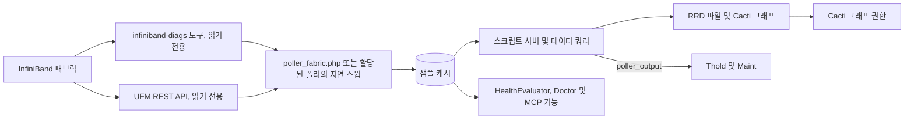

<!-- Source: README.md; SHA256: 79a16fb906f96ee79de2c719f18c38836f555440a7571a4a5ba38c64bb5b099f -->

<!-- translations:start -->
[English](../../../README.md) | [简体中文](../zh-CN/README.md) | [हिन्दी](../hi-IN/README.md) | [Español (España)](../es-ES/README.md) | [Español (Latinoamérica)](../es-419/README.md) | [العربية (السعودية)](../ar-SA/README.md) | [Afrikaans](../af-ZA/README.md) | [አማርኛ](../am-ET/README.md) | [العربية (مصر)](../ar-EG/README.md) | [العربية (المغرب)](../ar-MA/README.md) | [Български](../bg-BG/README.md) | [বাংলা](../bn-BD/README.md) | [Bosanski](../bs-BA/README.md) | [Deutsch](../de-DE/README.md) | [Ελληνικά](../el-GR/README.md) | [فارسی](../fa-IR/README.md) | [Filipino](../fil-PH/README.md) | [Français](../fr-FR/README.md) | [Français (Maroc)](../fr-MA/README.md) | [Français (Sénégal)](../fr-SN/README.md) | [Hausa](../ha-NG/README.md) | [עברית](../he-IL/README.md) | [Hrvatski](../hr-HR/README.md) | [Bahasa Indonesia](../id-ID/README.md) | [Igbo](../ig-NG/README.md) | [Italiano](../it-IT/README.md) | [日本語](../ja-JP/README.md) | [ქართული](../ka-GE/README.md) | [한국어](README.md) | [Latviešu](../lv-LV/README.md) | [Malagasy](../mg-MG/README.md) | [मराठी](../mr-IN/README.md) | [Bahasa Melayu](../ms-MY/README.md) | [Nederlands](../nl-NL/README.md) | [Polski](../pl-PL/README.md) | [Português (Brasil)](../pt-BR/README.md) | [Português (Portugal)](../pt-PT/README.md) | [Русский](../ru-RU/README.md) | [Kinyarwanda](../rw-RW/README.md) | [Soomaali](../so-SO/README.md) | [Српски](../sr-RS/README.md) | [Svenska](../sv-SE/README.md) | [Kiswahili](../sw-KE/README.md) | [தமிழ்](../ta-IN/README.md) | [తెలుగు](../te-IN/README.md) | [ไทย](../th-TH/README.md) | [Türkçe](../tr-TR/README.md) | [Українська](../uk-UA/README.md) | [اردو](../ur-PK/README.md) | [Tiếng Việt](../vi-VN/README.md) | [isiXhosa](../xh-ZA/README.md) | [Yorùbá](../yo-NG/README.md) | [繁體中文](../zh-TW/README.md) | [isiZulu](../zu-ZA/README.md)
<!-- translations:end -->

# plugin_fabric

InfiniBand 포트 카운터, 링크 폭과 속도, 혼잡 지표를 일반 디바이스, 데이터 소스, 그래프로 Cacti에 통합하는 Cacti 1.2 플러그인(`fabric`, 버전 `0.1.0-dev`)입니다. 링크가 4X 대신 1X로 협상(트레이닝)되면 해당 링크가 연결된 호스트 옆에 그래프와 Thold 알림으로 표시되며, Cacti의 권한 체계를 따르고 Maint 인식 및 알림 억제 기능을 지원합니다.

> **상태: 개발 중, 아직 릴리스되지 않았습니다.** 이 브랜치에는 플러그인 기반, Cacti 객체 및 알림, 예약된 백그라운드 폴러 스윕, 원격 수집기 복제, 암호화된 자격 증명 보관소(vault)를 갖춘 읽기 전용 NVIDIA UFM REST 백엔드, Configuration-as-Code(CasC) CLI 관리, 그리고 Cacti 에코시스템 훅(CasC, Doctor, MCP / Abilities API v2)이 구현되어 있습니다. 가짜 도구, 합성 UFM 트랜스포트, `ibsim` 패브릭 시뮬레이터(rdma-core 50.0)를 대상으로 테스트되었으며, 물리적 InfiniBand 패브릭이나 실제 UFM 서버에서는 테스트된 적이 없습니다. 하드웨어가 필요한 확인 항목은 [docs/research/](../../research/)에 미완료 상태로 남아 있습니다. 이 프로젝트는 Cacti 프로젝트와 공식적으로 관련이 없습니다.

## 구현된 기능

- **수명 주기 및 스키마(v3)**: 설치, 멱등적 업그레이드, 제거(기본적으로 플러그인 테이블 유지), 진입점을 PHP 8.0에서도 파싱 가능하게 유지하면서 적용되는 PHP 8.2 요구 사항 가드.
- **접근 역할 및 페이지**: `Fabric View` (`fabric.php`), `Fabric Operator` (`fabric_operator.php`), `Fabric Admin` (`fabric_admin.php`, `fabric_health.php`) 영역(Realm) 및 **Configuration > Settings > Fabrics** 아래의 설정 탭.
- **읽기 전용 진단 백엔드(`diags`)**: `perfquery`, `ibnetdiscover`, `iblinkinfo`의 엄격한 인수 벡터 실행, ID 충돌 감지 및 재연결 제안을 포함한 GUID 기반 인벤토리, 링크 상태 평가, 노드별 카운터 스윕.
- **읽기 전용 NVIDIA UFM REST 백엔드(`ufm`) 및 암호화된 보관소**: `diags`와 동일한 인벤토리, 링크 상태, 샘플 및 상태 테이블에 데이터를 공급하는 GET 전용 허용 목록 기반 REST 클라이언트(`/ufmRest/resources/ports`, `/ufmRest/resources/systems`, `/ufmRest/monitoring/session/0/data` 및 토큰 인증용 `/ufmRestV3/...` 대응 엔드포인트). 자격 증명(`token` 또는 `basic`)은 `fabric_vault_key_file`로 구성된 외부 256비트 키 파일을 사용하여 AES-256-GCM으로 암호화되어 `plugin_fabric_secret`에 저장됩니다. UFM 패브릭은 CasC(`cli/fabric.php`) 또는 리포지토리를 통해 정의할 수 있으며, 웹 관리 폼은 현재 `diags` 필드를 노출합니다.
- **Cacti 객체, Thold 및 Maint**: Cacti 디바이스, 데이터, 그래프 템플릿(`templates/fabric-templates.xml`), "Fabric Port" 스크립트 서버 데이터 쿼리(`scripts/ss_fabric_ports.php`, `resource/script_server/fabric_ports.xml`), Thold용 `DERIVE` 카운터 데이터 소스 및 `GAUGE` 링크 상태/속도 데이터 소스, 불연속성(discontinuity) 추적, `U`로 보고되는 포화된 기본 카운터. Maint 연동(`MaintMaintenance`)은 `plugin_maint_check_cacti_host()`를 조회하고(`is_device_in_maintenance` 훅으로 폴백) 활성 유지보수 중인 노드를 별도로 집계하며 스윕 실패 및 저하된 포트 상태 경고에서 제외합니다.
- **예약된 스윕, 샤딩 및 원격 수집기**: `poller_bottom`은 스크립트 서버가 트리거하는 지연 스윕과 함께 현재 폴러에 할당된 실행 대상 패브릭에 대해 `poller_fabric.php`를 백그라운드로 실행합니다. `INFO`는 `remote_collect:1, remote_poller:1`을 선언하고, `poller_fabric.php`는 결정론적 GUID 샤딩(`--shard=K/N`)을 지원하며, `replicate_out`은 비밀이 아닌 `plugin_fabric_fabric` 행을 원격 수집기(`poller_id >= 2`)로 복제합니다. 보관소 항목(`plugin_fabric_secret`)과 외부 키 파일은 절대 복제되지 않습니다.
- **CasC CLI 및 에코시스템 훅**: YAML/XML 내보내기, 유효성 검사, 드라이런 diff 계획, 확인(confirmation) 기반 적용 및 상태 보고를 위한 `cli/fabric.php`, 그리고 `casc_register_providers`, `doctor_register_checks`, `abilities_register` 훅.

## 접근 역할

| 영역(Realm) | 접근 권한 |
| --- | --- |
| Fabric View | 인벤토리 및 포트 뷰 모니터링 (`fabric.php`). |
| Fabric Operator | View 접근 권한 및 Operations 페이지 (`fabric_operator.php`)와 개인 분류(triage) 확인(acknowledgment). |
| Fabric Admin | Operator 접근 권한 및 구성, 관리 작업 (`fabric_admin.php`), 상태 페이지 (`fabric_health.php`). |

업그레이드 파일을 복사한 후 관리자로 Plugins 페이지에 접속하여 새 영역과 훅을 등록하세요. **Configuration > Users** 또는 사용자 그룹에서 Operator 영역을 명시적으로 할당하세요. 업그레이드 시 기존 View 및 Admin 영역 ID와 부여된 권한은 유지됩니다. Admin 접근 권한은 Operator 접근 권한을 상속하고, Operator 접근 권한은 매 요청마다 View 접근 권한을 상속합니다. 이는 사용자나 그룹에 저장된 권한 부여(grant)를 추가하지 않습니다. 플러그인 설정에는 Cacti의 Settings 권한 외에 Fabric Admin 접근 권한도 필요합니다.

Cacti 디바이스 권한은 각 사용자가 볼 수 있는 행과 수행 가능한 작업을 제한하며, 매핑되지 않은 객체에는 관리자 권한이 필요합니다. 자격 증명, 구성, 매핑, 삭제 및 기타 관리 변경 사항은 관리 페이지 또는 CLI에서 유지됩니다. 확인(acknowledgment)은 현재 사용자의 세션에서만 최대 1시간 동안, 그리고 동일한 관측 결과가 최신 상태로 유지되는 동안에만 유효합니다. 관측 결과가 새로워지거나 변경되면 확인은 무효화됩니다. 확인은 실패한 측정을 정상으로 표시하거나 알림을 억제하지 않습니다.

## 도입 배경

성능이 저하된 InfiniBand 링크도 트래픽은 계속 통과시킵니다. 4X 링크가 1X로 재협상(retrain)되면 포트는 "active" 상태로 유지되고 호스트의 SNMP 인터페이스 그래프도 정상처럼 보이지만, 강결합(tightly coupled) 작업의 속도가 느려집니다. 그 증거는 패브릭에 있습니다. 각 포트는 활성(active), 활성화(enabled), 지원(supported) 폭과 속도는 물론 오류 및 혼잡 카운터를 보고합니다. 이를 읽으려면 InfiniBand 진단 도구나 패브릭 매니저 API가 필요합니다. 이를 수동으로 실행하면 세 가지 공백이 남습니다:

- **이력 부재.** `perfquery`와 `iblinkinfo`는 현재 상태만 보여주므로 지난주에 저하된 링크는 보이지 않습니다.
- **디바이스 컨텍스트 부재.** 패브릭 포트는 Cacti 객체가 아니므로 포트가 연결된 호스트 옆에 그래프를 그릴 수 없습니다.
- **Cacti 알림 연동 경로 부재.** Thold와 Maint는 Cacti 데이터 소스와 디바이스를 대상으로 작동합니다.

이 플러그인은 `infiniband-diags` 또는 NVIDIA UFM REST API를 통해 패브릭을 읽고, GUID로 노드와 포트를 식별하며, 카운터와 링크 상태를 Cacti 데이터 소스로 게시하여 이러한 공백을 메웁니다. 읽기 전용으로만 동작하며, 카운터를 초기화하거나 포트 상태를 변경하지 않습니다.

## 운영 및 CLI

### 백그라운드 폴러 및 수동 스윕

`fabric_poller_bottom()`은 각 폴러에서 해당 `poller_id`에 할당되고 스윕 주기가 도래한 활성 패브릭에 대해 `poller_fabric.php`를 백그라운드로 시작합니다. 할당된 폴러에서 폴러 계정으로 폴러 실행기나 수동 스윕을 직접 실행할 수도 있습니다(`/path/to/cacti`는 실제 Cacti 디렉터리 경로로 바꾸세요):

```sh
php /path/to/cacti/plugins/fabric/poller_fabric.php [--fabric=ID] [--shard=K/N] [--force] [--debug]
php /path/to/cacti/plugins/fabric/fabric_sweep.php --fabric=ID [--node=GUID] [--force]
```

- `poller_fabric.php`는 로컬 폴러에 대한 모든 실행 대상 패브릭(또는 `--fabric=ID`로 지정한 단일 패브릭)을 실행하며, Cacti의 프로세스 레지스트리 잠금과 `max(30, intdiv(sweep_interval, 2))`초의 시간 예산을 갖는 `ClaimRepository` 임대를 적용하고, 노드 GUID별로 `diags` 노드 카운터 스윕을 결정론적으로 샤딩하기 위한 `--shard=K/N` (`0 <= K < N`)을 지원합니다.
- `fabric_sweep.php`는 로컬 폴러에 할당된 단일 활성 패브릭(또는 `--node=GUID`로 지정한 단일 노드)의 온디맨드 스윕을 실행합니다. `--force`는 임대(claim)를 준수하면서도 패브릭의 스윕 주기 도래 여부를 무시합니다.

첫 번째 검색으로 인벤토리가 채워진 후 Fabric Admin 페이지에서 노드를 Cacti 디바이스에 매핑하세요. Cacti의 스크립트 타임아웃을 25초 이상으로 유지하세요. 데이터 쿼리 읽기에 의해 시작된 지연 스윕은 스크립트 서버가 마지막으로 저장된 샘플 또는 `U`를 제때 반환할 수 있도록 도구 실행 시간을 `script_timeout - 5`초로 제한합니다.

### NVIDIA UFM REST 백엔드 및 자격 증명 보관소

`ufm` 패브릭은 내장된 자격 증명, 쿼리 문자열 또는 프래그먼트가 없는 `https://` URL이 필요합니다. `UfmSocketTransport`는 TLS 피어 및 호스트 이름 검증을 강제하고, 리디렉션을 거부하며, 선택적 CA 번들(`ufm_ca_file`)과 SHA-256 SPKI 핀(`ufm_spki_pin`)을 지원합니다.

`plugin_fabric_secret`에 UFM 자격 증명을 저장하려면 **Configuration > Settings > Fabrics** 아래의 `fabric_vault_key_file`을 폴러 사용자가 소유한 일반 파일의 절대 경로로 구성하세요(상위 디렉터리에 심볼릭 링크 없음, 권한 모드 `0600`, `openssl rand -hex 32`와 같은 64자리 16진수 문자 또는 인쇄 불가능한 임의의 32바이트 포함). 플러그인은 키 파일을 생성하거나 쓰지 않으며, `replicate_out`은 `plugin_fabric_secret`이나 키 파일을 원격 폴러로 절대 복제하지 않습니다.

### Configuration-as-Code 및 상태 CLI

`cli/fabric.php`는 YAML 또는 XML로 플러그인 설정과 패브릭 정의를 선언적으로 관리하고, 라이브 스윕을 실행하지 않고도 유지보수를 인식하는 상태를 보고합니다:

```sh
php /path/to/cacti/plugins/fabric/cli/fabric.php export [--format=yaml|xml] [--file=PATH]
php /path/to/cacti/plugins/fabric/cli/fabric.php validate --file=PATH [--format=yaml|xml]
php /path/to/cacti/plugins/fabric/cli/fabric.php plan --file=PATH [--format=yaml|xml]
php /path/to/cacti/plugins/fabric/cli/fabric.php apply --file=PATH --confirm=PLAN_HASH [--format=yaml|xml]
php /path/to/cacti/plugins/fabric/cli/fabric.php health [--format=text|json]
```

`export`는 권한 모드 `0600`으로 새 파일을 생성하고, `fabric_vault_key_file`을 `[REDACTED]`로 가리며, 비밀 값 대신 명명된 `ufm_credential_ref` 참조를 출력합니다. `plan`과 `apply`는 인라인 `ufm_token`, `ufm_password`, `secret` 및 인라인 `fabric_vault_key_file` 값을 거부합니다. `apply`는 `plan`이 생성한 정확한 `--confirm=PLAN_HASH`가 필요합니다.

### 에코시스템 훅

해당 Cacti 플러그인이나 호스트 통합이 존재하는 경우 `setup.php`는 다음을 등록합니다:

- `casc_register_providers`: 비밀 가리기(redaction)가 적용된 `fabric` 구성(`yaml` 및 `xml`, 스키마 v1)을 내보내고, 검증하고, 계획하고, 확인 후 적용합니다.
- `doctor_register_checks`: 네 가지 읽기 전용 진단 검사(`fabric.schema`, `fabric.poller_freshness`, `fabric.identity_conflicts`, `fabric.ufm_vault`)를 제공합니다.
- `abilities_register`: Fabric View 영역(및 포트 오류의 경우 Cacti 디바이스 권한)으로 제한되는 `fabric` 카테고리 아래의 읽기 전용, 비파괴적, 멱등적 기능 세 가지(`fabric-list-fabrics`, `fabric-get-health`, `fabric-list-port-errors`)를 등록합니다.

## 범위 및 경계

범위 외 항목: 패브릭 상태 변경, 카운터 초기화, 패브릭 매니저 또는 서브넷 매니저 대체, 플러그인 자체 알림 엔진, 커스텀 데몬 또는 네트워크 프로토콜, Ethernet 또는 RoCE 패브릭.

## 요구 사항 및 호환성

| 구성 요소 | 대상 |
|---|---|
| Cacti | 1.2.31 이상 (`compat = 1.2.31`), 코어 패치 불필요 |
| PHP | 8.2 이상; 지원되지 않는 런타임에서 Cacti UI가 깨지는 대신 거부 메시지를 받도록 진입점은 8.0에서도 파싱 가능하게 유지되고 8.1에서는 활성화를 거부함 |
| InfiniBand 도구 | `rdma-core`의 `infiniband-diags` (`ibsim` 환경에서 rdma-core 50.0으로 CI 테스트 완료, v66.0 소스를 기준으로 출력 형식 확인) |
| UFM | NVIDIA UFM Enterprise REST API (`ufmRest` 및 `ufmRestV3` 읽기 전용 엔드포인트; 단위 테스트에서 합성 트랜스포트 대상으로 테스트 완료) |
| Thold, Maint | 변경 불필요; CI에서 수정하지 않은 Thold v1.8.2 및 Maint v1.3과의 종단 간(end-to-end) 테스트 실행 |

## 개발 및 테스트

CI 워크플로(`.github/workflows/plugin-ci-workflow.yml`)는 Cacti `release/1.2.31` 및 `1.2.x`를 대상으로 PHP 8.2부터 8.5까지 테스트하며, PHP 8.0 진입점 린트, PHP 8.1 거부, PHPStan, gettext/번역 검증, REUSE 라이선스 검사, 워크플로 린트, Thold/Maint 종단 간 리플레이, `ibsim` 패브릭 시뮬레이션을 실행합니다.

Cacti의 잠긴 공유 Pest 플러그인 하네스(`CACTI_PEST_BIN`)와 일회용(disposable) Cacti 데이터베이스를 사용하는 경우:

```sh
# Unit tests
"$CACTI_PEST_BIN" --configuration=phpunit.xml

# Lifecycle integration tests (disposable database only)
CACTI_PATH=/path/to/cacti FABRIC_TEST_DATABASE=disposable "$CACTI_PEST_BIN" --configuration=phpunit-integration.xml

# Static analysis (against Cacti 1.2.31)
CACTI_PATH=/path/to/cacti phpstan analyse -c phpstan.neon --no-progress

# Translation template, catalogs, and localized README checks
sh locales/build_gettext.sh --check

# Simulated ibsim fixture parser check
php tests/bin/check-ibsim-fixtures.php tests/fixtures/ibsim
```

## 설계

- [docs/PLAN.md](../../PLAN.md)는 아키텍처 및 설계 계획 문서입니다: 출처가 포함된 업스트림 사실, 미완료 하드웨어 확인 항목, ID 모델, 카운터 및 링크 상태 규칙, 보안 경계, 성능 계산, 테스트, 위험 요소.
- [docs/decisions/](../../decisions/)에는 아키텍처 결정 기록(ADR)이 들어 있습니다.
- [docs/REQUIREMENTS.md](../../REQUIREMENTS.md)는 모든 요구 사항 ID를 해당 이슈와 연결합니다.



## 작업 추적 방식

- **마일스톤**은 계획의 마일스톤을 따릅니다. 각 마일스톤에는 하위 이슈와 완료 근거(exit evidence)를 나열한 에픽 이슈가 있습니다.
- **이슈**는 레이블로 유형이 구분됩니다: `type: requirement`, `type: research`, `type: decision`, `type: epic`. 요구 사항 이슈에는 번호가 매겨진 테스트 가능한 요구 사항(`REQ-AREA-NNN`)과 인수 기준이 명시됩니다.
- **레이블**은 `area:`, `phase:`, `priority:`, `status:`도 포함합니다. [CONTRIBUTING.md](../../../CONTRIBUTING.md#labels)를 참고하세요.
- [프로젝트 보드](https://github.com/users/somethingwithproof/projects/8)에서 모든 마일스톤의 이슈를 확인할 수 있습니다.

## 기여하기

[CONTRIBUTING.md](../../../CONTRIBUTING.md)를 읽어보세요. 커밋에는 DCO sign-off(`git commit -s`)가 필요합니다. 설계 논의는 이슈에서 진행되며, 미결 결정 사항에는 `type: decision` 레이블이 붙습니다.

## 보안

취약점은 비공개로 제보해 주세요. [SECURITY.md](../../../SECURITY.md)를 참고하세요.

## 라이선스

Cacti 및 해당 플러그인들과 동일한 라이선스인 GNU General Public License v2.0을 따릅니다. [LICENSE](../../../LICENSE)를 참고하세요.
