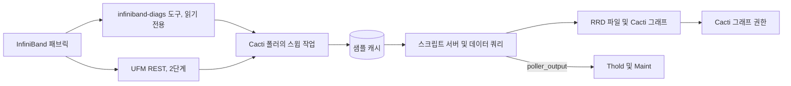

<!-- Source: README.md; SHA256: ce5af61a1bc993ec2aae6d4f22c3885694632f2b1d5eb94e2ce88b8390e96f1e -->

<!-- translations:start -->
[English](../../../README.md) | [简体中文](../zh-CN/README.md) | [हिन्दी](../hi-IN/README.md) | [Español (España)](../es-ES/README.md) | [Español (Latinoamérica)](../es-419/README.md) | [العربية (السعودية)](../ar-SA/README.md) | [Afrikaans](../af-ZA/README.md) | [አማርኛ](../am-ET/README.md) | [العربية (مصر)](../ar-EG/README.md) | [العربية (المغرب)](../ar-MA/README.md) | [বাংলা](../bn-BD/README.md) | [Bosanski](../bs-BA/README.md) | [Deutsch](../de-DE/README.md) | [فارسی](../fa-IR/README.md) | [Filipino](../fil-PH/README.md) | [Français](../fr-FR/README.md) | [Français (Maroc)](../fr-MA/README.md) | [Français (Sénégal)](../fr-SN/README.md) | [Hausa](../ha-NG/README.md) | [עברית](../he-IL/README.md) | [Hrvatski](../hr-HR/README.md) | [Bahasa Indonesia](../id-ID/README.md) | [Igbo](../ig-NG/README.md) | [Italiano](../it-IT/README.md) | [日本語](../ja-JP/README.md) | [한국어](README.md) | [Malagasy](../mg-MG/README.md) | [मराठी](../mr-IN/README.md) | [Bahasa Melayu](../ms-MY/README.md) | [Nederlands](../nl-NL/README.md) | [Polski](../pl-PL/README.md) | [Português (Brasil)](../pt-BR/README.md) | [Русский](../ru-RU/README.md) | [Kinyarwanda](../rw-RW/README.md) | [Soomaali](../so-SO/README.md) | [Српски](../sr-RS/README.md) | [Svenska](../sv-SE/README.md) | [Kiswahili](../sw-KE/README.md) | [தமிழ்](../ta-IN/README.md) | [తెలుగు](../te-IN/README.md) | [ไทย](../th-TH/README.md) | [Türkçe](../tr-TR/README.md) | [Українська](../uk-UA/README.md) | [اردو](../ur-PK/README.md) | [Tiếng Việt](../vi-VN/README.md) | [isiXhosa](../xh-ZA/README.md) | [Yorùbá](../yo-NG/README.md) | [繁體中文](../zh-TW/README.md) | [isiZulu](../zu-ZA/README.md)
<!-- translations:end -->

# plugin_fabric

InfiniBand 포트 카운터, 링크 폭과 속도, 혼잡 지표를 일반 디바이스, 데이터 소스, 그래프로 Cacti에 통합하는 Cacti 1.2 플러그인입니다. 링크가 4X 대신 1X로 협상(트레이닝)되면 해당 링크가 연결된 호스트 옆에 그래프와 Thold 알림으로 표시되며, Cacti의 권한 체계를 따르고 Maint로 알림을 억제할 수 있습니다.

> **상태: 개발 중, 아직 릴리스되지 않았습니다.** 마일스톤 2(기반 구현)는 `main`에 병합되었으며, 마일스톤 3(Cacti 객체 및 알림)은 검토 중입니다. 마일스톤 1에서는 문서 및 업스트림 소스를 대조하여 설계를 검증했으며(PR #71), 출처가 포함된 결과는 [docs/research/](../../research)에 있습니다. 마일스톤 2에는 다음과 같은 플러그인 기반 기능이 추가되었습니다:
>
> - 설치, 업그레이드, 제거 및 PHP 8.2 가드
> - View, Operator, Admin 영역(Realm) 및 설정
> - 패브릭 레코드
> - `perfquery`, `ibnetdiscover`, `iblinkinfo`에 대한 읽기 전용 명령 경계
> - ID 충돌 및 재연결 제안을 포함한 GUID 기반 인벤토리
> - 링크 상태 및 카운터 스윕 캐시
> - 인벤토리, 관리 및 상태(Health) 페이지
>
> 마일스톤 3에는 다음과 같은 Cacti 객체가 추가됩니다:
>
> - Cacti 템플릿 XML로 제공되는 디바이스, 데이터, 그래프 템플릿 및 "Fabric Port" 데이터 쿼리
> - 노드를 Cacti 디바이스에 매핑하거나 확인 시 새 디바이스 생성 ([ADR 0010](../../decisions/0010-one-device-per-node.md))
> - 그래프용 카운터 데이터 소스와 Thold용 GAUGE 링크 상태 및 속도(rate) 데이터 소스 ([ADR 0011](../../decisions/0011-derive-counters-and-gauge-alert-values.md))
> - 불연속성(discontinuity) 처리 및 포화된 기본 카운터의 unknown 처리 ([ADR 0012](../../decisions/0012-saturated-basic-counters-read-as-unknown.md)), 포트 페이지의 카운터 유효성 및 그래프 링크, 혼잡 순위
> - 수정하지 않은 Thold v1.8.2 및 Maint v1.3과의 종단 간(end-to-end) 테스트 및 시뮬레이션된 패브릭에 대해 실제 진단 도구를 실행하는 CI 작업
>
> 3단계에서 원격 데이터 수집기(remote data collector)가 지원될 때까지 패브릭은 기본 폴러(main poller)에서만 스윕할 수 있습니다. 가짜 도구와 ibsim 패브릭 시뮬레이터를 대상으로만 테스트되었으며, 실제 InfiniBand 패브릭에서는 테스트된 적이 없습니다. 실제 패브릭이 필요한 확인 항목은 각 리서치 페이지의 실시간 확인(live-checks) 표에 미완료 상태로 남아 있습니다. 이 프로젝트는 Cacti 프로젝트와 공식적으로 관련이 없습니다.

## 접근 역할

| 영역(Realm) | 접근 권한 |
| --- | --- |
| Fabric View | 기존 모니터링 페이지. |
| Fabric Operator | 모니터링 페이지 및 Operations 페이지와 개인 분류(triage) 확인(acknowledgment). |
| Fabric Admin | Operator 접근 권한 및 기존 구성과 관리 작업. |

업그레이드 파일을 복사한 후 관리자로 Plugins 페이지에 접속하여 새 영역을 등록하세요. **Configuration > Users** 또는 사용자 그룹에서 Operator 영역을 명시적으로 할당하세요. 업그레이드시 기존 View 및 Admin 영역 ID와 부여된 권한은 유지됩니다. Admin 접근 권한은 Operator 접근 권한을 상속하고, Operator 접근 권한은 매 요청마다 View 접근 권한을 상속합니다. 이는 사용자나 그룹에 저장된 권한 부여(grant)를 추가하지 않습니다. 플러그인 설정에는 Cacti의 Settings 권한 외에 Fabric Admin 접근 권한도 필요합니다.

Cacti 디바이스 권한은 여전히 각 사용자가 볼 수 있는 행과 수행 가능한 작업을 제한하며, 매핑되지 않은 객체에는 관리자 권한이 필요합니다. 자격 증명, 구성, 매핑, 삭제 및 기타 관리 변경 사항은 관리 페이지에 유지됩니다. 확인(acknowledgment)은 현재 사용자의 세션에서만 최대 1시간 동안, 그리고 동일한 관측 결과가 최신 상태로 유지되는 동안에만 유효합니다. 관측 결과가 새로워지거나 변경되면 확인은 무효화됩니다. 확인은 실패한 측정을 정상으로 표시하거나 알림을 억제하지 않습니다.

## 도입 배경

성능이 저하된 InfiniBand 링크도 트래픽은 계속 통과시킵니다. 4X 링크가 1X로 재협상(retrain)되면 포트는 "active" 상태로 유지되고 호스트의 SNMP 인터페이스 그래프도 정상처럼 보이지만, 강결합(tightly coupled) 작업의 속도가 느려집니다. 그 증거는 패브릭에 있습니다. 각 포트는 활성(active), 활성화(enabled), 지원(supported) 폭과 속도는 물론 오류 및 혼잡 카운터를 보고합니다. 이를 읽으려면 InfiniBand 진단 도구나 패브릭 매니저 API가 필요합니다. 이를 수동으로 실행하면 세 가지 공백이 남습니다:

- **이력 부재.** `perfquery`와 `iblinkinfo`는 현재 상태만 보여주므로 지난주에 저하된 링크는 보이지 않습니다.
- **디바이스 컨텍스트 부재.** 패브릭 포트는 Cacti 객체가 아니므로 포트가 연결된 호스트 옆에 그래프를 그릴 수 없습니다.
- **Cacti 알림 연동 경로 부재.** Thold와 Maint는 Cacti 데이터 소스와 디바이스를 대상으로 작동합니다.

이 플러그인은 자체 진단 도구(및 추후 UFM)를 통해 패브릭을 읽고, GUID로 노드와 포트를 식별하며, 카운터와 링크 상태를 Cacti 데이터 소스로 게시하여 이러한 공백을 메웁니다. 읽기 전용으로만 동작하며, 카운터를 초기화하거나 포트 상태를 변경하지 않습니다.

## 최초 검색

새 패브릭에는 노드가 없으며, 스윕은 Cacti 디바이스에 매핑된 노드에 대해서만 스크립트 서버에서 시작됩니다. 따라서 최초 검색은 수동 단계로 진행해야 합니다. 활성화된 패브릭을 저장한 후, 패브릭이 할당된 폴러에서 폴러 계정으로 다음 명령을 한 번 실행하세요. `/path/to/cacti`는 실제 Cacti 디렉터리 경로로 바꾸어야 합니다(절대 경로는 cron에서도 동작합니다):

```
php /path/to/cacti/plugins/fabric/fabric_sweep.php --fabric=ID --force
```

그러면 인벤토리가 채워집니다. Fabric Admin 페이지에서 노드를 Cacti 디바이스에 매핑하세요. 이후 스윕은 데이터 쿼리에서 시작됩니다. 패브릭의 노드가 하나도 매핑되지 않은 상태에서는 인벤토리가 자동으로 새로 고침되지 않으므로, 새 노드나 누락된 노드를 기록하려면 원할 때 cron 등으로 동일한 명령을 다시 실행하세요. 상태(Health) 페이지에는 아직 검색되지 않았거나 매핑된 노드가 없는 활성 패브릭에 대해 이 명령이 표시됩니다.

## 계획된 범위

| 단계 | 범위 | 마일스톤 |
|---|---|---|
| 0, 리서치 | 버전 매트릭스, 업스트림 동작 확인, 하드웨어에서의 카운터 동작, 권한 모델, MAD 예산, UFM API | [M1](https://github.com/somethingwithproof/plugin_fabric/milestone/1) |
| 1, 관측 | GUID 기반 인벤토리, Cacti 디바이스, 포트 데이터 쿼리, 카운터 및 링크 상태 데이터 소스, Thold 알림, Maint 억제, 상태 페이지 | [M2](https://github.com/somethingwithproof/plugin_fabric/milestone/2), [M3](https://github.com/somethingwithproof/plugin_fabric/milestone/3), [M4](https://github.com/somethingwithproof/plugin_fabric/milestone/4) |
| 2, UFM | 읽기 전용 UFM REST 백엔드, 자격 증명 처리, 백엔드 간 ID 연속성 | [M5](https://github.com/somethingwithproof/plugin_fabric/milestone/5) |
| 3, 원격 | 원격 데이터 수집기, 복제, `remote_agent` 작업, 대규모 패브릭을 위한 샤딩된 스윕 | [M6](https://github.com/somethingwithproof/plugin_fabric/milestone/6) |

범위 외 항목: 패브릭 상태 변경, 패브릭 매니저 또는 서브넷 매니저 대체, 플러그인 자체 알림 엔진, 커스텀 데몬 또는 네트워크 프로토콜, Ethernet 또는 RoCE 패브릭(리서치 대상).

## 호환성 대상

| 구성 요소 | 대상 |
|---|---|
| Cacti | 1.2.31 이상, 코어 패치 불필요 |
| PHP | 8.2 이상; 지원되지 않는 런타임에서 Cacti UI가 깨지는 대신 거부 메시지를 표시하도록 `setup.php`는 8.0에서도 파싱 가능하게 유지 |
| InfiniBand 도구 | rdma-core의 infiniband-diags; v66.0 소스를 기준으로 출력 형식 확인 |
| UFM | UFM Enterprise REST API, 2단계; 릴리스 매트릭스는 마일스톤 1의 결과물 |
| Thold, Maint | 변경 불필요 |

Cacti의 스크립트 타임아웃을 기본값인 25초 이상으로 유지하세요. 데이터 쿼리 읽기로 시작된 스윕은 캐시를 읽고 응답할 시간을 확보하기 위해 도구 실행 시간을 해당 타임아웃에서 5초를 뺀 값으로 제한합니다. 이 시간 예산이 만료되면 쿼리는 마지막 유효 샘플 또는 unknown을 반환하며, 다음 주기에 스윕을 다시 시도합니다. 이 제한은 PHP 폴러에도 적용됩니다. 타임아웃이 5초 이하이면 도구를 시작할 시간이 남지 않습니다.

## 설계

- [docs/PLAN.md](../../PLAN.md)는 전체 계획 문서입니다. 아키텍처, 의존하는 업스트림 사실(출처 포함) 및 아직 확인이 필요한 가정, ID 모델, 카운터 및 링크 상태 규칙, 보안 경계, 성능 계산, 테스트, 위험 요소를 다룹니다.
- [docs/decisions/](../../decisions)에는 이미 내린 선택에 대한 아키텍처 결정 기록(ADR)이 들어 있습니다.
- [docs/REQUIREMENTS.md](../../REQUIREMENTS.md)는 모든 요구 사항 ID를 해당 이슈와 연결합니다.



## 작업 추적 방식

- **마일스톤**은 계획의 마일스톤을 따릅니다. 각 마일스톤에는 하위 이슈와 완료 근거(exit evidence)를 나열한 에픽 이슈가 있습니다.
- **이슈**는 레이블로 유형이 구분됩니다: `type: requirement`, `type: research`, `type: decision`, `type: epic`. 요구 사항 이슈에는 번호가 매겨진 테스트 가능한 요구 사항(`REQ-AREA-NNN`)과 인수 기준이 명시됩니다.
- **레이블**은 `area:`, `phase:`, `priority:`, `status:`도 포함합니다. [CONTRIBUTING.md](../../../CONTRIBUTING.md#labels)를 참고하세요.
- [프로젝트 보드](https://github.com/users/somethingwithproof/projects/8)에서 모든 마일스톤의 이슈를 확인할 수 있습니다.

## 기여하기

[CONTRIBUTING.md](../../../CONTRIBUTING.md)를 읽어보세요. 커밋에는 DCO sign-off가 필요합니다. 설계 논의는 이슈에서 진행되며, 미결 결정 사항에는 `type: decision` 레이블이 붙습니다.

## 보안

취약점은 비공개로 제보해 주세요. [SECURITY.md](../../../SECURITY.md)를 참고하세요.

## 라이선스

Cacti 및 해당 플러그인들과 동일한 라이선스인 GNU General Public License v2.0을 따릅니다. [LICENSE](../../../LICENSE)를 참고하세요.
