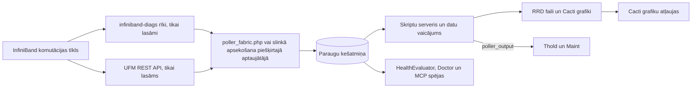

<!-- Source: README.md; SHA256: 79a16fb906f96ee79de2c719f18c38836f555440a7571a4a5ba38c64bb5b099f -->

<!-- translations:start -->
[English](../../../README.md) | [简体中文](../zh-CN/README.md) | [हिन्दी](../hi-IN/README.md) | [Español (España)](../es-ES/README.md) | [Español (Latinoamérica)](../es-419/README.md) | [العربية (السعودية)](../ar-SA/README.md) | [Afrikaans](../af-ZA/README.md) | [አማርኛ](../am-ET/README.md) | [العربية (مصر)](../ar-EG/README.md) | [العربية (المغرب)](../ar-MA/README.md) | [Български](../bg-BG/README.md) | [বাংলা](../bn-BD/README.md) | [Bosanski](../bs-BA/README.md) | [Deutsch](../de-DE/README.md) | [Ελληνικά](../el-GR/README.md) | [فارسی](../fa-IR/README.md) | [Filipino](../fil-PH/README.md) | [Français](../fr-FR/README.md) | [Français (Maroc)](../fr-MA/README.md) | [Français (Sénégal)](../fr-SN/README.md) | [Hausa](../ha-NG/README.md) | [עברית](../he-IL/README.md) | [Hrvatski](../hr-HR/README.md) | [Bahasa Indonesia](../id-ID/README.md) | [Igbo](../ig-NG/README.md) | [Italiano](../it-IT/README.md) | [日本語](../ja-JP/README.md) | [ქართული](../ka-GE/README.md) | [한국어](../ko-KR/README.md) | [Latviešu](README.md) | [Malagasy](../mg-MG/README.md) | [मराठी](../mr-IN/README.md) | [Bahasa Melayu](../ms-MY/README.md) | [Nederlands](../nl-NL/README.md) | [Polski](../pl-PL/README.md) | [Português (Brasil)](../pt-BR/README.md) | [Português (Portugal)](../pt-PT/README.md) | [Русский](../ru-RU/README.md) | [Kinyarwanda](../rw-RW/README.md) | [Soomaali](../so-SO/README.md) | [Српски](../sr-RS/README.md) | [Svenska](../sv-SE/README.md) | [Kiswahili](../sw-KE/README.md) | [தமிழ்](../ta-IN/README.md) | [తెలుగు](../te-IN/README.md) | [ไทย](../th-TH/README.md) | [Türkçe](../tr-TR/README.md) | [Українська](../uk-UA/README.md) | [اردو](../ur-PK/README.md) | [Tiếng Việt](../vi-VN/README.md) | [isiXhosa](../xh-ZA/README.md) | [Yorùbá](../yo-NG/README.md) | [繁體中文](../zh-TW/README.md) | [isiZulu](../zu-ZA/README.md)
<!-- translations:end -->

# plugin_fabric

Cacti 1.2 spraudnis (`fabric`, versija `0.1.0-dev`), kas ienes InfiniBand portu skaitītājus, savienojumu platumu un ātrumu, kā arī pārslodzes indikatorus Cacti vidē kā parastas ierīces, datu avotus un grafikus. Savienojums, kas izveidojies ar 1X, nevis 4X platumu, parādās kā grafiks un Thold brīdinājums blakus tā apkalpotajam resursdatoram saskaņā ar Cacti atļaujām, ar Maint atbalstu un apslāpēšanu.

> **Statuss: izstrādē, vēl nav laidiena.** Šajā zarā ir ieviests spraudņa pamats, Cacti objekti un brīdinājumi, plānotās fona aptaujātāja apsekošanas, attālo vācēju replikācija, tikai lasāma NVIDIA UFM REST aizmugursistēma ar šifrētu akreditācijas datu glabātuvi, Configuration-as-Code (CasC) CLI pārvaldība un Cacti ekosistēmas āķi (CasC, Doctor un MCP / Abilities API v2). Tas ir testēts ar viltotiem rīkiem, sintētiskiem UFM transportiem un `ibsim` komutācijas tīkla simulatoru (rdma-core 50.0), bet nekad nav darbināts fiziskā InfiniBand komutācijas tīklā vai reālā UFM serverī. Pārbaudes, kurām nepieciešama aparatūra, joprojām ir atvērtas mapē [docs/research/](../../research/). Šis projekts nav saistīts ar Cacti projektu.

## Kas ir ieviests

- **Dzīves cikls un shēma (v3)**: instalēšana, idempotenta jaunināšana, atinstalēšana (pēc noklusējuma saglabājot spraudņa tabulas) un PHP 8.2 prasības aizsardzība, vienlaikus saglabājot ieejas punktus parsējamus PHP 8.0.
- **Piekļuves lomas un lapas**: tiesību jomas `Fabric View` (`fabric.php`), `Fabric Operator` (`fabric_operator.php`) un `Fabric Admin` (`fabric_admin.php`, `fabric_health.php`), kā arī iestatījumu cilne sadaļā **Configuration > Settings > Fabrics**.
- **Tikai lasāma diagnostikas aizmugursistēma (`diags`)**: stingra argumentu vektora izpilde rīkiem `perfquery`, `ibnetdiscover` un `iblinkinfo`, pēc GUID indeksēts inventārs ar identitātes konfliktu noteikšanu un atkārtotas sasaistes priekšlikumiem, savienojumu stāvokļa novērtēšana un katra mezgla skaitītāju apsekošana.
- **Tikai lasāma NVIDIA UFM REST aizmugursistēma (`ufm`) un šifrēta glabātuve**: tikai GET atļauto saraksta REST klients (`/ufmRest/resources/ports`, `/ufmRest/resources/systems`, `/ufmRest/monitoring/session/0/data` un `/ufmRestV3/...` ekvivalenti marķieru autentifikācijai), kas aizpilda tās pašas inventāra, savienojumu stāvokļa, paraugu un veselības tabulas kā `diags`. Akreditācijas dati (`token` vai `basic`) tiek glabāti šifrēti ar AES-256-GCM tabulā `plugin_fabric_secret`, izmantojot ārēju 256 bitu atslēgas failu, ko konfigurē `fabric_vault_key_file`. UFM komutācijas tīklus var definēt caur CasC (`cli/fabric.php`) vai repozitorijiem; tīmekļa administrēšanas veidlapa pašlaik rāda `diags` laukus.
- **Cacti objekti, Thold un Maint**: Cacti ierīču, datu un grafiku veidnes (`templates/fabric-templates.xml`), skriptu servera datu vaicājums "Fabric Port" (`scripts/ss_fabric_ports.php`, `resource/script_server/fabric_ports.xml`), `DERIVE` skaitītāju datu avoti un `GAUGE` savienojumu stāvokļa/ātruma datu avoti priekš Thold, pārtraukumu izsekošana un piesātinātu pamata skaitītāju ziņošana kā `U`. Maint integrācija (`MaintMaintenance`) vaicā `plugin_maint_check_cacti_host()` (ar rezerves ceļu uz āķi `is_device_in_maintenance`), lai aktīvā apkopē esošie mezgli tiktu skaitīti atsevišķi un izslēgti no neveiksmīgo apsekošanu un pasliktināto portu veselības brīdinājumiem.
- **Plānotās apsekošanas, šardēšana un attālie vācēji**: `poller_bottom` fonā palaiž `poller_fabric.php` termiņam atbilstošiem komutācijas tīkliem, kas piešķirti pašreizējam aptaujātājam, līdzās slinkajām apsekošanām, kuras ierosina skriptu serveris. `INFO` deklarē `remote_collect:1, remote_poller:1`, `poller_fabric.php` atbalsta deterministisku GUID šardēšanu (`--shard=K/N`), un `replicate_out` replicē neslepenas `plugin_fabric_fabric` rindas uz attālajiem vācējiem (`poller_id >= 2`). Glabātuves ieraksti (`plugin_fabric_secret`) un ārējie atslēgu faili nekad netiek replicēti.
- **CasC CLI un ekosistēmas āķi**: `cli/fabric.php` YAML/XML eksportam, validācijai, izmēģinājuma atšķirību plānošanai, apstiprinājumu prasošai piemērošanai un veselības atskaitēm, kā arī `casc_register_providers`, `doctor_register_checks` un `abilities_register` āķi.

## Piekļuves lomas

| Tiesību joma | Piekļuve |
| --- | --- |
| Fabric View | Uzraudzības inventāra un portu skati (`fabric.php`). |
| Fabric Operator | View piekļuve, kā arī Darbību lapa (`fabric_operator.php`) un personīgie šķirošanas apstiprinājumi. |
| Fabric Admin | Operatora piekļuve, kā arī konfigurācija, administratīvās darbības (`fabric_admin.php`) un veselības lapa (`fabric_health.php`). |

Pēc jaunināšanas failu nokopēšanas atveriet spraudņu (Plugins) lapu kā administrators, lai reģistrētu jaunās tiesību jomas un āķus. Operatora tiesību jomu piešķiriet tieši sadaļā **Configuration > Users** vai lietotāju grupās. Jauninājumi saglabā esošos View un Admin tiesību jomu ID un piešķīrumus. Admin piekļuve katrā pieprasījumā manto Operator piekļuvi, un Operator piekļuve manto View piekļuvi; tas nepievieno saglabātus piešķīrumus lietotājiem vai grupām. Spraudņa iestatījumiem papildus Cacti iestatījumu atļaujai ir nepieciešama arī Fabric Admin piekļuve.

Cacti ierīču atļaujas ierobežo katram lietotājam pieejamās rindas un darbības; nepiesaistītiem objektiem nepieciešams administrators. Akreditācijas dati, konfigurācija, piesaiste, dzēšana un citas administratīvās izmaiņas paliek administratīvajās lapās vai CLI. Apstiprinājumi ir spēkā tikai pašreizējā lietotāja sesijā, ne ilgāk par vienu stundu un tikai tikmēr, kamēr tas pats novērojums paliek aktuāls. Jauni vai mainīti novērojumi padara tos nederīgus. Tie nekad neatzīmē neveiksmīgu mērījumu kā veselu un neapslāpē brīdinājumus.

## Kāpēc

Pasliktināts InfiniBand savienojums joprojām pārsūta datplūsmu. 4X savienojums, kas atkārtoti izveidojas ar 1X platumu, atstāj portu stāvoklī "active", un resursdatora SNMP saskarņu grafiki izskatās normāli, bet cieši saistīti aprēķinu uzdevumi kļūst lēnāki. Pierādījumi atrodas pašā komutācijas tīklā: katrs ports ziņo savu aktīvo, iespējoto un atbalstīto platumu un ātrumu, kā arī kļūdu un pārslodzes skaitītājus. To nolasīšanai nepieciešami InfiniBand diagnostikas rīki vai komutācijas tīkla pārvaldnieka API. Darbinot tos manuāli, paliek trīs robi:

- **Nav vēstures.** `perfquery` un `iblinkinfo` rāda pašreizējo brīdi, tāpēc pagājušajā nedēļā pasliktinājies savienojums nav redzams.
- **Nav ierīces konteksta.** Komutācijas tīkla porti nav Cacti objekti, tāpēc portu nevar attēlot grafikā blakus tā apkalpotajam resursdatoram.
- **Nav ceļa uz Cacti brīdinājumiem.** Thold un Maint darbojas ar Cacti datu avotiem un ierīcēm.

Spraudnis aizpilda šos robus, lasot komutācijas tīklu caur `infiniband-diags` vai NVIDIA UFM REST API, identificējot mezglus un portus pēc GUID un publicējot skaitītājus un savienojumu stāvokli kā Cacti datu avotus. Tas tikai lasa: tas nekad neatiestata skaitītājus un nemaina portu stāvokli.

## Darbība un CLI

### Fona aptaujātājs un manuālas apsekošanas

`fabric_poller_bottom()` katrā aptaujātājā fonā palaiž `poller_fabric.php` iespējotajiem komutācijas tīkliem, kas piešķirti šim `poller_id` un kuriem pienācis apsekošanas laiks. Jūs varat arī palaist aptaujātāja izpildītāju vai manuālu apsekošanu tieši piešķirtajā aptaujātājā kā aptaujātāja lietotājs (aizstājot `/path/to/cacti` ar savu Cacti direktoriju):

```sh
php /path/to/cacti/plugins/fabric/poller_fabric.php [--fabric=ID] [--shard=K/N] [--force] [--debug]
php /path/to/cacti/plugins/fabric/fabric_sweep.php --fabric=ID [--node=GUID] [--force]
```

- `poller_fabric.php` izpilda visus termiņam atbilstošos komutācijas tīklus lokālajam aptaujātājam (vai vienu komutācijas tīklu ar `--fabric=ID`), ievēro Cacti procesu reģistra bloķēšanu un `ClaimRepository` nomas ar laika budžetu `max(30, intdiv(sweep_interval, 2))` sekundes un atbalsta `--shard=K/N` (`0 <= K < N`), lai deterministiski šardētu `diags` mezglu skaitītāju apsekošanas pēc mezgla GUID.
- `fabric_sweep.php` izpilda viena lokālajam aptaujātājam piešķirta iespējota komutācijas tīkla (vai viena mezgla ar `--node=GUID`) apsekošanu pēc pieprasījuma. `--force` ignorē to, vai komutācijas tīklam pienācis apsekošanas laiks, bet joprojām ievēro nomas bloķējumus.

Kad pirmā atklāšana aizpilda inventāru, piesaistiet mezglus Cacti ierīcēm Komutācijas tīkla administrēšanas lapā. Saglabājiet Cacti skripta noildzi vismaz 25 sekundes: slinkā apsekošana, ko sāk datu vaicājuma nolasīšana, ierobežo rīka izpildi līdz `script_timeout - 5` sekundēm, lai skriptu serveris laikā atgrieztu pēdējo saglabāto paraugu vai `U`.

### NVIDIA UFM REST aizmugursistēma un akreditācijas datu glabātuve

`ufm` komutācijas tīklam nepieciešams `https://` URL bez iestrādātiem akreditācijas datiem, vaicājuma virknēm vai fragmentiem. `UfmSocketTransport` piemēro TLS sertifikāta un resursdatora nosaukuma pārbaudi, noraida pāradresācijas un atbalsta neobligātu CA komplektu (`ufm_ca_file`) un SHA-256 SPKI piespraudi (`ufm_spki_pin`).

Lai glabātu UFM akreditācijas datus tabulā `plugin_fabric_secret`, sadaļā **Configuration > Settings > Fabrics** konfigurējiet `fabric_vault_key_file` ar absolūtu ceļu līdz parastam failam, kas pieder aptaujātāja lietotājam (bez simboliskajām saitēm nevienā vecākdirektorijā, tiesības `0600`, satur 64 heksadecimālās rakstzīmes, piemēram, no `openssl rand -hex 32`, vai 32 nejaušus nedrukājamus baitus). Spraudnis nekad neveido un neraksta atslēgas failu, un `replicate_out` nekad nereplicē `plugin_fabric_secret` vai atslēgu failus uz attālajiem aptaujātājiem.

### Configuration-as-Code un veselības CLI

`cli/fabric.php` deklaratīvi pārvalda spraudņa iestatījumus un komutācijas tīklu definīcijas YAML vai XML formātā, kā arī ziņo par apkopes stāvokli ievērojošu veselību bez reālu apsekošanu palaišanas:

```sh
php /path/to/cacti/plugins/fabric/cli/fabric.php export [--format=yaml|xml] [--file=PATH]
php /path/to/cacti/plugins/fabric/cli/fabric.php validate --file=PATH [--format=yaml|xml]
php /path/to/cacti/plugins/fabric/cli/fabric.php plan --file=PATH [--format=yaml|xml]
php /path/to/cacti/plugins/fabric/cli/fabric.php apply --file=PATH --confirm=PLAN_HASH [--format=yaml|xml]
php /path/to/cacti/plugins/fabric/cli/fabric.php health [--format=text|json]
```

`export` izveido jaunus failus ar tiesībām `0600`, aizklāj `fabric_vault_key_file` ar `[REDACTED]` un izvada nosauktas `ufm_credential_ref` atsauces, nevis noslēpumus. `plan` un `apply` noraida iekļautas `ufm_token`, `ufm_password`, `secret` un `fabric_vault_key_file` vērtības. `apply` pieprasa precīzu `--confirm=PLAN_HASH`, ko izveidojis `plan`.

### Ekosistēmas āķi

Ja ir pieejami atbilstošie Cacti spraudņi vai resursdatora integrācijas, `setup.php` reģistrē:

- `casc_register_providers`: eksportē, validē, plāno un ar apstiprinājumu piemēro `fabric` konfigurāciju (`yaml` un `xml`, 1. shēmas versija) ar noslēpumu aizklāšanu.
- `doctor_register_checks`: nodrošina četras tikai lasāmas diagnostikas pārbaudes (`fabric.schema`, `fabric.poller_freshness`, `fabric.identity_conflicts`, `fabric.ufm_vault`).
- `abilities_register`: reģistrē trīs tikai lasāmas, nedestruktīvas, idempotentas spējas kategorijā `fabric`, kuras ierobežo Fabric View tiesību joma (un Cacti ierīču atļaujas portu kļūdām): `fabric-list-fabrics`, `fabric-get-health` un `fabric-list-port-errors`.

## Tvērums un robežas

Ārpus tvēruma: komutācijas tīkla stāvokļa maiņa, skaitītāju atiestatīšana, komutācijas tīkla pārvaldnieka vai apakštīkla pārvaldnieka aizstāšana, spraudnim piederošs brīdinājumu dzinis, pielāgots dēmons vai tīkla protokols, kā arī Ethernet vai RoCE tīkli.

## Prasības un saderība

| Komponents | Mērķis |
|---|---|
| Cacti | 1.2.31 vai jaunāks (`compat = 1.2.31`), bez kodola ielāpiem |
| PHP | 8.2 vai jaunāks; ieejas punkti paliek parsējami PHP 8.0 un noraida aktivizēšanu PHP 8.1, lai neatbalstīta izpildvide saņemtu atteikumu, nevis bojātu Cacti lietotāja saskarni |
| InfiniBand rīki | `infiniband-diags` no `rdma-core` (testēts CI vidē ar rdma-core 50.0 zem `ibsim`; izvades formāti pārbaudīti pret v66.0 pirmkodu) |
| UFM | NVIDIA UFM Enterprise REST API (`ufmRest` un `ufmRestV3` tikai lasāmi galapunkti; testēts ar sintētiskiem transportiem vienībtestos) |
| Thold, Maint | Izmaiņas nav nepieciešamas; CI izpilda pilna cikla testu ar nemainītu Thold v1.8.2 un Maint v1.3 |

## Izstrāde un testēšana

CI darbplūsma (`.github/workflows/plugin-ci-workflow.yml`) testē PHP versijas no 8.2 līdz 8.5 ar Cacti `release/1.2.31` un `1.2.x`, PHP 8.0 ieejas punktu sintakses pārbaudi, PHP 8.1 atteikumu, PHPStan, gettext/tulkojumu verifikāciju, REUSE licencēšanu, darbplūsmas pārbaudi, Thold/Maint pilna cikla atkārtojumu un `ibsim` komutācijas tīkla simulāciju.

Ar Cacti piesaistīto koplietoto Pest spraudņu testa rīku (`CACTI_PEST_BIN`) un vienreizēju Cacti datubāzi:

```sh
# Unit tests
"$CACTI_PEST_BIN" --configuration=phpunit.xml

# Lifecycle integration tests (disposable database only)
CACTI_PATH=/path/to/cacti FABRIC_TEST_DATABASE=disposable "$CACTI_PEST_BIN" --configuration=phpunit-integration.xml

# Static analysis (against Cacti 1.2.31)
CACTI_PATH=/path/to/cacti phpstan analyse -c phpstan.neon --no-progress

# Translation template, catalogs, and localized README checks
sh locales/build_gettext.sh --check

# Simulated ibsim fixture parser check
php tests/bin/check-ibsim-fixtures.php tests/fixtures/ibsim
```

## Dizains

- [docs/PLAN.md](../../PLAN.md) ir arhitektūras un dizaina plāns: augšupējie fakti ar avotiem, atvērtās aparatūras pārbaudes, identitātes modelis, skaitītāju un savienojumu stāvokļa noteikumi, drošības robežas, veiktspējas aprēķini, testēšana un riski.
- [docs/decisions/](../../decisions/) satur arhitektūras lēmumu ierakstus.
- [docs/REQUIREMENTS.md](../../REQUIREMENTS.md) sasaista katru prasības ID ar tā uzdevumu.



## Kā tiek sekots darbam

- **Atskaites (Milestones)** seko plāna atskaitēm. Katrai ir episkais uzdevums ar apakšuzdevumu sarakstu un pabeigšanas pierādījumiem.
- **Uzdevumi (Issues)** tiek klasificēti ar birkām: `type: requirement`, `type: research`, `type: decision`, `type: epic`. Prasību uzdevumos norādītas numurētas, pārbaudāmas prasības (`REQ-AREA-NNN`) un pieņemšanas kritēriji.
- **Birkas (Labels)** satur arī `area:`, `phase:`, `priority:` un `status:`. Skatiet [CONTRIBUTING.md](../../../CONTRIBUTING.md#labels).
- [Projekta tāfele](https://github.com/users/somethingwithproof/projects/8) parāda visus uzdevumus visās atskaitēs.

## Līdzdalība

Izlasiet [CONTRIBUTING.md](../../../CONTRIBUTING.md). Iesniegumiem (commits) nepieciešams DCO paraksts (`git commit -s`). Dizaina diskusijas notiek uzdevumos; atvērtie lēmumi ir marķēti ar birku `type: decision`.

## Drošība

Par ievainojamībām ziņojiet privāti; skatiet [SECURITY.md](../../../SECURITY.md).

## Licence

GNU General Public License v2.0 — tā pati licence, kas Cacti un tā spraudņiem. Skatiet [LICENSE](../../../LICENSE).
