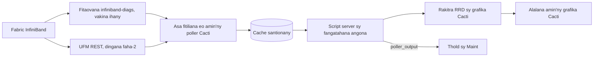

<!-- Source: README.md; SHA256: ce5af61a1bc993ec2aae6d4f22c3885694632f2b1d5eb94e2ce88b8390e96f1e -->

<!-- translations:start -->
[English](../../../README.md) | [简体中文](../zh-CN/README.md) | [हिन्दी](../hi-IN/README.md) | [Español (España)](../es-ES/README.md) | [Español (Latinoamérica)](../es-419/README.md) | [العربية (السعودية)](../ar-SA/README.md) | [Afrikaans](../af-ZA/README.md) | [አማርኛ](../am-ET/README.md) | [العربية (مصر)](../ar-EG/README.md) | [العربية (المغرب)](../ar-MA/README.md) | [বাংলা](../bn-BD/README.md) | [Deutsch](../de-DE/README.md) | [فارسی](../fa-IR/README.md) | [Filipino](../fil-PH/README.md) | [Français](../fr-FR/README.md) | [Français (Maroc)](../fr-MA/README.md) | [Français (Sénégal)](../fr-SN/README.md) | [Hausa](../ha-NG/README.md) | [עברית](../he-IL/README.md) | [Bahasa Indonesia](../id-ID/README.md) | [Igbo](../ig-NG/README.md) | [Italiano](../it-IT/README.md) | [日本語](../ja-JP/README.md) | [한국어](../ko-KR/README.md) | [Malagasy](README.md) | [मराठी](../mr-IN/README.md) | [Bahasa Melayu](../ms-MY/README.md) | [Nederlands](../nl-NL/README.md) | [Polski](../pl-PL/README.md) | [Português (Brasil)](../pt-BR/README.md) | [Русский](../ru-RU/README.md) | [Kinyarwanda](../rw-RW/README.md) | [Soomaali](../so-SO/README.md) | [Svenska](../sv-SE/README.md) | [Kiswahili](../sw-KE/README.md) | [தமிழ்](../ta-IN/README.md) | [తెలుగు](../te-IN/README.md) | [ไทย](../th-TH/README.md) | [Türkçe](../tr-TR/README.md) | [Українська](../uk-UA/README.md) | [اردو](../ur-PK/README.md) | [Tiếng Việt](../vi-VN/README.md) | [isiXhosa](../xh-ZA/README.md) | [Yorùbá](../yo-NG/README.md) | [繁體中文](../zh-TW/README.md) | [isiZulu](../zu-ZA/README.md)
<!-- translations:end -->

# plugin_fabric

Plugin Cacti 1.2 izay mitondra ny kaontera seranan-tsambo InfiniBand, ny sakan'ny rohy sy ny hafainganam-pandeha, ary ny famantarana ny fitohanana ho ao amin'ny Cacti amin'ny endrika fitaovana, loharanon'angona, ary grafika mahazatra. Ny rohy iray izay niasa tamin'ny 1X fa tsy 4X dia miseho ho grafika sy fanairana Thold eo anilan'ny mpampiantrano izay tompoiny, eo ambanin'ny alalan'ny Cacti, ka afaka manakana azy ny Maint.

> **Sata: eo an-dalam-pandrosoana, tsy mbola misy famoahana.** Ny dingana lehibe faha-2 (fototra) dia voakambana ao amin'ny `main`, ary ny dingana lehibe faha-3 (zavatra Cacti sy fanairana) dia eo am-pandinihana. Ny dingana lehibe voalohany dia nanamarina ny famolavolana mifanaraka amin'ny antontan-taratasy sy ny loharanon-kaody ambony (PR #71); ny vokatra, miaraka amin'ny loharano, dia ao amin'ny [docs/research/](../../research). Ny dingana lehibe faha-2 dia manampy ny fototry ny plugin:
>
> - fametrahana, fanavaozana, fanesorana, ary ny fiambenana PHP 8.2
> - sehatra View, Operator ary Admin, sy ny fandrindrana
> - firaketana fabric
> - sisin-tany baikon'ny famakiana ihany ho an'ny `perfquery`, `ibnetdiscover`, ary `iblinkinfo`
> - lisitra araka ny GUID, miaraka amin'ny fifandonana ara-panondroana sy tolo-kevitra fampifandraisana indray
> - toetry ny rohy sy ny cache-n'ny fitiliana kaontera
> - pejin'ny lisitra, fitantanana, ary fahasalamana
>
> Ny dingana lehibe faha-3 dia manampy ny zavatra Cacti:
>
> - lasitra fitaovana, angona, ary grafika izay alefa amin'ny endrika XML lasitra Cacti, ary ny fangatahana angona "Fabric Port"
> - fampifandraisana ny node iray amin'ny fitaovana Cacti iray, na famoronana iray rehefa voamarina ([ADR 0010](../../decisions/0010-one-device-per-node.md))
> - loharanon'angona kaontera ho an'ny grafika, ary loharanon'angona toetry ny rohy sy tahan'ny GAUGE ho an'ny Thold ([ADR 0011](../../decisions/0011-derive-counters-and-gauge-alert-values.md))
> - fitantanana ny fahatapahana sy ny kaontera fototra feno izay vakina ho tsy fantatra ([ADR 0012](../../decisions/0012-saturated-basic-counters-read-as-unknown.md)), ny fahamarinan'ny kaontera sy rohy grafika eo amin'ny pejin'ny seranan-tsambo, ary ny filaharan'ny fitohanana
> - fitsapana hatramin'ny farany miaraka amin'ny Thold v1.8.2 sy Maint v1.3 tsy novana, ary asa CI iray izay mandefa ny fitaovana fitiliana tena izy amin'ny fabric natao simulation
>
> Ny fabric iray dia azo tiliana avy amin'ny poller fototra ihany mandra-pahazoan'ny mpanangona angona lavitra fanohanana amin'ny dingana faha-3. Notsapaina tamin'ny fitaovana sandoka sy ny simulator fabric ibsim izy io, fa tsy mbola tamin'ny fabric InfiniBand tena izy. Ny fanamarinana izay mila fabric dia mijanona misokatra ao amin'ny tabilao fanamarinana mivantana amin'ny pejy fikarohana tsirairay. Ity tetikasa ity dia tsy misy fifandraisana amin'ny tetikasa Cacti.

## Andraikitra fidirana

| Sehatra | Fidirana |
| --- | --- |
| Fabric View | Pejy fanaraha-maso efa misy. |
| Fabric Operator | Fanaraha-maso miampy ny pejy Fampandehanana sy ny fanekena triage manokana. |
| Fabric Admin | Fidiran'ny Operator miampy ny fikirakirana sy ny hetsika fitantanana efa misy. |

Aorian'ny fandikana ny rakitra fanavaozana, sokafy ny pejy Plugins amin'ny maha-mpitantana mba hisoratra anarana ny sehatra vaovao.
Omeo mazava ny sehatra Operator eo ambanin'ny **Configuration > Users** na vondrona mpampiasa.
Ny fanavaozana dia mitazona ny ID sy ny alalana View sy Admin efa misy. Ny fidiran'ny Admin
dia mandova ny fidiran'ny Operator, ary ny fidiran'ny Operator dia mandova ny fidiran'ny View isaky ny fangatahana;
izany dia tsy manampy alalana voatahiry ho an'ny mpampiasa na vondrona. Ny fandrindrana ny plugin dia mitaky ihany koa
ny fidirana Fabric Admin ankoatra ny alalana Settings ao amin'ny Cacti.

Ny alalan'ny fitaovana Cacti dia mbola mametra ny laharana sy ny hetsika azon'ny mpampiasa tsirairay ampiasaina; ny zavatra tsy mbola nampifandraisina dia mitaky mpitantana.
Ny fahazoan-dalana, ny fikirakirana, ny fampifandraisana, ny famafana ary ny fanovana fitantanana hafa
dia mijanona ao amin'ny pejy fitantanana. Ny fanekena dia tsy maharitra afa-tsy mandritra ny fotoam-pivoriana ankehitriny
an'ny mpampiasa, mandritra ny adiny iray raha be indrindra ary raha mbola vaovao io fandinihana io
ihany. Ny fandinihana vaovao na niova dia manafoana azy ireo. Tsy manamarika fandrefesana tsy nahomby
ho salama na manakana fanairana na oviana na oviana izy ireo.

## Nahoana

Ny rohy InfiniBand simba dia mbola mampita fifamoivoizana ihany. Ny rohy 4X iray izay miverina miasa amin'ny 1X dia mamela ny seranan-tsambo ho "mavitrika", ary toa ara-dalàna ny grafika fifandraisana SNMP an'ny mpampiantrano, saingy mihamiadana ny asa mifamatotra mafy. Ny porofo dia ao amin'ny fabric: ny seranan-tsambo tsirairay dia mitatitra ny sakany sy ny hafainganam-pandeha mavitrika, alefa, ary tohanana, miampy ny kaontera hadisoana sy fitohanana. Ny famakiana izany dia mitaky ny fitaovana fitiliana InfiniBand na API mpitantana fabric. Rehefa alefa amin'ny tanana dia mamela banga telo izy ireo:

- **Tsy misy tantara.** Ny `perfquery` sy ny `iblinkinfo` dia mampiseho ny ankehitriny, ka tsy hita izay rohy niharatsy tamin'ny herinandro lasa.
- **Tsy misy tontolon'ny fitaovana.** Ny seranan-tsambo fabric dia tsy zavatra Cacti, ka tsy azo atao grafika eo anilan'ny mpampiantrano tompoiny ny seranan-tsambo iray.
- **Tsy misy lalana mankany amin'ny fanairana Cacti.** Ny Thold sy ny Maint dia miasa amin'ny loharanon'angona sy fitaovana Cacti.

Ity plugin ity dia manidy ireo banga ireo amin'ny alalan'ny famakiana ny fabric amin'ny alalan'ny fitaovana fitiliany manokana (ary avy eo amin'ny alalan'ny UFM), ny famantarana ny node sy ny seranan-tsambo amin'ny alalan'ny GUID, ary ny famoahana ny kaontera sy ny toetry ny rohy ho loharanon'angona Cacti. Mamaky ihany izy: tsy mamerina ny kaontera amin'ny zero na manova ny toetry ny seranan-tsambo na oviana na oviana.

## Fikarohana voalohany

Ny fabric vaovao dia tsy manana node, ary ny fitiliana dia manomboka avy amin'ny script server ho an'ny node izay efa nampifandraisina tamin'ny fitaovana Cacti ihany. Noho izany, dingana atao tanana ny fikarohana voalohany. Aorian'ny fitahirizana fabric iray efa alefa, alefaso indray mandeha eo amin'ny poller nanendrena ilay fabric ity baiko ity, amin'ny kaontin'ny poller, ary soloy amin'ny lahatahiry Cacti anao ny `/path/to/cacti` (ny lalana feno dia mandeha avy amin'ny cron ihany koa):

```
php /path/to/cacti/plugins/fabric/fabric_sweep.php --fabric=ID --force
```

Feno avy eo ny lisitra. Ampifandraiso amin'ny fitaovana Cacti ny node eo amin'ny pejy Fabric Admin; ny fitiliana manaraka dia manomboka avy amin'ny fangatahana angona. Raha mbola tsy misy node ao amin'ny fabric iray voampifandray, dia tsy misy na inona na inona manavao ny lisitra ao aminy, koa alefaso indray io baiko io ihany, avy amin'ny cron raha tianao, mba handraketana ireo node vaovao na tsy hita. Ny pejy fahasalamana dia mampiseho io baiko io ho an'ny fabric efa alefa izay mbola tsy hita na tsy manana node voampifandray.

## Sakany voaomana

| Dingana | Sakany | Dingana lehibe |
|---|---|---|
| 0, fikarohana | Tabilao dikan-teny, fanamarinana ny fitondran-tena ambony, fitondran-tenan'ny kaontera eo amin'ny fitaovana, maodely alalana, teti-bola MAD, API UFM | [M1](https://github.com/somethingwithproof/plugin_fabric/milestone/1) |
| 1, fanaraha-maso | Lisitra araka ny GUID, fitaovana Cacti, fangatahana angona seranan-tsambo, loharanon'angona kaontera sy toetry ny rohy, fanairana Thold, fanakanana Maint, pejy fahasalamana | [M2](https://github.com/somethingwithproof/plugin_fabric/milestone/2), [M3](https://github.com/somethingwithproof/plugin_fabric/milestone/3), [M4](https://github.com/somethingwithproof/plugin_fabric/milestone/4) |
| 2, UFM | Backend REST UFM vakina ihany, fitantanana fahazoan-dalana, fitohizan'ny famantarana eo amin'ny backend | [M5](https://github.com/somethingwithproof/plugin_fabric/milestone/5) |
| 3, lavitra | Mpanangona angona lavitra, famerimberenana, hetsika `remote_agent`, fitiliana voazarazara ho an'ny fabric lehibe | [M6](https://github.com/somethingwithproof/plugin_fabric/milestone/6) |

Tsy tafiditra ao anatin'ny sakany: fanovana ny toetry ny fabric, fanoloana mpitantana fabric na mpitantana tambajotra ambany, rafitra fanairana an'ny plugin manokana, daemon na protokolon'ny tambajotra manokana, ary fabric Ethernet na RoCE (fikarohana).

## Tanjona fifanarahana

| Singa | Tanjona |
|---|---|
| Cacti | 1.2.31 na vaovao kokoa, tsy misy fanovana fototra |
| PHP | 8.2 na vaovao kokoa; mijanona ho azo vakina amin'ny 8.0 ny `setup.php` mba hahazoan'ny tontolo tsy tohanana fandavana fa tsy interface Cacti simba |
| Fitaovana InfiniBand | infiniband-diags avy amin'ny rdma-core; endriky ny vokatra nohamarinina tamin'ny loharano v66.0 |
| UFM | UFM Enterprise REST API, dingana faha-2; ny tabilao famoahana dia vokatra ao amin'ny dingana lehibe voalohany |
| Thold, Maint | Tsy mila fanovana |

Tazomy amin'ny sanda mahazatra 25 segondra na mihoatra ny fe-potoana fijanonan'ny script ao amin'ny Cacti. Ny fitiliana natomboky ny famakiana fangatahana angona dia mametra ny fandefasana fitaovana ho amin'io fe-potoana io analana dimy segondra, mba hitahirizana fotoana hamakiana ny cache sy hamaliana. Rehefa lany ny teti-bola, ny fangatahana dia manome ny santionany farany manankery na tsy fantatra; ny tsingerina manaraka dia manandrana ny fitiliana indray. Io fetra io dia mihatra amin'ny poller PHP ihany koa. Ny fe-potoana dimy segondra na latsaka dia tsy mamela fotoana hanombohana fitaovana.

## Famolavolana

- [docs/PLAN.md](../../PLAN.md) no drafitra feno: rafitra, zava-misy ambony iankinany (miaraka amin'ny loharano) sy vinavina mbola hamarinina, maodely famantarana, fitsipiky ny kaontera sy ny toetry ny rohy, sisin-tany fiarovana, kajy fahombiazana, fitsapana, ary loza mety hitranga.
- [docs/decisions/](../../decisions) no mitahiry ny firaketana fanapahan-kevitra momba ny rafitra ho an'ny safidy efa natao.
- [docs/REQUIREMENTS.md](../../REQUIREMENTS.md) no mampifandray ny ID fepetra tsirairay amin'ny olana mifandraika aminy.



## Fomba fanaraha-maso ny asa

- Ny **dingana lehibe** dia manaraka ny dingana lehibe ao amin'ny drafitra. Ny tsirairay dia manana olana epic mitanisa ny olana zana-tsampana sy ny porofo fivoahana.
- Ny **olana** dia voasokajy araka ny marika: `type: requirement`, `type: research`, `type: decision`, `type: epic`. Ny olana fepetra dia milaza fepetra azo tsapaina sy misy laharana (`REQ-AREA-NNN`) ary fepetra fanekena.
- Ny **marika** ihany koa dia mitondra `area:`, `phase:`, `priority:`, ary `status:`. Jereo ny [CONTRIBUTING.md](../../../CONTRIBUTING.md#labels).
- Ny [tabilao tetikasa](https://github.com/users/somethingwithproof/projects/8) dia mampiseho ny olana rehetra manerana ny dingana lehibe.

## Fandraisana anjara

Vakio ny [CONTRIBUTING.md](../../../CONTRIBUTING.md). Mila sonia DCO ny commit. Ny adihevitra momba ny famolavolana dia atao eo amin'ny olana; ny fanapahan-kevitra misokatra dia mitondra ny marika `type: decision`.

## Fiarovana

Tatitrao mangingina ny lesoka ara-piarovana; jereo ny [SECURITY.md](../../../SECURITY.md).

## Fahazoan-dalana

GNU General Public License v2.0, mitovy fahazoan-dalana amin'ny Cacti sy ny plugin-ny. Jereo ny [LICENSE](../../../LICENSE).
