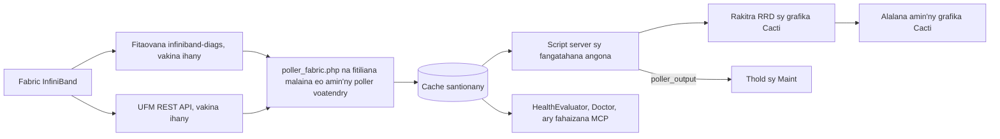

<!-- Source: README.md; SHA256: 79a16fb906f96ee79de2c719f18c38836f555440a7571a4a5ba38c64bb5b099f -->

<!-- translations:start -->
[English](../../../README.md) | [简体中文](../zh-CN/README.md) | [हिन्दी](../hi-IN/README.md) | [Español (España)](../es-ES/README.md) | [Español (Latinoamérica)](../es-419/README.md) | [العربية (السعودية)](../ar-SA/README.md) | [Afrikaans](../af-ZA/README.md) | [አማርኛ](../am-ET/README.md) | [العربية (مصر)](../ar-EG/README.md) | [العربية (المغرب)](../ar-MA/README.md) | [Български](../bg-BG/README.md) | [বাংলা](../bn-BD/README.md) | [Bosanski](../bs-BA/README.md) | [Deutsch](../de-DE/README.md) | [Ελληνικά](../el-GR/README.md) | [فارسی](../fa-IR/README.md) | [Filipino](../fil-PH/README.md) | [Français](../fr-FR/README.md) | [Français (Maroc)](../fr-MA/README.md) | [Français (Sénégal)](../fr-SN/README.md) | [Hausa](../ha-NG/README.md) | [עברית](../he-IL/README.md) | [Hrvatski](../hr-HR/README.md) | [Bahasa Indonesia](../id-ID/README.md) | [Igbo](../ig-NG/README.md) | [Italiano](../it-IT/README.md) | [日本語](../ja-JP/README.md) | [ქართული](../ka-GE/README.md) | [한국어](../ko-KR/README.md) | [Latviešu](../lv-LV/README.md) | [Malagasy](README.md) | [मराठी](../mr-IN/README.md) | [Bahasa Melayu](../ms-MY/README.md) | [Nederlands](../nl-NL/README.md) | [Polski](../pl-PL/README.md) | [Português (Brasil)](../pt-BR/README.md) | [Português (Portugal)](../pt-PT/README.md) | [Русский](../ru-RU/README.md) | [Kinyarwanda](../rw-RW/README.md) | [Soomaali](../so-SO/README.md) | [Српски](../sr-RS/README.md) | [Svenska](../sv-SE/README.md) | [Kiswahili](../sw-KE/README.md) | [தமிழ்](../ta-IN/README.md) | [తెలుగు](../te-IN/README.md) | [ไทย](../th-TH/README.md) | [Türkçe](../tr-TR/README.md) | [Українська](../uk-UA/README.md) | [اردو](../ur-PK/README.md) | [Tiếng Việt](../vi-VN/README.md) | [isiXhosa](../xh-ZA/README.md) | [Yorùbá](../yo-NG/README.md) | [繁體中文](../zh-TW/README.md) | [isiZulu](../zu-ZA/README.md)
<!-- translations:end -->

# plugin_fabric

Plugin Cacti 1.2 (`fabric`, dikan-teny `0.1.0-dev`) izay mitondra ny kaontera seranan-tsambo InfiniBand, ny sakan'ny rohy sy ny hafainganam-pandeha, ary ny famantarana ny fitohanana ho ao amin'ny Cacti amin'ny endrika fitaovana, loharanon'angona, ary grafika mahazatra. Ny rohy iray izay niasa tamin'ny 1X fa tsy 4X dia miseho ho grafika sy fanairana Thold eo anilan'ny mpampiantrano izay tompoiny, eo ambanin'ny alalan'ny Cacti, miaraka amin'ny fahafantarana sy fanakanana avy amin'ny Maint.

> **Sata: eo an-dalam-pandrosoana, tsy mbola misy famoahana.** Ity sampana ity dia manatanteraka ny fototry ny plugin, ny zavatra Cacti sy ny fanairana, ny fitiliana poller voalamina ao ambadika, ny famerimberenana mpanangona lavitra, ny backend REST NVIDIA UFM vakina ihany miaraka amin'ny fitehirizana fahazoan-dalana voasitrana (encrypted credential vault), ny fitantanana CLI Configuration-as-Code (CasC), ary ny hook tontolo iainana Cacti (CasC, Doctor, ary MCP / Abilities API v2). Notsapaina tamin'ny fitaovana sandoka, fifandraisana UFM namboarina, ary ny simulator fabric `ibsim` (rdma-core 50.0) izy io, fa tsy mbola tamin'ny fabric InfiniBand tena izy na mpizara UFM mivantana. Ny fanamarinana izay mila fitaovana tena izy dia mijanona misokatra ao amin'ny [docs/research/](../../research/). Ity tetikasa ity dia tsy misy fifandraisana amin'ny tetikasa Cacti.

## Inona no efa vita

- **Tsingerin'aina sy schema (v3)**: fametrahana, fanavaozana tsy miovaova vokatra (idempotent), fanesorana (mitazona ny tabilao plugin amin'ny fomba mahazatra), ary ny fiambenana fepetra PHP 8.2 sady mitazona ny teboka fidirana ho azo vakina amin'ny PHP 8.0.
- **Andraikitra fidirana sy pejy**: sehatra `Fabric View` (`fabric.php`), `Fabric Operator` (`fabric_operator.php`), ary `Fabric Admin` (`fabric_admin.php`, `fabric_health.php`), miampy tabilao Settings eo ambanin'ny **Configuration > Settings > Fabrics**.
- **Backend fitiliana vakina ihany (`diags`)**: fandefasana hentitra vector-n'ny famantarana ho an'ny `perfquery`, `ibnetdiscover`, ary `iblinkinfo`, lisitra araka ny GUID miaraka amin'ny fahitana fifandonana ara-panondroana sy tolo-kevitra fampifandraisana indray, fanombanana ny toetry ny rohy, ary fitiliana kaontera isaky ny node.
- **Backend REST NVIDIA UFM vakina ihany (`ufm`) sy fitehirizana voasitrana**: mpanjifa REST GET ihany voafantina amin'ny lisitra ekena (`/ufmRest/resources/ports`, `/ufmRest/resources/systems`, `/ufmRest/monitoring/session/0/data`, ary ny mitovy aminy `/ufmRestV3/...` ho an'ny fanamarinana token) izay mamahana ireo tabilao lisitra, toetry ny rohy, santionany, ary fahasalamana mitovy amin'ny `diags`. Ny fahazoan-dalana (`token` na `basic`) dia tehirizina voasitrana amin'ny AES-256-GCM ao amin'ny `plugin_fabric_secret` amin'ny alalan'ny rakitra fanalahidy 256-bit ivelany voarindra amin'ny `fabric_vault_key_file`. Ny fabric UFM dia azo faritana amin'ny alalan'ny CasC (`cli/fabric.php`) na ireo tahiry (repositories); ny endrika fitantanana an-tranonkala amin'izao fotoana izao dia mampiseho saha `diags`.
- **Zavatra Cacti, Thold, ary Maint**: lasitra fitaovana, angona, ary grafika Cacti (`templates/fabric-templates.xml`), ny fangatahana angona script-server "Fabric Port" (`scripts/ss_fabric_ports.php`, `resource/script_server/fabric_ports.xml`), loharanon'angona kaontera `DERIVE` ary loharanon'angona toetry ny rohy/taha `GAUGE` ho an'ny Thold, fanaraha-maso ny fahatapahana, ary kaontera fototra feno taterina ho `U`. Ny fampidirana Maint (`MaintMaintenance`) dia manontany ny `plugin_maint_check_cacti_host()` (miverina amin'ny hook `is_device_in_maintenance` raha ilaina) mba hisaina mitokana ny node ao anatin'ny fikojakojana mavitrika sy hanesorana azy ireo amin'ny fampitandremana tsy fahombiazan'ny fitiliana sy seranan-tsambo simba.
- **Fitiliana voalamina, fizarazarana (sharding), ary mpanangona lavitra**: ny `poller_bottom` dia mandefa ny `poller_fabric.php` ao ambadika ho an'ny fabric tonga fotoana voatendry amin'ny poller ankehitriny, miaraka amin'ny fitiliana malaina (lazy sweeps) natomboky ny script server. Ny `INFO` dia manambara `remote_collect:1, remote_poller:1`, ny `poller_fabric.php` dia manohana ny fizarazarana GUID voafaritra (`--shard=K/N`), ary ny `replicate_out` dia mamerimberina ny andalana `plugin_fabric_fabric` tsy misy tsiambaratelo ho any amin'ny mpanangona lavitra (`poller_id >= 2`). Ny fidirana ao amin'ny fitehirizana (`plugin_fabric_secret`) sy ny rakitra fanalahidy ivelany dia tsy averimberina na oviana na oviana.
- **CasC CLI sy hook tontolo iainana**: `cli/fabric.php` ho an'ny fanondranana YAML/XML, fanamarinana, fandrindrana fahasamihafana andrana (dry-run diff), fampiharana mila fanamafisana, ary tatitra fahasalamana, miampy ny hook `casc_register_providers`, `doctor_register_checks`, ary `abilities_register`.

## Andraikitra fidirana

| Sehatra | Fidirana |
| --- | --- |
| Fabric View | Fijerena lisitra fanaraha-maso sy seranan-tsambo (`fabric.php`). |
| Fabric Operator | Fidiran'ny View miampy ny pejy Fampandehanana (`fabric_operator.php`) sy ny fanekena triage manokana. |
| Fabric Admin | Fidiran'ny Operator miampy ny fikirakirana, hetsika fitantanana (`fabric_admin.php`), ary ny pejy fahasalamana (`fabric_health.php`). |

Aorian'ny fandikana ny rakitra fanavaozana, sokafy ny pejy Plugins amin'ny maha-mpitantana mba hisoratra anarana ny sehatra sy hook vaovao. Omeo mazava ny sehatra Operator eo ambanin'ny **Configuration > Users** na vondrona mpampiasa. Ny fanavaozana dia mitazona ny ID sy ny alalana View sy Admin efa misy. Ny fidiran'ny Admin dia mandova ny fidiran'ny Operator, ary ny fidiran'ny Operator dia mandova ny fidiran'ny View isaky ny fangatahana; izany dia tsy manampy alalana voatahiry ho an'ny mpampiasa na vondrona. Ny fandrindrana ny plugin dia mitaky ihany koa ny fidirana Fabric Admin ankoatra ny alalana Settings ao amin'ny Cacti.

Ny alalan'ny fitaovana Cacti dia mametra ny laharana sy ny hetsika azon'ny mpampiasa tsirairay ampiasaina; ny zavatra tsy mbola nampifandraisina dia mitaky mpitantana. Ny fahazoan-dalana, ny fikirakirana, ny fampifandraisana, ny famafana ary ny fanovana fitantanana hafa dia mijanona ao amin'ny pejy fitantanana na CLI. Ny fanekena dia tsy maharitra afa-tsy mandritra ny fotoam-pivoriana ankehitriny an'ny mpampiasa, mandritra ny adiny iray raha be indrindra ary raha mbola vaovao io fandinihana io ihany. Ny fandinihana vaovao na niova dia manafoana azy ireo. Tsy manamarika fandrefesana tsy nahomby ho salama na manakana fanairana na oviana na oviana izy ireo.

## Nahoana

Ny rohy InfiniBand simba dia mbola mampita fifamoivoizana ihany. Ny rohy 4X iray izay miverina miasa amin'ny 1X dia mamela ny seranan-tsambo ho "active", ary toa ara-dalàna ny grafika fifandraisana SNMP an'ny mpampiantrano, saingy mihamiadana ny asa mifamatotra mafy. Ny porofo dia ao amin'ny fabric: ny seranan-tsambo tsirairay dia mitatitra ny sakany sy ny hafainganam-pandeha mavitrika, alefa, ary tohanana, miampy ny kaontera hadisoana sy fitohanana. Ny famakiana izany dia mitaky ny fitaovana fitiliana InfiniBand na API mpitantana fabric. Rehefa alefa amin'ny tanana dia mamela banga telo izy ireo:

- **Tsy misy tantara.** Ny `perfquery` sy ny `iblinkinfo` dia mampiseho ny ankehitriny, ka tsy hita izay rohy niharatsy tamin'ny herinandro lasa.
- **Tsy misy tontolon'ny fitaovana.** Ny seranan-tsambo fabric dia tsy zavatra Cacti, ka tsy azo atao grafika eo anilan'ny mpampiantrano tompoiny ny seranan-tsambo iray.
- **Tsy misy lalana mankany amin'ny fanairana Cacti.** Ny Thold sy ny Maint dia miasa amin'ny loharanon'angona sy fitaovana Cacti.

Ity plugin ity dia manidy ireo banga ireo amin'ny alalan'ny famakiana ny fabric amin'ny alalan'ny `infiniband-diags` na ny NVIDIA UFM REST API, ny famantarana ny node sy ny seranan-tsambo amin'ny alalan'ny GUID, ary ny famoahana ny kaontera sy ny toetry ny rohy ho loharanon'angona Cacti. Mamaky ihany izy: tsy mamerina ny kaontera amin'ny zero na manova ny toetry ny seranan-tsambo na oviana na oviana.

## Fampandehanana sy CLI

### Poller ao ambadika sy fitiliana atao tanana

Ny `fabric_poller_bottom()` dia manomboka ny `poller_fabric.php` ao ambadika amin'ny poller tsirairay ho an'ny fabric alefa voatendry amin'io `poller_id` io izay tonga fotoana ny fitiliana azy. Azonao atao koa ny mandefa mivantana ny mpandefa poller na fitiliana tanana eo amin'ny poller voatendry amin'ny maha-mpampiasa poller (soloy amin'ny lahatahiry Cacti anao ny `/path/to/cacti`):

```sh
php /path/to/cacti/plugins/fabric/poller_fabric.php [--fabric=ID] [--shard=K/N] [--force] [--debug]
php /path/to/cacti/plugins/fabric/fabric_sweep.php --fabric=ID [--node=GUID] [--force]
```

- Ny `poller_fabric.php` dia mandefa ny fabric rehetra tonga fotoana ho an'ny poller eo an-toerana (na fabric iray miaraka amin'ny `--fabric=ID`), mampihatra ny hidin'ny rejisitry ny fizotran'ny Cacti sy ny fanofana `ClaimRepository` miaraka amin'ny teti-potoana `max(30, intdiv(sweep_interval, 2))` segondra, ary manohana ny `--shard=K/N` (`0 <= K < N`) mba hizarazarana ny fitiliana kaontera node `diags` amin'ny fomba voafaritra araka ny GUID-n'ny node.
- Ny `fabric_sweep.php` dia mandefa fitiliana eo no ho eo ho an'ny fabric iray alefa (na node iray miaraka amin'ny `--node=GUID`) voatendry amin'ny poller eo an-toerana. Ny `--force` dia tsy miraharaha raha tonga fotoana ny fabric nefa mbola manaja ny fanomezana alalana (claims).

Rehefa feno ny lisitra tamin'ny fikarohana voalohany, ampifandraiso amin'ny fitaovana Cacti ny node eo amin'ny pejy Fabric Admin. Tazomy ho 25 segondra na mihoatra ny fe-potoana fijanonan'ny script ao amin'ny Cacti: ny fitiliana malaina natomboky ny famakiana fangatahana angona dia mametra ny fandefasana fitaovana ho `script_timeout - 5` segondra mba hiverenan'ny script server ara-potoana miaraka amin'ny santionany farany voatahiry na `U`.

### Backend REST NVIDIA UFM sy fitehirizana fahazoan-dalana

Ny fabric `ufm` dia mitaky URL `https://` tsy misy fahazoan-dalana anatiny, tady fanontaniana (query strings), na sombiny (fragments). Ny `UfmSocketTransport` dia mampihatra ny fanamarinana TLS peer sy mpampiantrano, mandà ny famindrana (redirects), ary manohana rakitra CA azo isafidianana (`ufm_ca_file`) sy pin SHA-256 SPKI (`ufm_spki_pin`).

Mba hitehirizana ny fahazoan-dalana UFM ao amin'ny `plugin_fabric_secret`, amboary ny `fabric_vault_key_file` eo ambanin'ny **Configuration > Settings > Fabrics** miaraka amin'ny lalana feno mankany amin'ny rakitra mahazatra an'ny mpampiasa poller (tsy misy symlinks amin'ny lahatahiry ray aman-dreny rehetra, fomba `0600`, misy tarehin-tsoratra hex 64 toy ny `openssl rand -hex 32` na byte kisendrasendra 32 tsy azo atao pirinty). Ny plugin dia tsy mamorona na manoratra ny rakitra fanalahidy na oviana na oviana, ary ny `replicate_out` dia tsy mamerimberina ny `plugin_fabric_secret` na ny rakitra fanalahidy any amin'ny poller lavitra.

### Configuration-as-Code sy CLI fahasalamana

Ny `cli/fabric.php` dia mitantana ny fandrindrana plugin sy ny famaritana fabric amin'ny endrika YAML na XML, ary mitatitra ny fahasalamana mahafantatra fikojakojana nefa tsy mandefa fitiliana mivantana:

```sh
php /path/to/cacti/plugins/fabric/cli/fabric.php export [--format=yaml|xml] [--file=PATH]
php /path/to/cacti/plugins/fabric/cli/fabric.php validate --file=PATH [--format=yaml|xml]
php /path/to/cacti/plugins/fabric/cli/fabric.php plan --file=PATH [--format=yaml|xml]
php /path/to/cacti/plugins/fabric/cli/fabric.php apply --file=PATH --confirm=PLAN_HASH [--format=yaml|xml]
php /path/to/cacti/plugins/fabric/cli/fabric.php health [--format=text|json]
```

Ny `export` dia mamorona rakitra vaovao amin'ny fomba `0600`, manafina ny `fabric_vault_key_file` ho `[REDACTED]`, ary mamoaka fanondroana `ufm_credential_ref` voatonona anarana fa tsy tsiambaratelo. Ny `plan` sy ny `apply` dia mandà ny sanda `ufm_token`, `ufm_password`, `secret`, ary `fabric_vault_key_file` apetraka mivantana (inline). Ny `apply` dia mitaky ny `--confirm=PLAN_HASH` marina navoakan'ny `plan`.

### Hook tontolo iainana

Rehefa misy ny plugin Cacti mifandraika aminy na ny fampidirana mpampiantrano, ny `setup.php` dia manoratra anarana:

- `casc_register_providers`: manondrana, manamarina, mandrindra, ary mampihatra miaraka amin'ny fanamafisana ny fandrindrana `fabric` (`yaml` sy `xml`, schema v1) miaraka amin'ny fanafenana tsiambaratelo.
- `doctor_register_checks`: manome fanamarinana fitiliana vakina ihany efatra (`fabric.schema`, `fabric.poller_freshness`, `fabric.identity_conflicts`, `fabric.ufm_vault`).
- `abilities_register`: manoratra anarana fahaizana telo vakina ihany, tsy manimba, ary idempotent eo ambanin'ny sokajy `fabric`, voafetra amin'ny sehatra Fabric View (sy ny alalan'ny fitaovana Cacti ho an'ny hadisoana seranan-tsambo): `fabric-list-fabrics`, `fabric-get-health`, ary `fabric-list-port-errors`.

## Sakany sy sisin-tany

Tsy tafiditra ao anatin'ny sakany: fanovana ny toetry ny fabric, famerenana ny kaontera amin'ny zero, fanoloana mpitantana fabric na mpitantana subnet, rafitra fanairana an'ny plugin manokana, daemon na protokolon'ny tambajotra manokana, ary fabric Ethernet na RoCE.

## Fepetra sy fifanarahana

| Singa | Tanjona |
|---|---|
| Cacti | 1.2.31 na vaovao kokoa (`compat = 1.2.31`), tsy misy fanovana fototra |
| PHP | 8.2 na vaovao kokoa; ny teboka fidirana dia mijanona ho azo vakina amin'ny 8.0 ary mandà ny fampavitrihana amin'ny 8.1 mba hahazoan'ny tontolo tsy tohanana fandavana fa tsy interface Cacti simba |
| Fitaovana InfiniBand | `infiniband-diags` avy amin'ny `rdma-core` (notsapaina tao amin'ny CI niaraka tamin'ny rdma-core 50.0 tao amin'ny `ibsim`; endriky ny vokatra nohamarinina tamin'ny loharano v66.0) |
| UFM | NVIDIA UFM Enterprise REST API (teboka famaranana vakina ihany `ufmRest` sy `ufmRestV3`; notsapaina tamin'ny fifandraisana namboarina tao amin'ny fitsapana singa) |
| Thold, Maint | Tsy mila fanovana; mandefa fitsapana hatramin'ny farany miaraka amin'ny Thold v1.8.2 sy Maint v1.3 tsy novana ny CI |

## Fampandrosoana sy fitsapana

Ny fizotran'ny CI (`.github/workflows/plugin-ci-workflow.yml`) dia mitsapa ny PHP 8.2 hatramin'ny 8.5 amin'ny Cacti `release/1.2.31` sy `1.2.x`, ny fanamarinana teboka fidirana PHP 8.0, ny fandavana PHP 8.1, PHPStan, fanamarinana gettext/dikan-teny, fahazoan-dalana REUSE, fanamarinana workflow, famerenana hatramin'ny farany Thold/Maint, ary ny simulation fabric `ibsim`.

Miaraka amin'ny fitaovana fitsapana plugin Pest iraisana voahidy an'ny Cacti (`CACTI_PEST_BIN`) sy angon-drakitra Cacti ariana (disposable):

```sh
# Unit tests
"$CACTI_PEST_BIN" --configuration=phpunit.xml

# Lifecycle integration tests (disposable database only)
CACTI_PATH=/path/to/cacti FABRIC_TEST_DATABASE=disposable "$CACTI_PEST_BIN" --configuration=phpunit-integration.xml

# Static analysis (against Cacti 1.2.31)
CACTI_PATH=/path/to/cacti phpstan analyse -c phpstan.neon --no-progress

# Translation template, catalogs, and localized README checks
sh locales/build_gettext.sh --check

# Simulated ibsim fixture parser check
php tests/bin/check-ibsim-fixtures.php tests/fixtures/ibsim
```

## Famolavolana

- [docs/PLAN.md](../../PLAN.md) no drafitra momba ny rafitra sy ny famolavolana: zava-misy ambony miaraka amin'ny loharano, fanamarinana fitaovana mbola misokatra, maodely famantarana, fitsipiky ny kaontera sy ny toetry ny rohy, sisin-tany fiarovana, kajy fahombiazana, fitsapana, ary loza mety hitranga.
- [docs/decisions/](../../decisions/) no mitahiry ny firaketana fanapahan-kevitra momba ny rafitra.
- [docs/REQUIREMENTS.md](../../REQUIREMENTS.md) no mampifandray ny ID fepetra tsirairay amin'ny olana mifandraika aminy.



## Fomba fanaraha-maso ny asa

- Ny **dingana lehibe** dia manaraka ny dingana lehibe ao amin'ny drafitra. Ny tsirairay dia manana olana epic mitanisa ny olana zana-tsampana sy ny porofo fivoahana.
- Ny **olana** dia voasokajy araka ny marika: `type: requirement`, `type: research`, `type: decision`, `type: epic`. Ny olana fepetra dia milaza fepetra azo tsapaina sy misy laharana (`REQ-AREA-NNN`) ary fepetra fanekena.
- Ny **marika** ihany koa dia mitondra `area:`, `phase:`, `priority:`, ary `status:`. Jereo ny [CONTRIBUTING.md](../../../CONTRIBUTING.md#labels).
- Ny [tabilao tetikasa](https://github.com/users/somethingwithproof/projects/8) dia mampiseho ny olana rehetra manerana ny dingana lehibe.

## Fandraisana anjara

Vakio ny [CONTRIBUTING.md](../../../CONTRIBUTING.md). Ny commit dia mila sonia DCO (`git commit -s`). Ny adihevitra momba ny famolavolana dia atao eo amin'ny olana; ny fanapahan-kevitra misokatra dia mitondra ny marika `type: decision`.

## Fiarovana

Tatitrao mangingina ny lesoka ara-piarovana; jereo ny [SECURITY.md](../../../SECURITY.md).

## Fahazoan-dalana

GNU General Public License v2.0, mitovy fahazoan-dalana amin'ny Cacti sy ny plugin-ny. Jereo ny [LICENSE](../../../LICENSE).
